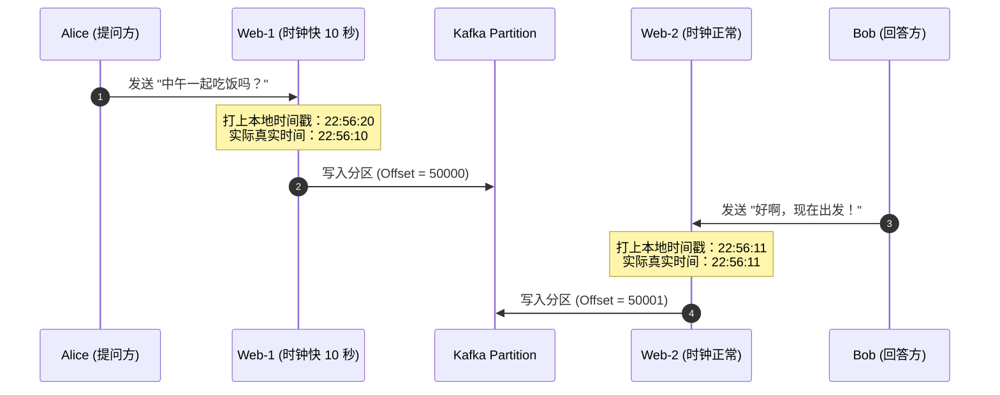
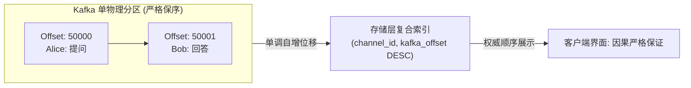
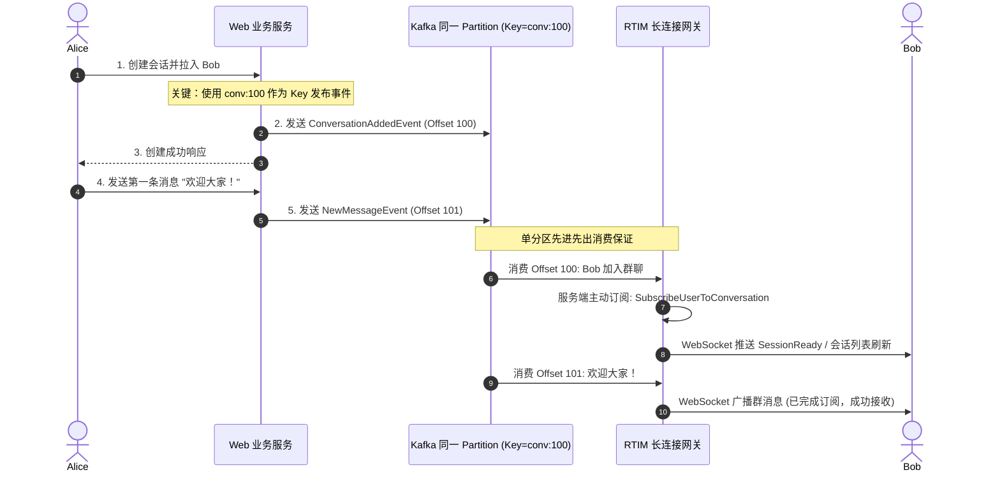

在上一篇探讨中，我们确立了发消息链路的可靠性契约：通过向 Kafka 集群同步写入并等待副本仲裁确认（`RequiredAcks = RequireAll`），确立了消息绝不丢失的底座防线。

然而，在分布式系统中，解决“消息存得下”只是第一步，另一个同样棘手的问题接踵而至：**如何保证消息的顺序绝对正确？**

很多人会直觉地认为：“每条消息在入库时打上服务器当前的纳秒时间戳（`created_at`），读取时直接按时间戳倒序排列（`ORDER BY created_at DESC`），不就可以保序了吗？”

本篇文章中，我们将继续通过技术对谈的形式，揭示依赖物理时间戳在分布式环境下引发的致命缺陷，并推导出基于单调自增 Offset 的权威保序与已读游标方案。

---

## 一、物理时间戳的陷阱：因果倒置与幽灵未读

**面试官**：在由多台 Web 服务器组成的集群中，每台机器都在并发接收来自不同用户的发言请求。如果我们直接用各台服务器的本地时间戳作为消息的先后顺序，在生产中会遇到什么问题？

**候选人**：在分布式系统理论中，这是一个非常经典的痛点——**不可靠的物理时钟（Unreliable Wall Clock）**。

即使我们在所有服务器上都配置了网络时间协议（NTP）进行时钟同步，物理时钟依然会因为网络抖动、晶振温漂或虚拟机调度而存在不可避免的漂移。哪怕这个漂移只有短短几百毫秒或者几秒钟，在即时通讯场景下都会产生灾难性的逻辑错误。

我们可以通过一个具体的场景切片来看出问题所在：



在这个场景中：
1. **真实物理因果**：Alice 先提问，Bob 看到提问后在 1 秒后做出了回答；
2. **Kafka 内部顺序**：由于同一个频道的发言走同一个 Partition，Alice 的提问先到达，分配到 `Offset = 50000`；Bob 的回答后到达，分配到 `Offset = 50001`；
3. **本地时间戳记录**：因为 Web-1 的物理时钟比正常时钟快了 10 秒，Alice 的提问被打上了 `22:56:20`，而 Bob 的回答被打上了 `22:56:11`。

接下来，灾难在两个环节同时爆发了：

### 痛点 1：聊天记录因果倒置（先答后问）

当用户打开聊天窗口拉取最近消息时，如果查询 SQL 是：
```sql
-- 错误设计：依赖本地物理时间戳排序
SELECT * FROM channel_message 
WHERE channel_id = 1 
ORDER BY message_ts DESC 
LIMIT 20;
```
数据库会认为时间戳更大的 `22:56:20` 是“最新消息”。结果在客户端的界面上，**Bob 的回答排在了最顶上，Alice 的提问反而被排在了后面**。对话的逻辑因果被彻底颠倒。

### 痛点 2：已读回执引发幽灵未读数（Ghost Unread）

用户读完消息后，客户端会向服务端上报已读状态。如果已读游标记录的是时间戳（`last_read_ts = 22:56:11`）：
```sql
-- 错误设计：统计大于已读时间戳的消息数量
SELECT COUNT(*) FROM channel_message 
WHERE channel_id = 1 
  AND message_ts > '2026-10-14 22:56:11';
```
因为 Alice 的提问时间戳是 `22:56:20`，大于已读游标的 `22:56:11`，查询结果将永远返回 `unread = 1`！用户明明已经把频道里的所有消息都看完了，红点却永远无法消除。

**面试官**：分析得非常透彻。那么在工程落地中，我们应该如何彻底消除对物理时间戳的依赖？

---

## 二、以单调序号（Offset）建立绝对因果全序

**候选人**：解决这个问题的根本原则是：**在分布式状态机中，用逻辑自增序号（Logical Sequence Number）完全取代物理时间戳作为全序广播的唯一凭据**。

在我们的架构中，天然存在一个极具权威性的单调递增发生器——**Kafka Partition 的内部位移（`kafka_offset`）**。



由于我们前面已经确保同一个频道的所有消息必然路由到同一个 Kafka Partition，因此：
1. 先到达 Broker 并持久化的消息，分配到的 Offset 一定严格小于后到达的消息；
2. 即使不同服务器的本地时间戳漂移了几十秒，Kafka Partition 分配出的 Offset 是在单一节点上单调自增的，不受任何客户端或业务服务器时钟的影响。

### 1. 存储层复合索引与排序重构

在 PostgreSQL 或 ScyllaDB 存储层中，我们将表结构与索引全面改造为以 `kafka_offset` 为核心：

```sql
-- 针对频道消息的权威保序索引
CREATE INDEX IF NOT EXISTS idx_channel_message_kafka_order
ON channel_message (channel_id, kafka_offset DESC, message_id DESC);
```

查询历史消息时，完全基于 Offset 倒序：

```sql
-- 正确设计：完全以 kafka_offset 建立权威序
SELECT message_id, user_id, body, message_ts, kafka_offset
FROM channel_message
WHERE channel_id = $1
ORDER BY kafka_offset DESC, message_id DESC
LIMIT $2;
```

此时，即使 Alice 的 `message_ts` 比较大，但她的 `kafka_offset` 是 50000，Bob 的是 50001。查询结果自然将 Bob 的回答排在最新位置，因果时序得到了严格保证。

**面试官**：那么翻页加载历史消息（Scroll Up to Load More）如何实现？

**候选人**：同样走游标翻页（Cursor-based Pagination）。客户端在向上滑动加载更多历史消息时，传入当前屏幕顶部最老一条消息的 Offset（例如 `cursor_offset = 50000`）：

```sql
SELECT message_id, user_id, body, message_ts, kafka_offset
FROM channel_message
WHERE channel_id = $1
  AND kafka_offset < $2
ORDER BY kafka_offset DESC, message_id DESC
LIMIT $3;
```
利用 `(channel_id, kafka_offset DESC)` 联合索引，数据库可以直接执行索引范围扫描，时间复杂度仅为 $O(\log N)$，而且即使中途有新消息写入，也不会发生传统 `OFFSET` 分页带来的数据重复或漏读问题。

---

## 三、已读回执的单调推进与 $O(\log N)$ 未读数统计

**面试官**：解决了消息排序，那么前面提到的“幽灵未读数”如何基于 Offset 彻底解决？

**候选人**：我们对已读状态表（`read_state`）进行同步升级，将记录的游标从时间戳改为 `last_read_offset`。

### 1. 原子推进已读游标（防并发乱序回退）

在多终端登录或弱网并发下，客户端上报已读回执的请求可能会乱序到达服务端。例如用户先上报了读到 Offset 50001，稍后一个重试的滞后请求又上报了读到 Offset 50000。

为了防止已读游标被倒退覆盖，数据库更新操作必须使用 `GREATEST` 原语：

```sql
INSERT INTO read_state (org_id, user_id, channel_id, last_read_message_id, last_read_offset)
VALUES ($1, $2, $3, $4, $5)
ON CONFLICT (org_id, user_id, channel_id)
DO UPDATE SET
    last_read_message_id = EXCLUDED.last_read_message_id,
    -- 核心：游标只能单调递增，绝不倒退
    last_read_offset = GREATEST(read_state.last_read_offset, EXCLUDED.last_read_offset);
```

### 2. 未读数的高效计算

计算某个频道的未读消息数时，直接使用当前的 `last_read_offset` 进行比对：

```sql
SELECT COUNT(*) 
FROM channel_message
WHERE channel_id = $1
  AND kafka_offset > $2;
```

由于 `kafka_offset` 位于联合索引的前导列，数据库无需进行全表扫描，只需要在 B-Tree 索引树上快速定位到 `$2` 的位置，即可精准统计出后续未读的消息数量。

在前面的例子中，Bob 读完了 Offset 为 50001 的回答，`last_read_offset` 被推进到 50001。执行未读统计时，大于 50001 的记录数为 0，未读数准确返回 `0`，“幽灵未读数”彻底不复存在。

---

## 四、事件因果竞争：成员加入与首条群消息的时序难题

**面试官**：针对有序性，我再抛出一个更极端的生产场景：

> 用户 Alice 在一个组织里新建了一个群聊会话（Conversation），并把在线的 Bob 拉入了群聊。随后 Alice 立即在群里发了第一条消息：“欢迎大家！”
> 在分布式环境下，成员加入事件与第一条聊天消息分属两个不同的操作。如果 Bob 的客户端先收到了群消息，但此时由于网络延迟，Bob 甚至还不知道自己被拉进了这个群，系统会发生什么？怎么解决？

**候选人**：这是一个非常精彩的**事件因果竞争（Causal Race Condition）**问题。

如果处理不当，Bob 的长连接网关在收到消息扇出时，查阅本地连接的订阅表发现 Bob 根本没有订阅该会话，就会直接丢弃这条消息；等到“入群事件”姗姗来迟时，Bob 已经永久漏掉了首条欢迎消息。

为了保障绝对的因果单调性，我们的核心解法是：**把成员事件作为特殊消息，与后续聊天消息锁定在同一物理分区中严格串行化**。



### 关键工程约束：
1. **统一路由 Key**：创建会话产生的成员加入事件，向 Kafka 投递时必须以该会话的全局标识（如 `conv:<conversation_id>`）作为 Partition Key；
2. **前后依赖严格串行**：只有当成员事件在 Kafka 成功持久化之后，创建会话的 API 才向 Alice 返回成功。此时 Alice 才能触发后续的发消息动作；
3. **服务端驱动订阅**：RTIM 网关消费到成员加入事件时，不仅向客户端推送通知，更在**网关内存中直接执行 `SubscribeUserToConversation`**，主动为 Bob 的所有多端连接建立会话订阅；
4. **单分区 FIFO 保证**：由于事件与消息使用完全相同的 Partition Key，它们落入同一个 Kafka 分区。RTIM 单协程消费必定先处理 Offset 100 的成员事件建立订阅，再处理 Offset 101 的聊天消息，从数学上根除了因果竞争的发生。

---

## 五、本篇小结与思考

**面试官**：把物理时钟与逻辑序号解耦，并且用统一 Partition Key 解决成员事件因果竞争，思路非常严密。

**候选人**：总结本篇的核心结论：
1. **物理时钟不可信**：在多机分布式环境下，绝对不要用本地时间戳（`message_ts`）作为排序与已读推进的唯一依据；
2. **单一数据源单调保序**：利用单分区内单调自增的 `kafka_offset` 建立权威全序，让存储层和展示层获得严格的因果一致性；
3. **原子递增游标**：已读回执升级为 `last_read_offset`，配合 SQL 的 `GREATEST` 原语，防止网络重试与乱序覆盖；
4. **元数据事件同轨**：将具有先后因果关系的元数据变更（如加群）与数据流放在同一 Partition 中，通过 FIFO 保障先建订阅、后收消息。

**面试官**：消息既然能够严格按序到达网关，那网关接下来就要把消息推送给长连接客户端了。如果频道里有几千个在线用户，网关该如何高效分发？如果其中有几个用户网络极其缓慢，会不会把网关的消费循环卡死？

**候选人**：这正是长连接网关设计中最凶险的陷阱之一——**慢连接引发的队头阻塞（Head-of-Line Blocking）**。

*(在下一篇文章中，我们将深入长连接网关内部，探讨如何用协程分离与有界非阻塞队列化解这一危机。)*
