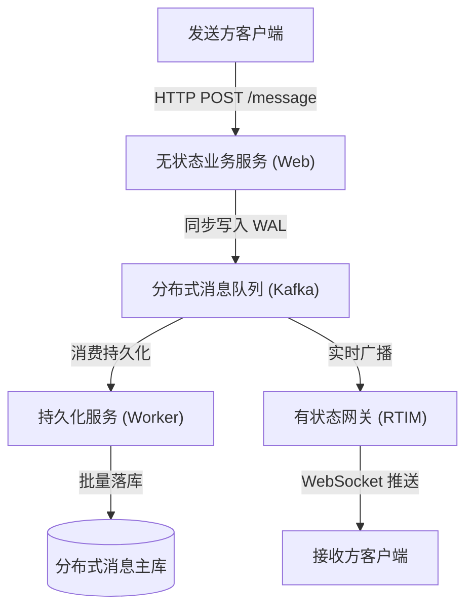
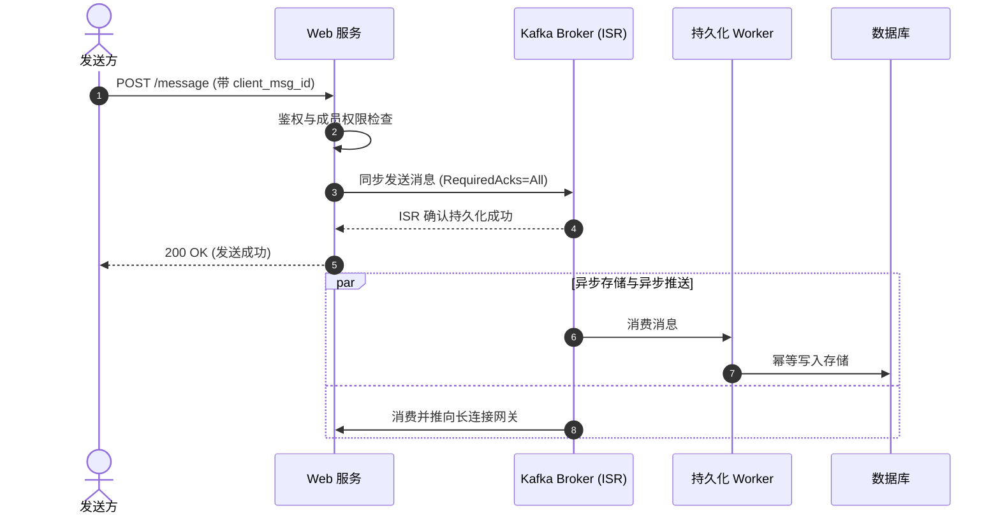

在分布式系统设计中，即时通讯（IM）系统是一个非常经典的业务场景。它不仅要求极高的并发能力与极低的端到端传输延迟，而且对消息的一致性与可靠性有着近乎严苛的要求：**消息既不能丢失，也不能乱序，更不能在网络重试时出现重复**。

为了让复杂的技术推导更加生动、清晰，我们将以一次务实、深入的系统设计技术对谈形式，还原即时通讯系统在工程落地中的真实思考过程与架构决策。

---

## 一、需求澄清与目标设定

**面试官**：我们今天来讨论一个即时通讯系统的架构设计。类似于 Slack 或企业微信，支持万人级群聊以及单聊场景。请先梳理一下系统的核心需求，我们逐步展开。

**候选人**：好的。在动手设计之前，我们先界定好系统的功能需求与非功能需求边界。

**功能需求（Functional Requirements）**：
1. **收发消息**：用户可以在频道（Channel）或单聊会话中发送文本消息，会话内的其他在线用户能够实时收到该消息；
2. **多端同步与历史回放**：用户断线重连或在新设备登录后，可以查看完整的历史消息；
3. **已读状态与未读计数**：系统能够追踪用户的阅读进度，并准确显示各频道的未读消息数量。

**非功能需求（Non-Functional Requirements）**：
1. **可靠性（不丢消息）**：只要服务端向发送方明确确认“发送成功”，这条消息就绝不允许丢失；
2. **有序性（严格因果序）**：同一个聊天频道内的所有消息，必须保证因果顺序一致，不能出现提问排在回答之后的情况；
3. **高吞吐与低延迟**：在线用户的实时投递延迟应当在数百毫秒以内；
4. **幂等性（防重复）**：在弱网或网络超时发生客户端重试时，系统不能产生重复消息。

**面试官**：边界划分得很清晰。那么在宏观架构上，你打算如何划分服务职责？

---

## 二、宏观架构分层：无状态与有状态的分离

**候选人**：即时通讯系统的一个核心特征是**长短连接并存**。为了保障系统的高可用与横向扩展能力，我将核心链路拆分为三个角色：



1. **无状态业务层（Web API）**：
   * 负责处理客户端的 HTTP 请求（如鉴权、发送消息、拉取历史记录、创建频道等）；
   * 本身不维护客户端的 TCP/WebSocket 长连接，因此可以非常轻松地利用负载均衡器做横向扩缩容。
2. **有状态长连接网关（RTIM - Real-Time Interaction Module）**：
   * 负责维持与海量客户端的 WebSocket 长连接，维护本节点在线用户的连接映射表；
   * 从下游消息队列拉取消息后，向本地长连接进行实时广播扇出（Fan-out）。
3. **分布式日志与解耦层（Kafka）**：
   * 作为系统消息的预写日志（WAL，Write-Ahead Logging）与异步分发总线；
   * 连接无状态写入层与有状态推送层，实现读写路径的物理隔离。

**面试官**：这个分层很规整。现在我们聚焦到最核心的一步：**当用户点击“发送”按钮，调用 Web 服务的发消息接口时，服务端内部的第一步操作应该是什么？**

---

## 三、发消息链路的可靠性权衡：三种方案对比

**候选人**：在这个环节，业界通常有三种不同的演进思路：

### 方案 1：直接同步写数据库

* **做法**：Web 服务收到消息后，直接开启数据库事务，写入 `message` 表，成功后返回 HTTP 200。后台通过轮询或者 Change Data Capture（CDC）通知网关推送。
* **局限**：数据库（无论是单体还是分库分表）的写入 QPS 存在上限，数据库连接池容易在流量高峰期被打满；如果直接在事务中等待外部网络通知，系统的写入延迟会显著攀升。

### 方案 2：写入 Redis 缓存后立即返回（乐观确认）

* **做法**：为了追求极低的响应延迟（几毫秒），Web 服务收到消息后，先写入 Redis 的 List 或 Stream，立即给客户端返回成功（例如 HTTP 202 Accepted）；后台异步 Worker 慢慢从 Redis 拉取消息落库，并推送到 Kafka。
* **致命风险**：这是很多初学者或小型项目最容易踩的坑。如果在消息写入 Redis 后、异步持久化完成前，Redis 实例发生突发宕机、主从切换丢失数据，或者 Worker 进程异常退出，**服务端已经给用户承诺了“发送成功”，但这条消息在物理上永远丢失了**。这种“虚假确认”对企业级通讯是不可接受的。

### 方案 3：同步直写分布式消息队列（Kafka ISR Quorum）

* **做法**：Web 服务完成参数校验和鉴权后，直接将消息**同步写入 Kafka**，等待 Kafka 集群的副本集合（In-Sync Replicas）确认写入成功后，再给客户端返回 HTTP 200 成功响应。
* **优势**：
  * **明确可靠性边界**：Kafka 本质上是分布式磁盘顺序追加的 WAL 日志，具备极高的并发写入吞吐能力；
  * **确定性故障处理**：如果 Kafka 集群故障或者网络超时，发送接口直接向客户端返回失败或超时，客户端感知到失败后会继续重试，绝不会产生“假成功”。



**面试官**：分析得切中要害。那么，当你选择方案 3（同步写 Kafka）时，你在生产者配置和分区键选择上有什么细节需要注意？

---

## 四、Kafka 生产端的可靠性与分区设计

**候选人**：在同步直写 Kafka 的落地过程中，有两个核心决策点：

### 1. 确认机制（ACK 策略）

在 Kafka 生产者配置中，我们必须强制要求：
```go
RequiredAcks: kafka.RequireAll // 等同于 acks=all
Async:        false             // 同步写入，阻塞等待 Broker 响应
```

如果使用 `acks=1`（仅 Leader 写入就返回），一旦 Leader Broker 刚写完就发生宿主机物理宕机，副本尚未同步完成，新选举出的 Leader 就会丢失这条消息。只有当 `acks=all` 且 `min.insync.replicas >= 2` 时，才能确保消息落入持久化 Quorum。

### 2. 分区键（Partition Key）的设计

在即时通讯中，消息的顺序是至关重要的。Kafka 只能保证**单个 Partition 内部的消息是严格按序追加的**，不同 Partition 之间没有先后顺序保证。

因此，消息的分区键必须按会话粒度进行路由：
* **频道公开消息**：使用频道的全局标识 `channel_id` 作为 Partition Key；
* **单聊或私密群聊**：使用会话标识 `conv:<conversation_id>` 作为 Partition Key。

这样一来，**同一个聊天上下文中的所有消息，必然会被一致性哈希路由到 Kafka 的同一个物理 Partition 中**，为后续的按序持久化与按序扇出打下坚实的基石。

**面试官**：很好。现在考虑一种不可避免的网络异常：**如果 Web 服务已经把消息成功写入了 Kafka，但在准备向客户端返回 HTTP 200 的瞬间，网络抖动断开了，或者客户端超时了**。客户端认为发送失败，于是发起了重试。此时你的系统如何保证不会出现两条一模一样的消息？

---

## 五、端到端防重与服务端幂等落库

**候选人**：网络超时引发的客户端重试是分布式系统中最普遍的现象。为了彻底解决重复消息问题，必须由**客户端与服务端协同建立幂等防线**。

### 1. 客户端生成唯一标识符（client_msg_id）

客户端在用户点击发送消息的瞬间，于本地内存生成一个全局唯一的 UUID，例如 `client_msg_id = "550e8400-e29b-41d4-a716-446655440000"`。

* **关键规则**：无论是网络重试 1 次、2 次还是多次，**重试请求必须携带完全相同的 `client_msg_id`**，绝对不能在每次重试时重新生成 ID。

### 2. 存储层的唯一约束防线

当持久化 Worker 从 Kafka 拉取消息写入数据库时，我们通过数据库的部分唯一索引（Partial Unique Index）来实施底座保护：

```sql
-- 针对频道消息表的客户端去重索引
CREATE UNIQUE INDEX IF NOT EXISTS uq_channel_message_client
ON channel_message (channel_id, client_msg_id)
WHERE client_msg_id IS NOT NULL;
```

写入数据时，使用原子插入与冲突忽略语义：

```sql
INSERT INTO channel_message (
    message_id, org_id, channel_id, user_id, client_msg_id, body, message_ts, kafka_offset
) VALUES (
    $1, $2, $3, $4, $5, $6, $7, $8
)
ON CONFLICT (channel_id, client_msg_id) DO NOTHING;
```

* **执行效果**：
  * 第一次写入成功入库；
  * 如果客户端因为超时发起重试，第二条携带相同 `client_msg_id` 的消息即使再次经过 Kafka 投递到数据库，数据库底座会直接触发 `DO NOTHING`，静默忽略重复写入，不会产生任何数据脏污。

### 3. 消费端的实时去重

在实时推送网关和接收端客户端，同样维护了一个基于 `message_id` 的滑动窗口去重集（`seenSet`）。即使因消费者重启出现极低概率的重复投递，客户端在渲染视图前比对已见集合，也能确保界面只呈现单条消息。

---

## 六、本篇小结与思考

**面试官**：这一套推导非常扎实，既说清楚了业务权衡，又给出了具体的索引设计与代码语义。

**候选人**：总结一下，构建可靠的发消息链路，核心在于理清三个边界：
1. **可靠性边界**：不把未持久化的内存缓存当作成功依据，依靠 Kafka 的 ISR 机制作为确定性的持久化确认底座；
2. **顺序边界**：通过会话级别的分区路由键（Partition Key），确保同一会话的所有消息落入同一个物理分区；
3. **幂等边界**：通过客户端固定 `client_msg_id` 与服务端数据库唯一索引，在网络超时重试时实现天然的幂等去重。

**面试官**：不过，这里还有一个更隐蔽的深层挑战。即使消息按序写入了单个 Kafka 分区，但在由几十台服务器组成的多机集群中，**各台 Web 服务器的本地时钟总会存在几毫秒到几十毫秒的不可避免的漂移**。如果 Alice 和 Bob 在不同的服务器上发言，物理时间戳错乱会不会导致“提问出现在回答后面”？这个问题你打算怎么解？

**候选人**：这个问题直指分布式系统最核心的难题之一——“不可靠的物理时钟”。解决它的关键，在于**彻底废弃本地物理时间戳作为排序依据，改由单一数据流中的单调序号（Kafka Offset）建立因果全序**。

*(关于时钟漂移的危害与 Offset 权威保序的具体推导，我们将在下一篇文章中详细展开。)*
