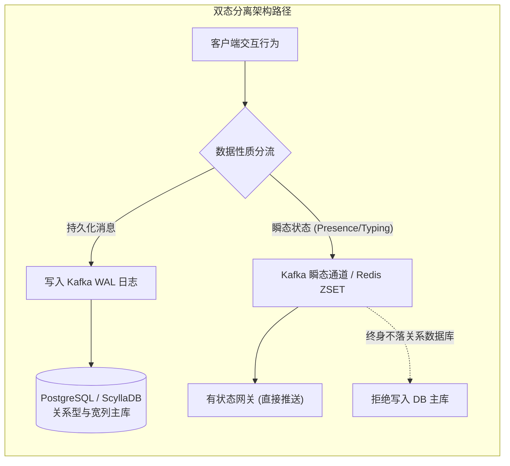
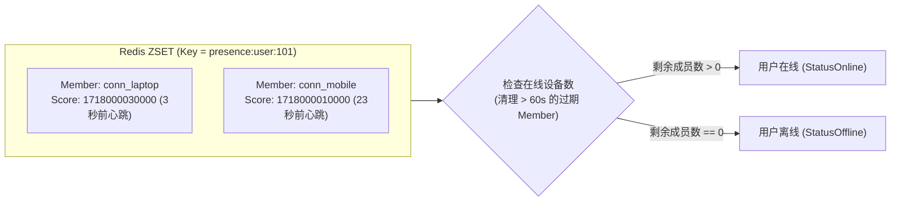
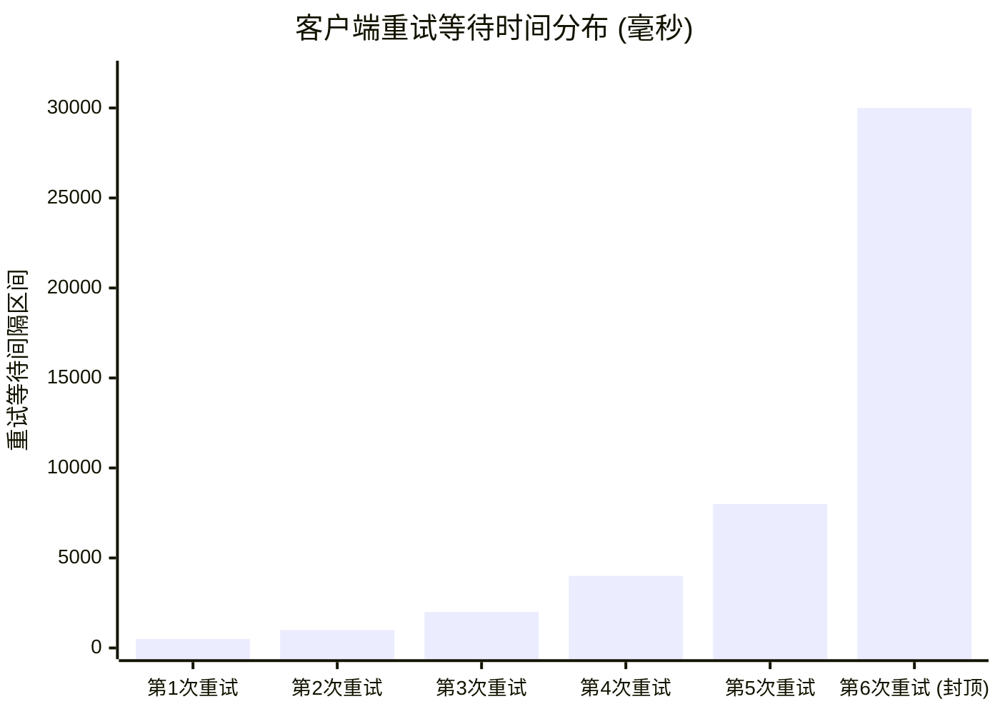
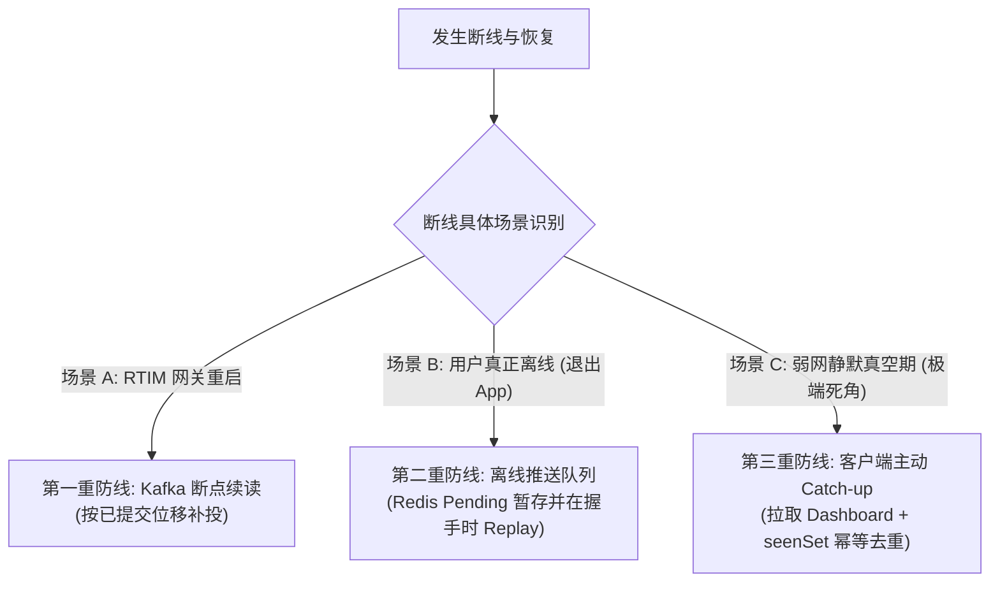

在上一篇探讨中，我们深入剖析了长连接网关内部的并发治理，依靠单连接独立写协程（`writePump`）化解了广播队头阻塞，并借助动态心跳检测消除了半开连接引发的幽灵在线。

在实际网络环境中，任何客户端都必然会遭遇网络闪断、基站切换或网关重启。当断线发生后，系统面临着两个全新的架构考验：
1. **重连风暴（Thundering Herd）**：网关重启或网络恢复瞬间，数万个客户端如果在同一毫秒发起并发重连，会瞬间将网关甚至下游认证鉴权服务击穿；
2. **断线补偿（Catch-up Recovery）**：在客户端与网关失联的几十秒甚至数小时内，发送到该会话的消息究竟去了哪里？客户端如何确保**不漏掉任何一条消息，同时又绝不重复渲染**？

本篇文章中，我们将继续以技术对谈的形式，探讨“双态分离”的设计思想，并推导出抗高并发的断线自愈体系。

---

## 一、架构设计的“双态分离”哲学

**面试官**：在即时通讯系统中，数据主要分为两大类：一类是文字、图片这种真正的聊天内容；另一类是“用户在线/隐身状态”、“正在输入中（Typing）”以及“已读进度回执”。你会把这两类数据放在同一套存储引擎里吗？

**候选人**：**绝对不能**。这是很多初版系统极易犯下的架构错误——把所有数据一律塞入主关系型数据库（如 MySQL 或 PostgreSQL）。

这两类数据在生命周期、容忍度与访问特征上存在本质的对立：

| 维度 | 持久化数据（Persistent State） | 瞬态数据（Transient State） |
| :--- | :--- | :--- |
| **典型代表** | 聊天文本、多媒体附件、频道元数据 | 在线状态（Presence）、输入中（Typing）、已读广播 |
| **持久化要求** | **强持久化**，绝对不能丢失，需长期保留 | **低持久化**，关机即废，丢失无业务资损 |
| **访问频次** | 随用户发言产生，读多写少（缓存后） | **超高频并发**，用户点开窗口、切换焦点都会高频触发 |
| **一致性权衡** | 追求单调因果序与严格落盘确认 | 追求最终一致与低延迟，允许网络抖动时丢弃瞬态帧 |



如果把用户每秒高频刷新的“输入状态”或心跳写进 MySQL，即使分库分表，数据库的事务日志（WAL/Binlog）和连接池也会瞬间被这些毫无历史留存价值的垃圾数据冲垮。

因此，我们的核心原则是：**持久化数据走日志与存储引擎；瞬态状态走 Kafka 瞬态通道与内存注册表，终身不落关系型数据库。**

**面试官**：清晰明确。那么对于“在线状态（Presence）”，多端登录（例如同时在手机和电脑在线）非常普遍，你如何在内存中维护这个全局状态？

---

## 二、基于 Redis Sorted Set 的全局多端 Presence 注册表

**候选人**：在线状态的核心难点在于：**一个用户可能有多个在线连接（手机、平板、桌面端）**。只要该用户的**任意一个设备**保持连接，系统就必须判定该用户“在线”；只有当他的**所有设备全部断开**时，他才真正变为“离线”。

为了支撑跨 RTIM 网关实例的全局共享，我们利用 Redis Sorted Set（ZSET）设计了一个轻量级注册表：

### 1. 数据结构设计
* **Key**：`presence:user:<user_id>`（按用户 ID 划分）
* **Member**：连接的唯一 UUID（`conn_id`，标识具体设备的连接）
* **Score**：该连接最近一次收到心跳的时间戳（毫秒级 Unix Timestamp，`score = now_ms`）



### 2. 状态判定的工程优势
1. **自动聚合多端**：通过 `ZCARD` 或统计有效成员数量，只要集合不为空，用户就是在线的；
2. **无锁续期**：网关的后台心跳协程只需定期执行 `ZADD presence:user:<uid> <now_ms> <conn_id>`，直接刷新对应连接的时间戳，无需加分布式锁；
3. **免集中式扫表清理**：即便某台网关物理宕机导致连接未来得及正常注销，查询时只需顺带执行一行 `ZREMRANGEBYSCORE key 0 (now - 60s)`，超过 60 秒未续期的假死连接会被惰性自动清除，不会造成状态死锁。

**面试官**：好的，现在回到刚才的第一个问题：如果网关因为版本升级而重启，连在它上面的几万个客户端连接被同时掐断。网络恢复后，**如何防止几万个客户端在同一瞬间发起并发重连，从而把刚起起来的网关直接击穿？**

---

## 三、重连风暴防御：指数退避与 Equal Jitter 随机抖动

**候选人**：这是分布式重连中最为致命的**惊群风暴（Thundering Herd）**。如果客户端使用固定的时间间隔（例如每隔 1 秒重试一次），所有断开的客户端将保持步调一致，以固定的波峰周期性轰击网关。

为了平滑离散并发流量，客户端必须实现**指数退避（Exponential Backoff）配合 Equal Jitter 随机抖动**算法。



### 1. 算法推导与实现

退避等待时间随着失败次数指数翻倍，设置初始基数 `base = 500ms`，封顶上限 `max = 30s`。

最关键的是 **Equal Jitter（对半抖动）**：我们将封顶后的计算值一分为二，一半作为固定底线，另一半注入真随机数：

```go
// backoffDelay 计算重试等待时长
// n: 连续重试失败次数 (0-based)
// randFn: 产生 [0.0, 1.0) 浮点数的随机函数
func backoffDelay(n int, base, max time.Duration, randFn func() float64) time.Duration {
    d := base
    for i := 0; i < n && d < max; i++ {
        d *= 2
    }
    if d > max {
        d = max
    }
    // 核心：一半固定，一半随机
    half := d / 2
    return half + time.Duration(randFn() * float64(half))
}
```

### 2. 数学收益分析
* **第 1 次重连**：落在 `[250ms, 500ms)` 区间；
* **第 2 次重连**：落在 `[500ms, 1000ms)` 区间；
* **第 3 次重连**：落在 `[1000ms, 2000ms)` 区间；
* **高次重连**：最终在 `[15s, 30s)` 之间充分打散。

即使 5 万个客户端在同一微秒掉线，第一次重连的请求也会被均匀涂抹在 250 毫秒的时间轴上，重连波峰瞬间被削平了数倍，网关获得平滑启动的缓冲空间。

此外，如果服务端在握手时返回 HTTP 401（Token 无效/过期）、403、404 等**永久性错误**，客户端必须立刻**熔断终止重试**，不再徒劳消耗资源。

**面试官**：重连风暴解决了。那么最核心的第二个问题：**客户端断网期间产生的那些消息，系统如何保证一条不落地找补回来？**

---

## 四、三重自愈防线：覆盖全场景的消息断线补偿

**候选人**：在复杂的现实网络中，客户端断线的原因各不相同（网关重启、用户进电梯、进程被操作系统静默杀掉）。单一的补偿机制无法覆盖所有边界，我们构建了**相互兜底的三重自愈矩阵**：



### 第一重防线：网关重启时的 Kafka 断点续读（针对网关宕机）
* **原理**：每个 RTIM 网关实例使用独立的消费者组（如 `rtim-<hostname>`）。网关正常运行时每消费并广播一条消息就提交一次位移。
* **自愈过程**：如果网关崩溃或重启，重启后网关会从 Kafka **最近一次成功提交的 Offset 开始续读**。在网关宕机这几秒内流入 Kafka 的所有新消息，会在启动瞬间被拉取并实时补投给刚刚重连上来的客户端。

### 第二重防线：用户真实离线时的 Redis 离线推送队列（针对用户离线）
* **原理**：当发消息链路发现接收方处于离线状态（通过 `presence.IsOnline` 检查），业务系统会将该消息封装为通知对象，压入 Redis 的有序集合：`notify:pending:<user_id>`。
* **自愈过程**：当该用户上线完成 WebSocket 握手时，网关在向其发送 `session_ready` 确认帧后，紧接着执行 `deliverPending`：
  ```go
  // 回放离线积压的消息通知
  items, _ := h.cache.PendingNotifications(ctx, userID, 100)
  for _, it := range items {
      c.write(WSMessage{Type: WSTypePendingNotification, Data: it})
  }
  // 按实际投递的最大分值原子清除已回放内容
  h.cache.ClearPendingUpTo(ctx, userID, maxScore)
  ```
  离线消息被完整回放，随后队列安全清除。

### 第三重防线：极端静默掉线真空期的主动 Catch-up（针对客户端边界死角）
* **深层死角**：如果发生了一种极端情况——客户端在电梯里断网了，但服务端还没到 60 秒的心跳超时判定，因此 Redis Presence 依然认为他“在线”（没有触发第二重的离线推送队列）；同时网关并没有重启（因此不会触发第一重的 Kafka 回放）。在这几十秒的“真空期”内发送的消息，会不会永远丢失？
* **终端主动自愈**：为了堵死这个死角，客户端在每次与网关重连成功（收到 `session_ready`）之后，**强制向 Web API 发起一次轻量级同步请求：`GET /dashboard`**，拉取各频道的最新消息切片。
* **端侧 `seenSet` 去重**：
  客户端内存中维护一个已渲染消息的 `seenSet`（基于全局 `message_id`）。
  无论消息是通过实时 WebSocket 帧推送过来的、离线队列 Replay 补回来的，还是 Catch-up 主动拉取到的，全部走同一道去重门禁：
  ```go
  if !seenSet[msg.MessageID] {
      seenSet[msg.MessageID] = true
      renderMessage(msg) // 仅第一次见到的消息执行渲染
  }
  ```
  这样既彻底补全了静默失联真空期的消息，又确保界面绝对不会出现重复消息。

---

## 五、本篇小结与思考

**面试官**：将状态与持久化彻底解耦，并针对不同的掉线时机设计三层防线，兼顾了吞吐、弹性与一致性。

**候选人**：总结本篇的核心架构思想：
1. **持久化与瞬态分离**：业务消息走不可篡改的日志主库，高频状态走 Kafka 瞬态分发与 Redis 注册表，守住存储底座；
2. **多端 Presence 无锁聚合**：利用 Redis ZSET 将心跳时间作为分值，实现多设备在线状态的自然汇聚与超时自愈；
3. **退避算法消除重连雪崩**：指数倍增打底，结合 Equal Jitter 将请求均匀涂抹在时间轴上；
4. **三重恢复消灭死角**：Kafka 断点续读保网关重启、Redis 离线队列保长期休眠、端侧 Catch-up + `seenSet` 闭环极端弱网真空期。

**面试官**：现在消息的可靠性、保序性、长连接网关与断线恢复都齐备了。但随着时间推移，系统的消息总数会达到数亿甚至数十亿条。关系型数据库即使建了索引，单表容量也会面临极限。在存储层，你如何做分片扩展？如何平滑演进到宽列存储（如 Cassandra / ScyllaDB）？

**候选人**：这涉及存储层六边形架构、一致性哈希分片环以及读写分离的 CQRS 检索解耦。

*(在下一篇文章中，我们将探讨存储层的分片演进与宽列架构实战。)*
