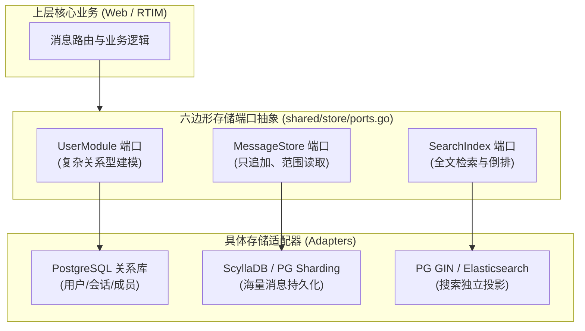
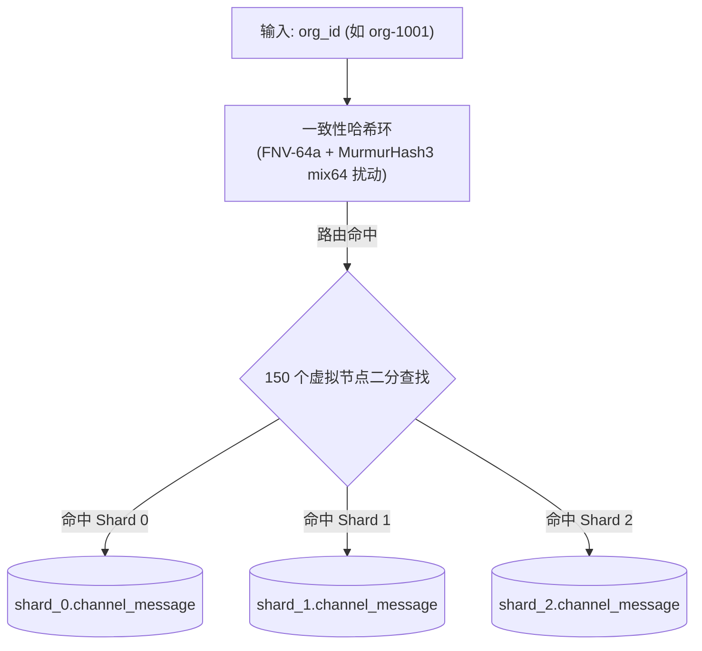
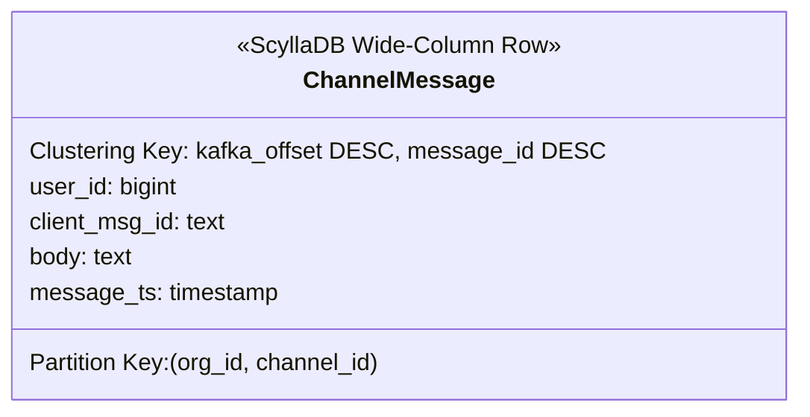
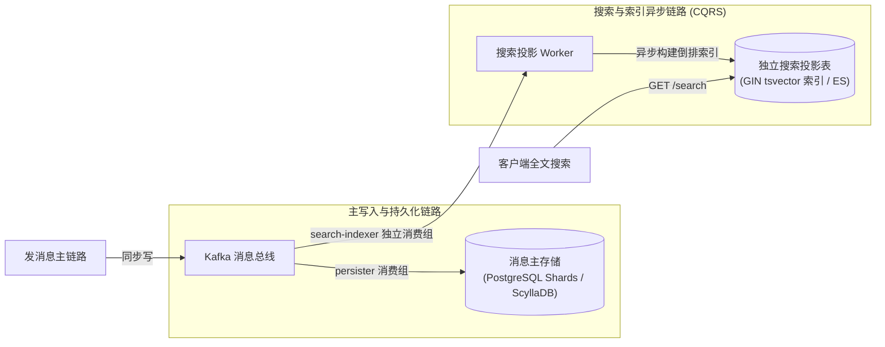
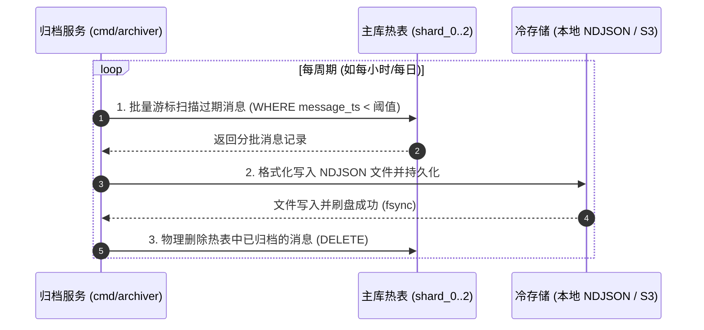
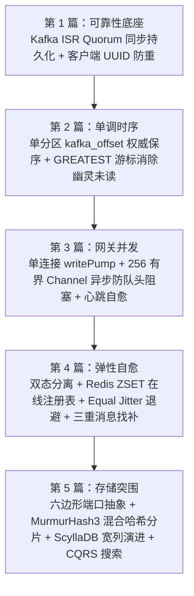

在前面的四篇探讨中，我们层层递进地推导了即时通讯系统的核心骨架：
* 第一篇确立了**基于 Kafka ISR Quorum 的强持久化发消息契约**；
* 第二篇用**单分区自增 Offset 解耦物理时钟，解决了时钟漂移与已读计算**；
* 第三篇通过**单连接协程模型与有界非阻塞队列消除了网关队头阻塞与半开连接**；
* 第四篇践行**双态分离哲学，构建了抗惊群重连与三重消息自愈防线**。

至此，消息的收发、广播与故障恢复都已得到妥善解决。然而，随着时间推移，系统的历史消息总数会迅速突破数千万乃至数十亿条。

在海量数据规模下，单体数据库面临着存储容量耗尽、B-Tree 索引深层膨胀、备份维护缓慢等一系列严峻挑战。**存储层应该如何横向扩展？如何让系统既能在初期的关系型数据库平稳运行，又能在业务膨胀时无缝演进到分布式宽列存储（如 Cassandra / ScyllaDB）？**

作为专栏的收官之作，本篇我们将通过技术对谈，探讨存储层的分片演进与架构突围。

---

## 一、存储接口的六边形架构：给未来留出退路

**面试官**：在很多系统的早期阶段，业务代码往往直接写死调用关系型数据库的 SQL。如果未来消息量暴增，需要将底层的消息表从 PostgreSQL 迁移到分布式宽列存储 ScyllaDB，或者将全文检索迁移到 Elasticsearch，你如何确保上层业务代码不需要推倒重构？

**候选人**：实现这种平滑演进的核心，在于**六边形架构（Hexagonal Architecture / Ports and Adapters）中的端口解耦**。

即时通讯系统的数据访问天然具备三种完全不同的访问模式，我们在存储端口（Port）层将它们明确划分为三个独立的抽象接口：



1. **`UserModule` 端口（关系型模式）**：
   * 负责用户资料、工作区组织、群组成员关系、已读游标等；
   * 特征是**强事务、强关系关联**，非常适合放在标准的关系型数据库（PostgreSQL/MySQL）中维护。
2. **`MessageStore` 端口（流式宽列模式）**：
   * 负责聊天消息的写入与拉取（`RecentMessages`, `MessagesBefore`, `CountAfterOffset`）；
   * 特征是**纯追加写入（Append-only）、无跨表 Join、按会话范围查询**。这个接口既可以由 PostgreSQL 的分片表实现，也可以由 ScyllaDB 无缝实现。
3. **`SearchIndex` 端口（检索模式）**：
   * 负责全文检索和关键词搜索；
   * 独立于主消息读写流，走下游 CQRS 异步投影。

上层业务（Web 服务与网关）只依赖这三个 Go 语言接口，完全感知不到底层具体是哪种数据库驱动。这为存储层的演进提供了极大的自由度。

**面试官**：很好的设计纪律。现在我们先来看第一种演进方案：**在继续使用关系型数据库的前提下，面对海量组织多租户，你如何设计分片（Sharding）策略？**

---

## 二、PostgreSQL 逻辑分片：一致性哈希与雪崩扰动算法

**候选人**：对于企业级 IM 而言，多租户（Organization / Workspace）是一个天然的分片隔离边界。同属于一个组织内的沟通是高度密集的，而跨组织的消息几乎没有交集。

因此，我们采用**以组织标识（`org_id`）作为分片路由键**，将数据分布到多个逻辑 Schema（如 `shard_0`, `shard_1`, `shard_2`）中。



### 1. 哈希偏斜陷阱：为什么裸 FNV-64a 会失效？

在实现一致性哈希环时，很多人会直接用虚拟节点名称（例如 `shard_0#1`, `shard_0#2` ... `shard_2#150`）计算 FNV-64a 散列值。

我们在工程落地中发现了一个隐蔽的暗坑：**FNV 算法处理具有长公共前缀的短字符串时，雪崩效应（Avalanche Effect）极差**。计算出的 64 位整数高位变化极小，导致虚拟节点在环上严重扎堆聚集（Clustering）。实测中，有的分片吞下了 60% 的数据，而有的分片只有 10%，负载均衡完全失效。

### 2. 引入 MurmurHash3 Finalizer（mix64 混合扰动算法）

为了让哈希环达到理论最优分布，我们设计了混合散列算法：先由 FNV-64a 生成基础哈希，再经过 **MurmurHash3 64-bit Finalizer（`mix64`）** 进行强力雪崩扰动：

```go
// mix64 执行强位移与乘法混合扰动，使低位变化充分扩散到全 64 位
func mix64(h uint64) uint64 {
    h ^= h >> 33
    h *= 0xff51afd7ed558ccd
    h ^= h >> 33
    h *= 0xc4ceb9fe1a85ec53
    h ^= h >> 33
    return h
}
```

配合每个物理分片配备 150 个虚拟节点：
* **数据均匀度实测**：10,000 个测试 Key 在 3 个分片中的分布为 **34.1% : 32.0% : 33.9%**，近乎绝对平分；
* **扩容平滑迁移率**：当分片由 3 个扩容到 4 个时，数据迁移比例精准落在 **25.4%**，完全吻合 $\frac{1}{N} = 25\%$ 的理论最优迁移下限，没有产生不必要的节点抖动。

**面试官**：分片算法推导很严谨。但如果单组织的日消息量依然极大（例如跨国巨头的一个组织就有数十亿条消息），关系型数据库的单表和分片也会逼近极限。如果切换到分布式宽列存储 ScyllaDB，你的数据模型该如何重构？

---

## 三、宽列分布式存储演进：ScyllaDB 的物理建模

**候选人**：这正是为什么我们在前面要抽象出 `MessageStore` 接口的原因。宽列数据库（Cassandra / ScyllaDB）是即时通讯场景的终极存储选型之一。它天然基于 LSM-Tree 存储引擎，写入完全是顺序写，且支持硬件级别的集群横向伸缩。

在 ScyllaDB 中，我们利用其原生的 **复合主键（Compound Primary Key）** 进行物理建模：

```sql
CREATE KEYSPACE IF NOT EXISTS slack
WITH replication = {'class': 'SimpleStrategy', 'replication_factor': 1};

CREATE TABLE IF NOT EXISTS slack.channel_message (
    org_id          bigint,
    channel_id      bigint,
    kafka_offset    bigint,
    message_id      text,
    user_id         bigint,
    client_msg_id   text,
    body            text,
    message_ts      timestamp,
    -- 复合主键设计
    PRIMARY KEY ((org_id, channel_id), kafka_offset, message_id)
) WITH CLUSTERING ORDER BY (kafka_offset DESC, message_id DESC)
  AND default_time_to_live = 2592000; -- 30 天自动生命周期归档
```



### 1. 分区键（Partition Key）：`((org_id, channel_id))`
* 双括号语法声明 `(org_id, channel_id)` 为复合分区键；
* ScyllaDB 内部的 Murmur3Partitioner 会自动计算其哈希值，并将该频道的所有消息**物理聚集在集群的某台节点的单个 SSTable 数据文件中**；
* 应用层不再需要自己维护一致性哈希环，数据库集群自身会自动负责节点间的分区负载。

### 2. 聚簇键（Clustering Key）：`kafka_offset DESC, message_id DESC`
* 声明了数据在磁盘文件内的物理存储排序；
* 消息在写入磁盘时，**物理上就已经按 Offset 倒序排列好了**；
* 当客户端调用 `RecentMessages` 拉取最新 20 条消息时，ScyllaDB 只需在 SSTable 文件头部执行连续顺序读，耗时仅几百微秒，**不需要在内存中做任何昂贵的排序计算**。

### 3. 原生生命周期 TTL（`default_time_to_live`）
* 表级别配置 TTL（如 30 天，2592000 秒）。到期消息由 LSM-Tree 的后台 Compaction 进程自动回收磁盘空间，零代码成本实现了热存储的配额约束。

**面试官**：如果底层消息已经切换到 ScyllaDB，或者分片到了不同的 Postgres Schema 中，**用户想跨越整个组织搜索包含关键词“发票”的所有历史消息，你该怎么查？宽列数据库并不擅长复杂的全文检索。**

---

## 四、CQRS 架构：搜索与存储的物理彻底解耦

**候选人**：在即时通讯系统中，**绝对不要在核心消息存储主库上直接执行全文检索（Full-Text Search）或 `LIKE %keyword%` 模糊查询**。

在海量写入时，数据库维持复杂的全文倒排索引（如 GIN 索引）会带来极高的写放大，严重拖累写吞吐。

因此，我们采用 **命令查询职责分离（CQRS - Command Query Responsibility Segregation）** 架构：



### 1. 独立消费投影（Projection）
* 全文检索由独立的消费者组 `search-indexer` 负责；
* 它作为 Kafka 的一个普通下游，异步拉取消息并写入专门的集中式搜索表 `public.search_message`；
* 搜索表配置 PostgreSQL 原生的 `tsvector` 与 GIN 倒排索引：
  ```sql
  CREATE INDEX IF NOT EXISTS idx_search_tsv 
  ON search_message USING GIN (tsv);
  ```

### 2. 彻底解耦的实战验证
在我们的系统测试中，做过一个极具说服力的解耦验证：
* 我们将底层配置切为 `MESSAGE_STORE=scylla`，消息全部落在 ScyllaDB 宽列库中，PostgreSQL 的消息分片表中一条记录都没有；
* 客户端发起全文搜索 `GET /search?q=s4final`，依然能够毫秒级命中并返回高亮结果。
* 这证明了：**消息主存储无论是分库分表、切换宽列数据库还是物理清理，全文搜索功能均不受任何影响**。未来如果将检索升级为 Elasticsearch 或 OpenSearch，也只需增加一个 Kafka 下游消费者即可。

---

## 五、温冷数据分级：Archiver 归档 ETL

**面试官**：对于那些超过几个月甚至几年的陈旧消息，系统如何进行归档，以防止主库无限膨胀？

**候选人**：我们实现了一个轻量的后台归档服务（`cmd/archiver`）：



1. **分批安全扫描**：按 `ARCHIVE_AFTER_DAYS` 阈值，以 `message_ts` 范围游标分批读取陈旧消息，绝不单次执行耗尽内存的大事务；
2. **冷存储导出**：将过往消息以标准的 NDJSON（Newline Delimited JSON）格式写入按组织分目录的冷存储介质（可直接挂载对象存储如 S3/OSS）；
3. **热表修剪**：文件成功落盘并校验后，在事务中安全清理热表数据，确保主库体积始终维持在可控的高性能水位线以内。

---

## 六、全专栏总结：分布式 IM 架构全景回顾

**面试官**：从发消息链路的可靠性契约，到分布式时序、网关并发、断线自愈，再到海量存储分片，整体方案推导完整、权衡清晰、细节扎实。

**候选人**：非常感谢深入的讨论。回顾整个五部曲专栏，我们推导出的架构本质上是一套**层层设防的工业级设计**：



1. **在可靠性上**：我们绝不轻信内存暂存，用分布式 WAL 建立强确定性的持久化边界；
2. **在时序上**：我们彻底解耦不可靠的物理时钟，以单分区单调 Offset 作为因果全序的唯一真理；
3. **在并发上**：我们隔绝外部网络与内部处理流，用独立写协程与有界队列杜绝慢连接队头阻塞，用心跳精准收割假死连接；
4. **在状态上**：我们坚持双态分离，状态走轻量内存注册表，配合指数退避与三重补偿实现优雅自愈；
5. **在存储上**：我们依托六边形架构，既能在初期依靠一致性哈希多 Schema 实现高性价比分片，又能平滑演进到 ScyllaDB 宽列分布式存储。

这一整套架构的价值，不在于堆砌了多少前沿技术名词，而在于**对分布式环境下的每一个边界死角（网络断线、时钟漂移、慢客户端、惊群风暴）都给出了扎实的工程解答**。希望这个系列能够为正在设计与构建即时通讯系统的工程师们，提供一份有价值的参考样本。
