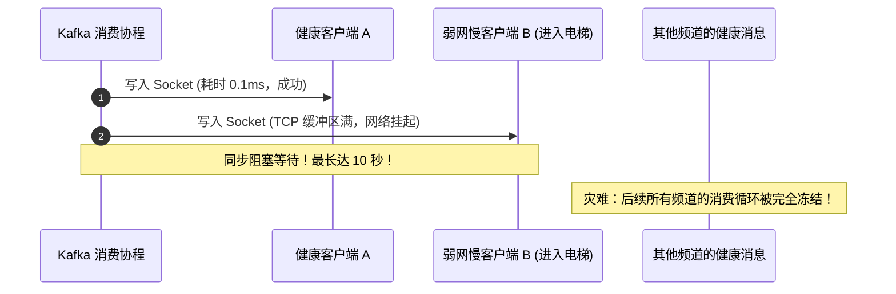
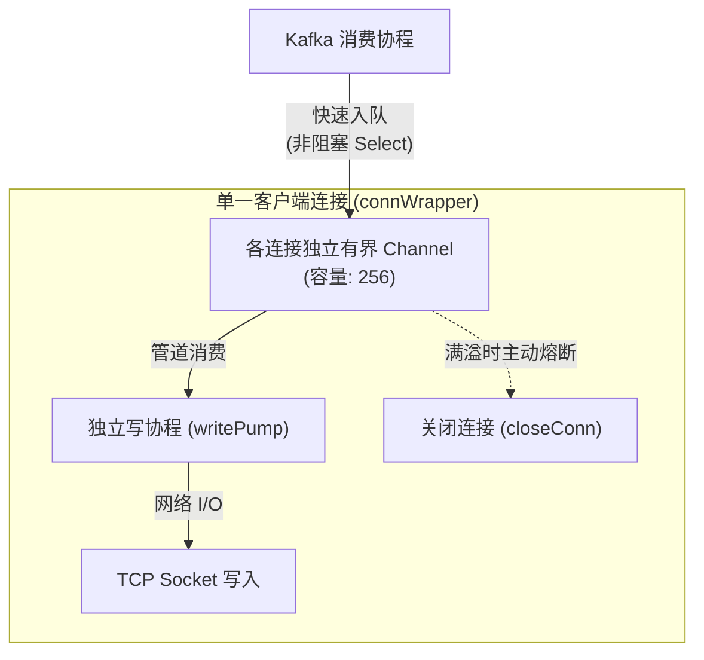
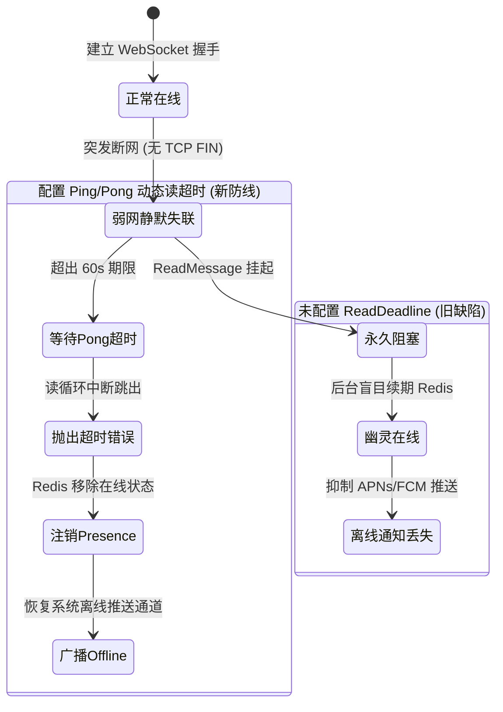

在上一篇探讨中，我们通过将单一聊天上下文锁定在单个 Kafka 分区，并依托自增 Offset 建立了全局权威时序，解决了分布式时钟漂移引发的乱序与已读计算缺陷。

至此，消息已经能够稳定、保序地流转至有状态长连接网关（RTIM - Real-Time Interaction Module）。

网关的核心职责是**将上游到达的消息，实时、低延迟地推送给所有在本地维持 WebSocket 连接的在线用户**。看似简单的“遍历连接列表并发送”，在真实的生产网络中却暗藏着两个可能摧毁整个集群的致命暗坑：**慢连接队头阻塞**与**半开假死幽灵在线**。

本篇我们将通过技术对谈，深入拆解长连接网关的并发治理与防线设计。

---

## 一、广播风暴下的隐形杀手：队头阻塞（Head-of-Line Blocking）

**面试官**：当网关中的 Kafka 消费者从某个频道的单物理分区拉取到一条最新消息后，本地可能维持着该频道的数百甚至数千个在线客户端的长连接。你会如何编写这段广播分发的代码？

**候选人**：最符合直觉但暗藏巨大隐患的代码，通常长成下面这样：

```go
// 存在严重缺陷的设计：同步遍历写 Socket
func (m *Manager) BroadcastToChannel(channelID int64, msg WSMessage) {
    conns := m.getChannelConnections(channelID)
    for _, c := range conns {
        // 设置 10 秒写超时，向网络连接同步写入 JSON
        _ = c.ws.SetWriteDeadline(time.Now().Add(10 * time.Second))
        _ = c.ws.WriteJSON(msg) 
    }
}
```

这段代码在本地测试或内网千兆环境下运行得非常完美，但在公网真实移动弱网环境下，会引发**全站性的连锁灾难**。



**面试官**：能详细剖析一下，这里的灾难是如何一步步扩大的吗？

**候选人**：核心瓶颈在于：**Kafka 消费协程被绑定在了不可靠的外部客户端网络 I/O 上**。

1. **移动弱网现状**：公网移动端随时面临进入地下车库、电梯或者基站切换等突发丢包场景。此时客户端的 TCP 接收窗口收缩，服务端的系统内核 TCP 发送缓冲区迅速被填满；
2. **消费协程挂起**：当遍历到这个慢客户端时，`c.ws.WriteJSON(msg)` 会陷入阻塞，直到 10 秒写超时到期；
3. **队头阻塞扩散**：因为整个广播动作是在 Kafka 消费者的单协程循环中同步执行的，这 10 秒内，消费循环被死死卡住，**既无法提交当前位移，也无法拉取后续消息**；
4. **无辜邻居受灾**：如果一个 Kafka 分区同时承载了 50 个聊天频道，这 10 秒的卡顿意味着**这 50 个频道中成千上万个网络状况良好的正常用户，一条新消息都收不到**。一个人的弱网，拖慢了全站健康用户。

**面试官**：一针见血。那么，如何打破这种耦合，让广播耗时从“秒级网络阻塞”降到“微秒级内存处理”？

---

## 二、架构破局：单连接协程模型与有界非阻塞缓冲

**候选人**：解决方案的核心在于**读写协程解耦**与**有界非阻塞入队**。

在 Gorilla WebSocket 规范中，明确指出了底层 Socket 的并发限制：
> *"Connections support one concurrent reader and one concurrent writer."*

因此，我们必须为每个长连接抽象出独立的读写生命周期，绝不能在外部消费循环中直接调用 Socket 的写入方法。



### 1. 结构抽象与协程分离

每个客户端连接被封装为一个 `connWrapper`，拥有专属的发送队列：

```go
type connWrapper struct {
    id     string
    userID int64
    ws     *websocket.Conn
    
    // 关键：容量为 256 的有界发送管道
    send      chan contracts.WSMessage 
    done      chan struct{}
    closeOnce sync.Once
}
```

每个连接启动时，由且仅由一个专门的 `writePump` 协程负责从 `send` 管道中读取数据并写入网络：

```go
func (c *connWrapper) writePump() {
    ticker := time.NewTicker(pingPeriod)
    defer func() {
        ticker.Stop()
        c.closeConn()
    }()

    for {
        select {
        case <-c.done:
            return
        case msg := <-c.send:
            _ = c.ws.SetWriteDeadline(time.Now().Add(writeWait))
            if err := c.ws.WriteJSON(msg); err != nil {
                return
            }
        case <-ticker.C:
            // 稍后详述的心跳保活
            _ = c.ws.SetWriteDeadline(time.Now().Add(writeWait))
            if err := c.ws.WriteMessage(websocket.PingMessage, nil); err != nil {
                return
            }
        }
    }
}
```

### 2. 非阻塞入队与慢连接主动熔断

当 Kafka 消费循环需要广播消息时，它不再触碰网络 Socket，而是向目标连接的 `send` 管道投递。最核心的防线体现在 `enqueue` 方法中：

```go
func (c *connWrapper) enqueue(msg contracts.WSMessage) bool {
    select {
    case <-c.done:
        return false
    default:
    }

    select {
    case c.send <- msg:
        // 成功放入内存队列，耗时仅几纳秒，立刻返回
        return true
    default:
        // 核心防线：队列已满 256 条，说明客户端严重脱节或已挂起！
        // 主动熔断并关闭慢连接，绝不让它拖累系统
        c.closeConn()
        return false
    }
}
```

### 3. 达成的工程收益：
1. **纳秒级广播**：遍历千级连接列表调用 `c.enqueue(msg)` 只是向 Go 内存通道推送指针，整个循环在几十微秒内即可完成，Kafka 消费者始终保持高吞吐运转；
2. **坏邻居隔离**：慢连接积压满 256 条缓冲后，服务端主动断开该连接并回收资源，慢客户端后续通过重连补偿流程自愈，彻底杜绝队头阻塞。

**面试官**：这个有界缓冲的设计很巧妙。但这里又引出了另一个问题：**如果客户端不是网络慢，而是由于断网导致 TCP 连接完全假死（Half-Open TCP），客户端并没有发 FIN 报文，服务端怎么知道它已经死了？**

---

## 三、幽灵在线与离线推送失效：半开连接治理

**候选人**：这正是长连接系统中非常典型的**半开连接（Half-Open Connection）**陷阱。

### 1. 业务危害推导

当手机直接断电、进入完全无信号区或被家用路由器静默清理 NAT 映射时，TCP 协议层不会收到任何通知报文（无 FIN，无 RST）。
* 如果服务端只在 `ServeWS` 读循环中调用 `conn.ReadMessage()` 且**未设置任何读取超时时间（ReadDeadline）**，这个读操作会永久阻塞挂起；
* 与此同时，服务端的后台心跳任务仍在定时刷新 Redis 中的在线状态注册表（Presence），持续为该连接续期；
* **最终恶果**：该用户在全站展示中**永久处于“幽灵在线”状态**。当别人给他发送私信时，推送系统误以为他“正在前台在线”，从而抑制了 Apple APNs 或 Google FCM 离线推送通道，导致该用户彻底与消息失联！



**面试官**：如何利用 WebSocket 原生控制帧构建自愈的心跳保活体系？

---

## 四、双向心跳检测与动态读超时自愈

**候选人**：我们采用了标准的 `pingPeriod = 30s` 与 `pongWait = 60s` 动态读超时模型。

### 1. 读超时的动态顺延

在连接升级成功后，服务端立即施加 60 秒的读取期限，并注册 Pong 控制帧的拦截器：

```go
// 初始设置：60 秒内必须收到数据或心跳
_ = conn.SetReadDeadline(time.Now().Add(pongWait))

// 注册 Pong 拦截回调：每次收到客户端的 Pong 响应，顺延 60 秒
conn.SetPongHandler(func(string) error {
    _ = conn.SetReadDeadline(time.Now().Add(pongWait))
    return nil
})
```

在底层的读消息循环中，每次成功读取到业务数据帧，也同步顺延期限：

```go
for {
    _, data, err := conn.ReadMessage()
    if err != nil {
        // 读取超时（i/o timeout）或异常错误，跳出循环
        break
    }
    // 成功收到客户端上行数据，证明连接依然健康，顺延超时
    _ = conn.SetReadDeadline(time.Now().Add(pongWait))
    // 处理业务消息...
}
```

### 2. 服务端驱动心跳（writePump 下发 Ping）

如前文代码所示，由连接专属的 `writePump` 协程每隔 30 秒（`pingPeriod`）向下游主动发送一个 WebSocket 原生 Ping 控制帧（Opcode 0x9）。

符合 RFC 6455 规范的客户端（浏览器、移动端 SDK）收到 Ping 后，会在协议栈底层自动回发一个携带相同载荷的 Pong 控制帧（Opcode 0xA）。

### 3. 超时断开与资源收割

一旦客户端失联（假死）：
1. 客户端在 60 秒内无法回发 Pong；
2. 服务端的 `conn.ReadMessage()` 立即抛出 `i/o timeout` 错误并退出循环；
3. 退出触发 `defer` 资源清理闭包：
   * 停止向 Redis 刷新心跳；
   * 从 Redis 注册表中执行 `presence.Disconnect`；
   * 若用户的所有设备均已断开，向全组织发布 `StatusOffline` 广播；
   * 关闭网络 Socket，回收协程。
4. 下一次有人向他发消息时，系统识别其处于离线状态，离线推送通道被正常唤醒。

---

## 五、大频道的瞬态打字事件降级

**面试官**：在群聊中，还有一个常见的特性是“正在输入中（Typing Indicator）”。如果一个大频道里有几千人，几百个人同时打字，这种瞬态事件会不会引发扇出风暴？

**候选人**：非常敏锐的问题。在万人大群中，向所有人同步“谁正在打字”不仅没有用户体验价值，反而会带来 $O(N^2)$ 的网络风暴。

因此在网关的广播入口处，必须设置**防御性降级阈值**：

```go
func (m *Manager) BroadcastToChannel(channelID int64, msg contracts.WSMessage) {
    // 针对高频瞬态输入指示器做动态降级
    if msg.Type == contracts.WSTypeTypingEvent {
        m.mu.RLock()
        tooLarge := len(m.byChan[channelID]) >= contracts.LargeChannelThreshold // 如 100 人
        m.mu.RUnlock()
        if tooLarge {
            // 大频道直接静默丢弃打字事件，绝不向下游漫延风暴
            return 
        }
    }
    
    // 正常聊天消息则不受阈值限制，全员广播
    m.broadcast(func() map[string]struct{} { return m.byChan[channelID] }, msg)
}
```

---

## 六、本篇小结与思考

**面试官**：将长连接拆解为读写双协程，配合有界非阻塞队列与动态心跳收割，很好地化解了弱网环境下的并发风险。

**候选人**：总结长连接网关的核心治理经验：
1. **网络写操作必须与上游消费隔离**：绝不在核心消息消费主循环中直接执行网络写入，依靠单连接专属写协程与有界队列实现纳秒级投递；
2. **慢连接必须果断熔断**：为每个连接设立最大缓冲配额，满溢即主动淘汰，保障集群整体的高可用性；
3. **不能相信 TCP 会自发通告死亡**：必须通过服务端定时 Ping、客户端 Pong 延长 ReadDeadline 的机制，在 60 秒内硬核收割半开僵尸连接，守住离线推送通道；
4. **高频瞬态事件动态降级**：非核心业务事件（如 Typing）必须在大群场景下实施阈值熔断。

**面试官**：既然客户端可能因为网络波动或慢连接被服务端主动切断，那它在重连时必定面临两个问题：第一，成千上万个客户端同时重连，怎么防止把网关再次打垮（重连风暴）？第二，断线期间漏收的消息，系统如何帮它百分之百找补回来？

**候选人**：这涉及客户端重连退避算法，以及多端数据自愈的三重补偿机制。

*(在下一篇文章中，我们将剖析双态分离架构与断线自愈体系。)*
