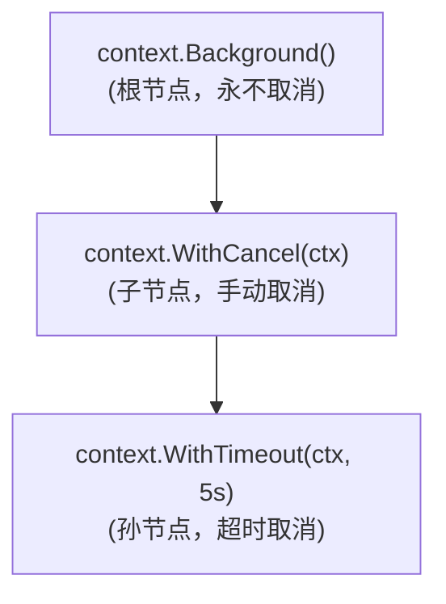
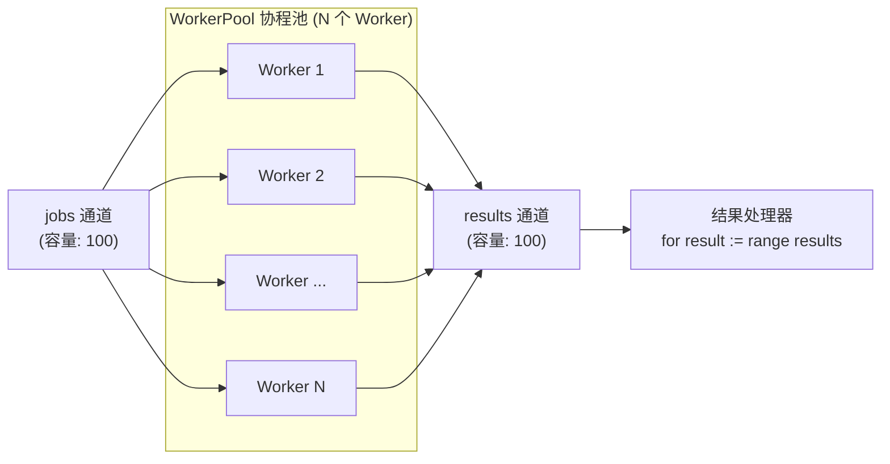

在刚开始学习 Go 语言时，有一件事从来没有人告诉过你：**其实你早就已经掌握了分布式系统。只是你以前没有用这个名字去称呼它而已。**

一个 Goroutine 就是一个服务实例（Service Instance）。它独立运行，处理任务，并产出结果。  
一个 Channel 就是一条网络连接（Network Connection）。它在不同的 Goroutine 之间传输消息，它可以是满载的、空闲的，或是已关闭的 —— 这与真实网络环境中的网络拥塞、线路空闲或连接中断完全如出一辙。  
`context.Context` 则是全局紧急制动开关（Kill Switch）。一旦上下文被取消，每一个尊重该上下文的 Goroutine 都会立刻停止手头的工作并安全返回。

这绝非空洞的比喻。你在协调 Goroutine 时所使用的所有核心模式 —— **超时控制（Timeouts）、级联取消（Cancellation）、背压机制（Backpressure）以及优雅停机（Graceful Shutdown）** —— 正是你在微服务架构中协调分布式服务所使用的同一套模式。只要你在 Goroutine 层面吃透了这些原理，就能无缝理解服务层面的分布式系统。

本章是后续所有章节的坚实基石。让我们严谨细致地把它构建起来。

---

## 1. Goroutine：并发执行单元（Goroutines）

Goroutine 是由 Go 运行时（Runtime）直接管理的轻量级线程。你只需使用 `go` 关键字即可启动一个 Goroutine：

```go
go func() {
    fmt.Println("running concurrently")
}()
```

该函数将独立于启动它的原 Goroutine 异步运行。Go 运行时负责将这些 Goroutine 调度到系统可用的操作系统线程（OS Threads）上 —— 通常每个 CPU 核心分配一个线程。一个 Go 程序可以轻松并发运行成千上万个 Goroutine，而完全不会产生传统操作系统线程那样高昂的每线程内存开销。

Goroutine 最关键的特质并不在于它们“轻量廉价”，而在于它们是**承载独立工作单元的天然载体（The natural unit of independent work）**。当你将一个复杂问题拆解为多个 Goroutine 时，你所做出的架构设计决策，与你将单体系统拆解为微服务集群时是完全相同的：**哪些组件需要独立运行、哪些组件需要彼此通信，以及当某个组件停止时哪些组件必须随之停止。**

---

### 生命周期的挑战（The lifecycle problem）

你所启动的每一个 Goroutine 都必须有始有终地退出。这听起来显而易见，但它却是绝大多数 **Goroutine 泄露（Goroutine Leaks）** 的根本根源。

```go
func processRequests(requests <-chan Request) {
    for req := range requests {
        go func(r Request) {
            process(r)
        }(req)
    }
}
```

这个函数会为接收到的每一个请求启动一个新的 Goroutine。如果 `requests` 通道永远不被关闭，该函数就会永不休止地运行下去。如果程序在 Goroutine 仍在处理在途任务（In-flight Work）时收到了停机信号，这些 Goroutine 就会在任务执行到一半时被粗暴丢弃。如果 `process` 发生 panic，该 Goroutine 就会无声无息地彻底消失。

管理 Goroutine 的生命周期是一门严谨的工程纪律。我们手中的核心武器是 `sync.WaitGroup`、通道（Channels）以及 `context.Context`。在本章结束之前，我们将融会贯通地使用这三大利器。

---

## 2. 通道：进程内的消息网络（Channels）

通道（Channel）是 Goroutine 之间具备强类型保证的通信管道（Typed Conduit）。你可以使用内置函数 `make` 来创建一个通道：

```go
messages := make(chan string)     // 无缓冲通道（unbuffered）
messages := make(chan string, 10) // 有缓冲通道，容量为 10（buffered, capacity 10）
```

使用 `<-` 运算符向通道发送数据：

```go
messages <- "hello"
```

在另一端同样使用 `<-` 运算符从通道接收数据：

```go
msg := <-messages
```

通道是强类型的。`chan string` 专门承载字符串，`chan Request` 专门承载请求对象。Go 的类型系统在编译期强行保证流经每个通道的数据类型安全。

---

### 有向通道（Directional channels）

在函数签名中，通道可以被严格限定为只写（Send-only）或只读（Receive-only）：

```go
// 只能向通道发送数据（can only send）
func produce(out chan<- string) {
    out <- "message"
}

// 只能从通道接收数据（can only receive）
func consume(in <-chan string) {
    msg := <-in
    fmt.Println(msg)
}
```

这是通道在语义层面等价于“接口（Interface）”的体现 —— 它精确界定了每个通信参与者的角色职责。接收 `chan<- string` 的函数是**生产者（Producer）**；接收 `<-chan string` 的函数是**消费者（Consumer）**。编译器会在编译阶段严格强制执行这些角色约束。

当你在设计分布式服务的 API 时，你所做的事情本质上一模一样：决定哪一方负责发送、哪一方负责接收，以及哪一方全权掌控通信通道的生命周期。

---

### 有缓冲与无缓冲通道（Buffered vs unbuffered）

**无缓冲通道（Unbuffered Channel）** 没有内部存储空间。每一次发送操作都会被阻塞，直到有接收者准备好接收；每一次接收操作也都会被阻塞，直到有发送者发送数据。这是一种**同步通信（Synchronous Communication）** —— 通信双方必须同时在线就绪。

**有缓冲通道（Buffered Channel）** 则具有固定的容量（Capacity）。只要缓冲区未满，发送操作就会立即成功返回；只要缓冲区中有数据，接收操作也会立即成功返回。当缓冲区满载时，后续的发送操作将被阻塞；当缓冲区彻底空闲时，接收操作将被阻塞。

这就是**微型化的背压机制（Backpressure in miniature）**。当消费者处理速度跟不上生产者的生成节奏时，缓冲区被填满，发送端随之被阻塞，生产者的产出速度就会自然而然地慢下来。这正是系统面对负载时的正确表现。反之，无界队列（Unbounded Queue）会让生产者毫无节制地飞速前进，不断吞噬内存，直到整个进程发生 OOM 崩溃。

我们将在第 8 章深入探讨分布式系统中的背压机制。就目前而言：**请优先使用容量有限的有缓冲通道。有限的容量能够让背压机制以显式的方式运作。**

---

### 关闭通道（Closing channels）

当发送者没有更多数据需要发送时，可以主动关闭通道：

```go
close(messages)
```

接收端可以明确检测到通道是否已经被关闭：

```go
msg, ok := <-messages
if !ok {
    // 通道已关闭且已排空（channel is closed and empty）
}
```

或者使用 `range` 循环，当通道关闭且数据被消费完毕后，循环会自动安全终止：

```go
for msg := range messages {
    process(msg)
}
```

> [!IMPORTANT]
> **黄金法则**：永远只由发送者关闭通道，绝不能由接收者关闭。  
> 关闭通道所传递的信号是“没有更多数据了”，而只有生产者才知晓这一事实。向已经关闭的通道发送数据会导致 panic；关闭一个已经关闭的通道同样会导致 panic。这两种情况都是纯粹的程序员编码错误（Programmer Errors），而非正常的运行时状态。

---

## 3. 多路复用：select 语句（select）

在针对分布式系统场景的 Go 编程中，`select` 是最重要的控制语句。它允许一个 Goroutine 同时监听多个通道的 I/O 操作，并在其中任意一个准备就绪时立即执行对应的分支：

```go
select {
case msg := <-incoming:
    process(msg)
case <-done:
    return
}
```

该 Goroutine 会持续等待：要么接收到新消息进行处理，要么接收到停止信号安全退出。无论哪一个事件先发生，就会触发对应的分支。如果多个通道同时就绪，`select` 会**伪随机（Pseudo-randomly）**挑选其中一个执行 —— 对于绝大多数分布式协同问题而言，这种随机选择正是最公平且正确的行为。

---

### 基于 select 实现超时控制（Timeout with select）

在生产级服务代码中，`select` 最常见的用法是实现**超时控制（Timeout）**：

```go
select {
case result := <-workDone:
    return result, nil
case <-time.After(5 * time.Second):
    return nil, errors.New("timeout waiting for result")
}
```

`time.After` 会返回一个通道，在经过指定的时间段后，该通道会接收到一个时间戳信号。将其与 `select` 搭配使用，便能构建出一个永远不会无休止阻塞的超时机制。

你将会在编写生产代码时反复使用这个模式。每一次网络调用、每一次队列读取、每一次对下游微服务的远程请求，都必须设置超时时间。在分布式系统中，**核心问题从来不是“要不要超时”，而是“究竟该等待多长时间”。**

---

### 非阻塞通道操作（Non-blocking operations）

带 `default` 分支的 `select` 语句会退化为完全非阻塞的操作：

```go
select {
case msg := <-messages:
    process(msg)
default:
    // 当前没有可用消息（no message available right now）
}
```

可以将此模式用于轮询场景（Polling Patterns），即你希望检查通道中是否有现成数据，但绝不愿意挂起等待。请谨慎使用该特性 —— 密集的自旋轮询（Tight Polling Loops）会白白浪费 CPU 算力。如果你发现自己在写一个紧密的轮询循环，请停下来反思：换成带超时的阻塞接收是不是会更加干净优雅？

---

## 4. 并发协同：sync.WaitGroup（sync.WaitGroup）

当你启动了多个 Goroutine，并且需要等待它们全部执行完毕才能继续向下推进时，请使用 `sync.WaitGroup`：

```go
var wg sync.WaitGroup

for _, item := range items {
    wg.Add(1)
    go func(i Item) {
        defer wg.Done()
        process(i)
    }(item)
}

wg.Wait() // 阻塞直到所有 Goroutine 都调用了 Done（blocks until all goroutines call Done）
```

- 在启动每个 Goroutine **之前**调用 `Add(1)`。
- 在 Goroutine 内部使用 `defer wg.Done()`（通过 `defer` 确保即使函数发生 panic 也能正常执行计数器递减）。
- `Wait()` 会持续阻塞当前 Goroutine，直到计数器归零。

最常见的致命错误是在 Goroutine 内部调用 `Add`。这会引发恶性的**竞态条件（Race Condition）**：如果子 Goroutine 在主协程调用 `Wait` 之后才真正被调度启动，那么 `Wait` 可能会在 Goroutine 甚至还没来得及递增计数器之前就误以为所有工作均已完成并提前返回。**务必永远在 `go` 语句之前调用 `Add`。**

在 Goroutine 池中使用 `WaitGroup`，与分布式系统中的**并行扇出（Distributed Fan-out）**是完全相同的架构模式：启动 N 个 Worker、等待所有 Worker 协同处理完成、汇聚汇总最终结果。本专栏第 10 章将把这一模式从单机并发扩展到跨网络的分布式服务调用。

---

## 5. 跨边界传播：context.Context（context.Context）

`context.Context` 是在函数调用边界以及跨网络调用之间传递**取消信号（Cancellation）**与**截止时间（Deadlines）**的核心标准机制。在几乎所有执行 I/O 操作的 Go 函数中，你都会看到它作为第一个参数出现：

```go
func FetchUser(ctx context.Context, id string) (*User, error)
func SaveOrder(ctx context.Context, order Order) error
func PublishEvent(ctx context.Context, event Event) error
```

这是一种全行业通行的设计约定，而非生硬的语言语法特性。Go 生态之所以无一例外地严格遵循这一规范，是因为它切中要害地解决了分布式系统中最棘手的生命周期协同问题。

---

### 取消树机制（The cancellation tree）

Context 在逻辑上构成一棵层级树（Tree）。每个派生出来的 Context 都有一个父节点。**当父 Context 被取消时，由它派生出的所有子 Context 也会被递归地连带取消。**



```go
// Background 是根节点 —— 它永远不会被取消
ctx := context.Background()

// 派生一个可手动取消的子 Context
ctx, cancel := context.WithCancel(ctx)
defer cancel() // 务必调用 cancel 以释放关联的上下文资源

// 派生一个带 5 秒超时时间的孙 Context
ctx, cancel2 := context.WithTimeout(ctx, 5*time.Second)
defer cancel2()
```

如果主程序取消了父级 `ctx`，基于它派生出的超时上下文也会立即被连带取消。而如果仅仅是孙级 Context 的 5 秒超时触发，它只会取消自己和它自己的子树，绝不会影响父级 Context。

这完美映射了分布式请求的真实生命周期。例如：一个 HTTP 处理函数接收到一个带有 5 秒 SLA 截止时间的请求。处理函数启动了两个并发的 Goroutine 分别查询数据库与调用下游微服务，并将同一个 Context 透传给它们。客户端在 2 秒后主动断开了连接或取消了请求。此时 Context 被取消，数据库查询与下游 RPC 调用均能敏锐感知到该取消信号并立即终止执行。**没有任何 Goroutine 会在无人关心结果的情况下继续白费算力。**

---

### context.WithCancel

`context.WithCancel` 会返回一个派生的子 Context 以及一个取消函数 `cancel`。调用该函数即可显式取消该上下文：

```go
ctx, cancel := context.WithCancel(parent)
defer cancel()

go func() {
    select {
    case result := <-workDone:
        output <- result
    case <-ctx.Done():
        return
    }
}()
```

> [!IMPORTANT]
> **黄金法则**：即使业务逻辑已经成功执行完毕，也务必调用 `cancel()`。如果不调用 `cancel()`，Context 内部关联的计时器、Goroutine 引用等底层资源就会发生泄露。`defer cancel()` 习惯用法能从根本上规避此类泄露。

---

### context.WithTimeout 与 context.WithDeadline

`context.WithTimeout` 会在经过指定的持续时间后自动触发取消：

```go
ctx, cancel := context.WithTimeout(parent, 3*time.Second)
defer cancel()
```

`context.WithDeadline` 则使用绝对的时间点（Absolute Time）来完成相同的功能：

```go
deadline := time.Now().Add(3 * time.Second)
ctx, cancel := context.WithDeadline(parent, deadline)
defer cancel()
```

- 当你明确知道当前操作**最多允许等待多长时间**时，使用 `WithTimeout`。
- 当你从上游调用方那里**继承了一个全局截止时间**并需要继续向下游透传时，使用 `WithDeadline` —— 截止时间绝不会因为多层调用而延长，它只会随着链路不断向下游严格传播。

---

### 检查取消信号（Checking cancellation）

当执行耗时较长或包含多步批处理的循环任务时，应当周期性地主动检查 `ctx.Done()`：

```go
for _, item := range bigList {
    select {
    case <-ctx.Done():
        return ctx.Err()
    default:
    }
    process(item)
}
```

Go 标准库中的大部分基础设施都已经为你内置了这种检查机制 —— `database/sql`、`net/http`、`grpc` 等均接收 Context，并在其被取消时提前返回中断。但在你自己编写的业务循环或批处理中，你必须主动进行检查。

`ctx.Err()` 在被显式取消时返回 `context.Canceled`，在超时触发时返回 `context.DeadlineExceeded`。直接返回该错误可以使取消原因沿着调用栈层层向上传递。

---

### 上下文传值（Context values）

Context 还可以携带键值对数据：

```go
ctx = context.WithValue(ctx, requestIDKey, requestID)
```

通过指定键提取数据：

```go
id, ok := ctx.Value(requestIDKey).(string)
```

请严格将该功能限制在**与请求生命周期绑定的元数据（Request-scoped metadata）**上，这些数据不属于函数的显式业务输入：链路追踪 Trace ID、身份认证凭据（Claims）、全局请求 ID。**切勿使用它来传递可选的业务参数，也不要用它传递本该定义在业务结构体中的核心数据。** 请把 Context Value 当作最后的手段，而不是一个随心所欲的全局变量大杂烩。

---

## 6. 融会贯通：构建工业级工作池（Putting It Together: A Worker Pool）

工作池（Worker Pool）是展示 Goroutine、Channel、WaitGroup 与 Context 协同作战的最清晰范例。它也是分布式工程中最基础、最通用的核心模式之一。



```go
func WorkerPool(
    ctx context.Context,
    jobs <-chan Job,
    results chan<- Result,
    numWorkers int,
) {
    var wg sync.WaitGroup

    for i := 0; i < numWorkers; i++ {
        wg.Add(1)
        go func() {
            defer wg.Done()
            for {
                select {
                case job, ok := <-jobs:
                    if !ok {
                        return
                    }
                    result, err := process(ctx, job)
                    if err != nil {
                        if ctx.Err() != nil {
                            return
                        }
                        continue
                    }
                    select {
                    case results <- result:
                    case <-ctx.Done():
                        return
                    }
                case <-ctx.Done():
                    return
                }
            }
        }()
    }

    go func() {
        wg.Wait()
        close(results)
    }()
}
```

让我们一步一步剖析这个精妙的设计：

- **受控的工作循环**：每个 Worker 持续从 `jobs` 通道拉取任务，直到该通道被关闭，或者 Context 收到取消信号退出。
- **防止结果通道死锁**：Worker 在尝试将结果写入 `results` 时，同样受到 Context 取消的保护 —— 即使下游消费者停止消费导致 `results` 通道满载，Worker 也绝不会无限期阻塞挂死。
- **完备的生命周期清理**：当 `jobs` 通道关闭后，所有 Worker 处理完余留任务并相继安全返回；`WaitGroup` 计数归零触发后台 Goroutine 关闭 `results` 通道 —— 从而明确通知下游消费者“所有计算结果已全部推送完毕”。
- **全链路快速熔断**：一旦外部 Context 被取消，所有正在等待新任务或正在等待写回结果的 Worker 将立刻全部干净退出。

调用方的协调范式如下：

```go
ctx, cancel := context.WithTimeout(context.Background(), 30*time.Second)
defer cancel()

jobs := make(chan Job, 100)
results := make(chan Result, 100)

WorkerPool(ctx, jobs, results, 8)

go func() {
    defer close(jobs)
    for _, j := range allJobs {
        select {
        case jobs <- j:
        case <-ctx.Done():
            return
        }
    }
}()

for result := range results {
    handle(result)
}
```

这是一个经典的**扇出（Fan-out，单发送端分发给多个并发 Worker）**与随后的**扇入（Fan-in，多个 Worker 汇聚结果到单通道）**架构。本专栏第 10 章将把完全相同的模式，扩展到基于网络的跨服务远程调用中。

---

## 7. 优雅停机（Graceful Shutdown）

以分布式思维编写的 Go 代码，与不考虑分布式特性的脚本代码之间，最显著的分水岭之一就在于**如何处理停机（Shutdown）**。

一个无视停机过程的程序，在 `main` 函数返回的那一刹那就会直接暴力杀死所有存活的 Goroutine。数据库事务被半路抛弃，消息队列中的消息既未 ACK 确认也未 NACK 回滚，正在处理中的 HTTP 请求瞬间遭遇 Connection Reset 异常。对于短命的脚本工具而言这或许无关紧要，但对于生产级分布式服务来说，这无异于灾难。

**优雅停机（Graceful Shutdown）的核心准则**：
1. **停止接收新工作**（Stop accepting new work）。
2. **允许正在执行中的在途工作平稳运行完毕**（Let in-flight work finish）。
3. **安全释放和清理底层各类资源**（Clean up resources）。

```go
func main() {
    ctx, stop := signal.NotifyContext(context.Background(),
        os.Interrupt,
        syscall.SIGTERM)
    defer stop()

    srv := &http.Server{
        Addr:    ":8080",
        Handler: buildHandler(ctx),
    }

    go func() {
        if err := srv.ListenAndServe(); err != nil && err != http.ErrServerClosed {
            log.Fatal(err)
        }
    }()

    <-ctx.Done()
    stop()

    shutdownCtx, cancel := context.WithTimeout(context.Background(),
        30*time.Second)
    defer cancel()

    if err := srv.Shutdown(shutdownCtx); err != nil {
        log.Printf("shutdown error: %v", err)
    }
}
```

`signal.NotifyContext` 会返回一个特殊的 Context，当操作系统向该进程发送中断信号（如 `SIGINT` / Ctrl+C）或终止信号（如 Kubernetes 发送的 `SIGTERM`）时，该 Context 会自动被取消。

一旦信号到达，程序便会优雅地停机 HTTP 服务器 —— 服务器立即拒绝接收任何新的网络连接和请求，同时为已经进入系统的在途请求提供长达 30 秒的宽限期以确保它们平稳完成。

在本专栏后续构建的每一个微服务中，都会包含这样一条严谨的停机路径。**这正是“平滑发布只需 15 秒”与“发布一次导致数据损坏”之间的云泥之别。**

---

## 8. 并发思维模型映射表（The Concurrency Mental Model）

以下是单机并发概念与分布式系统概念的完整对等映射表：

| Goroutine 单机并发概念（Goroutine concept） | 分布式系统对等概念（Distributed systems equivalent） | 架构设计对应物 |
| :--- | :--- | :--- |
| **goroutine** | **服务实例（service instance）** | 独立运行、自主处理的工作单元 |
| **channel** | **网络 / 消息队列（network / message queue）** | 承载跨实体通信的数据管道 |
| **buffered channel** | **带背压的有界队列（bounded queue with backpressure）** | 保护消费者不被冲垮的流量缓冲池 |
| **select** | **事件驱动消息处理器（event-driven message handler）** | 多路监听、就绪执行的调度中枢 |
| **context.WithTimeout** | **请求超时截止时间 / 服务等级协议（request deadline / SLA）** | 防止远程调用无休止挂起的熔断保障 |
| **context.WithCancel** | **请求取消传播（request cancellation propagation）** | 客户端断开时的全链路级联中断 |
| **WaitGroup** | **扇出协调器（fan-out coordinator）** | 分发任务并等待全员集合的聚合点 |
| **closed channel** | **“生产者完成”信号（“producer done” signal）** | 标识数据流结束的明确控制帧 |
| **ctx.Done()** | **停机 / 终止信号（shutdown signal）** | 通知所有下游组件有序退出的广播机制 |

当你审视分布式架构图时，请在脑海中将其映射到这个模型：
- 一个 HTTP 网关将请求同时扇出给 3 个下游微服务，本质上就是一个 Goroutine 同时向 3 个 Channel 发送消息；
- 消息队列的消费者组（Consumer Group），本质上就是一个跨节点的工作池（Worker Pool）；
- 熔断器（Circuit Breaker），本质上就是一个带回退降级（Fallback Default）的 `select` 语句。

两者的核心设计模式完全一致。唯一的区别在于它们的**失效模式（Failure Modes）**不同 —— 我们将在后续章节对这些失效模式进行逐一攻克。

---

## 9. 常见问答（Q&A）

### Q: 启动多少个 Goroutine 算太多？
**A**: Go 运行时管理几十万个 Goroutine 毫无压力。系统的上限瓶颈从来不是 Goroutine 的数量本身 —— 而是**每个 Goroutine 所持有的底层系统资源**：打开的网络连接数、分配的堆内存大小、持有的锁资源等。Goroutine 泄露之所以极其危险，根本不是因为 Goroutine 这个结构体本身占用了内存，而是因为它让背后所持有的宝贵系统资源永远无法释放。

### Q: 我应该始终使用 Context 来取消 Goroutine 吗？
**A**: **对于执行网络 I/O 或可能无限期运行的 Goroutine，答案是肯定的。** 但对于执行简短、有界计算任务的 Goroutine（例如为切片排序、计算哈希值），引入 Context 则属于过度设计。核心判断准则：**如果你的 Goroutine 调用的任何函数接受 `ctx context.Context` 参数，那么就必须把 Context 传递下去。**

### Q: context.Background() 与 context.TODO() 有什么区别？
**A**: 在底层功能上，二者**完全没有任何区别** —— 它们都返回一个非 nil、空的、永远不会被取消的根 Context。它们唯一的区别在于**工程约定**：在 `main` 函数、测试函数以及顶层初始化代码中，使用 `Background()` 作为根上下文；而当你明确知道未来需要一个真正的上下文、但当前尚未完成参数传递改造时，使用 `TODO()` 作为临时占位符。绝大多数静态代码检查工具（Linters）都会把 `TODO()` 作为待办提醒标记出来，督促你后续将其替换。

### Q: 我可以用互斥锁（Mutex）代替 Channel 吗？
**A**: **当然可以。** 通道绝非安全共享状态的唯一手段。Go 官方 FAQ 的权威指引是：**当需要转移数据所有权时，使用 Channel；当需要保护组件内部状态时，使用 Mutex。** 在分布式系统模式中，Channel 更加自然，因为它精准模拟了消息传递机制 —— 但如果互斥锁能让代码更简单清晰，切勿生搬硬套强行使用 Channel。

### Q: 什么是 Goroutine 泄露？我该如何排查它？
**A**: Goroutine 泄露是指一个 Goroutine **永远无法退出执行** —— 通常由以下原因导致：向通道发送或从通道接收数据时永久阻塞、`select` 语句遗漏了退出/取消分支，或是进入了无法跳出的死循环。  
排查手段包括：
1. **测试阶段排查**：在单元测试与集成测试中引入 Uber 开源的 `goleak` 检测工具，它能在测试退出时断言当前是否有残留未退出的 Goroutine；
2. **生产环境监控**：在生产环境中持续监控 `runtime.NumGoroutine()` 指标 —— 如果 Goroutine 数量呈单调不减的无界增长趋势，说明系统必然存在 Goroutine 泄露。

---

## 10. 沉淀至 SDK 的核心组件（What Goes in the SDK）

本章所探讨的并发控制模式，是整个分布式系统中每一个微服务在进行生命周期管理时所依赖的基石。

我们将这些可复用的核心组件沉淀到公共包 `platform/concurrency` 中：

```
platform/concurrency/
├── workerpool.go   — 具备受限 Goroutine 数量与优雅停机特性的 WorkerPool
├── shutdown.go     — 组合了信号处理与资源清理的 GracefulShutdown 辅助工具
└── context.go      — Detach（从父 Context 派生独立 Background 上下文并继承 Value）
```

其中，**工作池（Worker Pool）** 是复用频率最高的模式 —— 每一个需要对下游进行并发控制的服务都离不开它：

```go
// platform/concurrency/workerpool.go
package concurrency

import (
	"context"
	"sync"
)

type WorkerPool struct {
	jobs    chan func() error
	results chan error
	wg      sync.WaitGroup
}

func NewWorkerPool(ctx context.Context, workers int) *WorkerPool {
	wp := &WorkerPool{
		jobs:    make(chan func() error, workers*2),
		results: make(chan error, workers),
	}

	for i := 0; i < workers; i++ {
		wp.wg.Add(1)
		go func() {
			defer wp.wg.Done()
			for fn := range wp.jobs {
				wp.results <- fn()
			}
		}()
	}

	return wp
}

func (wp *WorkerPool) Submit(fn func() error) {
	wp.jobs <- fn
}

func (wp *WorkerPool) Close() []error {
	close(wp.jobs)
	wp.wg.Wait()
	close(wp.results)

	var errs []error
	for err := range wp.results {
		if err != nil {
			errs = append(errs, err)
		}
	}
	return errs
}
```

而**优雅停机辅助工具（Graceful Shutdown Helper）** 则是整个系统中在各服务 `main.go` 里出现频率最高的核心代码：

```go
// platform/concurrency/shutdown.go
package concurrency

import (
	"context"
	"errors"
	"time"
)

func GracefulShutdown(ctx context.Context,
	timeout time.Duration,
	servers ...Shutdowner) error {
	<-ctx.Done()

	shutdownCtx, cancel := context.WithTimeout(context.Background(), timeout)
	defer cancel()

	var errs []error
	for _, srv := range servers {
		if err := srv.Shutdown(shutdownCtx); err != nil {
			errs = append(errs, err)
		}
	}
	return errors.Join(errs...)
}

type Shutdowner interface {
	Shutdown(context.Context) error
}
```

在 Go 标准库与主流流行库中，`http.Server`、`grpc.Server` 以及 `pgxpool.Pool`（PostgreSQL 连接池）均天然实现了 `Shutdown(context.Context) error` 接口方法。

有了这个组件，一个真实微服务的 `main` 函数停机编排将精炼到令人发指的程度：

```go
go srv.ListenAndServe()
<-concurrency.GracefulShutdown(ctx, 30*time.Second, srv, dbPool, producer)
```

> [!NOTE]
> 仅需短短三行核心编排，便能按照严格的生命周期顺序、在明确的超时截止时间保障下，同时停机 HTTP 服务器、数据库连接池以及消息生产者，并且完整聚合并记录来自它们的所有错误。

---

现在，你已经彻底掌握了单机 Goroutine 之间的协同控制之道，你已经做好了跨越网络去协调真正分布式服务的充分准备。下一章我们将迎来第一个真正的分布式胜利时刻：**两个 Go 程序通过消息队列进行异步通信，即使中途强行杀死其中一个，另一个仍然安然无恙地持续运转。**

---

> 💡 **专栏导航**：
> - 专栏目录：[《Go 云原生分布式系统实战》全集路线图](/columns/distributed-go)
> - 专栏广场：[浏览全部技术专栏](/columns)
> - 上一篇：[Go 分布式系统实战（一）：为什么需要分布式？协同的成本与单机极限](/posts/2026-10-18-distributed-go-01-why-distributed)
> - 下一篇：[Go 分布式系统实战（三）：两个服务一条队列：HTTP 同步 vs 异步选型与 NATS 实战](/posts/2026-10-18-distributed-go-03-two-services-one-queue)
