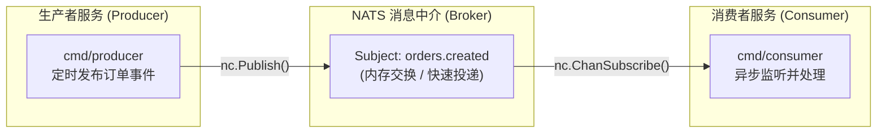
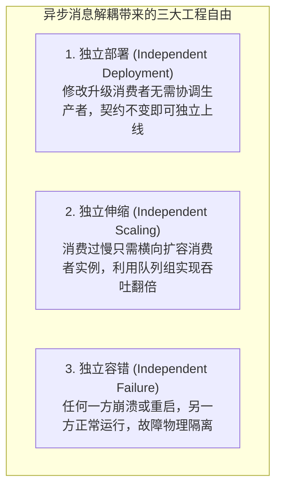

想象一家快递公司。你在柜台寄出一个包裹，快递员取走包裹并负责派送。你不会站在柜台前一直等包裹送达才离开；快递员也不会非得等到收件人在家才收下你的包裹。这两个操作 —— 寄件与送件 —— 在时间维度上是完全解耦的。邮局在其中充当了中介的角色。

消息队列的工作原理完全一样。一个服务生产消息（Produce），另一个服务消费消息（Consume）。两者无需知道彼此的存在，也无需在同一时间点同时处于运行状态。队列就是它们之间的中介。

这是异步分布式系统的核心模式。在本章中，你将亲手构建它：编写两个 Go 程序 —— 一个生产者和一个消费者 —— 通过消息队列进行通信。随后，你将亲手杀掉其中一个进程，并亲眼见证另一个进程依然稳定运行。那一刻，便是你收获的第一个分布式架构红利。

---

## 1. 为什么用队列而不是 HTTP 调用？（Why a Queue and Not an HTTP Call?）

在开始编写代码之前，必须先理清何时该用队列，何时该在服务之间使用直接的 HTTP 同步调用。

### 何时使用 HTTP：
- 你需要**立即**获得响应结果；
- 你必须确认下游操作成功后才能继续推进当前流程；
- 或者下游服务必须作为调用方业务工作流的**同步**组成部分来处理请求。

**典型场景**：订单服务在最终确认订单之前，必须先检查商品库存是否充足。这是一个典型的 HTTP 同步调用 —— 必须等待库存检查的结果返回后，订单创建的最终响应才能发送给客户端。

### 何时使用队列：
- 工作任务可以**延后处理**；
- 下游服务的崩溃或故障**绝不能**导致上游服务失败；
- 你需要将同一个事件同时分发到**多个不同的地方**进行处理；
- 或者你需要**削峰填谷**，以平滑突发的高并发流量负载。

**典型场景**：订单服务在成功创建订单后，需要通知履约履约服务、邮件通知服务以及大数据分析流水线。这必须使用消息队列 —— 订单的成功创建完全不依赖于上述任何一个下游通知是否已处理完毕。

### 选型失误的代价
在这里做出错误的选型会引发灾难性的工程问题。服务之间直接的 HTTP 强耦合意味着：**下游消费者的缓慢会迅速逆流拖垮上游生产者**（即级联雪崩）。而消息队列将它们彻底解耦开来：即使消费者宕机停摆，生产者依然可以继续正常处理业务，产生的消息会在队列中积压暂存，等消费者恢复后再迎头赶上。

---

## 2. 初试利刃：为什么首选 NATS？（NATS for a First Example）

在本章中，我们将选用 **NATS**。

对于具备持久化存储、超高吞吐量的事件流场景，Kafka 确实是工业界的首选工具 —— 我们也将在第 8 章深入探讨并使用 Kafka。但对于入门首例而言，Kafka 需要搭建 Broker 集群以及 Zookeeper 或 KRaft 协同服务，这引入了远超本章所需的基础设施运维负担。

NATS 是一款极度轻量、性能卓越的高性能消息系统。它只有一个独立的服务器二进制文件，没有任何外部依赖。

在本地开发环境中，只需一条 Docker 命令即可启动：

```bash
docker run -p 4222:4222 nats:latest
```

而在生产环境中，**NATS JetStream** 则进一步提供了持久化存储与消费者消息确认（Ack）机制。

本章我们将使用 **NATS Core**（无持久化模式），因为在剥离了持久化复杂性后，底层的解耦架构反而呈现得更加纯粹清晰。先彻底搞懂无持久化场景的本质，日后在第 8 章学习持久化场景时，你才能理解得更加深刻。



---

## 3. 接口先行（The Interfaces）

在动手编写具体的 NATS 逻辑之前，先定义接口。这是一个非常值得终身培养的良好架构习惯：**先写接口，再写实现。接口代表高层设计，实现只是底层细节。**

### 生产者接口定义
```go
// producer/publisher.go
package publisher

import "context"

type Publisher interface {
	Publish(ctx context.Context, subject string, data []byte) error
	Close() error
}
```

### 消费者接口定义
```go
// consumer/subscriber.go
package subscriber

import "context"

type Message struct {
	Subject string
	Data    []byte
}

type Subscriber interface {
	Subscribe(ctx context.Context, subject string) (<-chan Message, error)
	Close() error
}
```

这两个接口构成了**应用程序业务层与底层消息传输层之间的正式契约**。应用程序只需调用 `Publish` 发送数据，通过 `Subscribe` 返回的 Go Channel 接收数据，其业务代码绝不直接接触 NATS 的具体 API。

这在测试时意义重大：你可以编写一个完全在进程内运行的 Mock/Fake Publisher 和 Subscriber，完全无需在后台运行真实的 NATS 服务器。我们在第 13 章的集成测试与单元测试中就会充分利用这一点。

---

## 4. 生产者服务实现（The Producer）

生产者是生成业务事件的服务。在我们的示例中，它会定时生成订单事件 —— 这是真实微服务领域事件的一个直观缩影。

```go
// cmd/producer/main.go
package main

import (
	"context"
	"encoding/json"
	"fmt"
	"log/slog"
	"os"
	"os/signal"
	"syscall"
	"time"

	"github.com/nats-io/nats.go"
)

type OrderEvent struct {
	ID        string    `json:"id"`
	ProductID string    `json:"product_id"`
	Quantity  int       `json:"quantity"`
	CreatedAt time.Time `json:"created_at"`
}

func main() {
	// 使用 slog 输出 JSON 格式的结构化日志
	logger := slog.New(slog.NewJSONHandler(os.Stdout, nil))

	// 从环境变量读取 NATS 地址，未指定则使用默认连接
	natsURL := os.Getenv("NATS_URL")
	if natsURL == "" {
		natsURL = nats.DefaultURL
	}

	nc, err := nats.Connect(natsURL)
	if err != nil {
		logger.Error("failed to connect to NATS", "error", err)
		os.Exit(1)
	}
	defer nc.Close()

	logger.Info("producer started", "nats_url", natsURL)

	// 捕获操作系统中断与终止信号，实现优雅停机
	ctx, stop := signal.NotifyContext(context.Background(),
		os.Interrupt,
		syscall.SIGTERM)
	defer stop()

	// 定时器：每 2 秒生产并发布一个订单事件
	ticker := time.NewTicker(2 * time.Second)
	defer ticker.Stop()

	orderNum := 1
	for {
		select {
		case <-ctx.Done():
			logger.Info("producer shutting down")
			return
		case <-ticker.C:
			event := OrderEvent{
				ID:        fmt.Sprintf("order-%04d", orderNum),
				ProductID: "prod-001",
				Quantity:  orderNum%5 + 1,
				CreatedAt: time.Now().UTC(),
			}

			data, err := json.Marshal(event)
			if err != nil {
				logger.Error("failed to marshal event", "error", err)
				continue
			}

			if err := nc.Publish("orders.created", data); err != nil {
				logger.Error("failed to publish", "error", err)
				continue
			}

			logger.Info("published order",
				"order_id", event.ID,
				"quantity", event.Quantity)
			orderNum++
		}
	}
}
```

### 生产者的架构要点剖析：
- **基于 `log/slog` 的 JSON 结构化日志**：从第一行代码起就坚持使用结构化日志。每个字段都是键值对（Key-Value），而不是不可解析的格式化字符串。当你在排查跨多个微服务的海量日志时，这一点具有决定性意义。
- **从环境变量读取 NATS URL**：拒绝硬编码网络地址。服务自身无需关心自己是运行在本地笔记本、容器中还是 Kubernetes 集群里。
- **`signal.NotifyContext`**：优雅停机（Graceful Shutdown）。生产者会持续发布消息，直到捕获操作系统中断信号，然后体面清理并退出。
- **`ticker + select`**：生产主循环。每隔 2 秒发布一个事件。在同一个 `select` 中监听 `ctx.Done()`，确保在收到退出信号时能瞬间终止循环，而无需死等下一个定时滴答到来。

---

## 5. 消费者服务实现（The Consumer）

消费者负责接收事件并进行业务处理。在真实工业级系统中，它可能会将数据落盘到数据库、调用其他下游服务或触发异步工作流。在此处，它会将接收到的数据进行解析并记录日志。

```go
// cmd/consumer/main.go
package main

import (
	"context"
	"encoding/json"
	"log/slog"
	"os"
	"os/signal"
	"syscall"
	"time"

	"github.com/nats-io/nats.go"
)

type OrderEvent struct {
	ID        string    `json:"id"`
	ProductID string    `json:"product_id"`
	Quantity  int       `json:"quantity"`
	CreatedAt time.Time `json:"created_at"`
}

func main() {
	logger := slog.New(slog.NewJSONHandler(os.Stdout, nil))

	natsURL := os.Getenv("NATS_URL")
	if natsURL == "" {
		natsURL = nats.DefaultURL
	}

	nc, err := nats.Connect(natsURL)
	if err != nil {
		logger.Error("failed to connect to NATS", "error", err)
		os.Exit(1)
	}
	defer nc.Close()

	// 捕获操作系统信号以实现优雅停机
	ctx, stop := signal.NotifyContext(context.Background(),
		os.Interrupt,
		syscall.SIGTERM)
	defer stop()

	// 创建带缓冲的 Go Channel 接收 NATS 消息
	msgs := make(chan *nats.Msg, 64)

	sub, err := nc.ChanSubscribe("orders.created", msgs)
	if err != nil {
		logger.Error("failed to subscribe", "error", err)
		os.Exit(1)
	}
	defer sub.Unsubscribe()

	logger.Info("consumer started, waiting for orders")

	for {
		select {
		case <-ctx.Done():
			logger.Info("consumer shutting down")
			return
		case msg, ok := <-msgs:
			if !ok {
				return
			}

			var event OrderEvent
			if err := json.Unmarshal(msg.Data, &event); err != nil {
				logger.Error("failed to unmarshal event", "error", err)
				continue
			}

			logger.Info("received order",
				"order_id", event.ID,
				"product_id", event.ProductID,
				"quantity", event.Quantity,
				"age_ms", time.Since(event.CreatedAt).Milliseconds(),
			)
		}
	}
}
```

### 消费者的架构要点剖析：
消费者的架构形态与生产者高度契合：
- **相同的优雅停机范式**：同样通过 `signal.NotifyContext` 监听信号并优雅退出。
- **`ChanSubscribe`**：该方法返回一个 Channel —— NATS 会直接将接收到的消息推送到这个 Channel 中。消费者的 `select` 循环在同一个事件多路复用中同时监听该 Channel 与退出信号。
- **日志中的 `age_ms` 字段**：记录从事件生成（CreatedAt）到被消费者实际处理经历了多少毫秒的延迟。这是生产环境中极具价值的黄金观测指标 —— 如果消费者处理积压滞后，这个数值就会持续飙升。

---

## 6. 运行与验证：见证分布式解耦（Running It）

### 1. 初始化模块
创建 `go.mod`：

```go
module github.com/yourname/orders

go 1.22

require github.com/nats-io/nats.go v1.36.0
```

### 2. 启动 NATS 服务器
在后台拉起 NATS 容器：

```bash
docker run -p 4222:4222 --name nats nats:latest
```

### 3. 运行消费者与生产者
在第一个终端中，启动消费者：

```bash
go run ./cmd/consumer
```

在第二个终端中，启动生产者：

```bash
go run ./cmd/producer
```

你将看到生产者每两秒发布一条订单事件：

```json
{"time":"...","level":"INFO","msg":"published order","order_id":"order-0001","quantity":2}
{"time":"...","level":"INFO","msg":"published order","order_id":"order-0002","quantity":3}
```

消费者实时收到并处理它们：

```json
{"time":"...","level":"INFO","msg":"received order","order_id":"order-0001","product_id":"prod-001","quantity":2,"age_ms":1}
```

### 4. 动手验证解耦与容错
- **测试 1：杀掉消费者**  
  在终端 1 中按下 `Ctrl-C` 强行停止消费者。此时生产者依然在持续稳定地运行。消息依然在不断发布 —— 只是当前没有任何消费者在线接收。在 NATS Core（无持久化模式）下，这些消息会被直接丢弃。我们将在第 8 章利用 Kafka 的持久化提交日志（Commit Log）彻底解决这一问题。
- **测试 2：重启消费者**  
  重新启动消费者。它会立即从当前时刻开始继续接收新消息 —— 它不会看到在它宕机期间发布的消息。
- **测试 3：杀掉生产者**  
  现在按下 `Ctrl-C` 强行停止生产者。消费者依然安然运行，只是安静地挂起等待。再次启动生产者，消费者瞬间就能无缝衔接处理新消息。

这两个服务对彼此的生命周期毫无感知。它们仅仅通过队列进行通信，而**消息队列是它们之间唯一的共同外部依赖**。

---

## 7. 实战中的松耦合（Loose Coupling in Practice）

你刚刚亲身体验到的现象有一个正式的软件工程术语：**松耦合（Loose Coupling）**。

生产者没有导入（import）消费者的任何代码包；消费者也没有导入生产者的任何代码包。它们之间除了以下三点之外，完全没有任何共享：
1. 一个正在运行的 NATS 服务器；
2. 主题名称 `"orders.created"`；
3. `OrderEvent` 结构体的字段布局（即 Schema 契约）。

这是两个分布式服务要实现跨网络通信所需的**绝对最小耦合度**。任何额外的耦合 —— 比如共享同一个底层数据库、强依赖直接的 HTTP 调用、或者共享同一个配置文件 —— 都是架构中应当被剥离的多余负担。

主题名称与事件 Schema 构成了服务之间极其严肃的显式契约。它们理应获得与对外暴露的公共 API 相同规格的维护与重视。

当你需要对事件结构进行破坏性变更时，务必进行版本化管理：例如发布到 `"orders.created.v2"`，而不是强行篡改 `"orders.created"`。老版本的消费者可以继续稳定消费旧主题，直到你平滑迁移完成。这就是经典的**事件版本演进问题（Event Versioning Problem）**，它在真实生产环境中至关重要 —— 我们将在第 11 章（分布式一致性）中详细深入探讨。

---

## 8. 错误处理与自动重连（Error Handling and Reconnection）

在生产环境中，网络连接随时可能中断，NATS 服务器随时可能重启，网络分区也偶有发生。当 NATS 网络连接意外掉线时，生产者和消费者会发生什么？

`nats.go` 官方客户端库内置了自动重连机制。默认情况下，它会采用可配置的退避算法（Backoff）无限次尝试重连。你可以在建立连接时精确配置这些行为：

```go
nc, err := nats.Connect(natsURL,
	nats.MaxReconnects(-1),
	nats.ReconnectWait(2*time.Second),
	nats.DisconnectErrHandler(func(nc *nats.Conn, err error) {
		logger.Warn("disconnected from NATS", "error", err)
	}),
	nats.ReconnectHandler(func(nc *nats.Conn) {
		logger.Info("reconnected to NATS", "url", nc.ConnectedUrl())
	}),
)
```

断开连接处理器（Disconnect Handler）和重连处理器（Reconnect Handler）为你提供了宝贵的底层连接可见性 —— 这在排查生产事故时具有不可替代的价值，比如经常会遇到服务进程看起来健康存活、但消息却神秘停止流转的故障假象。

必须明确的是，在网络断开连接期间，NATS Core **不会**替你缓存或补发在这期间发布的任何消息。那些消息直接消失了。如果你的业务系统对消息丢失零容忍，必须使用 **NATS JetStream**（持久化模式）或 **Kafka**（第 8 章）。但对于常规系统通知、埋点行为分析以及即发即弃（Fire-and-Forget）的事件场景，NATS Core 提供的“至多一次（At-most-once）”投递保证是完全可以接受的。

---

## 9. 宏观全貌：异步消息带来的三大自由（The Complete Picture）

两个服务，一个队列。让这种架构展现出无穷威力的关键特性究竟是什么？



### 1. 独立部署（Independent Deployment）
你可以随意部署消费者的全新版本，而根本不需要碰生产者分毫。生产者持续向同一个主题发布消息，消费者从该主题读取。两个团队或两个服务之间完全不需要繁复耗时的跨服务协同发布流程。

### 2. 独立伸缩（Independent Scaling）
如果消费端处理订单的速度跟不上生产端创建订单的速度，你只需直接拉起第二个消费者实例。

两个消费者同时连到同一个 NATS 主题上，NATS 会自动将每条消息分发给其中一个消费者（**队列组订阅机制，Queue Group Subscription**）。在无需修改两边任何代码的前提下，你的系统整体处理吞吐量瞬间翻倍。

### 3. 独立容错与故障隔离（Independent Failure）
生产者发生崩溃了？消费者完全不受影响，安然等待新消息到来。生产者重启恢复后，消费者无缝继续处理。反之亦然。任何一方的致命崩溃都不会成为另一方的灾难。

---

### 架构收益与代价权衡

这三大特性 —— **独立部署、独立伸缩、独立容错** —— 正是异步消息系统带给分布式架构的核心红利。

但这些红利并非免费获得，它们伴随着不可忽视的代价：**你再也无法在单一时间点轻而易举地推导或审视整个系统的即时全局状态了。**  
消费者的数据追平了吗？最后一条核心消息究竟有没有被完整处理完毕？如果没有额外的全链路观测与追踪机制，你根本无从知晓。这种架构权衡是实实在在的，而这正是第 11 章（分布式一致性）将要全力攻克的核心议题。

但就目前而言：你已经亲手打造了两个能够跨网络自如对话的独立服务。杀掉其中一个，另一个仍然健步如飞。这正是分布式系统带给我们的第一场伟大胜利。

---

## 10. 沉淀到 SDK：定义平台标准契约（What Goes in the SDK）

本章中定义的 `Publisher` 和 `Subscriber` 接口，构成了整个系统所有消息传输实现必须满足的标准抽象契约。让我们将它们抽取沉淀到统一的 `platform/messaging` 基础设施包中：

```
platform/messaging/
  interfaces.go   — Publisher、Subscriber 与 Message 核心类型
  nats/
    publisher.go  — 实现 Publisher 接口的 NATS 生产者封装
    subscriber.go — 实现 Subscriber 接口的 NATS 消费者封装
```

这些接口是整个平台 SDK 对外暴露的关键资产：

```go
// platform/messaging/interfaces.go
package messaging

import "context"

type Publisher interface {
	Publish(ctx context.Context, subject string, data []byte) error
	Close() error
}

type Subscriber interface {
	Subscribe(ctx context.Context, subject string) (<-chan Message, error)
	Close() error
}

type Message struct {
	Subject string
	Data    []byte
	Reply   string
	Ack     func() error // 在 NATS Core 中为空操作；在 Kafka 中用于提交 offset
}
```

业务服务代码只强依赖这套抽象接口，**绝不允许直接依赖具体的 `nats.Conn`**。例如，一个需要发布事件的 HTTP Handler 只需注入一个 `Publisher`：

```go
func createOrderHandler(store OrderStore, pub messaging.Publisher) http.HandlerFunc {
	return func(w http.ResponseWriter, r *http.Request) {
		// ... 创建订单 ...
		event, _ := json.Marshal(OrderCreated{ID: order.ID})
		pub.Publish(r.Context(), "orders.created", event)
		// ...
	}
}
```

当我们在第 8 章引入 Kafka 时，Kafka Producer 同样实现这个 `Publisher` 接口。上层业务的 Handler 代码无需做任何修改！而在编写自动化单元测试时，测试用例只需注入一个在内存中记录发布事件的 `FakePublisher` —— 整个测试运行过程中完全无需依赖真实的 NATS 或 Kafka。

这种**接口先行（Interface-first）**的设计理念，是整个平台 SDK 架构中最为关键的设计决策。它将纯粹的业务逻辑与具体的基础设施技术选型彻底解耦开来。

---

## 11. 章节问答（Q&A）

### Q1：NATS 中的“主题”（Subject）究竟是什么？
**答：主题是消息的具名目标地址**，类似于 Kafka 中的 Topic 或 RabbitMQ 中的 Exchange。  
NATS 的主题原生支持通配符匹配：
- `orders.*` 可以匹配 `orders.created` 和 `orders.cancelled`（单 token 匹配）；
- `orders.>` 可以匹配任意层级 token（例如 `orders.eu.created`）。  
这使得基于层级化主题组织业务事件变得非常自然且强大。

### Q2：什么是队列组（Queue Group）？
**答：队列组是一组共享同一个队列组名称的订阅者集群。**  
NATS 保证将每条消息**精确投递给组内的某一个订阅者**。这是消费者实现水平横向扩展（Horizontal Scaling）的标准范式：所有消费者实例使用相同的队列组名称进行订阅，进入该主题的消息会自动负载均衡分配给其中一个实例：

```go
sub, err := nc.QueueSubscribe("orders.created", "fulfilment-workers", handler)
```

### Q3：生产者和消费者应该跨服务共享同一个 `OrderEvent` 结构体代码吗？
**答：在单体代码仓库（Monorepo）中可以；在多仓库（Polyrepo）中绝不要共享。**  
- 在单一 Monorepo 中，维护一个包含通用事件类型的公共 `events` 包是实用且便捷的。
- 在独立的不同代码仓库中，每个服务应当自行定义自己的事件结构体，并独立对接收到的数据进行校验。跨仓库共享 Go 结构体代码会制造硬编码的编译期耦合，彻底抵消独立部署的优势。  
使用 **JSON Schema** 或 **Protocol Buffers** 是定义跨服务契约而不产生源码级编译耦合的正确方案。

### Q4：如果消费者在处理消息的过程中突然崩溃，消息会怎样？
**答：在 NATS Core 模式下，该消息就彻底丢失了。**  
消费者收到消息（或刚开始处理）后发生崩溃并重启，此时它是冷启动状态，内存中完全没有在途消息的记录。如果你的业务场景必须保证**精确一次（Exactly-once）**或**至少一次（At-least-once）**处理，你需要借助 NATS JetStream 的显式确认机制（Ack Model）或 Kafka 的偏移量位移管理（Offset Management）—— 这两者都将在第 8 章全面讲解。  
此外，在设计消费者时，务必尽可能将其实现为**幂等的（Idempotent）**：即使重复处理同一条消息多次，其产生的系统状态变更与处理一次完全一致。

### Q5：本章的消息队列模型与第 2 章中的 Goroutine 并发模型有什么内在联系？
**答：两者在思维模型上是完全等价的直接映射。**  
消费者中的 NATS Channel（`msgs`），本质上与第 2 章 Worker Pool 中的带缓冲 Channel 毫无二致；其 `select` 监听循环完全相同；通过 `ctx.Done()` 实现的优雅停机模式也完全相同。唯一的区别仅仅在于：消息不再来自于同一进程内的其他 Goroutine，而是来自于网络 Socket。它们的**认知模型是完全一致的**。

---

### 下一章预告（What's Next）

消息队列在时间维度上成功解耦了服务。然而，绝大多数直接面向终端用户的核心系统，依然不可避免地需要同步的 HTTP 即时响应。

下一章我们将亲手构建 HTTP 服务层 —— 绝不套用任何现成框架，而是直接基于标准库 `net/http` 和优雅的可组合中间件链条（Composable Middleware Chains）从零搭建。这套模式，正是 Gin、Chi、Echo 等一切现代主流 Go HTTP 框架赖以生存的底层基石。

---

> 💡 **专栏导航**：
> - 专栏目录：[《Go 云原生分布式系统实战》全集路线图](/columns/distributed-go)
> - 专栏广场：[浏览全部技术专栏](/columns)
> - 上一篇：[Go 分布式系统实战（二）：并发即微缩分布式系统：Goroutine、Channel 与工作池](/posts/2026-10-18-distributed-go-02-concurrency)
> - 下一篇：[Go 分布式系统实战（四）：HTTP 服务与中间件链路：Go 1.22 原生路由与核心中间件](/posts/2026-10-18-distributed-go-04-http-middleware)
