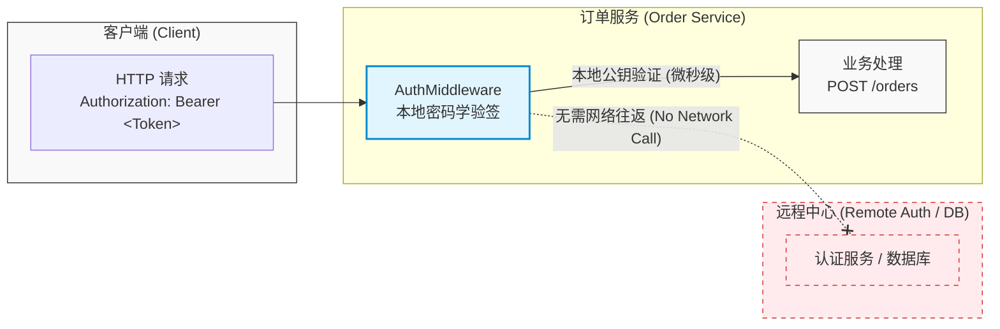
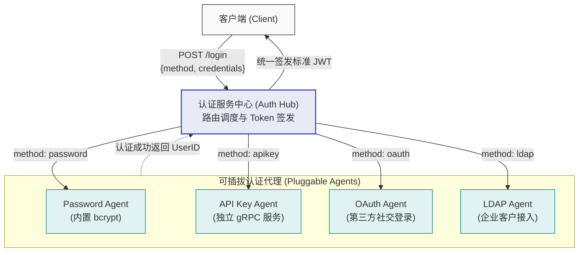
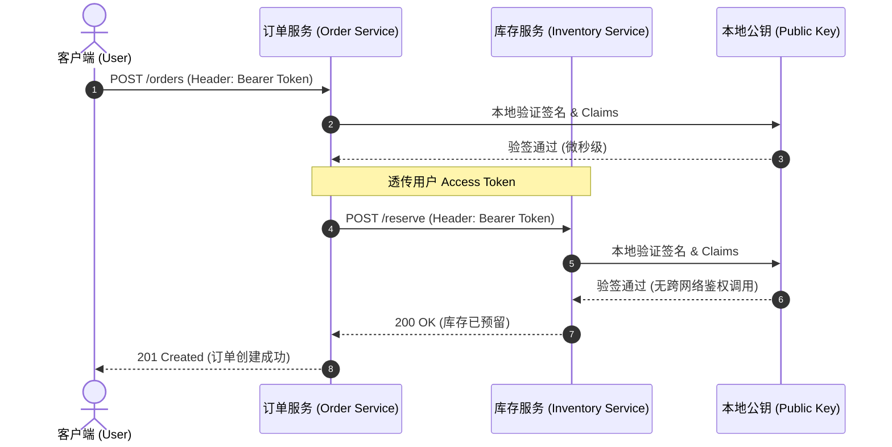

每一个跨越服务边界的请求都来自陌生人。

你的订单服务收到了一个 `POST /orders` 请求。是谁发送的？是一位合法的真实用户？一个自动化脚本？还是某位正在对生产环境进行测试的开发者？

在单进程应用中，身份认证只需要处理一次 —— 在 Web 入口层 —— 认证结果可以通过会话（Session）或 Goroutine 局部存储在系统内随处可用。但在分布式系统中，身份认证必须能够跨越物理进程边界工作，而绝不能在每一次处理请求时都往返调用一次中心认证服务器。正是这一硬性约束，促成了 **JSON Web Token（JWT）** 的广泛采用。

本章将带你亲手构建一套完整的工业级分布式身份认证系统：
- 负责签发凭据的**独立认证服务（Auth Service）**；
- 负责在本地高性能验签的**认证中间件（Auth Middleware）**；
- 负责细粒度权限控制的**角色与作用域授权（RBAC & Scope-Based Authorization）**；
- 支持多种登录方式的**可插拔认证代理（Pluggable Authentication Agents）**；
- 保证用户身份在微服务间无缝流转的 **Token 传播机制（Token Propagation）**。

学完本章，系统中的任何一个微服务都能够仅凭传入的 HTTP 请求头，在本地微秒级识别调用方身份，全程无需任何数据库查询或跨网络 RPC 调用。

---

## 1. 什么是 JWT（What a JWT Is）

JWT（JSON Web Token）是一种紧凑（Compact）、自包含（Self-contained）的安全凭证。它携带了声明（Claims，即关于该 Token 所代表主体的断言），并附带一份由受信任权威机构签发的数字签名，用以向接收方在密码学层面证明：**这些声明确实出自合法签发者，且在传输过程中未经任何篡改**。

JWT 的整体结构由三部分组成，通过点号（`.`）分隔，并统一使用 Base64URL 进行编码：

```text
header.payload.signature
```

### 1. 头部（Header）
头部用于声明签名的加密算法与令牌类型：

```json
{
  "alg": "RS256",
  "typ": "JWT",
  "kid": "key-2026-05"
}
```

### 2. 载荷（Payload）
载荷用于承载具体的业务与身份声明（Claims）：

```json
{
  "sub": "user-123",
  "email": "dev@example.com",
  "role": "customer",
  "scope": "orders:read orders:write",
  "iss": "https://auth.example.com",
  "aud": ["order-service", "inventory-service"],
  "iat": 1717000000,
  "exp": 1717003600
}
```

### 3. 签名（Signature）
签名是对编码后的 Header 与 Payload 通过指定算法计算得到的加密摘要。以 RSA-SHA256（RS256）为例：认证服务持有自己的私钥（Private Key）对内容进行签名；而系统中任何持有对应公钥（Public Key）的下游微服务，都可以独立验证该签名的有效性 —— **整个验签过程完全不需要向认证服务发起任何网络请求**。



这种**无状态验证（Stateless Verification）**是分布式系统最为看重的核心属性。一个携带有效 JWT 的请求到达订单服务后，订单服务仅需消耗微秒级别的 CPU 计算时间执行一次本地密码学验证，即可完成身份确权：
- **无数据库查询（No database lookup）**；
- **无远程网络调用（No network call）**；
- **无跨机共享会话存储（No shared session store）**。

---

## 2. 签名算法选型：HMAC vs RSA vs ECDSA（HMAC vs RSA vs ECDSA）

签名算法的选择直接决定了系统中“谁能够验证 Token”以及整个集群的安全拓扑边界：

| 算法类型 | 常见算法 | 密钥机制 | 验签性能 | 密钥与 Token 尺寸 | 安全信任模型与风险 | 推荐适用场景 |
| :--- | :--- | :--- | :--- | :--- | :--- | :--- |
| **HMAC** | HS256, HS512 | 对称加密（共享 Secret） | 极快（纳秒级） | 极小 | **高风险**：任何持有 Secret 验签的下游服务被攻破，攻击者均可伪造任意全网合法的 Token | 单一进程内、完全受信且规模极小的内部实验项目 |
| **RSA** | RS256, RS512 | 非对称密钥对（私钥签名，公钥验签） | 较慢（约慢 HMAC 100×） | 较大（2048 位公钥较冗长） | **高安全**：消费端仅持公钥，即使被黑客攻破也无法伪造签名 | 需与老旧系统或外部传统 API 强兼容的遗留架构 |
| **ECDSA** | ES256, ES384 | 椭圆曲线非对称签名（P-256 / P-384） | 快（接近对称算法性能） | 极小（尺寸仅约为 RSA 的 1/10） | **高安全**：非对称机制保证私钥零泄露，兼具现代密码学防护标准 | **现代分布式系统的黄金默认标准** |

### 算法深度解析：
- **HMAC（HS256, HS512）**：使用单一的共享密钥（Shared Secret）。同一个密钥既负责签名，又负责验签。这意味着每一个需要验证 Token 的微服务都必须把这个密钥加载到内存中。它实现最简单、执行最快，但安全隐患极大：**一旦集群中任意一个边缘微服务被攻陷，攻击者拿到 HMAC 密钥，就能立刻伪造系统管理员的 Token，导致全系统防线瞬间崩溃**。对于跨团队、多信任域部署的分布式系统而言，这种方案极其危险。
- **RSA（RS256, RS512）**：使用非对称密钥对。认证服务独自持有私钥负责签署 Token；其余所有微服务仅持有公钥用于验证。即便某个消费端微服务被彻底攻破，攻击者也只能拿到公钥 —— 能够读取 Token，但**绝不可能伪造出合法的新 Token**。其代价是：RSA 计算开销显著高于对称加密，且密钥长度通常需要 2048 位以上。
- **ECDSA（ES256, ES384）**：椭圆曲线非对称签名。它保留了 RSA 优秀的非对称安全模型，同时借助现代椭圆曲线密码学大幅缩小了密钥与签名尺寸，并显著提升了计算性能。ES256（基于 NIST P-256 曲线）能够以 RSA 十分之一的密钥体积提供同等甚至更高的安全保障。

> [!IMPORTANT]
> **现代分布式系统的最佳选择**：对于全新构建的云原生分布式系统，请坚决选用 **ES256（基于 P-256 曲线的 ECDSA）**。它快速、紧凑，并且是当前各大安全标准组织一致推荐的黄金标准。

---

## 3. 基于 ECDSA 生成与验证 Token（Generating and Validating Tokens with ECDSA）

下面展示使用标准库 `crypto/ecdsa` 配合社区标准 `github.com/golang-jwt/jwt/v5` 库实现的高性能 Token 签发与强类型验证代码：

```go
package auth

import (
	"crypto/ecdsa"
	"crypto/elliptic"
	"crypto/rand"
	"errors"
	"fmt"
	"time"

	"github.com/golang-jwt/jwt/v5"
)

// Claims 定义了 JWT 载荷中携带的标准与自定义声明
type Claims struct {
	UserID string   `json:"sub"`   // 用户唯一标识（JWT 标准声明 Subject）
	Email  string   `json:"email"` // 用户邮箱
	Role   string   `json:"role"`  // 粗粒度角色（例如 customer, admin）
	Scopes []string `json:"scope"` // 细粒度操作作用域权限
	jwt.RegisteredClaims
}

// GenerateKeyPair 生成用于 Token 签名的全新 ECDSA 密钥对。
// 注意：在真实的生产环境中，密钥应从专用的密钥管理系统（如 HashiCorp Vault、AWS KMS）中加载，
// 而绝不能在每次服务启动运行时动态随机构造。
func GenerateKeyPair() (*ecdsa.PrivateKey, error) {
	return ecdsa.GenerateKey(elliptic.P256(), rand.Reader)
}

// GenerateToken 使用 ECDSA 私钥签署并生成合法的 JWT 字符串
func GenerateToken(
	privateKey *ecdsa.PrivateKey,
	issuer string,
	userID, email, role string,
	scopes []string,
	ttl time.Duration,
) (string, error) {
	claims := Claims{
		UserID: userID,
		Email:  email,
		Role:   role,
		Scopes: scopes,
		RegisteredClaims: jwt.RegisteredClaims{
			Issuer:    issuer,
			IssuedAt:  jwt.NewNumericDate(time.Now()),
			ExpiresAt: jwt.NewNumericDate(time.Now().Add(ttl)),
		},
	}

	// 明确使用 ES256（ECDSA P-256 SHA-256）非对称算法
	token := jwt.NewWithClaims(jwt.SigningMethodES256, claims)
	return token.SignedString(privateKey)
}

// ValidateToken 使用公钥严格解析并验证 JWT 字符串的合法性
func ValidateToken(publicKey *ecdsa.PublicKey, tokenString string) (*Claims, error) {
	token, err := jwt.ParseWithClaims(
		tokenString,
		&Claims{},
		func(token *jwt.Token) (interface{}, error) {
			// 必须主动校验签名算法 —— 坚决防止 "alg: none" 降级攻击
			if _, ok := token.Method.(*jwt.SigningMethodECDSA); !ok {
				return nil, fmt.Errorf("unexpected signing method: %v", token.Header["alg"])
			}
			return publicKey, nil
		},
		jwt.WithValidMethods([]string{"ES256"}), // 强制白名单校验
		jwt.WithIssuedAt(),
	)
	if err != nil {
		return nil, fmt.Errorf("invalid token: %w", err)
	}

	claims, ok := token.Claims.(*Claims)
	if !ok || !token.Valid {
		return nil, errors.New("invalid claims")
	}

	return claims, nil
}
```

### 深度安全防线解析：
1. **`jwt.WithValidMethods([]string{"ES256"})`**：这是一道关键的**纵深防御（Defense-in-depth）**防线，它显式将接收算法限制在严格的 ES256 白名单内。即便开发者在 `keyFunc` 解析回调函数中的算法类型断言逻辑出现疏漏，JWT 底层库也会坚决拒绝任何使用其它算法的恶意伪造 Token。
2. **严防臭名昭著的 `"alg": "none"` 算法漏洞**：在 JWT 的历史上，早期部分库曾因设计不当，允许将 Token 头部的 `"alg"` 声明为 `"none"`（意为无需签名）。攻击者只需截获任意合法 Token，修改其中的声明（如将角色篡改为 `admin`），并将头部篡改为 `"alg": "none"` 且抹去签名部分，某些有缺陷的库就会直接判定该 Token 合法！  
   在上述代码中，我们通过两处强制保障彻底根绝此类威胁：
   - 在 `keyFunc` 回调中对 `token.Method` 实施 `*jwt.SigningMethodECDSA` 的严格类型断言；
   - 在解析器选项中显式注入 `jwt.WithValidMethods([]string{"ES256"})` 白名单规则。

---

## 4. JWKS 端点与动态公钥分发（The JWKS Endpoint）

当微服务架构扩展到几十上百个服务节点时，将公钥以静态配置文件（如 PEM 文件或环境变量）的形式分发是极其脆弱且运维成本极高的：**每当由于密钥轮换（Key Rotation）或安全审计需要更新公钥时，你必须同时重新部署或重启集群中的每一个消费端微服务**。

工业级标准解决方案是 **JWKS（JSON Web Key Set，RFC 7517）端点** —— 认证服务对外暴露一个公开的标准化 HTTP 端点（通常为 `GET /.well-known/jwks.json`），动态发布当前集群信任的公钥集。

```go
// GET /.well-known/jwks.json 端点处理器
func jwksHandler(keys []*ecdsa.PublicKey) http.HandlerFunc {
	return func(w http.ResponseWriter, r *http.Request) {
		jwks := buildJWKS(keys)
		w.Header().Set("Content-Type", "application/json")
		// 设置公开缓存 1 小时，降低高并发对认证服务的冲击
		w.Header().Set("Cache-Control", "public, max-age=3600")
		json.NewEncoder(w).Encode(jwks)
	}
}

// JWKS 代表 RFC 7517 标准定义的公钥集合
type JWKS struct {
	Keys []JWK `json:"keys"`
}

// JWK 代表单张符合 RFC 7517 格式的椭圆曲线公钥
type JWK struct {
	KeyType   string `json:"kty"` // 密钥类型：EC 代表椭圆曲线
	Algorithm string `json:"alg"` // 预期算法：ES256
	Use       string `json:"use"` // 预期用途：sig 代表数字签名
	KeyID     string `json:"kid"` // 密钥唯一标识符，便于多版本管理
	CurveType string `json:"crv"` // 曲线参数：P-256
	X         string `json:"x"`   // 椭圆曲线 X 坐标的 Base64RawURL 编码
	Y         string `json:"y"`   // 椭圆曲线 Y 坐标的 Base64RawURL 编码
}

// buildJWKS 将 Go 标准库的 ecdsa.PublicKey 切片转换为规范的 JWKS 结构
func buildJWKS(keys []*ecdsa.PublicKey) JWKS {
	jwks := JWKS{}
	for i, key := range keys {
		xBytes := key.X.Bytes()
		yBytes := key.Y.Bytes()
		jwks.Keys = append(jwks.Keys, JWK{
			KeyType:   "EC",
			Algorithm: "ES256",
			Use:       "sig",
			KeyID:     fmt.Sprintf("key-%d", i),
			CurveType: "P-256",
			X:         base64.RawURLEncoding.EncodeToString(xBytes),
			Y:         base64.RawURLEncoding.EncodeToString(yBytes),
		})
	}
	return jwks
}
```

### 零停机平滑轮换机制（Zero-Downtime Key Rotation）：
1. **服务冷启动与预加载**：所有业务微服务在进程初始化启动时，通过 HTTP 请求拉取认证服务的 JWKS 公钥列表并加载到本地内存缓存中；
2. **渐进式双密钥灰度**：在进行密钥定期轮换时，认证服务生成新的密钥对，并将新公钥追加到 JWKS 中，**同时保留旧公钥**；
3. **启用新私钥签发**：认证服务开始全面使用新私钥签发新 Token；
4. **平滑验签兼容**：下游微服务如果收到用旧密钥签发的在途 Token，由于本地 JWKS 缓存中依然存在旧公钥，校验依旧成功；
5. **安全淘汰**：等待老 Token 的最大 TTL（通常为 15~60 分钟）完全耗尽后，再安全地从 JWKS 中彻底注销并移除旧公钥。整个过程零网络中断、零业务报错。

> [!TIP]
> 在严肃的工业级生产实践中，推荐优先选用社区成熟的公认库 [`MicahParks/jwks-go`](https://github.com/MicahParks/jwks-go) 或 [`lestrrat-go/jwx`](https://github.com/lestrrat-go/jwx)。它们内部完善封装了 JWKS 的自动拉取、本地内存过期淘汰、并发防击穿（Singleflight）锁控制以及自动平滑重试机制，免除了手写样板代码的繁琐与潜在缺陷。

---

## 5. 认证中间件（Auth Middleware）

我们将 Token 校验逻辑封装为标准的 HTTP 中间件，使其能够无缝插入到第 4 章设计的可组合中间件流水线中：

```go
type contextKey string

const claimsKey contextKey = "claims"

// AuthMiddleware 负责提取 Authorization 请求头中的 Bearer Token 并执行本地验签
func AuthMiddleware(publicKey *ecdsa.PublicKey) Middleware {
	return func(next http.Handler) http.Handler {
		return http.HandlerFunc(func(w http.ResponseWriter, r *http.Request) {
			authHeader := r.Header.Get("Authorization")
			if authHeader == "" {
				WriteError(w,
					http.StatusUnauthorized,
					"MISSING_TOKEN",
					"authorization required")
				return
			}

			// 验证标准 Bearer 格式
			parts := strings.SplitN(authHeader, " ", 2)
			if len(parts) != 2 || !strings.EqualFold(parts[0], "bearer") {
				WriteError(w,
					http.StatusUnauthorized,
					"INVALID_TOKEN_FORMAT",
					"expected Bearer token")
				return
			}

			// 调用本地 ECDSA 密码学验签
			claims, err := ValidateToken(publicKey, parts[1])
			if err != nil {
				// 注意：切勿在此打印日志 —— 任何过期或恶意伪造的 Token 都会触发此处，
				// 打印日志会导致日志系统被洪水般的无效扫描打爆并带来性能损耗
				WriteError(w,
					http.StatusUnauthorized,
					"INVALID_TOKEN",
					"token is invalid or expired")
				return
			}

			// 将解出的 Claims 注入 Context 并传递给下游 Handler
			ctx := context.WithValue(r.Context(), claimsKey, claims)
			next.ServeHTTP(w, r.WithContext(ctx))
		})
	}
}

// ClaimsFromContext 供下游业务 Handler 从 Context 中提取当前已认证的用户声明
func ClaimsFromContext(ctx context.Context) (*Claims, bool) {
	claims, ok := ctx.Value(claimsKey).(*Claims)
	return claims, ok
}
```

### 生产环境安全日志准则：
- **切勿逐条记录每一次非法/过期 Token**：在面临公网黑客探测、恶意脚本暴力爬取或大批量客户端 Token 自然过期刷新时，逐条打 Log 会引发严重的日志风暴（Log Flooding），甚至可能将未经脱敏的敏感凭证信息意外泄露到第三方日志平台中。
- **应重点监控与审计异常安全模式（Unusual Patterns）**：
  1. 来自同一客户端 IP 地址的高频连续非法 Token 突发（疑似暴力碰撞或针对性攻击）；
  2. 签名在密码学上有效，但 `iss`（签发者）或 `aud`（受众）不匹配的凭证（表明可能存在跨环境凭据泄露，如测试环境 Token 被错用于生产集群）；
  3. 携带已明确被列入系统应急黑名单（Blocklist）的凭据发起的调用。

---

## 6. 基于作用域的细粒度授权（Scope-Based Authorization）

在复杂的分布式微服务体系中，单纯依靠粗粒度的**角色（Roles，如 `admin`、`customer`）**往往无法满足最小权限原则（Principle of Least Privilege）。更现代、更具弹性的机制是引入细粒度的**作用域（Scopes）**，例如：`orders:read`（订单只读）、`orders:write`（创建与修改订单）、`inventory:reserve`（库存预留）。

例如：
- 仅持有 `orders:read` 作用域的调用方只能查询历史订单，无权创建或修改新订单；
- 持有 `orders:write` 作用域的调用方则具备写权限。

在 JWT Payload 中的格式体现为：
```json
{
  "scope": "orders:read orders:write"
}
```

### 作用域鉴权中间件实现：

```go
// RequireScope 检查当前请求的 Claims 中是否包含指定的操作作用域
func RequireScope(requiredScope string) Middleware {
	return func(next http.Handler) http.Handler {
		return http.HandlerFunc(func(w http.ResponseWriter, r *http.Request) {
			claims, ok := ClaimsFromContext(r.Context())
			if !ok {
				WriteError(w,
					http.StatusUnauthorized,
					"UNAUTHENTICATED",
					"not authenticated")
				return
			}

			// 检查用户持有的 Scopes 列表中是否命中目标权限
			for _, scope := range claims.Scopes {
				if scope == requiredScope {
					next.ServeHTTP(w, r)
					return
				}
			}

			// 缺少所需 Scope，返回 403 Forbidden 权限不足错误
			WriteError(w, http.StatusForbidden, "INSUFFICIENT_SCOPE",
				fmt.Sprintf("scope %q required", requiredScope))
		})
	}
}
```

### 在路由层按需精准挂载：

```go
mux.Handle("GET /orders/{id}",
	Chain(getOrderHandler(store), RequireScope("orders:read")),
)
mux.Handle("POST /orders",
	Chain(createOrderHandler(store), RequireScope("orders:write")),
)
mux.Handle("DELETE /orders/{id}",
	Chain(deleteOrderHandler(store), RequireScope("orders:admin")),
)
```

### 角色（Roles）与作用域（Scopes）的最佳协同实践：
- **角色（Roles）**：用于宏观的主体分类与业务身份归属（如 `admin` 运维管理员、`customer` 终端买家、`operator` 运营调度员）；
- **作用域（Scopes）**：用于微观的具体 API 端点操作授权。

在签发 Token 时，可以将两者一并注入载荷中。下游服务在处理粗粒度管理端点时校验角色，在细粒度开放 API 与微服务间交互时校验作用域，实现灵活性与安全性的统一。

---

## 7. 认证服务的核心实现（The Auth Service）

在分布式系统中，用户认证逻辑必须高度内聚并收敛在专门的**认证服务（Auth Service）**中。系统中的其它任何业务微服务都绝不能直接触碰用户密码表或自行签发用户级凭据 —— 它们只负责消费公钥来验证凭据。

认证服务承担着三大核心职责：
1. **注册新用户并以高安全规格存储凭据**；
2. **验证登录凭据，并签发成对的短效 Access Token 与长效 Refresh Token**；
3. **基于有效的 Refresh Token，原子安全换发新的 Access Token**。

### 基于 bcrypt 的密码哈希存储

```go
import (
	"fmt"
	"golang.org/x/crypto/bcrypt"
)

// bcryptCost 设置为 12。在现代主流硬件上，Cost 12 计算单次哈希约耗时 300ms
const bcryptCost = 12

// hashPassword 使用带有随机盐的 bcrypt 算法对明文密码进行安全哈希
func hashPassword(password string) (string, error) {
	hash, err := bcrypt.GenerateFromPassword([]byte(password), bcryptCost)
	if err != nil {
		return "", fmt.Errorf("hash password: %w", err)
	}
	return string(hash), nil
}

// verifyPassword 比对数据库中存储的哈希串与用户输入的明文密码
func verifyPassword(hash, password string) bool {
	return bcrypt.CompareHashAndPassword([]byte(hash), []byte(password)) == nil
}
```

> [!NOTE]
> **为什么单次哈希需要刻意设计为 300ms？**  
> bcrypt 是一种专门设计的“计算密集型慢哈希算法”。对于注册和登录这种人机交互低频操作，300ms 的延迟对人类用户几乎完全无感；但对黑客而言，这使得离线字典攻击与彩虹表暴力破解的计算成本直接暴增了数万倍！**严正告诫：绝对不能将 bcrypt 用于每秒需要被调用数次以上的高频业务 API 主链路上。**

### 登录处理器（Login Handler）

```go
func loginHandler(
	store UserStore,
	privateKey *ecdsa.PrivateKey,
	cfg AuthConfig,
) http.HandlerFunc {
	return func(w http.ResponseWriter, r *http.Request) {
		var req struct {
			Email    string `json:"email"`
			Password string `json:"password"`
		}

		if err := DecodeJSON(r, &req); err != nil {
			WriteError(w,
				http.StatusBadRequest,
				"INVALID_REQUEST",
				err.Error())
			return
		}

		if req.Email == "" || req.Password == "" {
			WriteError(w,
				http.StatusBadRequest,
				"MISSING_FIELDS",
				"email and password required")
			return
		}

		user, err := store.FindByEmail(r.Context(), req.Email)
		if err != nil || !verifyPassword(user.PasswordHash, req.Password) {
			// 重要安全设计：无论“用户不存在”还是“密码错误”，统一返回相同的模糊错误信息，
			// 坚决防止攻击者通过响应差异暴力枚举（Enumerate）系统中的合法注册邮箱
			WriteError(w,
				http.StatusUnauthorized,
				"INVALID_CREDENTIALS",
				"invalid email or password")
			return
		}

		// 1. 签发短寿命的 JWT Access Token（例如 15 分钟）
		accessToken, err := GenerateToken(privateKey, cfg.Issuer,
			user.ID, user.Email, user.Role, user.Scopes, cfg.AccessTokenTTL)
		if err != nil {
			slog.ErrorContext(r.Context(),
				"generate access token failed",
				"error",
				err)
			WriteError(w,
				http.StatusInternalServerError,
				"INTERNAL_ERROR",
				"internal server error")
			return
		}

		// 2. 签发长寿命的 Refresh Token（持久化存储在数据库中）
		refreshToken, err := store.CreateRefreshToken(r.Context(),
			user.ID,
			cfg.RefreshTokenTTL)
		if err != nil {
			slog.ErrorContext(r.Context(),
				"create refresh token failed",
				"error",
				err)
			WriteError(w,
				http.StatusInternalServerError,
				"INTERNAL_ERROR",
				"internal server error")
			return
		}

		w.Header().Set("Content-Type", "application/json")
		json.NewEncoder(w).Encode(TokenPair{
			AccessToken:  accessToken,
			RefreshToken: refreshToken,
			ExpiresIn:    int(cfg.AccessTokenTTL.Seconds()),
		})
	}
}
```

### Refresh Token 的本质与单次轮换机制（Single-Use Token Rotation）
Refresh Token **绝不是 JWT**，而是一个由高强度加密随机数发生器生成的**不透明随机字符串（Opaque String）**，存储在后端的数据库中并附带明确的过期时间。它不包含任何可被篡改的 Claims。数据库记录将它与具体的 `user_id` 强关联。

当客户端的短效 Access Token 过期时，客户端向认证服务出示 Refresh Token；认证服务对其校验通过后，签发新的 Access Token，并**立即在数据库中废弃旧的 Refresh Token 并下发全新的 Refresh Token**（即单次轮换机制，防止重放与令牌窃听）。

### 令牌刷新处理器（Refresh Handler）

```go
func refreshHandler(
	store UserStore,
	privateKey *ecdsa.PrivateKey,
	cfg AuthConfig,
) http.HandlerFunc {
	return func(w http.ResponseWriter, r *http.Request) {
		var req struct {
			RefreshToken string `json:"refresh_token"`
		}
		if err := DecodeJSON(r, &req); err != nil {
			WriteError(w,
				http.StatusBadRequest,
				"INVALID_REQUEST",
				err.Error())
			return
		}

		// 验证并原子轮换刷新令牌（在单事务中执行，防止并发竞争）
		userID, newRefreshToken, err := store.RotateRefreshToken(r.Context(),
			req.RefreshToken)
		if err != nil {
			if errors.Is(err, ErrTokenNotFound) || errors.Is(err, ErrTokenExpired) {
				WriteError(w,
					http.StatusUnauthorized,
					"INVALID_REFRESH_TOKEN",
					"refresh token invalid or expired")
				return
			}
			slog.ErrorContext(r.Context(),
				"rotate refresh token failed",
				"error",
				err)
			WriteError(w,
				http.StatusInternalServerError,
				"INTERNAL_ERROR",
				"internal server error")
			return
		}

		user, _ := store.FindByID(r.Context(), userID)

		// 使用最新用户信息签发全新的 Access Token
		accessToken, _ := GenerateToken(privateKey, cfg.Issuer,
			user.ID, user.Email, user.Role, user.Scopes, cfg.AccessTokenTTL)

		w.Header().Set("Content-Type", "application/json")
		json.NewEncoder(w).Encode(TokenPair{
			AccessToken:  accessToken,
			RefreshToken: newRefreshToken,
			ExpiresIn:    int(cfg.AccessTokenTTL.Seconds()),
		})
	}
}
```

### 原子轮换的并发竞争防御：
`RotateRefreshToken` 必须在一个原子的数据库事务内完成：它在同一事务中删除旧 Token 记录并插入新 Token 记录。如果移动端客户端在弱网环境下由于并发重试同时发送了两次相同的 Refresh Token 请求，由于原子性约束，**仅有一个请求能够成功**。并发失败的另一个请求将收到 `401 Unauthorized` 拒绝响应，从而强制重新登录，杜绝令牌重放隐患。

---

## 8. 可插拔认证代理架构（Pluggable Authentication Agents）

上述认证服务完整实现了传统的账号/密码登录。然而在真实的大型系统中，身份凭证的形式极其多样：
- 供内部微服务或机器调用方使用的 **API Key**；
- 供终端用户使用的 **OAuth 2.0 / OIDC 社交登录（Google、GitHub 等）**；
- 供企业级客户对接的 **LDAP / Active Directory / SAML**；
- 供现代无密码设备使用的 **WebAuthn / Passkeys**。

如果把每一种认证方式的校验代码都直接塞进认证服务中，认证服务将迅速蜕化为一个臃肿的“大杂烩”，并与外部所有第三方认证协议产生强耦合。

更优雅的分布式架构是**中心-轮辐架构（Hub-and-Spoke Architecture）**：
认证服务本身演化为一个纯粹的调度中心（Hub），它将具体的认证请求按类型派发给可插拔的**代理服务（Agent Services）**。每个 Agent 独立运行，只专注于精通某一种特定的认证机制。新增一种认证机制只需独立部署一个新的 Agent 服务，**认证服务核心代码完全零修改**！



### Agent 接口与 Hub 调度器实现：

```go
// Agent 定义了所有可插拔认证方式必须实现的通用接口
type Agent interface {
	// Authenticate 接收不同方式自定义的 JSON 凭据，并在验证成功后返回系统统一的用户 ID
	Authenticate(ctx context.Context, credentials json.RawMessage) (string, error)
}

// Hub 统一维护支持的认证方式注册表
type Hub struct {
	mu     sync.RWMutex
	agents map[string]Agent // 例如 "password" -> 密码代理, "apikey" -> API Key 代理
}

func (h *Hub) Register(method string, agent Agent) {
	h.mu.Lock()
	defer h.mu.Unlock()
	h.agents[method] = agent
}

func (h *Hub) Authenticate(ctx context.Context, method string, credentials json.RawMessage) (string, error) {
	h.mu.RLock()
	agent, ok := h.agents[method]
	h.mu.RUnlock()

	if !ok {
		return "", fmt.Errorf("unknown auth method: %s", method)
	}
	return agent.Authenticate(ctx, credentials)
}
```

### 基于 Hub 改造的统一登录入口：

```go
func loginHandler(hub *Hub, tokenManager *TokenManager) http.HandlerFunc {
	return func(w http.ResponseWriter, r *http.Request) {
		var req struct {
			Method      string          `json:"method"`      // 例如 "password", "apikey", "oauth"
			Credentials json.RawMessage `json:"credentials"` // 特定认证方式自有的载荷数据
		}

		if err := DecodeJSON(r, &req); err != nil {
			WriteError(w,
				http.StatusBadRequest,
				"INVALID_REQUEST",
				err.Error())
			return
		}

		// 将凭据动态派发至对应的 Agent 执行解耦验证
		userID, err := hub.Authenticate(r.Context(),
			req.Method,
			req.Credentials)
		if err != nil {
			WriteError(w,
				http.StatusUnauthorized,
				"AUTH_FAILED",
				"authentication failed")
			return
		}

		// 验证通过，统一生成并签署标准的 JWT
		token, _ := tokenManager.Issue(userID)
		w.Header().Set("Content-Type", "application/json")
		json.NewEncoder(w).Encode(token)
	}
}
```

### 代理服务的独立启动与 gRPC 动态注册：

```go
// APIKeyAgent 在自身独立进程启动时，通过 gRPC 将自己注册到中央 Hub
func (a *APIKeyAgent) RegisterWithHub(ctx context.Context, hubAddr string) error {
	conn, err := grpc.NewClient(hubAddr,
		grpc.WithTransportCredentials(insecure.NewCredentials()))
	if err != nil {
		return err
	}

	client := NewHubClient(conn)
	_, err = client.RegisterAgent(ctx, &RegisterAgentRequest{
		Method:  "apikey",
		Address: a.serviceAddr, // Hub 后续收到 API Key 认证请求时，将反向 RPC 回调此地址
	})
	return err
}
```

### 架构演进价值：
当客户端出示 `"method": "apikey"` 时，Hub 通过 RPC 调用 API Key Agent 并透传凭据。API Key Agent 执行校验并返回用户 ID。**Hub 从始至终不需要了解 API Key 的哈希方式、不需要存储 API Key 数据库、在 API Key 格式升级时也无需重新发布**。

Hub 是**路由器（Router）**，Agent 才是具体的**认证器（Authenticator）**。未来系统若需支持 OAuth 登录，只需编写并上线一个 OAuth Agent，执行 `hub.Register("oauth", oauthAgent)` 即可平滑支持。

---

## 9. 跨服务间的 Token 传播（Token Propagation Between Services）

在分布式系统中，当订单服务（服务 A）代表终端用户调用库存服务（服务 B）预留库存时，必须向下游透传该用户的 Access Token：

```go
func callInventoryService(
	ctx context.Context,
	token, productID string,
	qty int,
) error {
	req, err := http.NewRequestWithContext(ctx, "POST",
		"http://inventory-service/reserve",
		strings.NewReader(fmt.Sprintf(`{"product_id":%q,"quantity":%d}`, productID, qty)),
	)
	if err != nil {
		return err
	}
	req.Header.Set("Content-Type", "application/json")
	// 将当前受保护链路中的用户 Bearer Token 原样透传给下游服务
	req.Header.Set("Authorization", "Bearer "+token)

	resp, err := http.DefaultClient.Do(req)
	// 处理下游响应...
	_ = resp
	return err
}
```

下游库存服务挂载自己的 `AuthMiddleware`，使用公钥在本地解密并校验 Token，读出完全一致的 Claims。**全链路无需二次往返中心认证服务器，无需共享内存或 Redis 存储**。用户的身份以一份不可伪造的、自包含的数字凭据形式，在整个分布式集群调用链路中自由穿梭。



> [!CAUTION]
> **服务间身份鉴权的绝对铁律**：  
> 用户的 Access Token **仅适用于代表终端用户发起的业务调用链路**。对于不代表具体用户的后台离线作业、定期结算任务、系统级健康同步等纯系统间调用（Machine-to-Machine），**必须使用专属的服务令牌（Service Token，详见第 9 章）**。  
> 严禁在后台任务中混用或假借普通用户的 JWT！否则不仅会导致全链路审计追踪日志彻底失真，还会给系统引入权限越界的巨大安全风险。

---

## 10. 将认证集成到服务中间件链（Adding Auth to the Service Chain）

将 `AuthMiddleware` 融入第 4 章构建的通用中间件链条中：

```go
// 初始尝试：作为全局链的一部分
handler := Chain(
	mux,
	RecoverMiddleware,
	RequestIDMiddleware,
	TimeoutMiddleware(cfg.HTTPTimeout),
	LoggingMiddleware,
	BodyCloseMiddleware,
	AuthMiddleware(publicKey), // 对挂载在 mux 上的所有路由进行拦截校验
)
```

然而，一个服务中往往同时存在**公开路由（Public Routes）**与**受保护路由（Protected Routes）**。例如健康检查探针 `/healthz/live`、登录接口 `/auth/login`、刷新接口 `/auth/refresh` 必须对公网或未登录用户开放。如果将 `AuthMiddleware` 直接挂载在全局链上，所有未携带 Token 的健康检查和登录请求都会被无差别拦截（401 Unauthorized）。

最干净、最稳健的工程实践是：**保持全局链纯净（仅包含 Panic 恢复、Request ID、超时控制、访问日志等基础通用设施），而将身份认证与作用域校验按路由（Per-Route）显式声明挂载**：

```go
// 1. 公开路由 —— 无需认证拦截
mux.HandleFunc("GET /healthz/live", livenessHandler)
mux.HandleFunc("POST /auth/login", loginHandler(store, privateKey, cfg))
mux.HandleFunc("POST /auth/refresh", refreshHandler(store, privateKey, cfg))

// 2. 受保护业务路由 —— 按需挂载 Auth 与 Scope 中间件
mux.Handle("GET /orders/{id}",
	Chain(getOrderHandler(store),
		AuthMiddleware(publicKey),
		RequireScope("orders:read")))

mux.Handle("POST /orders",
	Chain(createOrderHandler(store),
		AuthMiddleware(publicKey),
		RequireScope("orders:write")))
```

这种显式声明的方式优于“全局过滤并在中间件内维护黑白名单正则匹配”。代码读起来清晰直接，任何工程师在维护路由表时，哪条接口公开、哪条接口需要什么权限一目了然。

---

## 11. 认证逻辑的自动化测试（Testing Auth）

在编写认证相关的单元测试与集成测试时，切忌依赖外部的真实认证服务或静态生产密钥文件。最佳模式是在测试用例内部**动态临时生成一套专用的 ECDSA 密钥对**，并使用 `httptest.NewServer` 构建轻量化的测试环境：

```go
package auth_test

import (
	"net/http"
	"net/http/httptest"
	"testing"
	"time"

	"platform/auth"
	"platform/middleware"
)

// TestAuthMiddleware_Valid 测试合法 Token 的正确解析与 Context 注入
func TestAuthMiddleware_Valid(t *testing.T) {
	// 为本测试独立生成临时的密钥对，杜绝污染与依赖
	privateKey, _ := auth.GenerateKeyPair()
	publicKey := &privateKey.PublicKey

	// 签发有效期为 1 小时的合法测试 Token
	token, _ := auth.GenerateToken(privateKey, "test-issuer",
		"user-123", "test@example.com", "customer",
		[]string{"orders:read"}, time.Hour)

	// 构建包含 AuthMiddleware 的测试处理器
	handler := middleware.Chain(
		http.HandlerFunc(func(w http.ResponseWriter, r *http.Request) {
			claims, ok := auth.ClaimsFromContext(r.Context())
			if !ok {
				t.Error("claims not in context")
				return
			}
			if claims.UserID != "user-123" {
				t.Errorf("user ID: got %q, want user-123", claims.UserID)
			}
			w.WriteHeader(http.StatusOK)
		}),
		auth.AuthMiddleware(publicKey),
	)

	srv := httptest.NewServer(handler)
	defer srv.Close()

	req, _ := http.NewRequest("GET", srv.URL+"/test", nil)
	req.Header.Set("Authorization", "Bearer "+token)

	resp, _ := http.DefaultClient.Do(req)
	if resp.StatusCode != http.StatusOK {
		t.Errorf("status: got %d, want 200", resp.StatusCode)
	}
}

// TestAuthMiddleware_Expired 测试过期 Token 能够被严格拦截并返回 401
func TestAuthMiddleware_Expired(t *testing.T) {
	privateKey, _ := auth.GenerateKeyPair()
	publicKey := &privateKey.PublicKey

	// 故意签发 1 小时前就已经过期的测试 Token
	token, _ := auth.GenerateToken(privateKey, "test-issuer",
		"user-123", "test@example.com", "customer",
		[]string{"orders:read"}, -time.Hour)

	handler := middleware.Chain(
		http.HandlerFunc(func(w http.ResponseWriter, r *http.Request) {
			// 如果这个 Handler 被触发，说明中间件放行了非法 Token，测试失败
			t.Error("handler should not be called with expired token")
		}),
		auth.AuthMiddleware(publicKey),
	)

	srv := httptest.NewServer(handler)
	defer srv.Close()

	req, _ := http.NewRequest("GET", srv.URL+"/test", nil)
	req.Header.Set("Authorization", "Bearer "+token)

	resp, _ := http.DefaultClient.Do(req)
	if resp.StatusCode != http.StatusUnauthorized {
		t.Errorf("status: got %d, want 401", resp.StatusCode)
	}
}
```

### 测试工程精髓：
- 使用轻量临时密钥对消除环境依赖；
- 覆盖正常路径（Happy Path）验证 Context 声明是否完整准确传递；
- 覆盖过期、格式篡改、空 Header 等负面路径，确保中间件坚决阻断调用并严格返回规范的 HTTP 401 响应码。

---

## 12. 章节问答（Q&A）

### Q1：我应该选用对称加密 HS256（HMAC）还是非对称加密 RS256/ES256？
**答：对于新构建的现代分布式系统，必须首选 ES256。**  
HMAC 要求所有需要验签的下游微服务都持有同一个共享密钥。一旦集群中任何一个下游服务的容器或配置文件被黑客攻陷，攻击者即可掌握该密钥，并在全网伪造任意合法身份的 Token。而在 ES256 架构下，只有认证服务掌管私钥，全网消费端仅持有公开的公钥。公钥泄露对系统安全性没有任何实质影响，攻击者绝无法借助公钥伪造出有效签名。虽然对称加密计算速度更快，但现代 CPU 执行 ECDSA 验签的耗时仅有数十微秒，在真实的微服务吞吐量场景下性能损耗完全可以忽略不计。

### Q2：当业务需要强制提前吊销某个尚未过期的 Token 时（如密码被盗或管理员强制下线），该如何处理？
**答：无状态 JWT 无法在完全不依赖服务端状态的前提下单方面提前吊销。**  
在实际生产中，根据系统架构复杂度和一致性要求的不同，有三种渐进式方案：
1. **短 Access Token TTL（业界最通用标准）**：将访问令牌的有效期设置得足够短（如 15 分钟），将安全暴露的时间窗口限制在可接受的极小范围内；
2. **基于 Redis 的轻量黑名单（Blocklist）**：当用户注销或密码变更时，将该 Token 的唯一编号（`jti`）写入 Redis 黑名单，并设置与 Token 剩余寿命一致的 TTL。中间件在验签时快速比对一次 Redis（只有被主动吊销的 Token 才会命中）；
3. **完全不透明 Token（Opaque Token）**：彻底放弃无状态设计，所有请求强制回查中心数据库，具备最强的即时吊销能力，但彻底丧失了无状态本地验签的高吞吐扩展性。  
对于绝大多数分布式架构，**短效 Access Token + 数据库原子即时可吊销的 Refresh Token** 是安全与吞吐兼顾的最优解。

### Q3：如何在生产环境中实现零停机（Zero-Downtime）平滑轮换签名公私钥？
**答：借助 JWKS 端点实施多版本渐进式轮换。**  
具体标准实操流程：
1. 认证服务生成新密钥对，将新公钥追加到 `/.well-known/jwks.json` 的公钥列表中（此时 JWKS 中同时存在新、旧两个公钥）；
2. 各下游微服务拉取并更新本地内存中的 JWKS 公钥缓存；
3. 认证服务将当前签名私钥切换为新私钥，开始用新密钥签发新 Token；
4. 此时网络中尚在有效期内、由旧私钥签署的在途 Token 依旧能够顺利通过下游服务校验（因为旧公钥依然在 JWKS 缓存中）；
5. 静默等待一个完整的 Access Token TTL（例如 15~60 分钟），确保网络中存留的所有旧 Token 自然耗尽失效；
6. 从 JWKS 列表中安全剔除旧公钥，轮换宣告圆满完成。

### Q4：什么是 `"alg": "none"` 算法漏洞？
**答：这是早年部分 JWT 库在规范解析实现上的严重逻辑缺陷。**  
在 JWT 规范草案中曾允许将签名算法设置为 `"none"`，代表此 Token 无需加密签名。攻击者截获一份合法用户的普通 Token 后，将 Payload 中的用户角色篡改为 `"admin"`，随后将 Header 中的 `"alg"` 改为 `"none"` 并抹去最后的签名部分。在早期存在缺陷的库中，解析器看到 `"alg": "none"` 便直接跳过验签流程，认定 Token 合法并放行。  
防范此漏洞必须实施双重防御：
- 在 `ValidateToken` 的密钥回调函数（`keyFunc`）中强制断言算法类型为 `*jwt.SigningMethodECDSA`；
- 在解析配置中通过 `jwt.WithValidMethods([]string{"ES256"})` 设置硬编码的算法白名单。

### Q5：微服务间非代表终端用户的后台调用（Machine-to-Machine），应该如何鉴权？
**答：必须使用专属的“服务令牌（Service Token）”。**  
服务令牌是专门在微服务部署或启动时，由认证服务签发给微服务自身的专用凭据。它的 `sub` 声明标识的是调用方微服务本身（如 `sub: "cron-job-scheduler"` 或 `sub: "billing-service"`），而非某个自然人；其 `scope` 中仅包含该系统内部交互所需的权限。第 9 章将详细剖析服务令牌的流转设计。**绝对不要用普通用户的 JWT 来假借身份执行机器级调用** —— 否则会导致安全审计日志彻底混乱，并在权限边界上引发严重的越权漏洞。

---

## 13. SDK 沉淀：平台级认证库设计（What Goes in the SDK）

身份认证是微服务架构中最容易被各团队反复重写、同时也是最容易因手滑产生重大安全漏洞的模块。必须将其统一抽取并沉淀到跨服务的公共基础库 `platform/auth` 中：

```text
platform/auth/
├── token.go       — 基于 ECDSA 的 GenerateToken 与 ValidateToken 实现
├── claims.go      — Claims 声明结构体与 ClaimsFromContext 辅助注入提取方法
├── middleware.go  — 生产级 AuthMiddleware, RequireScope, RequireRole 中间件
├── jwks.go        — JWKS 结构体, JWK 规范类型, 以及 jwksHandler 服务端端点
├── service.go     — 机器间调用专用的 ServiceToken 签发与鉴权逻辑
├── password.go    — 基于 bcrypt 的安全密码散列 hashPassword 与 verifyPassword
├── hub.go         — 可插拔认证 Hub 与 Agent 接口规范定义
└── jwks_client.go — 下游消费端自动拉取并高效缓存公钥的 JWKSClient
```

### SDK 的架构边界价值：
下游业务微服务如果需要验证用户 Token，只需引入 `platform/auth` 并调用一行 `auth.AuthMiddleware(publicKey)` 即可。业务代码**严禁直接导入或调用底层第三方 JWT 库**。SDK 团队收敛并全权负责所有密码学计算、防降级攻击策略与合规性；业务团队则完全专注于自身的业务逻辑。

### 客户端 JWKS 自动拉取与无锁缓存实现：

```go
// platform/auth/jwks_client.go

package auth

import (
	"context"
	"crypto/ecdsa"
	"sync"
	"sync/atomic"
)

// JWKSClient 负责在消费端自动获取、解析并高性能本地缓存认证服务的公钥
type JWKSClient struct {
	endpoint string
	cache    atomic.Pointer[ecdsa.PublicKey] // 使用 atomic.Pointer 实现高并发无锁零争用读取
	mu       sync.Mutex                      // 互斥锁，用于在缓存失效或冷启动时防止并发击穿
}

// GetPublicKey 获取当前有效的验签公钥
func (c *JWKSClient) GetPublicKey(ctx context.Context) (*ecdsa.PublicKey, error) {
	// 极快路径（Fast Path）：原子读取本地缓存指针，99.999% 的请求在此微秒级返回
	if key := c.cache.Load(); key != nil {
		return key, nil
	}
	// 慢路径（Slow Path）：冷启动或缓存过期，加锁向远程 JWKS 端点拉取并更新缓存
	return c.fetchAndCache(ctx)
}
```

### 运行机制剖析：
借助 Go 标准库的 `atomic.Pointer`，绝大多数常规 HTTP 请求在执行 Token 验签时，仅需一次本地原子内存指针寻址即可拿到公钥，不存在任何锁竞争与网络开销。只有在进程刚启动（冷启动）或密钥轮换触发公钥刷新时，才会进入带锁保护的 `fetchAndCache` 慢路径。业务团队只需在初始化时调用 `auth.NewJWKSClient(authServiceURL)`，从此彻底告别公钥同步与证书分发的运维心智负担。

---

### 下一章预告
身份认证解决了“**来者何人（Who is calling）**”的身份与边界信任问题。在掌握了安全的跨网络调用之后，我们必须将目光投向分布式架构中最核心、同时也是最复杂的资产 —— **数据（Where the data lives）**。

在接下来的 **第 6 章：数据库访问与迁移（Database Access and Migrations）** 中，我们将深入剖析在多实例高并发场景下安全使用 PostgreSQL 的最佳实践、连接池调优法则、零停机数据库平滑迁移（Zero-Downtime Migrations）策略，以及捍卫微服务独立自治底线的“**一服务一数据库（One Database Per Service）**”工程铁律。

---

> 💡 **专栏导航**：
> - 专栏目录：[《Go 云原生分布式系统实战》全集路线图](/columns/distributed-go)
> - 专栏广场：[浏览全部技术专栏](/columns)
> - 上一篇：[Go 分布式系统实战（四）：HTTP 服务与中间件链路：Go 1.22 原生路由与核心中间件](/posts/2026-10-18-distributed-go-04-http-middleware)
> - 下一篇：[Go 分布式系统实战（六）：数据库访问与平滑迁移：连接池调优与 Expand-Contract 模式](/posts/2026-10-18-distributed-go-06-database-migrations)
