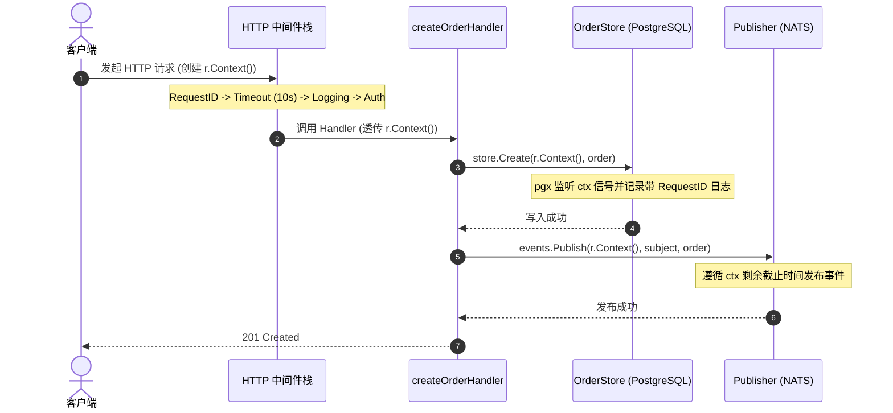

> 💡 **专栏导读**：本文收录于专栏 [《Go 云原生分布式系统实战》](/columns/distributed-go)。全专栏共 17 篇，深入剖析现代 Go 在并发模型、微服务通信、JWT 鉴权、分布式事务、可观测性与生产集群落地的完整工程实践。

这里有一个极易产生却极难排查的典型系统故障。

用户在发起 HTTP 请求 2 秒后选择取消，其浏览器随即关闭了网络连接。此时，你的后端服务正处于一项复杂操作的执行中途：它已经向数据库写入了数据，正在调用下游服务，并准备更新缓存。当客户端断开连接时，系统会发生什么？

如果你没有正确使用 `context.Context`：**什么都不会发生**。数据库写入照常完成，下游服务调用照常完成，缓存更新照常完成。你的服务为了一个早已被取消的请求倾尽全力完成了所有繁重工作，白白燃烧 CPU、内存与连接池资源，最终计算出一个根本无人读取的结果。

将这一现象放大到高并发生产环境 —— 客户端在超时后不断重试被取消的请求，缓慢的下游服务导致大量在途（In-flight）操作堆积如山，即使计算结果被随手丢弃，所有操作依然固执地运行直至结束 —— 你就面临了一个从外部监控指标看起来极像内存泄漏（Memory Leak）的资源耗尽危机。

`context.Context` 正是解决这一难题的终极方案。本章的核心就是将 Context 严密串联到请求的整个生命周期中，使得“取消”信号能够级联扩散到系统的每一个角落，而非仅仅停留在最外层。

---

## 1. Context 树是如何失效的（How the Context Tree Fails）

在第 2 章中你已经掌握了 Context 的核心原理。下面来看它在真实生产服务中的具体失效模式：

```go
// 处理函数从 HTTP 框架接收一个 Context。
// 当客户端断开连接时，该 Context 会被自动取消。
func createOrderHandler(store OrderStore, events Publisher) http.HandlerFunc {
    return func(w http.ResponseWriter, r *http.Request) {
        var order Order
        if err := json.NewDecoder(r.Body).Decode(&order); err != nil {
            WriteError(w,
                http.StatusBadRequest,
                "INVALID_REQUEST",
                err.Error())
            return
        }

        // BUG：context.Background() 彻底无视了客户端的取消信号
        if err := store.Create(context.Background(), order); err != nil {
            WriteError(w,
                http.StatusInternalServerError,
                "STORE_ERROR",
                err.Error())
            return
        }

        // BUG：context.Background() 彻底无视了客户端的取消信号
        if err := events.Publish(context.Background(),
            "orders.created",
            order); err != nil {
            WriteError(w,
                http.StatusInternalServerError,
                "PUBLISH_ERROR",
                err.Error())
            return
        }

        w.WriteHeader(http.StatusCreated)
    }
}
```

在上面的代码中，数据库写入和事件发布都使用了 `context.Background()` —— 一个**永远不会被取消**的根 Context。当客户端断开连接时，`r.Context()` 确实收到了取消信号，但两个下游调用对此全然不知，耗时的远程调用依然我行我素地继续执行。

> [!WARNING]
> 在 HTTP 处理函数中使用 `context.Background()` 是一个严重的系统级 Bug。它直接斩断了取消信号树（Cancellation Tree）。每一个下游调用 —— 无论是数据库、消息队列还是 gRPC —— 都会继续全力处理一个客户端早已抛弃的死请求。在高并发且下游响应迟缓的场景下，这些孤儿请求会迅速累积，最终演变成一场看似内存泄漏的资源耗尽灾难。

正确的修复方式是**在整个调用链中全流程传递 `r.Context()`**：

```go
func createOrderHandler(store OrderStore, events Publisher) http.HandlerFunc {
    return func(w http.ResponseWriter, r *http.Request) {
        var order Order
        if err := json.NewDecoder(r.Body).Decode(&order); err != nil {
            WriteError(w,
                http.StatusBadRequest,
                "INVALID_REQUEST",
                err.Error())
            return
        }

        // 传递 r.Context()
        if err := store.Create(r.Context(), order); err != nil {
            if r.Context().Err() != nil {
                return // 客户端已断开连接，静默终止处理
            }
            WriteError(w,
                http.StatusInternalServerError,
                "STORE_ERROR",
                err.Error())
            return
        }

        // 传递 r.Context()
        if err := events.Publish(r.Context(),
            "orders.created",
            order); err != nil {
            if r.Context().Err() != nil {
                return // 客户端已断开连接，静默终止处理
            }
            WriteError(w,
                http.StatusInternalServerError,
                "PUBLISH_ERROR",
                err.Error())
            return
        }

        w.WriteHeader(http.StatusCreated)
    }
}
```

现在，当客户端断开连接时：
- `r.Context()` 立即被取消；
- 数据库写入被及时中断（pgx 底层驱动会主动监听 Context 信号并中止查询）；
- 事件发布被及时中断（我们实现的 Publisher 会主动检查 Context 状态）；
- 处理函数直接返回，不再向已经关闭的网络连接写入任何无意义的响应。

没有任何浪费的工作。所有系统资源 —— 数据库连接、Goroutine 以及下游调用 —— 都会在第一时间被优雅释放。

---

## 2. Context 规范与纪律（The Context Discipline）

在分布式系统中，正确传递 Context 需要遵守一套不容妥协的工程纪律：

> **核心纪律**：**每一个执行 I/O 操作的函数，都必须将 `ctx context.Context` 作为其第一个参数，并在该函数发起的每一次 I/O 调用中传递和使用它。**

这不是可有可无的辅助设施，而是 Go 语言提供的在整个调用栈中传播取消信号的**唯一机制**。没有 Context，就没有取消信号的传播。

当你编写一个需要调用其他感知 Context 函数的新函数时，规则非常简单明确：**接收 Context，并向下透传。绝不要在一个已经接收了 Context 的函数内部重新创建 `context.Background()`。** 在整个软件工程中，`context.Background()` 唯三合法的出现场所只有 `main` 函数、单元测试以及服务初始化阶段 —— 它们是 Context 树的天然根节点。

```go
// 规范做法：Context 贯穿调用链（Good: context flows through）
func processOrder(ctx context.Context,
    order Order,
    store OrderStore,
    events Publisher,
) error {
    if err := validateOrder(ctx, order, store); err != nil {
        return err
    }
    if err := store.Create(ctx, order); err != nil {
        return err
    }
    return events.Publish(ctx, "orders.created", order)
}

// 违规做法：在函数内部自行创建 Context（Bad: context created inside）
func processOrder(order Order, store OrderStore, events Publisher) error {
    ctx := context.Background() // ← 错误：斩断了调用链
    if err := validateOrder(ctx, order, store); err != nil {
        return err
    }
    // ...
}
```

第二种反模式实现看似与规范版本相差无几，但它在悄然之间粉碎了取消信号树。调用方传入的任何 Context —— 无论其包含剩余截止时间、链路追踪 ID 还是取消信号 —— 都会被彻底视而不见。

---

## 3. 截止时间传播（Deadline Propagation）

Context 传播并不仅仅是为了应对客户端断开连接时的被动取消，它更是**截止时间传播（Deadline Propagation）**的核心载体 —— 这是一项防止某一个响应迟缓的组件拖垮整条调用链路的关键防御机制。

设想一个拥有 10 秒截止时间的 HTTP 请求（由第 4 章中的超时中间件设定）。该截止时间应当逐层向下渗透并传播至系统中的每一个层级：

```text
HTTP 处理函数（HTTP handler，初始 10s 截止时间）
│
├─→ validateOrder（继承 10s 截止时间，此时约剩余 9.9s）
│     └─→ store.GetProduct（继承截止时间，此时约剩余 9.8s）
│           └─→ 数据库查询（继承截止时间，当截止时间耗尽时主动中止查询）
│
├─→ store.Create（继承截止时间，剩余可用时间）
│     └─→ 数据库写入（继承截止时间）
│
└─→ events.Publish（继承截止时间，剩余可用时间）
      └─→ NATS 发布（继承截止时间）
```

调用链中的每个操作都会继承其父级 Context 的剩余时间预算。如果第一个数据库查询异常缓慢，意外耗费了 8 秒，那么留给后续所有操作的时间就只剩下 2 秒。此时，随后的第二个数据库查询或事件发布就会触发超时。

整项业务操作最终宣告失败，但它是**快速且可预测地失败（Fail fast and predictably）** —— 而绝非无休止地阻塞和挂起系统线程。

> [!IMPORTANT]
> 截止时间传播能够生效的绝对前提，是调用链上的每一层都忠实地透传了 Context。链条中哪怕出现一个薄弱环节 —— 哪怕调用了一次 `context.Background()` —— 都会瞬间打破这种预算约束，导致后续所有下游组件失去时间感知能力。

---

## 4. 收紧截止时间（Narrowing Deadlines）

在某些业务场景下，某个底层具体函数非常清楚自身操作的耗时上限应当远低于父级 Context 所允许的时限。此时可以使用 `context.WithTimeout` 来进一步收紧（Narrow）截止时间：

```go
func fetchProductDetails(ctx context.Context,
    productID string,
) (*Product, error) {
    // 无论整体请求的截止时间还剩多久，
    // 该特定调用的耗时都不应超过 500ms
    ctx, cancel := context.WithTimeout(ctx, 500*time.Millisecond)
    defer cancel()

    return productService.Get(ctx, productID)
}
```

其背后的运行逻辑如下：
- 如果父级 Context 此时还剩余 3 秒，该操作会将当前调用的截止时间压缩至 500ms。
- 如果父级 Context 此时仅剩 200ms，那么此操作就是一次无损的空操作（No-op）—— 因为父级设定的截止时间本身就已经更为严格。

这就是微服务体系中的**时间预算分配（Budget Allocation）**：整个请求拥有一笔总预算（初始截止时间），调用链上的各个组件根据各自的 SLA 申请一部分配额。如果某个组件耗尽了自己的全部预算，留给后续组件的可用时间就会缩水 —— 促使它们迅速失败（Fail fast），而不是盲目死等。

---

## 5. 实战中的 Context 键值（Context Values in Practice）

Context 键值（Values）专门用于携带**请求生命周期内的元数据（Request-scoped Metadata）**。在第 4 章和第 5 章中，我们已经向 Context 中注入了两项核心数据：请求 ID（Request ID）和认证身份声明（Auth Claims）。下面展示它们在整个分布式体系中是如何顺畅流转的。

首先，中间件层负责将元数据注入 Context：

```go
// RequestIDMiddleware 注入请求 ID
ctx = context.WithValue(ctx, requestIDKey, id)

// AuthMiddleware 注入用户认证 Claims
ctx = context.WithValue(ctx, claimsKey, claims)
```

随后，系统深处的任何业务层函数都可以透明地读取它们：

```go
func (r *OrderRepository) Create(ctx context.Context, order Order) error {
    requestID := RequestIDFromContext(ctx)
    userID := ClaimsFromContext(ctx).UserID

    slog.InfoContext(ctx, "creating order",
        "request_id", requestID,
        "user_id", userID,
        "order_id", order.ID,
    )

    _, err := r.db.Exec(ctx, `INSERT INTO orders ...`, ...)
    return err
}
```

请求 ID 能够自然地呈现在仓储层（Repository）的结构化日志中，而仓储层本身对 HTTP 协议或外层中间件栈一无所知。这些元数据完全是通过 Context 静默流转的。

在第 12 章（可观测性）中，我们还会向 Context 中加入分布式链路追踪 ID（Trace ID），它将以完全相同的方式在整个调用栈的每个函数之间传播，自动呈现在每一行日志中，无需任何函数显式将其作为形参声明。

---

## 6. Context 反模式（The Context Anti-Patterns）

在工程实践中，存在几种极其常见却危害巨大的 Context 滥用方式，你必须能够敏锐识别并坚决避免。

### 1. 在 Context Value 中存储可变状态（Storing mutable state in context values）

```go
// 错误示例：Context 中存储的值是指向可变结构体的指针
ctx = context.WithValue(ctx, metricsKey, &Metrics{})

// 随后在某处代码中：
metrics := ctx.Value(metricsKey).(*Metrics)
metrics.Increment("requests") // 并发写入共享状态！
```

Context 中的键值必须是**不可变的元数据（Immutable Metadata）**，绝对不能是可变的共享状态。如果在请求推进的过程中需要累积数据（例如分布式 Span、指标 Metrics、警告信息 Warnings），请显式传递专用结构体参数，或者使用并发安全（Goroutine-safe）的数据结构。

### 2. 使用 Context 进行依赖注入（Using context for dependency injection）

```go
// 错误示例：通过 Context 隐式注入服务依赖
ctx = context.WithValue(ctx, dbKey, db)

// 随后在业务代码深处：
db := ctx.Value(dbKey).(*pgxpool.Pool)
```

系统核心依赖项 —— 如数据库连接池、RPC 客户端、事件发布者 —— 属于清晰明确的基础设施，应当光明正大地出现在函数签名或结构体字段中，绝对不能塞进 Context。Context 的天职是传递请求级元数据：**是谁发起了请求**以及**该请求必须在何时之前完成**。它绝不是一个隐藏依赖关系的全局变量杂物袋。

### 3. 在结构体中存储 Context（Storing context in a struct）

```go
// 错误示例：将 Context 存储在长期存在的结构体字段中
type Worker struct {
    ctx context.Context
}
```

Context 是与单次请求严格绑定的（Request-scoped），而结构体的生命周期通常远比单个请求长久得多。将 Context 存储在结构体字段中，会将结构体的存活期与某个特定请求的生命周期强行耦合在一起，这几乎永远不是你所期望的设计。请始终将 Context 作为函数的首个参数显式传递。

### 4. 长循环中未检查取消信号（Not checking cancellation in long loops）

```go
// 错误示例：大循环完全无视 Context 取消信号
for _, item := range millionItems {
    process(item) // 每个处理耗时 1ms = 总共需要 1000 秒
}
```

在遍历大规模数据集的长循环中，如果没有主动检查取消信号，循环就会全然无视 Context 的取消状态而一直闷头运行至结束。必须主动添加取消检查逻辑：

```go
// 正确做法：在每次迭代开始前通过 select 检查取消信号
for _, item := range millionItems {
    select {
    case <-ctx.Done():
        return ctx.Err()
    default:
    }
    process(item)
}
```

### 5. 跨 Goroutine 树的 Context 传播（Context across goroutine trees）

一个 HTTP 处理函数通常会并发启动多个 Goroutine，那些 Goroutine 又会进一步派生出各自的子 Goroutine。系统中的 Context 树实际上映射着一棵真实的 Goroutine 并发树，在根节点发生的取消动作必须能够级联终止树上的每一片叶子节点。

这正是 `errgroup` 自动为我们所提供的强大能力：

```go
func processOrder(ctx context.Context, order Order) error {
    g, ctx := errgroup.WithContext(ctx)

    g.Go(func() error {
        return validateInventory(ctx, order)
    })

    g.Go(func() error {
        return validatePayment(ctx, order)
    })

    g.Go(func() error {
        // 该 Goroutine 会进一步派生出属于自己的子 Goroutine
        return notifyParties(ctx, order)
    })

    return g.Wait()
}

func notifyParties(ctx context.Context, order Order) error {
    g, ctx := errgroup.WithContext(ctx)

    g.Go(func() error { return notifyWarehouse(ctx, order) })
    g.Go(func() error { return notifyCustomer(ctx, order) })

    return g.Wait()
}
```

当父级 Context 被取消时 —— 无论是客户端主动断开连接、全局截止时间到期，还是其中任何一个 Goroutine 返回了非空错误 —— 树上的每一个并发 Goroutine 都会立刻停止工作。

`errgroup.WithContext` 派生出了一个新的 Context，只要有任何一个 Goroutine 返回非空错误，该 Context 就会被自动取消。这个派生出的 Context 通过 `ctx` 参数继续层层向下传递到每一个子 Goroutine 中。

> [!TIP]
> **核心洞察**：`g.Go` 通过闭包捕获并接收了派生出来的 Context。如果 `validateInventory` 执行失败，`ctx` 会立刻被取消，随后 `notifyWarehouse` 和 `notifyCustomer` 都能通过 `ctx.Done()` 感知到取消信号 —— 尽管它们是在另一个完全不同的函数中被派生出来的。**取消信号树与 Goroutine 派生树形成了完美的镜像对齐。**

### 6. 脱离父级 Context（Detaching from the parent context）

并非所有工作都应该在请求终止时戛然而止。例如：一条哪怕客户端断开连接也必须持久化成功的关键审计日志；或者 Saga 分布式事务中无论整体是否超时都必须执行的补偿动作（Compensation Action）。这些特殊任务需要一个能在父级 Context 被取消后依然继续存活的 Context。

Go 1.21+ 引入的标准库函数 `context.WithoutCancel` 正是为此量身定制的。它创建出的新 Context 会完整继承父级的所有键值（Values），但彻底剥离父级的取消信号（Cancellation）：

```go
func processOrder(ctx context.Context, order Order) error {
    if err := reserveInventory(ctx, order); err != nil {
        return err
    }

    if err := store.Create(ctx, order); err != nil {
        // 即使请求 Context 已被取消，补偿操作也必须执行。
        // 从父 Context 中脱离 —— 此时仅独立的超时时间有意义。
        compCtx := context.WithoutCancel(ctx)
        compCtx, cancel := context.WithTimeout(compCtx, 5*time.Second)
        defer cancel()

        releaseInventory(compCtx, order)
        return fmt.Errorf("create order: %w", err)
    }

    return nil
}
```

`context.WithoutCancel(ctx)` 为我们提供了一个继承了父级全部元数据（Request ID、Claims、Trace ID）但不再受父级取消信号干扰的 Context。我们随后为其附加了独立的超时时间（5 秒），以确保该补偿动作不会无限期阻塞。

**这是在父级 Context 被取消后执行清理工作的唯一正确方式** —— 若盲目使用 `context.Background()`，就会彻底丢失所有需要输出在日志和链路追踪中的上下文元数据。

#### 何时脱离 Context，何时切勿脱离：
- **应当脱离**：补偿操作（Compensation）、资源清理（Cleanup）以及审计日志写入等必须比请求本身存活更久的正确性保障任务。
- **切勿脱离**：任何调用方正在等待其返回结果的操作 —— 如果调用方已经断开连接，那些工作就应当立即停下，因为调用方根本不再需要这个计算结果。

这一关键分水岭 —— **是为单次请求服务（Work that serves the request），还是为系统正确性服务（Work that serves correctness）** —— 决定了 Context 是否应该与请求的生命周期捆绑在一起。

---

## 7. 串联所有层级（Connecting the Layers）

让我们完整梳理一个请求穿越我们构建的所有层级（从 HTTP 接入层一路到达数据库与消息中间件层）的端到端全貌，观察 Context 是如何在每一层之间无缝穿梭的：

```text
客户端 HTTP 请求 Client HTTP request（创建 r.Context()）
│
├─ RecoverMiddleware（向下透传 r.Context()）
├─ RequestIDMiddleware（将 request ID 注入 context）
├─ TimeoutMiddleware（派生具有 10s 截止时间的子 ctx）
├─ LoggingMiddleware（从 context 读取 request ID 用于输出日志）
├─ AuthMiddleware（将 JWT claims 注入 context）
│
└─ createOrderHandler(w, r)
    │ 在所有下游调用中统一传递 r.Context()
    ├─ OrderStore.Create(r.Context(), order)
    │   ├─ pgx db.Exec(ctx, sql) ← 持续检查 ctx，若已取消则立即中止
    │   └─ 输出携带 ctx 中 request ID 的结构化日志
    │
    └─ Publisher.Publish(r.Context(), subject, data)
        ├─ 带有 ctx 截止时间的 nats.Publish ← 严格遵循超时约束
        └─ 输出携带 ctx 中 request ID 的结构化日志
```



**一个 Context，一个请求，一个统一的取消信号。** 如果客户端在上述流程中的任何时间点断开连接，取消信号将沿着 `r.Context()` 瞬间且同步地渗透进系统的每一层。

---

## 8. 常见问题解答（Q&A）

### Q: 如果在请求的 Context 被取消后，我需要执行清理操作该怎么办？
**A**：为清理操作创建一个全新的独立 Context。由于请求本身的 Context 已经被取消了，你无法再用它来进行数据库写入或服务调用。此时应当创建一个带有短暂超时时间的新 Context（结合 `context.WithoutCancel` 或 `context.WithTimeout(context.Background(), 5*time.Second)`）并在独立的 Goroutine 中执行清理：

```go
go func() {
    cleanupCtx, cancel := context.WithTimeout(context.Background(),
        5*time.Second)
    defer cancel()
    cleanup(cleanupCtx, orderID)
}()
```

这是后请求清理操作必须在请求取消后依然存活的标准工程模式。

### Q: 在处理函数所启动的 Goroutine 中，Context 是如何工作的？
**A**：将 Context 显式作为形参传递给 Goroutine。Goroutine 内部应当持续监听 `ctx.Done()` 并尊重取消信号。如果该 Goroutine 所执行的工作必须比请求本身存活更久，请使用一个不从请求 Context 派生的独立 Context（如 `context.WithoutCancel` 或后台 Context）。

### Q: 什么是 Context “泄漏”（Context Leaking）？
**A**：Context 泄漏是指一个本应被取消的 Context 永远没有被触发取消。每一次调用 `context.WithCancel` 和 `context.WithTimeout` 都会在内存中分配定时器及内部关联资源，这些资源只有在 Context 被取消时才会被释放。如果你调用了这些函数却从未执行其返回的 `cancel` 函数，这些资源就会在内存中不断堆积。遵循 `defer cancel()` 编程模式可以彻底根除此类泄漏。

### Q: 如何为那些本身不支持 Context 的第三方库添加 Context 支持？
**A**：绝大多数现代 Go 库都原生接收 Context 参数。对于那些不支持 Context 的遗留老旧库，你可以将阻塞调用封装在独立的 Goroutine 中，并使用 `select` 监听结果通道与 `ctx.Done()`：

```go
type result struct {
    value interface{}
    err   error
}

ch := make(chan result, 1)
go func() {
    v, err := oldLibraryCall()
    ch <- result{v, err}
}()

select {
case r := <-ch:
    return r.value, r.err
case <-ctx.Done():
    return nil, ctx.Err()
}
```

> [!NOTE]
> 注意：底层的 Goroutine 依然会运行直至结束 —— 你只是在调用方的视角上实现了“提前超时取消”，但第三方库本身的内部执行过程是无法被强行中断的。这是缺乏原生 Context 支持的库的固有缺陷。

---

## 9. SDK 封装设计（What Goes in the SDK）

Context 传播依赖于几个精简、优雅且高度一致的通用助手。平台中每一个需要从 Context 读取数据的微服务都需要用到它们。我们将这些功能统一下沉抽取至 `platform/context` 包中：

```text
platform/context/
    context.go     — 类型化 Context 键助手、通用值提取器
    requestid.go   — RequestIDFromContext, RequestIDToContext
    claims.go      — ClaimsFromContext, ClaimsToContext（源自第 5 章）
```

其核心模式是采用私有类型键配合安全提取器的**类型化 Context 键（Typed Context Keys）**：

```go
// platform/context/context.go
package ctxutil

import "context"

type contextKey string

func WithValue(ctx context.Context, key contextKey, val any) context.Context {
    return context.WithValue(ctx, key, val)
}

func Value[T any](ctx context.Context, key contextKey) (T, bool) {
    v, ok := ctx.Value(key).(T)
    return v, ok
}
```

泛型函数 `Value[T]` 取代了以往散落在各个微服务中冗长且容易出错的类型断言模式：

```go
// 优化前（每个微服务都在重复编写此类代码）：
id, _ := ctx.Value(requestIDKey).(string)

// 优化后（单次统一导入，类型安全）：
id, _ := ctxutil.Value[string](ctx, requestIDKey)
```

这是一个极其精巧的辅助函数，但它消除了在一个大型多服务分布式系统中反复出现数十次的样板代码。当我们在第 12 章引入分布式链路追踪 ID（Trace ID）时，直接复用同一个 `Value` 函数即可 —— 无需编写任何重复的提取代码。

`context` 包还集中统一管理着整个基础设施平台通用的 Context 键常量：

```go
// platform/context/keys.go
package ctxutil

const (
    RequestIDKey contextKey = "request_id"
    ClaimsKey    contextKey = "claims"
    TraceIDKey   contextKey = "trace_id"
    ServiceIDKey contextKey = "service_id"
)
```

所有微服务统一使用相同的键常量。从源头上根绝了字符串拼写冲突，更防止因两个不同的中间件使用不同的键名而导致元数据静默丢失的隐蔽故障。

最后，取消检查辅助函数封装了本章反复出现的高频判断逻辑：

```go
// platform/context/check.go
package ctxutil

import "context"

func IsCancelled(ctx context.Context) bool {
    return ctx.Err() != nil
}
```

HTTP 与 RPC 处理函数利用它可以清晰优雅地区分到底是调用被主动取消，还是发生了真正的系统业务错误，无需每次都繁琐地手动检查底层 `ctx.Err()`。

---

随着 Context 严密且顺畅地贯穿于整个技术栈，下一步我们要解决的课题是**如何确保这根脉络能够跨越消息代理（Message Broker）继续安全延伸**。NATS 在第 3 章为我们打下了坚实的第一战。而在接下来的第 8 章中，我们将深度探讨消息队列的核心巨头 —— **Kafka**：持久化、可重放，专为“绝不允许丢失任何一条事件”的关键分布式场景而打造。

---

> 💡 **专栏导航**：
> - 专栏目录：[《Go 云原生分布式系统实战》全集路线图](/columns/distributed-go)
> - 专栏广场：[浏览全部技术专栏](/columns)
> - 上一篇：[Go 分布式系统实战（六）：数据库访问与平滑迁移：连接池调优与 Expand-Contract 模式](/posts/2026-10-18-distributed-go-06-database-migrations)
> - 下一篇：[Go 分布式系统实战（八）：深入消息队列：Kafka 账本模型、背压控制与消费者组](/posts/2026-10-18-distributed-go-08-kafka-queues)
