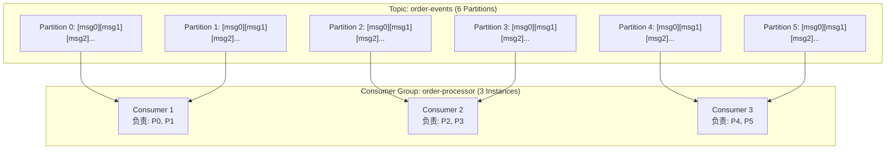
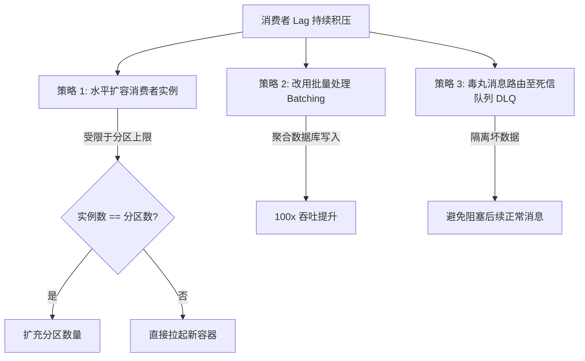
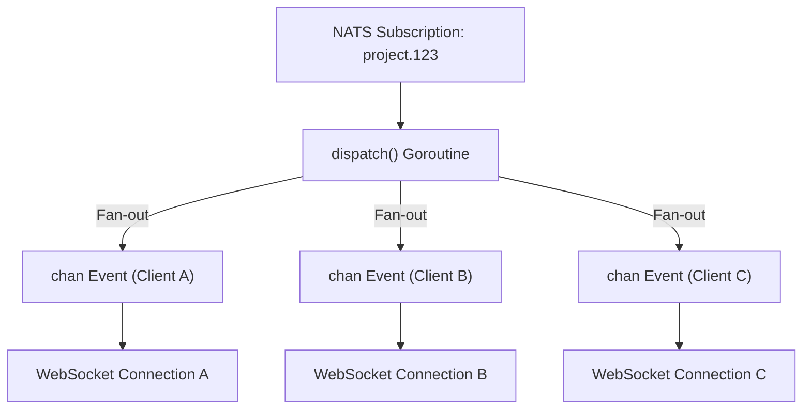

> 💡 **专栏导读**：本文收录于专栏 [《Go 云原生分布式系统实战》](/columns)。全专栏共 17 篇，深入剖析现代 Go 在并发模型、微服务通信、JWT 鉴权、分布式事务、可观测性与生产集群落地的完整工程实践。

NATS 是邮箱，Kafka 是账本。

当你向 NATS Core 发布一条消息时，只要当时有接收者在线，该消息就存在；如果没有接收者，消息就荡然无存。该事件就此彻底消失。这对于轻量通知以及允许偶发丢失的“即发即弃（Fire-and-forget）”事件是完全适用的。

但 Kafka 的工作机制截然不同。每一条消息都会被追加写入磁盘上的持久化日志中。这个日志是**只追加（Append-only）且有序的**。消费者可以按照各自的处理节奏独立读取日志，并自主跟踪记录各自的读取位置（即偏移量，Offset）。你可以从日志的最开头重新回放所有历史消息。你甚至可以在系统上线运行六个月之后，再接入一个全新的消费者，让它完整重放并读取自系统诞生以来发布过的每一条事件。

这种能力彻底改变了系统的可能性：
- **审计日志（Audit Trails）**：完整记录所有发生过的操作与变更；
- **事件溯源（Event Sourcing）**：状态变更皆为事件，历史可完整追溯；
- **Bug 修复后的事件回放（Replaying Events after a Bug Fix）**：当下游业务逻辑修复后，重新消费历史数据以重建派生状态（Derived State）；
- **零侵入接入新服务**：新服务直接订阅既有事件流，而上游生产者无需做任何代码修改。

这些都是典型的 Kafka 模式 —— 而 NATS Core 完全无法支持上述任何一种场景。

然而，这种强大能力的代价是：**更高的运维复杂度（Operational Complexity）**。Kafka 需要依赖 Broker 集群、分区管理（Partition Management）、消费者组协同机制（Consumer Group Coordination）以及精细的数据保留策略决策（Retention Policy Decisions）。对于持久化要求宽松的小型系统，NATS 是恰到好处的工具；而对于需要强持久性保证、历史事件回放、高吞吐能力以及拥有众多独立消费者的系统，Kafka 的复杂度完全物有所值。

```mermaid
flowchart LR
    subgraph NATS["NATS (邮箱模型 Mailbox)"]
        P1[Producer] -->|瞬时投递| B1[NATS Core]
        B1 -->|仅在线消费| C1[Consumer A]
        B1 -.->|无接收者即丢弃| Lost((消息丢失))
    end

    subgraph Kafka["Kafka (账本模型 Ledger)"]
        P2[Producer] -->|追加写入| L[(磁盘持久化有序日志 Log)]
        L -->|Offset 100| C2[Order Processor]
        L -->|Offset 80 (滞后追赶)| C3[Analytics Consumer]
        L -->|Offset 0 (从头回放)| C4[New Audit Service]
    end
```

---

## 1. Kafka 的工作原理 (How Kafka Works)

深入理解 Kafka 的底层模型是正确使用它的前提。尽管它的许多抽象概念看起来与其它消息队列类似，但关键细节截然不同。

- **主题（Topic）**：主题是一个具名的事件流。生产者向主题中写入消息，消费者从主题中读取消息。主题是**只追加（Append-only）**的：消息一旦写入就绝不会被修改，也不会被删除（直到保留时间过期）。
- **分区（Partition）**：一个主题被划分为若干个分区。每个分区本质上是一个**严格有序、不可变（Immutable）的提交日志**。同一分区内的消息依据其**偏移量（Offset）**严格保证先后顺序 —— 偏移量即消息写入该分区时的递增序号。但是，**跨分区的消息之间不存在任何全局顺序保证**。一个拥有 10 个分区的主题，其吞吐能力大约是单分区主题的 10 倍，因为每个分区都可以由不同的 Broker 节点提供服务，并分配给不同的消费者并行拉取。
- **消费者组（Consumer Group）**：消费者组是由多个消费者构成的协同处理集合，共同协作消费某个主题。Kafka 负责将分区分配给组内的消费者：**在任何给定时刻，每个分区仅被分配给组内的唯一一个消费者**。如果一个主题有 6 个分区，组内有 3 个消费者实例，那么每个消费者将各自负责处理 2 个分区。如果其中一个消费者宕机崩溃，它所持有的分区会被重新分配给存活的消费者 —— 这一过程被称为**重平衡（Rebalance）**。
- **消费者偏移量（Consumer Offset）**：消费者偏移量记录了消费者当前在某个分区中已经处理到的位置。该位移数据持久化存储在 Kafka 自身内部（专门的 `__consumer_offsets` 系统主题中）。当某个消费者发生崩溃重启后，它会从最后一次提交的偏移量位置继续拉取 —— 既不会从头开始，也不会跳跃到当前的最新末尾。

这是 Kafka 区别于传统轻量队列的**核心本质特征：消费者自主拥有并维护各自的读取位置（Consumers own their position）**。一个处理缓慢的消费者绝对不会拖慢上游生产者的写入速度。慢消费者只是在读取进度上落后，从而累积**滞后量（Lag）** —— 即尚未被该消费者处理的消息积压总数。你可以监控这个 Lag 指标，针对 Lag 暴涨配置告警，并在积压扩大时横向扩容消费者实例。而上游生产者对下游这一切运行状况完全无感。



### 消息键与分区分配 (Message keys and partition assignment)

消息键（Message Key）决定了消息将被写入到哪一个分区。Kafka 对消息键进行哈希计算，并将哈希值映射到特定的分区编号上。**具有相同 Key 的消息必然会被路由到同一个分区中**。这就为具有相同 Key 的所有消息提供了绝对的保序保证。

以电商系统的订单事件为例：使用订单 ID（`order_id`）作为消息 Key，可以确保针对某个特定订单的所有事件（`order.created`、`order.paid`、`order.shipped`、`order.cancelled`）全部落入同一个分区中，并由同一个消费者实例严格按照先后发生顺序依次处理。如果不做这样的分区保序保证，消费者极有可能在处理 `order.paid`（订单已支付）之前先收到了 `order.shipped`（订单已发货），从而导致下游业务状态出现严重的不一致和逻辑错误。

对于没有指定 Key 的消息，Kafka 会采用轮询（Round-robin）或粘性分区策略（Sticky Partitioning）将其散列分布在各个分区中。**当且仅当特定实体范围内的时序性至关重要时，必须使用 Key；若只追求系统整体的最大吞吐量而不在意消息先后顺序，则留空 Key**。

---

## 2. 编写 Kafka 生产者 (Writing a Kafka Producer)

在 Go 生态中，我们选用 **`franz-go`** 客户端库（由 Travis Bemann 开发维护）。它是一个纯 Go 编写的 Kafka 客户端，**没有任何 cgo 依赖**。它维护活跃、性能极高，是现代全新 Go 微服务工程的最佳首选。它不需要系统预装 C 语言编写的 `librdkafka` —— 编译生成的 Go 静态二进制文件保持小巧轻量，并且支持平滑跨平台交叉编译（Cross-compilation）。

```go
package kafka

import (
	"context"
	"fmt"
	"log/slog"
	"os"
	"time"

	"github.com/twmb/franz-go/pkg/kgo"
)

type KafkaProducer struct {
	client *kgo.Client
	topic  string
	logger *slog.Logger
}

func NewKafkaProducer(brokers []string, topic string, logger *slog.Logger) (*KafkaProducer, error) {
	client, err := kgo.NewClient(
		// 配置种子 Broker 地址列表
		kgo.SeedBrokers(brokers...),
		// 等待所有同步副本（In-Sync Replicas, ISR）确认写入，提供最强持久性保证
		kgo.RequiredAcks(kgo.AllISRAcks()),
		// 客户端单批次最大累积字节数：~1MB
		kgo.ProducerBatchMaxBytes(1_000_000),
		// 等待最多 5ms 累积批次消息，显著提升网络往返吞吐
		kgo.ProducerLinger(5*time.Millisecond),
		// 发送失败时的最大重试次数
		kgo.RetryMax(10),
		// 重试退避间隔
		kgo.RetryBackoff(100*time.Millisecond),
		// 使用 slog 打印告警及以上级别的客户端内部日志
		kgo.WithLogger(kgo.BasicLogger(os.Stderr, kgo.LogLevelWarn, nil)),
		// 开发环境下允许自动创建主题（生产环境建议关闭）
		kgo.AllowAutoTopicCreation(),
	)
	if err != nil {
		return nil, fmt.Errorf("create kafka client: %w", err)
	}

	return &KafkaProducer{
		client: client,
		topic:  topic,
		logger: logger,
	}, nil
}
```

### 关键配置决策深度解析：

1. **`RequiredAcks(kgo.AllISRAcks())`**：表示生产者必须等待所有处于同步状态中的副本节点（ISR）都完成该写入确认后，才认为该条消息发送成功。这是 Kafka 能提供的最强持久性保证（Strongest Durability Guarantee）。对于某些追求极低延迟但允许极低概率丢失数据的场景，可以选择 `kgo.LeaderAck()`（仅主副本写入确认）—— 但其潜在风险是：若 Leader 在确认写入之后、将数据复制给 Follower 之前突发崩溃，这部分消息就会永久丢失。
2. **`ProducerLinger(5*time.Millisecond)`**：指示生产者在发送网络 Batch 请求之前最多等待 5 毫秒，以便在此窗口内将多个 Goroutine 产生的离散消息合并为一个网络批次。这是一种用微小的延迟换取网络 I/O 吞吐大幅跃升的典型权衡（Tradeoff）。对于某些对延迟极端苛刻的实时场景，可将此项设置为 0。
3. **幂等性生产者（Idempotent Producer）**：当 `RequiredAcks` 配置为 `AllISRAcks()` 时，`franz-go` 会**默认自动启用幂等生产者机制**。客户端会为每个生产者分配专属的 Producer ID，并为发布的每条消息附带严格递增的序号（Sequence Number）。即使因为网络波动导致客户端发生重试，Broker 端也能基于序号精准去重，确保底层分区日志中绝对不会出现重复消息。

### 消息发送逻辑：基于 Promise 的异步确认

`franz-go` 的 `Produce` 方法采用了基于 Promise（回调函数）的设计风格：

```go
func (p *KafkaProducer) Publish(ctx context.Context, key string, value []byte) error {
	record := &kgo.Record{
		Topic: p.topic,
		Key:   []byte(key),
		Value: value,
		Headers: []kgo.Header{
			{Key: "content-type", Value: []byte("application/json")},
		},
	}

	// Produce 方法返回一个 Promise；我们在外部通过阻塞同步等待 Broker 确认
	var produceErr error
	p.client.Produce(ctx, record, func(r *kgo.Record, err error) {
		if err != nil {
			produceErr = err
			return
		}
		p.logger.DebugContext(ctx, "message delivered",
			"topic", r.Topic,
			"partition", r.Partition,
			"offset", r.Offset,
		)
	})

	if produceErr != nil {
		return fmt.Errorf("produce: %w", produceErr)
	}
	return nil
}
```

### 优雅停机与缓冲区冲刷（Graceful Shutdown & Flush）

```go
func (p *KafkaProducer) Close(ctx context.Context) {
	p.logger.Info("flushing producer")
	// Flush 会阻塞当前调用，直到所有积压在内部缓冲区中尚未发送确认的 Record 全部落盘确认
	p.client.Flush(ctx)
	p.client.Close()
}
```

> [!CAUTION]
> **在 `Close()` 中调用 `client.Flush` 是绝对不可省略的关键一步！**  
> 由于我们在配置中启用了 `ProducerLinger` 批处理延迟积攒机制，在程序退出的瞬间，内存缓冲区中往往还存留着大量“已接收但尚未真正发送到网络上”的消息记录。如果不调用 `Flush` 强制冲刷直接退出，这部分在途消息将被静默丢弃！在服务优雅停机时，必须先 Flush 缓冲区，再关闭连接。

---

## 3. 编写 Kafka 消费者 (Writing a Kafka Consumer)

`franz-go` 的优秀设计在于：它统一使用同一个 `kgo.Client` 客户端实例来完成生产与消费。我们可以通过函数式选项（Functional Options）来配置一个消费者组：

```go
type KafkaConsumer struct {
	client *kgo.Client
	logger *slog.Logger
}

func NewKafkaConsumer(brokers []string, groupID string, topics []string, logger *slog.Logger) (*KafkaConsumer, error) {
	client, err := kgo.NewClient(
		kgo.SeedBrokers(brokers...),
		kgo.ConsumerGroup(groupID),
		kgo.ConsumeTopics(topics...),
		// 当服务端没有任何已提交的历史位移记录时，默认从分区最早的起始位置开始消费
		kgo.ConsumeResetOffset(kgo.NewOffset().AtStart()),
		// 会话超时时间：30 秒未收到心跳则判定该消费者宕机
		kgo.SessionTimeout(30*time.Second),
		// 心跳发送间隔：3 秒一次
		kgo.HeartbeatInterval(3*time.Second),
		// 启用增量协作式粘性平衡器（Incremental Cooperative Rebalancing）
		kgo.Balancers(kgo.CooperativeStickyBalancer()),
		kgo.WithLogger(kgo.BasicLogger(os.Stderr, kgo.LogLevelWarn, nil)),
	)
	if err != nil {
		return nil, fmt.Errorf("create kafka client: %w", err)
	}

	return &KafkaConsumer{
		client: client,
		logger: logger,
	}, nil
}
```

### 核心参数解析：
- **`SessionTimeout` 与 `HeartbeatInterval`**：需要格外注意。如果消费者在 `SessionTimeout`（此处为 30s）时间内因网络中断或进程假死未能向 Broker 发送心跳，Kafka 集群将视其为离线死亡，并立即触发全局消费者组重平衡（Rebalance）。心跳间隔通常保持为会话超时的 $1/3$ 到 $1/10$（此处为 3s）。
- **`CooperativeStickyBalancer`**：启用了**增量协同式分区分配机制**。在发生重平衡时，Kafka 仅逐个迁移受影响的特定分区，而绝不会让组内所有消费者同时“暂停所有分区的消费工作（Stop-the-world）”。

### 基于 `PollFetches` 的消费循环

消费者核心拉取循环的实现如下：

```go
func (c *KafkaConsumer) Consume(ctx context.Context, handler func(context.Context, *kgo.Record) error) error {
	for {
		select {
		case <-ctx.Done():
			c.logger.Info("consumer shutting down")
			return nil
		default:
		}

		// 从 Broker 批量轮询拉取最新到达的消息集合
		fetches := c.client.PollFetches(ctx)
		if fetches.IsClientClosed() {
			return nil
		}

		// 记录并处理特定分区的拉取异常，但不会中断主轮询循环
		fetches.EachError(func(t string, p int32, err error) {
			c.logger.ErrorContext(ctx, "fetch error",
				"topic", t,
				"partition", p,
				"error", err,
			)
		})

		// 遍历迭代批次中的每一条消息 Record
		fetches.EachRecord(func(record *kgo.Record) {
			if err := handler(ctx, record); err != nil {
				c.logger.ErrorContext(ctx, "message handler failed",
					"topic", record.Topic,
					"partition", record.Partition,
					"offset", record.Offset,
					"error", err,
				)
				// 业务处理失败时：绝对不要提交该消息的位移！
				// 这样在下一次重启或故障转移后，该消息会被重新投递
				return
			}

			// 只有在业务 Handler 完全执行成功之后，才执行手动位移提交
			if err := c.client.CommitRecords(ctx, record); err != nil {
				c.logger.ErrorContext(ctx, "commit failed", "error", err)
			}
		})
	}
}
```

`PollFetches` 会一次性返回自上次轮询以来到达的一整个批次的消息。`EachRecord` 负责顺序迭代这批记录 —— 业务先执行处理，处理成功后再执行逐条提交。`EachError` 回调则能够精准暴露单分区的网络或权限异常，而无需抛出错误阻断整个消费主流程。

### 至少一次投递与幂等性要求 (At-Least-Once Delivery & Idempotency)

在业务处理成功后显式手动提交位移（Manual Commit），为我们带来了**至少一次投递（At-least-once delivery）**的语义保障。如果某个消费者进程在刚执行完业务逻辑、却在即将执行 `CommitRecords` 之前的纳秒级瞬间崩溃断电，由于该位移尚未记录在 `__consumer_offsets` 中，当进程重启时，该条消息必然会被**重新投递消费**。

> [!IMPORTANT]
> **至少一次投递意味着：你的业务 Handler 必须具备绝对的幂等性（Idempotent）！**  
> 处理同一条消息两次，所产生的系统最终状态必须与处理一次完全相同。信用卡被扣款两次、同一封确认邮件被发送两次、库存被扣减两次 —— 这些不是简单的“重复数据”，而是严重的**生产数据损毁灾难**！本专栏第 11 章将专门剖析在消息重投机制下保证处理函数幂等安全的核心模式（如基于数据库唯一约束与 Outbox 模式）。

### 消费者重平衡 (Consumer rebalancing)

当有新的消费者加入消费组、或者既有消费者离开消费组时，Kafka 会重新重新分配分区的所有权 —— 这个过程称为**重平衡（Rebalance）**。在传统的重平衡过程中，组内所有消费者都会被迫暂停处理工作，这会导致服务产生肉眼可见的延迟尖刺（Latency Spikes）。

触发重平衡的常见诱因包括：
- **新消费者加入消费者组**：服务进行水平弹性扩容（Scale-out）或滚动发布上线；
- **消费者离开消费者组**：服务实例崩溃宕机、容器缩容下线、或执行优雅停机退出；
- **主题分区总数发生变更**：运维手动扩充了 Topic 分区；
- **心跳超时**：消费者因 Full GC 或处理耗时过长，未能及时在 `SessionTimeout` 窗口内发送心跳包。

`franz-go` 通过内置的 `CooperativeStickyBalancer`（协同粘性平衡器）默认开启**协作式重平衡机制** —— 分区所有权的转移是逐个平滑进行的，而不是全部粗暴剥夺然后再从头分配。在重平衡期间，组内绝大部分未受影响的消费者实例可以持续无缝处理其原有分区的消息。

---

## 4. 背压机制 (Backpressure)

**消费者滞后量（Consumer Lag）** —— 即已写入 Kafka 但尚未被消费者处理的消息数量 —— 是评估 Kafka 消费者健康状况的核心首要指标。当 Lag 持续攀升时，说明消费端的处理速率已经跟不上生产端的发布速率。如果任由其无休止地蔓延，系统的业务处理可能会比实时世界落后数小时之久，导致全系统在严重过时的陈旧数据上运行。

解决消费者积压滞后有三种核心应对策略（按推荐度由高到低排列）：



### 策略一：水平扩容消费者 (Scale out consumers)

在同一个消费者组中部署更多的消费者实例。更多的消费者意味着可以有更多的分区被并行消费。

**硬性制约**：**组内活跃消费者的数量绝不能超过该主题的分区总数**。一个拥有 6 个分区的 Topic，组内最多只能有 6 个活跃工作的消费者实例；如果你启动了第 7 个消费者实例，它将被闲置并处于完全空转状态。

当业务并发需求超过当前分区所能承载的上限时，必须对主题执行**扩充分区**操作。必须清醒认识到：**扩充分区是一个单向不可逆的操作（One-way operation）** —— 你只能增加分区数量，绝不能减少分区数量。此外，扩充分区会导致原有的基于 Key 的哈希映射被打破，同一个 Key 后续的消息可能会被路由到新的分区中，从而短暂破坏既有的顺序性。因此，生产实践中建议在服务创建之初就规划好略高于当前预期的分区数（通常默认选 **10 个分区**），为未来的水平扩容留出充足弹性。

### 策略二：批量处理 (Process in batches)

与其逐条从网络拉取并逐条处理单条消息，不如将一批消息在内存中先聚合为一个 Batch，然后整体批量下发。对于受制于数据库 I/O 吞吐瓶颈的消费者而言，为每条消息执行一次单行 `INSERT`，其效率往往比执行一次包含数十条数据的批量写入（Bulk `INSERT`）要**慢上 50 到 100 倍**：

```go
func (c *KafkaConsumer) ConsumeBatched(ctx context.Context, store OrderStore, batchSize int) error {
	// 定时器：防止低峰期小批次消息因凑不满 batchSize 而无限期停滞
	ticker := time.NewTicker(500 * time.Millisecond)
	defer ticker.Stop()

	batch := make([]*kgo.Record, 0, batchSize)

	// flush 闭包负责将当前积攒在切片中的批次写入底层存储，并提交最终位移
	flush := func() error {
		if len(batch) == 0 {
			return nil
		}

		orders := make([]Order, 0, len(batch))
		for _, record := range batch {
			var o Order
			if err := json.Unmarshal(record.Value, &o); err != nil {
				c.logger.Error("unmarshal failed",
					"offset", record.Offset,
					"error", err)
				continue
			}
			orders = append(orders, o)
		}

		// 调用底层数据库的批量插入 API
		if err := store.BulkCreate(ctx, orders); err != nil {
			return fmt.Errorf("bulk create: %w", err)
		}

		// 提交整个批次中最后一条记录的偏移量
		last := batch[len(batch)-1]
		if err := c.client.CommitRecords(ctx, last); err != nil {
			return fmt.Errorf("commit batch: %w", err)
		}

		// 清空批次切片，复用底层分配好的内存空间
		batch = batch[:0]
		return nil
	}

	for {
		select {
		case <-ctx.Done():
			// 退出前将最后积攒的残存批次强制冲刷入库
			return flush()
		case <-ticker.C:
			// 达到 500ms 时间阈值，强制触发批量写入
			if err := flush(); err != nil {
				return err
			}
		default:
		}

		fetches := c.client.PollFetches(ctx)
		if fetches.IsClientClosed() {
			return nil
		}

		fetches.EachRecord(func(record *kgo.Record) {
			batch = append(batch, record)
			// 达到容量阈值，立即触发批量写入
			if len(batch) >= batchSize {
				if err := flush(); err != nil {
					c.logger.Error("batch flush failed", "error", err)
				}
			}
		})
	}
}
```

批量消费者会在“批次达到指定容量（`batchSize`）”或“定时器超时（500ms）”任一条件满足时触发冲刷。虽然 `PollFetches` 本身就已经是分批从 Broker 返回数据，但这种设计是在**应用层与持久化存储层（Database Bulk Write）**之上建立的更高级别批处理管道。

### 策略三：死信队列 (Dead‐letter queues / DLQ)

当某些消息在消费端持续失败时（例如数据格式畸变损坏、消费者存在针对特定边界值的代码 Bug、或是下游服务抛出了无法恢复的永久性错误），这条“毒丸（Poison Pill）”绝不能死死堵在队头阻塞后续所有正常消息的推进。我们应该将其隔离转储到**死信主题（Dead-letter Topic）**中，然后继续向下处理：

```go
const maxRetries = 3

type RetryHeader struct {
	RetryCount int    `json:"retry_count"`
	LastError  string `json:"last_error"`
	OrigTopic  string `json:"orig_topic"`
}

func processWithRetryAndDLQ(ctx context.Context, record *kgo.Record, consumer *KafkaConsumer, dlqProducer *KafkaProducer) error {
	retries := extractRetryCount(record)

	if err := process(ctx, record); err != nil {
		if retries < maxRetries {
			// 未达到最大重试次数：构造包含重试元数据的 Header 并重新投递回重试主题
			header := RetryHeader{
				RetryCount: retries + 1,
				LastError:  err.Error(),
				OrigTopic:  record.Topic,
			}
			headerJSON, _ := json.Marshal(header)
			_ = headerJSON
			return dlqProducer.Publish(ctx, string(record.Key), record.Value)
		}

		// 超过最大重试上限：记录错误并投递进死信队列（DLQ）
		consumer.logger.Error("max retries exceeded, sending to DLQ",
			"topic", record.Topic,
			"key", string(record.Key),
			"error", err,
		)
		if err := dlqProducer.Publish(ctx, string(record.Key), record.Value); err != nil {
			return fmt.Errorf("publish to dlq: %w", err)
		}
	}

	// 无论是处理成功、还是毒丸消息已被妥善转储至 DLQ，都必须正常提交原消息的位移！
	return consumer.client.CommitRecords(ctx, record)
}
```

> [!WARNING]
> 进入死信队列的消息绝不能被视而不见。DLQ 中堆积的消息是一个强烈的警报信号，表明生产流中某些环节已经损坏。**必须针对 DLQ 建立生产告警监控**：如果死信队列的消息积压量在特定时间内超过了 $N$ 条，必须立即向值班工程师发送 Pager 报警短信介入排查。

---

## 5. 实战消费者组 (Consumer Groups in Action)

消费者组模型是 Kafka 架构中最强大的杀手级特性之一。**多个完全相互独立的消费者组可以同时订阅读取同一个主题，每个组各自维护完全独立的消费偏移量（Offset）**：

```go
// 订单主流程服务 —— 追求实时性，逐条立即处理并提交位移
orderProcessor, _ := NewKafkaConsumer(brokers,
	"order-processor",
	topics,
	logger)

// 数据分析服务 —— 在流量高峰期可以积压滞后两小时，完全不干扰主订单流程
analyticsConsumer, _ := NewKafkaConsumer(brokers,
	"order-analytics",
	topics,
	logger)

// 审计日志服务 —— 将发生过的每一个事件完整转存至数据仓库
auditConsumer, _ := NewKafkaConsumer(brokers,
	"order-audit",
	topics,
	logger)
```

每个消费者组拥有完全独立的生命周期、独立的启动顺序以及独立的位移提交进度：
- 在双十一流量洪峰期间，`order-analytics` 统计分析消费组即便积压了两个小时的滞后，生产环境的 `order-processor` 履约交易服务也**完全不受丝毫影响**；
- 当数据仓库做完底层数据模型重构后，`order-audit` 审计组可以随时将自身位移重置回主题的最开始位置（Offset 0），将全量历史数据彻底重放重建一遍。

这种**一对多的大规模事件扇出（Fan-out）**能力，正是 Kafka 驱动大规模现代事件驱动架构（EDA）的底气所在。上游生产者只负责将消息发布到一个主题中，它根本不需要、也不应该知道下游有多少个系统正在消费。当未来新增了一个需要读取订单事件的新微服务时，上游生产者不需要做任何一行代码改动。

---

## 6. 动态主题订阅 (Dynamic Topic Subscriptions)

Kafka 的消费者组模型通常建立在“在服务部署上线前就已经明确知道主题名称”的假设之上。这些 Topic 往往被硬编码在源码中或预置在静态配置文件里。然而，在许多需要根据客户端动态创建资源的现代交互系统中 —— 例如：用户在 Web 端创建了一个新的协作项目，其他在线用户需要实时订阅该项目内部的各种操作事件 —— 主题必须在**运行时（Runtime）**根据客户端的在线订阅诉求进行动态的创建与销毁。

针对这种场景，经典的架构模式是维护一个**主题注册中心（Topic Registry）**，用于跟踪每个主题在内存中的活跃订阅者集合：

```go
type TopicRegistry struct {
	mu     sync.Mutex
	topics map[string]*ActiveTopic // 主题标识 -> 活跃的底层订阅信息
	conn   *nats.Conn
}

type ActiveTopic struct {
	subject     string
	subscribers map[string]chan Event // 客户端 ID -> 事件分发 Channel
	sub         *nats.Subscription
	cancel      context.CancelFunc
}

func (r *TopicRegistry) Subscribe(ctx context.Context, clientID, subject string) (<-chan Event, error) {
	r.mu.Lock()
	defer r.mu.Unlock()

	topic, exists := r.topics[subject]
	if !exists {
		// 这是该主题的第一个订阅者 —— 建立底层连接并开始拉取数据
		ctx, cancel := context.WithCancel(context.Background())
		ch := make(chan *nats.Msg, 64)
		sub, err := r.conn.ChanSubscribe(subject, ch)
		if err != nil {
			cancel()
			return nil, err
		}

		topic = &ActiveTopic{
			subject:     subject,
			subscribers: make(map[string]chan Event),
			sub:         sub,
			cancel:      cancel,
		}

		// 扇出分发：单个 NATS 物理订阅，一个独立 Goroutine，分发给多个客户端 Channel
		go r.dispatch(ctx, topic, ch)

		r.topics[subject] = topic
	}

	// 为当前连接的客户端创建专属 Channel 并注册到该主题下
	eventCh := make(chan Event, 64)
	topic.subscribers[clientID] = eventCh

	return eventCh, nil
}

func (r *TopicRegistry) Unsubscribe(clientID, subject string) {
	r.mu.Lock()
	defer r.mu.Unlock()

	topic, exists := r.topics[subject]
	if !exists {
		return
	}

	// 关闭并注销该客户端的 Channel
	close(topic.subscribers[clientID])
	delete(topic.subscribers, clientID)

	// 当最后一个活跃订阅者离开时 —— 彻底清理并销毁该主题资源
	if len(topic.subscribers) == 0 {
		topic.cancel()
		topic.sub.Unsubscribe()
		delete(r.topics, subject)
	}
}
```



在这个模型中，单一的 NATS 底层订阅将消息实时扇出分发给每一个订阅了该主题的客户端。客户端可随时连接和断开 —— 只要存在至少一个活跃的订阅者，该动态主题就持续维系；一旦最后一名客户端断开注销，系统会自动触发全链路资源清理：关闭 NATS 物理订阅、终止后台 `dispatch` 分发 Goroutine，并从内存注册表中彻底移除。

这种模式在订阅层被称为**主题扇入与通道扇出（Topic Fan-in at Subscription Layer）**：由众多逻辑客户端组成订阅组，底层每个动态主题仅维持一个物理 NATS 订阅，并由单个专职协程将数据高效派发至各自的内存管道中。它是构建实时事件网关（Real-time Event Gateways）与基于 WebSocket 的动态通知系统的黄金架构模式。

虽然这一设计模式在理论上也可以借助 Kafka 实现（将逻辑订阅映射为消费者组成员），但 Kafka 相对静态的分区分配机制使得动态管理主题的代价极其高昂 —— 你需要设计复杂的协同协议在动态建表时频繁触发协调。相比之下，NATS 的轻量级动态订阅特性天然适配这种边缘动态交互。因此在工业界，两者通常是**黄金搭档组合**：**Kafka 负责在数据中心内部承担海量高持久性的核心业务事件流，而 NATS 则负责面向前端与边缘节点提供灵活轻量的秒级实时投递**。

---

## 7. 消息模式管理 (Message Schema Management)

没有严格模式契约（Schema Contract）保护的消息队列是不可维护的灾难。当你在生产中擅自变更了 `OrderCreated` 事件的 JSON 结构体定义时，如果事先没有严格的协同管理，下游所有消费服务都会在一夜之间崩溃停摆。

解决此问题的核心在于**显式定义事件的模式版本（Explicit Schema Definition）**：

```go
// 通过类型名称或 Header 显式标注事件版本号
// V1 初始版本定义
type OrderCreatedV1 struct {
	OrderID   string    `json:"order_id"`
	UserID    string    `json:"user_id"`
	ProductID string    `json:"product_id"`
	Quantity  int       `json:"quantity"`
	CreatedAt time.Time `json:"created_at"`
}

// V2 版本引入了 Amount 字段 —— 保持向前兼容（仅新增字段，绝不删除旧字段）
type OrderCreatedV2 struct {
	OrderID   string    `json:"order_id"`
	UserID    string    `json:"user_id"`
	ProductID string    `json:"product_id"`
	Quantity  int       `json:"quantity"`
	Amount    float64   `json:"amount"` // v2 新增字段
	CreatedAt time.Time `json:"created_at"`
}
```

在生产消息时，务必将当前采用的模式版本注入到消息 Header 中：

```go
kafka.Header{Key: "schema-version", Value: []byte("2")}
```

下游消费者在接收到消息时，首先提取 Header 中的版本标识，并据此决定反序列化逻辑：

```go
func handleOrderEvent(ctx context.Context, record *kgo.Record) error {
	version := extractSchemaVersion(record)
	switch version {
	case "1":
		var event OrderCreatedV1
		if err := json.Unmarshal(record.Value, &event); err != nil {
			return err
		}
		return processV1(ctx, event)
	case "2":
		var event OrderCreatedV2
		if err := json.Unmarshal(record.Value, &event); err != nil {
			return err
		}
		return processV2(ctx, event)
	default:
		return fmt.Errorf("unknown schema version: %s", version)
	}
}
```

在更大规模的微服务架构中，更优的做法是引入 **Confluent Schema Registry**，配合 **Avro** 或 **Protocol Buffers** 进行二进制治理。Schema Registry 会在生产者发送阶段前置校验兼容性规则（向后兼容 Backward、向前兼容 Forward、全量兼容 Full），从根本上杜绝破坏兼容性的模式变更被部署进生产网络。

---

## 8. 常见问答 (Q&A)

### Q: 如何选择主题的分区数量？
**A**: 在系统设计之初，建议规划**略多于当前紧迫需求的分区数 —— 通常推荐以 10 个分区作为通用的默认基准**。  
原因在于：虽然 Kafka 支持后续在运行时扩充增加分区，但**绝对无法缩减分区**；更重要的是，扩充分区会改变既有的哈希路由基数，导致具有相同 Key 的新消息被分散写入到新的分区上，进而破坏原先基于 Key 的严格时序性保证。如果某个微服务预计在高峰期需要运行 3 到 4 个消费者容器实例，配置 6 到 8 个分区可以在不造成过度资源浪费的前提下，为未来的水平扩容留出充裕的缓冲空间。

### Q: 什么是“精确一次（Exactly-Once）”投递？我需要它吗？
**A**: Kafka 的**精确一次语义（Exactly-Once Semantics, EOS）**结合了两项底层技术：
1. **幂等性生产者**（杜绝因网络重试导致的消息重复发送）；
2. **事务型消费者（Transactional Consumers）**（实现跨分区读取-处理-写入的原子事务操作）。

它在理论上同时消除了消息重复与消息丢失。然而其代价是：**更显著的端到端延迟以及成倍上升的配置与运维复杂度**。对于绝大多数常规微服务应用，**“至少一次投递（At-least-once） + 业务消费端幂等（Idempotent Consumers）”** 是更为明智和推崇的工业实践。这种方案架构上更简单轻量，并且你在处理至少一次投递时所构建的幂等防护网，本身就能极为平稳优雅地吞纳任何偶发的重投消息。

### Q: 消息应该保留（Retention）多长时间？
**A**: 这完全取决于业务的事件回放需求。  
- **7 天** 是一个非常成熟的日常运维默认值 —— 这个时间窗口足够覆盖周末突发故障后的周一排查与历史回放。
- 对于涉及合规审计、资金流水或事件溯源（Event Sourcing）的核心业务，建议采用更长的时间窗口（如 **30 至 90 天**），或者采用**日志压缩策略（Log Compaction）** —— 该策略会对相同 Key 的消息只保留最新的有效快照，并在磁盘上永久持久化。  
存储成本是廉价的，但在遭遇突发事故准备执行数据重建回放时却发现历史日志已被提前清理，代价是无法估量的。

### Q: franz-go、confluent-kafka-go 与 Sarama 之间该如何选型？
**A**: 
- **`franz-go` 是现代全新 Go 工程的默认首选**：纯 Go 原生实现，没有任何 cgo 依赖，社区维护极其活跃，基准性能优异，极大降低了容器构建和交叉编译的难度。新项目坚决推荐使用。
- **`confluent-kafka-go`** 底层通过 cgo 封装了 C 语言库 `librdkafka`：它是历史上久经沙场验证、生产实测历史最悠久的重型客户端。如果你的团队已具备深厚经验，或者必须要依赖 `librdkafka` 的特定高级功能（如特定的 Kerberos 扩展），可以选择它。
- **`Sarama`** 是早期的纯 Go 客户端代表，历史上拥有最大的装机量，但近年来其核心架构演进已明显放缓 —— **在新项目中应优先选择 `franz-go`**。

### Q: 如何监控消费者滞后量（Consumer Lag）？
**A**: 
1. 在代码层面，`franz-go` 在每次完成拉取后都可以通过 `client.Lag()` 方法直接暴露当前分区的 Lag 数值，你可以顺畅地将其导出为 Prometheus Gauge 监控指标。
2. 在运维 CLI 层面，可以通过官方命令行工具随时查询：
   ```bash
   kafka-consumer-groups.sh --bootstrap-server broker:9092 --describe --group my-group
   ```
3. 在告警策略上，必须基于业务的实质影响设定告警阈值：对于毫秒级实时推送服务，1,000 条积压就已经是需要关注的重大异常；而对于离线分析或批处理结算流水线，100,000 条的积压完全在正常容忍范围内。

### Q: 消费者发生重平衡（Rebalance）期间会发生什么？
**A**: 组内的所有消费者实例都会参与到分区重新分配的协调协议中。如果采用早期的 Eager 协议，所有消费者都会被迫中断手中的一切消费工作，出现全组停顿。但在本章所采用的 `franz-go` 默认**增量协同重平衡模式（`CooperativeStickyBalancer`）**下，分区迁移是渐进式单点交接的 —— 绝大部分未受影响的分区和消费者在重平衡交割期间依然会保持无感知的高速处理。对于延迟敏感的线上关键服务，**Cooperative Sticky 机制是必不可少的基石配置**。

---

## 9. SDK 中沉淀哪些代码 (What Goes in the SDK)

消息队列客户端是平台工程 SDK 中仅次于基础中间件的高价值核心组件。系统中每一个需要发布或消费事件的微服务，都面临着相同的连接初始化、错误治理、死信分流与优雅停机挑战。应当将它们标准化沉淀进 `platform/messaging` 共享模块中：

```
platform/messaging/
  interfaces.go   — Publisher 与 Subscriber 核心通用接口定义
  nats/
    publisher.go  — 实现了 Publisher 接口的 NATS 客户端适配器
    subscriber.go — 实现了 Subscriber 接口的 NATS 订阅端适配器
  kafka/
    producer.go   — 基于 franz-go 实现的 KafkaProducer
    consumer.go   — 具备手动位移提交控制的 KafkaConsumer
    batch.go      — 适用于高吞吐存储写入的批量消费者 ConsumeBatched
    dlq.go        — 死信队列（DLQ）重试与隔离路由管道
    schema.go     — 带有版本元数据头的 EventEnvelope 封装
  fake/
    fake.go       — 专供测试使用的 FakePublisher / FakeSubscriber
```

### 核心解耦抽象：通用接口 (interfaces.go)

标准化接口是 SDK 对外暴露的最关键契约：

```go
// platform/messaging/interfaces.go
package messaging

import "context"

type Publisher interface {
	Publish(ctx context.Context, subject string, data []byte) error
	Close() error
}

type Subscriber interface {
	Subscribe(ctx context.Context, subject string) (<-chan Message, error)
	Close() error
}

type Message struct {
	Subject string
	Data    []byte
	Headers map[string]string
	Ack     func() // 显式确认：在 Kafka 中提交 Offset，在 NATS JetStream 中执行 Ack
	Nack    func() // 显式拒绝：触发重试或放入死信流
}
```

上层业务服务的代码**仅依赖上述抽象接口，而绝不直接绑定具体的 Kafka 或 NATS 实现代码**。当在单元测试环境中验证业务逻辑时，将真实的消息中间件替换为测试实现只需短短一行代码。例如，一个仅需验证是否正确发出事件的微服务，可以直接注入 SDK 测试子包提供的 `FakePublisher`：

```go
// platform/messaging/fake/fake.go
package fake

import (
	"context"
	"sync"
)

type PublishedMessage struct {
	Subject string
	Data    []byte
}

type FakePublisher struct {
	mu       sync.Mutex
	Messages []PublishedMessage
}

func (f *FakePublisher) Publish(ctx context.Context, subject string, data []byte) error {
	f.mu.Lock()
	defer f.mu.Unlock()
	f.Messages = append(f.Messages, PublishedMessage{
		Subject: subject,
		Data:    data,
	})
	return nil
}

func (f *FakePublisher) Close() error {
	return nil
}
```

该伪实现保存在平台 SDK 的 testing 子包中，可直接供全系统所有业务服务的单元测试套件复用。

---

Kafka 完美支撑了那些可以容忍异步解耦的事件传输链路。然而，在分布式体系中，部分方法调用必须立即获得同步结果 —— 比如订单服务在确认下单前，必须即刻获知库存是否已完成锁定。下一章将全面深入探讨**基于 gRPC 与 Protocol Buffers 的服务间同步通信**，以及防止单点慢服务引发全集群雪崩级瘫痪的关键韧性治理模式（超时控制、智能重试与断路器）。

---

> 💡 **专栏导航**：
> - 专栏目录：[《Go 云原生分布式系统实战》全集路线图](/columns)
> - 上一篇：[Go 分布式系统实战（七）：Context 贯穿全链路：超时预算收窄与生命周期避坑](/posts/2026-10-18-distributed-go-07-context-propagation)
> - 下一篇：[Go 分布式系统实战（九）：服务间 RPC：gRPC、Protobuf 契约与断路器容错](/posts/2026-10-18-distributed-go-09-grpc-circuit-breaker)
