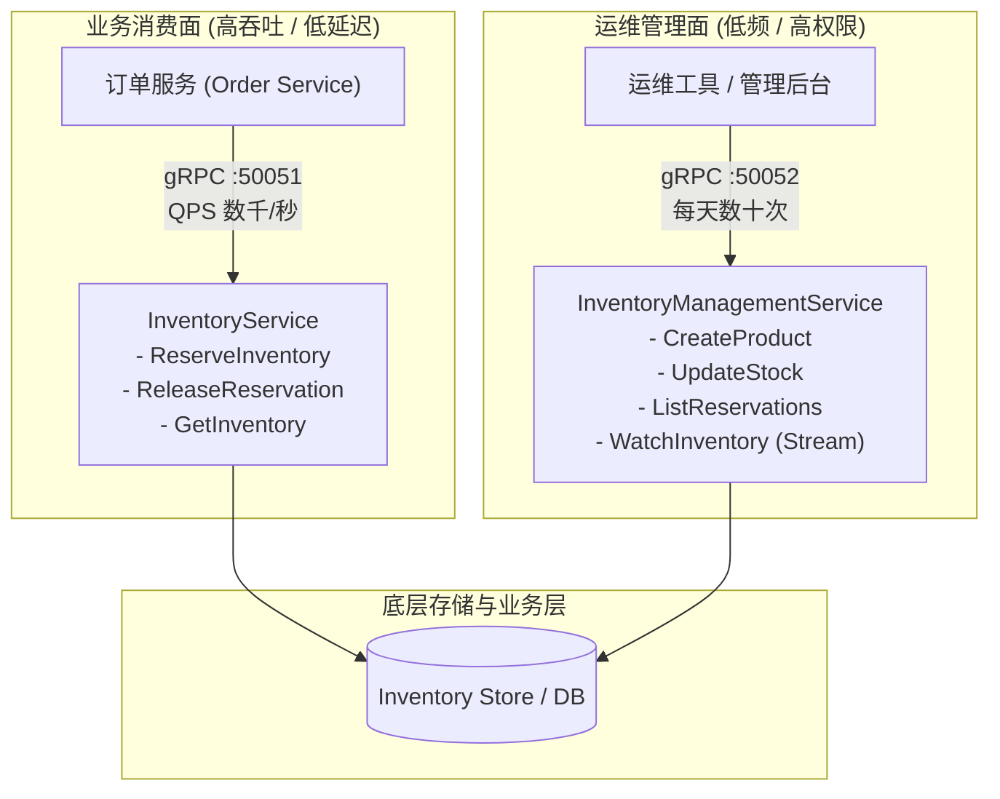
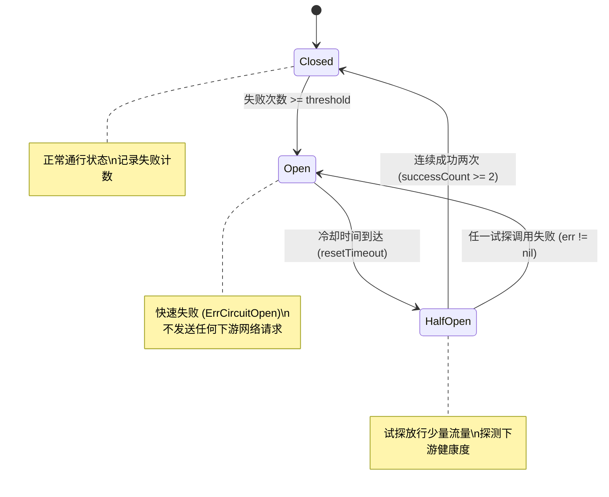

> 💡 **专栏导读**：本文收录于专栏 [《Go 云原生分布式系统实战》](/columns)。全专栏共 17 篇，深入剖析现代 Go 在并发模型、微服务通信、JWT 鉴权、分布式事务、可观测性与生产集群落地的完整工程实践。

## 1. 为什么内部通信选择 gRPC（Why gRPC for Internal Communication）

HTTP/JSON 是外部 API 的绝佳选择 —— 任何客户端、任何编程语言都能轻松调用，并且直接用 `curl` 即可调试。然而，对于两端都由你完全掌控的**内部服务间通信（Internal Service Communication）**，gRPC 提供了三项至关重要的核心优势：

### 模式约束（Schema Enforcement）
Protocol Buffers（Protobuf）定义了服务的严格契约。Go 语言的客户端与服务端代码均由 `.proto` 文件自动编译生成。如果消息字段的类型发生了变更，代码在编译期就会直接报错。如果有必填字段缺失，序列化层会在你的业务处理函数（Handler）执行之前就返回错误。而 JSON API 完全没有这种保障 —— 字段缺失只会静默解析为空字符串 `""` 或 `0`，而你往往只能在生产环境中通过故障排查才能发现这些 Bug。

### 性能表现（Performance）
Protobuf 的二进制编码体积通常比同等语义的 JSON 小 **3 到 10 倍**，且序列化与反序列化的 CPU 耗时更低、速度更快。基于 HTTP/2 的多路复用（Multiplexing）机制允许在单条 TCP 连接上并发发起多个 RPC 请求，极大地降低了连接建立与维持的开销。对于每秒发生数千次调用（QPS 上千）的高吞吐内部服务间通信而言，这种性能差异至关重要。

### 原生流式传输（Native Streaming）
gRPC 原生支持**服务端流式传输（Server Streaming，单请求/多响应）**、**客户端流式传输（Client Streaming，多请求/单响应）**以及**双向流式传输（Bidirectional Streaming）**。虽然这些模式在 HTTP/1.1 中勉强可以通过长轮询或 chunked 编码实现，但显得极其别扭；而在 gRPC 中，流式调用是一等公民（First-Class Citizens）。

---

## 2. 使用 Protocol Buffers 定义服务（Defining a Service with Protocol Buffers）

Protocol Buffers（Protobuf）是 gRPC 的接口定义语言（IDL）。`.proto` 文件负责定义消息（Message）与服务（Service）—— 它相当于跨语言、跨独立部署边界的 Go `interface`。

以本专栏主线案例系统（Capstone System）中的库存服务（Inventory Service）为例：

```protobuf
// proto/inventory/v1/inventory.proto
syntax = "proto3";

package inventory.v1;

option go_package = "github.com/yourorg/orderflow/proto/inventory/v1;inventoryv1";

// InventoryService 管理产品库存与预扣。
service InventoryService {
  // ReserveInventory 尝试为订单预扣库存。
  // 若库存不足则返回 FAILED_PRECONDITION 错误。
  rpc ReserveInventory(ReserveInventoryRequest) returns (ReserveInventoryResponse);

  // ReleaseReservation 释放此前已创建的预扣。
  // 幂等设计：释放一个不存在的预扣并非错误。
  rpc ReleaseReservation(ReleaseReservationRequest) returns (ReleaseReservationResponse);

  // GetInventory 返回当前库存水平。属于管理接口。
  rpc GetInventory(GetInventoryRequest) returns (GetInventoryResponse);

  // WatchInventory 实时流式推送库存变更。属于管理接口。
  rpc WatchInventory(WatchInventoryRequest) returns (stream InventoryUpdate);
}

message ReserveInventoryRequest {
  string product_id = 1;
  int32 quantity = 2;
  string order_id = 3; // 用于幂等性保证 —— 若已被预扣，相同 order_id 的重复请求为无操作（no-op）
}

message ReserveInventoryResponse {
  string reservation_id = 1;
  int32 reserved = 2;
}

message ReleaseReservationRequest {
  string reservation_id = 1;
}

message ReleaseReservationResponse {}

message GetInventoryRequest {
  string product_id = 1;
}

message GetInventoryResponse {
  string product_id = 1;
  int32 available = 2;
  int32 reserved = 3;
}

message WatchInventoryRequest {
  repeated string product_ids = 1; // 为空表示监听所有产品
}

message InventoryUpdate {
  string product_id = 1;
  int32 available = 2;
  int32 reserved = 3;
  string event_type = 4; // "reserved"（已预扣）, "released"（已释放）, "restocked"（已补货）
}
```

### 值得注意的几项架构设计决策（Design Decisions to Notice）

1. **幂等性键（Idempotency Key）**：`ReserveInventoryRequest` 中的 `order_id` 字段充当幂等性键。当订单服务因为网络抖动或超时而发起重试时，库存服务能识别该 `order_id` 并直接返回已有的预扣结果，而绝不会重复扣减库存。
2. **具名响应类型（Named Response Types）**：`ReleaseReservationResponse` 当前是一个空消息（Protobuf 中相当于 `void`）。**切勿在接口定义中直接返回通用的空消息类型（Empty Message Type）** —— 即使当下为空，也必须定义独立的具名响应类型。这样未来在演进协议时可以平滑追加新字段，而无需破坏现有的接口契约。
3. **双重 API 模式与服务端流（Server-side Streaming）**：`WatchInventory` 演示了服务端流式传输：客户端发出单个请求，服务端持续推送 `InventoryUpdate` 消息流，直到客户端主动断开连接。这种将**实时运营数据流（Real-time Operational Feeds）**与**同步请求-响应调用（Synchronous Request-Response Calls）**相分离的做法，正是借鉴自工业级生产系统的**双重 API 模式（Dual API Pattern）**。

---

## 3. 使用 buf 生成 Go 代码（Generating Go Code with buf）

`buf` 是现代 Protocol Buffers 代码生成的标准工具链。它用声明式的配置文件彻底取代了繁琐脆弱的原生 `protoc` 脚本命令：

```yaml
# buf.yaml — 项目配置
version: v2
modules:
  - path: proto
deps:
  - buf.build/googleapis/googleapis
  - buf.build/grpc/grpc
```

```yaml
# buf.gen.yaml — 代码生成配置
version: v2
managed:
  enabled: true
  override:
    - file_option: go_package_prefix
      value: github.com/yourorg/orderflow/proto
plugins:
  - remote: buf.build/protocolbuffers/go
    out: gen
    opt:
      - paths=source_relative
  - remote: buf.build/grpc/go
    out: gen
    opt:
      - paths=source_relative
      - require_unimplemented_servers=true
```

通过一条简单的命令执行生成：

```bash
buf generate
```

每个 `.proto` 文件都会对应生成两个 Go 文件：
- `gen/inventory/v1/inventory.pb.go` —— 承载 Protobuf 消息结构体定义与序列化/反序列化逻辑。
- `gen/inventory/v1/inventory_grpc.pb.go` —— 承载客户端 Stub 与服务端接口定义。

生成的服务端接口代码如下：

```go
// 由 buf 自动生成 —— 请勿手动修改
type InventoryServiceServer interface {
	ReserveInventory(context.Context, *ReserveInventoryRequest) (*ReserveInventoryResponse, error)
	ReleaseReservation(context.Context, *ReleaseReservationRequest) (*ReleaseReservationResponse, error)
	GetInventory(context.Context, *GetInventoryRequest) (*GetInventoryResponse, error)
	WatchInventory(*WatchInventoryRequest, InventoryService_WatchInventoryServer) error
	mustEmbedUnimplementedInventoryServiceServer()
}
```

### 强制嵌入未实现服务（Enforcing Unimplemented Servers）
通过配置 `require_unimplemented_servers=true` 所生成的 `mustEmbedUnimplementedInventoryServiceServer()` 方法，强制要求你的业务实现结构体必须内嵌生成的 `UnimplementedInventoryServiceServer`。这意味着：如果有人向 `.proto` 文件中新增了一个 RPC 方法，而你的服务端代码尚未实现它，代码在**编译阶段就会直接失败** —— 从而倒逼开发者实现所有方法，杜绝线上因漏写方法而静默返回 "not implemented" 错误的隐患。

---

## 4. 实现 gRPC 服务端（Implementing the gRPC Server）

```go
// internal/inventory/grpc.go
package inventory

import (
	"context"
	"errors"
	"log/slog"

	inventoryv1 "github.com/yourorg/orderflow/gen/inventory/v1"
	"go.opentelemetry.io/otel"
	"google.golang.org/grpc/codes"
	"google.golang.org/grpc/status"
)

type GRPCServer struct {
	inventoryv1.UnimplementedInventoryServiceServer
	store  InventoryStore
	logger *slog.Logger
}

func NewGRPCServer(store InventoryStore, logger *slog.Logger) *GRPCServer {
	return &GRPCServer{store: store, logger: logger}
}

func (s *GRPCServer) ReserveInventory(
	ctx context.Context,
	req *inventoryv1.ReserveInventoryRequest,
) (*inventoryv1.ReserveInventoryResponse, error) {
	// 开启 OpenTelemetry 分布式追踪 Span
	ctx, span := otel.Tracer("inventory").Start(ctx, "ReserveInventory")
	defer span.End()

	// 基础参数校验
	if req.ProductId == "" {
		return nil, status.Error(codes.InvalidArgument, "product_id is required")
	}
	if req.Quantity <= 0 {
		return nil, status.Errorf(codes.InvalidArgument, "quantity must be > 0, got %d", req.Quantity)
	}

	// 执行底层业务存储的库存预扣
	reservation, err := s.store.Reserve(ctx, ReservationRequest{
		ProductID:      req.ProductId,
		Quantity:       int(req.Quantity),
		IdempotencyKey: req.OrderId,
	})
	if err != nil {
		switch {
		case errors.Is(err, ErrInsufficientStock):
			// 业务规则不满足：库存不足属于 FailedPrecondition
			return nil, status.Errorf(codes.FailedPrecondition,
				"insufficient stock for product %s: requested %d",
				req.ProductId, req.Quantity)
		case errors.Is(err, ErrProductNotFound):
			return nil, status.Errorf(codes.NotFound,
				"product %s not found", req.ProductId)
		default:
			// 内部未预期错误：记录详细日志，对外仅屏蔽暴露为通用错误
			s.logger.ErrorContext(ctx, "reserve inventory failed",
				"product_id", req.ProductId,
				"error", err,
			)
			return nil, status.Error(codes.Internal, "internal error")
		}
	}

	return &inventoryv1.ReserveInventoryResponse{
		ReservationId: reservation.ID,
		Reserved:      int32(reservation.Quantity),
	}, nil
}

func (s *GRPCServer) WatchInventory(
	req *inventoryv1.WatchInventoryRequest,
	stream inventoryv1.InventoryService_WatchInventoryServer,
) error {
	ctx := stream.Context()
	updates, cleanup := s.store.Subscribe(req.ProductIds...)
	defer cleanup()

	for {
		select {
		case <-ctx.Done():
			return nil // 客户端取消了连接
		case update, ok := <-updates:
			if !ok {
				return nil // 订阅通道已关闭
			}
			if err := stream.Send(&inventoryv1.InventoryUpdate{
				ProductId: update.ProductID,
				Available: int32(update.Available),
				Reserved:  int32(update.Reserved),
				EventType: update.EventType,
			}); err != nil {
				return err // 客户端发生断开
			}
		}
	}
}
```

### 领域错误到 gRPC 状态码的映射（Mapping Domain Errors to gRPC Status Codes）

将内部领域错误映射为标准的 gRPC 状态码是分布式通信中的关键架构决策。调用方需要依据状态码明确判断**该错误是否值得重试**（如 `codes.Internal`、`codes.Unavailable`）还是**不应重试的确定性错误**（如 `codes.InvalidArgument`、`codes.NotFound`、`codes.FailedPrecondition`）。

> [!WARNING]
> **切勿因业务规则违反而返回 `codes.Internal`。**  
> 业务校验不通过（例如库存不足、余额不够）应该使用 `codes.FailedPrecondition` —— 其语义表示“请求格式与语法完全合法，但系统当前的状态不允许执行该操作”。`codes.Internal` 仅用于未预期的底层异常（如数据库宕机、空指针异常等）。
> 
> 内部错误必须在服务端记录详尽的上下文日志，但对外响应时只能返回脱敏的 `"internal error"`，防止泄露内部系统实现细节与敏感信息。

---

## 5. 运行 gRPC 服务端（Running the gRPC Server）

```go
// cmd/inventory/main.go
func main() {
	cfg, _ := LoadConfig()
	logger := newLogger(cfg)

	// 捕获操作系统退出信号以支持优雅停机
	ctx, stop := signal.NotifyContext(context.Background(),
		os.Interrupt,
		syscall.SIGTERM)
	defer stop()

	store, _ := NewInventoryStore(ctx, cfg.DatabaseURL)
	grpcServer := inventory.NewGRPCServer(store, logger)

	// 构造装配了拦截器链（Interceptors）的 gRPC Server
	srv := grpc.NewServer(
		grpc.ChainUnaryInterceptor(
			otelgrpc.UnaryServerInterceptor(),          // 分布式链路追踪
			LoggingInterceptor(logger),                 // 结构化日志记录
			AuthInterceptor(cfg.ServiceTokenKey),       // 服务间令牌鉴权
		),
		grpc.ChainStreamInterceptor(
			otelgrpc.StreamServerInterceptor(),
			StreamAuthInterceptor(cfg.ServiceTokenKey),
		),
	)

	// 注册业务实现
	inventoryv1.RegisterInventoryServiceServer(srv, grpcServer)

	// 注册 gRPC 健康检查协议服务 —— 供 Kubernetes 存活/就绪探针探查
	healthSrv := health.NewServer()
	grpc_health_v1.RegisterHealthServer(srv, healthSrv)
	healthSrv.SetServingStatus("inventory.v1.InventoryService",
		grpc_health_v1.HealthCheckResponse_SERVING)

	lis, _ := net.Listen("tcp", fmt.Sprintf(":%d", cfg.GRPCPort))

	go func() {
		logger.Info("grpc server starting", "port", cfg.GRPCPort)
		if err := srv.Serve(lis); err != nil && !errors.Is(err, grpc.ErrServerStopped) {
			logger.Error("grpc server error", "error", err)
			os.Exit(1)
		}
	}()

	<-ctx.Done()
	logger.Info("shutting down grpc server")
	srv.GracefulStop() // 等待所有正在执行的在途 RPC 调用完成后再安全退出
}
```

### 优雅停机（Graceful Shutdown）
`srv.GracefulStop()` 在 gRPC 中的作用等同于 HTTP 服务的 `http.Server.Shutdown` —— 它会立即拒绝新的接入连接，并等待当前所有活跃的在途 RPC 请求执行完毕后才关闭服务。**在生产环境中，务必使用 `GracefulStop()` 而不是强硬粗暴的 `Stop()`。**

### Kubernetes 健康检查探针（Kubernetes Health Probes）
标准的 gRPC 健康检查协议（`grpc_health_v1`）是 Kubernetes 判断 gRPC Pod 是否健康的原生机制。在 Kubernetes 部署配置（Deployment）中应如下配置探针：

```yaml
livenessProbe:
  grpc:
    port: 50051
readinessProbe:
  grpc:
    port: 50051
    service: inventory.v1.InventoryService
```

---

## 6. 带有拦截器的 gRPC 客户端（The gRPC Client with Interceptors）

```go
// internal/inventory/client.go
type Client struct {
	conn   *grpc.ClientConn
	client inventoryv1.InventoryServiceClient
}

func NewClient(target, serviceToken string) (*Client, error) {
	conn, err := grpc.NewClient(target,
		grpc.WithTransportCredentials(insecure.NewCredentials()), // 生产环境请使用真实 TLS
		grpc.WithChainUnaryInterceptor(
			otelgrpc.UnaryClientInterceptor(),      // 注入分布式追踪上下文
			serviceTokenInterceptor(serviceToken), // 挂载内部服务令牌
			retryInterceptor(RetryConfig{          // 自动重试拦截器
				MaxAttempts: 3,
				BaseDelay:   100 * time.Millisecond,
				MaxDelay:    1 * time.Second,
			}),
		),
		grpc.WithChainStreamInterceptor(
			otelgrpc.StreamClientInterceptor(),
		),
	)
	if err != nil {
		return nil, fmt.Errorf("dial inventory service: %w", err)
	}

	return &Client{
		conn:   conn,
		client: inventoryv1.NewInventoryServiceClient(conn),
	}, nil
}

func (c *Client) ReserveInventory(ctx context.Context, req ReserveRequest) (ReserveResponse, error) {
	resp, err := c.client.ReserveInventory(ctx, &inventoryv1.ReserveInventoryRequest{
		ProductId: req.ProductID,
		Quantity:  int32(req.Quantity),
		OrderId:   req.OrderID,
	})
	if err != nil {
		// 将 gRPC 状态码反向翻译映射为上层业务领域错误
		s, _ := status.FromError(err)
		switch s.Code() {
		case codes.FailedPrecondition:
			return ReserveResponse{}, ErrInsufficientStock
		case codes.NotFound:
			return ReserveResponse{}, ErrProductNotFound
		case codes.InvalidArgument:
			return ReserveResponse{}, fmt.Errorf("invalid request: %s", s.Message())
		default:
			return ReserveResponse{}, fmt.Errorf("reserve inventory: %w", err)
		}
	}

	return ReserveResponse{
		ReservationID: resp.ReservationId,
		Quantity:      int(resp.Reserved),
	}, nil
}

func (c *Client) Close() error {
	return c.conn.Close()
}
```

> [!NOTE]
> **客户端的错误解耦封装**：客户端在底层将 gRPC 状态码重新包装翻译为纯粹的领域错误（Domain Errors）。调用此客户端的上游业务（如订单服务）完全不需要感知底层使用的是 gRPC 还是 HTTP —— 它接收到的就是标准的 `ErrInsufficientStock` 和 `ErrProductNotFound`。这与任何其他本地内存实现或 Mock 测试所返回的错误完全一致。

---

## 7. 服务令牌认证（Service Token Authentication）

内部服务之间的通信必须相互认证。签发给终端最终用户的公网 JWT 绝不能被直接用于调用内部微服务 API。

解决方案是：**在服务部署时单独为其下发专用的服务令牌（Service Token）。**

该模式受到现代生产级注册中心令牌模式（Registry Token Pattern）的启发，以下是基于 HMAC-SHA256 签名的轻量级 JWT 实现方案：

```go
// 部署时由平台自动化生成；通过环境变量注入到服务中
const serviceTokenClaims = struct {
	ServiceID string   `json:"service_id"`
	Scopes    []string `json:"scopes"`
}

func generateServiceToken(secret []byte, serviceID string, scopes []string) (string, error) {
	claims := jwt.MapClaims{
		"service_id": serviceID,
		"scopes":     scopes,
		"iat":        time.Now().Unix(),
		"exp":        time.Now().Add(24 * time.Hour).Unix(),
	}
	token := jwt.NewWithClaims(jwt.SigningMethodHS256, claims)
	return token.SignedString(secret)
}
```

客户端拦截器会在每次发起 RPC 请求时，将该令牌自动挂载到元数据（Metadata）中：

```go
func serviceTokenInterceptor(token string) grpc.UnaryClientInterceptor {
	return func(ctx context.Context, method string, req, reply any,
		cc *grpc.ClientConn, invoker grpc.UnaryInvoker, opts ...grpc.CallOption) error {

		ctx = metadata.AppendToOutgoingContext(ctx,
			"authorization",
			"Bearer "+token)
		return invoker(ctx, method, req, reply, cc, opts...)
	}
}
```

服务端拦截器负责校验该令牌：

```go
func AuthInterceptor(secret []byte) grpc.UnaryServerInterceptor {
	return func(ctx context.Context, req any, info *grpc.UnaryServerInfo,
		handler grpc.UnaryHandler) (any, error) {

		// 针对探针健康检查豁免鉴权
		if info.FullMethod == "/grpc.health.v1.Health/Check" {
			return handler(ctx, req)
		}

		md, ok := metadata.FromIncomingContext(ctx)
		if !ok {
			return nil, status.Error(codes.Unauthenticated, "missing metadata")
		}

		tokens := md.Get("authorization")
		if len(tokens) == 0 {
			return nil, status.Error(codes.Unauthenticated, "missing authorization")
		}

		tokenStr := strings.TrimPrefix(tokens[0], "Bearer ")
		claims, err := validateServiceToken(secret, tokenStr)
		if err != nil {
			return nil, status.Errorf(codes.Unauthenticated, "invalid token: %v", err)
		}

		// 将解析后的调用方服务标识注入 context
		ctx = context.WithValue(ctx, serviceIDKey, claims.ServiceID)
		return handler(ctx, req)
	}
}
```

服务间令牌与终端用户令牌相互隔离。即便某个内部服务令牌意外泄露，攻击者也只能访问内部特定 API，而无法越权窥探或篡改用户身份数据。此外，服务令牌可以配置细粒度的权限作用域（`scopes: ["inventory:read", "inventory:reserve"]`），从而限制订单服务只能预扣库存，而绝无权限调用库存服务的管理员端点。

---

## 8. 双重 API 模式：管理型与消费型（The Dual API Pattern: Management vs Consumption）

生产级分布式系统往往需要对同一个业务服务提供两种截然不同的访问路径：一种是提供给运维人员、运营中台的管理路径；另一种是提供给线上业务流核心链路的数据消费路径。Grafana Mimir 的架构模式清晰地将这两者进行了切分。

以库存服务为例：

- **管理型 API（Management API）**（供运维人员、内部后台、监控大盘调用）：
  - 创建与更新产品品类
  - 手动调整库存盘点数据
  - 查询全量预扣记录明细
  - 监听实时的全量库存变更流
- **消费型 API（Consumption API）**（供业务核心数据链路的服务调用，低信任层级）：
  - 预扣库存
  - 释放预扣
  - 查询当前可用库存



这种职责切分对于系统的**安全性**与**容量伸缩**至关重要。消费型 API 承担着来自订单服务每秒数千次的严苛请求；而管理型 API 每天只有运维人员零星的几十次调用。两者的性能特征、鉴权策略、限流阈值以及受攻击时的爆炸半径（Blast Radius）存在天壤之别。

在 Protocol Buffers 中，我们将它们拆分为独立的 Service 定义：

```protobuf
// 消费型 API —— 高并发吞吐，供订单服务等核心系统调用
service InventoryService {
  rpc ReserveInventory(ReserveInventoryRequest) returns (ReserveInventoryResponse);
  rpc ReleaseReservation(ReleaseReservationRequest) returns (ReleaseReservationResponse);
  rpc GetInventory(GetInventoryRequest) returns (GetInventoryResponse);
}

// 管理型 API —— 低频管理操作，供运维人员与后台工具调用
service InventoryManagementService {
  rpc CreateProduct(CreateProductRequest) returns (CreateProductResponse);
  rpc UpdateStock(UpdateStockRequest) returns (UpdateStockResponse);
  rpc ListReservations(ListReservationsRequest) returns (ListReservationsResponse);
  rpc WatchInventory(WatchInventoryRequest) returns (stream InventoryUpdate);
}
```

这两个 Service 可以运行在同一个 Go 进程中，但监听不同的端口（例如 `50051` 用于业务消费端点，`50052` 用于运维管理端点），并配置不同的鉴权规则和速率限制策略。

---

## 9. 超时与重试（Timeouts and Retries）

### HTTP 超时控制（HTTP Timeouts）

针对基于 HTTP 的跨服务调用，必须始终通过 `context.WithTimeout` 实施严格的生命周期控制：

```go
func fetchUser(ctx context.Context, client *http.Client, userID string) (*User, error) {
	ctx, cancel := context.WithTimeout(ctx, 2*time.Second)
	defer cancel()

	req, err := http.NewRequestWithContext(ctx, "GET",
		"http://user-service/users/"+userID, nil)
	if err != nil {
		return nil, fmt.Errorf("create request: %w", err)
	}

	resp, err := client.Do(req)
	if err != nil {
		return nil, fmt.Errorf("fetch user: %w", err)
	}
	defer resp.Body.Close()

	if resp.StatusCode != http.StatusOK {
		return nil, &HTTPError{StatusCode: resp.StatusCode}
	}

	var user User
	if err := json.NewDecoder(resp.Body).Decode(&user); err != nil {
		return nil, fmt.Errorf("decode user: %w", err)
	}
	return &user, nil
}
```

### 带指数退避与抖动的重试（Retries with Exponential Backoff and Jitter）

在分布式系统中，并非所有错误都是永久性故障。服务滚动部署时的瞬间网络超时，或是正在重启的服务返回的短暂 503，往往在短暂间隔后重试即可恢复。

```go
type RetryConfig struct {
	MaxAttempts int           // 最大重试次数
	BaseDelay   time.Duration // 基础退避时间
	MaxDelay    time.Duration // 最大退避上限
}

func withRetry(ctx context.Context, cfg RetryConfig, fn func() error) error {
	var lastErr error

	for attempt := 0; attempt < cfg.MaxAttempts; attempt++ {
		lastErr = fn()
		if lastErr == nil {
			return nil
		}

		// 若遇到非可重试错误，立即熔断终止重试
		if !isRetryable(lastErr) {
			return lastErr
		}

		// 达到最后一次尝试则直接跳出
		if attempt == cfg.MaxAttempts-1 {
			break
		}

		// 计算指数退避延迟：BaseDelay * 2^attempt
		delay := cfg.BaseDelay * time.Duration(1<<uint(attempt))
		if delay > cfg.MaxDelay {
			delay = cfg.MaxDelay
		}

		// 叠加 ±20% 的随机抖动（Full Jitter）
		jitter := time.Duration(rand.Int63n(int64(delay) / 5))
		if rand.Intn(2) == 0 {
			delay += jitter
		} else {
			delay -= jitter
		}

		// 等待退避或响应 Context 撤销事件
		select {
		case <-time.After(delay):
		case <-ctx.Done():
			return ctx.Err()
		}
	}

	return fmt.Errorf("after %d attempts: %w", cfg.MaxAttempts, lastErr)
}

func isRetryable(err error) bool {
	var httpErr *HTTPError
	if errors.As(err, &httpErr) {
		// HTTP 仅重试 5xx 服务端错误
		return httpErr.StatusCode >= 500
	}

	// 针对 gRPC 错误进行判断
	s, ok := status.FromError(err)
	if ok {
		switch s.Code() {
		case codes.Unavailable, codes.DeadlineExceeded, codes.ResourceExhausted:
			return true
		default:
			return false
		}
	}
	return true
}
```

### 哪些错误可以重试？（What Errors are Retryable?）

1. **抖动（Jitter）的必要性**：加入抖动可以将大量客户端的重试时刻在时间轴上打散，防止成千上万个并发客户端在下游服务刚苏醒的瞬间同时发起重试，造成次生灾害般的**惊群冲击（Thundering Herd / Stampede）**。
2. **严禁重试 4xx 客户端错误**：
   - `400 Bad Request` 在第二次尝试时依然是非法请求；
   - `401 Unauthorized` 意味着调用方的凭证有误，重试不可能让密码变正确；
   - `404 Not Found` 意味着资源根本不存在。
   盲目重试这些错误不仅徒劳耗费 CPU 与网络带宽，还会极大延迟真正的错误向外传递。**唯有 5xx 错误、网络超时（Network Timeouts）和连接拒绝（Connection Refused）才属于可重试范畴。**

---

## 10. 熔断器模式（The Circuit Breaker）

重试解决的是**短暂瞬时抖动（Transient Failures）**；而熔断器解决的是**持续性下游故障（Sustained Failures）**。

### 缺乏熔断器的雪崩灾难
当没有熔断器保护时，下游服务发生宕机，每一个打入的请求都会被挂起并等待完整的超时时间（例如 2 秒）才会报错退出。设想一个架构中有 10 个上游服务实例，每个实例发起 3 次级联调用，每次等待 2 秒 —— 在整个宕机期间，每一个请求都将导致 60 个 Goroutine 被阻塞挂起整整 2 秒。瞬间就会造成全链路的连接池耗尽、Goroutine 暴涨与内存撑爆，引发灾难性的系统雪崩（Cascading Outage）。

### 熔断器状态机（State Transitions）

熔断器持续统计调用的失败比率：
- **Closed（关闭状态）**：正常放行流量。如果连续失败次数超过阈值，熔断器进入 **Open** 状态。
- **Open（开启熔断状态）**：后续调用**立即在本地快速失败（Fail Fast）**，根本不会触碰故障的下游网络，保护调用方不被挂死。
- **Half-Open（半开试探状态）**：经过预设的冷却重置时间（Reset Timeout）后，熔断器允许极少量（如 1~2 个）探测请求穿透。若试探调用成功，则熔断器恢复为 Closed；若再度失败，则立即退回 Open 并重新进入冷却计时。



### 熔断器的基础实现（Circuit Breaker Implementation）

```go
type CircuitBreaker struct {
	mu           sync.Mutex
	failures     int           // 连续失败次数
	successCount int           // 半开状态下的连续成功次数
	lastFailure  time.Time     // 上次发生失败的时间点
	state        cbState       // 当前状态
	threshold    int           // 触发熔断的失败阈值
	resetTimeout time.Duration // 熔断后冷却进入半开的时间
}

type cbState int

const (
	cbClosed cbState = iota
	cbOpen
	cbHalfOpen
)

var ErrCircuitOpen = errors.New("circuit breaker open")

func (cb *CircuitBreaker) Call(fn func() error) error {
	cb.mu.Lock()
	state := cb.currentState()
	cb.mu.Unlock()

	// 熔断开启状态：快速拒绝
	if state == cbOpen {
		return ErrCircuitOpen
	}

	err := fn()

	cb.mu.Lock()
	defer cb.mu.Unlock()

	if err != nil {
		cb.failures++
		cb.successCount = 0
		cb.lastFailure = time.Now()
		if cb.failures >= cb.threshold {
			cb.state = cbOpen
		}
		return err
	}

	// 成功调用分支
	if cb.state == cbHalfOpen {
		cb.successCount++
		if cb.successCount >= 2 { // 必须连续成功两次才能完全闭合熔断器
			cb.failures = 0
			cb.successCount = 0
			cb.state = cbClosed
		}
	} else {
		cb.failures = 0
	}
	return nil
}

func (cb *CircuitBreaker) currentState() cbState {
	if cb.state == cbOpen && time.Since(cb.lastFailure) > cb.resetTimeout {
		cb.state = cbHalfOpen
	}
	return cb.state
}
```

> [!TIP]
> **生产落地建议**：在生产级分布式系统推荐直接采用成熟的开源库 [`sony/gobreaker`](https://github.com/sony/gobreaker)。上述精简实现展示了核心状态机逻辑；而 `gobreaker` 进一步完善了高并发下的无锁与微锁状态转移、基于时间滑动窗口（Rolling Window）的错误率计算、更丰富灵活的半开试探比率控制，以及针对 Prometheus 监控指标的原生集成。

---

## 11. 选型考量：HTTP 还是 gRPC（Choosing: HTTP vs gRPC）

在工业级微服务体系中，HTTP/JSON 与 gRPC 各有千秋：

| 评估维度（Concern） | HTTP/JSON | gRPC/Protobuf |
| :--- | :--- | :--- |
| **外部客户端（External Clients）** | **首选（Preferred）**（浏览器、移动端原生支持，生态统一） | 需专用 Protobuf 客户端（复杂性较高） |
| **内部服务间调用（Internal Service-to-Service）** | 表现尚可（Fine） | **首选（Preferred）**（高吞吐、低延迟） |
| **契约/模式校验（Schema Validation）** | 运行时校验（Runtime，依赖解析库，易出错） | **编译期强校验（Compile time）**（漏字段/改类型即报错） |
| **流式传输支持（Streaming）** | 别扭局促（Awkward，需长轮询或 SSE） | **原生一级支持（Native）**（单向流、双向流） |
| **日常开发调试（Debugging）** | 极其便捷（`curl`、Postman、浏览器直连） | 需借助专业工具（`grpcurl`、Postman gRPC 模式） |
| **代码生成工具链（Code Generation）** | 手工编写或依赖 OpenAPI | **原生集成（`buf generate` 声明式构建）** |
| **传输与序列化性能（Performance）** | 良好（Good） | **卓越（Better）**（二进制高压缩率 + HTTP/2 多路复用） |
| **服务契约约束力（Contract Enforcement）** | 松散口头约定（Informal） | **强类型硬约束（Strong）** |

绝大多数成熟系统都采用**混合架构（Hybrid Architecture）**：外部面向终端用户与三方合作伙伴的网关层暴露 REST/JSON API；而在内网机房或 Service Mesh 内部，各个微服务之间全面采用 gRPC，借助编译期契约规避联调 Bug，并最大化吞吐性能。

---

## 12. 常见问题解答（Q&A）

### Q: gRPC 调用应该设置多长的超时时间？
**A**：超时时间应当设置在 `context.Context` 中，而不是固定在客户端连接配置里 —— **基于单次调用的细粒度超时控制（Per-call Timeouts）**远比全局静态超时更加灵活精确。一个通用的工程经验法则：**将初始超时设置为下游服务 p99 延迟的 3 倍**。例如下游日常响应的 p99 为 10ms，则设置 30ms 超时 —— 这既能及时捕获下游真正的性能恶化或阻塞，又不会因为偶发的网络正态波动而发生误报。

### Q: 内部 gRPC 调用需要开启 TLS 吗？
**A**：如果你的系统运行在由 Service Mesh（如 Istio、Linkerd）托管的双向 mTLS Kubernetes 集群中，TLS 由 Sidecar 基础设施层无感处理，你的 Go 业务代码可以显式使用 `insecure.NewCredentials()`。但在没有 Service Mesh 的裸机或基础容器环境中，必须使用 `credentials.NewClientTLSFromFile` 显式开启 gRPC TLS。在**零信任网络（Zero-Trust Networking）**原则下，任何内网网络调用都必须经过强加密防护。

### Q: 如何在 CI/CD 流水线中集成 buf？
**A**：将 `buf lint`（静态语法/命名风格规范检查）与 `buf breaking`（向后兼容性破坏检测）引入你的代码审查与构建流水线中：

```bash
# 检查 protobuf 编码规范与风格
buf lint

# 与 main 分支基线对比，严格阻断破坏性变更（Breaking Changes）
buf breaking --against '.git#branch=main'

# 重新自动生成 Go 契约代码
buf generate
```

`buf breaking` 能够精准拦截字段被删除、消息重命名或 RPC 入参签名被篡改等致命变更 —— 这些变更是导致正在运行中的存量客户端发生雪崩式崩溃的常见根源。

### Q: 应该对 Proto 文件进行版本化管理吗？
**A**：必须版本化。推荐直接利用目录路径体现主版本号，例如 `proto/inventory/v1/inventory.proto`。当不可避免要引入重大破坏性重构时，在同级创建 `v2` 目录（`proto/inventory/v2/...`），让 `v1` 与 `v2` 接口并存运行，直到所有存量消费方全部平滑迁移完毕后再逐步废弃下线 `v1`。**绝不能直接在 `v1` 的 proto 中引入破坏已有客户端兼容性的改动** —— 这正是 `buf breaking` 所强制执行的防御法则。

### Q: 如何将 gRPC 与重试逻辑集成？
**A**：在客户端的拦截器链中嵌入重试拦截器（Retry Interceptor）即可实现全透明集成。当 gRPC 调用返回诸如 `codes.Unavailable` 或 `codes.DeadlineExceeded` 时，拦截器会自动按照退避算法重试。上层业务代码对此完全无感，它要么拿到成功的最终结果，要么在重试额度耗尽后捕获最终错误。

---

## 13. SDK 中应该沉淀什么（What Goes in the SDK）

所有内部微服务在发起 gRPC 通信时所需要的模板代码 —— 连接池建立、拦截器装配链、链路追踪传播以及内部服务令牌挂载 —— 在所有服务中是完全通用一致的。应当将其统一封装并下沉至企业平台工程库 `platform/rpc`：

```
platform/rpc/
  client.go            — 提供统一的 NewClientConn(target, token, opts) 并预装标准拦截器
  server.go            — 提供统一的 NewServer(opts) 并预装鉴权、日志与分布式追踪拦截器
  interceptors/
    auth.go            — 客户端服务令牌自动注入与服务端鉴权拦截器
    retry.go           — 指数退避与防惊群抖动的自动重试拦截器
    logging.go         — 标准化请求/响应审计日志拦截器
    circuit.go         — 熔断器拦截器
    token.go           — GenerateServiceToken 与 ValidateServiceToken 工具包
    health.go          — gRPC Health Server 的一键初始化与健康注册
```

`NewClientConn` 工厂函数是整个微服务平台所有内部 gRPC 调用的唯一统一入口：

```go
// platform/rpc/client.go
func NewClientConn(target, serviceToken string, opts ...grpc.DialOption) (*grpc.ClientConn, error) {
	defaultOpts := []grpc.DialOption{
		grpc.WithTransportCredentials(insecure.NewCredentials()),
		grpc.WithChainUnaryInterceptor(
			otelgrpc.UnaryClientInterceptor(),
			interceptors.ServiceToken(serviceToken),
			interceptors.Retry(RetryConfig{MaxAttempts: 3, BaseDelay: 100 * time.Millisecond}),
		),
	}
	return grpc.NewClient(target, append(defaultOpts, opts...)...)
}
```

任何需要与库存服务交互的业务方代码，最终只需简短的两行：

```go
conn, err := rpc.NewClientConn("inventory-service:50051", cfg.ServiceToken)
client := inventoryv1.NewInventoryServiceClient(conn)
```

仅仅两行代码，就完整赋予了重试、分布式链路追踪和跨服务身份凭证校验等生产级防护能力。复杂的分布式防御细节被妥善封箱在 SDK 底座内部；面向应用开发者的则是极致简单、无心智负担的清晰 API。

与此同时，`buf.yaml` 与 `buf.gen.yaml` 也应收拢在统一的平台基础设施代码仓库中，确保跨团队的所有微服务在构建时都继承完全一致的 Protobuf 代码生成策略与版本基线。

---

> **下一章预告**：gRPC 为跨服务的点对点单次调用提供了可靠而高效的基础底座。然而，现代业务中几乎任何一个用户页面（如用户主页、聚合商品详情）都需要**同时并发获取**来自不同微服务的数据 —— 用户画像、历史订单、推荐列表等。第 10 章将深入讲解如何利用读者在第 2 章中已经熟练掌握的 Goroutine 与 Channel，以并行扇出（Parallel Fan-Out）的姿态将页面渲染的网络等待延迟直接削减一半以上。

---

> 💡 **专栏导航**：
> - 专栏目录：[《Go 云原生分布式系统实战》全集路线图](/columns)
> - 上一篇：[Go 分布式系统实战（八）：深入消息队列：Kafka 账本模型、背压控制与消费者组](/posts/2026-10-18-distributed-go-08-kafka-queues)
> - 下一篇：[Go 分布式系统实战（十）：并行编排与扇出调用：errgroup 并发控制与优雅降级](/posts/2026-10-18-distributed-go-10-orchestration-fan-out)
