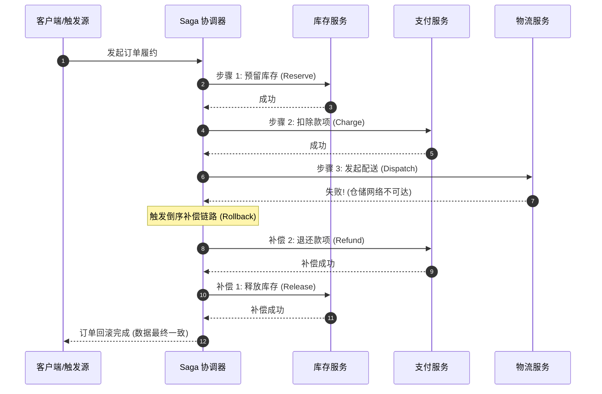
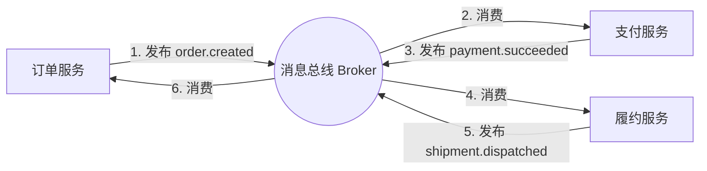
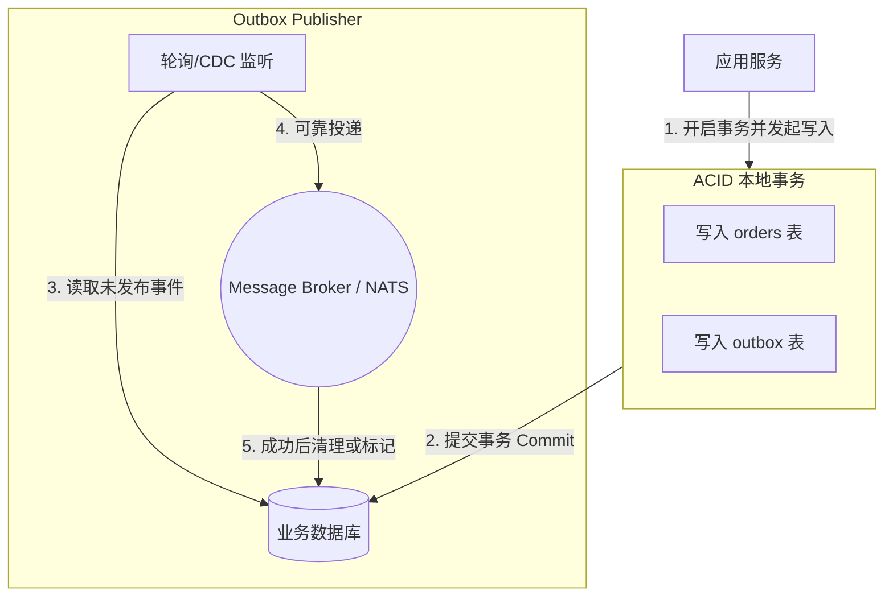

订单服务创建了一个订单。支付服务向客户扣款。一个事务。两个服务。在这两者之间，不存在任何能够跨越二者的 `tx.Rollback()`。

订单创建成功了，支付却失败了。现在该怎么办？订单实实在在地存在于订单服务的数据库中，但客户并没有被扣款。从客户的视角来看：他们提交了订单，并看到了提交成功的界面。从企业的商业视角来看：系统里多出了一个没有关联付款的幽灵订单。从数据库的技术视角来看：两个服务的数据库记录在各自内部都是自洽且一致的，但它们彼此之间却产生了严重的分歧。

这就是分布式一致性问题（The Distributed Consistency Problem）。这绝不是你代码编写中出现的 Bug，而是当系统演进为由多个独立服务分别维护各自状态时所必然伴随的固有属性。核心问题从来不是如何彻底阻止它 —— 因为在物理现实中你根本无法阻止 —— 而是如何通过科学的架构设计，使这种**不一致性能够被快速检测（Detectable）、可以安全恢复（Recoverable），并且其产生的影响窗口始终是有界受限的（Bounded）**。

---

## 1. CAP 定理的应用（The CAP Theorem, Applied）

CAP 定理指出，任何分布式系统最多只能同时提供以下三项保证中的两项：

* **一致性（Consistency）**：每次读取都能获取到最新写入的数据。
* **可用性（Availability）**：每个发往非故障节点的请求都能获得非错误的响应。
* **分区容忍性（Partition Tolerance）**：即使节点之间因网络故障导致通信中断或丢包（发生网络分区），系统仍能继续运行。

```
                 Consistency (一致性)
                      /\
                     /  \
                    /    \
      CP 系统      /      \      CA 系统
   (金融/账本系统) /        \  (单机数据库环境)
                  /   CAP   \
                 /  Theorem  \
                /             \
               /_______________\
Availability (可用性) --------- Partition Tolerance (分区容忍性)
                     AP 系统
                (购物车/社交网络)
```

由于物理网络分区是一定会发生的 —— 它们是不可避免的客观现实，而非可选项 —— 因此，**一旦发生网络分区，你永远都必须在一致性与可用性之间做出权衡与抉择**。

* **CP 系统（发生分区时优先保证一致性，牺牲可用性）**：例如银行转账系统，当它无法与主节点（Primary Node）取得联系时，宁可直接拒绝处理交易。系统中绝不会出现陈旧或不一致的账目数据，但代价是有时会中断服务。
* **AP 系统（发生分区时优先保证可用性，牺牲强一致性）**：例如电商的购物车系统，即使库存服务当前因网络中断而无法连通，也依然允许用户将商品先加入购物车。系统始终可用，但购物车中后续可能会出现实际已经脱销的商品。

这是一种纯粹的**架构设计抉择（Design Choice），而非技术上的缺陷或故障**。你必须基于真实的业务需求来做出明智的选择：

* **对于金融交易与资金结算**：选择一致性（Consistency）。
* **对于用户个人偏好设置与展示**：选择可用性（Availability）。
* **对于用户点击“加入购物车”时的库存检查**：选择可用性（先保证加购体验顺畅，留到最终结账时再做严谨校验）。
* **对于用户最终“提交支付结账”时的库存锁定**：选择一致性。

---

## 2. 最终一致性（Eventual Consistency）

在微服务与云原生架构中，绝大多数分布式系统都会针对大部分业务数据选择可用性而非强一致性。这一权衡的自然结果就是**最终一致性（Eventual Consistency）**：系统在经历状态变更后，最终必然会收敛并达到一致的状态；但在任意给定的特定中间时刻，不同的服务对全局状态可能有不同的视图。

最终一致性绝不意味着数据可以“长期错误且无从追溯”。它的精确含义是：**在停止注入新的数据更新的前提下，所有副本与下游视图最终都会收敛至相同的状态值。**

不一致的时间窗口（Window of Inconsistency）在系统设计中是必须有界的 —— 对于设计优秀的生产系统，这一窗口通常仅持续数毫秒（ms）；只有当某个下游服务遭遇网络分区或出现严重消息积压延迟时，该窗口期才会相应拉长。

在工程实践中，你可以通过以下两个核心数学与逻辑属性来推导和掌控最终一致性：

1. **幂等性（Idempotency）**：处理同一个事件两次与处理它一次所产生的结果完全相同（即 $f(f(x)) = f(x)$）。当你使用的消息传递机制无法保证“精确一次交付（Exactly-Once Delivery）”时，幂等性是保障系统正确性的生命线。
2. **可交换性（Commutativity）**：以任意先后顺序处理一组事件，最终产生的系统状态完全相同（即 $x \cdot y = y \cdot x$）。当底层传输网络无法保证“严格有序交付（Ordered Delivery）”时，可交换性能够极大简化消费逻辑。

现实世界中的业务操作并非天然都具备幂等性或可交换性。本章后续介绍的设计模式，正是为了在业务操作不具备这些特性时，为系统构建起坚固的一致性防线。

---

## 3. 幂等键（Idempotency Keys）

**幂等键（Idempotency Key）**是由客户端生成并随请求携带的全局唯一标识符（通常使用 UUID），服务端借助该标识符对传入的写请求进行精准去重。当客户端因为网络抖动、超时等原因对同一个请求发起重试时，服务端能够立刻识别出该重复请求，并直接返回第一次成功处理时所生成的相同响应结果。

```go
func createOrderHandler(store OrderStore, events Publisher) http.HandlerFunc {
	return func(w http.ResponseWriter, r *http.Request) {
		idempotencyKey := r.Header.Get("Idempotency-Key")
		if idempotencyKey == "" {
			WriteError(w,
				http.StatusBadRequest,
				"MISSING_KEY",
				"Idempotency-Key header required")
			return
		}

		// 检查是否已经处理过具有该幂等键的请求
		existing, err := store.GetByIdempotencyKey(r.Context(), idempotencyKey)
		if err != nil && !errors.Is(err, ErrNotFound) {
			WriteError(w,
				http.StatusInternalServerError,
				"INTERNAL_ERROR",
				"internal error")
			return
		}
		if existing != nil {
			// 该请求此前已成功处理完毕 —— 直接返回当时保存的完全相同的响应
			w.Header().Set("Content-Type", "application/json")
			w.WriteHeader(http.StatusCreated)
			json.NewEncoder(w).Encode(existing)
			return
		}

		var order Order
		if err := json.NewDecoder(r.Body).Decode(&order); err != nil {
			WriteError(w,
				http.StatusBadRequest,
				"INVALID_REQUEST",
				err.Error())
			return
		}

		order.ID = generateID()
		order.IdempotencyKey = idempotencyKey

		if err := store.Create(r.Context(), order); err != nil {
			WriteError(w,
				http.StatusInternalServerError,
				"STORE_ERROR",
				err.Error())
			return
		}

		w.Header().Set("Content-Type", "application/json")
		w.WriteHeader(http.StatusCreated)
		json.NewEncoder(w).Encode(order)
	}
}
```

底层数据库将该幂等键与订单记录一同持久化存储。在进入核心业务逻辑处理之前，系统首先检查该幂等键是否已被使用：
* **如果已存在**：说明这是一次重复请求，直接返回先前已持久化的处理结果。
* **如果不存在**：则正常执行订单创建逻辑，并在同一个事务中将幂等键与结果一并落库。

这种机制使得 API 端点具备了完全**重试安全（Retry-Safe）**的特质。无论客户端是因为瞬时网络中断、网关超时、还是由于对响应状态感到不确定而重复提交了多次相同请求，服务端都能坚不可摧地保证只执行一次实际业务扣款或创建。

---

## 4. 乐观锁（Optimistic Locking）

当两个并发进程或 Goroutine 试图同时更新数据库中的同一条记录时，最终的结果完全取决于哪一次写入在物理上先一步落盘。在没有任何并发协同机制的情况下，后到达的写入操作会无声无息地覆盖掉先前的更新成果 —— 这就是分布式领域中最臭名昭著的**更新丢失（Lost Update）**现象。

```
并发更新丢失场景 (Lost Update):
客户端 A: 读取 Order (Status: pending) ---------------------> 写入 Status: fulfilled (覆盖客户端 B 的更新!)
客户端 B:        读取 Order (Status: pending) -> 写入 Status: cancelled (被无情覆盖并丢失!)
```

**乐观并发控制（Optimistic Locking）**通过为数据模型引入自增版本号（Version Number）来探测并发冲突：

```go
type Order struct {
	ID        string
	Status    string
	Version   int
	UpdatedAt time.Time
}

func (r *OrderRepository) UpdateStatus(ctx context.Context, orderID,
	newStatus string, version int) error {
	result, err := r.db.Exec(ctx,
		`UPDATE orders
		 SET status = $1, version = version + 1, updated_at = NOW()
		 WHERE id = $2 AND version = $3`,
		newStatus, orderID, version,
	)
	if err != nil {
		return fmt.Errorf("update order: %w", err)
	}

	if result.RowsAffected() == 0 {
		return ErrConflict // 版本不匹配：说明自读取之后已有其他事务抢先更新了该记录
	}

	return nil
}
```

其中的 `WHERE id = $2 AND version = $3` 条件子句是实现乐观锁的关键钥匙：**更新操作唯有在数据库中当前版本号与调用者最初读取到的版本号完全一致时，才能成功执行。** 如果另一个并发进程在读取与写入之间的狭窄间隙抢先更新了该记录，该行的版本号就会自增变大，导致当前 UPDATE 语句匹配不到目标行，`result.RowsAffected()` 返回 0 —— 由此精准地向应用层抛出冲突信号。

调用端通常通过重新读取最新记录并重试来平滑化解冲突：

```go
func fulfillOrder(ctx context.Context,
	orderID string,
	store OrderRepository) error {
	for {
		order, err := store.GetByID(ctx, orderID)
		if err != nil {
			return err
		}

		if order.Status != "pending" {
			return ErrOrderNotPending
		}

		err = store.UpdateStatus(ctx, order.ID, "fulfilled", order.Version)
		if errors.Is(err, ErrConflict) {
			// 其他进程抢先更新了订单状态 —— 重新读取最新数据并重试
			continue
		}
		return err
	}
}
```

乐观锁最为契合**数据写入冲突概率较低（Conflicts are rare）**的业务场景。它完全规避了传统悲观锁（Pessimistic Locking，如 SQL 中的 `SELECT ... FOR UPDATE`）的昂贵性能开销 —— 悲观锁会在整个本地或分布式事务存活期间牢牢霸占数据库的行锁甚至表锁，在高并发流量冲击下极易引发线程排队、严重锁争用以及数据库连接池迅速被打爆的灾难。

---

## 5. Saga 模式（The Saga Pattern）

当一项核心业务事务需要跨越多个独立的微服务时，系统必须提供一种在中间任一步骤发生故障时能够将整个分布式状态安全回滚的可靠方案。**Saga 模式正是传统数据库 ACID 本地事务在分布式微服务领域的标准替代方案。**

一个 Saga 由一系列有序执行的局部事务步骤（Step）组成，每一个正向操作步骤都严格绑定了一个用于回滚状态的**补偿操作（Compensating Action）**。如果在执行到第 $N$ 步时发生不可恢复的错误，Saga 协调机制将以**倒序（Reverse Order）**依次执行第 $N-1$ 步递减至第 1 步所对应的补偿操作，撤销此前所有已经生效的中间变更。

以典型的电商订单履约业务流程为例，拆解为 Saga 如下表所示：

| 步骤序号 (Step) | 正向操作 (Action) | 补偿操作 (Compensating Action) |
| :---: | :--- | :--- |
| **步骤 1** | 预留库存（Reserve inventory） | 释放库存预留（Release inventory reservation） |
| **步骤 2** | 扣除款项（Charge payment） | 退还扣除款项（Refund payment） |
| **步骤 3** | 发起物流配送（Dispatch shipment） | 取消物流配送（Cancel shipment） |
| **步骤 4** | 标记订单已发货（Mark order shipped） | 标记订单未发货（Mark order unshipped） |



假设步骤 3（发起物流配送）执行失败，Saga 引擎将立刻触发倒序补偿流程：退还步骤 2 扣除的款项 $\rightarrow$ 释放步骤 1 预留的库存。最终整个系统状态安全回归一致，就如同该交易从一开始就从未发生过一样。

在 Go 语言中实现一个纯正且健壮的 Saga 执行引擎：

```go
type SagaStep struct {
	Action     func(ctx context.Context) error
	Compensate func(ctx context.Context) error
}

func RunSaga(ctx context.Context, steps []SagaStep) error {
	var completed []SagaStep

	for _, step := range steps {
		if err := step.Action(ctx); err != nil {
			// 正向步骤失败 —— 按倒序依次执行已完成步骤的补偿操作
			compensateCtx, cancel := context.WithTimeout(
				context.Background(), 30*time.Second)
			defer cancel()

			for i := len(completed) - 1; i >= 0; i-- {
				if compErr := completed[i].Compensate(compensateCtx); compErr != nil {
					slog.Error("compensation failed",
						"step", i,
						"error", compErr,
					)
					// 补偿失败：必须记录并触发告警，升级为人工介入处理
					// 写入故障事件系统，通知运维团队
				}
			}
			return fmt.Errorf("saga failed at step %d: %w",
				len(completed),
				err)
		}
		completed = append(completed, step)
	}

	return nil
}
```

在设计 Saga 架构时，有两条至关重要的工程铁律必须牢记于心：

### 铁律 1：补偿操作必须是严格幂等的
如果补偿动作由于网络瞬断失败并在之后被自动重试，释放一个已经处于释放状态的库存预留应当直接返回成功（No-Op 空操作），绝对不能报错中断；对一笔已经完成退款的流水再次发起退款必须在业务规则层面予以拦截。编写 `Compensate` 补偿函数的技术难度往往远超编写 `Action` 正向业务函数 —— 因为补偿逻辑必须能够完美兜底正向操作**仅部分成功（Partially Succeeded）**或状态不确定的各类边界条件。

### 铁律 2：补偿操作本身也可能会失败
现实世界中没有任何技术手段能够 100% 杜绝补偿操作本身的失败。当补偿逻辑报错耗尽重试次数时，系统就会陷入**补偿故障（Compensation Failure）**—— 即 Saga 停留在局部回滚的悬挂状态（“Stuck Saga”）。这种极端的边缘状态绝非在普通业务代码里简单自旋重试就能解决的，它必然需要**人工干预（Human Intervention）**。系统必须将此类事件完整落库、生成高优先级告警通知，并提供配套的标准运维手册（Runbook）供值班工程师手动介入。没有任何架构能彻底消除此类极端风险；**优秀架构的胜出之处，在于能第一时间发现它，并将人工排障与状态修复的流程设计得清晰、可控且毫无歧义**。

---

## 6. 事件驱动一致性（Event-Driven Consistency）

上一节展示的 Saga 属于**集中式流程调度（Choreography / 协作编舞或简单编排）**：由服务直接显式调用下一个下游服务。而在松耦合的微服务体系中，另一种极具吸引力的范式是**事件驱动的协作编舞（Event-Driven Choreography）**：每个服务专注于向外广播领域事件，由关心的下游服务自主监听并触发业务动作。

典型订单业务在事件驱动编舞下的流转链条：

$$
\begin{aligned}
\text{订单服务发布 } & \texttt{order.created} \\
\longrightarrow \text{支付服务响应事件并执行扣款} \\
\longrightarrow \text{支付服务发布 } & \texttt{payment.succeeded} \\
\longrightarrow \text{履约服务响应事件并安排发货} \\
\longrightarrow \text{履约服务发布 } & \texttt{shipment.dispatched} \\
\longrightarrow \text{订单服务响应事件并将订单标记为已完成}
\end{aligned}
$$

在此架构下，每一个处理步骤都具有极高的独立性。每个服务只关注自身订阅的外部事件以及自身产生的领域事件，对跨服务的宏观全局业务流程一无所知。当业务需要扩展（例如在支付成功后增加向用户推送风控分析或发送营销短信的环节）时，只需增加一个新的独立消费者去监听 `payment.succeeded` 即可 —— 核心的订单与支付服务无需改动任何一行代码，完全符合开闭原则。



### 架构权衡（The Tradeoff）
事件驱动协作编舞的最大代价在于：**业务工作流变成了隐式且高度分散的状态存在。** 当线上出现业务异常时，排查与定位问题必须依赖跨多个微服务的日志追踪和事件溯源（Trace ID）；当需要修改现有流程时，开发者必须地毯式排查整个分布式系统中有哪些潜在微服务正在悄悄响应这些事件。

> [!TIP]
> **编舞（Choreography）vs 编排（Orchestration）的选型黄金准则**：  
> 对于链路清晰短小（3 到 5 个步骤）且各个微服务分属不同自治团队维护的轻量场景，事件驱动协作编舞非常优雅解耦；而对于链路繁长、分支复杂、或者必须对全局业务状态持有确定性视图的场景，引入一个专门的**编排器服务（Orchestrator）**来显式驱动和集中管理状态流转，在系统推理、可观测性以及工程调试上要轻松得多。

---

## 7. 发现不一致性（Detecting Inconsistency）

无论你采用了多么精妙的分布式一致性模式，都必须在架构设计之初就为**必然会出现的数据不一致构建专门的检测与纠偏机制**。

* **周期性运行的对账任务（Reconciliation Job）**：例如定期运行定时任务，自动扫描出所有“已完成支付但超过指定时限仍未生成发货单”的异常订单。
* **状态滞留监控告警（Transition Monitoring Alert）**：针对任何在“中间过渡状态（Transitional State）”（如 `processing`、`pending_refund`）停留超过 5 分钟的业务单据，立刻通过 Prometheus 和 PagerDuty 触发监控告警。
* **不可篡改的审计日志（Audit Log）**：在数据库中精确记录每一次实体状态迁移的时间、原因和操作源，以便在系统出现未知异常分歧时，能够通过重放历史事件（Event Replay）重建或校准系统状态。

在分布式系统的严酷法则中，**数据出现不一致性绝不是你系统架构的失败，而是分布式环境下的物理客观规律**。真正的架构灾难，是**未被察觉的不一致性（Undetected Inconsistency）** —— 例如一个由于网络抖动被系统扣了款却永远静默丢失了发货单的订单，直到六周之后怒气冲冲的客户打电话给客服投诉时，研发团队才第一次知道它的存在。

---

## 8. 发件箱模式（The Outbox Pattern）

在现代微服务开发中，开发者们最容易写出的“炸弹代码”，正是看似极其自然的“数据库写操作 + 消息发布”两阶段调用：

```go
// 错误示范：这两个操作毫无原子性保障，随时可能产生不可挽回的分歧
store.Create(ctx, order)
events.Publish(ctx, "orders.created", event)
```

如果宿主机或容器进程恰好在 `store.Create` 成功落盘之后、`events.Publish` 执行之前由于 OOM、断电或 Crash 重启，订单已经切实存储在数据库中，但下游服务却永远不可能收到该事件。没有下游扣款，没有发送确认邮件，**该订单就此在分布式系统中被永久静默遗忘**。

如果开发者为了防止订单丢失，自作聪明地将调用顺序倒过来呢？

```go
// 同样是严重错误：极易产生幽灵事件 (Phantom Events)
events.Publish(ctx, "orders.created", event)
store.Create(ctx, order)
```

如果进程在消息成功发出后、数据库写操作执行前发生崩溃，每一个下游订阅者都将围绕一个**在订单服务底层数据库中根本不存在的订单**大动干戈 —— 库存服务锁定了本不存在的商品库存，支付服务无故扣取了客户银行卡资金，引发毁灭性的幽灵事件。

### 解决方案：发件箱模式（The Outbox Pattern）
彻底消灭这一双写困境的标准解法，是**发件箱模式（The Outbox Pattern）**：借助关系型数据库天然的 ACID 强一致性事务能力，将待发布的消息事件以记录的形式，与业务核心数据写入**同一个数据库、同一个本地事务中**。随后由一个解耦的独立后台进程可靠地轮询或消费该发件箱表，并负责将消息重试投递至消息代理总线（Message Broker）。



在数据库中定义专用的发件箱表：

```sql
-- 在业务订单表所在的同一个数据库中创建发件箱表
CREATE TABLE outbox (
    id          BIGSERIAL PRIMARY KEY,
    aggregate   TEXT NOT NULL,        -- 聚合根名称，例如 "orders"
    event_type  TEXT NOT NULL,        -- 事件类型，例如 "order.created"
    payload     JSONB NOT NULL,       -- 结构化事件内容
    created_at  TIMESTAMPTZ NOT NULL DEFAULT NOW()
);

-- 为未发布的事件创建高效的偏索引 (Partial Index)
-- 注：若采用保留记录并更新状态位的设计，可声明 published 字段并为其建立索引；
-- 若采用下文展示的 DELETE ... RETURNING 高性能消费架构，则直接根据主键与时间戳索引。
CREATE INDEX outbox_published_idx ON outbox (created_at);
```

业务层写入逻辑 —— 订单数据与发件箱事件在同一个本地数据库事务中提交：

```go
func (s *OrderService) CreateOrder(ctx context.Context, order Order) error {
	tx, _ := s.db.Begin(ctx)
	defer tx.Rollback(ctx)

	// 1. 写入业务订单主记录
	tx.Exec(ctx, `INSERT INTO orders ...`, ...)

	// 2. 将待发布事件写入发件箱 —— 同一个事务，同一个物理数据库
	payload, _ := json.Marshal(OrderCreated{OrderID: order.ID})
	tx.Exec(ctx,
		`INSERT INTO outbox (aggregate,
             event_type,
             payload) VALUES ($1,
             $2,
             $3)`,
		"orders", "order.created", payload,
	)

	// 两者要么同时持久化成功，要么同时回滚
	return tx.Commit(ctx)
}
```

此时，订单数据与待发事件要么双双落盘成功，要么双双回滚撤销，在物理上绝不可能出现“订单写入了但事件丢失”的不一致缝隙。这是在普通业务开发中实现**跨业务记录与消息广播原子性**的唯一通用正确途径 —— 充分利用单机数据库的成熟事务保证，因为在异构的业务数据库与分布式消息中间件之间，并不存在普适且高效的分布式事务协议。

在后台启动专属的 Go 协程作为发件箱发布者（Outbox Publisher）：

```go
func (p *OutboxPublisher) Run(ctx context.Context) error {
	ticker := time.NewTicker(100 * time.Millisecond)
	defer ticker.Stop()

	for {
		select {
		case <-ctx.Done():
			return nil
		case <-ticker.C:
			if err := p.pollAndPublish(ctx); err != nil {
				p.logger.Error("outbox publish failed", "error", err)
			}
		}
	}
}

func (p *OutboxPublisher) pollAndPublish(ctx context.Context) error {
	// 使用 PostgreSQL 特有的 DELETE ... RETURNING 语法
	// 原子性地锁定、弹出并删除最早待发送的批次数据
	rows, _ := p.db.Query(ctx,
		`DELETE FROM outbox WHERE id IN (
            SELECT id FROM outbox ORDER BY created_at LIMIT 100
         ) RETURNING id, aggregate, event_type, payload`,
	)

	for rows.Next() {
		var event OutboxEvent
		rows.Scan(&event.ID,
			&event.Aggregate,
			&event.EventType,
			&event.Payload)

		subject := event.Aggregate + "." + event.EventType
		if err := p.publisher.Publish(ctx,
			subject,
			event.Payload); err != nil {
			// 消息发送失败 —— 重新将该事件插入发件箱，等待下一次循环重试
			p.db.Exec(ctx,
				`INSERT INTO outbox (aggregate,
                     event_type,
                     payload) VALUES ($1,
                     $2,
                     $3)`,
				event.Aggregate, event.EventType, event.Payload,
			)
		}
	}
	return rows.Err()
}
```

这里的 `DELETE ... RETURNING` 语句是该实现的核心精髓所在：它以极高的原子性能从发件箱表中提取事件并立即将其移除。如果消息发布成功，发件箱中的记录随之彻底完成生命周期；如果发布失败，则重新将事件推入发件箱等待下一轮重试。

除非发生“消息投递已到达 Broker 但在进程提交 DELETE 事务前瞬间崩溃”这种极端边界，否则任何消息都不会被投递超过一次；而这极其罕见的极少数重复，能够被下游消费者的幂等性轻松消化。

发件箱模式在工程结构上实现了质的跃迁：它成功将原本脆弱不可靠的“至少一次本地写 + 至少一次远程发”，彻底改造为**“精确一次的本地原子事务写入（Exactly-once atomic write）+ 至少一次的可靠消息发布（At-least-once publish）”**。下游消费者依旧需要维护幂等底线，但上游生产者自此拥有了**永不丢失事件**的绝对底气。

---

## 9. 实践中的对账任务（Reconciliation in Practice）

对账任务在实际工程落地时并不需要编写得格外花哨复杂。下面就是一个极其简单却极为强大的生产级对账任务，它定期捕获所有异常停留在 `pending` 状态过久的卡滞订单：

```go
func (j *ReconciliationJob) Run(ctx context.Context) error {
	rows, err := j.db.Query(ctx,
		`SELECT id, created_at FROM orders
         WHERE status = 'pending'
         AND created_at < NOW() - INTERVAL '5 minutes'`,
	)
	if err != nil {
		return err
	}
	defer rows.Close()

	for rows.Next() {
		var orderID string
		var createdAt time.Time
		rows.Scan(&orderID, &createdAt)

		j.logger.WarnContext(ctx, "stuck order detected",
			"order_id", orderID,
			"age_minutes", time.Since(createdAt).Minutes(),
		)

		// 累加 Prometheus Gauge 监控指标，用于触发值班人员报警
		j.stuckOrdersMetric.Inc()

		// 可选：向系统广播修复事件，触发自动化补偿处理逻辑
		// j.publisher.Publish(ctx, "orders.stuck", StuckOrder{OrderID: orderID})
	}
	return rows.Err()
}
```

将其部署为周期性任务 —— 可以是在 Go 服务后台通过独立 Goroutine 配合 `time.Ticker` 每分钟调度一次，也可以作为 Kubernetes 的 `CronJob` 独立容器定时启动。

这段对账代码的根本价值不在于它的算法多么高深精巧，而在于**它的的确确常态化运行着**。

> 一个缺乏对账机制的分布式系统，是一个**不一致性悄然潜伏且完全不可见的失控系统**。  
> 一个配置了对账任务并能在异常时主动触发告警的系统，是一个**在客户尚未感知之前就已敏锐捕捉并能够安全修复不一致性的现代化自愈系统**。

在任何现代云原生分布式架构中，每一个核心业务域都必须部署至少一个常态化的对账任务。它是你为系统尚未发现的各类潜伏一致性 Bug 所安插的**最忠诚的金丝雀（Canary）**。

---

## 10. SDK 沉淀（What Goes in the SDK）

一致性设计模式是在各个微服务各自重复实现时最容易产生隐蔽 Bug 的高危领域。在 Saga 运行器或幂等校验逻辑中出现的任何微小代码缺陷，都会像多米诺骨牌一样顺着 RPC 调用链路迅速跨越微服务边界蔓延至全局。因此，必须将这些通用逻辑沉淀提炼至公司级的底层 SDK 中（例如 `platform/consistency`）：

```
platform/consistency/
  idempotency.go — IdempotencyStore 通用接口与 PostgreSQL 生产实现
  saga.go        — 支持自动倒序补偿的通用 Saga 执行器与 SagaStep 类型定义
  optimistic.go  — 基于版本号的乐观并发控制辅助工具函数
  reconcile.go   — 通用 ReconciliationJob 接口与后台定时调度引擎
```

其中，**幂等存储（Idempotency Store）**是价值极高的 SDK 核心组件 —— 每一个支持重试调用的微服务都对此有强烈的刚需：

```go
// platform/consistency/idempotency.go

type IdempotencyStore interface {
	Get(ctx context.Context, key string) (*StoredResult, error)
	Set(ctx context.Context, key string, result *StoredResult) error
}

type StoredResult struct {
	StatusCode int
	Body       []byte
	CreatedAt  time.Time
	ExpiresAt  time.Time
}

// IdempotencyMiddleware 是一个标准的 HTTP 中间件，
// 能够无侵入地为任何下游 HTTP Handler 赋予全自动的幂等防护能力。
func IdempotencyMiddleware(store IdempotencyStore) Middleware {
	return func(next http.Handler) http.Handler {
		return http.HandlerFunc(func(w http.ResponseWriter, r *http.Request) {
			// 对天然幂等的只读请求直接放行
			if r.Method == "GET" || r.Method == "HEAD" || r.Method == "OPTIONS" {
				next.ServeHTTP(w, r)
				return
			}

			key := r.Header.Get("Idempotency-Key")
			if key == "" {
				// 未携带幂等键的请求，按普通非幂等链路正常流转
				next.ServeHTTP(w, r)
				return
			}

			// 检查此前是否已缓存该幂等键的处理结果
			existing, err := store.Get(r.Context(), key)
			if err == nil {
				// 命中幂等缓存 —— 直接回放当时的状态码与响应体
				w.WriteHeader(existing.StatusCode)
				w.Write(existing.Body)
				return
			}

			// 使用自定义的 ResponseRecorder 拦截并捕获下游 Handler 的响应
			rec := &responseRecorder{ResponseWriter: w, status: http.StatusOK}
			next.ServeHTTP(rec, r)

			// 将处理结果安全写入幂等存储，供未来的潜在重试调用
			store.Set(context.Background(), key, &StoredResult{
				StatusCode: rec.status,
				Body:       rec.body.Bytes(),
				CreatedAt:  time.Now(),
				ExpiresAt:  time.Now().Add(24 * time.Hour),
			})
		})
	}
}
```

该中间件让系统内的任何 POST/PUT/PATCH 端点在**不需要修改下游业务代码任何一行实现的前提下**，立竿见影地获得严密的幂等保护。HTTP 请求到达业务逻辑前，`Idempotency-Key` 头部会被自动校验与拦截；业务处理完毕后，响应结果自动被持久化以便未来快速重放。

同样，本章早先设计的生产级 Saga 执行器也应当完整沉淀至该公共包中：

```go
// platform/consistency/saga.go

type SagaStep struct {
	Name       string
	Action     func(ctx context.Context) error
	Compensate func(ctx context.Context) error
}

func RunSaga(ctx context.Context,
	steps []SagaStep,
	logger *slog.Logger) error {
	var completed int

	for i, step := range steps {
		if err := step.Action(ctx); err != nil {
			logger.ErrorContext(ctx, "saga step failed, compensating",
				"step", step.Name,
				"error", err,
			)

			// 为补偿流程单独派生具备明确超时限制的独立 Context
			compensateCtx, cancel := context.WithTimeout(context.Background(),
				30*time.Second)
			defer cancel()

			// 倒序触发所有已执行步骤对应的补偿函数
			for j := i - 1; j >= 0; j-- {
				if compErr := steps[j].Compensate(compensateCtx); compErr != nil {
					logger.ErrorContext(ctx,
						"compensation failed — manual intervention required",
						"failed_step", step.Name,
						"compensating_step", steps[j].Name,
						"error", compErr,
					)
				}
			}
			return fmt.Errorf("saga %s failed at step %d (%s): %w",
				step.Name, i, step.Name, err)
		}
		completed++
	}

	return nil
}
```

未来任何需要执行跨服务复杂事务的微服务，只需要直接导入 `consistency.RunSaga` 并按规范声明各自的步骤与回滚函数即可 —— 所有繁杂的逆序补偿调度、超时隔离保护、结构化链路排查日志以及错误包装，全部由 SDK 底座统一标准化承载。

---

## 11. 常见问题解答（Q&A）

### Q: 在实现 Saga 时，应该选择协作编舞（Choreography）还是集中编排（Orchestration）？

**答**：  
* **协作编舞（Choreography）**：更适合业务流程较为简单直观（通常在 3 到 5 个步骤以内），且各个参与服务由不同团队独立维护、各团队非常看重自身微服务架构自治度的场景。
* **集中编排（Orchestration）**：更适合跨服务调用链路较长且业务规则错综复杂的场景；当你需要在一个集中化的控制台直观审视整个业务工作流的状态机进度，或者参与该链路的大多数微服务都由同一个业务团队集中掌控时，编排器是最好的选择。

在大多数成熟的工业界大型系统中，这两者并不是互斥的对立选择，通常会根据不同的具体业务链路混合使用。

---

### Q: 如何对 Saga 的补偿逻辑进行完备有效的测试？

**答**：  
核心策略是在测试用例中对每一个正向执行步骤**故意人为注入故障（Fault Injection）**，并极其严谨地断言验证其反向补偿链路是否按预期正确倒序执行。

本专栏第 13 章将深入介绍的 `testcontainers-go` 库允许你在 Go 的自动化集成测试中动态拉起真实的 Docker 数据库与外部微服务依赖。借助这一工具，你可以在真实的底层基础设施上测试包括各类严重故障分支在内的完整 Saga 流程。在单元测试层面仅仅使用 Mock 对象来测试补偿逻辑，对于保证复杂的分布式真实状态流转的正确性而言是远远不够的。

---

### Q: Saga 模式与传统两阶段提交（2PC）之间有何本质区别？

**答**：  
* **两阶段提交（Two-Phase Commit, 2PC）**：通过一个集中的事务协调器（Coordinator）跨多个异构数据库来协调分布式事务，在协调器做出最终的 Commit（提交）或 Abort（中止）裁决之前，所有参与节点的数据库资源都必须**全程持有排他锁（Holding Locks）**。2PC 提供了极强的强一致性（ACID）保证，但它致命的弱点在于：一旦协调器发生单点故障或遭遇网络分区，整个集群就会陷入漫长的阻塞等待；此外，它在现代微服务各自维护独立私有数据库（Database-per-Service）的架构下几乎无法运作。
* **Saga 模式**：采用纯粹的异步化设计，绝不在跨服务通信期间长期锁定任何底层的数据库资源，天然基于**最终一致性（Eventual Consistency）**构建。

对于绝大多数现代云原生分布式微服务体系，Saga 是最务实、最高效的黄金工具；只有当你能对涉及到的所有底层数据库实例拥有绝对的完全控制权且对实时强一致性有严苛硬性要求的狭窄场景下，2PC 才有适用的立足之地。

---

### Q: 当一个补偿操作在发生错误并重试三次后依然失败，该如何处理？

**答**：  
此时你的系统遭遇了最棘手的**“卡滞 Saga（Stuck Saga）”**—— 即一个跨多服务的分布式业务事务只部分完成了回滚，并且无法再通过系统的全自动化手段安全撤销。

这种情况**必须立刻升级为人工介入（Human Intervention）**。在工业级生产实践中，推荐遵循以下黄金规范：

1. **结构化持久化上下文**：立刻将该 Saga 的完整当前快照、各步骤输入输出以及失败的堆栈信息完整持久化至存储中；
2. **立即触发高优先级运维告警**：通过监控告警系统（如 PagerDuty/企业微信/钉钉告警通道）第一时间唤醒值班工程师；
3. **提供配套的手动介入工具**：系统必须预先开发配套的运维 CLI 命令行工具或受权限管控的后台管理 API，供工程师在修复底层依赖后安全地手动重试或强制平账；
4. **极致简化补偿逻辑的设计**：在设计补偿动作之初，就应将其逻辑收敛至极致简单、直接，尽可能减少在补偿函数中再次调用复杂的不可靠外部依赖；
5. **落库专用的 Saga 状态日志表**：许多成熟系统会在数据库中单独维护一张专门记录分布式长事务状态的日志表，供运维中台与对账系统全天候查询、分析与干预。

---

一致性设计模式能够构筑坚固的数据防线，防止你的数据发生不可挽回的分歧与错乱。但它们无法直接阻止你的微服务因下游拥堵而变慢、抛出意外错误、或在内存中发生隐蔽的资源泄漏。

在下一章中，我们将为你交付洞悉系统内部黑盒运行状态的现代化观测利器：**基于标准库 `slog` 的结构化日志（Structured Logging）、Prometheus 监控指标（Metrics），以及能够将每一行孤立日志精准串联至特定用户请求的分布式链路追踪（Distributed Tracing）**。
