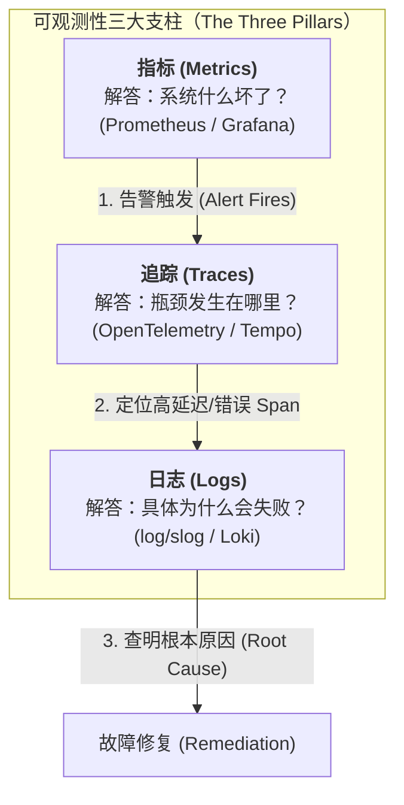
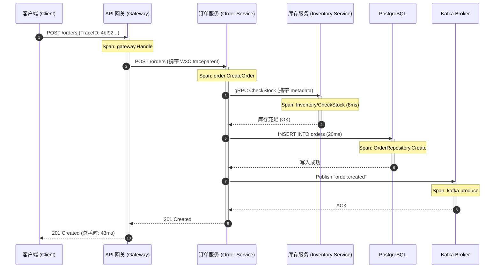
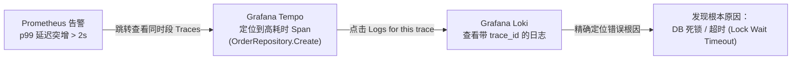

> 💡 **专栏导读**：本文收录于专栏 [《Go 云原生分布式系统实战》](/columns/distributed-go)。全专栏共 17 篇，深入剖析现代 Go 在并发模型、微服务通信、JWT 鉴权、分布式事务、可观测性与生产集群落地的完整工程实践。

你的服务挂了。日志里赫然打印着一句冷冰冰的 `context deadline exceeded`（上下文截止时间超时）。你不知道是哪个服务发起了这笔失败的请求，不知道究竟是哪个下游调用发生了超时，不知道这只影响了个别用户还是所有用户，甚至不知道这个问题到底已经持续了多久。

在团队真正投入建设**可观测性（Observability）**之前，绝大多数分布式系统都处于这种失明状态。可观测性并不能阻止故障的发生 —— 它决定的是你能在 **两分钟** 内定位问题，还是需要耗费 **整整两天**。

可观测性的三大支柱各自解答了不同维度的核心疑问：

- **指标（Metrics）** 告诉你**什么东西坏了**（错误率突增、延迟升高）。
- **追踪（Traces）** 告诉你**性能瓶颈在哪里**（具体卡在哪个微服务、哪条 SQL 查询、哪一次网络跳跃）。
- **日志（Logs）** 告诉你**特定请求为什么会失败**（精确的错误堆栈、具体的入参值、panic 现场）。

你必须三者兼备。只有指标仪表盘而缺乏链路追踪，意味着你知道系统出了问题却如同大海捞针、无法定位；只有链路追踪而缺乏详细日志，意味着你知道时间花在了哪里却不知道业务究竟因何报错。



本章所介绍的工具链 —— `log/slog`、**Prometheus** 以及 **OpenTelemetry** —— 是云原生时代 Go 分布式服务的标准可观测性技术栈。学完本章后，这三大支柱将被严密串联在一起：每行日志都会携带 Trace ID，追踪链路能够一键跳转到对应的日志条目，而指标则在系统劣化时第一时间触发告警。

这套体系构成了**云原生可观测性契约（Cloud-Native Observability Contract）**：你的服务不需要自己将日志远程推送到收集器，不需要主动向服务器推送指标，也不需要注入黑盒 Agent。服务只需将结构化 JSON 打印到标准输出（`stdout`），暴露一个 `/metrics` 端点，并将 Span 批处理发送给本地的 OTLP 收集器。底层的云平台（Kubernetes、服务网格 Service Mesh、DaemonSet）全权负责数据的采集、聚合与持久化存储。你的服务无需关心遥测数据的去向，即可天然具备完整的可观测性。

---

## 1. 基于 slog 的结构化日志（Structured Logging with slog）

Go 1.21 正式在标准库中引入了 `log/slog`。对于编写后端服务代码而言，它彻底取代了传统的 `log` 包。其最根本的变革不在于 API 的语法，而在于**输出格式**。

### 传统做法（The Old Way）

```go
log.Printf("order created: id=%s user=%s amount=%.2f",
    order.ID,
    order.UserID,
    order.Total)
```

**输出：**
```text
2026/05/29 10:15:30 order created: id=ord-1234 user=usr-5678 amount=49.99
```

这种日志虽然适合人类肉眼阅读，但对**机器极度不友好**。如果你想找出所有金额大于 100 美元的订单，必须编写复杂的正则表达式；如果你想把这行日志与同一请求后续抛出的错误日志关联起来，只能去比对时间戳，并祈祷在同一毫秒内没有其他并发请求穿插进来；如果你想统计某个特定用户在日志中出现的频次，就不得不借助 `grep` 和 `awk` 拼凑管道命令。

### 现代做法（The New Way）

```go
slog.Info("order created",
    "order_id", order.ID,
    "user_id", order.UserID,
    "amount", order.Total,
)
```

**JSON 格式输出：**
```json
{"time":"2026-05-29T10:15:30Z","level":"INFO","msg":"order created","order_id":"ord-1234","user_id":"usr-5678","amount":49.99}
```

日志中的每个字段都是明确的键值对（Key-Value Pair）。现代日志聚合系统（如 Grafana Loki、AWS CloudWatch、Datadog、Splunk）可以直接针对特定字段进行索引、过滤、精确查询和配置告警，无需做脆弱的文本正则解析。“查找所有以 `ord-` 开头且 `amount > 100` 的订单请求”现在只需一条简单的结构化查询语句，而不是一条脆弱的 `grep | awk` 脚本。

### 初始化配置 slog（Setting up slog）

生产环境中应输出 JSON 格式到标准输出，而本地开发时则输出更适合阅读的纯文本。我们可以通过工厂函数统一初始化：

```go
func newLogger(cfg Config) *slog.Logger {
    var handler slog.Handler
    opts := &slog.HandlerOptions{
        Level: parseLogLevel(cfg.LogLevel),
        // 非生产环境下在日志中输出源码调用文件与行号，便于本地调试
        AddSource: cfg.Environment != "production",
    }

    if cfg.Environment == "production" {
        handler = slog.NewJSONHandler(os.Stdout, opts)
    } else {
        handler = slog.NewTextHandler(os.Stdout, opts)
    }

    return slog.New(handler)
}

func parseLogLevel(level string) slog.Level {
    switch strings.ToLower(level) {
    case "debug":
        return slog.LevelDebug
    case "warn":
        return slog.LevelWarn
    case "error":
        return slog.LevelError
    default:
        return slog.LevelInfo
    }
}
```

标准库自带的 `slog.NewTextHandler` 在本地开发时已经足够使用。如果你希望在终端获得更清晰、带有色彩高亮的日志体验，且不需要改动任何业务代码中的打印逻辑，可以使用流行的第三方 Handler 库 `charmbracelet/log`：

```go
import "github.com/charmbracelet/log"

func newLogger(cfg Config) *slog.Logger {
    if cfg.Environment == "production" {
        return slog.New(slog.NewJSONHandler(os.Stdout, &slog.HandlerOptions{
            Level: parseLogLevel(cfg.LogLevel),
        }))
    }

    // 开发环境：使用 charmbracelet/log 输出可读性高、带颜色的终端日志。
    // 依然是结构化的键值对（key=value）——只是对人眼更友好。
    return log.NewWithOptions(os.Stderr, log.Options{
        ReportCaller:    true,
        ReportTimestamp: true,
        Level:           parseLogLevel(cfg.LogLevel),
    })
}
```

在生产环境中，遵循容器日志规范将 JSON 写入 `os.Stdout`；在本地开发环境中，使用终端美化输出提高研发体验。`slog.Handler` 接口是这一切的核心：**你只需要替换底层的 Handler，而业务代码中的所有日志调用完全无需改动**。

在日志级别方面：开发环境使用 `DEBUG`，生产环境使用 `INFO`。在生产环境盲目开启 DEBUG 日志会带来显著的性能开销 —— 每一个第三库即使最终决定不打印消息，在执行是否启用了 DEBUG 的判断分支时依然需要付出 CPU 代价。

最后，将配置好的 Logger 注册为全局默认 Logger，以便第三方库能够无缝采用：

```go
logger := newLogger(cfg)
slog.SetDefault(logger)
```

在执行 `slog.SetDefault` 之后，任何直接调用 `slog.Info(...)`（未显式传递特定 Logger 实例）的地方都会自动走你所配置的 Handler。生产环境中，调用全局默认 Logger 的第三方依赖库也会自动输出符合规范的 JSON 日志。

### 日志级别及其适用场景（Log levels and when to use them）

- **DEBUG**：详尽的诊断信息，仅在开发调试期间有用。记录走了哪个分支、具体的入参数值、命中或未命中了哪个缓存键等。生产环境除非针对特定严重故障进行定向抓包排查，否则应当关闭。
- **INFO**：系统的正常运行事件。服务成功启动、HTTP 请求处理完成、业务订单创建成功。这些事件应当始终记录在生产日志中。此时的关键不是“要不要记录”，而是“应该带上哪些结构化字段”。
- **WARN**：已被程序成功捕获并处理、但值得引起工程关注的异常情况。例如重试了两次后最终成功、缓存未命中触发回源查询数据库、请求耗时耗尽了 90% 的超时配额。它们在当下不是致命错误，但在流量洪峰下可能演变成真正的故障。
- **ERROR**：发生了严重异常且系统**无法自动恢复**。例如数据库写入在重试后依然彻底失败、下游微服务返回了非预期的 HTTP 500、Goroutine 发生了未捕获的 panic。每一条 ERROR 级别的日志都必须包含足够丰富的上下文信息，以便工程师在不重新单步调试代码的前提下直接诊断问题。

> [!WARNING] 常见反模式：用混日志级别
> 最常见的错误是在 `INFO` 级别记录严重错误，或者在 `ERROR` 级别记录常规业务流程。将错误记录为 INFO 会使其淹没在海量正常日志中被彻底遗漏；将常规事件记录为 ERROR 则会导致告警风暴，引发警报疲劳。严格一致地规范日志级别，才能确保针对 `level=error` 的自动化告警只在真正发生危机时触发。

### 上下文感知日志（Context-aware logging）

只要当前执行链路持有 `context.Context`，就务必使用 `slog.InfoContext` 代替普通的 `slog.Info`。这允许自定义 Handler 自动从 Context 中提取关键元数据（如 Trace ID、Request ID），而无需显式在每个日志调用处重复传参：

```go
slog.InfoContext(ctx, "processing order",
    "order_id", orderID,
    "user_id", userID,
)
```

为了把 Request ID、Trace ID 等追踪标识自动注入到每行日志中，我们可以编写一个自定义的 `slog.Handler` 装饰器：

```go
type contextHandler struct {
    slog.Handler
}

func (h *contextHandler) Handle(ctx context.Context, r slog.Record) error {
    if id := RequestIDFromContext(ctx); id != "" {
        r.AddAttrs(slog.String("request_id", id))
    }
    if traceID := TraceIDFromContext(ctx); traceID != "" {
        r.AddAttrs(slog.String("trace_id", traceID))
    }
    if userID := UserIDFromContext(ctx); userID != "" {
        r.AddAttrs(slog.String("user_id", userID))
    }
    return h.Handler.Handle(ctx, r)
}
```

使用该 Context 包装器包裹基础的 JSON Handler：

```go
baseHandler := slog.NewJSONHandler(os.Stdout, opts)
logger := slog.New(&contextHandler{Handler: baseHandler})
slog.SetDefault(logger)
```

现在，整个代码库中任何对 `slog.InfoContext` 的调用，都会自动从 Context 提取并附带上 `request_id`、`trace_id` 和 `user_id`。你在 `main` 函数中只需配置一次，后续在业务代码中再也不需要通过函数参数层层传递这些日志追踪字段。

这样一来，一个完整业务请求所产生的一系列日志将变得高度规整有序：

```json
{"time":"2026-05-29T10:15:30.100Z","level":"INFO","msg":"request received","request_id":"req-abc","trace_id":"4bf92f3577b34da6","method":"POST","path":"/orders"}
{"time":"2026-05-29T10:15:30.105Z","level":"INFO","msg":"validating order","request_id":"req-abc","trace_id":"4bf92f3577b34da6","product_id":"prod-001"}
{"time":"2026-05-29T10:15:30.120Z","level":"INFO","msg":"inventory reserved","request_id":"req-abc","trace_id":"4bf92f3577b34da6","quantity":2}
{"time":"2026-05-29T10:15:30.135Z","level":"INFO","msg":"order created","request_id":"req-abc","trace_id":"4bf92f3577b34da6","order_id":"ord-1234"}
{"time":"2026-05-29T10:15:30.145Z","level":"INFO","msg":"request completed","request_id":"req-abc","trace_id":"4bf92f3577b34da6","status":201,"duration_ms":45}
```

每一行日志都共享完全相同的 `request_id` 与 `trace_id`。你可以通过 `request_id` 在单服务内完整还原某个请求的生命周期；更可以在日志系统中直接根据 `trace_id` 检索出该请求在整个分布式集群所有相关微服务中留下的全部足迹。

### 多传输通道日志聚合（Multi-transport log aggregation）

在同时接入了 Kafka 和 NATS 的复杂异构系统中，日志事件可能会从不同的消息中间件涌入。集中式日志聚合器需要能够同时并发消费这两类传输通道，并通过同一个统一的 Logger 输出。我们可以为每个消息传输通道分配独立的 Goroutine，共同喂入日志处理逻辑：

```go
type LogAggregator struct {
    logger      *slog.Logger
    kafkaClient *kgo.Client
    natsConn    *nats.Conn
}

func (a *LogAggregator) Run(ctx context.Context) error {
    var wg sync.WaitGroup

    // Kafka 消费者 Goroutine
    wg.Add(1)
    go func() {
        defer wg.Done()
        for {
            select {
            case <-ctx.Done():
                return
            default:
            }
            fetches := a.kafkaClient.PollFetches(ctx)
            if fetches.IsClientClosed() {
                return
            }
            fetches.EachRecord(func(record *kgo.Record) {
                a.processLogMessage(string(record.Value))
            })
        }
    }()

    // NATS 消费者 Goroutine
    wg.Add(1)
    go func() {
        defer wg.Done()
        ch := make(chan *nats.Msg, 64)
        sub, _ := a.natsConn.ChanSubscribe("logs.>", ch)
        defer sub.Unsubscribe()

        for {
            select {
            case <-ctx.Done():
                return
            case msg := <-ch:
                a.processLogMessage(string(msg.Data))
            }
        }
    }()

    wg.Wait()
    return nil
}

func (a *LogAggregator) processLogMessage(raw string) {
    var entry LogEntry
    if err := json.Unmarshal([]byte(raw), &entry); err != nil {
        return // 忽略格式畸形的消息
    }

    switch entry.Level {
    case "ERROR":
        a.logger.Error(entry.Message, entry.Fields...)
    case "WARN":
        a.logger.Warn(entry.Message, entry.Fields...)
    case "INFO":
        a.logger.Info(entry.Message, entry.Fields...)
    case "DEBUG":
        a.logger.Debug(entry.Message, entry.Fields...)
    }
}
```

这种模式在架构迁移阶段极为有用 —— 例如从 NATS 平滑过渡到 Kafka，或者在异构团队共存的系统中，不同微服务将日志投递到不同的 Broker。聚合器无论底层是从哪个通道收到的原始消息，都能将其规整化为一致的结构化 JSON 格式。

在生产环境中，应将聚合器作为 Sidecar 或以 Kubernetes DaemonSet 的形式部署，让每个计算节点本地运行一个实例去直连本地 Broker。跨节点进行远程远程日志消费会徒增网络跳数与额外开销，背离了集中式日志低延迟低开销的设计初衷。始终保持日志聚合器与日志生产者近距离部署。

---

## 2. 基于 Prometheus 的指标度量（Metrics with Prometheus）

Prometheus 是 Go 云原生生态中事实上的标准度量系统。你的 Go 服务通过 HTTP 暴露出一个 `/metrics` 端点，Prometheus 服务端定期（通常为每 15 秒）通过 HTTP 请求拉取（Scrape）该端点的数据。你在业务代码中埋入计数器（Counter）、直方图（Histogram）和仪表盘（Gauge）。

这种**拉取模型（Pull Model）**在运维层面上远比让各微服务主动推送到中心收集器的推送模型（Push Model）简单稳健。你的服务根本不需要知道 Prometheus 服务器的 IP 或域名；Prometheus 通过服务发现机制自动感知服务实例的新增与注销，并自主发起拉取。

### 三种核心指标类型（The three metric types）

- **Counter（计数器）**：数值**单调递增**。记录总请求数、错误总数、处理的字节总量等。通过 `WithLabelValues(...).Inc()` 进行累加。绝对不要对可能下降的指标使用计数器 —— 一旦计数器被人为归零，Prometheus 的 `rate()` 速率计算函数就会彻底算错。
- **Gauge（仪表盘 / 计量器）**：数值**可增可减**。记录当前并发 Goroutine 数、当前活跃 TCP 连接数、队列积压深度、内存占用量等。支持 `Set`、`Inc`、`Dec` 操作。
- **Histogram（直方图）**：对**样本分布**进行统计打点。用于记录请求耗时、响应体大小、任务批处理时间等。直方图会将观测值记录在预设的区间桶（Buckets）中，并维护观测总量与总和，允许在查询时动态计算任意分位数（如 p50、p95、p99）。

```go
import (
    "github.com/prometheus/client_golang/prometheus"
    "github.com/prometheus/client_golang/prometheus/promauto"
    "github.com/prometheus/client_golang/prometheus/promhttp"
)

var (
    httpRequestsTotal = promauto.NewCounterVec(prometheus.CounterOpts{
        Name: "http_requests_total",
        Help: "按方法、路径和状态码统计的 HTTP 请求总数",
    }, []string{"method", "path", "status"})

    httpRequestDuration = promauto.NewHistogramVec(prometheus.HistogramOpts{
        Name:    "http_request_duration_seconds",
        Help:    "HTTP 请求耗时（秒）",
        Buckets: []float64{.005, .01, .025, .05, .1, .25, .5, 1, 2.5, 5, 10},
    }, []string{"method", "path"})

    activeConnections = promauto.NewGauge(prometheus.GaugeOpts{
        Name: "http_active_connections",
        Help: "当前活跃的 HTTP 连接数",
    })
)
```

直方图的桶区间（Buckets）决定了你对延迟观测的**分辨率（Resolution）**。上面的示例桶覆盖了从 5ms 到 10s 的范围。如果你的服务 p99 延迟平时大约在 200ms 上下，你就应该在该范围密集设桶（例如 50ms, 100ms, 150ms, 200ms, 250ms）。如果桶划分得过于粗糙，你将根本无法区分“p99 是 200ms”还是“p99 是 250ms”，你只能粗略得知请求落在了 100ms 至 500ms 这个巨大的宽泛区间内。

### 在中间件中记录指标（Recording metrics in middleware）

```go
func MetricsMiddleware(next http.Handler) http.Handler {
    return http.HandlerFunc(func(w http.ResponseWriter, r *http.Request) {
        start := time.Now()
        rw := &responseWriter{ResponseWriter: w, status: http.StatusOK}
        activeConnections.Inc()
        defer activeConnections.Dec()

        next.ServeHTTP(rw, r)

        duration := time.Since(start).Seconds()
        status := strconv.Itoa(rw.status)

        // 规范化路径以避免高基数（例如：/orders/123 -> /orders/{id}）
        path := normalizePath(r)

        httpRequestsTotal.WithLabelValues(r.Method, path, status).Inc()
        httpRequestDuration.WithLabelValues(r.Method, path).Observe(duration)
    })
}

func normalizePath(r *http.Request) string {
    // 若路由模式可用，优先使用路由模式（Go 1.22+）
    if pattern := r.Pattern; pattern != "" {
        return pattern
    }
    return r.URL.Path
}
```

这里的 `normalizePath` 函数至关重要。如果直接将原始请求 URL 路径（例如 `/orders/1`、`/orders/2`、`/orders/3`）作为 Prometheus 的 Label，每一个不同的订单 ID 都会在内存中衍生出一个**全新的时间序列（Time Series）**！数百万个订单 ID 会产生数百万条时间序列，迅速挤爆 Prometheus 的内存导致崩溃。

通过使用路由模式（Route Pattern，如 `/orders/{id}`），所有不同订单 ID 的请求都会被收敛归并到同一个时间序列中。**高基数标签（High Cardinality Labels）**是使用 Prometheus 时最常见、破坏力最大的反模式。

暴露指标端点：

```go
mux.Handle("GET /metrics", promhttp.Handler())
```

### 业务指标与技术指标并行（Business metrics alongside technical metrics）

技术指标（请求吞吐量、错误率、延时）告诉你**系统本身**健不健康；而业务指标则告诉你**核心业务**是否正常运转 —— 在很多真实故障场景中，后者往往是更为敏锐的信号：

```go
var (
    ordersCreatedTotal = promauto.NewCounterVec(prometheus.CounterOpts{
        Name: "orders_created_total",
        Help: "创建的订单总数，按状态分类",
    }, []string{"status"}) // "success" 或 "failed"

    orderValueHistogram = promauto.NewHistogram(prometheus.HistogramOpts{
        Name:    "order_value_dollars",
        Help:    "订单金额分布（美元）",
        Buckets: []float64{1, 5, 10, 25, 50, 100, 250, 500, 1000},
    })

    kafkaConsumerLag = promauto.NewGaugeVec(prometheus.GaugeOpts{
        Name: "kafka_consumer_lag_messages",
        Help: "Kafka 消费者积压消息数，按 Topic 和 Partition 分组",
    }, []string{"topic", "partition"})

    dbPoolUtilization = promauto.NewGauge(prometheus.GaugeOpts{
        Name: "db_pool_utilization_ratio",
        Help: "数据库连接池使用率（0.0 至 1.0）",
    })
)
```

`orders_created_total` 速率的突然暴跌，往往是重大事故爆发的第一先兆 —— 它经常发生在 HTTP 错误率尚未明显上升、系统延迟尚未飙升之前（例如前端页面支付按钮失效或第三方支付网关静默失败）。基于业务指标设置的告警，能够捕获那些纯技术指标完全感知不到的“隐形故障”。

有了这些指标，Grafana 仪表盘就可以同时呈现：当前实时订单速率、近期订单金额分布、消息队列消费积压量、数据库连接池水线 —— 让你一眼就能看清系统与业务的双重运行健康度。

---

## 3. 基于 OpenTelemetry 的分布式追踪（Distributed Tracing with OpenTelemetry）

一条**追踪链路（Trace）**记录了一个请求在整个分布式系统中所途经的每一个微服务。

- **日志**是单个服务内部孤立的事件流；
- **指标**是高度汇总的时间序列数据；
- **Trace** 则是一笔请求从端到端的**完整故事线**：
  > “请求在时刻 $T$ 抵达 API 网关；在 $T+2\text{ms}$ 被转发至订单服务（Order Service）；订单服务在 $T+5\text{ms}$ 通过 gRPC 发起对库存服务（Inventory Service）的调用（耗时 $8\text{ms}$）；在 $T+15\text{ms}$ 写入数据库（耗时 $20\text{ms}$）；在 $T+37\text{ms}$ 发送一条 Kafka 消息；最终在 $T+43\text{ms}$ 完成响应返回给客户端。”



在没有分布式追踪前，想要理清这笔流程，工程师必须在不同服务的海量日志中人肉查找并比对时间戳 —— 这一过程漫长且极易出错。有了追踪系统，整笔链路会被自动记录并以甘特图的时间线形式直观可视化。

**OpenTelemetry（简称 OTEL）** 是厂商中立的分布式追踪工业级标准。一条 Trace 由多个 **Span** 组成。Span 是一个具有名字和耗时的基本工作单元，拥有开始时间、结束时间、父 Span ID 以及零个或多个键值对属性（Attributes）。同属于一次请求的所有 Span 共享相同的 Trace ID，形成一棵跨进程的树状调用拓扑。

### 初始化追踪提供器（Setting up the trace provider）

```go
import (
    "go.opentelemetry.io/otel"
    "go.opentelemetry.io/otel/exporters/otlp/otlptrace/otlptracehttp"
    sdktrace "go.opentelemetry.io/otel/sdk/trace"
    "go.opentelemetry.io/otel/sdk/resource"
    semconv "go.opentelemetry.io/otel/semconv/v1.21.0"
)

func setupTracing(ctx context.Context, cfg Config) (func(context.Context) error, error) {
    exporter, err := otlptracehttp.New(ctx,
        otlptracehttp.WithEndpoint(cfg.OTLPEndpoint), // 例如："localhost:4318"
        otlptracehttp.WithInsecure(),                 // 生产环境应启用 TLS
    )
    if err != nil {
        return nil, fmt.Errorf("create trace exporter: %w", err)
    }

    res, err := resource.New(ctx,
        resource.WithAttributes(
            semconv.ServiceName(cfg.ServiceName),
            semconv.ServiceVersion(cfg.Version),
            semconv.DeploymentEnvironment(cfg.Environment),
        ),
    )
    if err != nil {
        return nil, fmt.Errorf("create resource: %w", err)
    }

    sampler := sdktrace.AlwaysSample()
    if cfg.Environment == "production" {
        // 生产环境采样率设为 10%，并优先遵循上游透传的采样决策（ParentBased）
        sampler = sdktrace.ParentBased(sdktrace.TraceIDRatioBased(0.1))
    }

    provider := sdktrace.NewTracerProvider(
        sdktrace.WithBatcher(exporter),
        sdktrace.WithResource(res),
        sdktrace.WithSampler(sampler),
    )

    otel.SetTracerProvider(provider)

    return provider.Shutdown, nil
}
```

在服务启动时调用此初始化函数，并在程序优雅停机（Graceful Shutdown）时调用返回的清理函数，确保在进程退出前将内存缓冲中尚未导出的 Span 完整刷盘或发送给 Collector：

```go
shutdownTracing, err := setupTracing(ctx, cfg)
if err != nil {
    slog.Error("failed to set up tracing", "error", err)
    os.Exit(1)
}
defer shutdownTracing(context.Background())
```

### 自动化 HTTP 埋点（Automatic HTTP instrumentation）

OpenTelemetry 的 HTTP 中间件会自动为每个进入的请求创建 Span，并自动从传入的 W3C `traceparent` 请求头中提取追踪上下文：

```go
import "go.opentelemetry.io/contrib/instrumentation/net/http/otelhttp"

handler := otelhttp.NewHandler(
    Chain(mux,
        RecoverMiddleware,
        RequestIDMiddleware,
        AuthMiddleware(secret)),
    "order-service",
    otelhttp.WithMessageEvents(otelhttp.ReadEvents, otelhttp.WriteEvents),
)
```

对于对外的 HTTP 下游调用，只需包装标准库 Client 的 Transport：

```go
httpClient := &http.Client{
    Transport: otelhttp.NewTransport(http.DefaultTransport),
    Timeout:   10 * time.Second,
}
```

`otelhttp.NewTransport` 会在发出的每个 HTTP 请求头中自动注入 `traceparent` 和 `tracestate`。当下游微服务同样集成了 OTEL 并解析这些 Header 时，就会自动创建一个继承此 Trace ID 的子 Span（Child Span）—— 两个微服务的 Span 即可完美缝合在同一个可视化时间线中。

对于 gRPC 调用，则使用官方提供的 gRPC 拦截器：

```go
import "go.opentelemetry.io/contrib/instrumentation/google.golang.org/grpc/otelgrpc"

conn, err := grpc.NewClient(target,
    grpc.WithStatsHandler(otelgrpc.NewClientHandler()),
)
```

HTTP 与 gRPC 维度的服务间跨网络 Span 都是全自动创建的。开发者只需要针对服务内部极其关键的耗时单元手动创建 Span 即可。

### 针对数据库与消息队列的手工 Span 埋点（Manual spans for database and queue operations）

自动化埋点主要覆盖了服务间的网络跳转。对于单服务内部耗时占比较大、极度关键的操作（如数据库 SQL 查询、向 Kafka 发送消息、CPU 密集型运算），我们需要手动补充 Span：

```go
func (r *OrderRepository) Create(ctx context.Context, order Order) error {
    ctx, span := otel.Tracer("order-service").Start(ctx,
        "OrderRepository.Create",
        oteltrace.WithSpanKind(oteltrace.SpanKindClient),
    )
    defer span.End()

    span.SetAttributes(
        attribute.String("db.system", "postgresql"),
        attribute.String("db.operation", "INSERT"),
        attribute.String("db.sql.table", "orders"),
        attribute.String("order.id", order.ID),
    )

    _, err := r.db.Exec(ctx,
        `INSERT INTO orders (id,
                             user_id,
                             product_id,
                             quantity,
                             status,
                             created_at)
         VALUES ($1, $2, $3, $4, $5, $6)`,
        order.ID, order.UserID, order.ProductID,
        order.Quantity, order.Status, order.CreatedAt,
    )
    if err != nil {
        span.RecordError(err)
        span.SetStatus(oteltrace.StatusCodeError, err.Error())
        return err
    }

    return nil
}
```

在追踪甘特图中，这个 Span 会清晰地作为 HTTP 处理函数 Span 的子节点展示，标签为 `OrderRepository.Create`。你可以直观看到这次 SQL 插入的精确耗时、绑定的属性（具体操作的表名、订单 ID）以及是否抛出了错误 —— 这是针对**某一笔具体请求**的精细刻画，而不是聚合指标。

声明 `oteltrace.SpanKindClient` 能够告知追踪后端（Tracing Backend）这个 Span 代表了对外部系统（数据库）的调用。这直接影响了可视化界面的渲染方式，也让后端的自动依赖分析工具能够精确识别出系统的外部拓扑依赖。

---

## 4. 串联可观测性三大支柱（Connecting the three pillars）

只有当三大支柱被无缝串联起来时，这套技术栈的真正威能才会彻底爆发。**它们之间最核心的纽带就是 Trace ID。**

我们更新前面的自定义 `slog` 上下文 Handler，使其自动从当前活跃的 OTEL Span 中提取 Trace ID 和 Span ID 并追加到日志中：

```go
func (h *contextHandler) Handle(ctx context.Context, r slog.Record) error {
    // ... 提取 request_id, user_id ...

    // 从当前活跃的 OTEL Span 中提取 Trace ID 与 Span ID
    span := oteltrace.SpanFromContext(ctx)
    if span.IsRecording() {
        sc := span.SpanContext()
        r.AddAttrs(
            slog.String("trace_id", sc.TraceID().String()),
            slog.String("span_id", sc.SpanID().String()),
        )
    }

    return h.Handler.Handle(ctx, r)
}
```

这一改造完成后，系统便拥有了完整的互联能力：

- **每一行业务日志**都会自动附带 `trace_id` 与 `span_id`。
- 在 **Grafana Loki** 中，你可以直接按 `trace_id` 过滤，聚合查看该请求在全链路所有微服务中产生的全部日志。
- 在 **Grafana Tempo** 中打开一条追踪链路，点击 “Logs for this trace” 按钮，即可秒级跳转至对应的全量日志。
- 在 **Prometheus / Grafana** 仪表盘中，当发现 `http_request_duration_p99` 出现异常毛刺时，以此为切入点调出同时段异常的高延迟 Trace；在 Trace 中一眼定位到是哪个数据库 Span 或下游 RPC 发生了阻塞；再跳转到该 Span 的日志查看抛出的具体错误信息。



这就是**闭环诊断工作流（Complete Diagnostic Loop）**。一条指标告警触发，你点击链接查看告警窗口期内的分布式追踪，找到耗时最高的异常 Span，一键跳转到该 Trace 关联的日志，看清确切的错误原因。从“收到报警”到“定位根因”，整个过程只需**数分钟**，再也不需要耗费数小时无序摸排。

---

## 5. 告警：当指标转化为报警（Alerting: When Metrics Become Alarms）

没有配置告警的指标只能用于“事后追溯复盘”；只有配置了告警，指标才能变为“事前主动防线”。

在 YAML 文件中定义 Prometheus 告警规则：

```yaml
# alerts.yaml
groups:
  - name: order-service
    rules:
      - alert: HighErrorRate
        expr: |
          sum(rate(http_requests_total{status=~"5.."}[5m])) /
          sum(rate(http_requests_total[5m])) > 0.01
        for: 2m
        labels:
          severity: critical
        annotations:
          summary: "HTTP 5xx 错误率超过 1%"
          description: "{{ $value | humanizePercentage }} 的请求正在遭遇失败"

      - alert: HighLatency
        expr: |
          histogram_quantile(0.95, sum(rate(http_request_duration_seconds_bucket[5m])) by (le, path))
          > 2
        for: 5m
        labels:
          severity: warning
        annotations:
          summary: "接口 p95 延迟超过 2 秒"

      - alert: KafkaConsumerLagHigh
        expr: kafka_consumer_lag_messages > 10000
        for: 10m
        labels:
          severity: warning
        annotations:
          summary: "Kafka 消费者消息积压正在持续扩大"
```

这三条规则牢牢覆盖了系统最核心的健康信号：**错误太多（HighErrorRate）**、**响应太慢（HighLatency）**、**异步任务严重积压（KafkaConsumerLagHigh）**。

在此基础之上，还必须叠加配置**业务维度的告警规则**：

```yaml
      - alert: OrderRateDropped
        expr: |
          rate(orders_created_total{status="success"}[10m]) <
          rate(orders_created_total{status="success"}[1h] offset 24h) * 0.5
        for: 5m
        labels:
          severity: critical
        annotations:
          summary: "订单创建成功率相较昨日同期暴跌超过 50%"
```

该告警规则利用 Prometheus 的 `offset 24h` 语法，将当前 10 分钟窗口内的订单创建速率与昨天同一时间的基线进行动态同比。如果成功订单速率跌至昨日同期的一半以下并持续 5 分钟，说明有严重的外部阻碍导致用户无法下单 —— 哪怕此时后端 HTTP 状态码全是 200、底层指标看起来一切风平浪静，系统也会立刻发出最高级别的致命警报。

---

## 6. 章节问答（Q&A）

### Q1：我应该选用哪种追踪后端（Tracing Backend）？
**答：** 开源领域中最主流的选择是 **Jaeger** 与 **Grafana Tempo**，二者均原生支持接收 OTLP 协议数据。如果你已经在团队中广泛使用 Grafana，强烈建议直接选用 Tempo —— **Loki + Tempo + Prometheus** 构成了统一的云原生可观测三件套，在同一个 Grafana 界面内原生提供了跨指标、追踪与日志的无缝跳转体验。对于商业托管 SaaS 服务，Honeycomb、Datadog、New Relic 也都对 OTEL 提供了开箱即用的支持。切忌使用厂商绑定的专属 SDK —— **OpenTelemetry 是标准抽象层，它允许你在未来自由切换后端存储平台，而无需修改任何应用埋点代码**。

### Q2：分布式追踪对系统性能的损耗有多大？
**答：只要配置合理的采样率（Sampling），性能损耗微乎其微。**  
在高并发流量下对每个请求都进行 100% 全量追踪代价极其高昂 —— 每个 Span 都会消耗内存分配，且异步批量导出也会占用 CPU。生产环境中通常建议配置 **1% 到 10% 的比例采样**。对于发生错误的请求，则可以使用 `AlwaysSample` 或尾部采样策略（Tail-based Sampling）强制保留全量 Span —— 面对故障你永远需要完整的链路现场。此外，`ParentBased` 采样器会自动继承上游服务的采样决策：如果网关决定采样某次请求，下游所有微服务都会自动对该请求保持采样，保证链路的完整性。

### Q3：什么是高基数（High Cardinality）？为什么它在 Prometheus 中会成为致命问题？
**答：基数（Cardinality）是指 Prometheus 中唯一时间序列（Time Series）的总数量。**  
每一个标签（Label）键值对的不同排列组合，都会在 Prometheus 内存中生成一条独立的时间序列。如果你错误地将未脱敏的原始 URL 路径（如 `/orders/123`、`/orders/124`）作为标签值，系统中有多少个订单就会产生多少条独立的时间序列，这在短时间内就会达到数百万级。Prometheus 将所有活跃序列缓存在内存中，高基数会瞬间引发 OOM 崩溃。

保持低基数的铁律：
- 使用参数化的**路由模式**（如 `/orders/{id}`），不要使用包含具体实参的原始路径；
- 使用通用的 HTTP 状态码（如 `200`、`500`），不要将具体的动态错误字符串打在标签上；
- 使用集群服务名称，不要将具体的 Pod 实例动态 Hash ID 作为高频聚合指标的标签。

如果你确实需要记录高基数的请求级明细，请将其记录到分布式追踪的 Span 属性或结构化日志中 —— 它们才是专为单请求明细数据设计的存储介质。

### Q4：Span 与 Trace 之间的区别是什么？
**答：Trace 是一笔请求在微服务集群中的全景旅程，而 Span 是该旅程中某一个具体的原子执行单元。**  
Trace 是一棵以共享 `trace_id` 串联起来的 Span 树。根 Span（Root Span）没有父节点，代表最外层入口；其后的每个子 Span 都有对应的父 Span ID。追踪甘特图将所有 Span 绘制在统一的时间轴上，让你能够一目了然地看清哪些操作是在并行执行（Fan-out），哪些操作是在串行阻塞排队。

### Q5：我需要在系统上线的第一天就搭建好全部三大支柱吗？
**答：不需要，可观测性建设应当分阶段推进。**  
- **第一天起必须具备的是：结构化日志（`log/slog`）。** 日志是排查一切业务 bug 的基石。没有结构化日志，每一次排障都无异于盲人摸象。
- **在承接规模化生产流量之前：必须接入指标（Prometheus）。** 你需要基线（Baseline）数据来界定系统的健康水线；如果在故障爆发之后才去配置指标，你根本无从得知平时的正常指标应该是什么样。
- **当微服务拆分至多个服务时：再引入分布式追踪（OpenTelemetry）。** 当系统只有一个单体进程时，日志配合 Request ID 就足以完成根因定位。只有当系统拆分为 5 个以上跨网络协作的独立微服务时，追踪系统才是帮助你免于在 5 个不同服务的日志间来回痛苦切换的核心利器。

---

## 7. SDK 中应当沉淀什么（What Goes in the SDK）

在微服务架构中，重复在每个独立服务中手工配置可观测性是最高耗损、最易遗漏的**重复性繁重劳动（High-toil Task）** —— 每个服务都要复制一遍自定义的 slog 上下文 Handler、Prometheus 中间件、OTEL 初始化样板代码。必须将这些通用基础设施沉淀封装到统一的基础库 `platform/observability` 中：

```text
platform/observability/
├── logger.go     — NewLogger(cfg) *slog.Logger，默认装配 Context 上下文处理器
├── context.go    — contextHandler：负责在处理每条日志时自动注入 request_id、trace_id、user_id
├── metrics.go    — 标准 HTTP 基础指标定义（requests_total, duration histogram）
├── tracing.go    — SetupTracing(ctx, cfg) → 返回优雅停机 shutdown 清理函数
├── middleware.go — 适用于标准 HTTP 服务的 MetricsMiddleware 中间件
└── alerts.go     — 标准 Prometheus 告警规则定义（以嵌入式 YAML 形式沉淀）
```

通过这一层封装，一个新创建的微服务只需要区区三行代码，就能开箱即用拉起完整的工业级可观测技术栈：

```go
// 在 main() 函数中：
logger := observability.NewLogger(cfg)
slog.SetDefault(logger)

shutdownTracing, _ := observability.SetupTracing(ctx, observability.Config{
    ServiceName:  "order-service",
    OTLPEndpoint: cfg.OTLPEndpoint,
    Environment:  cfg.Environment,
})
defer shutdownTracing(context.Background())
```

封装后的 Logger 已经内部集成了 Context 处理器 —— Trace ID 与 Request ID 在服务内部流转时会自动注入日志。追踪系统的配置也已经根据当前环境变量调优了采样策略。业务研发人员甚至无需直接接触复杂的 OpenTelemetry SDK 原生底层对象。

标准的基础 HTTP 黄金指标可以在包被导入时通过匿名导入（Blank Import）机制自动完成全局注册：

```go
import _ "github.com/yourorg/platform/observability" // 自动向 Prometheus 全局注册标准基础指标
```

这一行匿名导入会自动注册全局通用的 `http_requests_total` 和 `http_request_duration_seconds` 指标。微服务团队无需再为每个服务编写重复的基础指标注册代码，天然满足基础设施规范。

---

### 下一章预告
可观测性能告诉你系统坏在了哪里。但作为一名优秀的系统架构师，你肯定更希望在测试阶段就能将缺陷捕获，而不是在生产环境中直面熊熊烈火。

第 13 章将深入探讨**分布式系统的测试之道** —— 这里没有把所有依赖都 mock 掉的脆弱单元测试，我们将使用真实数据库与真实消息中间件进行集成测试，在流水线上真实暴露并发竞态条件、部分失败与幂等性漏洞，让分布式缺陷在上线前无所遁形。

---

> 💡 **专栏导航**：
> - 专栏目录：[《Go 云原生分布式系统实战》全集路线图](/columns/distributed-go)
> - 专栏广场：[浏览全部技术专栏](/columns)
> - 上一篇：[Go 分布式系统实战（十一）：分布式一致性实战：幂等键、乐观锁与 Saga 逆序补偿](/posts/2026-10-18-distributed-go-11-consistency-in-practice)
> - 下一篇：[Go 分布式系统实战（十三）：分布式系统测试：测试金字塔、Testcontainers 与混沌注入](/posts/2026-10-18-distributed-go-13-testing-distributed-systems)
