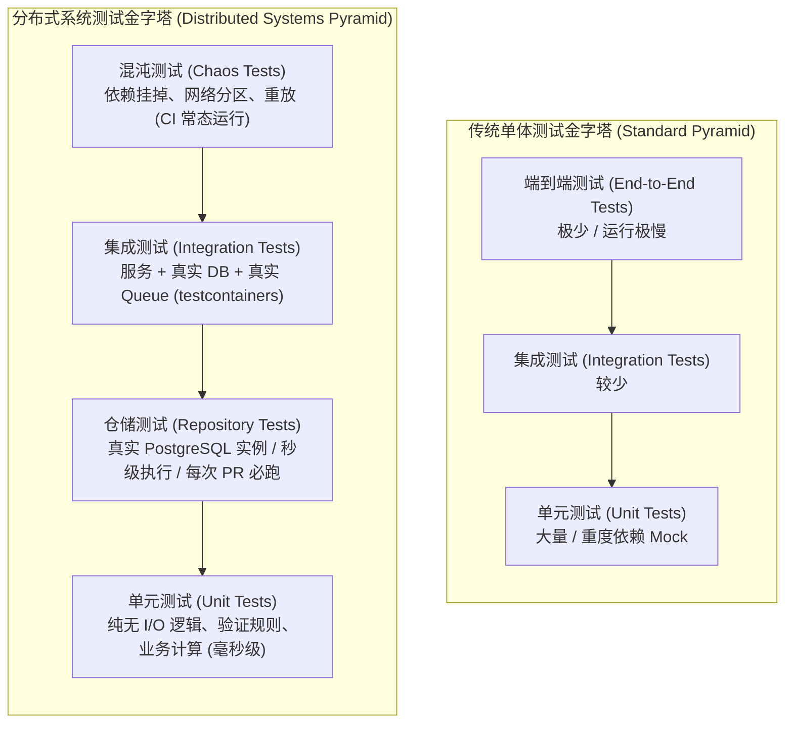

## 1. 分布式系统的测试金字塔 (The Testing Pyramid for Distributed Systems)

传统的测试金字塔 —— 大量的单元测试、较少的集成测试、极少数的端到端（E2E）测试 —— 无法直接照搬到分布式系统中。一个把数据库完全 Mock 掉的单元测试，根本无法告诉你编写的 SQL 语句是否正确；一个依赖虚假内存队列的集成测试，也完全无法验证消费者（Consumer）在遭遇消息重新投递（Redelivered Messages）时能否正确处理。



针对分布式系统，一种更为实用且高效的测试分层模型如下：

- **单元测试（Unit tests）**：专门验证**没有任何 I/O 操作**的纯内存逻辑，例如参数校验规则、数据结构转换、错误分类判定、纯业务规则计算等。这类测试执行迅速、维护成本低且高度可靠，通常在毫秒级内完成。编写单元测试的价值在于能快速拦截纯逻辑层面的功能退化（Regression），其极高的运行速度足以支撑开发者在本地编写代码时“每次保存文件即触发运行”。
- **仓储测试（Repository tests）**：针对**真实数据库**验证实际执行的 SQL 逻辑。借助 `testcontainers` 在本地或流水线中动态拉起一个真实的 PostgreSQL 实例。这类测试能够精准拦截列名拼写错误、外键与唯一约束冲突、索引失效行为以及数据库迁移脚本（Migrations）的不兼容问题。测试通常在几秒钟内完成，是你能为数据库交互代码编写的最具投资回报比的高价值测试。
- **集成测试（Integration tests）**：验证**两个或多个组件之间的协同工作**能力：例如服务进程 + 数据库 + 消息队列。同样基于 `testcontainers` 启动真实依赖。执行耗时通常在数十秒左右。这类测试专门捕捉组件装配与协作中的“连线缺陷”（Wiring Bugs）：例如拼写错误的队列主题名称、遗漏的数据库迁移版本、不兼容的数据序列化协议格式等。
- **混沌测试（Chaos tests）**：专门验证系统在**面对真实故障时的韧性与自愈能力**：包括外部依赖服务停机、响应极慢（Slow Responses）或持续报错；消息被重复投递多次；网络分区发生等。这类测试才是在分布式系统中真正挖掘隐蔽缺陷的核心手段 —— 捕捉那些只会在严苛生产环境下暴露、而普通测试永远无法模拟的深层次并发与网络 Bug。

与传统测试金字塔的关键区别在于：**仓储测试与混沌测试属于日常持续集成（CI）流水线的核心必跑环节**，而非束之高阁、偶尔执行的端到端测试。一个耗时仅需五秒钟的真实仓储测试，绝对值得在每一次提交 Pull Request 时都强制执行。

---

## 2. 使用真实数据库进行测试：testcontainers (Testing with Real Databases: testcontainers)

`testcontainers-go` 允许你在 Go 测试代码中直接以编程方式启动真实的 Docker 容器。这意味着你的测试套件将运行在真实的底层基础设施之上，而非虚幻脆弱的 Mock 桩对象。运行它唯一的前置依赖环境就是宿主机上的 Docker 守护进程。

```go
package repository_test

import (
	"context"
	"testing"
	"time"

	"github.com/jackc/pgx/v5/pgxpool"
	"github.com/testcontainers/testcontainers-go"
	"github.com/testcontainers/testcontainers-go/modules/postgres"
	"github.com/testcontainers/testcontainers-go/wait"
)

func setupTestDB(t *testing.T) *pgxpool.Pool {
	t.Helper()
	ctx := context.Background()

	// 启动真实的 PostgreSQL 16 容器
	pg, err := postgres.RunContainer(ctx,
		testcontainers.WithImage("postgres:16"),
		postgres.WithDatabase("testdb"),
		postgres.WithUsername("test"),
		postgres.WithPassword("test"),
		testcontainers.WithWaitStrategy(
			// 等待 PostgreSQL 日志打印出就绪信息（通常需要出现两次才表示完成初始化并接受连接）
			wait.ForLog("database system is ready to accept connections").
				WithOccurrence(2).
				WithStartupTimeout(30*time.Second),
		),
	)
	if err != nil {
		t.Fatalf("start postgres: %v", err)
	}

	// 注册清理钩子，确保测试结束后无论成功还是 panic 都会销毁容器
	t.Cleanup(func() {
		if err := pg.Terminate(ctx); err != nil {
			t.Logf("terminate postgres: %v", err)
		}
	})

	// 获取容器动态映射的外部数据库连接串
	connStr, err := pg.ConnectionString(ctx, "sslmode=disable")
	if err != nil {
		t.Fatalf("get connection string: %v", err)
	}

	// 在真实数据库上执行真实的表结构迁移脚本
	if err := RunMigrations(connStr, "../../migrations"); err != nil {
		t.Fatalf("run migrations: %v", err)
	}

	// 建立连接池
	pool, err := NewDB(ctx, connStr)
	if err != nil {
		t.Fatalf("connect: %v", err)
	}
	t.Cleanup(func() { pool.Close() })

	return pool
}
```

上述测试辅助函数会启动一个真实的 Postgres 16 容器，自动执行数据库迁移脚本，并返回一个处于就绪状态的活动连接池。代码中的 `t.Cleanup` 调用保证了即使测试发生断言失败或崩溃，容器也一定会被及时终止销毁，连接池也会被优雅关闭。

现在，你的仓储层测试将完全在真实的 PostgreSQL 环境中执行：

```go
func TestOrderRepository_Create(t *testing.T) {
	db := setupTestDB(t)
	repo := NewOrderRepository(db)

	order := Order{
		ID:        "test-order-001",
		UserID:    "user-001",
		ProductID: "product-001",
		Quantity:  2,
		Status:    "pending",
		// Postgres 时间戳精确到微秒，而 Go 的 time.Time 精确到纳秒，因此进行微秒截断对比
		CreatedAt: time.Now().UTC().Truncate(time.Microsecond),
	}

	err := repo.Create(context.Background(), order)
	if err != nil {
		t.Fatalf("create order: %v", err)
	}

	fetched, err := repo.GetByID(context.Background(), order.ID)
	if err != nil {
		t.Fatalf("get order: %v", err)
	}

	if fetched.ID != order.ID {
		t.Errorf("ID: got %q, want %q", fetched.ID, order.ID)
	}
	if fetched.Quantity != order.Quantity {
		t.Errorf("Quantity: got %d, want %d", fetched.Quantity, order.Quantity)
	}
}

func TestOrderRepository_GetByID_NotFound(t *testing.T) {
	db := setupTestDB(t)
	repo := NewOrderRepository(db)

	_, err := repo.GetByID(context.Background(), "nonexistent-id")
	if !errors.Is(err, ErrNotFound) {
		t.Errorf("expected ErrNotFound, got %v", err)
	}
}

func TestOrderRepository_UniqueConstraint(t *testing.T) {
	db := setupTestDB(t)
	repo := NewOrderRepository(db)

	order := Order{
		ID:        "dup-001",
		UserID:    "user-001",
		ProductID: "prod-001",
		Quantity:  1,
		Status:    "pending",
		CreatedAt: time.Now().UTC(),
	}

	if err := repo.Create(context.Background(), order); err != nil {
		t.Fatalf("first create: %v", err)
	}

	// 使用相同的 ID 再次创建应该触发主键/唯一约束冲突
	// Second create with same ID should fail
	err := repo.Create(context.Background(), order)
	if err == nil {
		t.Fatal("expected error on duplicate ID, got nil")
	}
}
```

这类测试能够精准拦截使用假桩（Mocks）的单元测试完全无法发现的致命隐患：
1. **时间戳精度截断**：PostgreSQL 默认存储微秒精度，而 Go 的 `time.Time` 具备纳秒精度，直接比对会导致对象不相等；
2. **实际数据库约束生效行为**：数据库唯一索引对重复数据的真实拒绝机制；
3. **驱动错误类型的真实映射**：当查询无结果时底层 `pgx` 返回的具体错误类型是否能被业务逻辑正确解包为预期的 `ErrNotFound`。

### 跨测试共享容器 (Sharing containers across tests)

启动一个 Docker 容器通常需要耗费 2 到 10 秒。如果为每一个测试用例都单独拉起一次容器，整个测试套件的运行速度将难以接受。在同一个 Go 包内，可以通过 `TestMain` 在所有测试之间共享同一个容器实例：

```go
var testDB *pgxpool.Pool

func TestMain(m *testing.M) {
	ctx := context.Background()

	pg, err := postgres.RunContainer(ctx,
		testcontainers.WithImage("postgres:16"),
		postgres.WithDatabase("testdb"),
		postgres.WithUsername("test"),
		postgres.WithPassword("test"),
		testcontainers.WithWaitStrategy(
			wait.ForLog("database system is ready to accept connections").WithOccurrence(2),
		),
	)
	if err != nil {
		fmt.Fprintf(os.Stderr, "start postgres: %v\n", err)
		os.Exit(1)
	}

	connStr, _ := pg.ConnectionString(ctx, "sslmode=disable")
	RunMigrations(connStr, "../../migrations")
	testDB, _ = NewDB(ctx, connStr)

	// 运行包内的全部测试用例
	code := m.Run()

	// 清理资源并销毁容器
	testDB.Close()
	pg.Terminate(ctx)
	os.Exit(code)
}
```

如此一来，整个 Go 包仅在开始时承担一次容器启动的时间开销。每个独立的测试用例负责自行清理自身产生的数据 —— 可以通过在用例结束后显式删除创建的数据行，或者在主键 ID 中加入唯一的前缀以实现逻辑隔离。这样既获得了测试隔离性，又避免了每个测试重复拉起容器的巨大开销。

针对共享同一数据库的并发测试（Parallel tests），可通过为每个测试分配独立的数据前缀来规避冲突：

```go
func TestOrderRepository_Create_Parallel(t *testing.T) {
	t.Parallel()
	repo := NewOrderRepository(testDB)

	// 使用 t.Name() 为每个测试生成互不冲突的唯一标识符
	// Unique ID per test using t.Name()
	orderID := "test-" + strings.ReplaceAll(t.Name(), "/", "-") + "-001"
	order := Order{ID: orderID, /* ... */}

	if err := repo.Create(context.Background(), order); err != nil {
		t.Fatalf("create: %v", err)
	}

	// 测试结束时清理自身创建的数据
	// Cleanup
	t.Cleanup(func() {
		repo.Delete(context.Background(), orderID)
	})
}
```

---

## 3. 数据竞争检测标志：-race (The -race Flag)

Go 的数据竞争检测器（Race Detector）通过在编译期对程序进行代码插桩（Instrumentation），实时监控所有对共享内存的并发访问是否具备正确的同步机制。在 CI 流水线中必须强制执行：

```bash
go test -race ./...
```

数据竞争检测器会带来大约 5 到 10 倍的 CPU 与内存性能开销，但它能揪出那些在通常测试中极难复现的诡异缺陷 —— 这类缺陷往往只在特定的时间微差（Timing conditions）或高并发生产流量下才会偶发出现。

以下展示了一个包含数据竞争缺陷的 HTTP 处理函数，它在单并发下不会崩溃，但在并发流量下会导致数据错乱甚至内存破坏：

```go
// 缺陷：stats 是被多个并发请求在无锁状态下读写的共享状态
// BUG: stats is shared state accessed concurrently without a lock
var stats = map[string]int{}

func handler(w http.ResponseWriter, r *http.Request) {
	// 数据竞争：两个 Goroutine 同时进行“读取-修改-写回”操作
	// DATA RACE: two goroutines read-modify-write concurrently
	stats[r.URL.Path]++
	w.WriteHeader(http.StatusOK)
}
```

Go 语言的原生 `map` **并非**并发安全的数据结构。当两个或多个 Goroutine 同时向同一个 map 执行写入时，极易损坏其内部哈希桶结构，导致致命的 `fatal error: concurrent map writes` 崩溃或者不可察觉的静默数据污染。

带有 `-race` 标志的测试会迅速捕获这一违规行为并打印明确告警：

```text
DATA RACE
Write at 0x00c0000a6060 by goroutine 7:
  runtime.mapassign_faststr(...)
  handler.go:8 +0x...

Previous write at 0x00c0000a6060 by goroutine 6:
  runtime.mapassign_faststr(...)
  handler.go:8 +0x...
```

修复方案是引入互斥锁（Mutex）进行同步保护，或者在并发读写场景下使用 `sync.Map`：

```go
var (
	statsMu sync.Mutex
	stats   = map[string]int{}
)

func handler(w http.ResponseWriter, r *http.Request) {
	statsMu.Lock()
	stats[r.URL.Path]++
	statsMu.Unlock()
	w.WriteHeader(http.StatusOK)
}
```

需要特别注意的是：**数据竞争检测器只有在实际发生两个 Goroutine 并发竞态访问时才会触发** —— 它是纯粹的运行时行为监控，而非静态代码扫描。因此，你的测试用例必须有意识地模拟并高频触发这些并发代码路径。

编写能够覆盖并发访问的测试用例：

```go
func TestHandler_Race(t *testing.T) {
	// 测试开始前重置全局状态
	// Reset stats before test
	statsMu.Lock()
	stats = map[string]int{}
	statsMu.Unlock()

	srv := httptest.NewServer(http.HandlerFunc(handler))
	defer srv.Close()

	var wg sync.WaitGroup
	// 启动 100 个并发 Goroutine 同时打向 HTTP 接口
	for i := 0; i < 100; i++ {
		wg.Add(1)
		go func() {
			defer wg.Done()
			resp, err := http.Get(srv.URL + "/test")
			if err != nil {
				t.Error(err)
				return
			}
			resp.Body.Close()
		}()
	}
	wg.Wait()
}
```

100 个 Goroutine 同时向共享状态发起密集写入。即使在这次测试运行中 HTTP 返回的状态码侥幸全都是 200，只要存在未经锁保护的内存写竞争，`-race` 检测器就会立刻宣告测试失败。

---

## 4. 使用 Fake 伪实现进行测试 (Testing with Fake Implementations)

当需要在不依赖外部基础设施的情况下对核心服务逻辑进行单元测试时，应当编写 **Fake（伪实现）**，而非使用 **Mock（模拟对象）**。

- **Mock** 通常是通过工具（如 `mockgen`、`moq` 等）自动生成的代码，其工作模式是**记录方法的调用次数与入参**，并允许测试对其进行断言：“验证此方法是否正好被调用了一次，且参数完全吻合”。Mock 适用于验证某些副作用（Side-effects）是否如期产生。但它们非常脆弱：一旦接口签名稍有改动，所有相关的 Mock 代码与期望设置都会崩溃；更糟糕的是，它们并不测试业务逻辑运算后是否输出了正确的结果，而仅仅是在检查代码是否按照死板的预期流程发起了调用。
- **Fake** 则是该接口的一个**简易但功能完整、切实可用的内存级工作实现**。它真正存储数据、在查询时检索并返回真实数据，并能在边界条件下模拟逼真的业务错误。Fake 在并发调用下能够保持正确的行为，并能主动揭示那些被 Mock 隐藏起来的深层次逻辑与集成缺陷。

```go
// FakeOrderStore 是 OrderStore 接口的一个线程安全内存实现。
// FakeOrderStore is a thread-safe in-memory implementation of OrderStore.
type FakeOrderStore struct {
	mu      sync.RWMutex
	orders  map[string]Order
	nextErr error // 用于测试时的故障注入
}

func NewFakeOrderStore() *FakeOrderStore {
	return &FakeOrderStore{orders: make(map[string]Order)}
}

func (f *FakeOrderStore) Create(ctx context.Context, order Order) error {
	f.mu.Lock()
	defer f.mu.Unlock()

	// 检查是否有预设的故障注入
	if f.nextErr != nil {
		err := f.nextErr
		f.nextErr = nil // 消费注入的错误（单次触发）
		return err
	}

	if _, exists := f.orders[order.ID]; exists {
		return ErrAlreadyExists
	}
	f.orders[order.ID] = order
	return nil
}

func (f *FakeOrderStore) GetByID(ctx context.Context, id string) (Order, error) {
	f.mu.RLock()
	defer f.mu.RUnlock()

	order, ok := f.orders[id]
	if !ok {
		return Order{}, ErrNotFound
	}
	return order, nil
}

func (f *FakeOrderStore) List(ctx context.Context) ([]Order, error) {
	f.mu.RLock()
	defer f.mu.RUnlock()

	orders := make([]Order, 0, len(f.orders))
	for _, o := range f.orders {
		orders = append(orders, o)
	}
	return orders, nil
}

// InjectError 使得下一次调用 Create 时主动返回指定的错误。
// 该模式极其适合用于测试各类异常处理与容错链路。
// InjectError causes the next call to Create to return the given error.
// Useful for testing error handling paths.
func (f *FakeOrderStore) InjectError(err error) {
	f.mu.Lock()
	defer f.mu.Unlock()
	f.nextErr = err
}
```

`InjectError` 方法是测试异常处理链路的关键设计模式。如果缺少它，你将很难测试当底层数据库发生“连接拒绝”或“超时崩溃”时服务处理函数的行为 —— 因为内存级 Fake 默认总是成功执行。有了故障注入机制，你便能随心所欲地构造任何极端错误场景：

```go
func TestCreateOrderHandler_DatabaseError(t *testing.T) {
	store := NewFakeOrderStore()
	// 人工注入数据库连接失败错误
	store.InjectError(errors.New("connection refused"))

	handler := createOrderHandler(store, &FakePublisher{})
	srv := httptest.NewServer(handler)
	defer srv.Close()

	body := strings.NewReader(`{"product_id":"p1","quantity":2}`)
	req, _ := http.NewRequest("POST", srv.URL+"/orders", body)
	req.Header.Set("Content-Type", "application/json")
	req.Header.Set("Idempotency-Key", "test-key-001")

	resp, err := http.DefaultClient.Do(req)
	if err != nil {
		t.Fatalf("request: %v", err)
	}
	defer resp.Body.Close()

	// 确认底层数据库报错时，HTTP 接口正确向上层返回了 500 Internal Server Error
	if resp.StatusCode != http.StatusInternalServerError {
		t.Errorf("got %d, want 500", resp.StatusCode)
	}
}
```

---

## 5. 测试幂等性 (Testing Idempotency)

幂等性要求：**发送完全相同的请求两次，第二次调用绝不能产生任何额外的副作用（Side Effects）**。必须将这一点提炼为显式的自动化测试用例：

```go
func TestCreateOrder_Idempotent(t *testing.T) {
	store := NewFakeOrderStore()
	publisher := &FakePublisher{}
	handler := createOrderHandler(store, publisher)
	srv := httptest.NewServer(handler)
	defer srv.Close()

	body := `{"product_id":"p1","quantity":2}`
	idempotencyKey := "idem-key-" + t.Name()

	sendRequest := func() *http.Response {
		req, _ := http.NewRequest("POST", srv.URL+"/orders", strings.NewReader(body))
		req.Header.Set("Content-Type", "application/json")
		req.Header.Set("Idempotency-Key", idempotencyKey)
		resp, err := http.DefaultClient.Do(req)
		if err != nil {
			t.Fatalf("send request: %v", err)
		}
		return resp
	}

	// 第一次请求：正常创建订单
	// First request: creates the order
	resp1 := sendRequest()
	if resp1.StatusCode != http.StatusCreated {
		t.Errorf("first request: got %d, want 201", resp1.StatusCode)
	}
	var order1 Order
	json.NewDecoder(resp1.Body).Decode(&order1)
	resp1.Body.Close()

	// 第二次请求：携带相同的幂等键与完全相同的请求体
	// Second request: same key, same body
	resp2 := sendRequest()
	if resp2.StatusCode != http.StatusCreated {
		t.Errorf("second request: got %d, want 201", resp2.StatusCode)
	}
	var order2 Order
	json.NewDecoder(resp2.Body).Decode(&order2)
	resp2.Body.Close()

	// 断言 1：两次请求返回的业务订单 ID 必须完全一致
	// Both requests return the same order ID
	if order1.ID != order2.ID {
		t.Errorf("idempotency violation: first order %q, second order %q",
			order1.ID, order2.ID)
	}

	// 断言 2：数据库存储中只落库了一条订单记录，绝不允许产生重复行
	// Only one order was stored
	orders, _ := store.List(context.Background())
	if len(orders) != 1 {
		t.Errorf("expected 1 order, got %d", len(orders))
	}

	// 断言 3：下游领域事件仅发布了一次，绝不允许重复广播
	// Only one event was published
	if publisher.PublishCount() != 1 {
		t.Errorf("expected 1 publish, got %d", publisher.PublishCount())
	}
}
```

该测试严格核查了幂等性设计的三大核心要素：
1. **相同的响应内容**（HTTP 状态码与响应数据一致）；
2. **相同的业务实体 ID**；
3. **副作用仅发生了一次**（底层数据没有重复插入，下游事件没有重复发布）。

大多数有缺陷的幂等性实现往往只验证了前两项（缓存了响应直接返回），却忽略了第三项，导致在重试发生时向消息中间件广播了多次重复事件。

---

## 6. 混沌测试：在测试执行期间终止依赖 (Chaos Testing: Kill a Dependency Mid-Test)

分布式系统中最具价值的测试就是主动模拟生产级真实故障。`testcontainers` 允许你在**测试执行进行到一半时直接停止并重启容器**，以此完美模拟生产中频繁发生的瞬态故障：

```go
func TestConsumer_RecoversFromBrokerRestart(t *testing.T) {
	// 标记为慢速测试：当运行 go test -short 时跳过
	if testing.Short() {
		t.Skip("chaos test: requires Docker and takes several seconds")
	}

	ctx := context.Background()

	// 启动 NATS 消息中继容器
	natsC, err := testcontainers.GenericContainer(ctx,
		testcontainers.GenericContainerRequest{
			ContainerRequest: testcontainers.ContainerRequest{
				Image:        "nats:latest",
				ExposedPorts: []string{"4222/tcp"},
				WaitingFor:   wait.ForListeningPort("4222/tcp"),
			},
			Started: true,
		})
	if err != nil {
		t.Fatalf("start nats: %v", err)
	}
	t.Cleanup(func() { natsC.Terminate(ctx) })

	endpoint, _ := natsC.Endpoint(ctx, "")
	natsURL := "nats://" + endpoint

	producer := setupProducer(t, natsURL)
	consumer := setupConsumer(t, natsURL)

	received := make(chan string, 10)
	go consumer.Listen(ctx, received)

	// 故障前测试：发布消息并验证正常消费到达
	// Publish and verify receipt before the restart
	producer.Publish(ctx, "test-subject", []byte("before-restart"))
	expectMessage(t, received, "before-restart", 5*time.Second)

	// 制造混沌：直接干掉 Broker 容器 —— 模拟生产环境的滚动重启或中间件宕机
	// Kill the broker — simulates a rolling restart or broker failure
	if err := natsC.Stop(ctx, nil); err != nil {
		t.Fatalf("stop nats: %v", err)
	}

	// 暂停 200ms 让连接断开事件在客户端网络栈中充分传播
	// Pause to let the disconnect propagate
	time.Sleep(200 * time.Millisecond)

	// 重启 Broker 容器
	// Restart
	if err := natsC.Start(ctx); err != nil {
		t.Fatalf("start nats: %v", err)
	}

	// 等待客户端网络重连自愈
	// Wait for reconnection
	time.Sleep(1 * time.Second)

	// 故障自愈后测试：重新发布消息 —— 验证消费端已经自动重连成功
	// Publish after restart — verifies the consumer reconnected
	producer.Publish(ctx, "test-subject", []byte("after-restart"))
	expectMessage(t, received, "after-restart", 10*time.Second)
}

func expectMessage(t *testing.T, ch <-chan string, want string, timeout time.Duration) {
	t.Helper()
	select {
	case got := <-ch:
		if got != want {
			t.Errorf("message: got %q, want %q", got, want)
		}
	case <-time.After(timeout):
		t.Fatalf("timeout waiting for message %q", want)
	}
}
```

这里对 `testing.Short()` 的判断极其重要：混沌测试通常需要耗费数秒并依赖 Docker 环境。使用 `t.Skip` 将它们标记出来，允许开发者在本地开发时通过 `go test -short` 瞬间跑完快速单元测试，而将混沌测试配置在 CI 流水线的专属独立阶段中运行。

### 更多值得纳入的混沌测试场景

#### 场景 1：慢依赖服务（Slow dependencies）
人为注入接口延迟，严格检验调用方的 Context 超时控制（Timeout）是否能够如期生效触发熔断：

```go
func TestHandler_DownstreamTimeout(t *testing.T) {
	// 构造一个故意休眠 10s 的极慢下游模拟服务
	// Slow downstream service
	slow := httptest.NewServer(http.HandlerFunc(func(w http.ResponseWriter, r *http.Request) {
		time.Sleep(10 * time.Second) // 远超出客户端设置的超时上限
		w.WriteHeader(http.StatusOK)
	}))
	defer slow.Close()

	// 客户端配置 500ms 超时约束
	client := NewUserClient(slow.URL, 500*time.Millisecond) // 500ms timeout
	_, err := client.GetUser(context.Background(), "user-001")

	// 断言必须返回超时错误，绝不能无限制悬挂
	if !errors.Is(err, context.DeadlineExceeded) && !isTimeoutError(err) {
		t.Errorf("expected timeout error, got %v", err)
	}
}
```

#### 场景 2：消息重复投递（Message redelivery）
将同一条消息连续投递两次，验证消费端是否具备完备的去重与幂等处理能力：

```go
func TestConsumer_HandlesDuplicateMessage(t *testing.T) {
	store := NewFakeOrderStore()
	consumer := NewOrderConsumer(store)

	event := OrderCreatedEvent{OrderID: "order-001", UserID: "user-001"}
	data, _ := json.Marshal(event)

	// 连续处理相同的消息两次
	// Process the message twice
	if err := consumer.Handle(context.Background(), data); err != nil {
		t.Fatalf("first handle: %v", err)
	}
	if err := consumer.Handle(context.Background(), data); err != nil {
		t.Fatalf("second handle: %v", err)
	}

	// 验证存储中仅沉淀了一条有效记录，没有被重复写入
	// Verify only one record was created
	orders, _ := store.List(context.Background())
	if len(orders) != 1 {
		t.Errorf("expected 1 order, got %d (idempotency violation)", len(orders))
	}
}
```

---

## 7. goleak：排查 Goroutine 泄露 (goleak: Finding Goroutine Leaks)

Goroutine 泄露在常规测试中极难被发现，因为它们**不会直接导致测试失败** —— 测试用例正常通过变绿，而那些被泄露遗忘的 Goroutine 会在后台一直运行，直到整个测试进程结束退出。而在长周期运行的生产服务中，这最终会导致内存耗尽（OOM）崩溃。

Uber 开源的 `uber-go/goleak` 能够将 Goroutine 泄露直接转化为测试失败：

```go
package orders_test

import (
	"testing"

	"go.uber.org/goleak"
)

func TestMain(m *testing.M) {
	// 验证测试执行完毕后，当前包内不存在任何多余的残留 Goroutine
	goleak.VerifyTestMain(m)
}
```

如果有任何测试用例在返回后留下了仍在运行的 Goroutine，`goleak` 会立即使测试 panic，并打印出该 Goroutine 完整的调用栈信息：

```text
panic: goleak: Leaks found:
goroutine 23 [chan receive]:
orderflow/internal/orders.(*OrderConsumer).listenLoop(...)
    /home/user/orderflow/consumer.go:45 +0x...
```

这份调用栈能精确指出是哪一个 Goroutine 发生了泄露，以及它当前卡死在了哪一行代码上。

常见的 Goroutine 泄露诱因包括：
1. **遗漏 `defer cancel()`**：Goroutine 正在监听一个永远无法收到信号的 Channel，而本应通知退出的 Context 因遗漏取消操作而始终未关闭；
2. **向无人接收的 Channel 阻塞发送**：接收端 Goroutine 因报错提前退出，导致发送端在无缓冲或满载的 Channel 上永久挂起阻塞；
3. **针对永不关闭的 Channel 进行 `for range`**：读取循环由于 Channel 未显式 close 而陷入永久等待；
4. **测试初始化逻辑中启动了后台后台任务**，但在测试收尾时未通过生命周期函数将其停止。

对于需要精细化排查的独立测试，可以针对单个用例进行粒度检测：

```go
func TestWorkerPool_NoLeak(t *testing.T) {
	// 在单个测试用例结束时自动核查 Goroutine 残留
	defer goleak.VerifyNone(t)

	ctx, cancel := context.WithCancel(context.Background())
	pool := NewWorkerPool(ctx, 4)
	pool.Submit(func() { time.Sleep(10 * time.Millisecond) })

	cancel()    // 广播退出信号 (signal shutdown)
	pool.Wait() // 等待所有 Worker 安全退出

	// goleak.VerifyNone 将严格验证 Wait() 返回后系统内没有遗留任何后台工作协程
	// goleak.VerifyNone verifies no goroutines remain after Wait()
}
```

---

## 8. 针对边界用例的表格驱动测试 (Table-Driven Tests for Edge Cases)

Go 语言惯用的**表格驱动测试（Table-Driven Tests）**模式非常适合用于测试业务参数校验逻辑、错误类型转换映射以及复杂的输入边界条件：

```go
func TestOrderValidation(t *testing.T) {
	tests := []struct {
		name        string
		order       Order
		wantErr     bool
		errContains string
	}{
		{
			name:  "valid order",
			order: Order{ProductID: "p1", Quantity: 1},
		},
		{
			name:        "zero quantity",
			order:       Order{ProductID: "p1", Quantity: 0},
			wantErr:     true,
			errContains: "quantity",
		},
		{
			name:        "negative quantity",
			order:       Order{ProductID: "p1", Quantity: -1},
			wantErr:     true,
			errContains: "quantity",
		},
		{
			name:        "missing product",
			order:       Order{ProductID: "", Quantity: 1},
			wantErr:     true,
			errContains: "product_id",
		},
	}

	for _, tc := range tests {
		t.Run(tc.name, func(t *testing.T) {
			err := validateOrder(tc.order)
			if tc.wantErr {
				if err == nil {
					t.Fatal("expected error, got nil")
				}
				if !strings.Contains(err.Error(), tc.errContains) {
					t.Errorf("error %q should contain %q",
						err.Error(),
						tc.errContains)
				}
			} else if err != nil {
				t.Fatalf("unexpected error: %v", err)
			}
		})
	}
}
```

表格驱动测试在捕捉**边界条件（Boundary Conditions）**时尤为出彩 —— 即正好处于合法与非法分界线上的临界值。这类边缘缺陷在手写单一测试用例时极易被疏漏，而在数据驱动的测试表中能够被清晰直观地逐项列出。

---

## 9. 常见问答 (Q&A)

### Q：如何在不降低测试执行速度的前提下测试超时逻辑？
**A**：注入一个超时阈值极短的 Context（例如 1ms 或 10ms），并断言方法能够迅速返回 `context.DeadlineExceeded`。在被测代码中，可以通过注入可配置的延时函数或虚拟时钟（Fake Clock）来模拟耗时操作，而无需让测试线程进行真实的长时间 `time.Sleep`。当需要测试生产配置下的超时生效时，应在测试配置中将默认超时时间覆写为一个很小的数值，而不是原地等待几十秒的真实业务超时。

### Q：testcontainers 测试有多慢？如何让它们跑得更快？
**A**：容器从拉取镜像到完成初始化的冷启动开销一般在 2 到 10 秒左右。提升速度的核心策略包括：
1. **通过 `TestMain` 跨用例共享容器**：让每个 Go 测试包仅承担一次容器启动的冷启动开销；
2. **在包内并发执行用例**：通过 `t.Parallel()` 让多个互不干扰的用例并发执行；
3. **区分快速测试与集成测试**：使用 `testing.Short()` 在本地开发时跳过耗时的容器测试，仅在 CI 流水线中完整运行。

通过“包级共享容器 + 测试并发隔离”，一个包含 20 个真实数据库测试的包通常可以在 5 到 10 秒内全部执行完毕。

### Q：何时应选用 testcontainers，何时应选用 Docker Compose？
**A**：
- **testcontainers** 适用于具备良好代码隔离性的独立测试包，每个模块自给自足地管控自身需要的单个中间件依赖。此外，testcontainers 提供了更精细的编程式控制能力 —— 你可以在测试执行到一半时通过 Go 代码动态重启某个依赖容器，这对于混沌测试至关重要。
- **Docker Compose** 则更适合大型端到端测试（End-to-End），即在测试启动前就需要将十几个服务、网关与中间件整套全栈环境同时拉起的场景（例如本专栏收尾大作业中的整体验收测试）。当需要预先准备好全量环境时，Docker Compose 配置起来更为简明。

### Q：Mock、Stub 与 Fake 之间的本质区别是什么？
**A**：
- **Stub（存根）**：仅返回预先写死的数据（Canned Responses）。比如“只要调用此方法，无论入参是什么都固定返回 true”。结构简单，但只能覆盖单一的理想主路径（Happy Path）。
- **Mock（模拟对象）**：专注于记录方法调用并验证行为期望。断言“此方法必须以特定参数被调用恰好 N 次”。适合验证非返回值的副作用，但非常脆弱且强耦合内部实现细节。
- **Fake（伪实现）**：一个精简但真正具备业务行为的完整工作实现。它在内存中存取数据、处理并发、模拟真实报错。在分布式系统测试中，Fake 是可维护性最高、最稳健的选择，因为它测试的是真实的系统逻辑与数据一致性，而非去机械匹配调用痕迹。

### Q：如何在 CI 中运行混沌测试并避免偶发失败（Flakiness）？
**A**：
1. **在断言中设定更宽松的超时预算**：例如在等待异步重连时，断言超时设置为 `10*time.Second` 而不是卡在临界点的 `1*time.Second`；
2. **容器启动与健康检查加入重试逻辑**：避免因 CI 宿主机高负载下的容器启动延迟导致用例直接崩溃；
3. **环境隔离与阶段分离**：通过 Go 构建标签（Build Tags）或 `-short` 标志将混沌测试归入 CI 的专属独立步骤，确保该步骤分配了充足的 CPU/内存资源与 Docker 访问权限；
4. **合理容忍并多轮重试**：认识到混沌测试本身就是在模拟网络动荡与系统崩溃，其波动率必然高于内存单测。可以在 CI 命令中使用 `-count=3` 跑 3 次，只有在持续失败时才宣告流水线挂掉。

---

## 10. SDK 沉淀内容 (What Goes in the SDK)

测试基础设施是多服务架构中最容易发生“代码肆意复制粘贴”的重灾区。如果每个需要数据库或消息队列的微服务团队都在各自的代码仓库中手写一遍 `testcontainers` 启动脚本，不仅冗余，而且极难统一样本生命周期与性能优化。

应当将通用的测试基建提炼到核心 SDK 的 `platform/testing` 模块中：

```text
platform/testing/
  postgres.go    — SetupTestDB(t) *pgxpool.Pool
  nats.go        — SetupTestNATS(t) string (返回连接 URL)
  kafka.go       — SetupTestKafka(t) string (返回 Broker 地址列表)
  fakes/
    publisher.go  — 具备消息拦截与捕获功能的 FakePublisher
    subscriber.go — 支持按需模拟消息推送的 FakeSubscriber
    store.go      — 内存实现的 FakeOrderStore（以及其它 Store 的标准模版）
  helpers.go     — ExpectMessage、WaitForCondition、AssertEventually
```

其中 `SetupTestDB` 函数负责拉起 Postgres 容器、运行 SQL 迁移并注册清理机制 —— 无论业务服务在一个 `TestMain` 中调用多少次，它都能保证全局幂等且仅初始化一次：

```go
// 在任何业务微服务的测试文件中直接调用：
// In any service's test file:
func TestMain(m *testing.M) {
	testDB = platformtesting.SetupTestDB(nil, "../../migrations")
	os.Exit(m.Run())
}
```

位于 `platform/testing/fakes` 中的 `FakePublisher` 是所有业务服务在进行单元测试时不可或缺的消息发布伪实现。所有 Fake 对象均严格实现了在 `platform/messaging` 中定义的抽象接口 —— 它们是真正生产适配器的即插即用、无缝兼容的替代实现。

`AssertEventually` 则解决了异步分布式测试中最令人头疼的挑战 —— **如何在不采用无脑 `time.Sleep` 盲等的前提下，高效等待一个最终一致性状态的达成**：

```go
// platform/testing/helpers.go

// AssertEventually 周期性轮询条件函数，直到满足预期或超时报错
func AssertEventually(t *testing.T, condition func() bool, timeout time.Duration, msg string) {
	t.Helper()
	deadline := time.Now().Add(timeout)
	for time.Now().Before(deadline) {
		if condition() {
			return
		}
		time.Sleep(50 * time.Millisecond)
	}
	t.Errorf("condition not met within %s: %s", timeout, msg)
}
```

---

测试能够检验代码逻辑与架构设计的正确性。然而在生产环境中，如果缺少了正确的系统配置 —— 数据库连接串、服务机密密钥（Secrets）、超时时间阈值以及在不同环境之间差异巨大的特性开关（Feature Flags），你的服务甚至根本无法成功启动。

下一章我们将深入探讨**环境无关、启动期强校验以及对敏感凭证绝对安全的配置与机密管理体系（Configuration and Secrets）**。
