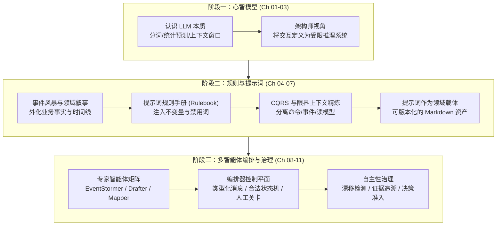

> 💡 **双栏独立滚动工作台导读**：本文采用双栏对照架构。**左栏**为导读核心实战精炼、学习路线矩阵与避坑决策；**右栏**为原著完整参考译文（Preface），附有各段落的英文原文展开与难词解析。左右两栏可独立滚动，并支持顶栏自定义宽度比例（7:3 / 5:5 / 3:7）与拖拽调节。

# 核心实战精炼：AI 辅助领域建模导读与学习工作台

## 1. 认知转向矩阵：AI 在领域建模中的定位

构建现代系统的困难来自分布式架构、监管合规、系统集成蔓延以及组织碎片化等多重力量的复合叠加。领域驱动设计（DDD）的核心挑战在于高强度的认知负荷。AI 的介入不是替代人类思考，而是充当结构化的推理伙伴。

| 维度 | 传统自动化心智 (Code Generation) | 结构化推理伙伴心智 (Reasoning Partner) | 架构收益与目标 |
| :--- | :--- | :--- | :--- |
| **角色定位** | 单纯的代码编写器或文档生成器 | 参与探索、建模与校验的认知放大器 | 降低概念外化阻力，扩展逻辑推演深度 |
| **交互形态** | 单次 Prompt 索取最终代码 | 迭代式的“生成-审查-纠偏”闭环 | 暴露隐性模糊，持续收敛领域认知 |
| **决策边界** | 模型隐式替人做出设计决断 | 模型负责逻辑展开，人类保留最终裁决权 | 杜绝假性自洽，所有业务不变量显式受控 |
| **资产形态** | 遗弃式对话文本 | 规则手册、领域载体、冻结运行包 | 领域知识版本化沉淀，跨会话一致复用 |

---

## 2. 贯穿案例：BrewUp 咖啡电商订单系统演进闭环

全专栏以 **BrewUp** 咖啡电商系统为唯一贯穿案例。同一份业务事实（Order submitted / Payment authorized / Stock reserved / Order confirmed）在三个阶段中逐层精炼与固化：

---

## 3. 三大阶段与学习路线规划表

| 阶段 | 核心目标 | 包含篇目 | 学习重点与实践产物 |
| :--- | :--- | :--- | :--- |
| **阶段一：AI 基础与 LLM 原理** | 建立精准能力边界心智模型，知晓模型推演盲区 | 第 01 ~ 03 篇 | 消除拟人化误解，掌握分词特征、自回归概率偏置与窗口主权意识。 |
| **阶段二：规则驱动的 DDD 建模** | 利用规则手册与反馈闭环产出自洽的领域模型 | 第 04 ~ 07 篇 | 编写 Bounded Context 提示词规则手册，运用 CQRS 透镜分离所有权。 |
| **阶段三：专家智能体与治理编排** | 将单提示词拓展为多智能体协同控制平面 | 第 08 ~ 11 篇 | 运行包（Run Pack）复现，编排器类型化流转与人工关卡（Human Gate）。 |

---

## 4. 全专栏统一术语契约表

| 中文术语 | 英文术语 | 形式定义与架构含义 |
| :--- | :--- | :--- |
| **限界上下文** | Bounded Context | 领域概念与模型在其中保持严密自洽的明确语义边界。 |
| **通用语言** | Ubiquitous Language | 业务专家、架构师与 AI 助手共同严格遵守的无歧义词汇体系。 |
| **聚合 / 聚合根** | Aggregate / Aggregate Root | 封装业务不变量与事务一致性边界的基本单元。 |
| **领域事件** | Domain Event | 领域内已经发生、不可撤销且具备业务意义的事实。 |
| **规则手册** | Rulebook | 伴随代码版本化管理、约束大模型推演边界的结构化规则清单。 |
| **领域载体** | Domain Carrier | 将领域知识、边界约束与用例模式固化其中的持久提示词工件。 |
| **专家智能体** | Specialist Agent | 职责高度聚焦、单向转换、绝不越权决策的最小协同单元。 |
| **编排器** | Orchestrator | 管理智能体交接、驱动合法状态机并执行人工把关的可执行控制平面。 |
| **人工关卡** | Human Gate | 状态机流转中必须由人类架构师审查确认方可放行的关键闸门。 |
| **概念漂移** | Drift | 大模型在多次交互中受概率倾向影响而偏离既定规则的失效模式。 |

---

## 5. 学习与避坑清单 (Do's & Don'ts)

| 错误实践 (Don't) | 正确实践 (Do) |
| :--- | :--- |
| 期望通过一条长提示词一次性生成完美的微服务领域模型。 | 采用“生成-审查-纠偏”微闭环，将每次纠错升级为显式规则。 |
| 允许 AI 自行推导业务归属权，导致订单上下文接管支付与库存。 | 显式设立通用语言与禁止概念列表，跨边界事实归入外部输入。 |
| 跳过心智模型与规则手册，直接编排多智能体工作流。 | 遵照“心智模型 -> 规则沉淀 -> 智能体隔离 -> 编排治理”递进路径。 |
| 彻底放权给智能体自动化推进，缺失人工审计环节。 | 在关键转换节点设置强类型人工审批关卡（Human Gate）。 |

<!-- split -->

# 原著完整参考：前言（Preface）

现代软件系统正变得前所未有的复杂。分布式架构、监管压力、无序蔓延的系统集成以及社会技术层面的碎片化，给开发人员、架构师和技术领导者带来了巨大的认知负荷。领域驱动设计（Domain-Driven Design，DDD）依然是掌控这种复杂性最有效的方法之一，但它高度依赖于持续的理性推理、精准的语言表达以及对业务领域的共识。

:::en
> **Original**: Modern software systems are more complex than ever. Distributed architectures, regulatory pressure, integration sprawl, and sociotechnical fragmentation place enormous cognitive demands on developers, architects, and technical leaders. Domain-Driven Design remains one of the most effective ways to master that complexity, but it depends on sustained reasoning, precise language, and a shared understanding of the business domain.

**📌 核心术语与语境解析**：
- **Integration Sprawl**：*系统集成无序蔓延*。微服务与外部系统接口随业务演进野蛮增长，缺乏统一治理与防腐层。
- **Sociotechnical Fragmentation**：*社会技术层面的碎片化*。康威定律下组织架构与技术系统错位带来的沟通与协作阻力。
:::

大语言模型（LLM）为这项工作提供了一种全新的支持。如果仅仅将它们视作“代码生成器”，它们确实能生成流畅且看似合理的产物，但却无法保留那些使领域模型保持自洽与连贯的核心决策。本书将 AI 视为**结构化的推理伙伴**（Structured Reasoning Partner）——它能够放大人类的思考能力、减轻认知过载，并帮助团队暴露领域中的模糊不清之处，同时始终将最终的决策权牢牢保留在人类手中。

:::en
> **Original**: Large language models introduce a new kind of support for this work. Used only as code generators, they can produce fluent and plausible artifacts without preserving the decisions that make a domain model coherent. This book treats AI as a structured reasoning partner that can amplify human thinking, reduce cognitive overload, and help teams expose ambiguity while people retain decision authority.

**📌 核心术语与语境解析**：
- **Plausible Artifacts**：*表面看似合理的人工产物*。大模型凭借流畅的语料概率拼接出假性完备的架构方案，往往暗含业务漏洞。
- **Decision Authority**：*决策裁决权*。在 AI 辅助架构推演中，机器负责展开推演分支，人类架构师必须掌握不可让渡的裁决权。
:::

本书首先从构建现代 AI 与大语言模型运作机制的“实用心智模型”开始。你将深入探讨分词（Tokenization）、统计预测、上下文窗口（Context Window）、涌现推理（Emergent Reasoning），以及在看似智能的行为背后所潜藏的局限性。这一理论基石将向你揭示：为什么精准的语言至关重要，以及当 AI 系统参与领域推理时，为什么架构层面的约束是必不可少的。

:::en
> **Original**: The book begins by building an operational mental model of how modern AI and LLMs work. You'll examine tokenization, statistical prediction, context windows, emergent reasoning, and the limits behind apparently intelligent behavior. This foundation explains why precision in language matters and why architectural constraints are essential when an AI system participates in domain reasoning.

**📌 核心术语与语境解析**：
- **Operational Mental Model**：*实用心智模型*。抛开深奥的数学公式推导，从工程视角理解分词、注意力与上下文边界的操作性认知。
- **Emergent Reasoning**：*涌现推理*。大语言模型在海量语料上训练后展现出的跨任务模式匹配与逻辑推导能力。
:::

在此基础上，你将学会如何将 AI 应用于领域的发现与建模。事件风暴（EventStorming）成为了连接人类探索与结构化 AI 协作的桥梁；与此同时，可复用的规则与提示词模式确立了词汇表、输出结构与语义边界。通过迭代反馈以及贯穿全书的 BrewUp 案例系统，你将逐步精炼事件、命令、聚合、策略以及限界上下文（Bounded Context），而不会遮蔽那些尚未解决的领域核心疑问。

:::en
> **Original**: From there, you'll apply AI to domain discovery and modeling. EventStorming becomes a bridge between human exploration and structured AI collaboration, while reusable rules and prompt patterns establish vocabulary, output structure, and semantic boundaries. Through iterative feedback and the BrewUp case study, you'll refine events, commands, aggregates, policies, and bounded contexts without hiding unresolved domain questions.

**📌 核心术语与语境解析**：
- **Semantic Boundaries**：*语义边界*。不同限界上下文对同一概念赋予不同含义与生命周期的刚性护栏。
- **Unresolved Domain Questions**：*尚未解决的领域核心疑问*。严禁模型在业务模糊处擅作主张填充臆想，必须显式留白交由专家仲裁。
:::

随后，提示词将从一次性的随意提问演变为**领域知识的持久载体**。示例、约束条件和通用语言成为了宝贵的可复用资产，完好封存了模型背后的设计推理。基于这些资产，你将从单提示词交互迈向更高级的多智能体协作——构建分别专注于领域发现、故事叙述、命令与事件编写以及上下文映射的专家智能体（Specialist Agents）。

:::en
> **Original**: Prompts then evolve from one-off requests into durable carriers of domain knowledge. Examples, constraints, and shared language become reusable assets that preserve the reasoning behind a model. Building on those assets, you'll move from single-prompt interactions to specialized agents for domain discovery, storytelling, command and event writing, and context mapping.

**📌 核心术语与语境解析**：
- **Durable Carriers**：*持久载体*。提示词摆脱消耗性提问脚本定位，作为与代码并存、受版本控制的架构约束资产。
- **Specialist Agents**：*专家智能体*。各司其职、语义边界严密且状态转换单向受控的专门化 AI 协作单元。
:::

在全书的最后一部分，我们将通过一个编排器（Orchestrator）将这些专家智能体整合起来：该编排器具备类型化消息、合法的状态机流转、人工关卡（Human Gates）、持久化存储、执行重放以及可强制执行的自主性策略。在整个工作流中，知识出处追溯（Provenance）、不确定性评估、概念漂移（Drift）以及人工验收始终保持清晰透明。

:::en
> **Original**: The final part brings these specialists together through an orchestrator with typed messages, legal state transitions, human gates, persistence, replay, and enforceable autonomy policies. Provenance, uncertainty, drift, and human acceptance remain visible throughout the workflow.

**📌 核心术语与语境解析**：
- **Typed Messages**：*类型化消息*。智能体间交互采用严格强类型的契约模式，防止非受控自然语言歧义蔓延。
- **Enforceable Autonomy Policies**：*可强制执行的自主性策略*。限定智能体推演自由度与决策权限边界的确定性代码规则。
:::

读完本书，你将掌握一套严谨且可重复的方法，能够借助 AI 分析业务领域、精炼领域事件与命令、设计限界上下文，并高效协同多智能体工作流。我们的终极目标不是搞“自主无人架构”，而是实现**更优质的推理**：让所有领域设计决策都保持显式化、可审查，并且完全处于人类的掌控之下。

:::en
> **Original**: By the end of the book, you'll be able to use AI to analyze domains, refine domain events and commands, design bounded contexts, and coordinate multi-agent workflows in a disciplined and repeatable way. The goal is not autonomous architecture, but better reasoning: domain decisions that remain explicit, inspectable, and under human control.

**📌 核心术语与语境解析**：
- **Autonomous Architecture**：*自主无人架构*。完全剥离人类控制的自动化架构设计幻象；本书坚决主张架构决策权在人。
- **Inspectable Reasoning**：*可审查的推理*。所有推演过程留存完整输入工件、约束依据与决策日志，随时可回溯验证。
:::
