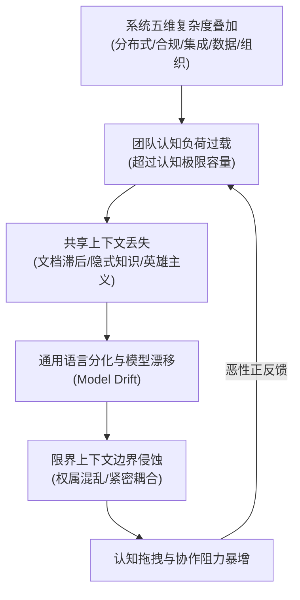
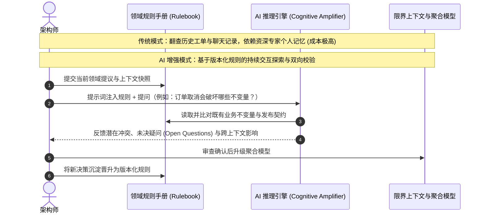

> 💡 **双栏独立滚动工作台导读**：本文采用双栏对照架构。**左栏**为核心精炼架构、实战代码与避坑决策；**右栏**为原著完整参考译文，附有关键段落的英文原文展开与难词解析。左右两栏可独立滚动，并支持顶栏自定义宽度比例（7:3 / 5:5 / 3:7）与拖拽调节。

# 核心实战精炼：AI 作为 DDD 的认知放大器

## 1. 架构决策矩阵：系统复杂度驱动力与工程应对

| 复杂性维度 | 典型表象与失效路径 | 传统 DDD 应对方式 | AI 增强架构决策模式 | 关键架构收益 |
| :--- | :--- | :--- | :--- | :--- |
| **分布式架构** | 跨服务业务调用链路长，部分失败与异步最终一致性导致全局状态难以追踪 | 依赖人工绘制时序图与静态架构文档，链路追踪滞后 | 将跨上下文事件流与不变量注入规则引擎，AI 持续校验跨边界状态机完备性 | 消除隐式时序假设，提前暴露跨服务因果断裂 |
| **监管与合规** | 法律合规与审计需求横切核心业务，形成散落的代码硬编码补丁 | 在聚合根外部包裹装饰器，合规逻辑侵蚀领域模型 | 通过 Prompt 显式解耦业务规则与合规约束，将审计断言形式化为可执行规则 | 阻止合规代码污染领域模型，实现规则与策略分离 |
| **集成蔓延** | 异构系统与第三方 API 数量激增，外部命名与语义潜移默化渗透 | 防腐层（ACL）与适配器模式，依赖人工手动映射 | 借助定义明确的 Universal Rules 手册，AI 充当语义防火墙，主动检测概念漂移 | 阻断外部系统语义泄漏，保全核心上下文纯洁性 |
| **数据与实时分析** | 分析型特征、用户标签、风控模型预测值直接参与事务决策 | 批处理同步至 OLTP，数据所有权边界模糊 | 显式建模“衍生概念”，通过 ADR 记录数据权威源与特征置信度依赖 | 明确分析输出与领域规则的权责边界，防止反馈闭环失控 |
| **组织社会技术** | 团队扩张与信息孤岛导致同一概念在各部门假设冲突、归属不清 | 定期举办事件风暴（EventStorming），产出静态上下文映射图 | 沉淀轻量级规则手册与快照，AI 协助高频比对跨团队概念定义 | 降低跨团队沟通摩擦，使模型物理边界与沟通结构对齐 |

## 2. 核心心智模型：认知过载与恶性闭环

践行 DDD 的真正瓶颈不是方法论失效，而是人类工作记忆（Working Memory）的物理极限。



### 认知容量解耦三原则
1. **限界上下文即认知边界**：限界上下文的本质是“可理解性的认知单元”，而非单纯的代码分割或微服务拆分。优质边界能降低同一时刻所需协调的知识总量。
2. **知识外显化（Externalization）**：将个人大脑中的隐式假设转化为版本控制的机器可读规则（YAML / Markdown），避免反复陷入重新探索历史决策的窘境。
3. **消除偶然复杂度（Accidental Complexity）**：将平台工程、代码模板与脚手架标准化，释放宝贵的认知带宽用于核心领域推演。

## 3. 技术演进与架构重塑：传统模式 vs AI 认知放大模式



### 架构师日常工作流升级对比矩阵

| 架构活动 | 传统手工作坊模式 | AI 认知放大器模式 | 效能跃迁指标 |
| :--- | :--- | :--- | :--- |
| **决策上下文重构** | 翻查历史工单、邮件与 Wiki，向资深员工口头追问决策历史 | 将持久化规则与上下文喂给模型，秒级定位历史设计因果 | 上下文召回时间从数小时降至秒级 |
| **领域发现与提炼** | 堆积数月疑问后举行马拉松式大型 EventStorming 工作坊 | 在两次工作坊之间进行微型澄清短循环，大型工作坊仅聚焦重大争议 | 缩短业务需求到模型落地的反馈周期 |
| **模型一致性验证** | 仅在代码审查或线上故障复盘时，由资深人员被动排查 | 每次领域模型发生变更，AI 对照业务不变量规则集进行自动化审查 | 由“故障后被动响应”转为“提议时主动拦截” |
| **领域知识传承** | 架构师成为单点瓶颈，反复向新员工解答相同的领域概念 | 团队通过 AI 问答交互式探索共享规则手册，架构师仅仲裁歧义 | 解除单点依赖，降低团队人员流动冲击 |
| **架构决策重构 (ADR)** | 重开讨论成本极高，倾向于对既有缺陷方案妥协和死守 | 压力测试成本极低，当领域演进时快速评估重构影响与可逆性 | 架构具备真正的敏捷适应性与演化弹性 |
| **模型漂移检测** | 通常在跨系统集成失败或版本发布异常后被动暴露 | 每次迭代将新业务描述与核心术语库比对，及时捕捉语义分歧 | 将漂移扼杀在概念阶段 |

## 4. 架构实战：DDD Starter 建模循环中的 AI 介入点

```
[ Understand (理解业务) ]  -->  AI: 梳理混乱输入，提炼业务事实与术语草稿
        ↓
[ Discover (领域发现) ]    -->  AI: 基于历史用例生成反思性质询提问
        ↓
[ Decompose (分解边界) ]   -->  AI: 对照组织架构与 Conway 定律评估拆分方案
        ↓
[ Strategize (战略设计) ]  -->  人类主导: 划分核心域/通用域/支撑域 (价值判断)
        ↓
[ Connect (上下文映射) ]   -->  AI: 校验防腐层 (ACL) 与契约发布的语义完整度
        ↓
[ Organize (团队对齐) ]    -->  人类主导: 逆康威定律组织对齐
        ↓
[ Define (战术定义) ]      -->  AI: 辅助编写聚合、实体、值对象与不变量约束规则
        ↓
[ Code (编码实现) ]        -->  AI: 代码与领域模型双向同步，检测实现层语义漂移
```

## 5. 架构避坑清单 (Do's & Don'ts)

| 维度 | 严禁行为 (Don'ts) | 推荐工程实践 (Do's) |
| :--- | :--- | :--- |
| **定位边界** | 试图让 AI 代替人类做出最终业务决策或架构边界裁决。 | 将 AI 定位为**认知放大器**与**批判性质疑者**，由人类架构师掌控终审权。 |
| **知识载体** | 将领域规则与业务决策仅保存在个别成员大脑或非结构化聊天记录中。 | 将领域术语、不变量与边界显式化为 Git 版本控制的规则手册（Rulebooks）。 |
| **上下文管理** | 盲目堆砌成千上万行未经筛选的聊天记录，指望模型自动大海捞针。 | 提炼最小完备上下文，控制认知范围（Scope），将稳定规则沉淀为资产。 |
| **业务语义** | 允许外部集成系统的专有术语直接渗透进入核心限界上下文代码中。 | 在上下文边界设立显式防腐层（ACL），借助 AI 严格审查跨边界语义泄漏。 |
| **一致性策略** | 假设系统设计是一次性成型的，长期不重构领域模型与边界。 | 视模型为持续演进的活体资产，将“模型漂移检测”内嵌为高频日常动作。 |

<!-- split -->

# 原著完整参考：为何 AI 对当今的领域驱动设计至关重要

如今，软件架构师与领域建模人员正面临着截然不同的挑战。困难早已不仅局限于技术本身的复杂度，同样沉重的负担来自于：随着系统在规模、相互依赖性以及约束条件上的不断膨胀，人们为了清晰推演和理解系统所需付出的巨大心智精力。在这样的环境下，即使是像**领域驱动设计（DDD）**这样纪律严明的方法论，也会承受巨大的压力。领域知识开始走向碎片化，模型的内聚自洽性逐渐减弱，架构设计的清晰度也变得愈发难以维系。这绝非 DDD 本身存在缺陷，而是在大规模场景下持续贯彻 DDD 所需的认知精力，已经超出了许多团队能够切实承受的极限。

:::en
> **Original**: Software architects and domain modelers face a different kind of challenge today. The difficulty is no longer limited to technical complexity alone. What weighs just as heavily is the effort required to reason clearly about systems as they grow in scope, interdependence, and constraints. In that environment, even a disciplined approach such as **domain-driven design (DDD)** can come under pressure. Domain knowledge starts to scatter, model coherence weakens, and design clarity becomes harder to sustain. The issue is not a flaw in DDD itself. Applying it consistently at scale now demands more cognitive effort than many teams can realistically sustain.

**📌 核心术语与语境解析**：
- **Cognitive effort** [ˈkɒɡnətɪv ˈefət]：*认知精力/心智开销*。指架构师和团队在理解、推演与维护庞大系统复杂关联时所必须耗费的工作记忆带宽。
- **Model coherence** [ˈmɒdl kəʊˈhɪərəns]：*模型内聚一致性*。领域概念与业务规则在特定边界内严密吻合、不产生冲突与歧义的状态。
:::

本章将阐述贯穿全书的核心驱动力：为什么对于注重精益领域建模的团队而言，AI 至关重要。

> 当 AI 能够增强理性推理时，其价值最为显著；单纯追求速度提升并不能带来根本性的改变。

如果审慎地加以利用，AI 能够辅助人类加深理解、缓解认知过载，并在系统持续演进的过程中帮助团队守护清晰的架构愿景。在本章中，我们将深入探讨：
- 系统的复杂度正在如何压垮传统的建模与沟通协作实践
- 为什么真正的瓶颈是认知过载，而非 DDD 本身的缺陷
- 将 AI 作为“推理伙伴”而非“代码生成器”究竟意味着什么
- 在 AI 的辅助下，架构师的日常职责如何在不失去控制权的前提下发生转变

让我们共同探索当下的技术格局发生了怎样的剧变，以及为什么领域建模实践必须随之进化。

:::en
> **Original**: This chapter introduces the core motivation for the rest of the book: why AI matters to teams who care about modeling domains well. AI helps most when it strengthens reasoning; acceleration alone changes little. Used with care, it can support human understanding, ease cognitive pressure, and help teams preserve clarity while systems continue to evolve. In this chapter, you will learn: How system complexity is overwhelming traditional modeling and communication practices; Why the real bottleneck is cognitive overload rather than any flaw in DDD; What it means to use AI as a reasoning partner instead of a code generator; How the architect's daily role changes when supported by AI, without losing control. Let's explore how the landscape has changed and why your modeling practices must evolve with it.

**📌 核心术语与语境解析**：
- **Reasoning partner** [ˈriːznɪŋ ˈpɑːtnə]：*理性推理伙伴*。区别于机械的代码补全工具，强调在架构方案论证与模型边界质询中提供辅助思考能力。
- **Acceleration alone changes little**：*单纯追求速度提升无济于事*。若底层领域建模方向存在偏差，代码生成速度的提升只会加速混乱代码的堆积。
:::

## 现代业务系统日益攀升的复杂度

构建现代软件系统的困难并非来自单一源头。它是由多种相互作用、彼此强化的力量交织而成的结果：分布式架构、监管合规约束、无序蔓延的系统集成、持续增长的数据处理诉求，以及组织规模的扩张。

如果单独审视，其中的每一股力量似乎都在可控范围之内；然而当它们相互叠加复合时，团队便会逐渐失去掌控。领域知识变得愈发难以维护，做出决策需要调动越来越多的上下文，而维持一个自洽连贯的模型，也越来越受限于人类一次性能够容纳和推理的复杂度上限。

为了理解 AI 为何能够在这一背景下发挥关键作用，我们有必要深入剖析造成这种认知负荷不断加剧的核心驱动因素，以及它们是如何层层累加的。

:::en
> **Original**: The difficulty of modeling modern software systems does not come from a single source. It emerges from forces that interact and reinforce one another: architectural distribution, regulatory constraints, integration sprawl, growing data demands, and organizational scale. Individually, each of these forces might seem manageable. When they compound, teams begin to lose their footing. Domain knowledge becomes harder to maintain, decisions require more context, and keeping a coherent model increasingly depends on how much complexity people can hold and reason about at once. To understand why AI can help in this context, it is useful to examine the main drivers behind this growing cognitive load and how they build on one another.

**📌 核心术语与语境解析**：
- **Compound** [kəmˈpaʊnd]：*复合/叠加*。复杂度多维度互相交织演进，产生超出单一维度线性累加的非线性放大效应。
- **Lose their footing**：*失去立足点/失去掌控*。团队无法再对全局架构及其演化结果保持清晰稳定的心智把控。
:::

### 分布式架构

导致系统复杂度急剧上升的一个主要推手，是行业向分布式架构的大规模迁移。微服务与事件驱动架构能够显著提升系统的自治性、可扩展性与弹性，但它们同时也把复杂度转移到了其他维度。单个独立的服务可能会变得更容易理解，但系统整体的端到端行为却变得更加扑朔迷离。

网络通信、部分节点失效（Partial Failure）、最终一致性（Eventual Consistency）以及异步工作流，无一不需要跨越边界进行复杂的思维推理。过去在单进程内部即可顺畅完成的一项业务操作，如今往往需要通过一系列交互序列才能展开，其产生的业务影响被分散在多个组件之中。

:::en
> **Original**: One driver of complexity is the widespread shift toward distributed architecture. Microservices and event-driven systems can improve autonomy, scalability, and resilience, but they also move complexity elsewhere. A service might become easier to understand in isolation while the behavior of the system as a whole becomes harder to follow. Network communication, partial failures, eventual consistency, and asynchronous workflows all require reasoning across boundaries. A business operation that once happened within a single process might now unfold through a sequence of interactions whose effects are distributed across multiple components.

**📌 核心术语与语境解析**：
- **Partial failures** [ˈpɑːʃl ˈfeɪljəz]：*部分节点失效*。分布式系统中局部节点或网络中断而系统整体仍在运转的状态，要求业务操作具备幂等与补偿推演能力。
- **Eventual consistency** [ɪˈventʃuəl kənˈsɪstənsi]：*最终一致性*。跨服务异步事件通信的核心特征，要求领域模型放弃单机强一致事务假设，推演中间过渡状态。
:::

以 BrewUp 应用程序为例——这是贯穿全书的核心案例系统。像“提交订单”这样一个表面上看似简单的动作，可能会在背后触发库存检查与扣减、支付处理、物流发货以及发票开具等一系列操作。每一个独立组件固然都有清晰明确的职责，但要真正理解这一业务操作的全局脉络，就必须串联起发生在不同地点、不同时间点的各项决策与状态变更。

基础设施与数据架构领域同样存在这种现象。云原生服务、分布式数据所有权以及面向特定领域的管道，虽然赋予了各个团队更大的自治权，但也引入了更多必须由团队进行协调与理解的边界。

因此，架构的复杂度并未凭空消失。很大一部分复杂度只是从单个应用的内部，转移到了分布式组件之间的交互关系上。对于践行领域驱动设计的架构师而言，仅仅保持每个限界上下文内部的自洽早已远远不够。在这些上下文跨越不可靠且异步的边界进行交互时，业务模型整体同样必须保持清晰易懂。

:::en
> **Original**: Architectural complexity has therefore not disappeared. Much of it has moved from inside individual applications to the relationships between distributed components. For domain-driven architects, keeping each bounded context coherent is no longer enough. The business model also has to stay understandable while those contexts interact across unreliable and asynchronous boundaries.

**📌 核心术语与语境解析**：
- **Bounded context** [ˈbaʊndɪd ˈkɒntekst]：*限界上下文*。DDD 核心概念，定义了特定模型在其中有效适用的显式边界。
- **Asynchronous boundaries**：*异步边界*。由消息总线、事件队列等解耦的系统分界，交互伴随时延与状态不确定性。
:::

### 监管与合规性负担

加剧复杂度的第二大驱动因素，是不断严苛的监管与合规环境。现代企业正面临着前所未有的严格监管审查。隐私法律、金融监管（例如反洗钱审查 AML）、医疗合规规范以及特定行业的合规性要求都在持续动态演进。监管变化的步伐显著加快，企业一旦跟不上合规要求，违规成本将极为高昂。每一项全新或修订的法规，都会引入新的规则、审计诉求以及软件必须满足的硬性约束，这些约束往往横跨从数据持久化存储到核心业务逻辑的每一个层级。

此处的复杂度体现在两个层面：首先，系统必须实现大量用于强制合规的规则与异常处理路径（例如处理数据授权许可，或根据数据驻留法规按地域隔离客户数据）。这些规则往往横切领域边界，引入盘根错节的交叉关注点，使原本纯粹的领域逻辑变得臃肿复杂。其次，合规性通常要求极高的可追溯性与全方位监控。系统需要产出详尽的审计日志、报表以及控制措施证明，这进一步增加了基础设施层面的复杂性。例如在金融领域，在线交易平台除了满足核心业务规则之外，还必须兼顾欺诈检测、**了解你的客户**（**KYC**）审查以及审计合规需求。每一个新增的关注点都会加剧架构师与开发人员的认知负荷，他们必须时刻确保系统设计不仅在业务层面正确无误（满足业务诉求），还要严格符合外部监管条例的强制要求。

:::en
> **Original**: The complexity here is twofold. First, systems must implement numerous rules and exception paths to enforce compliance (for example, handling data consent or segregating customer data by region to respect data residency laws). These rules often cut across domain boundaries, introducing tangled concerns that complicate the domain logic. Second, compliance often requires significant traceability and monitoring. These systems need to produce detailed logs, reports, and evidence of controls, which adds infrastructural complexity. In finance, for instance, an online trading platform might need to account for fraud detection, know your customer (KYC) checks, and audit requirements alongside its core business rules. As you can imagine, every additional concern increases cognitive load on architects and developers who must ensure the system's design remains both correct (satisfying business needs) and compliant with external mandates.

**📌 核心术语与语境解析**：
- **Data residency** [ˈdeɪtə ˈrezɪdənsi]：*数据驻留*。不同国家/地区法律对于用户数据物理存储地域的强制约束。
- **Traceability** [ˌtreɪsəˈbɪləti]：*可追溯性*。业务操作与状态流转可被全链路审计取证并生成合规凭证的架构属性。
:::

这正是监管约束必须被显式表达、且其对领域模型的影响必须被深刻理解的原因。有些约束会直接沉淀为业务规则，并上升为一等公民的领域概念；有些则依然属于外部约束或纯粹的基础设施关注点。关键挑战在于准确区分二者。如果跳过这一梳理步骤，合规逻辑最终只能作为补丁硬生生拼凑在领域模型之上，化为散落在各处的检查逻辑和特殊处理分支，破坏代码的可读性与稳定性。

:::en
> **Original**: The need for explicitness is why regulatory constraints must be stated explicitly, and their impact on the domain understood. Some become business rules and first-class domain concepts; others remain external constraints or infrastructural concerns. The challenge is knowing which is which. Skip that step, and compliance logic ends up bolted onto the domain as an afterthought, scattered checks and special cases that no one fully trusts and everyone is afraid to touch.

**📌 核心术语与语境解析**：
- **First-class domain concepts**：*一等公民领域概念*。直接进入核心领域模型、拥有明确业务实体与生命周期的核心抽象，而非散落在外的边缘校验。
- **Bolted onto the domain as an afterthought**：*作为事后补丁生硬拼接*。未经领域抽象便随处硬编码特殊判断条件，破坏领域模型的内聚性。
:::

### 无序蔓延的系统集成与异构系统

第三个驱动因素进一步放大了前两个维度的挑战：系统集成的无序蔓延（Integration Sprawl）。现代业务系统极少孤立存在，它们深植于由第三方服务、遗留系统以及合作伙伴 API 织就的网络之中。数字化转型与全渠道客户体验的浪潮，意味着单一业务流程往往需要跨越无数系统：CRM 软件、支付网关、分析服务以及各类物联网（IoT）设备。其直接后果便是集成蔓延：API 数量暴增，数据格式各异，架构必须去包容琳琅满目的接口协议。

你常常会发现自己不得不亲自管理一个本身就极具复杂度的异构系统与 API 终端生态。不同的业务部门可能会自行构建或引入各自的 API 与工具链，从而导致功能重叠或能力冗余；同时运行数个不同的 API 管理网关或集成中间件平台在企业中屡见不鲜。这种集成层面的复杂度直接渗透到日常开发中：你和你的团队必须在多个 SDK 和数据契约之间疲于奔命。某个外部服务的细微改动，可能对内部系统产生连锁反应式的级联冲击。在异构组件之间维系一致性与可靠性绝非易事。从领域建模的视角来看，更大的隐患在于**语义泄漏**（Semantic Leakage）。外部系统所使用的概念，极少与你自身领域中的内涵完全吻合。一家集成路线规划服务、地图 API、天气数据以及内部车队管理的物流公司，可能会遇到对“配送（Delivery）”或“路线（Route）”等概念的多种不同表达方式。在 DDD 中，不同模型合理共存本身并不是问题；真正的问题在于，当这些概念跨越边界而缺乏显式翻译时，外部系统的假设就会悄无声息地侵蚀并污染核心领域模型。

:::en
> **Original**: You will often find yourself managing a landscape of heterogeneous systems and API endpoints that is complex in itself. Different business units might build or adopt their own APIs and tools, resulting in overlapping or redundant capabilities, and it is not uncommon to end up running several different API management gateways or integration platforms at once. This integration complexity manifests in your day-to-day development too: you and your team must juggle multiple SDKs and data contracts. A change in one external service can have cascading impacts on your internal systems. Ensuring consistency and reliability across heterogeneous components is non-trivial. From a domain perspective, the bigger risk is semantic leakage. External systems rarely use concepts with exactly the same meaning as your domain does. A logistics company integrating routing services, mapping APIs, weather data, and internal fleet management might encounter several representations of concepts such as delivery or route. Those differences are not necessarily a problem; in DDD, different models can legitimately coexist. The problem begins when those meanings cross boundaries without explicit translation, allowing external assumptions to leak into the domain model.

**📌 核心术语与语境解析**：
- **Integration sprawl** [ˌɪntɪˈɡreɪʃn sprɔːl]：*集成无序蔓延*。异构系统、第三方接口及协议数量非受控增长，形成难以治理的网状依赖。
- **Semantic leakage** [sɪˈmæntɪk ˈliːkɪdʒ]：*语义泄漏*。外部上下文特有的字段、假设与生命周期未加过滤与转换直接渗透进入核心领域，造成概念污染。
:::

在架构层面，企业集成中枢（Enterprise Integration Hubs）、事件代理（Event Brokers）与 API 网关等模式有助于规范这种集成的物理通信实现；然而，它们并不能解决根本的语义冲突。以 DDD 的术语来说，架构师必须明确界定真正的模型边界在哪里，以及在何处必须通过架构手段施加防护以实现隔离与翻译。防腐层（Anti-Corruption Layer，ACL）与适配器能够有效阻止外部模型污染核心领域，而显式契约则让这些上下游关系变得清晰可见。因此，架构师不能只关心系统在物理上如何打通，更必须深度推演：允许哪些语义跨越各个边界进入接收方上下文。

:::en
> **Original**: Architecturally, patterns such as enterprise integration hubs, event brokers, and API gateways can help manage the mechanics of this sprawl. They do not, however, solve the semantic problem. In DDD terms, architects must decide where genuine model boundaries exist and where translation requires the architecture to protect them. Anti-corruption layers and adapters can prevent external models from leaking into the domain, while explicit contracts make those relationships visible. The architect must therefore reason about which meanings the receiving context may accept to cross each boundary, and not only about how the systems connect.

**📌 核心术语与语境解析**：
- **Anti-corruption layer (ACL)** [ˈænti kəˈrʌpʃn ˈleɪə]：*防腐层*。位于不同上下文之间的适配与隔离翻译层，阻止下游模型被上游外部概念污染。
- **Explicit contracts**：*显式契约*。明确界定两端系统交互时发布与接受语义的正式规范。
:::

### 庞大的数据规模与实时分析诉求

第四个驱动因素进一步推高了认知承载上限：系统所必须吞吐的数据量、流转速度与多样性呈现出爆发式增长。在众多行业中，企业的核心竞争优势越来越取决于对数据的深度利用效率（且往往要求极高实时性）。这推动了将大规模数据处理与机器学习组件直接嵌入核心业务工作流的新型架构演变。原本游离在边缘地带的分析平台与算法模型（例如独立的数据仓库或离线报表系统），正日益成为现代软件系统的一等公民。这意味着系统在设计时，不能仅局限于事务型处理（OLTP），还必须具备实时流式传输事件、即时刷新分析看板、乃至动态为 AI/ML 模型提供实时特征喂养的能力。

:::en
> **Original**: A fourth driver adds to the load. The volume, velocity, and variety of data that systems must handle have grown dramatically. In many industries, competitive advantage now comes from how well an organization leverages data (often in real time). This has led to architectures that embed large-scale data processing and machine learning components into the core business workflows. Analytical platforms and models that used to live on the periphery (for example, in a separate data warehouse or offline reports) are increasingly becoming first-class citizens of software systems. The implication is that systems are no longer designed only for transactional processing. They must also be capable of streaming events, updating analytics dashboards, and even feeding AI/ML models on the fly.

**📌 核心术语与语境解析**：
- **Transactional processing (OLTP)** [trænˈzækʃənl ˈprəʊsesɪŋ]：*事务型处理*。强调 ACID 强一致性、低延迟的高频业务状态读写。
- **Feeding AI/ML models on the fly**：*动态实时供给 AI/ML 模型*。在事务流转过程中实时抽取特征、完成推断并反哺事务决策。
:::

不仅如此，一旦分析和 AI 能力被嵌入到面向用户的核心业务功能中，就必须像对待任何其他生产组件一样对它们施加严谨的工程治理。架构师不仅需要推演弹性与伸缩性，还必须确保这些组件在生产环境中可被观测与理解。数据管道必须受到全天候监控，模型也不能被当成一成不变的静态产物——必须定期重新训练以避免**模型漂移**（Drift），其生命周期的管理精细度绝不能亚于任何核心业务组件。加之数据隐私合规对全系统施加的横切限制，使得吞吐量与数据新鲜度（Data Freshness）等质量属性上升为第一优先级关注点，分析结果的准确性将直接决定业务决策的成败。这些考量如今已与传统的一致性或可用性等指标并驾齐驱。

这种压力直接加剧了领域建模的难度，因为分析系统的输出开始直接介入并主导业务决策。像“客户分群（Customer Segment）”或“异常分值（Anomaly Score）”这样的概念，一旦被业务赋予了特定含义并作为决策依据，就会立刻变成核心领域密切相关的概念。仅仅由模型算出一个数值远远不够，架构师必须深度推演：这些衍生出来的概念在领域中究竟归属于何处？它们需要达到多高的置信度与可靠性？当下层数据或模型版本发生变化时，上层业务该如何应对？数据治理更是为这种推演增加了新的复杂度——从决定领域数据的权威归属地，到妥善管控“当算法预测反过来影响后续业务行为”时产生的反馈回路。

### 社会技术复杂度与团队规模扩张

第五个驱动因素属于组织层面，而非纯粹的技术层面。随着软件系统不断庞大，构建它们的团队与组织规模也在同步扩张。现代软件工程实践早已深刻认识到：软件架构既是一项技术设计，同样也是一种社会学设计。康威定律（Conway's Law）指出：*“设计系统的组织（就广义而言），其产生的设计必然是该组织沟通结构的缩影与复制。”*

:::en
> **Original**: A fifth driver is organizational, not technical. As systems grow, so do the teams and organizations that build them. Modern development practices recognize that software architecture is as much a social design as a technical one. Conway's Law states that "organizations which design systems (in the broad sense used here) are constrained to produce designs which are copies of the communication structures of these organizations."

**📌 核心术语与语境解析**：
- **Sociotechnical** [ˌsəʊsiəʊˈteknɪkl]：*社会技术学*。强调软件系统架构与其背后组织人力、沟通路径及权力结构密不可分的双重属性。
- **Conway's Law**：*康威定律*。系统架构的物理形态必然是对组织沟通结构的投影与复制。
:::

这绝非仅仅是一种微弱的巧合关联。团队内部与跨团队的沟通模式，深刻塑造了系统的物理边界、职责划分与耦合程度。当团队围绕清晰的业务领域进行组织对齐时，架构往往能够自然映射出内聚的限界上下文；相反，一旦团队沟通受阻、形成信息孤岛（Silos），这些社会技术层面的裂隙就会直接以概念重复、模型冲突以及归属职责模糊的形式映射到代码之中。在大型组织中，这种效应尤为突出：各个团队往往只能依据局部的业务理解和割裂的领域解释开展工作，长此以往，系统就会退化为一堆拼凑而成的模型集合，它们之间的真实边界与依赖关系再也没有人能够完整理清。

以 BrewUp 领域中的一个简单场景为例：订单管理（Order Management）、仓储（Warehouse）和物流发货（Shipping）完全可以且合理地从各自视角对同一项业务流程进行建模。真正的问题往往始于这种差异纯属偶然产生、或始终处于心照不宣的隐式状态。如果团队之间极少沟通，他们可能会使用相同的词汇，却对所有权、生命周期或具体职责抱有截然不同的假设，从而在跨上下文流转时引发严重冲突。

领域驱动设计正是对这种组织与技术张力的深思熟虑的回应。通过引入限界上下文、通用语言（Ubiquitous Language）以及模型之间的显式上下文映射，DDD 使得语义边界与职责边界变得清晰可见。然而，仅靠架构图纸是无法长久维持这些边界的。随着组织持续扩张，沟通路径不断变化，知识走向碎片化，团队职责频繁交接与演进，架构也必须随之动态进化。这些社会技术维度的力量，直接牵动着领域建模的命脉。

划分模型边界的决策，永远无法与所有权归属、团队沟通以及知识流动的现实脱钩。一个在概念上看似无懈可击、但组织结构根本无力长期维护的边界，最终必将被现实撕裂侵蚀。因此，架构设计不仅要映射业务的真实结构，更必须充分兼顾负责理解与演进该业务的人员之间究竟如何协同协作。

:::en
> **Original**: Decisions about model boundaries cannot be separated from questions of ownership, communication, and knowledge flow. A boundary that is conceptually sound but impossible for the organization to sustain will eventually erode. Architecture therefore has to account not only for how the business is structured, but also for how people responsible for understanding and evolving it collaborate.

**📌 核心术语与语境解析**：
- **Ownership** [ˈəʊnəʃɪp]：*所有权/权属归属*。明确界定特定聚合、实体和规则由哪支团队负全责维护。
- **Knowledge flow**：*知识流动*。领域洞见与架构决策在跨团队组织间的传递效率与准确度。
:::

### 对领域建模与设计决策的深远影响

回顾我们在前文梳理的五大驱动因素：
- *分布式架构*：单一业务操作横跨众多服务，理清它意味着必须跟踪跨越多个边界的状态变更。
- *监管与合规性负担*：源自业务外部的强制规则必须由内部团队落实建模，且其迭代节奏完全受制于外部时间表。
- *无序蔓延的系统集成与异构系统*：每个外部系统都携带着自己的词汇体系，这些外部含义极易渗透污染核心领域模型。
- *庞大的数据规模与实时分析诉求*：衍生计算值直接主导业务决策，模型必须明确其权责归属与可信度边界。
- *社会技术复杂度与团队规模扩张*：无论图纸画得多么漂亮，团队之间的真实沟通模式最终决定了模型边界的实际走向。

在逐一剖析这五大驱动因素后，我们必须追问：对于日复一日从事领域建模的工程师与架构师而言，这一切究竟意味着什么？

持续攀升的复杂度，深刻改变了你进行领域建模与架构决策的方式。在高度复杂的环境中，DDD 比以往任何时候都更加不可或缺，但也更加难以落地践行。最直接的冲击在于：架构师与建模人员必须时刻与“持续变化与演进”共存。在复杂自适应系统中，没有任何东西是静止不变的——业务流程在重塑，团队组织在重组，监管法规在修订，新兴技术也在颠覆旧有范式。

正如 Barry O'Reilly 所指出的：*“我们建模的那一刻，模型就已经开始偏离现实。”* **模型漂移（Model Drift）** 是一种不可避免的客观现象。你的软件模型在不知不觉中持续与鲜活的实际业务场景发生偏离。这种漂移意味着，领域模型绝不可能是一蹴而就、一劳永逸的产物。你必须将其视为一个有生命的活体资产，时刻准备随着业务认知深化而定期重构和重新对齐。因此，在此背景下的架构决策，必须高度推崇**反馈闭环、适应性与可逆性**。架构师不应过早追求所谓的“终极完美设计”，而应全力保持随领域认知演进而随时调整边界和决策的灵活性。

:::en
> **Original**: As Barry O'Reilly notes, "As soon as we model it, the model starts to drift from reality." Model drift is an inevitable phenomenon. Your software models continuously and often imperceptibly diverge from the living business context. This drift means that a domain model can never be one and done. You have to treat it as a living artifact, expecting to refactor and realign it regularly with the business. Decision-making in this context should therefore favor feedback, adaptability, and reversibility. Rather than optimizing for a supposedly final design, architects should preserve the ability to revise boundaries and decisions as understanding of the domain evolves.

**📌 核心术语与语境解析**：
- **Model drift** [ˈmɒdl drɪft]：*模型漂移*。软件代码或架构模型随时间推移，在无意识中逐渐偏离真实鲜活业务实践的客观退化现象。
- **Reversibility** [rɪˌvɜːsəˈbɪləti]：*决策可逆性*。软件架构在面对不确定性时，优先选择易于推翻、回滚与调整边界的设计策略。
:::

从领域建模的视角来看，复杂的系统使得**显式边界**变得前所未有地重要。通用语言并不需要在整个庞大的企业范围内实现绝对的大一统。不同的限界上下文完全可以、且理应使用不同的模型，对相似的术语赋予不同的内涵。真正的核心挑战在于：保持每个模型内部的高度自洽，同时让跨模型之间的翻译映射关系完全显式化。上下文映射图（Context Maps）、显式契约、发布语言（Published Languages）以及防腐层等翻译机制，正是为了让模型之间的关系变得清晰、受控且符合设计初衷。

当信息跨越限界上下文边界流动时，集成契约与事件应当清晰传达下游上下文有权且需要知晓的事实，而绝不暴露生产方内部的私有实现模型。

最后，持续建模带来了另一项严峻考验：**如何沉淀并留存团队获得的认知与洞察？** 如果各种业务假设、专业词汇定义、边界划分决策及其背后的权衡考量仅停留在口头交谈或个别人的私人记忆中，那么每一次人员流动或业务变更，都会迫使团队重新推演一遍当年的决策逻辑。因此，发现和挖掘领域知识仅仅完成了工作的一半；在系统持续演进的岁月里，让这些知识随时随地可被清晰检索、验证与理解，才是另一半同样艰巨的任务。正是在这里，问题的性质逐渐脱离了纯粹的架构范畴，转向了更深层的**人类认知问题**。

:::en
> **Original**: Finally, continuous modeling creates another challenge: preserving what the team has learned. If assumptions, terminology, boundary decisions, and their rationale remain only in conversations or individual memory, each change forces the team to reconstruct part of the reasoning that came before. Discovering domain knowledge is therefore only half the work. Keeping it accessible as the system evolves is the other half. This is where the problem becomes less architectural and more cognitive.

**📌 核心术语与语境解析**：
- **Continuous modeling** [kənˈtɪnjuəs ˈmɒdəlɪŋ]：*持续建模*。软件模型不应是前置阶段的静态产物，而是在软件生命周期中随业务理解不断迭代演化。
- **Preserving domain rationale**：*留存领域决策理据*。不仅记录模型结构“是什么”，更版本化留存“为什么如此设计”的推演上下文。
:::

## 为什么传统领域建模难以应对规模化挑战

随着系统复杂度不断提升，传统的领域建模之所以难以长期维系，根本原因在于它过度依赖于团队成员在大脑中实时维持极其庞大的共享上下文。在现代业务系统的演进过程中，团队必须在同一时刻兼顾思考业务规则、组织阵型、架构约束、合规要求以及接踵而至的日常变更。

其表象我们早已司空见惯：模型越建越多，文档迅速滞后于代码和日常决策，曾经做出的架构抉择变得无法追溯和重现。随着时间的推移，领域知识再次退化为难以言传的隐式默会知识，散落在零碎的聊天记录、老员工的个人经验中，或是深埋在晦涩的代码实现细节里。

因此，这种局限性本质上是**认知承载能力的极限**，而非 DDD 原理本身失效了。DDD 为我们提供了切分复杂度和让知识显式化的强大武器，但这些机制依然高度依赖于人类团队在系统演进过程中持续投入精力去维护语言、对齐上下文、记录设计权衡。当这项维系工作所需的精力超出了团队切实能够承担的极限时，建模实践便会不可避免地走向退化与瓦解。

要深刻洞察这一演变的根源，我们需要更加细致地审视“认知过载”这一隐形制约。

:::en
> **Original**: Traditional domain modeling becomes difficult to sustain as complexity grows because it depends on teams maintaining an increasing amount of shared context. As modern business systems evolve, teams must simultaneously reason about domain rules, organizational structures, architectural constraints, regulatory requirements, and ongoing changes. The limitation, therefore, is one of capacity rather than of principle: what runs short is your ability to sustain the shared understanding that domain modeling requires. DDD gives you powerful ways to partition complexity and make knowledge explicit, but those mechanisms still depend on people continuously maintaining language, context, and design rationale as the system evolves. When that effort exceeds what a team can reliably sustain, the modeling practice begins to degrade.

**📌 核心术语与语境解析**：
- **Shared context** [ʃeəd ˈkɒntekst]：*共享上下文*。跨职能团队成员对业务规则、边界与架构状态所持有的高度对齐的心智模型。
- **Degrade** [dɪˈɡreɪd]：*退化/衰减*。高质量建模实践在认知压力下逐渐沦为空洞形式主义并失去指导意义。
:::

## 认知过载：DDD 团队中隐形的根本制约

团队的**认知负荷（Cognitive Load）**，衡量的是团队成员为了高效推进工作，必须在大脑中主动处理与协调的领域、技术和组织上下文的总量。当这种负荷保持在合理阈值以内时，DDD 等优秀实践便能大放异彩：通用语言得以全员共识，领域模型得到充分研讨，各项决策都能在清晰的背景下被透彻理解。然而，一旦负荷激增，这些曾经行之有效的实践就会变得难以维系。DDD 依然高度依赖于人类持续的专注力，以确保随着领域演进，模型、语言与决策能够始终紧密相连。一旦超过了**认知极限容量（Cognitive Capacity）**，即使原本构建得极其精良的模型，也会失去作为推理工具的作用，反而退化为令人不堪重负的背景噪音。

在 DDD 实践中，认知容量之所以生死攸关，是因为建模本质上是一项**集体的理性推理活动**。团队必须在业务领域瞬息万变的同时，不断在大脑中建立起业务术语、架构边界、组件依赖与过往决策之间的网络映射。

:::en
> **Original**: A team's cognitive load reflects how much domain, technical, and organizational context its members must actively process and coordinate to work effectively. When this load remains within reasonable limits, practices such as DDD thrive: the Ubiquitous Language is shared, models are discussed, and decisions are understood in context. However, as the load increases, these same practices begin to become difficult to sustain. DDD still depends on sustained human attention to keep models, language, and decisions connected as the domain evolves. Once cognitive capacity is exceeded, even well-constructed models cease to function as reasoning tools and instead become background noise.

**📌 核心术语与语境解析**：
- **Cognitive load** [ˈkɒɡnətɪv ləʊd]：*认知负荷*。完成特定工作任务所必须在大脑中同时激活与处理的信息总量。
- **Cognitive capacity** [ˈkɒɡnətɪv kəˈpæsəti]：*认知容量上限*。团队在不出现理解崩溃或信息丢弃的前提下所能承受的最大上下文负荷。
:::

Matthew Skelton 与 Manuel Pais 在《Team Topologies》（团队拓扑）一书中，将认知负荷视为制约一个团队能否切实理解并拥有某个系统的关键硬约束。当团队承担的职责与需要维系的交互超越了认知极限时，尤其会引发三种破坏性后果：
- *频繁的上下文切换*：团队成员在多个任务之间疲于奔命，注意力彻底被撕裂。
- *缺乏精通深度*：由于需要应付的领域过多，没人有充裕的时间真正深入掌握任何一个特定业务领域。
- *归属感与所有权淡化*：团队对任何单一领域都缺乏足够的主人翁意识，导致产品质量和长期演进受到严重侵蚀。

在践行 DDD 的团队中，这些问题会直接转化为：浅尝辄止的领域洞察、支离破碎的心智模型以及举步维艰的交付节奏。其后果绝不仅限于生产效率下降。一个团队表面上可能仍在按期交付业务功能，但在水面之下，他们已经逐渐丧失了质疑模型合理性、识别隐蔽逻辑冲突、或察觉某个架构边界已不再符合业务现状的敏锐度与深度理解力。

:::en
> **Original**: Team Topologies, by Matthew Skelton and Manuel Pais, treats cognitive load as a constraint on what a team can effectively own and understand. When responsibilities and interactions exceed that capacity, three effects become particularly relevant: Increased context switching: people constantly jump between tasks and lose focus; Lack of mastery: no time to truly learn any one area, because they juggle too many; Diminished ownership: teams do not feel accountable for any one domain, so the product's quality and evolution suffer. In DDD teams, these issues translate to shallow domain insight, fragmented mental models, and slow progress.

**📌 核心术语与语境解析**：
- **Context switching** [ˈkɒntekst ˈswɪtʃɪŋ]：*上下文切换*。在互不相关的任务或领域之间跳转所引发的高昂注意力损耗。
- **Diminished ownership**：*所有权弱化/责任感稀释*。因涉足领域过于分散，导致无人对单一限界上下文的质量与演化负全责。
:::

随着认知负荷的加剧，维系团队共识的核心机制开始遭到腐蚀。统一的语言发生分化，设计成果物失去时效性，隐藏在架构与领域决策背后的深度权衡越来越难以复原。此时的团队表面上可能依然在*“做 DDD”*，但真正赋予这些实践生命力的共同理解，却已在悄然间彻底衰竭。

不妨看一个典型的真实场景：一个负责核心业务领域的团队，该系统已连续演进维护了数年。新加入的成员极难理解为什么会存在某些业务不变量（Invariants）、哪些规则是不可逾越的底线，哪些又只是当年妥协的技术债务。资深开发人员沦为了团队的唯一瓶颈，不得不一遍又一遍地向新人重复解释相同的概念。原本旨在探索全新业务洞见的建模研讨会，往往沦为了艰难还原当年决策背景的溯源会议。领域模型虽然在技术上依然存在，但它不仅未能减轻人们的心智负担，反而演变成了团队必须费力去解读的沉重包袱。

这也正是为什么限界上下文可以被深刻理解为**“可理解性的认知边界”**：它们绝不仅仅是在物理上拆分代码库，更是在划定一组必须被同时理解的紧密概念集。优质的边界能够大幅缩减团队在同一时刻必须协调的知识总量；而拙劣或退化的边界，则会让认知负荷呈指数级暴增。

:::en
> **Original**: This model is also why bounded contexts can be understood as boundaries of understandability: they do not merely partition software; they limit the set of concepts that must be understood together. Good boundaries reduce the amount of knowledge a team must coordinate at once; poor or eroded boundaries increase it.

**📌 核心术语与语境解析**：
- **Boundaries of understandability**：*可理解性的认知边界*。限界上下文的社会技术学定义——界定人类认知能力所能完全掌控的概念集边界。
- **Eroded boundaries**：*遭到侵蚀的边界*。因捷径调用或缺乏显式翻译导致概念边界模糊退化。
:::

### DDD 团队认知过载的典型症状

在实际工作中，认知过载究竟表现为何种形态？它最终会对 DDD 的推行带来怎样的破坏？认知过载会通过一系列极具辨识度的显性症状显露出来，直接阻碍建模与架构推进。如果任其发展，这些症状就会固化为对工程实践的持久伤害：
- *知识孤岛与个人英雄主义*：*关键领域知识被高度集中在极少数核心人员大脑中*。当某个领域环节的所有上下文全系于一人之身时，整个版本发布节奏都会因该人员的不可用而陷入停滞。
- *反复的重复发现与上下文丢失*：当认知负荷过载时，团队往往无暇去*沉淀或共享*所学到的洞察。这种共享上下文的缺失会导致团队不断重复探索、重新解决那些其他同事早已了然于胸的领域问题。
- *破碎割裂的通用语言*：DDD 的基石之一是在限界上下文内部建立统一的通用语言——一套开发人员与领域专家共同表达业务模型的共享词汇。在认知压力下，这套语言开始走向分裂。同一个概念被冠以多种不同的称谓，或者同一个术语在不同人口中承载着迥异的含义。团队开始跳过或敷衍工作坊，各种假设退化为心照不宣的隐式认知，共享语言逐渐名存实亡，不再代表真正的共享模型。
- *领域模型严重漂移*：过载的最典型标志，是领域模型停止跟随业务发展而进化。在健康的 DDD 流程中，模型会随着团队认知的深化而*持续演变*，但这需要充裕的反思、研讨与重构时间——而这恰恰是过载团队*极度匮乏*的。新功能像滚雪球一样不断堆砌，而深植于模型中的假设却与真实的业务现状脱节得越来越远。
- *脆弱不堪的限界上下文边界*：认知过载会逐步侵蚀原本泾渭分明的上下文边界。所有权归属变得含糊不清；业务职责在不同上下文之间任意泄漏；团队开始走捷径，将原本旨在独立演进的模型紧密耦合在一起。系统逐渐失去清晰界定“一个模型在哪里终结、另一个模型从哪里开始，以及彼此应如何规范交互”的能力。
- *协作阻力剧增（认知拖拽）*：最直接的体感是团队内部摩擦力全面上升——做任何事情都显得异常吃力与艰难。做出决策需要耗费更长时间，沟通误解成倍增加，*建模讨论的大部分时间都被用来吃力地重构过往上下文，而非真正去探索新的业务可能*。

这些症状之间往往互为因果、彼此强化：知识孤岛催生了破碎的语言，语言的分裂加速了模型漂移，而**模型漂移**又反过来使得边界划分与归属判定变得愈发困难。因此，认知过载引发的绝不是单一孤立的故障，而是形成了一种恶性负反馈闭环——DDD 赖以管理复杂度的底层支柱，在这个闭环中变得越来越不堪重负。

:::en
> **Original**: These symptoms are often interrelated and reinforcing: knowledge silos encourage fragmented language, fragmented language accelerates model drift, and model drift makes boundaries and ownership harder to understand. Cognitive overload therefore does not produce a single isolated failure; it creates a feedback loop in which the mechanisms DDD relies on to manage complexity become progressively harder to sustain.

**📌 核心术语与语境解析**：
- **Knowledge silos** [ˈnɒlɪdʒ ˈsaɪləʊz]：*知识孤岛*。领域认知封闭在单一团队或特定核心人员脑中，阻碍组织维度的知识流动。
- **Feedback loop** [ˈfiːdbæk luːp]：*反馈闭环*。系统内各个症状互相放大，形成恶性正反馈。
:::

### 缓解 DDD 团队认知负荷的实用策略

面对上述症状，一个务实的挑战摆在眼前：团队如何在不削弱领域理解深度的前提下，有效降低认知压力？没有任何单一银弹能够彻底解决问题。真正行之有效的，是一组协同生效的组合策略：限制大脑在同一时刻需要承载的内容、实现知识的外显化，并坚决剔除不必要的偶然复杂度。
- *限制认知范围（Limit the cognitive scope）*：限界上下文有助于限定必须被同时理解的概念集合，但团队的组织承载容量同样至关重要。团队负责的业务职责应当足够聚焦，使成员能够建立真正的精通深度，而无需在不同上下文之间频繁切换。这并不意味着教条式地要求“一个团队必须死板对应一个上下文”，更不应该仅仅为了迎合组织架构图去强行拆分上下文。相反，语义边界、所有权归属与团队容量应当形成良性的互相强化。这一原则同样适用于日常工作：严格控制在制品（WIP）数量并减少无谓的任务切换，有助于将宝贵的注意力集中在当前正在探索的领域之上。
- *实现领域知识外显化（Externalize domain knowledge）*：当核心知识不再完全维系于个人大脑记忆时，认知负荷便会显著下降。事件风暴（EventStorming）、上下文映射图、架构决策记录（ADR）以及其他共享成果物，能够让原本隐藏的假设、依赖关系以及尚未解决的疑点对全团队透明可见。在限界上下文内部，通用语言发挥着相同的作用：关键业务术语应当在日常对话、领域模型以及源代码中始终如一地精准体现，而不是每次沟通时都要依赖记忆重新推演。术语表能够为这项工作提供支撑，但它绝不能替代使语义得以鲜活进化的持续对话。
- *践行协同化推理（Make reasoning collaborative）*：当建模被视作一项全员参与的集体活动，而非少数几个技术专家的特权时，维系共享共识就会变得容易得多。协同建模、结对设计与全员群智探索（Ensemble Modeling）能够在做出决策的当下直接暴露潜藏的假设，并在不同意见硬化到代码模型之前及时促成碰撞与澄清。其目标并非教条地要求“每个人都必须精通所有细节”，而是确保核心的领域知识与推理逻辑绝不会单一依赖于某一个人。
- *坚决剔除偶然复杂度（Remove accidental complexity）*：并非所有的认知负荷都来源于业务领域本身。繁琐的工具链、复杂的部署流程、薄弱的基础设施、不一致的编码规范以及不必要的技术异构，都会大量蚕食团队的注意力，却对深化领域认知毫无裨益。通过标准化与自动化消除这些偶然复杂度极具价值，但切记不能因此抹杀限界上下文之间有意义的本质差异。统一的平台工程能力、标准化脚手架以及开箱即用的合理默认配置，能够将团队从周而复始解决底层基础设施的泥潭中解放出来，为真正需要领域深度推理的核心业务逻辑腾出宝贵的认知带宽。

这些策略能够大幅缓解团队的认知压力，但它们都有一个共同的底层局限：**它们依然高度依赖于人类持续不断地维护成果物、反思既有假设、共享上下文，并保持敏锐去捕捉认知漂移的蛛丝马迹。** 具讽刺意味的是，恰恰在团队认知负荷达到顶峰的关键时刻，维系这种纪律性往往是最难做到的。

正是在这一人类精力的极限分水岭上，AI 为我们提供了一种截然不同的杠杆力量。

:::en
> **Original**: These strategies can reduce cognitive pressure substantially, but they share a limitation: they still depend on people continuously maintaining artifacts, revisiting assumptions, sharing context, and noticing when understanding begins to drift. Ironically, that discipline becomes hardest to sustain precisely when cognitive load is highest. This limitation is the point at which AI introduces a different form of leverage.

**📌 核心术语与语境解析**：
- **Accidental complexity** [ˌæksɪˈdentl kəmˈpleksəti]：*偶然复杂度*。非业务领域固有、由工具链、技术选择或落后基础设施人为引入的杂质复杂度。
- **Form of leverage**：*杠杆力量*。借助外部工具倍增人类自身有限认知带宽的方法。
:::

## AI 作为认知放大器，而非全自动替代品

当技术团队讨论软件设计时，往往习惯于将 AI 首先描绘成一种自动化工具：更快地生成代码、自动撰写文档，或是直接替人类做出设计决策。在领域驱动设计的语境下，这种定式思维极具误导性。DDD 面临的核心挑战从来不是代码编写的执行速度，而是面对复杂且持续演化的业务领域时，**如何维持严谨、长期的理性推演能力**。单纯把产出物自动化并不能解决这一根本瓶颈；相反，如果在底层理解本就薄弱的基础上盲目加速生成，只会指数级放大混乱。

:::en
> **Original**: When teams discuss software design, they often frame AI primarily as an automation tool that writes code faster, generates documentation, or takes decisions away from humans. In the context of DDD, this framing is misleading. The central challenge in DDD is not speed of execution, but sustained reasoning about a complex and evolving domain. Automating outcomes does not address this challenge and can amplify confusion when the underlying understanding is weak.

**📌 核心术语与语境解析**：
- **Automation tool** [ˌɔːtəˈmeɪʃn tuːl]：*自动化工具*。以机械加速既定步骤执行为核心目标的工具定位。
- **Sustained reasoning** [səˈsteɪnd ˈriːznɪŋ]：*持续性理性推演*。在长期演进中对复杂业务不变量与领域假设保持严谨自洽的逻辑思考。
:::

在 DDD 领域中，只有当 AI 被作为**认知放大器（Cognitive Amplifier）**而非人类判断力的替代品时，它才能释放出真正的革命性价值。AI 最核心的贡献，是大幅降低探索、质疑与维护领域知识所需的心智成本，而核心决策权始终牢牢掌握在团队手中。团队明明掌握着大量业务规律，却常常苦于难以时刻保持全员对齐——深埋在代码里的隐式假设、语言中的微小歧义、遗漏的业务不变量、或是概念之间含糊的边界，AI 恰恰能够协助团队将这些宝贵认知外显化出来。通过协助团队将这些要素固化在透明、可审查的共享成果物中，AI 极大地减少了对个体大脑记忆的严苛依赖。

:::en
> **Original**: AI becomes valuable in DDD when it serves as a cognitive amplifier, not as a substitute for human judgment. Its main contribution is to reduce the cognitive effort required to explore, question, and maintain domain knowledge, while the decisions themselves stay with the team. AI can help teams externalize what they already know but struggle to keep aligned: assumptions hidden in code, inconsistencies in language, missing invariants, or unclear boundaries between concepts. By helping teams make these elements explicit in shared, inspectable artifacts, AI can reduce how much context depends on individual memory.

**📌 核心术语与语境解析**：
- **Cognitive amplifier** [ˈkɒɡnətɪv ˈæmplɪfaɪə]：*认知放大器*。降低知识外显化与逻辑质询门槛、辅助人类加深理解的高级智能协作形态。
- **Inspectable artifacts**：*可审查的架构成果物*。显式、结构化且可被版本控制的代码或文本文件（如 Rulebook、ADR）。
:::

从这个视角来看，AI 能够强有力地拓展传统建模工具的边界，而非取而代之。与冰冷静态的图表文档不同，只要为模型提供足够的上下文材料，AI 能够反复跨维度比对分析业务规范、领域模型、测试用例与讨论纪要。AI 可以作为极佳的探索性建模助手：抛出直击要害的澄清式提问、提供替代性的建模视角、对比不同架构表达方案的优劣，并敏锐地揭示潜在的逻辑张力或模糊地带，交由人类团队深入审视。

然而，放大机制在正反两个方向上是完全对称的：脆弱的假设、不完整的上下文或含糊不清的语言，会被 AI 以同样的方式迅速放大，其破坏力丝毫不亚于优质推理带来的益处。**这正是为什么架构师的审慎判断与领域专家的深厚知识不仅不可替代，反而变得更加至关重要的原因。**

:::en
> **Original**: From this perspective, AI can extend the role of traditional modeling tools without replacing them. Unlike static artifacts, AI can repeatedly analyze specifications, models, tests, and conversations when the material is made available as context. AI can support exploratory modeling by generating clarifying questions, proposing alternative interpretations, comparing representations, and surfacing potential tensions or ambiguities for the team to examine. Amplification, however, works in both directions: weak assumptions, incomplete context, or ambiguous language can be amplified just as easily as good reasoning. This amplification is why the judgment of the architect and the knowledge of the domain expert remain essential.

**📌 核心术语与语境解析**：
- **Exploratory modeling** [ɪkˈsplɒrətri ˈmɒdəlɪŋ]：*探索性建模*。在正式定稿前发散推演多种候选聚合划分与事件流向的思考过程。
- **Symmetrical amplification**：*对称放大效应*。高质量输入获得高阶推演，含糊输入与缺陷假设同样会被成倍放大为系统性谬误。
:::

这种认知定位构成了全书的理论基石：将 AI 仅仅视为自动化工具，容易诱使团队过早放弃深度思考；而将其视为认知放大器，则会产生截然相反的正向促进——以更低的心智阻力，开展更加深入、深思熟虑的理性推演。在此角色定位下，AI 不仅没有消解 DDD 的初衷，反而践行了 DDD 的核心承诺：赋予人类持续理解并驾驭复杂业务领域的强大能力。AI 不会让业务领域本身自动变简单，但它能让我们看得更清。

## AI 如何重塑架构师的日常工作流

如果将 AI 定位为认知放大器，那么它对软件架构师日常工作流的重塑将是润物无声却极其深远的。架构师的角色重心，将从单纯提高产出速度，深刻转向将“领域推理”转变为日常工作中更自然、更高频的组成部分。那些以往由于成本高昂而只能阶段性突击开展的活动——例如领域知识探索、模型一致性验证或全局架构梳理——如今都可以转变为持续化、轻量级的日常操作。架构师不再需要苦苦等待集中的大型工作坊或专门的设计冲刺，而是可以在日常开发流程中，随时开展小步快跑的探索与澄清循环。

在实际工作中，这意味着架构师无需再仅仅依靠个人的记忆力、静态文档或偶发的技术会议来苦苦维系对领域的整体一致性认知。只要将相关的模型、决策与领域成果物作为上下文喂给模型，AI 就能高效协助展开深度交叉审查、挖掘潜藏假设，并将当前的推演逻辑与此前确立的架构基准进行全方位比对。架构师可以随时提出如下问题，并立刻获得富有上下文的即时辅助：
- *“这项变更会波及哪些业务不变量？”*
- *“这个业务概念在系统的其他限界上下文中是否存在交集？”*
- *“此前的哪些设计假设在当下已不再成立？”*

这种即时且精准的上下文支持，极大消除了每次做决策前繁琐的上下文回溯成本，让宝贵的注意力能够直接聚焦在决策本身的权衡之上。

:::en
> **Original**: In practice, this means that architects no longer rely solely on memory, static documents, or occasional meetings to maintain a coherent understanding of the domain. When relevant models, decisions, and domain artifacts are made available as context, AI can help interrogate them, surface assumptions, and compare current reasoning with what was established before. Architects can ask questions like the following and get immediate, contextual support: What invariants does this change affect?, Where does this concept appear elsewhere in the system?, and Which assumptions are no longer valid? This contextual support reduces the mental overhead of reconstructing relevant context before each decision and allows attention to focus on the decision itself.

**📌 核心术语与语境解析**：
- **Contextual support** [kənˈtekstʃuəl səˈpɔːt]：*上下文感知辅助*。基于完整项目规则与当前提议展开精准推演，而非脱离实际的空洞泛化建议。
- **Mental overhead** [ˈmentl ˈəʊvəhed]：*心智开销*。在做决策之前，从零在大脑中重新拼装项目历史背景所需付出的额外认知代价。
:::

AI 同时重塑了架构师与开发团队及业务干系人的协同方式。架构师不必再充当孤立的“知识总路由”，无需周而复始地向不同的人解答相同的问题，也不必在业务语言与技术行话之间疲于奔命地充当传声筒。相反，架构师可以借助 AI，共同创建、审视并迭代那些承载着领域语言、业务约束与设计决策理据的核心活文档。领域语言、约束与设计初衷变得更加容易被团队协同审阅、质疑与提炼。这极大降低了对关键人物个人记忆的脆弱依赖，为整个团队提供了坚实、共享的推理基座。

更具变革意义的是，AI 彻底改变了**“架构反思”的经济学成本**。以往那些在时间与精力上被视为“极其昂贵”的任务——例如重新推演历史决策、探索替代性的建模方案、或校验跨限界上下文之间的一致性——如今执行起来成本大幅降低，使得高频开展此类复盘变得切实可行。架构师的工作流彻底告别了“为过往既成决策强行辩护”，转向对其进行高频的压力测试与动态演进。**AI 并没有取代架构师的判断力；它只是为更好、更高频、更低心智摩擦地运用这种判断力创造了绝佳条件。**

:::en
> **Original**: AI also changes the economics of reflection. Tasks that were once considered too expensive when considering time and cognitive effort, such as revisiting old decisions, exploring alternative models, or validating consistency across bounded contexts, become less expensive to perform more frequently. The architect's workflow shifts from defending past decisions to repeatedly stress-testing and evolving them. In this way, AI does not replace architectural judgment; it creates conditions for better judgment, applied more often and with less cognitive friction.

**📌 核心术语与语境解析**：
- **Economics of reflection**：*反思的经济学成本*。重新审视既成决策、测试替代方案时所需付出的时间与心智开销。
- **Stress-testing** [ˈstres testɪŋ]：*压力测试/边界质询*。对既有业务规则和模型边界注入极端场景以检验其稳健性。
:::

这种转变改变了建模流程中精力的分配方式，而非推翻流程本身。由 DDD Crew 维护的“DDD 入门建模流程”（DDD Starter Modeling Process）包含八个关键步骤：理解（Understand）、发现（Discover）、分解（Decompose）、战略（Strategize）、连接（Connect）、组织（Organize）、定义（Define）和编码（Code），并将其视为一个循环迭代闭环而非线性流程。在这一闭环中，当团队在某一时刻需要同时消化最庞大的上下文时，AI 便迎来了它的最佳用武之地：在开展“发现”研讨前整理和交叉比对输入材料、对照团队已有文档检验候选的拆分方案、或在编码实现过程中及时敏锐察觉模型与真实业务已发生漂移。而在那些旨在让人类直面分歧、达成共识的关键节点上，AI 的角色则适时退居辅助。

下方的*表 1.1*，将架构师一周中最常遇到的核心活动在传统模式与 AI 辅助模式下的真实状态进行了对比：

| 核心日常活动 | 没有 AI 辅助的一周 | 将 AI 作为认知放大器的一周 |
|---|---|---|
| **决策前的上下文重构** | 翻遍 Jira 单、架构图与历史聊天记录，苦苦追问仅存的两位还记得当年原由的老员工。 | 直接向系统提问既有决策与约束的具体规定，并依据沉淀的成果物本身快速交叉核验。 |
| **领域发现与挖掘** | 每隔几个月组织一次大型工作坊，因为未解决的疑问早已堆积如山。 | 在工作坊之间展开轻量级澄清短循环，大型工作坊得以完全留给真正存在重大分歧的难题。 |
| **模型一致性验证** | 只有在生产故障排查或代码审查时，才由碰巧了解上下文的资深人员被动排查。 | 每次模型发生变动时，对照团队沉淀的业务不变量规则集进行主动自动化核对。 |
| **重复解答相同的领域疑问** | 架构师沦为唯一的知识枢纽，因而不幸成为整个团队的最大瓶颈。 | 团队通过共享的成果物即可自行获取答案；唯有当成果物出现偏差错误时才需呼叫架构师介入。 |
| **重新审视历史决策** | 重新讨论的成本过于高昂，因而往往演变成对原有决策的固执防守与妥协。 | 压力测试成本极低，当业务领域发生变化时，能够迅速且自信地对决策进行重构升级。 |
| **察觉模型漂移** | 察觉往往严重滞后，通常是在突发生产故障或版本发布受阻后才被迫发现。 | 将漂移核验作为日常例行提问，在微小的语义分歧尚未恶化时即将其捕获并化解。 |

*表 1.1：架构师的一周：传统模式 vs AI 认知放大模式*

因此，架构师的日常重心彻底从“靠大脑记忆吃力还原历史上下文”，转向“与显式、可审查的知识体系协同工作”，并由 AI 全程协助展开深度探索与批判性质疑。诠释复杂业务领域与做出核心架构决策的终极责任，始终属于人类；但环绕其周围的大量认知工作，由此变得透明可见、可重复追溯且极易迭代复盘。这一质的飞跃，正是本章的核心主旨：**塑造一位能够更加清晰洞察业务领域的卓越架构师。**

:::en
> **Original**: The architect's day-to-day work therefore shifts from reconstructing context from memory toward working with explicit, inspectable knowledge that AI can help explore and challenge. Responsibility for interpreting the domain and making architectural decisions remains human, but more of the surrounding cognitive work can become visible, repeatable, and easier to revisit. The change marks the shift this chapter has been building toward: an architect who can see the domain more clearly.

**📌 核心术语与语境解析**：
- **Inspectable knowledge** [ɪnˈspektəbl ˈnɒlɪdʒ]：*可审查的知识*。以代码或显式文本呈现、能被全员随时查阅和质疑的领域真理。
- **Architectural decisions** [ˌɑːkɪˈtektʃərəl dɪˈsɪʒnz]：*架构决策*。关于系统边界、组件交互与关键不变量的根本性权衡判断。
:::

## 本章小结

在本章中，我们深入探讨了随着现代业务系统复杂度攀升，践行 DDD 为何变得日益艰难。分布式架构、监管合规约束、集成的无序蔓延、爆炸式增长的数据诉求以及复杂的社会技术动态，无一不在大幅推高架构师与技术团队必须实时掌握与协调的上下文总量。

随后，我们将“认知过载”定位为制约领域建模健康推进的深层隐形瓶颈。DDD 的核心思想在复杂系统面前依然熠熠生辉；真正面临枯竭的，是维系这些原则落地所需的团队共同理解力。知识高度集中于少数个人、语言走向碎片化、模型与现实悄然漂移、架构边界日益脆弱。尽管限制认知范围、沉淀显式知识、推行协同推理以及消除偶然复杂度等策略能显著减轻这种压力，但它们依然高度依赖于人类持续不断的专注力。

最后，我们重新确立了将 AI 作为“认知放大器”而非“全自动机器”的定位。当相关的领域知识、模型结构、决策理据与业务约束被转化为充分的上下文后，AI 能够以极低的心智摩擦，有力协助团队剖析既有假设、复盘设计推理，并主动暴露潜在的不一致性。AI 绝不会取代架构师的专业判断或领域专家的深刻见解；它的核心价值，在于赋能人类能够长久维系驾驭高复杂度领域所需的高维理解力。

本章的核心跃迁在于：**不要试图让 AI 代替你思考，而是借助 AI 让你的思考变得更加显式、更易审查、且更经得起长期的审视与迭代。**

:::en
> **Original**: This chapter's central shift is: not using AI to think instead of you, but using it to make your own reasoning more explicit, inspectable, and easier to revisit. In the next chapter, you will examine how modern language models actually work, and why understanding their strengths and limitations is essential if you want to use them effectively as reasoning partners in the design process.

**📌 核心术语与语境解析**：
- **Central shift** [ˈsentrəl ʃɪft]：*核心跃迁/心智范式转换*。从“依赖 AI 代替思考”转向“借助 AI 增强并显式化人类思考”。
- **Reasoning partners**：*推理伙伴*。模型在严密约束下协助探索边界与不变量，不越权做主观价值裁决。
:::

在下一章中，我们将深入大语言模型的底层工作机理，探讨为什么透彻理解它们的长处与硬伤，是将其打造为软件设计过程中高水准推理伙伴的必备前提。
