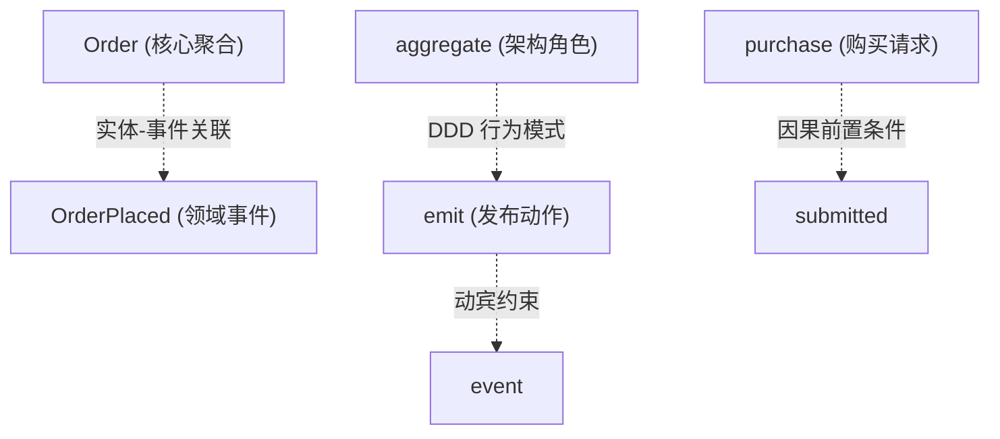

> 💡 **双栏独立滚动工作台导读**：本文采用双栏对照架构。**左栏**为核心精炼架构、实战代码与避坑决策；**右栏**为原著完整参考译文，附有关键段落的英文原文展开与难词解析。左右两栏可独立滚动，并支持顶栏自定义宽度比例（7:3 / 5:5 / 3:7）与拖拽调节。

# 核心实战精炼：大语言模型心智模型与概率收敛

## 1. 架构决策矩阵：模型推理与解码控制

| 控制维度 | 参数/策略 | 推荐配置值 | 作用机理与概率效应 | 领域建模核心价值 |
| :--- | :--- | :--- | :--- | :--- |
| **温度控制 (Temperature)** | 低温采样 | `0.1 ~ 0.3` | 陡峭化概率分布，使模型近乎确定性地采样头部高概率 Token | 确保聚合、实体、事件与不变量命名严格稳定一致 |
| **温度控制 (Temperature)** | 中温采样 | `0.6 ~ 0.8` | 概率分布平缓化，允许模型探索合理替代词 | 仅用于发散性业务头脑风暴或架构方案备选探索 |
| **核采样 (Top-p)** | 截断长尾 | `0.8 ~ 0.9` | 截断累积概率后 10%~20% 的低概率边缘候选词 | 坚决剔除长尾偏义词与不相关词汇（如把 Order 误解为军事指令） |
| **词汇表述格式** | 自然语言 vs 驼峰命名 | 自然语言 (`bounded context`) | 驼峰命名 (`BoundedContext`) 会被 BPE 分词撕裂为碎片，摧毁专业文献共现权重 | 激活预训练语料中高频沉淀的深层 DDD 语义关联 |
| **上下文编排** | 首尾注意力布局 | 首部定义 + 尾部约束 | 利用注意力机制的 U 型分布，克服中间腹地的“迷失在中间（Lost in the Middle）” | 确保核心业务不变量获得最高保真度的注意力加权 |
| **上下文范围 (Scope)** | 最小完备上下文 | 聚焦且结构化（< 4K Tokens） | 降低 $O(N^2)$ 的自注意力矩阵计算干扰，避免冗余背景稀释核心约束 | 消除无关噪音对关键业务推演的干扰 |

## 2. 核心心智模型：统计概率模拟器

大语言模型不是具有推理意识的心智大脑，而是一个**语言自洽性的高维概率模拟器（Probabilistic Simulator of Linguistic Coherence）**。


### 关键架构推论
1. **生成即不可逆的级联选择（Cascade Effect）**：开篇生成的首个词汇（如 *purchase* 对应电商，*hierarchical* 对应行政）将不可逆地重塑后续所有 Token 的概率地貌。
2. **流畅自洽 $\neq$ 物理事实（Coherence vs Grounding）**：模型在训练中内化了专家论述的修辞外壳，无论答案正确与否，都展现出同等程度的流畅与自信。
3. **涌现推理的四大物理脆弱性**：
   - *推理深度脆弱*：缺少步骤约束时易坍缩为浅层模式匹配。
   - *跨轮一致性缺失*：缺乏客观世界常驻模型，随上下文增长易产生自我矛盾。
   - *无内生错误检测*：无法像人类那样察觉认知失调，即使自相矛盾仍会顺畅生成。
   - *抽象边界为统计性而非结构性*：易将高频共现的概念混为一谈，无法自发捍卫架构边界。

## 3. 技术演进与分词机理：BPE 拆解对比

```
自然语言形态 (推荐):
"bounded context"
  ├── [Token: "bounded"]  (完整 DDD 语义单元，语料共现权重极高)
  └── [Token: "context"]  (完整概念词)

驼峰标识符形态 (严禁在 Prompt 领域推演中使用):
"BoundedContext"
  ├── [Token: "Bound"]    (词根被破坏)
  ├── [Token: "ed"]       (孤立词尾)
  └── [Token: "Context"]  (割裂片段)
```

### 自注意力机制的长程语义连接



## 4. 架构实战：刚性收敛提示词工程范式 (YAML Specification)

为了杜绝模型的概率漂移，必须通过结构化规范从源头彻底锁死发散路径：

```yaml
# 生产级领域建模收敛提示词规范 (DDD Constrained Prompt)
context:
  domain: "BrewUp"
  bounded_context: "Order Management"
  aggregate_root: "Order"

task: "定义 Order 聚合对外发布的核心领域事件"

naming_conventions:
  format: "自然语言结合过去时态，命名格式必须为 <Aggregate><Verb-ed>"
  examples:
    - "OrderPlaced"
    - "OrderPaymentConfirmed"
  forbidden_patterns:
    - "严禁使用现在时态（如 PlaceOrder）"
    - "严禁引入外部上下文专有词（如 InvoiceGenerated）"

scope_guards:
  allow_new_aggregates: false
  allow_cross_boundary_events: false
  required_action_on_missing_info: "显式输出 open_questions，严禁基于假设自行推测"

invariants:
  - "未包含任何订单项（Order Lines）的订单严禁提交"
  - "在支付确认（Payment Confirmed）之前，订单严禁发货（Ship）"
  - "一旦处于已发货（Shipped）状态，订单严禁取消（Cancel）"

output_format:
  type: "key_value_list"
  schema:
    event_name: "String"
    trigger_condition: "String (必须明确对应上述不变量)"
```

### 收敛输出样例（GPT-5.6 Sol 真实采样）：
```text
OrderPlaced — 当包含至少一个订单项的购买请求成功提交时发布。
OrderPaymentConfirmed — 当订单支付状态由第三方授权确认时发布，使订单进入可发货状态。
OrderShipped — 当已付款订单出库发货时发布，发货后订单终生不可取消。
OrderCancelled — 当未发货订单在客户或超时触发下被撤销时发布。
```

## 5. 架构避坑清单 (Do's & Don'ts)

| 维度 | 严禁行为 (Don'ts) | 推荐工程实践 (Do's) |
| :--- | :--- | :--- |
| **词汇表述** | 在向 AI 描述领域模型时使用驼峰命名（如 `OrderPlaced` 或 `AggregateRoot`）。 | 始终使用自然的英文词组（如 `order placed event` 或 `aggregate root`）。 |
| **提示词布局** | 将关键的业务不变量和系统约束塞在几万字历史对话或冗长文档的中央。 | 战略性置于提示词的最顶部（System/Context）与最末尾（Task/Output Constraint）。 |
| **上下文预期** | 误以为开启新会话或长对话后，模型依然在后台“记住”先前的架构决策。 | 会话是无状态的，所有关键决策必须通过规则手册或上下文挂载显式重新注入。 |
| **解码控制** | 在需要确定性定义领域模型、命名和规则时使用默认或高 Temperature（> 0.7）。 | 严格将 Temperature 锁定在 0.1 ~ 0.3，必要时将 Top-p 适度调至 0.8 以消除长尾怪词。 |
| **输出校验** | 将模型条理分明、引经据典的架构解释直接当成真实的业务真理采纳。 | 视一切 AI 输出为**待检验的建模假说（Hypothesis）**，由领域专家与架构师核验。 |
| **歧义应对** | 使用模糊笼统的指令（如“请帮我规划一套咖啡订单系统的架构”）。 | 提供精确的限界上下文、聚合边界、输入输出契约及刚性业务不变量。 |

<!-- split -->

# 原著完整参考：大语言模型到底如何“思考”，以及为何精准性能够解锁理解力

**大语言模型（LLM）**表面上看起来极具智慧，似乎能够对复杂领域进行深刻推理。然而，在其流畅表达的表象之下，运作的却是一套截然不同的机械机制。本章将帮助你构建必要的操作性心智模型，以便在**领域驱动设计（DDD）**中安全、高效地与 LLM 展开协作。

这种深刻理解将成为全书后续所有提示工程与建模技术的核心基石。在实际工作中，它将指导你编写出结构更优的提示词、更加安全地校验模型的回答，并在整场对话中始终保持领域术语的严密一致。

读完本章，你将能够看清 LLM 输出的本质：它是一种概率性生成过程，而你可以通过审慎的设计对其施加约束与精准引导。

:::en
> **Original**: **Large language models** (**LLMs**) appear intelligent and capable of reasoning about complex domains. However, beneath that fluency lies a different mechanism. This chapter builds the operational mental model you need to collaborate with LLMs safely and effectively in **domain-driven design** (**DDD**). This understanding will become the foundation for the prompting and modeling techniques used throughout the rest of the book. In practice, it will help you write better-structured prompts, validate the model's answers more safely, and keep your domain terms consistent across a conversation.

**📌 核心术语与语境解析**：
- **Operational mental model** [ˌɒpəˈreɪʃənl ˈmentl ˈmɒdl]：*操作性心智模型*。对系统底层物理运作规律的精准认知，指导工程师在日常工程中做出正确交互决策。
- **Fluency** [ˈfluːənsi]：*行文流畅度*。大语言模型输出表面自然通顺、符合语法与修辞习惯的表象特征，不代表事实层面的正确性。
:::

在本章中，我们将深入探讨：
- 为什么 LLM 是“统计模式匹配机器”而非“具有意识的思考大脑”，以及这对架构职责意味着什么
- 分词（Tokenization）、上下文窗口与注意力机制如何共同塑造输出，以及上下文摆放位置为何至关重要
- 为什么流畅的输出表面上酷似理性推理，实则可能缺乏真实依据（Ungrounded）
- 模型的“涌现推理（Emergent Reasoning）”在何处会遭遇失效崩溃
- 为什么语言的精准性——尤其是通过严守纪律的通用语言（Ubiquitous Language）——是确保领域建模准确性的终极杠杆

这些理念共同导向一个务实的目标：学会以 DDD 在领域建模中所秉持的相同语言纪律，去精准驾驭模型的概率性生成。然而，在你动手设计提示词模式与结构化工作流之前，必须首先看透你所操控的这台引擎的底层机制。

## LLM 是统计模式机器，而非思考心智

在能够与 LLM 展开高效协作之前，你必须首先纠正一个极具误导性的先入为主假设：

> **LLM 并不会像人类那样去真正思考或理解业务领域，它们也没有意图、信念或目标。** 它们的运作本质更加机械：它们只是在做预测。这种区分是操作层面的现实要求，而非纯粹的哲学思辨。

将模型误当成人类心智会导致切实的架构设计失误。人类同事会牢记三轮对话前做出的决定，因此你无需反复重申；而模型只有在历史决策依然保留在当前活跃上下文窗口中、或由外围应用程序再次注入时，才能利用该决策。人类同事若对某件事吃不准会主动说明，因此你常把流畅的措辞视为胸有成竹；然而无论答案是真实可靠还是凭空捏造，模型生成的语调都同样流畅自信。整个工作流往往恰恰在你撤除核验关卡的地方分崩离析——因为你误以为屏幕另一端有某种心智在帮你统揽全局。建立对 LLM 运作原理的精准心智模型，能明确告诉你这些校验机制究竟应当部署在哪里，从而让你能够极其安全地将模型作为推理放大器来使用。

:::en
> **Original**: *LLMs do not think or understand domains in the human sense, nor do they hold intentions, beliefs, or goals.* Their operation is more mechanical: they predict. This distinction is operational, not philosophical. Treating the model as a human mind leads to concrete design mistakes. A colleague would remember a decision taken three turns ago, so you stop restating it; the model can use that decision only while it remains available in the active context or is supplied again by the surrounding application. A colleague who was unsure would say so, so you read fluent phrasing as confidence; the model sounds equally fluent whether its answer is grounded or invented. The workflow breaks at exactly the points where you removed a check, assuming something on the other side was keeping track. Adopting a precise mental model of how LLMs function tells you where those checks belong, and lets you use the model safely as a reasoning amplifier.

**📌 核心术语与语境解析**：
- **Operational, not philosophical**：*操作层面的工程要求，而非哲学思辨*。必须明确模型机械预测的本质，以此在软件交互管道中严格设立核验防线。
- **Grounded vs invented** [ˈɡraʊndɪd]：*真实事实锚定 vs 虚构捏造*。判断模型输出是基于上下文确凿证据，还是平坦概率分布下的随机采样臆造。
:::

### 核心机制：下一个 Token 预测

在底层本质上，LLM 在训练中只专注于完成一项任务：**给定一串 Token 序列，预测下一个最可能出现的 Token。** 这项预测任务便是模型的全部工作。

如果输入的文本是：“*在领域驱动设计中，限界上下文定义了……*”，模型就会在其词表（Vocabulary）范围内计算概率分布，并挑选出与训练期间习得的统计模式最契合的那个 Token。模型在人类认知意义上既不“理解”何为限界上下文，也不会从某种记忆库中检索出定义。相反，它只是在生成统计上最为连贯的后续文本。这一过程一个 Token 接一个 Token 地不断循环往复，逐步拼装成完整的句子。

这背后的关键推论在于：**LLM 从来不是一次性生成完整答案的，它是在根据一系列概率决策，逐个 Token 顺序生成的。**

具体而言，模型从输入的 Token 序列开始，计算所有可能接续的下一个 Token 的概率分布。它选定一个 Token，将其追加到序列末尾，然后基于更新后的上下文重复这一计算过程。每一步生成都完全依赖于截至目前已生成的全部 Token 序列。在你眼中看似一气呵成的完整回答，在物理现实中，只不过是由无数个细小的、接续发生的概率决策串联而成的产物。

:::en
> **Original**: At its foundation, an LLM is trained to perform one task: *Given a sequence of tokens, predict the most probable next token.* The prediction task is all the model does. If the input is "*In Domain-Driven Design, a bounded context defines*," the model calculates probabilities across its vocabulary and selects the token that best fits the statistical patterns it learned during training. The model does not *know* what a bounded context is, and it does not retrieve a definition from memory in the human sense. Instead, it generates the continuation that is statistically most coherent. This process repeats token after token, building sentences incrementally... The key implication is that an LLM never generates an answer as a whole: it produces a sequence, one probability decision at a time.

**📌 核心术语与语境解析**：
- **Next-token prediction** [nekst ˈtəʊkən prɪˈdɪkʃn]：*下一个 Token 预测*。模型基于既有序列，在词表高维空间计算离散概率分布并采样的单步过程。
- **Statistically most coherent**：*统计上最自洽连贯*。输出依据训练语料中的模式转移规律生成，其自洽性衡量的是语言习惯而非物理真理。
:::

### 是 Token，而非单词

要透彻理解预测是如何运作的、以及措辞在领域建模中为何如此举足轻重，你就必须理解 Token。LLM 在接收你的通用语言时，并不会直接将其视作一个个完整的领域概念，而是接收到一串 Token 碎片。当领域术语含糊不清、前后矛盾或以模型不熟悉的形式呈现时，模型就必须完全依赖统计规律来强行拼凑其含义，从而急剧放大了歧义性与语义漂移的风险。

Token 并不等同于单词。一个 Token 可以是一个完整的英文单词、单词的一部分、一个标点符号、数字片段，甚至是单个空格。例如，*bounded context* 会被切分为两个独立的 Token：*bounded* 和 *context*，恰好对应两个英文单词。事件名称 *OrderPlaced* 同样会被拆分成两个 Token：*Order* 和 *Placed*，但这种拆分在文本中是不可见的；句子末尾的句点本身也是一个独立的 Token。模型是在 Token 的层面上进行运算，而非语义单元。

这对软件架构师有着至关重要的影响：
- 领域语义完全是通过统计学方式从 Token 碎片中重构出来的。
- 模型是通过反复出现的模式来推断概念之间的结构性关系。
- 含糊或不一致的术语会沿着预测链层层传递并放大偏差。

在领域建模中，这远比初看起来更为致命。当你提供含糊的语言、模棱两可的用词或前后割裂的词汇时，你实际上是将统计层面的歧义性直接注入到了模型的预测链之中。LLM 对提示词的具体措辞极度敏感，正是因为措辞直接重塑了背后的概率分布形态。

:::en
> **Original**: To understand how prediction works, and why wording matters in domain modeling, you must understand tokens. An LLM does not receive your Ubiquitous Language as a set of complete domain concepts; it receives a sequence of token fragments. When domain terms are vague, inconsistent, or represented in unfamiliar forms, the model must reconstruct their meaning statistically, increasing the risk of ambiguity and semantic drift. A token is not necessarily a word. A token may be a full word, part of a word, a punctuation mark, a number fragment, or even whitespace. For example, *bounded context* becomes two tokens, *bounded* and *context*, matching the two words. The event name *OrderPlaced* also becomes two tokens, *Order* and *Placed*, but here the split is invisible in the text; a trailing period is a token of its own. The model operates over tokens, not semantic units.

**📌 核心术语与语境解析**：
- **Token fragments** [ˈtəʊkən ˈfræɡmənts]：*Token 碎片*。文本经分词算法切分后的基础计算单元，模型在碎片而非完整概念层级进行数学运算。
- **Semantic drift** [sɪˈmæntɪk drɪft]：*语义漂移*。术语歧义或分词撕裂导致模型在预测链中逐步滑向与既定领域不符的概率分支。
:::

### 是预测，而非理解

人类是通过在脑海中建立外部世界的**内部心智模型**来进行理性推理的。你拥有因果逻辑结构、心智推演模拟能力和概念层级体系，并且你能够从这些结构中抽离出来进行元反思：复盘推演、修正原有信念、敏锐察觉自相矛盾。

LLM 完全不具备上述任何能力。它们只是通过复现海量训练数据中沉淀的推理模式来“近似”推理过程。在吞吐了人类浩瀚的文本语料后，它们学会了人类解释概念的固定范式、论证观点的套路、权衡取舍的行文风格，以及行业专家习惯的行文调性。当模型产出一份看似条理分明的架构分析时，这里的“自洽（Coherent）”指的仅仅是**行文流畅且前后不冲突**，绝非意味着其结论在物理现实中正确无误。输出仅仅映射了“架构解释通常如何组织”的统计特征；它丝毫不能证明模型真正理解了软件架构。

这种幻象之所以极具欺骗性，是因为模型完美模仿了专家论述的修辞外壳：先给定义再举例子、预判潜在异议、权衡利弊得失。当模型输出“*你应该将这些关注点拆分到两个独立的限界上下文中*”时，这句话让人感觉极具洞察力与判断力。然而事实的真相只是：在训练语料库中，处于此类上下文形态之后，往往极高概率会出现这种句式，于是模型只是顺理成章地补全了这个模式。

:::en
> **Original**: Humans reason through internal models of the world. You maintain causal structures, mental simulations, and conceptual hierarchies, and you can step back from them: reflect, revise a belief, notice a contradiction. LLMs do none of this. They approximate reasoning by reproducing patterns of reasoning found in training data. Trained on massive corpora of human text, they learn how explanations are formed, how arguments are built, how trade-offs are weighed, and how experts in a field typically write. When a model produces a coherent architectural explanation, *coherent* here means fluent and internally consistent rather than correct. The output reflects statistical patterns in how architectural explanations are structured; it does not demonstrate that the model understands architecture.

**📌 核心术语与语境解析**：
- **Internal models of the world**：*内部世界模型*。具备因果推理、状态模拟与反思修正能力的人类认知结构。
- **Coherent vs correct** [kəʊˈhɪərənt]：*自洽连贯 vs 客观正确*。语言修辞上严丝合缝、前后不冲突，并不等同于在业务领域物理现实中真实有效。
:::

**产出优美架构解释的同一套机制，制造起虚假编造来同样得心应手。** 如果与你的提示词相似的训练语料中经常提及法规约束，即使你的实际业务领域对此毫无要求，模型也很可能会臆造一些监管合规规则。如果在架构讨论中经常出现“关注点分离”，无论你的系统当前是否真正需要，它都会乐此不疲地建议你拆分出更多限界上下文。流畅的表达完美掩盖了缺乏事实依据的本质：**人类是以客观现实为基准来核验正确性，而 LLM 仅仅以先前生成的 Token 序列为基准来维持统计自洽。**

尽管其底层完全是机械性的，但 LLM 的表现却常常令人惊叹，这是因为**超大规模的统计模式建模催生出了结构涌现**。在海量语料上训练后，模型内化了如下模式：
- 严密的逻辑论证结构
- 数学公理与推导格式
- 经典的架构设计推演范式
- 因果关联的语言表述序列

这些内在模式使得模型展现出极似人类理性推理的宏观行为：多步骤复杂推演、看似有模有样的自我纠错，以及结构严谨的分层解释。这些行为通常被称为**涌现推理（Emergent Reasoning）**，我们在本章后文将剖析其内在边界。在此刻我们需要明确的是：这些都只是表层规则的统计映射。模型在内部根本没有维护对客观真理的表征；它仅仅维护着 Token 序列上的概率分布。

对于架构师而言，最致命的工程风险莫过于**把流畅自洽的解释误当成经过严格验证的建模决策**。一个关于引入新聚合、拆分限界上下文或定义新不变量的建议，听起来可能无懈可击，但在你真实的业务领域中却可能完全站不住脚。模型能够帮你梳理思考的结构，但它无法替你在真实的领域约束面前验证真伪——因此，架构师必须牢牢掌控对“何为事实”的终极裁判权。

:::en
> **Original**: The same mechanism that produces elegant explanations also produces elegant fabrications. If texts similar to your prompt often include regulatory constraints, the model might introduce them even when your domain has none. If architectural discussions frequently recommend separation of concerns, it might suggest additional bounded contexts whether or not your system needs them. The fluency of the output masks the absence of grounding: humans evaluate correctness against reality, while LLMs evaluate coherence against prior tokens... For architects, the practical risk is mistaking a coherent explanation for a validated modeling decision. A recommendation to introduce an aggregate, split a bounded context, or define a new invariant may sound convincing while remaining ungrounded in the actual domain. The model can structure thought, but it cannot validate it against your domain's actual constraints, so architects must remain in control of what counts as true.

**📌 核心术语与语境解析**：
- **Fabrications** [ˌfæbrɪˈkeɪʃnz]：*无事实依据的虚构/臆造*。模型在缺乏先决事实输入时，基于训练分布强行生成的伪真实陈述。
- **Absence of grounding** [ˈɡraʊndɪŋ]：*缺乏事实基准锚定*。输出缺乏外部权威事实源的支撑，仅以历史 Token 维持表层概率自洽。
:::

### 适合架构师的实用心智模型

请将 LLM 准确视为一个**语言自洽性的概率模拟器（Probabilistic Simulator of Linguistic Coherence）**：一个被训练用来预测 Token 的高维统计引擎，而不是一位有思考能力的人类专家或架构决策者。

模型既不理解你的领域，也不会产生主观意图，更无法对客观现实形成真理信念。除非你在当前的上下文窗口中显式喂给它领域知识，或通过外部权威数据源动态检索注入，否则模型根本无法跨对话长久保留你的领域知识。它真正擅长的是：高度压缩人类浩瀚语言中的模式规律、精妙复现熟悉的解释与推理结构，并对显式提供的结构化约束做出强烈的概率收敛响应。

这种心智模型能够有效防止走向两个极端：既不盲信盲从模型的输出结论，也不至于低估其强大的模式综合归纳能力。如果使用得当，它在以下方面极具效用：
- 理顺杂乱无章的领域原始信息
- 快速发散生成候选建模视角与解释方案
- 探索多样的语言表达与词汇变体
- 敏锐暴露潜在的隐式模式与遗漏假设

这些输出之所以无比珍贵，是因为它们将各种潜在可能清晰外显出来供人类审查。但请时刻谨记：它们始终只是未经现实检验的建模假说。

:::en
> **Original**: Think of an LLM as a probabilistic simulator of linguistic coherence: a high-dimensional statistical engine trained to predict tokens, not a thinker, a domain expert, or a decision-maker. The model does not understand your domain, form intentions, or maintain beliefs about what is true. Nor does it preserve domain knowledge across interactions unless you reintroduce that knowledge through the current context or an external source of truth. What it can do is compress patterns found across vast amounts of language, reproduce familiar structures of explanation and reasoning, and respond strongly to explicit constraints.

**📌 核心术语与语境解析**：
- **Probabilistic simulator of linguistic coherence**：*语言自洽性的概率模拟器*。大模型的精准架构定位——旨在优化符号序列的语言连贯性，而非推导真理。
- **Compress patterns**：*压缩模式*。模型在高维权重中紧凑沉淀的人类论辩、解释与推理结构规律。
:::

**当模型面临不确定性时，它绝不会主动弃权或沉默。** 即使在其知识库中根本不存在高置信度的接续方案，它依然会基于平坦的概率分布强行采样并继续生成。其直接结果便是：模型会以极其自信的口吻，凭空捏造虚假的论文引用、编造不存在的 API 接口、甚至虚构根本不存在的领域业务规则。

> 模型生成的根本目标是**维持语言自洽**，而非**陈述客观事实**。因此，语义层面的正确性必须无一例外由外部机制进行严格核验。

在 DDD 领域中，这一认知是性命攸关的。如果你在没有提供足够领域背景的情况下随口提问：“*这个聚合的不变量（Invariants）是什么？*”，模型很可能会凭空编造一套看似极具说服力的规则。这绝非模型有意欺骗；在软件工程语料中，聚合通常都带有一系列不变量，模型所补全的模式要求这里必须出现几条规则，于是它便顺理成章地填补了上去。

对于架构师而言，这划定了不可逾越的安全红线：**LLM 的输出仅仅是一个建模假说（Hypothesis）——一项必须在正式采纳前经过严格审视与批判性质疑的草案。** 模型能够极好地放大你显式声明的规则约束，但判断系统描述是否忠实于现实业务领域的终极责任，永远属于架构师与领域专家。

这是你在阅读后续内容时必须始终铭记于心智模型：**模型提供自洽的推演可能性，而你提供真实的上下文与最终的裁决验证。** 在这一清晰划定的边界之内，它将是你无比强大的推理放大器。

:::en
> **Original**: When the model encounters uncertainty, it does not automatically abstain. Even if no high-confidence continuation exists, it still generates from the available probability distribution and continues. As a result, it might produce invented citations, fabricated APIs, nonexistent domain rules, and other inaccuracies expressed with unwarranted confidence. The model generates for coherence, not truth. Semantic correctness must therefore be verified externally... For architects, that sets the boundary. An LLM output is a modeling hypothesis: something to inspect and challenge before it is accepted. The model can amplify a constraint you state explicitly, but responsibility for whether the domain is described truthfully stays with architects and domain experts.

**📌 核心术语与语境解析**：
- **Do not automatically abstain** [əbˈsteɪn]：*绝不主动弃权/沉默*。生成式模型的内在机理要求其必须完成序列补全，在不确定时以平坦概率强制采样。
- **Modeling hypothesis** [ˈmɒdəlɪŋ haɪˈpɒθəsɪs]：*建模假说*。一切未经领域专家与业务规则复核确认的模型输出，均只能视为待验证的假设方案。
:::

## 分词、上下文窗口与预测链

在前文中，我们确立了 LLM 预测的是 Token 而非语义。现在，我们需要进一步深入工程细节。深入理解分词的底层原理、模型在任一给定瞬间能够审视的信息边界，以及输出是如何逐个 Token 涌现出来的，将为你提供与这些模型高效协作所需的操作性洞察。

本节的探讨纯粹出于实战，绝非学院派的空谈。后续要运用的每一项高级技术——从结构化提示词、规则手册到多轮迭代精炼——全都是紧密围绕我们即将展开的这套底层机械机理而量身定制的。

### 模型眼中的领域语言

模型处理的是 Token 而非自然单词，因此核心问题在于：自然文本究竟是如何被切分为这些 Token 的？

目前绝大多数现代大语言模型采用一种名为**字节对编码（Byte Pair Encoding，BPE）**的分词算法。该算法最初由 Philip Gage 于 1994 年提出，早期主要用于数据无损压缩。其工作原理极其纯粹直接：在离线训练阶段，算法分析海量文本语料，找出出现频率最高的相邻字符对，将其合并为一个全新的单 Token。接着周而复始地重复该合并过程，逐步从最常见的字符组合构建出越来越大的复合 Token。

你可以将分词器（Tokenizer）形象地理解为一个针对通用人类语言专门优化过的高效压缩算法。对于语料中极其常见的基础高频词（例如 *the*、*and*、*function*、*return*），分词器会为其分配极其紧凑的高效单 Token。常见英语词汇和编程关键字因此拥有极为紧凑、表征完美的单一 Token。然而，你的 DDD 专属术语却绝不可能享受这种待遇。当写为两个分离的单词时，*bounded context* 由两个极其常见且表征良好的单 Token 组成；但一旦写成紧凑的程序标识符 *BoundedContext*，分词器就不得不将其无情拆解成细碎的碎片。

你的领域专有词汇，仅仅是模型在漫长训练中碰巧学到的一种“方言”，绝非它的“母语”。不妨仔细观察分词器在遭遇 DDD 术语时的表现：像 *aggregate*、*context* 和 *event* 这样的词汇，在日常英语中原本就是常见单词，因此它们拥有干净的单 Token 表征；然而，一旦你将它们组合成 DDD 专有的复合名词——尤其是采用驼峰命名法（CamelCase）拼装时——情况就急转直下。

当模型处理写成单个驼峰字符串的 *BoundedContext* 时，它看到的根本不是一个统一的整体概念，而是三个彼此割裂的 Token 碎片：*Bound*、*ed*、*Context*。大写字母彻底破坏了词形完整性：分词器在常规语料中见过无数次小写的 *bounded*，但极少见到首字母大写的 B 紧贴着其他单词出现，因此原本熟悉的词根单元瞬间崩解。模型必须在训练中习得的微弱统计关联支撑下，吃力地跨越这些 Token 碎片去重新拼装 *bounded context* 作为 DDD 核心概念的完整语义。

:::en
> **Original**: Many modern LLMs use a tokenization algorithm called byte pair encoding (BPE), a technique originally developed by Philip Gage in 1994 for data compression (Gage, 1994). The principle is straightforward: during training, the algorithm analyzes massive amounts of text and identifies the most frequently occurring character pairs. It merges them into a single token. Then, it repeats the process, building progressively larger tokens from the most common combinations... When the model processes BoundedContext as a single CamelCase string, it does not see one unified concept. It sees three separate fragments: Bound, ed, Context. The capital letters are what break the word: the tokenizer has seen bounded countless times in running text, but rarely with a capital B glued to another word, so the familiar unit disappears. The model must reconstruct the semantic unity of bounded context as a DDD concept statistically, across those fragments, through the patterns the model learned during training.

**📌 核心术语与语境解析**：
- **Byte Pair Encoding (BPE)** [baɪt peə ɪnˈkəʊdɪŋ]：*字节对编码*。基于字符共现频率迭代合并的高效统计分词算法。
- **CamelCase fragmentation**：*驼峰命名碎片化*。驼峰命名破坏自然语言词根完整性，导致分词器将其切割为破碎的低权重子词（Subwords）。
:::

这一工程事实引申出了一个极其直接的实战准则：**在编写面向领域建模的提示词时，务必使用自然的语言形式（如 *bounded context*），而坚决避免使用驼峰命名（如 *BoundedContext*）。** 其原因完全是统计层面的：在浩如烟海的 DDD 专著、技术博客、演讲纪要和行业论文中，模型见过无数次双词形式的 *bounded context*，这些 Token 与其周围环绕的丰富 DDD 术语之间，沉淀着无比强大且高度收敛的统计关联；相比之下，驼峰命名变体绝大多数只出现在源代码之中，其周围充斥的往往是纯粹的语法结构而非深度的领域语义。

不同模型的词表容量各有差异：GPT-4 所采用的 OpenAI cl100k 编码大约拥有 100,000 个 Token，而 GPT-4o 及后续模型所使用的 o200k 编码则扩张到了约 200,000 个 Token。Anthropic 虽未公开 Claude 分词器的确切词表规模，但无论具体数字是多少，DDD 领域全部的专业术语在整个词表空间中占有的比例都微乎其微。模型之所以“懂得”DDD，绝非因为为其专属领域概念分配了专用 Token，而是因为在海量探讨这些概念的技术文本中，沉淀下了高频共现的模式规律。这些模式的强弱，完全取决于模型在预训练语料中遇到它们的频率与一致性。

这说明了为什么在构建结构化提示词时，应当始终如一地使用自然语言而非代码风格的命名来表达领域概念。

:::en
> **Original**: This observation has a direct practical implication. When you write prompts for domain modeling, using natural language forms such as bounded context is typically more effective than using CamelCase forms such as BoundedContext. The reason is purely statistical: the model has encountered bounded context as a two-word phrase throughout DDD literature, blog posts, conference talks, and textbooks. The statistical associations between these tokens and the surrounding DDD vocabulary are strong and well-established. The CamelCase variant, by contrast, appears predominantly in source code, where the surrounding context is syntactic rather than semantic.

**📌 核心术语与语境解析**：
- **Natural language forms** [ˈnætʃrəl ˈlæŋɡwɪdʒ fɔːmz]：*自然语言形式*。如 "bounded context"，在专业经典文献中与核心理论具有高密度共现关联。
- **Syntactic vs semantic context** [sɪnˈtæktɪk / sɪˈmæntɪk]：*语法上下文 vs 语义上下文*。驼峰命名多局限于代码变量语法环境，而自然语言词组承载着深厚的领域语义体系。
:::

### 上下文窗口：容量与极限边界

**上下文窗口（Context Window）**指的是模型在同一时刻所能完整吞吐处理的 Token 上限总量。它囊括了单次交互中所提供的全部输入材料：系统提示词（System Prompt）、历史对话上下文、额外注入的约束规则或参考文档，以及截至当前生成的全部输出。模型在生成回答时所必需的全部信息，必须完整装入这一窗口之中；任何处于窗口之外的信息，对模型而言在物理上均不可见。

主流模型的上下文窗口已经普遍从数十万 Token 跨越到上百万 Token。作为参考基准，20 万 Token 大约等同于 15 万英文单词，折合约 300 页密集印刷的书籍体量，这已经超越了绝大多数传统长篇小说的容量。

然而在工程实践中：**上下文窗口越大，绝不等于生成效果越好。** 来自斯坦福大学、加州大学伯克利分校与 Samaya AI 的研究团队揭示了一项广为人知的著名规律：**迷失在中间（Lost in the Middle）效应**。

研究人员证实，当相关关键信息出现在超长上下文的“正中央区域”时，大语言模型的理解与召回能力会出现大幅下滑。模型的注意力分布呈现出鲜明的“U 型曲线”：位于上下文窗口**最开头**与**最末尾**的信息能够以极高保真度被模型提取和运用；而埋藏在**中心腹地**的信息则极易被模型彻底视而不见。在多文档问答测试基准中，仅仅是将目标文档从上下文头部挪到中央区域，GPT-3.5-Turbo 的准确率就下降了超过 20 个百分点；在某些极端场景下，其表现甚至比根本不给任何参考文档还要差。

:::en
> **Original**: The context window is the maximum number of tokens the model can process at once. It includes everything available during an interaction: the system prompt, the conversation history, any additional instructions or documents, and the output generated so far. Every token the model needs to produce a response must fit within this window. Information outside it is unavailable to the model... However, bigger is not necessarily better. Researchers from Stanford, UC Berkeley, and Samaya AI demonstrated a phenomenon now known as the Lost in the Middle effect (Liu et al., 2024). They found that LLMs consistently underperform when relevant information appears in the middle of long contexts. Performance follows a U-shaped curve: information at the beginning and end of the context window is used with high fidelity, while information in the central region is often missed.

**📌 核心术语与语境解析**：
- **Context window** [ˈkɒntekst ˈwɪndəʊ]：*上下文窗口*。单次推断中模型能够作为工作记忆完整加载的 Token 总量上限。
- **Lost in the Middle effect** [lɒst ɪn ðə ˈmɪdl]：*迷失在中间效应*。大模型注意力呈 U 型分布，导致置于上下文中央区域的关键信息召回率发生断崖式下跌。
:::

这一发现具有立竿见影的工程指导意义：如果你正在与模型协同推演复杂的限界上下文，却将至关重要的核心领域规则随意塞在一篇冗长提示词的正中央，夹杂在大量漫长的对话与背景铺垫之间，那么模型在实际推演中很可能会彻底忽略这些关键规则。**关键信息即便客观存在于上下文窗口中，也绝不意味着模型能够正确运用它。**

还有另一个至关重要的工程细节：模型能够利用的上下文，完全取决于应用层在每一次请求时重新装配注入的内容。同一场会话中早先确立的 *Order* 定义之所以生效，是因为前端应用将历史消息重新打包带入了新的请求上下文。然而一旦开启新会话，这些决策绝不会自动跨会话继承；同理，超出窗口长度时应用层所执行的粗暴截断或摘要压缩，都可能在不知不觉中抹杀或篡改先前的关键决策细节。在领域建模中，必须确保每一次推演的当前上下文窗口中，都精准包含着不可或缺的定义与规则，而绝不能以为模型一直记得所有历史对话。

这就解释了为什么必须将领域词汇、不变量约束与业务规则固化在显式的**规则手册（Rulebooks）**中，并在执行建模任务时动态按需注入。及时维护并更新这些规则手册，能够为连续多次的建模推演提供始终如一的权威基准。

常见的认知误区是以为只要把窗口拉得越大，建模效果就必然越好。在真实架构实践中，**一段仅有 2,000 Token、但约束边界严密、领域规则位置合理的精炼提示词，其输出质量往往会显著优于一段将关键信息散落在 50,000 Token 漫长聊天记录里的臃肿提示词。** 有效上下文往往远小于物理上下文上限。这一原理将指引我们如何设计高聚焦的提示词、将持久约束沉淀至规则手册，并在多智能体工作流中实现“最小上下文按需分发”。

:::en
> **Original**: A common mistake is to assume that a larger context window automatically means better results. In practice, a focused 2,000-token prompt with clear constraints and well-positioned domain rules will often outperform a 50,000-token prompt where important information is scattered across a sprawling conversation history. Effective context is usually far smaller than maximum context. Later in the book, this principle will guide how you design focused prompts, externalize stable domain constraints in rulebooks, and provide agents with only the context required for each step of a workflow.

**📌 核心术语与语境解析**：
- **Effective context** [ɪˈfektɪv ˈkɒntekst]：*有效上下文*。真正对当前推演产生高注意力权重的精炼信息，往往远小于物理窗口上限。
- **Rulebooks** [ˈruːlbʊks]：*规则手册*。外置化沉淀的领域硬约束与术语标准，用于在会话中按需注入有效上下文。
:::

### 模型如何跨越长距离串联 Token

模型固然是在有限窗口内审视 Token，但它还必须在这个窗口内跨越距离去洞察不同概念之间的因果关联。

在 2017 年 Transformer 架构诞生之前，主流神经语言模型主要依赖循环神经网络（RNN/LSTM）。这类架构逐个串行处理 Token，将早期信息压缩在单一隐藏状态中向前传递。尽管它们能在一定程度上捕捉长距离依赖，但随着步长拉长，早期关键信息的衰减与丢失十分严重。在领域驱动设计中，这往往是致命的——因为一条业务规则与受其约束的核心实体，在文本表述中常常相隔甚远。

**Transformer 架构**从底层彻底颠覆了这一现状。其核心的**自注意力机制（Self-Attention）**赋予了模型直接“全景扫视”当前上下文中已存在的所有 Token 的能力，无论它们在距离上相隔多远。在预测下一个 Token 的那一刻，模型能够自主计算并动态决定赋予先前各个 Token 多少注意力权重。

这一机制是通过每个 Token 同时扮演的三种角色精密协同的：每个 Token 都会映射生成一个**Query（查询：你正在寻找什么？）**、一个**Key（键：你代表什么特征？）**以及一个**Value（值：你实际承载什么信息？）**。模型计算当前 Token 的 Query 与自身及前面所有 Token 的 Key 之间的相似度匹配得分，以此决定应当融合吸纳多少来自各个 Token 的 Value 信息。

我们完全无需深究底层的线性代数矩阵运算，对架构师而言真正重要的是其物理表现：**模型能够在完全无视物理距离的前提下，将语义密切相关的 Token 连接在一起。** 在 AI 辅助的领域建模中，这直接决定了：当一条业务实体、领域事件、边界划分与其前置规则分散在提示词、规则手册或外部检索文档的不同段落时，模型能否精准地将它们关联起来。

:::en
> **Original**: Transformer architecture (Vaswani et al., 2017) changed this fundamentally. Its self-attention mechanism lets the model look at the tokens already in the context, including distant tokens. When generating the next token, the model decides how much weight to give each one. The mechanism works through three roles that every token plays simultaneously. Each token generates a Query (What are you looking for?), a Key (What do you represent?), and a Value (What information do you carry?). The model computes how well each token's Query matches its own Key and the Keys of the tokens before it, and uses those scores to determine how much of each token's Value to incorporate.

**📌 核心术语与语境解析**：
- **Self-Attention** [ˌself əˈtenʃn]：*自注意力机制*。突破线性步长限制，允许模型全景计算上下文中所有 Token 两两相关性的核心架构。
- **Query / Key / Value (Q/K/V)**：*查询/键/值向量*。每个 Token 在注意力空间中的投影，通过 Q 和 K 点积相似度决定 V 的融合比重。
:::

当模型处理句子：“*当购买请求提交时，订单聚合应当发布一个订单已创建事件（The Order aggregate should emit an OrderPlaced event when the purchase request is submitted）*”时，自注意力机制能够执行如下精密连接：
- 跨越中间相隔的多个单词，将核心实体 *Order* 与事件 *OrderPlaced* 强力绑定，识别其实体与事件的所属关系
- 将 *aggregate* 与动作 *emit* 连接，识别出 DDD 中“聚合发布领域事件”的标准范式
- 将 *emit* 与宾语 *event* 串联，明确动词与受词的作用关系
- 将 *purchase* 与 *submitted* 关联，锁定该操作触发的因果先决条件

自注意力机制允许模型直接跨越长距离串联关键概念，支撑它在复杂的上下文窗口中精准追踪各种类型的领域逻辑网络。

在实际实现中，模型并行运行着大量专注于不同职责的**注意力头（Attention Heads）**：有的专注解析语法结构，有的专注锚定语义关联，有的则专门追踪物理位置远近。这种高并发的并行处理能力，赋予了模型在解析高度复杂、层次多维的领域业务陈述时极强的综合解析力。

但必须注意计算开销。在标准注意力机制中，Token 数量翻倍，意味着它们之间的两两矩阵计算量将激增近四倍（$O(N^2)$ 的复杂度）。这正是上下文窗口存在工程上限、且处理超长上下文时延迟会显著上升的底层物理原因。盲目向窗口中灌入冗余信息不仅毫无裨益、反而极其有害：**这是在浪费宝贵的计算资源，稀释和干扰模型本应集中的注意力焦点。**

:::en
> **Original**: When the model processes "The Order aggregate should emit an OrderPlaced event when the purchase request is submitted," attention allows it to do the following: Connect Order to OrderPlaced across four intervening tokens, recognizing the entity-to-event relationship; Connect aggregate to emit, recognizing the DDD pattern in which aggregates produce events; Connect emit to event, linking the action to its object; Connect purchase to submitted, identifying the causal condition. Attention lets the model connect distant tokens directly, helping it track different types of relationships across the context window.

**📌 核心术语与语境解析**：
- **Entity-to-event relationship**：*实体与事件关联*。聚合根作为业务事实发布者的 DDD 结构归属关系。
- **Causal condition** [ˈkɔːzl kənˈdɪʃn]：*因果条件*。业务触发动作与状态变更事件之间的前置依赖关系。
:::

### 流畅的输出是如何逐个 Token 涌现出来的

我们已经明确了模型如何接收 Token、如何通过注意力机制建立全局关联、以及如何在有限窗口内运作。现在，我们需要洞悉模型究竟是如何输出内容的。

模型以严格的单步循环产出文本：它审视包括提示词和截至目前自己生成的所有内容在内的全量上下文，计算词表上的概率分布，选定一个 Token，将其追加至末尾，然后周而复始。这种串行机制构成了所谓的**预测链（Predictive Chain）**：**每一个 Token 的选定，都会不可逆地重塑其后所有 Token 的概率地貌。**

这一机制伴随着巨大的连锁反应。不妨看一个极其简单的提示词：*“定义 BrewUp 系统中的 Order 聚合”*。

在第一条预测路径上，模型开篇生成了这样的句子：“*Order 代表了客户的购买请求（An Order represents a customer's purchase request...）*”。*purchase（购买）* 这个词的敲定，瞬间将后续的所有生成牢牢锚定在电子商务的专业语境之中。与购买、客户、电商上下文高度关联的统计模式，将主导随后生成的每一个 Token。整个预测链保持着高度自洽且符合业务预期的形态。

然而在另一条预测路径上，可能仅仅因为微小的统计随机扰动，模型开篇吐出了这样的句子：“*Order 是一种层级化的指令（An Order is a hierarchical directive...）*”。*hierarchical（层级化的）* 与 *directive（指令）* 瞬间将生成的语境拖向了企业行政组织或指挥体系的语料地带。转眼之间，*Order* 在模型笔下不再是一个 DDD 意义上的业务聚合，而被当成了组织行政指令。后续生成的每一个 Token 都会在这个偏离的轨道上越陷越深，因为模型永远在基于自己刚刚说出的话进行自圆其说。

这就是**级联效应（Cascade Effect）**：在开头处一个看似微不足道、单独看也完全通顺的 Token 选择，可能会系统性地将整个生成过程彻底带偏，脱离你原本设定的业务领域。一旦预测链发生偏离，模型自身在底层根本无法主动察觉这种宏观错误。事后要求它对照原提示词进行自我检查固然有所帮助，但绝不能百分之百保证它能纠正过来。对于架构师而言，最现实的挑战在于：**在推演初期对某个领域概念哪怕极其轻微的偏差解读，都会逐步影响随后提出的每一项建模建议——从聚合边界划分、领域事件命名，一路侵蚀到业务不变量与核心规则。**

:::en
> **Original**: The model produces text one token at a time. It examines the entire context, including all tokens generated so far, calculates a probability distribution over its entire vocabulary, selects one token, appends it to the context, and repeats. This sequential process creates what you call a predictive chain: each token selection shapes the probability landscape for every subsequent token... This behavior is the cascade effect. An early token choice that seems individually reasonable can systematically steer the entire generation away from your intended domain. Once the chain diverges, the model might fail to notice the error. Asking it to check the response against the prompt can help, but does not guarantee a correction. For architects, the practical concern is that an early interpretation of a domain concept can shape every subsequent modeling suggestion, from aggregate boundaries and event names to invariants and business rules.

**📌 核心术语与语境解析**：
- **Predictive chain** [prɪˈdɪktɪv tʃeɪn]：*预测链*。前序 Token 的采样结果作为后续生成的输入，连续重塑后续概率地貌的串行过程。
- **Cascade effect** [kæˈskeɪd ɪˈfekt]：*级联效应/偏差雪崩*。开头微小的词汇偏差被后续自圆其说的预测链逐层放大，导致整体方案系统性脱轨。
:::

在模型推理过程中，有两个核心参数直接调控着 Token 的采样选择，深刻影响着预测链偏离轨道的容易程度。

#### 温度（Temperature）：多样性与发散度的调节旋钮

**温度（Temperature）**参数控制着从概率分布中选择 Token 时的随机性强弱。你可以把它视为一个发散度调节旋钮。温度是一个连续的数值调节器：绝大多数 API 允许在 0.0 到 2.0 之间任意设定，1.0 代表保持模型原生的概率分布不做干预：
- **低温区间（低于 0.3）**：模型会极高概率选择当前上下文中概率最高的那个头部 Token。低温能够带来极高的一致性与稳定性，这在规范 DDD 领域术语时极其宝贵。但请切记：**低温绝不能保证吐出来的术语或领域规则在客观现实中就是正确的。**
- **中温区间（约 0.3 到 1.0，0.7 为行业通用默认值）**：概率分布变得更加平缓均衡。模型愿意挑选那些虽然不是绝对第一、但同样合理通顺的备选 Token。生成的文本自然流畅、句式丰富，但同时也引入了出现非预期词汇的微小风险。
- **高温区间（高于 1.0）**：概率分布被大幅抹平，低概率的长尾词汇获得了大幅提升的选中机会。较高的温度有助于在头脑风暴时探索新颖的措辞或另类的建模构想，但极易导致模型偏离预定领域。

#### 实战中的解码控制：Top-p（核采样）

除了温度之外，你还可以通过**核采样（Nucleus Sampling，即 Top-p 采样）**来约束 Token 的挑选。模型会严格按照概率降序排列，仅在累积概率达到预设阈值（例如 0.9 即 90%）的最小 Token 集合内部进行采样。

在领域建模实战中，Top-p 能够为你提供极其精准的定向防护：**它能干脆利落地一刀切除低概率长尾 Token**——这正是诸如 *hierarchical* 这种偏义词潜入 *Order* 定义的罪魁祸首。作为一种实战调优手法，将 top-p 降至 0.8 左右能够坚决把低概率的边缘干扰项剔除在考虑范围之外；而温度改变的只是这群留存候选者各自被选中的内部相对权重。当高温抹平分布时，需要卷入更多词汇才能凑齐 80% 的阈值，因此这两个参数在底层是紧密交织的。请时刻谨记：**Top-p 仅仅是依据统计概率进行过滤，它无法判别存活下来的 Token 是否符合你真实的业务逻辑。**

对于严谨的领域建模任务，实战黄金法则是：**当需要产出命名一致、结构严谨的领域事件、命令、聚合或不变量定义时，始终采用极低的温度（如 0.2 或 0.3），将 top-p 保持默认；唯有当你发现生成内容开始掺杂无关领域的怪异词汇时，再将 top-p 适度压低至 0.8。** 产出的一切成果必须无条件对照真实的领域词汇与业务规则进行人工复核，因为任何参数调节都不能代替事实核验。唯有在有意进行发散式头脑风暴或探索替代方案时，才适合调高温度。

:::en
> **Original**: A parameter called temperature controls the degree of randomness in token selection. Think of it as a variability dial. Temperature is continuous: most APIs accept any value from 0 to 2, and 1.0 leaves the model's original probability distribution unchanged... Beyond temperature, you can also control token selection with nucleus sampling (also known as top-p sampling; Holtzman et al., 2020). The model samples from the smallest set of the most probable tokens whose combined probability reaches a chosen threshold, such as 0.9. What this protects you from in domain work is specific: the long tail of low-probability tokens, which is where a term such as hierarchical or directive slips into a definition of Order... For domain modeling, start with a low temperature, such as 0.2 or 0.3, when you want consistent names and structured definitions for events, commands, aggregates, or invariants, and leave top-p at its default until you see unrelated vocabulary appearing; lowering it to around 0.8 is the more direct remedy for that. Check the output against your domain vocabulary and rules, because neither control validates the model's suggestions. Use higher temperatures when deliberately exploring alternatives.

**📌 核心术语与语境解析**：
- **Temperature** [ˈtemprətʃə]：*采样温度*。平滑或陡峭 Softmax 输出概率分布的超参数，直接决定生成的发散度与稳定性。
- **Nucleus sampling (Top-p)** [ˈnjuːkliəs ˈsɑːmplɪŋ]：*核采样*。按累积概率阈值截断候选 Token 集合，强力过滤长尾低概率怪异词汇。
:::

### 这对你的领域建模工作意味着什么

让我们将上述探索的全部底层机械机理，凝练为指引后续一切实战操作的**五项核心工程原则**：

1. **在提示词中始终使用自然语言表达领域概念**：写 *bounded context*，不要写 *BoundedContext*；写 *aggregate root*，不要写 *AggregateRoot*。自然语言形态在浩瀚的 DDD 经典文献中频繁出现并拥有强烈的统计关联；而驼峰命名会在分词阶段被生硬撕裂成破碎的 Token，削弱模型将输出收敛至真实领域的能力。
2. **战略性地精心排布你的上下文窗口**：将核心领域规则与硬性约束置于提示词的**最前部**和**最尾部**。坚决避免将关键信息深埋在上万字上下文的中央腹地。充分尊重已被科学证实的“迷失在中间（Lost in the Middle）”效应。
3. **切勿将上下文长度等同于提示词质量**：一段约束严密、边界清晰的 2,000 Token 短提示词，其产出质量往往远胜于一篇冗长的长篇大论。多余的修辞只会为模型制造噪音，分散注意力带宽。
4. **对严肃的领域定义任务坚决采用低温设定**：在定义事件名称、聚合边界或不变量规则时，锁定 0.2 或 0.3 的低温，大幅压缩输出的随机扰动。严密对照领域词汇表进行人工复核。唯有在发散探索新架构思路时，才适度上调温度。
5. **在整个协作流程中确保领域词汇与约束唾手可得**：如果前一轮对话已经明确将 *Order* 定义为具备特定不变量的聚合，只要该定义依然留在当前上下文窗口内，它就能持续发挥约束效力。时刻检查所需上下文是否齐备有效，一旦发生截断，立即通过外部规则手册重新注入。

这五项原则直接脱胎于分词、上下文窗口、注意力机制与预测链之间的物理交互：分词决定了模型接纳语言的基本颗粒度，上下文窗口决定了信息的存续边界与空间排布，而注意力机制则支配着概念之间的深层关联。它们共同将措辞、结构与上下文编排，升格为你主动调控模型概率地貌的精准控制手段。

:::en
> **Original**: Consolidate the mechanics we have explored into five practical principles that will guide everything you do from this point forward. First, use natural language for domain concepts in your prompts... Second, structure your context window strategically. Place domain rules and constraints at the beginning and end of your prompt... Third, do not equate context length with quality... Fourth, choose low temperature for domain definitions... Fifth, keep domain vocabulary and constraints available throughout the workflow. These five principles follow directly from how tokenization, context windows, attention, and predictive chains interact: tokenization determines the units through which the model receives language, the context window determines which information is available and its position, and attention shapes the relationships that follow. Together, they make wording, structure, and context placement active controls over the model's probability space, and every structured prompt technique you will build in Part 2 is designed to work with them.

**📌 核心术语与语境解析**：
- **Linguistic discipline** [lɪŋˈɡwɪstɪk ˈdɪsəplɪn]：*语言纪律性*。在人机交互中保持术语完全一致、命名严守规范的工程控制要求。
- **Context placement** [ˈkɒntekst ˈpleɪsmənt]：*上下文战略布局*。依循注意力分布规律将核心约束置于首尾黄金区域的提示词设计技术。
:::

## 涌现推理及其认知盲区

前文指出，超大规模的模式压缩使得 LLM 展现出了类似人类理性推理的宏观行为：它们能够执行多步骤的逻辑演绎链条，也能求解结构化的复杂问题。这种**涌现推理（Emergent Reasoning）**极具实用价值，但它有着极其脆弱的物理边界。

首先，**推理深度极其脆弱**。如果提示词缺乏清晰的思考结构引导，模型的推理链极易坍缩为浅层的机械模式补全。显式设定推演步骤约束（例如：“*先剖析底层业务假设，再识别核心不变量，最后权衡架构利弊*”），能够显著提升推理质量，因为这在物理上直接重塑了顺次生成的预测路径。

其次，**跨轮输出的一致性毫无保障**。由于底层根本不存在一个稳定的客观世界模型，在面对不同的交互对话、甚至面对上下文变长变杂的同一场对话时，LLM 随时可能生成前后自相矛盾的结论。

第三，**模型完全缺乏内生性的错误检测机制**。人类在思维陷入自相矛盾时会产生强烈的认知失调与警觉，而 LLM 对此毫无感知。除非在提示词中显式命令它检查潜在冲突，否则即使后文的陈述与前文截然相悖，模型依然会心安理得地持续生成在局部看来流畅无比的文字。

第四，**其抽象边界完全是统计性的，而非结构性的**。在探讨领域模型时，LLM 极易将那些在预训练语料中经常共同出现的概念之间的边界彻底模糊化。模型对概念的表达完全受制于统计相关性，它根本无法自发恪守你在领域模型中所划定的显式边界。

这些认知盲区直接导致了许多典型的建模失效模式：
- **极其自信的虚假捏造**：毫无保留地宣称订单在发货后依然可以随时取消——而这直接违背了 BrewUp 系统的绝对业务不变量
- **隐蔽的底层逻辑冲突**：在架构方案的上半部分强调强一致性，下半部分却无缝切换为不加防护的最终一致性
- **过度泛化的套话建议**：抛出一堆放之四海而皆准却无法解决具体业务痛点的空洞架构模式
- **凭空捏造领域规则**：凭空臆造出 BrewUp 从未有过的“最低起订量”硬性限制
- **架构过度设计**：明明 BrewUp 只需要一个内聚的上下文，却非要教条地为订单、支付、物流拆分出三个独立的限界上下文

所有这些系统性偏离与失效模式，本质上全都是**“缺乏客观事实锚定的概率性生成”**所必然导致的后果。只要工作流中缺乏外部机制进行真伪核验，这些问题就必然会周而复始地上演。

对于架构师而言，这彻底重塑了我们使用 LLM 的姿态：**绝不要仅仅向模型索取最终答案，而是要求模型将其底层的推演假设与中间推导过程完全显式化地摊开，然后由人类进行严格的约束、审查与裁决。**

一旦将模型精准定位为“结构化推理模拟器”而非无所不知的“先知”，它就变成了一件利器：协助你发散架构备选方案、模拟严苛的技术质疑、对业务不变量进行压力测试，并敏锐揭示潜藏的隐式假设。

而这一切能够成立的绝对前提，在于**语言的精准性**。如果底层机制是对概率分布的预测，那么**你所敲下的每一个字词，就是你干预和操控该概率分布的最核心控制台。**

:::en
> **Original**: Earlier, you saw that LLMs exhibit behaviors that resemble reasoning: they can follow multi-step chains of inference and solve structured problems, because large-scale pattern compression produces approximations of reasoning structures. This emergent reasoning is useful, but it has boundaries. First, reasoning depth can be fragile... Second, consistency is not guaranteed across outputs... Third, it lacks intrinsic error detection... Fourth, abstraction boundaries are statistical, not structural... Each of these follows from probabilistic generation without grounded validation, so they will keep appearing until something in the workflow does the grounding. For architects, this reframes how LLMs should be used. Rather than asking only for answers, ask the model to make its assumptions and intermediate conclusions explicit, then constrain, inspect, and validate the result.

**📌 核心术语与语境解析**：
- **Emergent reasoning** [ɪˈmɜːdʒənt ˈriːznɪŋ]：*涌现推理*。超大规模统计模式压缩带来的多步演绎与结构化推导表现，其底层仍为概率补全而非物理实体演算。
- **Intrinsic error detection**：*内生错误检测机制*。大模型缺乏人类所具备的自发认知失调警觉，无法自主感知生成中的前后矛盾。
:::

## 语言精准性：领域建模准确性的终极核心

在领域驱动设计中，通用语言（Ubiquitous Language）绝非某种形式主义或文档卫生习惯，它是整个领域模型的结构主干。领域专家与开发人员之间达成的词汇共识，确保了每一个专业术语都精准映射到一个唯一的概念，并且每一个概念都严丝合缝地生存于明确的边界之内。一旦语言变得模棱两可，模型就会四分五裂；一旦术语使用前后矛盾，业务不变量就会荡然无存。

当与 LLM 协同工作时，这一原则变得更加性命攸关——因为**语言是你调控模型输出的最主要缰绳。**

LLM 不懂你的领域，不会自发帮你守护聚合边界，也不会主动捍卫你的业务不变量。它所做的一切，就是在受限的上下文窗口内，基于统计概率不断预测下一个 Token。因此，为了获得高度精确的领域建模支持，你唯一的途径就是**主动塑造模型赖以运算的概率分布形态**——而语言正是塑造该分布的雕刻刀。

对于人类团队而言，通用语言通过**共享共识**实现心智对齐；而对于 LLM 而言，严守纪律的语言则是通过**严密收敛预测空间**实现精准对齐。

含糊不清的表述绝不仅仅是不够优雅：它会在物理上拉平并放大模型的概率搜索空间。一个模棱两可的词汇会让合理的接续路径成倍发散，一个模糊不清的边界会让生成逻辑彻底漂移，而一个被赋予多重含义的混乱概念，则无异于直接导致模型滑向你完全未曾料想的歧途。

:::en
> **Original**: In DDD, Ubiquitous Language is the structural backbone of the model, not a matter of documentation hygiene. A shared vocabulary between domain experts and developers ensures that every term maps to a specific concept and every concept lives within a clear boundary. When language becomes ambiguous, models fragment; when terms are used inconsistently, invariants weaken. This principle becomes even more critical when collaborating with LLMs, where language is one of the main controls you have over what the model produces. An LLM does not understand your domain, validate your aggregate boundaries, or protect your invariants. It predicts the next token based on statistical likelihood within a constrained context window. To obtain accurate domain modeling support, then, you must shape the probability distribution within which the model operates, and language shapes that distribution.

**📌 核心术语与语境解析**：
- **Ubiquitous Language** [juːˈbɪkwɪtəs ˈlæŋɡwɪdʒ]：*通用语言*。DDD 核心要素，在人类团队中对齐心智，在 AI 协作中严密收敛概率分布空间。
- **Constrained prediction** [kənˈstreɪnd prɪˈdɪkʃn]：*受约束的预测*。通过刚性语言指令剥夺模型即兴发散的自由度，强制其在确定性语义轨道内推演。
:::

请仔细对比以下两段截然不同的提示词设计：
- 方案 A（随意发散）：“*为系统定义一些事件。*”
- 方案 B（严密收敛）：“*为 BrewUp 系统中的 Order 限界上下文定义领域事件。采用过去时态命名。严禁引入任何新的聚合。严格遵守下方列出的业务不变量。*”

第一种提示词无异于在放任模型自由即兴发挥；而第二种提示词则将生成过程死死锁紧在严密的概率通道之中。

将其展开写成完整的结构化提示词如下：

```yaml
Context: BrewUp, Order bounded context.
Aggregate root: Order.
Task: define the domain events raised by the Order aggregate.
Rules:
- Name events in past tense, as <Aggregate><Verb-ed>, for example OrderPlaced.
- Do not introduce new aggregates or new bounded contexts.
- Every event must be consistent with the invariants below.
Invariants:
- An order with no lines cannot be placed.
- An order cannot be shipped before payment is confirmed.
- A shipped order cannot be cancelled.
Output: one line per event, with the name and a one-sentence description.
```

在没有任何预设系统提示词的崭新对话中，GPT-5.6 Sol 于 2026 年 9 月给出了如下一字不差的真实输出：

```text
OrderPlaced — Raised when an order containing at least one line is successfully
placed.
OrderPaymentConfirmed — Raised when payment for the order is confirmed, making the
order eligible for shipment.
OrderShipped — Raised when a paid order is shipped, after which it can no longer
be cancelled.
OrderCancelled — Raised when an order that has not been shipped is cancelled.
```

模型的回答被严格约束在预设的轨道之中：每一个事件都是关于 *Order* 的过去时态既成事实，且每一条都丝毫不差地恪守了业务不变量。其中两条描述甚至主动用自己的语言重新复述了不变量规则——这充分证明，我们所注入的约束不仅过滤了杂质，更深度塑造了生成的内在内容。这一成果完全归功于提示词从源头上彻底封死了所有可能导向歧途的预测路径。

在底层机械层面，**精准性直接压缩了可行的预测通道。** 当你明确指定限界上下文、聚合根、命名契约与业务不变量时，你实际上是将合法的“下一个 Token”的概率分布收敛到了极致狭窄的范围。

这正是为什么词汇使用前后不一致极其危险的原因。如果你在描述同一个业务概念时，在 *Order*、*purchase* 和 *Request* 之间随意来回切换，模型在底层会将其捕捉为完全不同的三股统计信号。注意力机制只能依据词频统计而非你的真实设计意图，极其微弱地连接它们。久而久之，预测链必然发生漂移，模型甚至会开始凭空构造出你从未设计过的概念差异。

> 模型是一面忠实映射你语言纪律的镜子：**提示词中哪怕细微的词汇漂移，最终都会演变成产出物中巨大的架构边界漂移。**

这揭示了一个更深维度的启示：在人机协同中，通用语言对齐的是概率分布。提升架构师与领域专家沟通效率的相同语言纪律，同样能成倍提升架构师与 LLM 的交互效率。

然而必须清醒认识到：即便施加了精准的语言对齐，底层局限依然存在。当某些业务规则缺失或出现逻辑断层时，LLM 依然会强行生成。模型虽然偶尔会提出澄清反问，但更多时候它会基于毫无根据的假设，强行编造一个看似合理的答案。业务约束的缺失往往在不知不觉中发生，产出的文字虽然流畅优美，却已严重背离了真实的领域初衷。

因此，追求极致的语言精准性在 AI 辅助领域建模中承担着三大核心支柱作用：
1. **强力压制虚假编造**：显式的硬性规则极大地剥夺了模型胡乱发挥的自由度空间。
2. **极大稳固预测链条**：在推演初期精准敲定的 Token，能将整场生成牢牢锚定在预期的语义场内。
3. **敏锐暴露建模薄弱点**：如果你发现自己很难用精准的语言向模型描述某个边界，这往往直接反映出你的领域模型在概念层面本身就存在盲区与逻辑漏洞。

从这个意义上说，**LLM 反而成了检验你的领域模型是否成熟的一块极佳的“语言试金石”。** 当模型的输出开始发生偏离与漂移时，请首先深刻反思：正是你自己语言中的含糊与漏洞，为这种漂移留出了缝隙。

这彻底升华了架构师的核心职责：**你的工作是设计严密的语言约束体系，以精准驾驭模型的生成过程并极限收敛其概率空间。**

:::en
> **Original**: This need for precision explains why precision becomes essential. Precision in language performs three critical functions in AI-assisted domain modeling. First, it constrains hallucination. Explicit rules leave fewer degrees of freedom for invented details. Second, it stabilizes predictive chains. Clear early tokens anchor the generation in the intended semantic field. Third, it exposes modeling weaknesses. If you struggle to describe a boundary precisely, inconsistent output often reflects a real conceptual gap. In this sense, the LLM becomes a linguistic test for your domain model. When the output drifts, look first at where your own language left room for the drift. This reframes the architect's role: the work is to design linguistic constraints that steer the model's generation and narrow its probability space.

**📌 核心术语与语境解析**：
- **Linguistic test** [lɪŋˈɡwɪstɪk test]：*语言试金石*。利用模型对歧义的高度敏感性，反向探测领域模型设计中的概念漏洞。
- **Degrees of freedom** [dɪˈɡriːz əv ˈfriːdəm]：*自由度*。模型采样概率分布中的未收敛维度；显式规则越详尽，自由度越低。
:::

本章的核心底层洞察在于：
- **LLM 是概率预测引擎**
- **领域模型是精密语言产物**

AI 辅助领域建模的终极成败，完全取决于这套语言的纪律性究竟有多严密。

对于架构师而言，这大幅拓展了你的“设计客体”：你不仅是在设计底层的软件系统结构，更是在设计一套精密的**语言约束工程体系**，并以此引导 AI 深度参与领域建模。随后章节将要展开的结构化提示词、规则手册以及多智能体协同工作流，正是践行这一崇高架构职责的具象化工程武器。

## 本章小结

大语言模型绝非微缩版的领域专家。它们是概率系统，受制于分词机制、上下文窗口、注意力分配以及既有选择序列的严格制约，以单步推进的方式逐个 Token 预测生成文本。这一套机械机理揭示了其流畅表达与内在脆弱的一体两面：产出精妙绝伦的架构论证与炮制天花乱坠的虚假编造，背后运转的是完全相同的同一套推演逻辑。

对架构师而言，其工程推论极为清晰：再庞大的上下文窗口也可能会忽略核心信息，再流畅的论述也可能是无源之水。一切看似合理的领域构想，都必须时刻对照真实业务领域进行严格核验；上下文必须精心提炼，约束必须显式声明。

正是在这里，领域驱动设计展现出了无与伦比的强大威力。通用语言、限界上下文、业务不变量与显式领域规则，绝不仅仅是让人类达成共识的工具——它们在物理上强力收敛了模型的概率分布空间。严谨自律的语言规范，成功将 AI 从一个信马由缰的文本生成器，驯化为极其高效的理性推理放大器。

权责关系依然是非对称的：**LLM 负责优化语言的自洽连贯，而架构师与领域专家则永远对事实的客观正确性负终极全责。** 当 AI 深度参与领域建模的那一刻起，我们用来描述系统的每一个词汇，都已经在直接参与雕刻系统的灵魂。

在下一章中，我们将从底层的模型运行机理，迈向更高维度的架构设计原则——系统性构建用于规范对话、管理预期与划分职责的严谨框架。即使未来的底层 AI 算法瞬息万变，这些经典原则亦将历久弥新。

:::en
> **Original**: The responsibility remains asymmetrical. LLMs optimize coherence, while architects and domain experts remain responsible for correctness. Once AI participates in domain modeling, the words used to describe the system also help design it. In the next chapter, you move from model mechanics to architectural principles for structuring conversations, expectations, and responsibilities. These principles should remain stable even as AI technologies change.

**📌 核心术语与语境解析**：
- **Asymmetrical responsibility** [ˌeɪsɪˈmetrɪkl rɪˌspɒnsəˈbɪləti]：*非对称责任制*。模型仅负责优化行文的语言连贯性，人类架构师承担领域事实正确性与架构边界合规性的终极全责。
- **Architectural principles**：*架构设计原则*。超越底层模型版本更迭、长期恒定有效的对话交互与职责分配治理框架。
:::

## 参考文献

- Anthropic (2026). models overview. <https://platform.claude.com/docs/en/models/overview> (accessed September 2026).
- Gage, P. (1994). A New Algorithm for data compression. The C Users Journal, 12(2), 23– 38.
- Google (2026). Gemini API: Long context. <https://ai.google.dev/gemini-api/docs/long-context> (accessed September 2026).
- Holtzman, A., Buys, J., Du, L., Forbes, M., and Choi, Y. (2020). The Curious Case of Neural Text Degeneration. International Conference on Learning Representations (ICLR 2020). <https://arxiv.org/abs/1904.09751>
- Liu, N. F., Lin, K., Hewitt, J., Paranjape, A., Bevilacqua, M., Petroni, F., and Liang, P. (2024). Lost in the Middle: How Language Models Use Long Contexts. Transactions of the Association for Computational Linguistics, 12, 157–173. <https://doi.org/10.1162/tacl_a_00638>
- OpenAI (2024). tiktoken: a fast BPE tokenizer for use with OpenAI's models. <https://github.com/openai/tiktoken>
- OpenAI (2026). models. <https://developers.openai.com/api/docs/models> (accessed September 2026).
- Vaswani, A., Shazeer, N., Parmar, N., Uszkoreit, J., Jones, L., Gomez, A. N., Kaiser, Ł., and Polosukhin, I. (2017). Attention Is All You Need. Advances in Neural Information Processing Systems 30 (NeurIPS 2017). <https://arxiv.org/abs/1706.03762>
