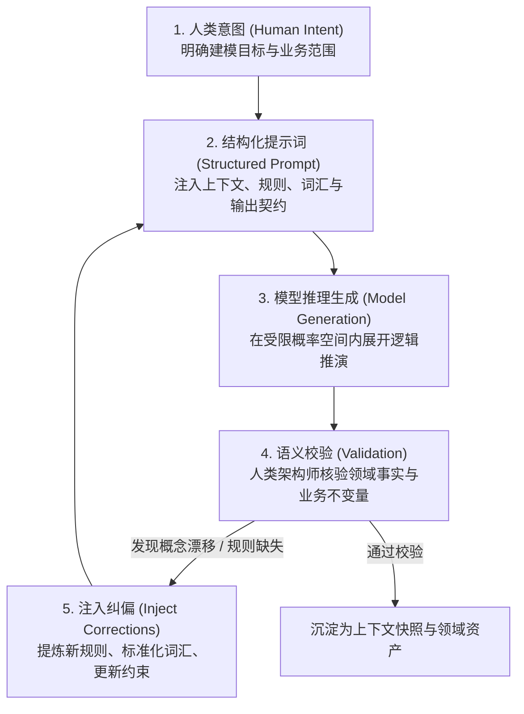
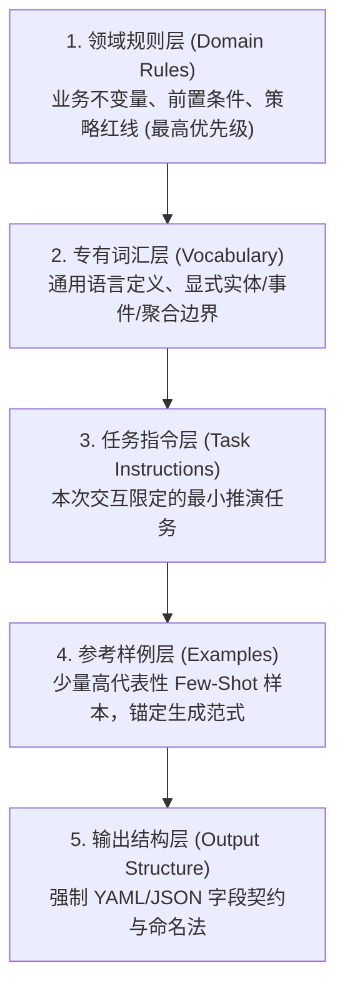
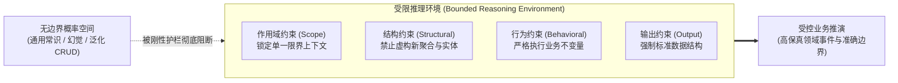

> 💡 **双栏独立滚动工作台导读**：本文采用双栏对照架构。**左栏**为核心精炼架构、实战代码与避坑决策；**右栏**为原著完整参考译文，附有关键段落的英文原文展开与难词解析。左右两栏可独立滚动，并支持顶栏自定义宽度比例（7:3 / 5:5 / 3:7）与拖拽调节。

# 核心实战精炼：架构师视角：与 AI 协同推理

## 1. 架构师心智跃迁：四大认知转向矩阵

在 AI 辅助领域建模中，架构师的角色从“代码执行审查者”演变为“推理环境设计师（Information Designer）”。核心关注点从微观 Prompt 编写转向宏观推演系统的架构设计。

| 认知维度 | 传统交互心智（Query 范式） | 架构师系统心智（System 范式） | 架构决策与收敛目标 |
| :--- | :--- | :--- | :--- |
| **交互形态** | 单次事务查询（Stateless Query） | 状态演进系统（Stateful Workflow） | 将对话视作具有输入、状态、反馈与校验的闭环系统 |
| **上下文感知** | 假设模型具备常识与记忆延续性 | 主权上下文窗口（Sovereign Context） | 明确“不在当前窗口即不存在”，显式分层注入知识 |
| **语言定位** | 自然语言沟通工具 | 形式契约与统计引力舵手 | 通过通用语言消除多义性，折叠概率分布空间 |
| **边界控制** | 开放式提问，依赖模型自由发挥 | 受限推理环境（Bounded Environment） | 施加刚性约束，防范概念越界与虚构聚合 |

---

## 2. 核心心智模型：AI 推理闭环与 DDD 知识提炼同构

与 AI 的高效协同本质上是一个控制不确定性的迭代闭环。该微循环与经典 DDD 知识提炼周期在结构上严格同构：



### DDD 知识提炼周期与 AI 推理闭环映射表

| 阶段 | 经典 DDD 知识提炼周期 | AI 推理闭环 (AI Reasoning Loop) | 核心产出物 |
| :--- | :--- | :--- | :--- |
| **探索** | 领域专家与架构师业务探索 | 架构师形式化表达人类意图 | 建模目标与候选事实 |
| **建模** | 提炼概念模型与聚合边界 | 编排五层信息流构建 Prompt | 结构化上下文与刚性护栏 |
| **检验** | 业务场景与真实案例验证 | 人类架构师校验语义与不变量 | 偏差分析与未决问题清单 |
| **精炼** | 修正模型定义并重新对齐 | 注入修正反馈并开启下一轮迭代 | 规则手册升级与词汇表收敛 |

---

## 3. 五层信息架构流水线 (Information Layering Pipeline)

上下文窗口是模型在单次推理中的“全部现实”。信息注入必须遵循**从最宽泛的刚性约束收敛至最狭窄的执行细节**的原则，避免底层细节过早干扰全局推演。



### 信息层级职责与失效分析

| 层级编号与名称 | 所属范畴与核心内容 | 架构收敛机制 | 缺失导致的失效模式 |
| :--- | :--- | :--- | :--- |
| **1. 领域规则层** | 核心业务不变量、不可逾越的业务策略 | 强行从高概率分布中抹除非法 Token 序列 | 模型引入违背业务现实的“合理臆测” |
| **2. 专有词汇层** | 严谨的通用语言术语、显式概念定义 | 压制模型预训练统计多义性，锚定特定语义场 | 发生术语漂移（如混用 Order 与 Transaction） |
| **3. 任务指令层** | 当前建模目标与操作范围 | 将注意力权重集中在受控的作用域之内 | 推演范围失控，模型擅自横向发散 |
| **4. 参考样例层** | 规范的黄金样本（Golden Examples） | 提供具体的 Token 排布模式与颗粒度参考 | 输出风格多变、概念抽象层次不一致 |
| **5. 输出结构层** | 强制 Schema、字段命名法、过去时态约定 | 强约束终止符与生成结构，利于自动化比对 | 产生非结构化散文，无法转译为工程制品 |

---

## 4. 四大刚性约束与受限推理环境

通过将规则定义为边界，架构师为模型构建了一个**受限推理环境（Bounded Reasoning Environment）**。



### 提示词约束对比实验

| 对比维度 | 弱约束提示词 (Weak Prompt) | 强受限提示词 (Constrained Prompt) |
| :--- | :--- | :--- |
| **输入示例** | “*为订单设计一个领域模型*” | “*在 BrewUp 的 Order 上下文中识别 Order 聚合发布的事件。严禁引入新聚合，严格恪守已给定的三大不变量。*” |
| **模型输出表现** | 凭空捏造 `Payment`, `Shipment`, `Refund` 三大聚合，擅自分割 4 个微服务上下文。 | 仅输出 `OrderPlaced` 等核心事件，严格符合订单不可撤销与支付前不可发货约束。 |
| **架构归属权** | **模型越权决策**，架构边界失控。 | **架构师主导边界**，模型作为受控推理放大器。 |

---

## 5. 生产级受限推理提示词 YAML 模板

用于引导 AI 协作进行限界上下文领域事件提取的标准工程模版：

```yaml
# prompt-templates/bounded-reasoning-prompt.yaml
version: "1.0.0"
interaction_type: "domain-event-extraction"

# 1. 领域规则层 (Domain Rules)
invariants:
  - "An order cannot be placed without at least one order line."
  - "An order cannot be shipped before payment is confirmed."
  - "A shipped order cannot be canceled."

# 2. 专有词汇层 (Vocabulary Contract)
vocabulary:
  Order: "Aggregate root representing customer purchase intent."
  OrderPlaced: "Domain event raised when an order with >=1 items is created."
  Customer: "External entity identifier initiating the order."
forbidden_terms:
  - "Transaction"
  - "PurchaseOrder"
  - "Cart"

# 3. 任务指令层 (Task Instructions)
task:
  scope: "Order Bounded Context / Order Aggregate"
  goal: "Identify domain events published strictly by the Order aggregate."
  guardrails:
    - "Do not invent new aggregates or entities."
    - "Do not introduce concepts outside the supplied vocabulary."
    - "If a state transition requires missing facts, output an open question instead of guessing."

# 4. 参考样例层 (Few-Shot Example)
example:
  event_name: "OrderPlaced"
  trigger: "Order transitions from draft to created."
  invariants_checked: "Order contains at least one line item."

# 5. 输出结构层 (Output Schema)
output:
  format: "yaml"
  required_fields:
    - event_name
    - trigger
    - affected_aggregate
    - open_questions
```

---

## 6. 架构避坑清单 (Do's & Don'ts)

| 领域维度 | 错误实践 (Don't) | 正确实践 (Do) |
| :--- | :--- | :--- |
| **交互心智** | 将 LLM 当作搜索引擎，每次输入无上下文的单次查询。 | 将人机交互构建为带校验与纠偏的受控推理工作流。 |
| **知识延续** | 依赖模型的跨会话记忆，默认模型记住了昨日敲定的聚合边界。 | 贯彻“上下文窗口主权原则”，在每次关键推演中显式分层注入知识。 |
| **术语管控** | 容忍模型在不同对话轮次中使用近义词（如交替使用 Order 与 Charge）。 | 将通用语言固化为形式契约，使用禁止词表（forbidden_terms）消除多义性。 |
| **边界控制** | 发出宽泛指令（如“请基于 DDD 设计电商系统”），放任模型擅自划分上下文。 | 施加四大刚性约束（作用域、结构、行为、输出），锁定模型在单一聚合内推演。 |
| **输出处理** | 允许模型以散文段落自由阐述推演过程。 | 强制结构化 Schema 输出，把模糊推断转化为显式可比对的 `open_questions`。 |

<!-- split -->

# 原著完整参考：架构师视角：与 AI 系统协同推理

交响乐团的指挥家并不会亲自演奏每一种乐器。在小提琴演奏技艺上，他们或许比不上前排的首席小提琴手。然而，正是指挥家决定了整个乐团最终演奏出的是天籁之音还是刺耳噪音。他们的核心能力不在于具体的演奏执行，而在于对宏观结构的统摄。他们精妙把控各个声部之间的信息传递，决断何时施加严格的节奏约束、何时留出自由抒发的空间，并决定整个乐团的自洽连贯性如何最终涌现。

这也正是软件架构师与大语言模型协作时所扮演的核心角色。至关重要的并非你对模型底层数学原理的理解有多深，而在于你如何精心设计人机交互的结构，使系统能够稳定产出连贯、具备现实依据且符合领域准确性的理性推理。

:::en
> **Original**: Conductors do not play every instrument. They may not understand violin technique better than the violinist in the front row. Yet they determine whether the ensemble produces music or noise. Their competence lies not in execution but in structure. They shape how information flows between sections, decide when to impose constraints and when to leave space, and determine how coherence emerges across the whole ensemble. This role is also the role of an architect collaborating with a Large Language Model. What matters is not how well you understand the model's internal mechanics, but how well you design the interaction so that it produces coherent, grounded, and domain-accurate reasoning.

**📌 核心术语与语境解析**：
- **Ensemble** [ɒnˈsɒmbl]：*合奏团/整体协同系统*。在软件架构语境中指代由人、上下文规则与概率推理模型共同构成的协同推演系统。
- **Grounded Reasoning**：*具备现实事实依托的推理*。特指模型的推演结果牢牢锚定在给定的业务规则与领域上下文内，杜绝无事实支撑的自由幻觉。
:::

前两章阐述了大语言模型的本质及其行为背后的底层机制。本章则探讨一个截然不同的核心命题：在与 AI 协同推理时，架构师应当具备怎样的思维方式？

本章是连接理论基石与工程实战的关键桥梁。在第二部分和第三部分着手编写结构化提示词、构建规则手册以及设计专业智能体之前，你需要建立一套稳固的心智框架——无论今天或明天底层模型如何更迭演进，这套框架都将历久弥新、始终有效。

这一框架由四大架构原则构成：将对话视为精心设计的系统、审慎设计信息流、将共享词汇作为形式契约构建，以及将约束作为概念边界引入。BrewUp 系统将在本章中简要作为参考锚点出现，但本章真正的核心主角是架构师的系统性思维方式。接下来的四个小节将层层递进地展开这些原则。读完本章，这四次视角的深刻跃迁将为你汇聚成一种与 AI 协同工作的全新范式。

:::en
> **Original**: Four architectural principles form this framework: treating conversations as designed systems, engineering information flows deliberately, building shared vocabulary as a formal contract, and using constraints as conceptual boundaries. BrewUp will appear briefly in this chapter as a reference point, but the real subject is the architect's way of thinking. The four sections that follow take these principles one at a time, with each building on the last. By the end of the chapter, the four shifts in perspective add up to a different way of working with AI.

**📌 核心术语与语境解析**：
- **Architectural Principles**：*架构原则*。跨越具体大模型厂商 API 的通用设计准则。
- **Conceptual Boundaries**：*概念边界*。在领域驱动设计与提示词工程中用于隔离不同业务语义与职责的明确防护网。
:::

在本章中，你将学到：

- **架构对话，而不仅仅是架构系统**：为什么与大语言模型交互本质上是设计一套理性推理工作流。
- **为 AI 精心设计信息流**：上下文窗口内信息的结构组织与物理排布，如何直接决定输出质量。
- **在你与模型之间建立共享词汇表**：为什么严格自律的通用语言（Ubiquitous Language）既是 DDD 的核心资产，又是操纵概率分布的精准舵手。
- **将约束作为概念边界引入**：业务规则与系统护栏如何作为你 AI 交互设计中的“限界上下文”发挥效力。

让我们首先打破与 AI 协作中最普遍存在的一大认知误区。

## 架构对话，而不仅仅是架构系统

如果你去问绝大多数开发人员在工作中是如何使用大语言模型的，他们描述的场景大体如此：打开聊天界面，敲入一个问题，阅读答案，然后接着追问。这种心智模型极为熟悉——它酷似使用搜索引擎，或是随时向一位无所不知的同事当面请教。整个交互被定性为一次查询（Query）：你发问，模型作答。

这种心智模型潜藏着巨大的架构风险，因为“查询”天然携带着一系列固有假设：查询是事务性的、无状态的、期待获得一次性的完整回答，并且几乎不需要任何前置设计。然而在领域驱动设计的语境下，核心挑战在于针对复杂且动态演化的领域展开长期、持续、迭代的理性推演；此时，事务性的心智模型所换来的产出，也必然完全符合一次事务的特征：浅尝辄止、脱离上下文且极度不可靠。

:::en
> **Original**: This mental model creates an architectural risk because a query brings its assumptions with it: queries are transactional, stateless, expect a single complete answer, and require no design. In the context of Domain-Driven Design, where the challenge is sustained, iterative reasoning about complex and evolving domains, a transactional mental model produces exactly the kind of output you should expect from a transaction: shallow, decontextualized, and unreliable.

**📌 核心术语与语境解析**：
- **Transactional** [trænˈzækʃənl]：*事务性的/单次了结的*。在此特指缺乏跨轮次状态延续与演进约束的单发式交互方式。
- **Decontextualized** [diːkənˈtekstʃuəlaɪzd]：*脱离上下文的*。由于未显式提供前置领域规则与边界，导致模型输出失去业务语境依据。
:::

### “提示词范式”的局限性

“提示工程（Prompt Engineering）”这个词如今已广为人知，但它潜藏着微妙的误导性。“工程”一词暗示着严谨与体系，但“提示词（Prompt）”本身却依然暗示着单一静态的成果物：你写下它，发送出去，然后收获结果。这种认知框架所遗漏的，恰恰是环绕其周围的完整流程：提示词仅仅是一条理性推理工作流的入口。

当技术团队仅仅把大模型当成高阶搜索引擎来用时，其后果是完全可预见的：提示词写得极其随意；上下文在单次交互结束后即告丢失；由于每次调用都在对既有共识毫无记忆的白纸状态下重新开始，导致输出前后矛盾；在某次会话中推演出的领域规则，在下一轮会话中被忘得一干二净。模型让人感觉既无比强大，却又极度不可靠。

问题并不出在模型身上，而在于交互设计的缺失：在缺乏清晰结构的情况下，架构师实际上是在强求模型在一个无边界的混沌环境中展开推理。

:::en
> **Original**: The term *prompt engineering* has become widely used, but it carries a subtle misdirection. The word *engineering* suggests rigor, but the word *prompt* still implies a single artifact: you write it, you send it, you receive a result. What that framing leaves out is the process around it: a prompt is the entry point of a reasoning workflow. When teams use LLMs as glorified search engines, the results are predictable. Prompts are written casually. Context is lost between interactions. Output is inconsistent because each invocation starts without memory of what was established before. Domain rules invented in one session are forgotten in the next. The model feels powerful and unreliable at the same time. The issue lies in the interaction design: without clear structure, architects ask the model to reason in an unbounded environment.

**📌 核心术语与语境解析**：
- **Prompt Paradigm**：*提示词范式*。狭隘地将关注点局限于单条文本提示词编写，忽视完整推理流程设计的局部思维模式。
- **Unbounded Environment**：*无边界环境*。没有划定限界上下文、词汇表与业务不变量的混沌提示环境，极易诱发模型产生概率发散。
:::

### 对话即系统

不妨仔细审视在一场高效的 AI 辅助领域建模会话中，究竟真实发生了什么：你首先提供领域背景，确立业务规则，然后引导模型推演特定的领域事件或架构边界。接着，你仔细审阅产出的结果，识别出发生漂移的偏差，提炼修正你的指令，并重新注入纠正后的精确语言。你展开小步快跑的循环迭代。在整个过程中，没有任何一个环节可以被归结为孤立的单次事务。

你实际上是在操盘运转一个系统。正如任何设计精良的系统一样，它包含若干清晰可辨的核心组件。表 3.1 列出了决定成败的五个核心组件，它们将贯穿本专栏始终：第二部分和第三部分中涉及的全部结构化提示词、规则手册和专业智能体，无一例外全是由这五大基石构建而成的。

| 核心组件 | 在 AI 交互系统中的定位与职责 |
|---|---|
| **提示词（Prompt）** | **系统入口**：发起结构化理性推理的输入指令 |
| **上下文（Context）** | **工作记忆**：作用域内的领域知识、业务规则与历史背景 |
| **规则（Rules）** | **系统护栏**：强力收敛模型概率分布空间的硬性约束 |
| **反馈回路（Feedback loop）** | **精炼机制**：由人类重新注入的核验评估与纠偏指令 |
| **验证（Validation）** | **人类判断**：架构师对语义事实正确性承担的终极责任 |

*表 3.1 – AI 交互系统的五大核心组件及其各自扮演的角色*

该表格精准勾勒出了一场高效 AI 协同推演的骨架结构。架构师能够对每一个组件进行针对性的设计、评估与调优。每个组件都有其特定的失效模式，而全局输出的品质，完全取决于这些组件在物理上被编排组合得有多严密。

深刻意识到这一点，构成了本章要求你完成的第一次架构认知跃迁：停止孤立地思考提示词，全面转向思考“对话架构（Conversation Architecture）”。

:::en
> **Original**: What you are doing is operating a system. Like any well-designed system, it has identifiable components. Table 3.1 lists the five that matter, and they recur through the rest of the book: the structured prompts, rulebooks, and specialized agents of Parts 2 and 3 are all built from these same components. This table describes the structure of an effective AI collaboration. Architects can design, evaluate, and improve each component. Each component has failure modes, and the quality of the overall output depends on how well these components are composed. Recognizing this is the first architectural shift this chapter asks of you: stop thinking about prompts and start thinking about conversation architecture.

**📌 核心术语与语境解析**：
- **Conversation Architecture**：*对话架构*。将提示词、上下文、规则、反馈回路与验证统一编排的系统工程体系。
- **Failure Modes**：*失效模式*。各系统组件在特定场景下的特征性崩溃或偏离方式（如上下文溢出、规则冲突等）。
:::

### AI 推理循环闭环

一旦将对话架构作为核心思考框架，一套自然流动的工程结构便浮出水面。图 3.1 展示了 AI 推理闭环（AI Reasoning Loop）——在整个推理工作流中周而复始运转的核心微循环。推理工作流指的是整场宏观设计活动；而推理闭环则是贯穿其中的单次迭代：意图、提示词、模型输出与人类核验。


*图 3.1 – AI 推理闭环示意图*

这一闭环始终始于人类的意图：一个具体明确的建模目标，例如梳理 BrewUp 系统中 Order 限界上下文的核心事件。架构师将该意图转化为包含上下文、业务规则及预期输出格式的结构化提示词。模型在此受限结构内部模拟推演并产出回答。随后，架构师对照深度的领域认知与语义准确性对结果展开严格核验，而绝非仅仅检查表面的文字通顺。最后，修正项与精炼指令被重新打包注入到下一轮提示循环之中。

这一闭环的巨大威力，在于各步骤之间所传递沉淀的资产。每一次迭代都会将前一轮所沉淀的精确词汇、修正规则与对齐共识完整继承到下一轮之中，使得整场建模中的模糊性随着对话推进而持续收敛缩小，而非在每个提示词发出时都被粗暴重置。

:::en
> **Original**: The loop begins with human intent: a specific modeling goal, such as identifying the core events of the Order bounded context in BrewUp. The architect translates that intent into a structured prompt that encodes context, rules, and the expected output format. The model simulates reasoning within that structure and produces output. The architect validates the output against domain knowledge and semantic accuracy, not just surface coherence. Corrections and refinements are reintroduced in the next prompt cycle. The value of the loop lies in what carries forward between its steps. Each iteration carries forward the vocabulary, the rules, and the corrections established in the previous one, so ambiguity narrows across the session instead of resetting at every prompt.

**📌 核心术语与语境解析**：
- **AI Reasoning Loop**：*AI 推理闭环*。意图 $\to$ 结构化提示 $\to$ 概率模拟 $\to$ 人类验证 $\to$ 注入修正的自适应循环。
- **Surface Coherence**：*表面连贯性*。语言流畅自然但缺乏真实业务事实与不变量支撑的虚假正确表象。
:::

### 与 DDD 知识提炼周期的同构共鸣

如果你觉得这个闭环似曾相识，那就完全对了。AI 推理闭环在结构上与领域驱动设计底层的“知识提炼周期”完全同构。表 3.2 将二者并列对比：左列是经典 DDD 的核心步骤，右列则是其在 AI 推理闭环中的映射。

| DDD 知识提炼周期 | AI 推理闭环 |
|---|---|
| **探索领域（Explore the domain）** | **明确人类意图（Formulate human intent）** |
| **概念建模（Model the concepts）** | **结构化提示词（Structure the prompt）** |
| **对照现实检验（Test against reality）** | **校验模型输出（Validate model output）** |
| **提炼并重新对齐（Refine and realign）** | **注入修正并持续迭代（Inject corrections and iterate）** |

*表 3.2 – DDD 知识提炼周期及其在 AI 推理闭环中的精准对应*

这种高度对齐源于二者共同的终极目标：通过结构化的迭代循环，持续消除歧义与不确定性。传统 DDD 是通过架构师与业务领域专家之间的对话来实现这一目标的；而 AI 推理闭环则是通过架构师与概率推理引擎之间的结构化对话来达成的。二者所要求的工程纪律毫无二致：精准显式的语言、界限分明的边界、永不停歇的迭代提炼。

一场设计严密的 AI 协同会话能够成倍放大 DDD 实践的效果，而非投机取巧走捷径。模型绝不可能取代业务专家或系统架构师。战略维度的核心拷问——在这个领域中究竟什么才是核心业务？哪些架构取舍是可接受的？限界上下文应当如何划定？——依然百分之百属于人类的专属职责。模型真正改变的，是这一精炼循环的运行节奏与外显透明度。它极速加快了精炼步伐，能够在几分钟内迅速暴露以往可能需要数场工作坊才能艰难察觉的潜在歧义，并强行将那些深埋在非正式口头交谈中的隐式假设彻底外显化。如果你曾亲眼目睹过一场建模研讨会因为两位专家使用同一个词汇表达不同概念而陷入无休止的僵局，你就会明白这种快速外显化具备何等惊人的价值。

:::en
> **Original**: The alignment follows from a shared purpose: both processes reduce ambiguity through structured iteration. DDD does it through conversations between architects and domain experts. The AI Reasoning Loop does it through structured conversations between architects and probabilistic reasoning engines. The discipline required is the same: explicit language, clear boundaries, continuous refinement. A well-structured AI collaboration session can amplify DDD practice rather than shortcut it. The model does not replace the domain expert or the architect. The strategic questions – what matters in this domain, which trade-offs are acceptable, and where the boundaries belong – remain entirely human. What the model changes is the tempo and visibility of the loop. It accelerates refinement, surfaces in minutes ambiguities that might otherwise take a workshop to emerge, and externalizes implicit assumptions that would remain buried in informal conversations. If you have ever watched a modeling discussion stall because two experts were using the same word for different concepts, you know how valuable that externalization is.

**📌 核心术语与语境解析**：
- **Knowledge Refinement Cycle**：*知识提炼周期*。DDD 核心精炼过程，通过反复推演、质疑与对齐，逐步剥离次要细节并收敛核心模型。
- **Externalization** [ɪkˌstɜːnəlaɪˈzeɪʃn]：*显式外化*。将存在于领域专家头脑中的隐式假设转化为可审查、可比对、可编码的显式制品。
:::

### 对话作为受限进程

我们可以将这种架构思维进一步升华。在 DDD 中，限界上下文界定了一个清晰的范畴：特定的业务领域、特定的专有语言、特定的业务规则集。任何概念在跨越这一边界时，都必须经过显式的翻译转换。

一场高效的 AI 协同对话完全具备相同的本质属性。它拥有明确的目的（当前的建模目标）、严密的边界（本次交互的作用域范畴）以及唯一的语言（统摄所有输入与输出的领域词汇）。当一场对话缺失了这三者中的任何一项，它的表现就会迅速退化为一个定义拙劣的限界上下文：概念在不同范围之间任意渗透污染，语言使用前后割裂，而输出结果则赤裸裸地折射出架构设计本身的混乱与含糊。

其深远结论不言而喻：

> 你并不是在向模型发送提示词，你是在设计一个严密的推理环境。

你在这个环境中放置的每一个要素——上下文背景、约束规则、专有词汇、预期输出格式——都是一项严肃的架构设计决策。正如所有经典的软件架构决策一样，其产生的影响会随着时间推移产生深远的复利效应。表 3.1 中的核心组件、图 3.1 中的推理闭环，以及此处界定的概念边界，构成了第一次架构认知跃迁的完整版图。而下一次跃迁，将聚焦于这个边界之内应当容纳什么内容。

:::en
> **Original**: You can take this architectural thinking one step further. In DDD, a bounded context defines a clear scope: a specific domain, a specific language, a specific set of rules. Nothing crosses the boundary without explicit translation. An effective AI conversation has exactly the same properties. It has a *purpose* (the modeling goal), *boundaries* (what is in scope for this interaction), and *language* (the domain vocabulary that governs all inputs and outputs). When a conversation lacks any of these, it behaves like a poorly defined bounded context: concepts bleed across scope, language becomes inconsistent, and the output reflects the ambiguity of the design. The implication is clear: *You are not prompting a model. You are designing a reasoning environment.*

**📌 核心术语与语境解析**：
- **Bounded Process**：*受限进程*。具有明确输入约束、边界隔离与生命周期的会话推演过程。
- **Reasoning Environment**：*推理环境*。由规则手册、词汇表与输出结构构建的确定性认知场域。
:::

## 为 AI 精心设计信息流

如果说与大语言模型的对话是一座精密运行的系统，那么信息便是其最核心的原料。正如在任何工程系统中一样，产出物的品质绝不仅仅取决于输入原料的优劣，更深层取决于这些输入信息是如何被结构化组织、按序排列并在物理空间中排布的。

这正是本章要求你完成的第二次架构认知跃迁：从单纯思考“告诉模型什么内容”，深刻跃迁至思考“信息如何流向模型，以及模型在该数据流中究竟能感知到什么”。

绝大多数实践者往往过度沉溺于内容本身：罗列哪些事实、解释哪些术语、提供哪些样例。内容固然重要，但拙劣的排版布局会让原本极具价值的信息在模型眼中形同虚设。我们在第 2 章中深入剖析的上下文窗口运行机制，直接带来了必须由架构师审慎设计的显式架构推论。

:::en
> **Original**: If a conversation with an LLM is a system, then information is its raw material. As in any system, output quality depends on more than input quality: it depends on *how that input is structured, sequenced, and positioned*. This shift is the second architectural shift this chapter asks of you: from thinking about what you tell the model to thinking about how information flows into the model and what the model can actually perceive within that flow. Most practitioners focus on content: what facts to include, what terms to define, and what examples to provide. Content matters, but poor placement can make useful information effectively invisible. The mechanics of the context window, which we examined in detail in Chapter 2, have direct architectural consequences that require deliberate design.

**📌 核心术语与语境解析**：
- **Information Flow**：*信息流*。提示工程中指令、背景、约束与样本按时序和空间排布向注意力机制递送的路径。
- **Deliberate Design**：*深思熟虑的审慎设计*。拒绝随意拼凑，基于大模型注意力分布特征进行精准编排。
:::

### 无状态模型与主权上下文窗口

我们在第 2 章中已经确立：大语言模型在物理上完全没有任何持久记忆。每一次全新的交互都是从绝对的零度状态开始。上下文窗口是模型在本次交互期间能够感知的“全部宇宙”，它仅仅包含你在此刻亲手放进去的内容。

对架构师而言，其推论极其简单而严酷：

> 如果某项信息在当前的上下文窗口中不存在，模型在物理上就绝对无法利用它。

你在两个会话前推演确立的领域规则，除非你此刻重新注入，否则对模型完全不可见；你昨天敲定的聚合边界，除非出现在今天的提示词里，否则在模型的世界中根本未曾发生；你在工作坊里耗费数天打磨出的通用语言，除非显式存在于当前上下文中，否则在模型看来完全等同于不存在。

这种无状态特性是一项必须主动拥抱的硬性设计约束。正如 DDD 中的限界上下文原则要求在每一个系统边界施加显式翻译、而绝不假设彼此心照不宣一样，无状态模型同样要求在每一次交互时对核心知识进行显式重申与注入，而绝不假设历史的连续性。二者的工程纪律完全相通，只是承载介质发生了变化。

然而，重新注入知识仅仅解决了问题的一半；到底往窗口里放入什么、以何种顺序放置，构成了同样决定成败的另一半。

:::en
> **Original**: We established in Chapter 2, How LLMs Actually Think and Why Precision Unlocks Understanding, that an LLM has no persistent memory. Each interaction begins from zero. The context window is the model's *entire reality* for the duration of that interaction, and it holds only what you put there. For architects, the consequence is simple: *If information is not available in the current context, the model cannot use it.* The domain rules you established two sessions ago are unavailable to the model unless you reintroduce them. The aggregate boundaries you defined yesterday do not exist unless they appear in today's prompt. The Ubiquitous Language you spent a workshop refining does not exist from the model's perspective unless it is explicitly present in the current context. The stateless model is a *design constraint to work with*. Like the bounded context principle in DDD, which requires explicit translation at every boundary rather than assuming shared understanding, the stateless model requires explicit reintroduction of knowledge at every interaction rather than assuming continuity. The discipline is the same, even though the medium differs. Reintroducing knowledge is only half the problem; what goes into the window, and in what order, is the other half.

**📌 核心术语与语境解析**：
- **Sovereign Context Window**：*主权上下文窗口*。强调上下文窗口对模型推演拥有绝对排他的决定权，窗口之外无知识。
- **Stateless Model**：*无状态模型*。模型本身不持久化会话状态，依赖上下文作为外部工作记忆（Working Memory）。
:::

### 信息架构：对模型所见之物进行分层编排

既然上下文窗口构成了模型的全部现实，那么核心工程问题便转化为：你如何架构这个现实中所容纳的世界？答案在于信息分层（Information Layering）——审慎地将不同维度的知识解耦为清晰、有序的独立层次。

有三个术语贯穿本节：信息架构（Information Architecture）是顶层设计原则，信息分层（Information Layering）是该原则所催生的物理结构，而信息流模式（Information Flow Pattern）则是这些层次顺次注入模型的输入编排。

这一排列顺序严格遵循从“最宽泛的刚性约束”逐步收敛至“最狭窄的执行细节”，从而确保后续的每一层都只能在上一层已经界定好的合法范围内进行收敛。表 3.3 详尽列出了这五个信息层级、各层所承载的具体内容，以及它们各自肩负的架构功能。

| 层次编号与名称 | 所包含的核心内容 | 肩负的架构功能 |
|---|---|---|
| **1. 领域规则层（Domain Rules）** | 业务不变量、硬性约束、业务策略 | 构筑模型绝对不可逾越的底层语义红线 |
| **2. 专有词汇层（Vocabulary）** | 通用语言（Ubiquitous Language）术语与定义 | 将概率预测牢牢对齐至特定领域的专有语义 |
| **3. 任务指令层（Task Instructions）** | 本次交互所聚焦的具体建模目标 | 将推理闭环严格锁定在受控的作用域内 |
| **4. 参考样例层（Examples）** | 符合预期的规范输出标准样本 | 为文本生成提供成熟稳定的范式锚点 |
| **5. 输出结构层（Output Structure）** | 预期交付的格式、符号标记、命名契约 | 强行约束最终生成的 Token 序列排列形态 |

*表 3.3 – 五大信息层级、承载内容及其各自的架构设计功能*

这五个层次代表了不同类型的信息维度，它们在层层收敛的颗粒度上，对模型的概率分布施加着越来越精准的雕刻。

当这些信息层级出现缺失或排列混乱时，模型就会被迫通过从预训练语料分布中抽样来填补空白：它会推断出看似合理实则脱离实际的业务规则，抓取在统计上相邻但业务语义完全错误的词汇，并以其训练数据中相似场景的随意格式输出内容。其最终产物必然是：表象上流畅自洽，实质上漏洞百出。所有此类偏离与失效，都可以直接追溯为架构师遗漏了某个信息层级——这也把解决问题的主动权彻底交回到了架构师手中：在决定向模型提问之前，务必首先规划清楚各个信息层级的内容。

:::en
> **Original**: Given that the context window is the model's complete reality, the question becomes: how do you architect what lives in that reality? The answer is information layering, the deliberate separation of different types of knowledge into distinct, ordered layers. Three terms carry this idea through the section. Information architecture is the principle, information layering is the structure it produces, and the information flow pattern is the order in which the layers reach the model. The order runs from the broadest constraint to the narrowest, so that each layer can only narrow what the layers above it have already left open. Table 3.3 sets out the five layers, what goes in each, and the architectural function each one performs... When these layers are absent or disordered, the model compensates by inventing plausible content from its training distribution: it infers domain rules that sound reasonable, reaches for vocabulary that is statistically adjacent but semantically incorrect, and produces output in whatever format its training data suggested was typical for similar requests. The result is coherent in appearance and unreliable in substance. Each of those failures traces back to a layer the architect left out, which puts the fix squarely in the architect's hands: decide what belongs in each layer before deciding what to ask.

**📌 核心术语与语境解析**：
- **Information Layering**：*信息分层*。按照刚性与抽象程度解耦提示内容，自顶向下级联收窄概率分布的架构模式。
- **Statistically Adjacent**：*统计上相邻*。在大模型向量空间中余弦相似度高、但在业务领域中定义完全不同的近义词（例如 Payment 与 Charge）。
:::

### 信息流输入模式

在实际工程落地中，高效的 AI 辅助领域建模始终严格遵循如图 3.2 所示的信息流模式：


*图 3.2 – AI 交互中的信息分层架构示意图*

该模式固化了信息流向模型的标准先后次序，同时为具体提示词的措辞保留了灵活空间。将该模式具体落地到 BrewUp 案例系统中，五大层级的编排呈现如下形态：

1. **领域规则层**：声明 Order 限界上下文的核心不变量——订单在支付确认之前绝不可发货。
2. **专有词汇层**：以通用语言的标准定义严格界定 Order、`OrderPlaced` 和 Customer 的内涵。
3. **任务指令层**：明确命令模型梳理出 Order 聚合所发布的核心领域事件——此外的内容一概不得发散。
4. **参考样例层**：提供标准规范样例以锚定生成风格，例如给出一个 `OrderPlaced` 的标准定义模板。
5. **输出结构层**：强制要求每个事件均以过去时态命名，并附带一行精炼的业务说明。

请敏锐体会这一模式所展现的前瞻性：你在第二部分中将要亲手打造的全部结构化提示词、规则手册和迭代精炼技术，无一不是这一通用信息架构原则在特定 DDD 建模任务下的具象化实践。

:::en
> **Original**: Three terms are in play here, and they name three different things: *information architecture* is the principle that what the model sees, and where, determines what it can produce; the five *information layers* of Table 3.3 are the structure that principle produces; and the *information flow pattern* is the order in which those layers reach the model. In practice, effective AI-assisted domain modeling follows a consistent information flow pattern, shown in Figure 3.2... Notice what this pattern anticipates: the structured prompts, rulebooks, and iterative refinement techniques you will build throughout Part 2. Every technique in the following chapters is an instantiation of this information architecture principle applied to specific DDD modeling tasks.

**📌 核心术语与语境解析**：
- **Information Flow Pattern**：*信息流模式*。信息各层级注入上下文的标准几何时序。
- **Instantiation** [ɪnˌstænʃiˈeɪʃn]：*具象化实例化*。抽象架构原则在特定业务领域与任务中的代码化与文档化落地。
:::

### 信息即概率约束

从第 2 章所揭示的底层机制来看，上下文窗口中所注入的全部信息，本质上都是对概率搜索空间的强力约束。

你所注入的每一条显式事实，都在物理上排除了海量统计上可能、但业务上非法的接续路径。你所声明的每一条业务规则，都会直接将违反该规则的 Token 从高概率采样区中抹杀。你所定义的每一个词汇概念，都在建立一种能压制模型通用预训练默认偏好的特定语义绑定。通常而言，显式约束能够大幅收窄概率空间，从而让涌现出的推理逻辑与你的目标业务领域高度吻合。

这一原理昭示着：信息设计本质上就是一种概率工程（Probabilistic Engineering）。当你字斟句酌地决定将哪些内容放入上下文、排布在什么位置、采用何种语气措辞时，你实际上是在对模型的输出概率分布进行严肃的工程设计。架构师对于系统约束的敏锐直觉——那种时刻致力于让隐式假设显式化、并划定清晰边界的本能——恰恰正是此处概率工程所最不可或缺的核心素养。

:::en
> **Original**: Every piece of explicit information you inject narrows the range of statistically plausible continuations. Every domain rule you specify eliminates tokens that would violate it from the high-probability region. Every vocabulary term you define anchors a semantic association that overrides the model's broader statistical defaults. In general, explicit constraints narrow the probability space and can make the resulting reasoning more consistent with the intended domain. This principle means that information design is *probabilistic engineering*. When you decide what to include in a context window, where to position it, and how to phrase it, you are making engineering decisions about the model's output distribution. The architect's intuition for system constraints, the instinct to make implicit assumptions explicit and to draw clear boundaries, is exactly the intuition required here.

**📌 核心术语与语境解析**：
- **Probabilistic Engineering**：*概率工程*。通过精确编排上下文输入，系统性操控与塑形大模型下一 Token 概率分布的架构学科。
- **Plausible Continuations**：*统计上似是而非的合理接续*。符合语言习惯但在领域逻辑上错误的文本序列。
:::

### 架构师即信息设计师

这种视角的升华带来了一项极其精准的身份再定义：与 AI 协同工作的架构师，本质上是一位信息设计师（Information Designer）——负责为理性推理的发生构建严密的生息环境。

在传统软件架构中，架构师设计的是系统组件赖以运行的拓扑环境：网络边界、数据流向、服务契约、边界保护条件。下层的业务组件随后在这些既定约束内部稳定执行。而在 AI 辅助的领域建模中，这套思维完全无缝映射到了推理环境的营造上：业务规则、专有词汇、任务范围、示范样本、输出契约——模型在这一由你亲手构筑的受控边界内部展开概率生成。

这种高度的相似性折射出架构实践在内核层面的永恒延续性。决定在模型生成之前必须向其呈现哪些核心不变量，与在微服务设计中定义服务契约属于完全相同的决策范式；将单次建模会话的作用域严格限定在单一聚合之内，与划定微服务的上下文边界在本质上毫无二致。这深刻反映了架构思维在面对两种截然不同的系统形态时，所展现出的高度一贯性与生命力。

这成功将架构设计的客体，从纯粹的软件代码系统全面拓展到了推理环境本身，并为你迎接本专栏后续的全部高阶内容做好了最充分的准备。第二部分将为你提供将该原则落实为具体建模任务的实战利器；第三部分则将展示如何将其扩展至专业多智能体与大型编排工作流之中。然而万变不离其宗，其基石始终根植于此：将与 AI 的协同协作，升华为针对全新系统形态的严肃架构实践。

:::en
> **Original**: That reframing carries a precise redefinition with it. Architects working with AI are *information designers*, responsible for structuring the environment in which reasoning happens. In traditional software architecture, the architect designs the environment in which components operate: the network topology, the data flows, the service contracts, the boundary conditions. The components then execute within those constraints. In AI-assisted domain modeling, the same decisions build a reasoning environment: domain rules, vocabulary, task scope, examples, output constraints – and the model generates inside it. The parallel reflects a continuity in architectural practice. Deciding which invariants the model must see before generating is the same kind of decision as defining a service contract; scoping a modeling session to a single aggregate is the same kind of decision as drawing a context boundary. It reflects a genuine continuity of architectural thinking across two different kinds of systems. This extends architectural design beyond software systems to the reasoning environment itself, and it prepares you for everything that follows in this book. Part 2 will give you the tools to instantiate this principle in concrete modeling tasks. Part 3 will show you how to scale it across specialized agents and orchestrated workflows. However, the foundation is here: in the recognition that AI collaboration is architecture, applied to a new kind of system.

**📌 核心术语与语境解析**：
- **Information Designer**：*信息设计师*。架构师在 AI 时代的核心角色，专注设计支撑高可靠推演所需的认知环境与信息拓扑。
- **Continuity in Architectural Practice**：*架构实践的连续性*。微服务边界治理与受限推理环境设计在本质上的同构自洽性。
:::

## 在你与模型之间建立共享词汇表

信息分层清晰界定了哪些维度的信息应当放入上下文以及应当如何排布。然而一个更深层次的命题随之浮出水面：这些层级之间，究竟应当使用何种语言进行沟通？

第三次架构认知跃迁，在于将共享词汇表视为与模型签订的一份形式契约——这是每一位 DDD 实践者早已烂熟于心的经典原则。

在第 2 章中，我们揭示了语言是实现概率控制的终极机制：上下文窗口中写下的每一个字词，都会深刻重塑接续 Token 的概率地貌。词汇的使用越严谨自律，模型赖以运转的概率空间就被收敛得越窄。

领域驱动设计通过通用语言（Ubiquitous Language）来破解这一难题：一套让领域专家、开发人员与系统架构师围绕同一个概念模型紧密对齐的共享词汇体系。每一个专业术语严密对应一个特定概念，每一个概念明确归属于一个特定的限界上下文，并通过持续的迭代对话不断剔除所有模糊地带。在与大语言模型协同推演时，相同的原则依然适用，但背后的底层动因却截然不同：

> 人类协作者使用通用语言是为了“同步彼此的心智模型”；而大语言模型使用通用语言则是为了“稳定底层的统计关联”。

这意味着，当你在提示词与人机交互中树立严谨自律的词汇体系时，你绝非在人类意义上去“教会”它业务知识，而是在将模型的概率预测强行锚定在一个极其狭窄的特定语义场之内。模型不再在自然语言浩瀚的多义性汪洋中随波逐流，而是被死死锚定在唯一的一种解读上：在当前的对话场域中，*Order* 这个词唯一指代某个特定业务上下文中、受制于特定规则的一等公民业务聚合。换言之，词汇表成为了你与模型之间神圣的形式契约。

:::en
> **Original**: Human collaborators use Ubiquitous Language to synchronize mental models. For LLMs, it helps stabilize statistical associations. This practice means that when you establish a disciplined vocabulary in your prompts and interactions, you are anchoring the model's predictions to a specific semantic field rather than teaching it your domain in the human sense. Instead of drifting across all the possible meanings a term might have in natural language, the model stays anchored to a single reading: within this conversation, the word *Order* refers to a specific aggregate, within a specific business context, governed by specific rules. In other words, vocabulary becomes a contract between you and the model.

**📌 核心术语与语境解析**：
- **Synchronize Mental Models**：*同步心智模型*。人类跨学科团队通过通用语言达成主观认知对齐。
- **Stabilize Statistical Associations**：*稳定统计关联*。大语言模型通过强上下文语义锚点，压制注意力偏转并固定权重关联。
:::

一旦缺乏这样一份显式契约，模型就会瞬间退化，全盘退回其在预训练中习得的泛化统计模式。一个简简单单的单词 *order*，既可以代表电商中的“购买订单”，也可以指代行政组织中的“管理指令”，或是数学中的“几何序”，甚至是数据库查询中的“排序操作（ORDER BY）”。所有这些迥异的含义在预训练概率分布中平等共存，模型只能完全依据上下文周围的蛛丝马迹碰运气进行概率挑选。图 3.3 清晰展现了四个截然不同的含义在同一个 Token 上激烈竞争的场景。


*图 3.3 – 模型在底层对同一个单词所具备的多种统计竞争含义*

一套严谨自律的专有词汇表，能够干脆利落地将所有多余的歧义备选项一扫而空，只留下预期的业务语义。

与其毫无约束地随口提问“*为系统定义一些事件*”，不如首先在上下文最顶层确立如下专属词汇契约：

| 专有术语 | 严密的业务含义定义 |
|---|---|
| **Order** | 代表客户购买意向的核心聚合根。 |
| **OrderPlaced** | 当包含至少一行商品的订单成功创建时发布的领域事件。 |
| **Customer** | 发起 Order 的系统外部实体。 |

*表 3.4 – 用于为模型锁定 BrewUp 三个核心术语严密定义的专属词汇契约*

仅仅是增加了这样一份词汇表，其带来的产出质感差距便立竿见影。在没有任何预设词汇表、仅仅要求其“为系统定义事件”的对照测试中，GPT-5.6 Sol（高推理模式、崭新会话）于 2026 年 9 月给出了如下典型回答：

```text
在系统中，事件是触发系统执行操作或更新其状态的发生项或状态变更。
[…]
用户事件：login（登录）、logout（登出）、button click（点击按钮）、
form submission（表单提交）、purchase request（购买请求）。
[…]
如果您能告诉我具体是指哪个系统，我可以为您定义其完整的事件集。
```

模型的回答彻底偏离了技术层级：它输出了一堆前端交互和基础设施层面的机械事件，而非业务领域事件，并无奈地反问到底指的是什么系统。

而当我们将表 3.4 中的专属词汇契约置于相同的请求之前，在全新的会话中重新运行，模型的回答立刻发生了本质的质变：

```text
OrderPlaced — 表示 Customer 已成功创建 Order 的既成领域事实。
[…]
触发时机：Order 从未创建/草稿状态流转为已创建状态，且订单中至少包含一行商品。
[…]
至于像 OrderLineAdded、OrderCancelled 或 OrderShipped 等其他事件，
唯有当这些状态流转是系统明确需要的领域事实时才应引入；基于当前给定的词汇表，
无法推断出它们的存在。
```

仅仅是三行精准的定义，就完成了这项惊人的重塑。`OrderPlaced` 完全按照表 3.4 中的规范展开描述；Customer 被精准识别为外部标识符而非事件内部的冗余实体；整个回答严格被圈定在赋予它的三个词汇范围之内。

最后一行尤为关键：在被问及泛化的事件时，模型不仅主动指出了它不会擅自捏造哪些事件，更深刻阐明了底层原因——它们无法从当前给定的词汇表中被合法推断出来。一份严密的词汇契约不仅能告诉模型你的词汇代表什么，更能同时为模型划定一道不可逾越的知识边界：哪些是它无权擅自揣测的领域盲区。

:::en
> **Original**: Three definitions did that work. `OrderPlaced` is described in the terms defined in Table 3.4, Customer appears as an identifier rather than as an entity inside the event, and the answer stays inside the three terms it was given. The last line is especially important: when asked about events in general, the model named the events it would not invent and explained why – they cannot be inferred from the vocabulary given. A vocabulary section tells the model what your words mean and, at the same time, where its knowledge of your domain stops.

**📌 核心术语与语境解析**：
- **Vocabulary Contract**：*词汇契约*。通过前置显式概念字典，剥夺大语言模型胡乱引入外部概念的许可。
- **Domain Stopping Boundary**：*领域知识终止边界*。向模型明确标示已知与未知的交界线，避免模型在盲区内展开虚构推演。
:::

一旦这些专有术语在上下文窗口中保持高度稳定，模型生成的全部文本便会自然呈现出高度的语义自洽。自注意力机制会跨越对话历史将反复出现的 Token 紧密绑定，极大强化其内在的语义张力。整条预测链变得坚不可摧，因为相同的语言锚点在上下文各个位置反复出现。图 3.4 展现了由这些严谨定义所锻造出的极度稳定的预测链条。


*图 3.4 – 严谨词汇表将发散的统计多义性折叠为单一的强语义锚点*

这种语言确定性带来了两大具有深远实战价值的架构红利：

1. **语义漂移被彻底终结**：当核心词汇保持绝对一致时，模型极难擅自引入荒诞的另类解读或替换在统计上相邻但业务完全不同的词汇。如果缺乏词汇表的约束，一场以 *order* 开局的推演，往往会在几轮对话之后悄悄滑向 *purchase*、*transaction* 甚至 *request*——每一个词都会将模型拽向截然不同的统计泥潭。而有了词汇契约的护航，Order 在每一轮迭代中都始终是不折不扣的 Order，具备完全相同的边界与业务法则。
2. **理性推理实现滚雪球式的累加**：在 AI 推理闭环中的每一次往返，都在持续强化既有的语言基准，使得整场对话能够向着更高维度的精准性层层递进，而绝不会在每一轮被重置回含糊不清的混沌原点。

在实战中，一场高水平的 AI 辅助建模会话，往往正是以一段短小精悍的词汇定义开篇。这绝非因为模型缺乏处理概念的能力，而是因为显式的词汇定义构筑了收敛概率预测的绝对语义引力场。

因此，持续净化并打磨交互所使用的语言，是架构师不可推卸的核心天职。每一个被反复强调的标准术语都在强力稳固概念锚点；每一对未经规范的随意同义词都在向系统注入破坏性的概率噪音；而每一个悬而未决的模糊概念，都无异于在向模型发出凭空臆造的危险邀请。

当你通过提示词、人工纠偏和规范示例始终如一地捍卫词汇纪律时，模型也会像镜子一样忠实倒映出这种纪律性。久而久之，整场交互便彻底告别了信马由缰的闲聊，蜕变为一场由严谨领域术语牢牢统摄的结构化建模工作坊。这也深刻揭示了为什么通用语言在 AI 协作中承担着与人类团队截然不同的底层职责：

> 人类能够包容含糊并通过持续对话化解歧义；而大语言模型面对含糊只会依靠概率随波逐流。

词汇越是干净纯粹，涌现出的理性推演就越发稳定可靠。

:::en
> **Original**: This stability has two important consequences. First, semantic drift decreases: when vocabulary remains consistent, the model is far less likely to introduce alternative interpretations or substitute statistically adjacent terms. Without the vocabulary section, a session that starts with *order* might drift into *purchase*, *transaction*, or *request* within a few exchanges – each term pulling the model toward a slightly different statistical neighborhood. With the vocabulary in place, an Order remains an Order, with the same meaning, boundaries, and rules on every iteration. Second, reasoning becomes cumulative: each pass through the AI Reasoning Loop reinforces the established language, allowing the conversation to evolve toward greater precision rather than resetting into ambiguity... Humans tolerate ambiguity and resolve it through dialogue; LLMs resolve ambiguity through probability. Clearer vocabulary generally makes the resulting reasoning more predictable.

**📌 核心术语与语境解析**：
- **Semantic Drift** [sɪˈmæntɪk drɪft]：*语义漂移*。在多轮对话中，由于近义词替换导致模型逐步偏离最初业务定义的技术现象。
- **Cumulative Reasoning**：*累积式推理*。各轮次推演结果在统一词汇基准下实现知识与精度的持续正向叠加。
:::

## 将约束作为概念边界引入

如果说共享词汇表通过明确“存在哪些概念”稳固了语义，那么业务约束则通过界定“这些概念允许发生哪些行为”稳固了推理。

在领域驱动设计中，这项使命正是由限界上下文（Bounded Context）来肩负的。限界上下文确立了一个特定业务模型成立的合法有效边界。在边界内部，语言高度自洽，业务规则绝对适用；一旦跨越边界，则必须施加严格的翻译与防腐隔离。

这一理念构成了本章要求你完成的第四次架构认知跃迁：将规则约束作为概念边界引入，以确保模型的全部推理过程被死死限定在领域红线之内。

如果缺乏显式约束的强力管束，模型的推理空间就会瞬间被拉平，发散至其海量训练数据的全部边界。其产出往往华丽而极不可靠：听起来头头是道，实则粗暴践踏业务不变量、随意凭空引入全新的冗余聚合，或是将属于其他限界上下文的概念生硬拼凑在一起。约束正是遏制这种盲目发散的堤坝。它们为模型的推演活动严密划定了物理边界。

请仔细对比以下两组提示词的巨大反差（这正是第 2 章所揭示的核心张力）：

- 提示词 A：“*为订单设计一个领域模型*”

这是一个极度贫瘠的提示词，但其软弱之处绝不在于模型生成的文字是否通顺。在完全相同的顶级配置下（全新会话、无系统提示词、高推理模式），GPT-5.6 Sol 给出了如下回答：

```text
关联聚合推荐：
当系统演进为非平凡规模时，建议将以下概念与 Order 聚合严格解耦：
Payment（支付） · Shipment（物流） · Refund（退款）
[…] 对于典型的电子商务系统，我会将限界上下文大致划分为：
Catalog（商品目录） · Ordering（订单） · Payments（支付） · Fulfillment（履约）
```

这是一份堪称教科书级别的标准 DDD 解答，挑不出任何学术毛病。然而，这根本不是 BrewUp 系统的真实业务！凭空冒出了三个没人要求的全新聚合；强行塞入了关于退款与部分履约的复杂不变量——而这些在当前的 Order 上下文中根本不存在；甚至在最后一行，模型自作主张为你切分出了四个独立的限界上下文！

决定这些核心边界究竟应当划在哪里，正是本专栏坚决强调必须牢牢掌握在架构师手中的核心判断权。在提示词缺乏显式边界的前提下，模型轻而易举地替你越权决策了。

:::en
> **Original**: Without explicit constraints, the model's reasoning space expands to the full scope of its training data. The result is often impressive but unreliable: suggestions that sound plausible but violate domain invariants, introduce new aggregates, or mix concepts that belong to different parts of the system. Constraints prevent expansion. They define the boundaries of the reasoning environment in which the model operates. Consider the following prompt, which echoes the contrast introduced in Chapter 2, How LLMs Actually Think and Why Precision Unlocks Understanding: "Design a domain model for orders"... It is competent, textbook DDD. It is also not BrewUp. Three aggregates appear that nobody asked for, invariants about refunds and partial shipments that the Order context does not have, and – in the last line – four bounded contexts. Deciding where those boundaries belong is the one judgment this book insists stays with the architect. Given no boundary in the prompt, the model drew them itself.

**📌 核心术语与语境解析**：
- **Reasoning Space Expansion**：*推理空间盲目扩张*。缺乏边界约束时，大模型基于统计概率将其全部通用知识强行投射到当前问题的现象。
- **Architectural Judgment**：*架构判断权*。决定限界上下文边界与核心取舍的最高主权，绝不能拱手让与概率模型。
:::

现在，请将其与提示词 B 进行深度对比：

- 提示词 B：“*在 BrewUp 的 Order 限界上下文内部，识别 Order 聚合所发布的核心领域事件。严禁引入任何新的聚合，并严格恪守下列小节中列出的业务不变量。*”

此处附带的不变量正是 BrewUp 系统自身的硬性规则（我们在第 2 章中已经熟知）：没有订单明细项的订单无法创建、订单在支付确认前不可发货、已发货的订单绝对不可取消。

第二种提示词以极其凌厉的姿态，瞬间封死了绝大多数可能发散的接续路径。模型彻底丧失了在周围信马由缰凭空捏造架构结构的自由度。它必须严丝合缝地在你划定的概念牢笼之内展开推演。正如我们在第 2 章所见证的真实输出一样：回答中的每一个事件，都是关于 Order 过去时态的严谨事实，且丝毫不差地恪守着所有既定不变量。

从概率机理而言，约束在物理上直接压制了预测空间。你所界定的每一条规则，都在无情剔除可能违背该规则的高概率 Token 序列。而作用域的显式声明更是从源头上完成了强力过滤：在提示词中高亮声明 Order 限界上下文，会将这些强相关的 Token 注入上下文窗口，注意力机制会将后续生成的全部内容与该作用域紧密勾连，从而使得那些本该属于 Payment 或 Shipment 的词汇因为缺乏上下文支撑，其采样概率断崖式暴跌。

一旦模型企图引入一个全新聚合，结构约束就会形成刚性冲突；一旦它企图混淆某个术语，词汇契约就会迎头痛击。长此以往，这些硬性约束塑造生成过程的方式，与软件架构边界塑造分布式系统的方式如出一辙。因此，业务规则、系统不变量与作用域声明，必须以最高优先级作为系统护栏，显式固化在结构化提示词中。

在架构实战中，典型的约束维度划分为四大类别：

| 约束类型 | 在架构推演中的核心定位与目的 |
|---|---|
| **作用域约束（Scope constraints）** | 明确界定当前的理性推演严格适用于哪一个具体的限界上下文。 |
| **结构约束（Structural constraints）** | 坚决禁止模型擅自引入未经验证的全新聚合、实体或值对象。 |
| **行为约束（Behavioral constraints）** | 强力执行核心业务不变量、前置条件与业务规则。 |
| **输出约束（Output constraints）** | 严格规范回答的格式、字段结构、符号契约与表现形式。 |

*表 3.5 – 约束模型推理空间的四大核心约束维度*

表 3.5 中的四大约束协同发力，构筑起了我们所谓的**受限推理环境（Bounded Reasoning Environment）**。在此受限环境内部，模型被充分赋能展开深度探索、提炼归纳与架构建议；而在此边界之外，模型被彻底剥夺了一切任意越权的通行证。

这完美映射了领域驱动设计本身的哲学灵魂：正如限界上下文守护着软件业务的概念完整性一样，架构约束同样誓死守护着人机协同推理的理性完整性。当边界清晰硬朗时，模型能始终保持自洽连贯；而一旦边界含糊退化，概念泄漏便会无可避免地爆发——概念在不同上下文之间任意乱窜，规则陷入自相矛盾，语言彻底丧失精准。

约束成功将模型强大的生成潜能，精准聚焦在真正刀刃上的核心业务之中。在泾渭分明的边界内部，模型是无与伦比的理性推理放大器；而一旦脱离这些边界，它就会瞬间沦为一个无序发散的推测生成器。架构师的核心天职，正是亲手雕刻出这道允许理性生成在其中肆意绽放的神圣概念边界。

词汇契约对齐了语义内涵，而约束边界对齐了业务范畴；二者交相辉映，成功将一场漫无边际的 AI 闲聊，彻底升华为了一个结构严谨、高度受控的受限推理环境——其精密与优雅，恰如一座设计精绝的限界上下文。

:::en
> **Original**: In probabilistic terms, constraints narrow the prediction space. Every rule you specify removes potential token sequences from the high-probability region. A scope declaration does this from the other side: naming the Order bounded context places those tokens in the window, where attention connects them to everything generated afterward, so continuations that belong to Payment or Shipment have nothing in the context supporting them, and their probability falls accordingly. If the model attempts to introduce a new aggregate, the constraint contradicts it. If it attempts to redefine a term, the vocabulary prevents it. Over time, these constraints shape the generation process the same way architectural boundaries shape a software system. Rules, invariants, and scope declarations should therefore appear explicitly in structured prompts as guardrails... Together, the four types in Table 3.5 create what you call a `bounded reasoning environment`. Inside it, the model explores, proposes, and structures; outside it, it has no license to operate. This mirrors the design philosophy of Domain-Driven Design itself: just as bounded contexts protect conceptual integrity, architectural constraints protect reasoning integrity. When the boundaries are clear, models remain coherent; when they are vague, conceptual leakage occurs – concepts drift between contexts, rules become inconsistent, and language loses precision. Constraints focus the model's generative power where it matters. Within well-defined boundaries, the model becomes an effective reasoning amplifier. Outside those boundaries, it becomes a speculative generator. The architect's work is to design the conceptual boundaries inside which generation occurs.

**📌 核心术语与语境解析**：
- **Bounded Reasoning Environment**：*受限推理环境*。结合作用域、结构、行为与输出四大约束，强行锁死大语言模型推演自由度的刚性沙箱。
- **Reasoning Amplifier vs Speculative Generator**：*推理放大器与推测生成器*。模型在有约束时的正面效能（聚焦放大人类理性）与在无约束时的负面退化（凭空臆造与概率泛滥）。
:::

## 本章小结

在本章中，我们的视角完成了决定性的飞跃：从透彻理解大语言模型的运行原理，全面升华至掌握架构师应当如何运用系统性思维与 AI 协同推理。其核心灵魂在于：高效的 AI 协同，要求架构师亲自出手设计理性推理得以发生的完整环境。

我们彻底告别了将提示词视为单次提问的浅薄认知，将人机协同深度重塑为一套结构化的理性推理系统。架构师在此系统中的角色被精准定义为信息设计师：模型能够审视什么、信息如何分层排布，以及施加了哪些刚性约束，共同构成了统摄每一次概率采样的终极引力场。

本章沉淀出的四大架构认知跃迁构成了坚不可摧的理论基石：

- **对话即系统，而非单纯的事务查询**：架构设计的真正基本单元是完整的推理工作流。
- **信息流向直接主导产出质量**：上下文窗口构成了模型全部的工作记忆与感知现实。
- **共享词汇表构筑语义确定性**：严守纪律的通用语言能从物理上彻底遏制语义漂移。
- **显式约束筑起理性推理的边界**：硬性规则与作用域声明发挥着与限界上下文完全相同的防腐护栏作用。

综上所述，它们并非四项孤立的技术技巧，而是同一套系统性架构实践在四个维度的具象化投影：对话赋予了你设计系统的框架，信息流为你提供了最核心的系统原料，词汇表确保这些原料忠实映射业务本质，而约束则时刻守护着理性推演绝不越轨脱轨。

一位能够娴熟融会贯通这些原则的架构师，早已超越了所谓的“向模型写提示词”的初级阶段——你是在亲手操盘并统领一座高度受控的受限推理环境。这正是贯穿本专栏后续所有进阶篇章的终极心智底座。

在下一章中，我们将正式告别纯粹的架构理论原则，迈向人类与 AI 之间的第一项硬核协同实战技术。我们将运用领域驱动设计中最强大的领域发现利器——事件风暴（EventStorming）——作为连接人类业务洞见与机器理性推理的坚实纽带。你将亲眼见证：一场原本混乱、发散、高度视觉化贴满便签纸的领域探索，是如何被精妙转化为结构化的提示词，从而赋能大语言模型以极高的精准度识别核心领域事件、敏锐揭示潜在模式，并在严谨语言的牢固护航下，实现领域清晰度的爆发式飞跃。

:::en
> **Original**: In this chapter, we shifted perspective from understanding how LLMs work to understanding how architects should reason with them. The central idea is that effective AI collaboration requires the architect to design the environment in which reasoning happens. Instead of treating a prompt as a single request, we framed AI interaction as a structured reasoning system, and the architect's role within it as one of information design: what the model sees, how it is layered, and which constraints apply determine the probability space from which every response is drawn. The chapter's four architectural shifts are: *Conversations are systems, not queries* – the unit of design is the reasoning workflow. *Information flow determines output quality* – the context window is the model's entire working memory. *Shared vocabulary stabilizes meaning* – a disciplined Ubiquitous Language reduces semantic drift. *Constraints create reasoning boundaries* – explicit rules and scope declarations work like bounded contexts. Taken together, they are less four separate techniques than one practice seen from four angles: the conversation gives you a system to design, information flow gives you its raw material, vocabulary makes that material mean what the domain means, and constraints keep the reasoning from leaving the domain. An architect who applies them together is no longer prompting a model – they are operating a bounded reasoning environment. This is the mental framework the rest of this book builds on.

**📌 核心术语与语境解析**：
- **Reasoning Workflow**：*推理工作流*。贯穿软件生命周期的端到端多轮人机协同认知工程体系。
- **Operating a Bounded Reasoning Environment**：*操盘受限推理环境*。架构师在生成式 AI 时代的新型核心职责。
:::
