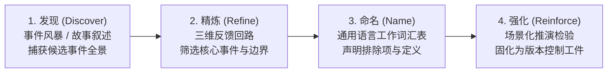
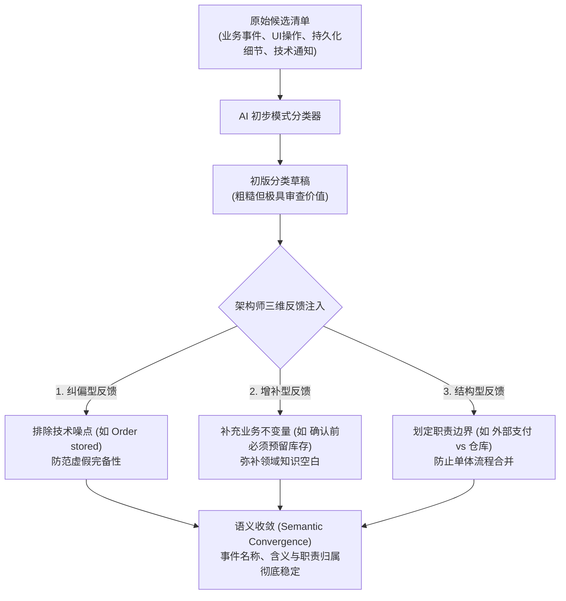
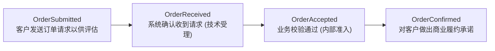

# 核心实战精炼：从领域探索到 AI 协作

## 1. 核心心智模型：领域探索到 AI 协作四阶段演进

与大语言模型协作开展领域驱动设计的前提，是将存在于人类头脑中的隐性知识转化为显式的结构化制品。探索演进严格遵循 **Discover $\to$ Refine $\to$ Name $\to$ Reinforce** 四步流水线：



- **发现（Discover）**：利用事件风暴与领域故事叙述使碎片化知识全面外显，形成包含疑问与假设的候选全景。
- **精炼（Refine）**：引入纠正性、补充性与结构性反馈，剔除 UI 与持久化噪声，萃取核心业务事实。
- **命名（Name）**：消除同义词与歧义词，明确业务状态流转的精确分界，确立词汇排除契约。
- **强化（Reinforce）**：将固化的工作词汇表注入实际场景中验证，固化为可复用的 Markdown 领域工件。

---

## 2. 架构决策矩阵：探索技术互补性与信息转译决策

### 决策矩阵 1：事件风暴与领域故事叙述的互补维度

| 维度 | 事件风暴 (EventStorming) | 领域故事叙述 (Domain Storytelling) | 架构互补价值 |
| :--- | :--- | :--- | :--- |
| **关注视角** | 业务事实全景与系统演化时间线 | 参与者意图、交互场景与行为流转 | 宏观事件骨架与微观叙事因果的闭环校验 |
| **核心要素** | 事件、命令、策略、读模型、外部系统 | 参与者（Actor）、工作对象（Work Object）、活动 | 补充操作主体与对象，防止模型抹平参与者 |
| **对 AI 的约束** | 提供候选术语与潜在结构锚点 | 消除因果跨度过大导致的自由推测 | 强力收敛 `OrderSubmitted` 到 `OrderConfirmed` 之间的推演缝隙 |
| **典型失效** | 容易退化为孤立的事件流水账 | 难以一眼纵览全系统的全局边界 | 结合使用：事件风暴定广度，故事叙述定深度 |

### 决策矩阵 2：转录 (Transcription) vs 转译 (Translation)

| 对比维度 | 机械转录 (Transcription) | 深度转译 (Translation) |
| :--- | :--- | :--- |
| **信息捕获** | 仅记录即时贴表面文本与可见顺序 | 提取便签背后的业务意图、被否决的方案与未决问题 |
| **不确定性处理** | 忽略争论，将模糊条目混入正式事件 | 显式声明 `known_distinctions` 与 `open_questions` |
| **大模型输入** | 诱发模型用统计常识强行补全空白 | 设立明确的知识终止边界，阻止模型无依据推测填充 |
| **工程成果** | 白板照片或扁平文本，容易过时 | 可版本控制、可 diff 比对的领域上下文 Markdown 文件 |

---

## 3. 信号萃取与三维反馈循环 (Signal Distillation & 3D Feedback)

模型在初次分类时扮演“快速模式综合器”，架构师必须通过三维反馈引导其迈向**语义收敛（Semantic Convergence）**：



### 三维反馈分类与实战指引

| 反馈类型 | 核心目的 | 典型纠偏指令范式 | 防范的系统风险 |
| :--- | :--- | :--- | :--- |
| **纠正性反馈 (Corrective)** | 剔除不属于领域的假设与技术细节 | “`Order page opened` 是 UI 交互，`Order stored` 是持久化细节，均非业务事件。” | 防范**虚假完备性**（流于表面工整而实质混杂） |
| **补充性反馈 (Additive)** | 补充模型无法自行推断的业务规则 | “支付授权不等于订单确认；订单确认代表企业对客户的商业承诺。” | 消除**通用电商常识污染**，对齐当前企业特例 |
| **结构性反馈 (Structural)** | 捍卫上下文与聚合的职责边界 | “`StockReserved` 归属仓库限界上下文；外部支付事件不得与销售聚合合并。” | 防止模型将多方协作**扁平化压缩为单一流水账** |

### 语义收敛判定指标清单
1. 模型不再重复引入已被明确否决的技术细节。
2. 领域专家对核心事件命名不再存在语义分歧。
3. 关键业务状态流转不再被近义词反复替换。
4. 未决盲区被显式固化为 `open_questions`，而非由模型随意推断。
5. 团队讨论重心从基础术语转向更深层次的聚合边界与职责划分。

---

## 4. 语言稳定机制：防范假性一致性 (False Coherence)

当提示词中混杂近义词时，模型会自作主张抹平分歧，产生高度自洽但完全错误的输出（**假性一致性**）。必须建立细粒度的状态流转边界：



| 专有事件术语 | 严密业务定义 | 严禁混用的同义词与原因 |
| :--- | :--- | :--- |
| **`OrderSubmitted`** | 客户向平台发起订购意向并提交请求 | 严禁混用 `OrderReceived`（接收为系统响应，提交为客户动作） |
| **`PaymentAuthorized`** | 外部支付网关预留并冻结了相应资金 | 严禁混用 `PaymentCompleted`（授权仅冻结资金，结算方发生转移） |
| **`StockReserved`** | 仓库上下文在物理仓储中锁定了对应货品 | 严禁混用 `InventoryAllocated`（避免多重命名掩盖仓库上下文边界） |
| **`OrderConfirmed`** | 企业完成全部前置校验，向客户作出法定履约承诺 | 严禁混用 `OrderApproved`（审批为内部核验，确认为外部商业承诺） |

---

## 5. 生产级实战规范：领域探索工件与工作词汇表模板

### 规范 1：探索转译工件模板 (`brewup-ordering-exploration.md`)

```markdown
# BrewUp 订单探索工件 (BrewUp Ordering Exploration)

## 1. 范围 (Scope)
描述 BrewUp 销售订单主流程的早期探索，用于沉淀 AI 协作上下文，非最终模型。

## 2. 候选事件清单 (Candidate Events)
- Order submitted (客户提交订单)
- Payment authorized (外部支付已授权)
- Order stored (订单已持久化 - 待评审)
- Stock reserved (仓库库存已预留)
- Confirmation email sent (邮件已发送 - 待评审)
- Order confirmed (订单已正式确认)

## 3. 已知区别与断言 (Known Distinctions)
- 支付授权仅代表授信成功，绝不等于订单已被确认。
- 销售订单职责与仓库库存管理职责必须在物理上明确解耦。
- UI 交互事件（如页面打开）与数据库持久化操作严禁升格为领域事件。

## 4. 待决问题 (Open Questions)
- 订单确认前是否必须强依赖库存预留成功？
- 若支付授权成功但库存预留失败，触发何种补偿事件？
- 邮件发送是否具有法律合规效力，还是纯粹的技术异步通知？
```

### 规范 2：工作词汇表模板 (`brewup-ordering-vocabulary.md`)

```markdown
# BrewUp 订单词汇表与排除契约 (Working Vocabulary)

## 核心领域事件定义
### Order submitted
- 定义：客户向 BrewUp 发送订购请求以供评估时触发的领域事件。
- 不变量约束：不代表订单已接受，亦不代表订单已确认。

### Payment authorized
- 定义：外部支付服务商冻结所请求金额后向 BrewUp 报告的外部事实。
- 不变量约束：不代表支付已结算，亦不代表 BrewUp 承诺履行订单。

### Stock reserved
- 定义：仓库限界上下文成功为订单锁定库存后发布的领域事件。
- 不变量约束：不代表订单已被销售侧正式确认。

### Order confirmed
- 定义：在业务前置条件（支付授权与库存预留）全部就绪后，企业对客户作出履行承诺时触发的领域事件。

## 词汇排除项清单 (Vocabulary Exclusions)
- FORBIDDEN: `Order received` AS SYNONYM OF `Order submitted` (接收是系统的被动受理，提交是客户的主动诉求).
- FORBIDDEN: `Payment completed` WHEN FACT IS `Payment authorized` (授权是资金冻结，完成是资金划拨).
- FORBIDDEN: `Inventory allocated` AS SYNONYM OF `Stock reserved` (严禁用多套同义词混淆仓库限界上下文边界).
- FORBIDDEN: `Order approved` AS SYNONYM OF `Order confirmed` (审批为内部状态，确认为对外部客户的法定承诺).
```

---

## 6. 架构避坑清单 (Do's & Don'ts)

| 领域维度 | 错误实践 (Don't) | 正确实践 (Do) |
| :--- | :--- | :--- |
| **探索转译** | 拍照上传白板或机械转录文字，让大模型自行猜测便签布局背后的业务逻辑。 | 将视觉便签转译为包含候选事件、已知区别、未决问题的结构化 Markdown 工件。 |
| **信号萃取** | 将工作坊所有的便利贴不加筛选地直接喂给 AI，要求其直接生成微服务模型。 | 分离候选事件与核心事件，利用 AI 识别模式，由人类主导筛选。 |
| **反馈机制** | 对模型生成的不满意时仅重复点击重新生成，期待模型“自发顿悟”。 | 实施三维反馈闭环：明确给出纠正性、补充性与结构性指示。 |
| **术语治理** | 容忍在文档与对话中交替使用近义词（如将 Submitted 与 Placed 混用）。 | 显式声明词汇排除清单（Exclusions），消除大模型的假性一致性归一化。 |
| **职责划分** | 允许模型将因果时序相邻的事件全部归入同一个单体聚合中。 | 施加结构性反馈，将外部系统事实（支付提供商）与不同上下文（仓库）明确切分。 |

<!-- split -->

# 原著完整参考：从领域探索到 AI 协作

在前面的章节中，你已经确立了一个冷酷的事实：大语言模型并不能在人类意义上理解业务领域。它只是根据接收到的上下文预测最可能出现的后续文本。

这从根本上改变了 AI 在软件架构中发挥作用的前提条件。只有当你将知识、约束和不确定性显式化时，AI 才能放大你的推理能力。如果缺乏这种自律，模型可能会给出流畅且看似合理的回答，同时却悄然偏离你试图理解的真实领域。

这引发了一个紧迫的现实问题：

*进行严谨自律的 AI 协作所需的素材究竟来自何处？*

在 AI 能够协助你对业务领域进行理性推理之前，你必须首先让该领域变得“清晰可见”。必须将其中的事件、参与者、决策、术语、歧义和因果关系外显化，转化为人类能够探讨、模型能够处理的形式。本章将从前几章的概念基石，迈向 AI 辅助领域驱动设计（AI-assisted Domain-Driven Design）的第一个实战步骤：领域探索。

:::en
> **Original**: In the previous chapters, you established a hard truth: a Large Language Model does not understand a business domain in the human sense. It predicts likely continuations from the context it receives. This changes the conditions under which AI becomes useful for software architecture. AI can amplify your reasoning only when you make knowledge, constraints, and uncertainty explicit. Without that discipline, the model might produce fluent and plausible answers while silently drifting away from the domain you are trying to understand. This leads to an immediate practical question: Where does the material required for disciplined AI collaboration come from? Before AI can help you reason about a business domain, you must make that domain visible. Its events, actors, decisions, terminology, ambiguities, and causal relationships must be externalized in a form that humans can discuss and that a model can process. This chapter moves from the conceptual foundation of the previous chapters to the first operational step of AI-assisted Domain-Driven Design: domain exploration.

**📌 核心术语与语境解析**：
- **Disciplined AI Collaboration**：*受严谨纪律约束的 AI 协作*。基于明确边界、形式契约与显式反馈，拒绝模型自由发散的专业人机交互方式。
- **Externalize** [ɪkˈstɜːnəlaɪz]：*显式外化*。将专家心智中的内隐假定沉淀为人类可审查、机器可处理的结构化制品。
:::

以 BrewUp 为参考案例，你将探讨探索工件如何浮现候选事件、揭示因果流转、暴露模糊歧义，并为更加严谨自律的 AI 协作提供原始素材。读完本章，你将理解：

- 为什么领域探索是在 DDD 中进行高效 AI 协作的先决条件。
- 事件风暴（EventStorming）如何将领域知识外显化，并将工作坊产出转化为结构化信号。
- 领域故事叙述（Domain Storytelling）如何通过叙事流、参与者视角和因果关系对领域事件形成互补。
- 如何将探索性工件转化为结构化的领域上下文，并将其提炼为可复用的建模素材。

BrewUp 订购流程的一个片段贯穿了整章内容。它最初只是工作坊墙上的四张即时贴——订单已提交（Order submitted）、支付已授权（Payment authorized）、库存已预留（Stock reserved）、订单已确认（Order confirmed）——最终演进为一个团队可以复用的文件，其中每个名称都明确定义了它代表什么以及不代表什么：

```markdown
## Order confirmed（订单已确认）

A domain event raised when BrewUp commits to fulfilling the order after the
required business conditions have been satisfied.
（在满足所需的业务条件后，BrewUp 承诺履行订单时触发的领域事件。）
```

“发现（Discover）”让这些便签清晰可见，“精炼（Refine）”决定哪些便签至关重要，“命名（Name）”明确其真实内涵，“强化（Reinforce）”则将这些名称带入后续的对话中。这一演进路径——***发现 → 精炼 → 命名 → 强化（Discover → Refine → Name → Reinforce）***——正是本章的行文脉络。你将从优秀建模始终开始的地方启程：让领域足够显式化，以便人们对其发起审视质疑，并使 AI 系统能够在其中稳定运转。

:::en
> **Original**: Discover makes those notes visible, Refine decides which of them matter, Name fixes what they mean, and Reinforce carries the names into the next conversation. That progression – ***Discover → Refine → Name → Reinforce*** – is the structure of this chapter. You begin where good modeling always begins: by making the domain explicit enough for people to challenge it and for AI systems to operate within it.

**📌 核心术语与语境解析**：
- **Discover → Refine → Name → Reinforce**：*发现、精炼、命名、强化*。领域驱动设计知识工程的四阶段递进式演化范式。
- **Reusability** [ˌriːˌjuːzəˈbɪləti]：*可复用性*。工件脱离单次会话长久保存、被多轮推演无损继承的关键属性。
:::

## 技术要求

本章所讨论的技术并不依赖于特定的大语言模型或开发环境。要跟随本章的示例操作，你需要：

- 访问支持多轮对话与文本上下文的 LLM 交互界面。
- 一个能够处理 Markdown 文件的文本编辑器。
- 获取本章所使用的探索工件和工作词汇表：<https://github.com/PacktPublishing/AI-Augmented-Domain-Driven-Design/tree/main/docs/ch04>

本章展示的示例和工件特意保持了工具独立性。其目的在于说明如何将领域知识转化为结构化上下文，而非演示特定产品的功能特性。

## 人与 AI 之间的桥梁工具

复杂的业务领域往往会超出单个人大脑所能可靠承载的极限。随着系统的演进，知识会分散在领域专家、开发人员、文档、日常交流以及既有软件的行为之中。

问题不仅仅在于信息量的庞大，更在于不同的人对同一信息有着不同的解读。术语发生漂移，假设依然隐晦，因果关系因描述流程的人不同而各有理解。

在 AI 能够协助进行推理之前，这种碎片化的知识必须被外显化。知识无需做到完备或完美无瑕，但必须足够显式清晰，从而构建一个共享界面——在这里，假设可以受到挑战，术语可以进行比对，缺失的知识也能够被及时识别。领域探索技术正是提供了这样一个平台。

### 事件风暴

**事件风暴（EventStorming）** 是一种协作式的领域探索技术，旨在通过可视化方式将业务知识外显化。领域专家、开发人员和其他利益相关者协同工作，在共享平面上梳理出具有实际意义的领域事件。领域事件通常采用过去时态表达，因为它们描述的是领域中已经发生的既成事实。随后，团队可以添加命令（Command）、参与者（Actor）、策略（Policy）、外部系统（External System）以及悬而未决的问题，从而解释是什么引发了这些事件，以及事件发生后带来了什么后果。

其目的绝不仅是为了记录既有流程。这个共享平面成为了团队的临时外存（Temporary Memory）。它让参与者能够共同审视领域，而不是各自依赖脑海中分散的心智模型。重复的事件、前后矛盾的术语、缺失的状态流转以及冲突的解读都会暴露无遗，因为它们在视觉上紧挨着排列在一起。

不妨来看 BrewUp 订购领域的一个小片段。在早期的工作坊中，参与者可能会写出如下表达：

- 销售订单已创建（Sales order created）
- 支付已授权（Payment authorized）
- 库存已预留（Stock reserved）
- 确认通知已发送（Confirmation sent）

在这一阶段，这些即时贴尚不可靠：它们只是关于领域的“候选陈述”。其中一些可能代表有意义的业务事实，另一些则可能描述的是技术响应、用户界面操作，或是尚未得到验证的假设。

对于人类而言，这些即时贴的物理排列提供了宝贵的上下文。位置、次序、分组、批注以及产出这些便签的现场讨论，都构成了它们含义的一部分。然而对于 AI 系统，团队必须将这种含义显式化地表达出来。

拍摄白板照片或转录墙上的便签，无法可靠地保留工作坊中发生的一切。转录可能记录了字面词句，却丢失了为什么两张便签要分开摆放、为什么某个术语被弃用、团队原本打算划定怎样的边界，或者哪个问题尚未得到解决。

因此，通往 AI 的桥梁在于**将白板上的内容严谨地翻译为结构化语言**。这种翻译将工作坊的产物——事件、关系、术语、边界和悬而未决的问题——以一种能跨越单次会话长久留存的形式记录下来。

一旦显式表达出来，这些要素就会成为模型上下文中的约束条件。模型依然不会像领域专家那样真正“理解”领域，但它能够在团队划定的边界内展开更加自洽连贯的推理。

图 4.1 展示了源自 BrewUp 订购流程的一个简化片段。`CreateSalesOrder` 命令触发了 `SalesOrderCreated` 事件，随后该事件用于更新销售读模型（Sales Read Model）并为销售 UI（Sales UI）提供支持。图中显示的外部系统代表该流程中的另一个参与者。


*图 4.1 – 来自 BrewUp ERP 的事件风暴示例*

通过将探索成果转化为明确的事件、时序和词汇，你可以将部分认知负担从个人记忆转移到可复用的上下文中。架构师因而可以少花精力去死记硬背每张便签，而把更多注意力聚焦在更高维度的关注点上：

- 边界划分是否有实际意义？
- 是否将业务事实与技术后果混为一谈？
- 哪些假设仍有待验证？
- 哪些术语保持稳定？
- 遗漏了哪些关键流转？

从这个意义上说，事件风暴充当了人类认知与概率推理之间的翻译层。它将隐性知识转化为可见的工件，再将这些工件转化为 AI 可以处理的结构化输入，同时又不会放任 AI 自行定义领域。

:::en
> **Original**: By translating discovery results into explicit events, sequences, and vocabulary, you move part of the cognitive burden from individual memory into a reusable context. The architect can then focus less on recalling every note and more on higher-level concerns: Are the boundaries meaningful? Are you mixing business facts with technical consequences? Which assumptions still need validation? Which terms remain stable? Which transitions are missing? In this sense, EventStorming works as a translation layer between human cognition and probabilistic reasoning. It turns implicit knowledge into visible artifacts and those artifacts into structured input that AI can process without allowing it to define the domain on its own.

**📌 核心术语与语境解析**：
- **Translation Layer**：*翻译层*。连接人类非结构化业务洞见与大模型概率推理引擎之间的形式化语义转换层。
- **Cognitive Burden** [ˈkɒɡnətɪv ˈbɜːdn]：*认知负担*。在大规模复杂系统中，个人大脑维系海量时序与依赖关系所需耗费的心智成本。
:::

### 领域故事叙述

事件风暴赋予你广度，它能迅速浮现出大量的业务事实、问题和潜在关系。

然而，事件全景并不总能保留相关人员的视角。事件全景可能会告诉你发生了某件事，却未完全解释是谁采取了行动、他们试图达成什么目标，以及为什么某一步会导致下一步的发生。为此，你需要一个互补的叙事视角。

**领域故事叙述（Domain Storytelling）** 通过具体场景来探索领域。它不是首先聚焦于事件，而是描述参与者（Actor）如何随着时间的推移与系统和工作对象（Work Object）进行交互。一个简单的场景可能会描述客户提交销售订单：销售系统验证请求，外部系统对支付进行授权，一旦满足所需的业务条件，订单即告确认。

随后，利用参与者、活动、工作对象和带编号的时序，将该场景进行可视化呈现。这里的目标是行为的清晰度，而非技术上的严密性：

*从当事人的视角来看，这个领域中究竟发生了什么？*

这种叙事方法具有重要的认知效应。人类天然善于通过讲故事来解释工作。故事能够保持时序、揭示意图，并通过因果关系将孤立的行动串联起来。它们还使假设更容易受到检验和推敲。

例如，在事件列表中列出“*订单已确认（the order is confirmed）*”，表面上看起来似乎毫无歧义。但将相同的表述置于一个故事中，会立刻引发一系列追加问题：

- 谁来确认订单？
- 必须首先满足哪些条件？
- 支付授权是否已足够充分？
- 是否必须已经预留库存？
- 确认是否构成了对客户的履约承诺？

这些问题揭示了孤立的事件名称可能掩盖的知识。图 4.2 展示了与图 4.1 相同的流程，但此时是从参与者的视角展开观察。图中展现了一系列活动中的各个参与方，包括用户、销售系统、外部系统、销售订单、交互产生的事件、读模型以及销售 UI。


*图 4.2 – 采用领域故事叙述的同一流程示例*

如果说事件风暴倾向于快速浮现出许多相关事实，那么领域故事叙述则放慢了探索节奏，并将这些事实串联为连贯的业务流。对于与 AI 协作而言，这一区别至关重要。事件列表告诉模型发生了什么；而领域故事还指明了是谁发起了操作、涉及哪个工作对象、参与者试图达成何种意图、哪些条件影响了流程走向，以及为什么一个动作会先于或后于另一个动作发生。

这种额外的结构减少了模型可采纳的合理解读数量。如果事件列表直接从 `OrderSubmitted` 跳跃到 `OrderConfirmed`，它能与许多截然不同的业务流程相兼容：模型可能会在两者之间插入支付步骤、信用检查，或者什么都不加，而这些补全方案单看本身似乎都言之成理。而一份记录了谁提交了订单、他们提出了什么诉求，以及 BrewUp 在确认前检查了哪些条件的故事，则直接排除了许多模棱两可的补全可能。模型仍在执行它先前的预测机制，但需要从训练数据中凭空填补的空白却大大减少了。

:::en
> **Original**: Where EventStorming tends to surface many relevant facts quickly, Domain Storytelling slows the exploration down and connects those facts into coherent flows. For AI collaboration, this distinction matters. An event list tells the model what happened. A domain story also identifies who initiated the action, which work object was involved, what the actor intended to achieve, which conditions influenced the flow, and why one action preceded or followed another. This additional structure reduces the number of plausible interpretations available to the model. An event list that jumps from `OrderSubmitted` to `OrderConfirmed` is compatible with many different business processes: the model can insert a payment step, a credit check, or nothing at all, and each of those completions looks reasonable on its own. A story that records who submitted the order, what they were asking for, and which condition BrewUp checked before confirming rules out many of those completions. The model is doing the same thing it did before, with fewer gaps to fill from its training data.

**📌 核心术语与语境解析**：
- **Domain Storytelling**：*领域故事叙述*。以参与者、动作和工作对象为核心的具体场景探索方法，强化业务因果流转。
- **Plausible Interpretations**：*统计上似是而非的解读*。大语言模型在信息不足时依据通用预训练概率随意构造的业务流程分支。
:::

### 事件风暴与领域故事叙述的对比

*事件风暴为你呈现事件全景，领域故事叙述为你提供叙事连续性。*

事件描述发生了什么。故事则解释是谁采取了行动、对什么对象施加了操作，以及前一步是如何引发下一步的。这两种技术揭示了同一领域的不同维度，并且相辅相成。

事件风暴通过浮现业务事实、疑问、系统响应和潜在边界来拓宽探索视野。领域故事叙述则将这些素材的一部分组织成保留了参与者、意图和因果关系的具体场景。

两者结合，为人类和 AI 共同运作提供了更丰富的上下文。事件风暴揭示了领域词汇及其候选的结构锚点；领域故事叙述则对照真实的行为模式对这些锚点进行检验；而两者的比对则能暴露出前后矛盾、缺失的流转环节以及不稳定的术语。

架构师的职责在于塑造推理得以展开的基石素材，而解释领域的最终责任始终归属于团队。领域探索产出的是原始素材。接下来的步骤，是将这些素材转化为一种能够在工作坊之外长久留存、并成为 AI 协作可复用上下文的形式。

## 将视觉混沌转化为结构化上下文

核心原则在于：**在探索素材输入给模型之前，先对其进行结构化整理**。要求模型对模糊不清的素材强行施加结构，往往只会把这种歧义直接转嫁到输出结果中。因此，团队应当首先使结构显式化。

事件风暴白板或领域故事叙述图中所蕴含的信息，远远超出了上面写下的文字本身。人类能够从位置、颜色、临近度、时序、分组，以及参与者在创建该工件时所展开的讨论中推断出含义。

相距很远的两个事件可能属于不同的业务能力；一个密集的便签集群可能暗示着所有权的归属；一个问号可能记录着某条悬而未决的业务规则；而一张被反复移动的便签，则往往暴露了关于时序排列或职责划分的分歧。

即便大语言模型能够处理图像，它也无法可靠地还原出这些视觉选择背后的全部工作坊知识。它能看到最终生成的工件，却未必能洞察赋予该工件意义的现场讨论、被否决的替代方案或隐性共识约定。因此，目标绝不仅仅是转录白板，而是**翻译**白板。

### 是翻译，而非转录

转录仅仅捕捉肉眼可见的内容：每张即时贴上写的文字、便签的表观顺序、参与者与系统的标签，以及共享平面上可见的物理分组。

而翻译则走得更深。翻译会将这些要素背后的真实含义显式化地表达出来。

根据探索素材的不同，这种翻译可能包括用过去时态表达的候选领域事件、可能引发这些事件的命令或意图、流程中涉及的参与者，以及操作与结果之间的因果关系。翻译还可以记录反复出现的领域概念与术语、由归属权或职责所暗示的候选边界、已被领域专家确认的业务规则、尚未解决的待决问题，以及团队因产生歧义而已明确否决的术语。

这一区别至关重要，因为大语言模型倾向于**用统计上看似合理的结构来填补缺失的结构**。如果工件包含两个事件却未说明它们的关系，模型便可能在两者之间臆造一种关联；如果一个术语存在歧义，模型可能会悄悄将其规范化为其训练数据中最常见的解读模式。

结构化的上下文能够有效收缩这种自由度。结构化上下文并不保证绝对正确，但它能明确界定领域的哪些部分已知、必须保留哪些核心区别，以及模型在何处应当适可而止而非擅自推断。

:::en
> **Original**: A transcription captures what is visible: the text written on each sticky note, the apparent sequence of the notes, the labels attached to actors and systems, and the groups visible on the shared surface. A translation goes further. A translation makes the meaning behind those elements explicit... This distinction is important because an LLM tends to complete a missing structure with a statistically plausible structure. If the artifact contains two events but does not explain their relationship, the model may invent a connection between them. If a term is ambiguous, the model might silently normalize it into the most common interpretation found in its training data. Structured context reduces that freedom. Structured context does not guarantee correctness, but it makes explicit that parts of the domain are known, which distinctions must be preserved, and where the model should stop rather than infer.

**📌 核心术语与语境解析**：
- **Transcription vs Translation**：*机械转录与深层转译*。转录仅保留符号字面，转译则捕获业务意图、排他规则与上下文边界。
- **Silent Normalization**：*隐性平滑归一化*。大语言模型在遇到未决歧义时，不经提示直接按预训练统计习惯强行折叠为大众化常见模式的失误行为。
:::

### 提取既有结构

思考在 BrewUp 订购领域探索期间产生的这一小段素材：

- 订单已提交（Order submitted）
- 支付已授权（Payment authorized）
- 订单已存储（Order stored）
- 库存已预留（Stock reserved）
- 确认邮件已发送（Confirmation email sent）
- 订单已确认（Order confirmed）

作为一个未经加工的原始列表，这些素材依然充满歧义。它混杂了业务事实、技术操作和下游响应，同时也遗留了若干悬而未决的问题：

- 支付授权是否意味着订单已被接受？
- 库存是在订单功能内部预留，还是由仓库负责预留？
- 存储订单属于业务事实还是实现细节？
- 订单确认发生在库存预留之前还是之后？
- 发送邮件本身对领域具有业务意义，还是仅仅是对确认动作的技术反应？

用于 AI 协作的第一个实用工件应当**保留这种不确定性，而不是将其掩盖**。以下工件也收录在配套代码仓库中，路径为 `docs/ch04/brewup‑ordering‑exploration.md`：

```markdown
# BrewUp 订单探索 (BrewUp Ordering Exploration)

## 范围 (Scope)

本工件描述了 BrewUp 销售订单流程的早期探索。
它尚不是最终的领域模型。

## 候选事件 (Candidate events)
- Order submitted（订单已提交）
- Payment authorized（支付已授权）
- Order stored（订单已存储）
- Stock reserved（库存已预留）
- Confirmation email sent（确认邮件已发送）
- Order confirmed（订单已确认）

## 已知区别 (Known distinctions)

- 支付授权并不自动意味着订单确认。
- 订单职责与仓库职责必须保持明确区分。
- UI 操作和持久化细节并不自动构成领域事件。

## 待决问题 (Open questions)

- 在订单能够确认之前，必须满足哪些条件？
- 谁拥有库存预留的所有权？
- 订单确认是否构成了对客户的商业承诺？
- 候选列表中的哪些项属于技术副作用？
```

该工件为模型提供了一个有明确边界的审查对象。候选事件清晰可见，但已知区别和未决问题同样一目了然。此时，模型可以对素材展开分类、比对和质疑，而不会被误导将每张便签都视为同等有效的业务事实。这种转变是从领域探索迈向 AI 协作的第一个务实跃迁：**在视觉素材变成建模提示词之前，先将其转化为显式上下文。**

:::en
> **Original**: This artifact gives the model a bounded object to examine. The candidate events remain visible, but so do the distinctions and unanswered questions. The model can now classify, compare, and challenge the material without being encouraged to treat every note as an equally valid business fact. This transformation is the first practical transformation from domain exploration to AI collaboration. Visual material becomes explicit context before it becomes a modeling prompt.

**📌 核心术语与语境解析**：
- **Bounded Object**：*受限分析标的*。包含正向事实与反向未决疑问的闭合审查单元，为 AI 推理提供聚焦支点。
- **Modeling Prompt**：*建模提示词*。建立在显式上下文之上的结构化推演指令。
:::

### 从探索工件到可复用上下文

经过翻译的工件之所以重要，是因为它能够跨越工作坊而长久留存。满墙的即时贴只是暂时的存在，其含义不仅取决于眼前能看到的内容，更取决于团队在构建这面墙时所发生的对话、分歧与决策。一旦会议结束，许多环绕周围的上下文便开始迅速消退。

结构化工件为团队提供了一种沉淀当前探索状态的有效途径。在现阶段，它的目标被刻意限定在清晰的范围内：正在探索的业务范围、候选事件与反复出现的概念、团队已经澄清的含义、必须保持可见的区别、尚未解决的问题，以及信息的来源出处——是来自工作坊、某个具体场景，还是与领域专家的某次交谈。

你可以将这些素材保存在 Markdown 文件中。这种选择非常务实：Markdown 是纯文本格式，工件既可以由人类直接阅读，也可以在版本控制系统中进行 diff 比对，还能毫无阻碍地直接粘贴到模型的上下文中，无需任何格式转换。这些工件是工作性工件（Working Artifacts）而非形式化的死板文档，它们的核心价值在于**连续性**——后续的对话可以基于完全相同的领域素材重新启动，而不是依赖模糊的记忆从头重建。

如果缺乏可复用的工件，每一次交互都将始于对领域的片面复述。术语会发生改变，悬而未决的问题会被遗忘，先前已被否决的假设又可能悄然复活。

有了工件作为依托，团队便能在共享的统一起跑线上重新开启探索。模型接收到的是团队精心保留的事件、定义与不确定性，而领域专家则牢牢掌握着对它们进行修订的最终裁量权。

有些项目还会维护描述编码规范或实现惯例的技术指南文件。那些文件服务于截然不同的目的：它们约束的是解决方案的具体实现方式，而此处讨论的工件保留的则是领域在当前的真实含义。当下，你的关注点应纯粹聚焦于领域素材本身。

这些文件构成了更宏大的交互架构的第一层。它们确保探索成果不会在一次又一次的交互间隙中流失蒸发。至于定义一套完整的规则手册，或者规范模型应当如何进行推理，则属于更高级的层次——那也是下一章的主题。

这一转化为你带来了领域探索的第一个操作性成果：**在视觉知识转化为推理约束之前，先将其沉淀为可复用的上下文**。然而，仅仅保留工作坊的每张便签是远远不够的。翻译后的工件中仍可能夹杂着 UI 操作、技术响应、重复表达，以及建模分量迥异的各类事件。

一旦视觉知识完成显式化，接下来的核心任务便是筛选：

*哪些候选事件足够重要，能够成为初生模型的结构性锚点？*

:::en
> **Original**: You keep this material in Markdown files. The choice is practical: Markdown is plain text, so the artifact can be read by a person, diffed in version control, and pasted into a model's context without conversion. These artifacts are working artifacts rather than documentation, and their value is continuity – a later conversation can begin from the same domain material instead of reconstructing it from memory. Without a reusable artifact, each interaction begins with a partial retelling of the domain. Terms change, unresolved questions disappear, and assumptions that were previously rejected might return unnoticed. With the artifact in place, the team can reopen the exploration from a shared starting point. The model receives the events, definitions, and uncertainties that the team has chosen to preserve, while domain experts retain the authority to revise them.

**📌 核心术语与语境解析**：
- **Working Artifacts**：*工作性工件*。持续迭代更新、用于人机协作对齐的轻量级纯文本版本控制制品。
- **Continuity** [ˌkɒntɪˈnjuːəti]：*连续性*。跨越时间与会话边界，防止知识在重复交互中降解与变形的关键工程属性。
:::

## 识别核心事件并通过反馈进行精炼

一旦探索工件被转化为结构化上下文，接下来的挑战就不再是大范围的发散探索，而是**严谨的收敛筛选**。一场事件风暴工作坊可能会涌现出数十个候选事件，但并非所有事件都具有相同的建模分量。有些表达了业务层面的重大变更；另一些描述的不过是屏幕画面的切换、持久化操作、基础设施的响应，或是局部的实现细节。

如果你在未作区分的情况下将它们全盘喂给大模型，模型并没有可靠的依据来判定某一项比另一项更为重要。模型或许能将它们编排成看似连贯的时序流，但这种时序流不仅会继承源素材中本已存在的混乱，有时甚至会进一步放大这种混淆。其结果往往是一个充满噪声的事件全景：看似合理、文笔流畅，在概念上却千疮百孔、毫无说服力。

因此，与 AI 协作的第一步是**提炼萃取（Distillation）**。模型可以帮助你归类相似的表述、暴露缺失的状态流转、质疑表意不清的命名，并区分不同层级的含义。然而，模型给出的第一版结果绝不应被直接当作模型本身，而应将其视为一份**供人推敲质疑的草稿**。

#### 候选事件与核心事件

在这一阶段，最具实战价值的区分在于**候选事件（Candidate Events）**与**核心事件（Core Events）**。候选事件囊括了探索过程中浮现出的全部要素：利益相关者提及的事实、看似标志着流程某一步骤的动作、在既有系统中观察到的技术响应、不同参与者对看似相同的流转所使用的不同术语，以及为了填补故事叙述中的空白而临时提出的事件。

候选事件在设计上刻意保持包容性。其目的是在团队决定取舍之前，完整保留探索的广度。

核心事件的范围则要收敛得多。一个核心事件代表着具有重要建模分量的业务事实：它可能记录了领域状态的重大变更、确立了某项商业承诺、触发了下游决策或策略、标志着某项关键业务规则的执行结果、揭示了职责之间的清晰边界，或者提供了一个核心锚点，命令、策略、聚合或限界上下文可以围绕其逐步展开组织。

这种区分并不意味着每个核心事件最终都必然体现在代码实现中。在当前阶段，团队的核心任务是识别出那些分量足够厚重、足以支撑后续建模深入开展的关键事件。

:::en
> **Original**: Candidate events include everything that emerges during exploration: facts mentioned by stakeholders, actions that appear to mark a step in a process, technical reactions observed in the existing system, terms that different participants use for apparently similar transitions, and events proposed to explain gaps in a story. Candidate events are deliberately inclusive. Their purpose is to preserve the breadth of discovery before the team decides what matters. Core events are narrower. A core event represents a business fact that carries meaningful modeling weight: it may record an important change in domain state, establish a business commitment, trigger a downstream decision or policy, mark the result of a significant business rule, reveal a boundary between responsibilities, or provide an anchor around which commands, policies, aggregates, or bounded contexts might begin to organize.

**📌 核心术语与语境解析**：
- **Candidate Events vs Core Events**：*候选事件与核心事件*。探索初期全景素材与具备重度领域状态变更价值的核心资产的架构解耦。
- **Business Commitment**：*商业承诺*。具有契约约束力的领域事实（例如订单确认意味着企业承诺排产与履约）。
:::

思考以下来自 BrewUp 销售订单流程早期探索的一组混杂条目：

- 订单页面已打开（Order page opened）
- 订单已提交（Order submitted）
- 支付已授权（Payment authorized）
- 订单已存储（Order stored）
- 确认邮件已发送（Confirmation email sent）
- 库存已预留（Stock reserved）
- 订单已确认（Order confirmed）

该列表记录了探索过程中捕获的真实观察，但它混淆了若干个不同的语义层次。`OrderPageOpened` 描述的是用户界面交互；`OrderStored` 属于持久化范畴；而 `ConfirmationEmailSent` 很可能只是下游的技术响应。`OrderSubmitted`、`PaymentAuthorized`、`StockReserved` 和 `OrderConfirmed` 则可能代表真正的业务事实，尽管它们的确切含义和所属边界仍需进一步验证。

如果你要求模型在没有明确这些区别的情况下对该列表进行推理，它可能会将每一项都升格为领域事件，产出一个光鲜亮丽却极具误导性的模型。正是在这个节点上，架构师必须牢牢掌控精炼反馈回路的主导权。

关键的问题绝非：

*模型是否生成了一份令人信服的事件列表？*

真正至关重要的问题是：

- 领域专家会认可哪些事件是具有实质意义的业务事实？
- 哪些条目仅仅描述了当前系统如何实现该流程？
- 哪些事件只是从不同视角表达的重复项？
- 哪些名称背后掩盖了多个业务状态流转？
- 哪些前提条件将一个事件与下一个事件隔离开来？
- 哪些事件分属于不同的业务职责范畴？
- 依然遗漏了哪些关键的业务状态流转？

最初的列表只是一份假设，而上述问题正是检验该假设的试金石。

#### 模型的贡献与局限

在当前阶段，AI 能够以一种非常具体且受控的方式发挥效用：它充当了一个**快速模式综合器（Fast Pattern Synthesizer）**。在给定粗糙的事件列表、简短的领域描述以及明确的分类标准的前提下，它可以归类重叠的表述、检测潜在的同义词、识别抽象层次不一致的事件，并指出某个条目可能只是 UI 操作或技术副作用。它还能揭示因果链条中可疑的断层裂痕、提出切分业务流的备选方案，并突出显示需要补充领域知识的关键流转。

假设列表中包含紧随 `OrderSubmitted` 之后的 `OrderConfirmed`。模型可能会敏锐地察觉到这种状态流转似乎缺乏充分的前提规定，并主动提问：在两者之间是否必须发生支付授权、信用校验或库存可用性检查？这个提问本身极具价值。

但模型给出的备选答案绝不等于真实的领域知识。在统计学上极其普遍的通用电商流程看似合理，但对于 BrewUp 的具体业务而言可能大错特错。

类似地，如果列表中包含 `ConfirmationEmailSent`，模型可能会将其归类为下游响应而非核心业务事件。这种分类是一个极具参考价值的假设，但团队仍必须最终裁决：在当前业务领域中，发送该通知是否具备某种特殊的合同契约或合规监管意义。

模型能够加速比对分析与重组表述，但业务的真实真相依然必须经由领域专家的验证。

:::en
> **Original**: At this stage, AI is useful in a specific and limited way: it acts as a fast pattern synthesizer. Given a rough event list, a short domain description, and explicit classification criteria, it can group overlapping formulations, detect likely synonyms, identify events expressed at inconsistent levels of abstraction, and suggest that an item is a UI action or a technical side effect. It can also surface suspicious gaps in a causal chain, propose alternative ways of segmenting the flow, and highlight transitions that require further domain knowledge... The model can accelerate comparison and reformulation. Business truth still requires domain validation.

**📌 核心术语与语境解析**：
- **Fast Pattern Synthesizer**：*快速模式综合器*。模型在领域探索中的精准定位：仅负责归纳同义词、对齐抽象层级与暴露断层，不承担业务裁决权。
- **Domain Validation**：*领域校验*。由人类架构师与业务专家依据真实商业约束进行的权威终审。
:::

#### 作为架构输入的反馈

在没有 AI 辅助的情况下，团队可能会耗费大量时间来重写事件列表、比对术语、重新归纳概念，并为下一次工作坊准备备选解读方案。大模型可以在两次会议的间隙承担大量这类过渡性工作：保持候选解读清晰可见、生成备选分类方案、始终如一地应用明确的评审标准、暴露遗漏的状态流转、比对修订版工件与历史版本的差异，并为领域专家整理出针对性极强的澄清问题。

唯有当反馈引入闭环时，实质性的精炼才真正拉开序幕。缺乏反馈，模型所能做的充其量只是润色表面的自洽性；而一旦注入反馈，它便开始在一个逐步收紧、日益清晰的语义边界之内精准运作。

每一次纠偏都剔除了一种无效的解读；领域专家补充的每一条缺失规则都弥合了一个知识断层；对职责边界的每一次显式切分，都阻止了模型将复杂的专业领域扁平化压缩为平庸泛化的通用流程。

有三种反馈形式尤为实用。结合具体实例，它们将变得更加直观易懂。在本章中，你要求模型对 BrewUp 工作坊的便签条目进行分类；它返回的结果中，以下三行足以作为典型的剖析样本：

```text
Order submitted — uncertain. It could mean the customer clicked a submit control,
or it could mean the business has accepted an order submission as a meaningful
fact.
（Order submitted —— 不确定。它可能意味着客户点击了提交控件，也可能意味着业务层面已将订单提交作为一个有意义的事实予以接受。）

Payment authorized — business event. Records a meaningful business fact:
authorization for payment has been obtained.
（Payment authorized —— 业务事件。记录了一项有意义的业务事实：已获取支付授权。）

Confirmation email sent — technical side effect. Assumes email delivery itself has
no special domain significance.
（Confirmation email sent —— 技术副作用。假定邮件送达本身没有特殊的领域业务意义。）
```

基于模型接收到的素材，上述每项分类表面上都言之成理，但每一项都需要不同类型的修正：或是剔除缺乏依据的假设，或是补充缺失的领域知识，抑或是捍卫既定的架构边界。

#### 纠正性反馈

**纠正性反馈（Corrective feedback）** 用于剔除那些不属于该模型的假设或分类。上面那一行假定邮件送达没有特殊的领域意义，但这仅仅是一个候选假设，因为唯有团队（而非模型）才能决定该通信行为是否具有契约或合规层面的特殊含义。在 BrewUp 的评审过程中，这种反馈通常表达为：

- 该分类属于 UI 操作，并非领域事件。
- 存储订单属于实现细节。
- 你的领域中并不存在该事件。
- 模型擅自引入了一条团队从未陈述过的业务规则。
- 这两个术语并不是同义词。

纠正性反馈是防范“虚假完备性（False Completeness）”的重要防线。纠正性反馈能有效防止一个看似合理的输出仅仅因为它结构工整自洽就被盲目采纳。

#### 补充性反馈

**补充性反馈（Additive feedback）** 用于引入模型无法从现有探索素材中可靠推断出的领域知识。上述标记为“不确定（uncertain）”的那一行正是典型代表：唯有领域专家才能明确裁定，`Order submitted` 到底代表着一个业务事实，还是仅仅是屏幕上的一次点击。在 BrewUp 案例中，它体现为如下陈述：

- 支付授权并不意味着订单已被接受。
- 在库存预留成功之前，订单不能被确认。
- 你遗漏了“库存预留失败”时触发的事件。
- 即便支付授权被延后处理，客户依然可以提交订单。
- 确认动作代表了 BrewUp 履行订单的正式承诺。

补充性反馈能够将一个泛化的通用流程，转变为真正扎根于现实具体业务的领域流程。

#### 结构性反馈

**结构性反馈（Structural feedback）** 用于捍卫素材内部的架构边界与职责划分。`Payment authorized` 在初次分类中被直接标记为普通的业务事件；而结构性反馈则需要明确记录下该事实是由外部供应商报告的，并不属于 BrewUp 的订单职责范畴。向模型传达这种反馈的指令通常如下：

- 将销售订单事件与仓库事件彻底分开。
- 切勿将库存管理混入订单职责之中。
- 严格区分决策与响应。
- 将 BrewUp 拥有的事件与外部支付提供商报告的事实保持隔离。
- 切勿假设因果顺序相邻的事件必定归属于同一个聚合或同一个限界上下文。

结构性反馈至关重要，因为大语言模型天然倾向于编织出一段浑然一体、高度连贯的叙事。然而在领域建模中，表面的连贯往往会掩盖至关重要的边界。一个因果相连的序列可能跨越了多个不同的职责范围，而绝不应被揉捏进单一的模型之中。

:::en
> **Original**: Meaningful refinement begins when feedback enters the loop. Without feedback, the model might do little more than improve surface coherence. With feedback, it begins to operate inside a progressively sharper semantic boundary. Each correction removes an invalid interpretation. Each missing rule supplied by a domain expert closes a knowledge gap. Each explicit separation between responsibilities prevents the model from flattening the domain into a single generic process... Corrective feedback removes assumptions or classifications that do not belong in the model... Additive feedback introduces domain knowledge that the model could not infer reliably from the discovery material... Structural feedback preserves architectural distinctions within the material. Structural feedback is essential because an LLM naturally tends to produce one coherent narrative. In domain modeling, however, apparent coherence can hide boundaries that matter. A causal sequence may cross several responsibilities without belonging to a single model.

**📌 核心术语与语境解析**：
- **Corrective / Additive / Structural Feedback**：*纠正性、补充性、结构性反馈*。驱动模型输出逐步逼近真实业务模型的三大核心反馈支柱。
- **False Completeness**：*虚假完备性*。因输出排版工整漂亮而误判其在逻辑与业务层面已无漏洞的致命心理错觉。
:::

#### 实用的精炼循环

上述三种反馈形式可以被组织成一个可重复执行的工程闭环：

1. **生成（Generate）**：基于当前的探索素材生成初步分类。
2. **评审（Critique）**：对照明确的领域规则与架构准则评审结果。
3. **精炼（Refine）**：注入纠偏修正、补充缺失知识并划定结构性边界。
4. **验证（Validate）**：对照工作坊工件、具体场景和领域专家核验修改后的结果。
5. **锚定（Anchor）**：将稳定下来的核心事件沉淀为后续交互的工作上下文。

将这一流程应用于 BrewUp 示例，其脉络将变得清晰可见。

#### 第 1 步：对探索素材进行分类

首个提示词要求模型对不同类型的信号进行区分归类。此时切忌急于让它构建领域模型。

```yaml
Context:

We are exploring the BrewUp sales-order flow.

Candidate items collected during the workshop:

- Order page opened
- Order submitted
- Payment authorized
- Order stored
- Confirmation email sent
- Stock reserved
- Order confirmed

Task:

Classify each item as one of the following:
- business event
- UI action
- technical side effect
- uncertain

For each classification:

1. Provide a short explanation.
2. State any assumption required by the classification.
3. Use "uncertain" when the available domain information is insufficient.
4. Do not introduce new events.
```

模型返回了对每个条目的分类，并附带了简短解释以及该分类所依赖的前提假设。节录如下：

```text
Order page opened — UI action. An interaction with the user interface, not a
business-relevant change in the order.
（Order page opened —— UI 操作。与用户界面的交互，并非与订单相关的业务状态变更。）

Order submitted — uncertain. It could mean the customer clicked a submit control,
or it could mean the business has accepted an order submission as a meaningful
fact. More domain information is needed.
（Order submitted —— 不确定。它可能意味着客户点击了提交控件，也可能意味着业务层面已将订单提交作为一个有意义的事实予以接受。需要更多领域信息。）

Payment authorized — business event. Records a meaningful business fact:
authorization for payment has been obtained. Assumes authorization affects whether
the order can proceed.
（Payment authorized —— 业务事件。记录了一项有意义的业务事实：已获取支付授权。前提假设是该授权会影响订单是否可以继续推进。）

Order stored — technical side effect. Persistence of data rather than a business-
domain occurrence.
（Order stored —— 技术副作用。属于数据持久化操作，而非业务领域事件。）

Confirmation email sent — technical side effect. A communication mechanism
triggered by the process rather than the core business state change. Assumes email
delivery itself has no special domain significance.
（Confirmation email sent —— 技术副作用。由流程触发的通信机制，而非核心业务状态变更。前提假设是邮件送达本身没有特殊的领域业务意义。）

Stock reserved — business event. A business-relevant change in inventory
availability associated with the order. Assumes reservation changes the stock
commitment.
（Stock reserved —— 业务事件。与订单关联的、具有业务意义的库存可用性变更。前提假设是预留操作会改变库存承诺。）

Order confirmed — business event. Assumes "confirmed" has an explicit domain
meaning, such as the business committing to fulfill the order.
（Order confirmed —— 业务事件。前提假设是“confirmed”具有明确的领域业务含义，例如企业承诺履行该订单。）
```

```text
The main ambiguity is "Order submitted": its wording does not establish whether it
describes the user's interface action or a durable business fact.
（主要歧义在于“Order submitted”：其措辞并未明确它描述的是用户的界面操作，还是持久的业务事实。）
```

`uncertain`（不确定）这一分类极其关键。如果没有它，当上下文不足以支撑可靠决策时，模型就会被强行逼迫去妄下定论。

这一产出为团队审查提供了初始标的。团队现在可以推翻错误的分类、澄清隐性假设，并指出哪些领域的知识仍然处于空白状态。值得注意的是，两个看似笃定的分类需要引起更严密的警惕：`PaymentAuthorized` 被标记为业务事件，却完全未提及该事实是由外部供应商报告的；`StockReserved` 同样被标记为业务事件却毫无归属者，尽管库存预留明明属于仓库的职责。根据提供给模型的现有素材，这两种回答都算不上错误，但它们都抹平了一道团队尚未明示的边界——而这正是下一个提示词必须纠偏的地方。输出看起来如同成品一般流畅自然，而这恰恰是该闭环每一个阶段（绝非仅在终局）潜藏的最大陷阱：**粗糙的草稿引人推敲审视，流畅的输出却诱人盲目轻信。**

:::en
> **Original**: The `uncertain` category is important. Without it, the model is forced to classify every item when the context does not support a reliable decision. The result provides an initial object for review. The team can now reject incorrect classifications, clarify assumptions, and identify where domain knowledge is still missing. Two of the confident classifications warrant closer attention. `PaymentAuthorized` is labeled a business event with no mention that the fact is reported by an external provider, and `StockReserved` is labeled a business event with no owner, although reservation belongs to the warehouse. Neither answer is wrong based on the evidence the model was given. Both flatten a distinction the team has not yet supplied, and that is what the next prompt has to correct. The output reads as finished work. That is the danger at every stage of this loop, not only at the end: a rough draft invites scrutiny, a fluent one invites trust.

**📌 核心术语与语境解析**：
- **Uncertain Category**：*不确定分类*。一种关键的护栏机制，允许模型坦承上下文不足，阻断概率胡乱臆断。
- **Fluent vs Rough Output**：*流畅输出与粗糙草稿*。流畅自然的文本极易麻痹人类架构师的批判直觉，需时刻警惕“虚假正确性”。
:::

#### 第 2 步：注入领域与结构性反馈

假设第一轮产出印证了列表中确实混杂着 UI 和技术关注点，但依然将剩下的业务事件当作单一连贯的流程来处理。下一个提示词重新引入上一轮的结果，并施加更加锐利的边界约束：

```yaml
Refine the previous result using the following feedback:

- Keep only facts that domain experts would recognize as meaningful business
events.
- Exclude UI actions, persistence operations, and downstream technical
notifications.
- Payment authorization does not imply that the order is confirmed.
- Stock reservation belongs to the warehouse responsibility.
- Preserve the distinction between
BrewUp events and facts reported by an external payment provider.
- Causal order does not imply that all events belong to the same aggregate or
bounded context.

Tasks:

1. Return the revised set of core events in causal order.
2. Indicate the responsibility associated with each event.
3. Identify any missing business transition between order submission and order
confirmation.
4. Mark unresolved points as questions instead of inventing answers.
```

模型返回了四个核心事件及其各自的职责归属：

- `OrderSubmitted` – 销售订单（Sales ordering）
- `PaymentAuthorized` – 外部支付提供商（external payment provider）
- `StockReserved` – 仓库（warehouse）
- `OrderConfirmed` – 销售订单（Sales ordering）

它成功排除了作为 UI 操作的 `Order page opened`、作为持久化操作的 `Order stored`，以及作为下游技术通知的 `Confirmation email sent`。在素材不足以支撑确切答案的地方，它没有臆造事件名称，而是抛出了一个关键问题：

```text
What business transition within BrewUp determines that a submitted order may
become confirmed, and which external or business facts must be satisfied for that
transition?
（BrewUp 内部的何种业务流转决定了已提交的订单可以变为已确认状态，以及该状态流转必须满足哪些外部事实或业务事实？）
```

这份列表比原始素材更加精炼、准确，但它依然不是最终的定论。它同时揭示了该流程跨越了多个职责边界。这种职责分离比单一无差别的序列有价值得多，因为它为接下来的建模研讨提供了极为具体的焦点问题：

- 是什么引发了仓库进行库存预留？
- 如果预留失败会发生什么？
- 销售系统是同时等待支付授权与库存预留，还是另有逻辑？
- 由哪一个组件来裁定订单可以被确认？
- 在这些职责之间传递的事实，究竟是领域事件、集成事件，还是二者兼有？

模型帮助我们把这些关键问题显式化地暴露出来；而解答这些问题，依然是团队不可推卸的核心工作。

#### 第 3 步：验证修订后的事件集合

现在，必须对照原始探索素材对修订后的事件集合进行严格核验：事件风暴白板或其结构化翻译、领域故事叙述的具体场景、领域专家提供的正例与反例用例、业务现有的专业术语、已知的异常和失败分支路径，以及团队此前已经做出的显式架构决策。

模型可以通过比对不同工件并指出矛盾之处来提供辅助，但验证工作始终位于模型之外。一份整洁的事件列表仅仅证明现有的素材已经完成了初步整理，除此以外别无其他。

#### 作为知识提炼的精炼过程

这一精炼过程深刻呼应了领域驱动设计的核心思想：建模本质上就是一种**知识提炼（Knowledge Crunching）**。团队最初面对的是碎片化的信息、相互竞争的术语、不完整的用例和各执一词的解读。团队尝试不同的组织思路，否决低劣的抽象方案，逐步将真正重要的内核萃取为实用的模型。

AI 改变了这一进程的节奏。模型能够迅速重构素材、保留过渡性的备选方案、比对分类结果，并在每一次迭代之间暴露前后矛盾。架构师与领域专家则负责注入专业判断、业务底蕴，以及拍板采纳或否决某种解读方案的最终权力。

模型加速了比对、重述和备选方案的准备，而工件与领域专家则赋予其意义、判断与验证。模型的真正贡献，是让这些关键问题变得足够具象，以便团队展开深入剖析。

:::en
> **Original**: The knowledge crunching process reflects a foundational Domain-Driven Design idea: modeling is a form of **knowledge crunching**. The team begins with fragmented information, competing terminology, partial examples, and different interpretations. The team tries alternative organizing ideas, rejects weak abstractions, and gradually distills what matters into a useful model. AI changes the tempo of this process. The model can reformulate material quickly, preserve provisional alternatives, compare classifications, and expose inconsistencies between one iteration and the next. Architects and domain experts contribute judgment, business knowledge, and the authority to accept or reject a proposed interpretation. The model accelerates comparison, reformulation, and the preparation of alternatives, while artifacts and domain experts provide meaning, judgment, and validation. Its contribution is to make those questions concrete enough for the team to examine.

**📌 核心术语与语境解析**：
- **Knowledge Crunching** [ˈnɒlɪdʒ ˈkrʌntʃɪŋ]：*知识提炼/知识咀嚼*。埃里克·埃文斯在经典 DDD 中提出的概念，指架构师与专家反复消化混沌知识、萃取核心模型的过程。
- **Provisional Alternatives**：*过渡性备选方案*。在最终决策敲定前，由大模型并行维护的多种可能业务建模分支。
:::

#### 从迭代演进到语义收敛

**语义收敛（Semantic Convergence）** 是证明这一反馈闭环正在有效运转的务实标志：事件、事件内涵及其职责归属不再在一次又一次的迭代中剧烈摇摆。这个词描述的是素材最终达到的稳定状态，而非团队刻意采取的某种特定技巧。在经历了数轮迭代之后，素材开始呈现出清晰的稳定性：

- 模型不再重新引入此前已被明确否决的技术细节。
- 领域专家不再对事件名称提出异议。
- 相同的状态流转不再被若干个可互换的含糊词汇来回指代。
- 遗漏步骤的现象显著减少。
- 团队越来越多地用明确的规则或待决问题来替代主观臆测。
- 分歧点从基础词汇的争论，转向了更深层次的边界与职责划分决策。

语义收敛意味着团队已经获得了足够的稳定性，足以支撑迈向下一个建模阶段。这种稳定性远比表面上的穷尽完备更为宝贵。一个稳定的核心事件集合能够被反复推敲、扩充，并作为共享的上下文基石；而一份在每次交互中都变幻莫测、看似面面俱到的冗长事件列表却毫无价值。这正是为什么迭代精炼的重要性远远压倒了所谓“初次尝试就惊艳全场”的幻想。

在后续的 AI 工程工作流中，你将以不同的名称遇到相同的理念姿态，包括 Huntley（2025）所描述的通俗命名的 **Ralph Wiggum 循环（Ralph Wiggum loop）**：一种刻意保持朴素的技术——反复执行相同的提示词直至满足终止条件，依靠文件及其版本历史而非漫长的对话记录来在各次运行之间传递状态。其底层原则十分纯粹：**切勿围绕“第一次输出就能完全正确”的盲目预期来设计流程；相反，应精心设计流程，使反复的执行、推敲与纠偏能够驱动工件稳步迈向收敛。**

然而在领域建模中，单靠机械重复是远远不够的。在没有引入更优质反馈的前提下盲目重新运行模型，往往只会产出另一种看似合理的随机变体。闭环的运转质量，完全取决于回传给它的信号质量。

本章中所精炼的对象是领域素材本身：候选事件、核心含义、职责划分、因果关系以及悬而未决的问题。反馈闭环帮助团队使这些素材变得更加显式、更加稳固。但这个反馈闭环尚未规定模型在未来的交互中必须如何展开推理。

在*第 5 章*中，你将把相同的迭代姿态应用到另一类工件上：你不再仅仅精炼领域素材，而是去精炼用于约束模型如何对这些素材展开推理的**规则手册（Rulebook）**。

:::en
> **Original**: **Semantic convergence** is a practical sign that the loop is working: the events, their meanings, and their responsibilities stop shifting from one iteration to the next. The phrase describes a state the material reaches, not a technique the team applies. After several iterations, the material begins to stabilize... Semantic convergence means that the team has reached enough stability to support the next modeling step. Stability is more valuable than apparent exhaustiveness. A stable set of core events can be tested, extended, and used as shared context. A long set of plausible events that changes at every interaction cannot. This is why iterative refinement matters more than first-pass brilliance. In later AI engineering workflows, you will encounter the same posture under different names, including the informal **Ralph Wiggum loop** described by Huntley (2025): a deliberately crude technique that reruns the same prompt until a stop condition is met, letting the files and their history rather than the conversation carry the state between runs. The underlying principle is straightforward: do not design the process around the expectation that the first result will be correct. Design it so that repeated execution, critique, and correction can move the artifact toward convergence. In domain modeling, however, repetition alone is insufficient. Running the model again without introducing better feedback might simply produce another plausible variation. The quality of the loop depends on the quality of the signals returned to it.

**📌 核心术语与语境解析**：
- **Semantic Convergence**：*语义收敛*。模型生成的领域事件、概念内涵及归属职责在多次迭代中不再漂移的稳态。
- **Ralph Wiggum Loop**：*Ralph Wiggum 循环*。依靠外部文件状态和自动化测试断言、通过小步反复迭代驱动结果收敛的工程流派。
:::

#### AI 改变了什么，没有改变什么

AI 并没有取代这一切——它没有取代事件风暴，没有取代领域故事叙述，没有取代领域专家，更没有取代架构师的专业判断。真正改变的，是紧随探索之后的**精炼循环的流转速度与信息密度**。这种提速使 AI 成为了当白板贴满便签之后强有力的工作加速器。然而，潜藏的风险依然真实存在。

一份光鲜整洁的事件列表可能会制造出一种虚假的完备感。一段在统计学上极其普遍的订购流程表面上无懈可击，却可能恰恰遗漏了定义这家企业核心竞争力的特例规则。通用的零售电商或 CRUD 概念可能会悄然渗入模型，篡改并取代更为精准的专业领域语言。

更严峻的是，语言表达的流畅极易被误认为是建模质量的高超。仅仅依靠优化提示词无法根除这些风险。唯有依靠严谨自律的反馈、直面不确定性的坦诚，以及始终立足于模型之外的人工核验，才能将风险牢牢锁定在安全阈值之内。

因此，识别核心事件应当被视为一种**持续精炼的工程实践**，而非一次性的简单提取任务。模型可以协助产出候选、提出质疑、重构命名与重新编排；但唯有扎根于真实领域的深度反馈，才能将这些候选素材锻造成极具设计价值的架构基石。精炼并不能让 AI 真正“读懂”业务领域；精炼的真正价值，在于让领域本身变得空前清晰与显式。

## 语言在确立领域清晰度中的作用

一旦事件集合开始趋于收敛，接下来的核心挑战便是**锚定并捍卫依附于其上的精确含义**。探索与精炼或许已经为你过滤出了一组规模更小、意义深远的核心事件，但如果它们的命名依然摇摆不定，这些事件就谈不上真正稳定。同一个业务状态流转可能依然被若干个近义词交替指代，而业务语言与技术术语也可能继续相互渗透、边界模糊。

如果这种不稳定性渗入了后续的提示词中，模型就完全没有可靠的理由去维护团队历经千辛万苦才厘清的细微差别。一个事件或许在结构形式上依然存在，但其内在含义却会在同义词的轮番替换、泛化的重述或自相矛盾的术语中悄然发生语义漂移。**如果说事件是初生模型的结构性锚点，那么语言就是防止这些锚点发生漂移的锁链。**

*第 3 章*已经阐明了在与 LLM 协作时保持自律词汇体系的重要性。然而在此处，我们面临着一个更为具体的工程难题：**在探索阶段产出的原始词汇几乎从来都不是干净纯粹的。**

事件风暴鼓励人们自由无拘地探索。参与者各抒己见，自然交谈，混淆抽象层次，发明临时缩写，并对可能相同、也可能不同的概念使用截然不同的术语。领域故事叙述则将这些表达保留在具体的业务场景中，并可能在其中衍生出更多的词汇变体。

在探索阶段，这种流动性是富有建设性的。它允许各种想法在团队尚未敲定组织方案之前自由浮现。然而，当探索素材需要转化为可复用的 AI 上下文时，同样的流动性就变成了致命的隐患。核心问题在于：

*如何从探索阶段高度流动的自由语言，过渡到足以稳定复用的受控词汇体系？*

严谨命名的价值在于它锁定了经过验证的细微差别，并塑造了模型能够稳定维系的领域边界。

:::en
> **Original**: If that instability enters subsequent prompts, the model has no reliable reason to preserve distinctions that the team has worked to uncover. An event can remain structurally present while its meaning slowly changes through synonyms, generic reformulations, or inconsistent terminology. If events are the structural anchors of the emerging model, language is what prevents those anchors from drifting. Chapter 3 established why disciplined vocabulary matters when collaborating with an LLM. Here, however, we face a more specific problem: the vocabulary produced during discovery is rarely clean. EventStorming encourages people to explore freely. Participants speak naturally, mix levels of abstraction, invent shorthand, and use different terms for what may, or might not, be the same concept. Domain Storytelling preserves those expressions inside concrete scenarios, where further variations might emerge. This fluidity is productive during exploration. It allows ideas to surface before the team has decided how they should be organized. However, the same fluidity becomes a liability when the discovery material is turned into a reusable AI context. The question is: *How do you move from the fluid language of exploration to a vocabulary stable enough to reuse?* Naming matters because it preserves validated distinctions. It shapes the boundaries the model can preserve.

**📌 核心术语与语境解析**：
- **Structural Anchors**：*结构性锚点*。在架构模型演进中保持稳定、支撑聚合与策略生长的关键领域事件。
- **Fluid Language to Stable Vocabulary**：*从流动语言到稳定词汇*。从探索期的发散自由表达走向工程期的收敛严格词典。
:::

### 工作坊之后不稳定性潜藏在何处

语言层面的不稳定性往往并不显山露水。它通常伪装成一组听起来极其相似、以至于常被误以为可以完全互换的词汇集合。

思考 BrewUp 早期事件风暴会议中出现的以下事件：

- 订单已提交（Order submitted）
- 订单已接收（Order received）
- 订单已接受（Order accepted）
- 订单已确认（Order confirmed）

在日常随意的口头交谈中，参与者可能会用这些表达来大致指代同一个时刻。然而从领域建模的角度来看，它们可能代表着四个截然不同的关键状态流转：

`OrderSubmitted` 可能描述的是客户发送订单请求以供系统评估；`OrderReceived` 可能描述的是 BrewUp 确认该请求已进入系统队列；`OrderAccepted` 可能表明相关业务合规校验已经顺利通过；而 `OrderConfirmed` 则可能表示 BrewUp 已正式通知客户接受订单，并作出了履行订单的商业承诺。

即便在团队着手探讨聚合、命令、策略或集成机制之前，这些细微差别就已经至关重要。如果它们始终隐晦不明，大语言模型往往会倾向于将这些术语强行压缩为一个它所熟知的标准化通用订购流程。生成的工作流看似干净流畅且极具说服力，却在无形中悄然抹杀了对企业至关重要的状态流转。

例如，一项本应在库存预留之后才触发的策略可能会被过早激活；支付授权可能被草率等同于订单接受；命令可能被绑定到错误的事件上；对客户的商业承诺可能被贬低为单纯的技术通知；而原本界限分明的独立业务职责，也可能被捏造为一个浑然一体的连续单体流程。

领域故事叙述能够在具体语境中协助揭露这种不稳定性。假设一个故事写道“*客户下了订单（The customer places an order）*”，另一个故事写道“*买家提交了请求（The buyer submits a request）*”，而第三个故事则写道“*BrewUp 接收到了订单（BrewUp receives the order）*”。

这些变体可能仅仅是无伤大雅的修辞偏好，但也可能揭示了截然不同的参与者、意图和关键业务节点。故事提供了足够丰富的上下文，让团队能够及时发问：哪一种解读才是业务的真实意图？**模型绝不可能替团队去捍卫一道团队自身尚未明确划定的语义边界。**

### 假性一致性的危险

含糊不清的语言并不一定会导致输出结果在字面上漏洞百出。相反，它往往会制造出更加危险的**假性一致性（False Coherence）**。

假设模型同时接收到：

- 事件风暴转录稿中的 `OrderSubmitted`。
- 修订版事件列表中的 `OrderAccepted`。
- 领域故事叙述场景中的“*客户下了订单（The customer places an order）*”。

现有的上下文并没有明确说明这些表述是描述同一个流转、多个不同的流转，还是同一业务事实在不同视角下的表述。在缺乏额外明确指令的情况下，模型不会主动停下来向你请求澄清。相反，它极有可能擅自挑选一种看似最合理的解读，并悄无声息地将其他表述强行向其靠拢对齐。

其产出的结果看起来可能丝滑顺畅、结构严谨。文本给人的感觉高度自洽连贯，因为字里行间已经彻底磨平了歧义，尽管在真实的业务领域中这种歧义依然客观存在。模型越俎代庖，擅自替团队抹平了不确定性。

这种平滑处理带来了极其隐蔽的风险：**输出看起来越是无懈可击，人们就越容易盲目推定底层业务领域也已经完全理清**。因此，严谨自律的语言是一道坚固的心理防线，防止团队过早地误以为模型已经“理解”了某些团队自己都尚未澄清的本质问题。

当术语尚未稳定时，歧义必须保持高度可见。应当明确指示模型标出存在竞争关系的冲突术语、识别潜在的含义分歧，并主动要求补充缺失的领域知识，而不是擅自将一切粗暴折叠为一个貌似完美的片面解读。

:::en
> **Original**: Ambiguous language does not necessarily produce visibly confused output. More often, it produces **false coherence**... The available context does not establish whether these expressions describe one transition, several transitions, or different perspectives on the same business fact. The model will not necessarily stop and request clarification. Unless instructed otherwise, it is likely to select one plausible interpretation and silently normalize the others around it. The result might look smooth and well-structured. The output feels coherent because the prose no longer shows the ambiguity, even though the domain still contains it. The model has resolved that ambiguity on the team's behalf. This normalization creates a specific risk: the cleaner the output appears, the easier it becomes to assume that the underlying domain has also become clear. Disciplined language is therefore a defense against prematurely believing that the model has understood something the team itself has not clarified. When terminology remains unstable, ambiguity must stay visible. Instruct the model to flag competing terms, identify possible distinctions, and ask for missing domain knowledge rather than collapse everything into a polished interpretation.

**📌 核心术语与语境解析**：
- **False Coherence**：*假性一致性*。大语言模型通过平滑掉业务歧义与未决冲突，生成表面天衣无缝、实质隐藏致命业务漏洞的伪连贯输出。
- **Ambiguity Visibility**：*歧义显性化*。在架构提示词中要求模型强制保留并暴露未决问题，拒绝擅自平滑折叠。
:::

### 实用的 BrewUp 词汇表

假设 BrewUp 订购流程最终围绕以下四个核心事件达成了初步收敛：

- 订单已提交（Order submitted）
- 支付已授权（Payment authorized）
- 库存已预留（Stock reserved）
- 订单已确认（Order confirmed）

仅仅罗列一份名称清单固然有用，但远远不够。每个名称依然需要一份能够锁定其核心业务内涵的精准定义。这四个事件正是模型在第 2 步中返回的相同事件，其中两个依然携带着待决问题：`Order submitted` 究竟代表业务事实还是界面点击，以及什么前提条件允许 BrewUp 从提交状态跃迁至确认状态。而工作词汇表正是记录这些关键裁决的地方。

一份切实可行的工作词汇表应呈现如下形态。该文件的完整内容同样收录在配套代码仓库中，路径为 `docs/ch04/brewup‑ordering‑vocabulary.md`：

```markdown
# BrewUp 订单词汇表 (BrewUp ordering vocabulary)

## Order submitted（订单已提交）

当客户向 BrewUp 发送订单请求以供评估时触发的领域事件。

它并不意味着订单已被接受或已确认。

## Payment authorized（支付已授权）

当支付提供商对所请求的金额进行授权时报告的一项事实。

授权并不意味着支付已完成，也不意味着 BrewUp 已承诺履行该订单。

## Stock reserved（库存已预留）

当订单所需的库存成功预留后，由仓库职责触发的领域事件。

它并不意味着销售订单已经确认。

## Order confirmed（订单已确认）

在满足所需的业务条件后，BrewUp 承诺履行订单时触发的领域事件。
```

该工件还必须旗帜鲜明地记录**排除项（Exclusions）**：

```markdown
## 词汇排除项 (Vocabulary exclusions)

- 切勿将“Order received（订单已接收）”用作“Order submitted（订单已提交）”的同义词。接收是指 BrewUp 确认收到了该请求；而提交是指客户发送了该请求。
- 当领域事实仅为授权时，切勿使用“Payment completed（支付已完成）”。授权是预留资金；完成是资金转移。
- 除非仓库领域明确采纳该术语，否则切勿将“Inventory allocated（库存已分配）”用作“Stock reserved（库存已预留）”的同义词。用两个名称指代同一事实会掩盖领域边界。
- 切勿使用“Order approved（订单已审批）”替代“Order confirmed（订单已确认）”。审批是一项内部校验；确认则是对客户作出的承诺。
- 切勿将支付授权视为订单已确认的充分证据。授权只是该决策的一个输入，而非决策本身。
```

在当前阶段，该工件依然属于一份工作词汇表。它精确记录了各个术语的真实内涵、哪些替代说法被明确否决，以及哪些细微差别必须保持清晰可见。一份完整的规则手册还会进一步定义全套领域不变量（Domain Invariants）、规范严格的推理程序、施加固定的输出 Schema，并确定这些约束应当在何处执行。那些更高维度的层级将留在下一章展开探讨。

该工件同样记录了关于时序、归属权、前提条件与商业承诺的业务决策。词汇表就此化身为团队当前对该业务流理解的高度浓缩载体。

例如，`PaymentAuthorized` 与 `OrderConfirmed` 之间的明确界定，能够有效防止模型将外部供应商的局部决策，草率篡改为 BrewUp 自身的履约承诺。类似地，将 `StockReserved` 明确归属于仓库职责，有效捍卫了一条简单的因果列表极易抹杀的上下文边界。

将这份词汇表注入到后续的提示词中，相比松散模糊的事件名称集合，它能够为模型提供远为坚实可靠的推理基准。同时，它也为领域专家提供了一份可供推敲、审视与挑战的具象化工件。

#### 测试与强化词汇表

一份工作词汇表唯有在与真实的具体业务场景碰撞检验并幸存下来时，才真正具备实战价值。思考如下 BrewUp 业务流场景：

```text
A customer submits an order for 50 bottles of
IPA. The payment provider authorizes the requested amount. The warehouse reserves
the required stock. BrewUp then confirms that it will fulfill the order.
（客户提交了一份购买 50 瓶 IPA 啤酒的订单。支付提供商对请求的金额进行了授权。仓库预留了所需的库存。随后 BrewUp 确认将履行该订单。）
```

固化稳定的词汇表使团队能够在不引入任何新术语的情况下，精准刻画该流程：

- `OrderSubmitted`
- `PaymentAuthorized`
- `StockReserved`
- `OrderConfirmed`

该序列的宝贵之处在于：当把选定的专有名称放回真实严苛的业务流中时，它们依然保持着清晰深厚的业务内涵。

该场景同样捍卫了在精炼阶段所确立的核心区别。团队不会将支付授权草率等同于订单确认；库存预留始终紧密依附于仓库的职责范畴；订单确认代表的是 BrewUp 的商业承诺，而非技术层面的通知。

现在，再来看一个稍有不同的业务场景：

```text
A customer submits an order. The payment provider authorizes the amount, and
BrewUp immediately confirms the order. Stock is reserved afterward.
（客户提交了订单。支付提供商对金额进行了授权，随后 BrewUp 立即确认了订单。库存则在之后才进行预留。）
```

当前的工作词汇表对该场景的合法性保持了开放态度，并敏锐地暴露出了一个团队必须直面裁决的问题：

*库存预留成功，是否属于订单能够确认之前必须满足的法定业务前置条件之一？*

这正是你在领域探索收尾阶段迫切需要的关键产出。工件将尚未裁决的区别显式化地暴露出来，并将其交还给团队定夺，而不是自作聪明地生造一条缺失的规则，或是强行将该场景套入某种司空见惯的固定套路之中。除了规范字词之外，一份工作词汇表更为团队提供了一套坚固稳定的通用语言，使前后矛盾、缺失的流转以及悬而未决的问题能够在同一套语言体系下被严谨讨论。

:::en
> **Original**: A working vocabulary becomes useful only when its terms survive contact with a concrete domain scenario... The working vocabulary leaves the validity of this scenario open and exposes a question that the team must answer: *Is successful stock reservation one of the business conditions required before an order can be confirmed?* This is the outcome you need at the end of domain exploration. The artifact makes the unresolved distinction visible and returns it to the team, instead of manufacturing a missing rule or forcing the scenario into a familiar sequence. Beyond normalizing words, a working vocabulary gives the team a stable language in which inconsistencies, missing transitions, and unanswered questions can be discussed.

**📌 核心术语与语境解析**：
- **Concrete Domain Scenario**：*具体领域场景*。用于压力测试工作词汇表与业务状态流转的黄金端到端用例。
- **Unresolved Distinction**：*未决业务分界*。尚未形成架构定论的边界问题，必须显式抛出由人类团队决策，严禁模型自行闭合。
:::

### 从自由探索走向审慎交互

本章始于一个刻意呈现的混沌局面：领域知识四散分布在不同人员的头脑中、工作坊的交谈里、墙上的即时贴上、各类架构草图中，以及尚未完全对齐的术语之间。这些素材弥足珍贵，但它们脆弱易变，尚不足以支撑与 AI 系统展开长期、可复用的深度协作。

事件风暴让业务事实与潜在边界清晰可见；领域故事叙述将这些事实置于保留了参与者、意图与因果关系的生动场景之中；文本翻译则将这些视觉工件的深层含义带入了可长久复用的纯文本载体之中。

在此基础之上，精炼流程将具有实质意义的业务事件与 UI 操作、持久化细节及技术响应彻底隔离开来；反馈回路暴露出了遗漏的关键流转并厘清了职责归属；最终，词汇表的固化赋予了初生概念高度稳定的名称，使其能够在后续的对话中历久弥新。

整套演进逻辑可概括为：

***发现 → 精炼 → 命名 → 强化（Discover → Refine → Name → Reinforce）***

- **发现（Discover）**：使碎片化的知识清晰可见。
- **精炼（Refine）**：剥离噪音，萃取有价值的业务素材，并彻底暴露依然缺失的盲区。
- **命名（Name）**：为至关重要的业务差别赋予坚固稳定的专有术语。
- **强化（Reinforce）**：在后续交互中持续沿用并加固这些术语，同时保持开放姿态，当涌现新的领域认知时允许对其进行深思熟虑的演进修订。

这一过程的终极成果，是一组精确度极高、足以支撑下一阶段深度协作的领域素材：候选事件经过了严苛评估，关键内涵完成了显式化沉淀，专有词汇高度稳固可复用，绝不会在每一轮对话中发生悄无声息的语义漂移。本章便在这个关键节点画上句号，而下一章将从一个全新的架构命题展开：

*一旦语言稳定下来，我们应当通过哪些规则来约束模型，防止其滥用这套语言？*

## 本章小结

在本章中，你从领域探索出发，逐步构建了 AI 辅助领域驱动设计的第一个工程实战基石。事件风暴帮助团队将业务知识外显化为候选事件、疑问、系统响应与潜在边界；领域故事叙述则通过保留参与者、意图、工作对象与因果流转，对全景事件图形成了至关重要的叙事互补。

随后，你深入剖析了“转录”与“翻译”的本质区别。仅仅机械地记录工作坊白板上的文字是远远不够的。由逻辑关系、物理分组、已确认的区别、待决疑问以及领域专家反馈所共同承载的深层内涵，必须以一种能够超越工作坊而长久留存的形式沉淀下来。

一旦素材完成显式化，面临的挑战便从广度探索转向了严谨筛选。候选事件保留了探索的广阔视野，而核心事件则精准锚定了足以支撑后续深入建模的关键业务事实。AI 极大地加速了分类、比对与重组的过程，但验证核验的最终责任，依然牢牢掌握在架构师与领域专家的手中。

精炼过程依托了三种核心反馈形式：

- **纠正性反馈（Corrective feedback）**：剔除无效假设、技术细节与错误分类。
- **补充性反馈（Additive feedback）**：引入模型无法自行可靠推断出的核心业务知识。
- **结构性反馈（Structural feedback）**：捍卫架构边界、职责归属与上下文划分。

持续的迭代精炼推动素材稳步迈向**语义收敛**：在事件、含义与职责归属上建立起足够的稳定性，从而强力支撑下一阶段的建模工作。最后，你探讨了语言在维系这种稳定性中的基石作用。看似相似的术语可能代表着截然不同的业务状态流转，而流畅自然的 AI 输出往往会通过悄悄抹平未决歧义而制造出极具欺骗性的假性一致性。一份严谨的工作词汇表牢牢锁定了规范名称、当前含义、明确被否决的替代说法以及悬而未决的关键问题。

贯穿本章的核心演进逻辑是：

***发现 → 精炼 → 命名 → 强化（Discover → Refine → Name → Reinforce）***

这一序列产出的领域素材，其业务含义足够清晰显式，足以在后续的人机协作中长久沿用。该序列在走向完整设计以及针对模型如何推理制定硬性规则之前适时收笔。领域探索、领域专家以及架构师的判断力依然不可或缺；而 AI 的真正价值，在于极大地加速了对这些专家产出素材进行翻译、比对、质疑与精炼的工程进程。

在*第 5 章*中，你将在这套坚实基石之上继续深入。稳定下来的词汇表将成为**规则手册（Rulebook）**的输入核心，用于强力约束模型在一个限界上下文之内应当如何展开严密推理。

:::en
> **Original**: In this chapter, you moved from domain exploration to the first operational foundation for AI-assisted Domain-Driven Design. EventStorming helped the team externalize business knowledge as candidate events, questions, reactions, and possible boundaries. Domain Storytelling complemented that event landscape by preserving actors, intentions, work objects, and causal flow. You then distinguished transcription from translation. Capturing the text written on a workshop wall is not enough. The meaning carried by relationships, grouping, accepted distinctions, unresolved questions, and domain-expert feedback must be preserved in a form that can survive beyond the workshop. Once the material became explicit, the challenge shifted from discovery to selection. Candidate events preserved the breadth of the exploration, while core events identified the business facts important enough to support further modeling. AI accelerated classification, comparison, and reformulation, but validation remained the responsibility of architects and domain experts. The progression developed in this chapter was: ***Discover → Refine → Name → Reinforce***. This sequence produces domain material whose meaning is explicit enough to be carried forward. This sequence stops short of a complete design and of any rule about how the model must reason. Domain exploration, the domain expert, and the architect's judgment remain in place. AI accelerates the work of translating, comparing, challenging, and refining the material they produce.

**📌 核心术语与语境解析**：
- **Operational Foundation**：*可操作的工程基石*。使领域探索成果直接赋能软件架构与 AI 推理的具体方法体系。
- **Discover → Refine → Name → Reinforce**：*发现、精炼、命名、强化*。将隐性混沌知识提炼为坚固版本化通用语言的完整闭环。
:::

## 参考文献

- Huntley, G. (2025). Ralph Wiggum as a "software engineer." <https://ghuntley.com/ralph/>（访问于 2026 年 9 月）。
