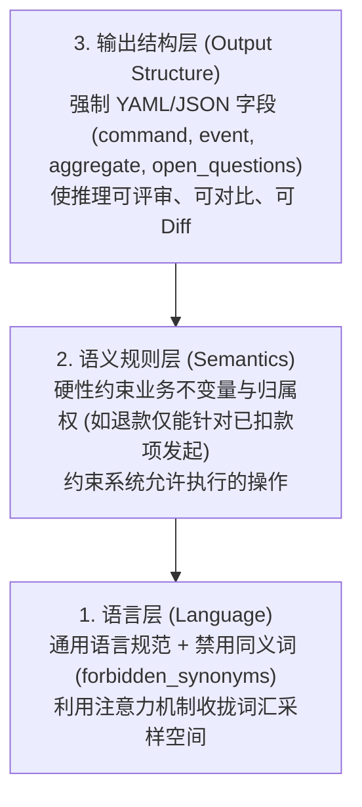

> 💡 **学习导读**：本文收录于专栏 [《AI 增强的领域驱动设计》](/columns/ai-ddd)。
> 📦 **配套工程资产**：本篇核心沉淀的规则手册模版与配置已固化为可执行技能包，支持一键打包下载：[获取 DDD 规则与精化技能包](/skills/ddd-context-refiner)。

---

## 学习导航：为什么需要这套笔记？

在与 AI 协作进行领域建模时，最可怕的不是 AI 报错，而是 **“输出表面行云流水、格式极具 DDD 范儿，背地里却存在隐秘错误（Silently Wrong）”**。

本文档采用 **「🎯 实战精粹（高信噪比学习主线）」** 与 **「📖 原书论述（溯源背景对照）」** 的双重视角编排。帮助你在 3 分钟内建立核心心智模型，同时保留原著的论据溯源。

---

## 一、 核心翻车现场：为什么规则远比提示词更重要？

| 🎯 实战精粹（心智模型） | 📖 原书论述对照（溯源背景） |
| :--- | :--- |
| **提示词 vs 规则手册**<br>• **提示词（Prompt）**：要求模型“做什么”。<br>• **规则手册（Rulebook）**：约束模型“如何推演”。<br><br>**破除教科书指令的迷信**：<br>写 `“请始终如一地应用 DDD 原则”`、`“实体必须有唯一标识”` 毫无约束力。因为大模型早在预训练数据中背熟了这些常识，泛化指令**丝毫没有收窄模型在你项目中的概率采样空间**。 | **BrewUp 支付建模的惨痛教训**<br>团队首次要求 AI 对支付上下文建模，输出的 YAML 乍看无可挑剔（有 Payment 聚合、Authorize、Capture 等命令）。<br>然而资深工程师发现：<br>1. AI 悄悄捏造了 `Charge` 聚合，仅因提示词偶然提到了 *“charge the customer”*；<br>2. AI 竟对处于授权（Authorized）而非已扣款（Captured）的款项发起退款。<br>*[溯源: 原著第 32-56 行]* |

### 核心结论
大语言模型本质是**沿着概率填补空白**。规则手册的作用正如 DDD 中的限界上下文：**提前规定模型应当如何处理这些概率空白，将缺乏约束的主观臆测收拢在刚性护栏内。**

---

## 二、 DDD 规则手册的三层架构

一份合格的规则手册必须自底向上由三层构建，每一层都是上一层的基石：



| 层级 | 核心职责 | 实战示例（Payment 上下文） |
| :--- | :--- | :--- |
| **1. 语言层** | 锁定领域专用词汇，设立**禁用同义词**拦截漂移。 | `forbidden_synonyms: [Charge, Transaction, OrderPayment]` |
| **2. 语义规则层** | 约束概念的行为、生命周期与核心业务不变量。 | `Refunds are issued only against captured payments, never against authorizations.` |
| **3. 输出结构层** | 强制结构化呈现，拒绝发散性散文。 | `format: yaml; fields: [command, event, aggregate, open_questions]` |

---

## 三、 规则从何而来？（拒绝空中楼阁）

不要试图大费周章开务虚会枚举所有规则。成熟的规则手册天然源于三大渠道：

1. **团队已经踩过的生产 Bug（代价惨痛的真知）**：
   * 禁用同义词清单**不必穷举世间所有错词**，只记录让团队付出过真金白银代价的词（例如 `Charge`）。这使得规则库天然保持有限且收敛。
2. **领域研讨中沉淀的“词汇排他块”**：
   * 只要领域专家在讨论中费心区分两个相近词汇（如 `Order submitted` vs `Order received`），一条规则就呼之欲出。
3. **工作坊未能敲定的“未决问题（Open Questions）”**：
   * 遇到权属模糊之处，下达**紧急刹车指令**：*“如果归属权不清晰，将其列为待决问题，严禁擅自脑补规则。”*

---

## 四、 护栏的三大工程容器：关注点解耦

不要把人设、过程、词汇和项目数据杂糅在一个庞杂的 Prompt 中。作者提炼出了三大容器的分工法则：


| 容器 | 核心回答 | 生命周期 | DDD 实战职责 |
| :--- | :--- | :--- | :--- |
| **Agent（智能体）** | **Who**（模型扮演何种角色） | 贯穿整个会话 | 维持 DDD 架构师姿态；严守限界上下文边界；确立“遇缺则问”而非妄加揣测的准则。 |
| **Skill（技能）** | **How**（特定任务怎么做） | 显式触发，按需激活 | 规范独立规程（如提取领域事件、校验聚合边界）；强制统一的输入与输出 Schema。 |
| **MCP 服务器** | **What**（可以查阅什么数据） | 运行时工具检索 | 暴露词汇表、上下文映射图（Context Map）、事件风暴记录。**将“概率推测”转化为“确定性查表检索”**。 |

### 工程经验法则
> 💡 **收敛原则**：一条规则应当只编写一次，并优先置于足以容纳它的最宽泛容器中（Agent）；仅当更窄的容器（Skill）确实需要对特定任务进行加固收紧时，才允许进行重申。

---

## 五、 案例推演：从批判审视中演化规则

以 BrewUp 订单管理（Order Management）上下文的演化为例，展现如何将 AI 的错误转化为规则：

### 1. AI 的初稿缺陷
在仅给出基础词汇 `Order, Payment, Stock` 时，AI 返回了包含 `Payment` 聚合和 `Stock` 聚合的模型。
* **致命隐患**：AI 将当前上下文仅仅“引用”到的外部概念，直接跃升为了本上下文“拥有”的聚合，**暗中击穿并瓦解了限界上下文的边界**！

### 2. 批判并晋升为新规则
团队并不手动修补单次输出，而是提炼出刚性约束注入规则库：
```yaml
- Order Management 仅拥有 Order 聚合。
- Payment 和 Stock 是外部概念。
- 由其他限界上下文产生的事件必须标记为 external_input。
- 绝不能将外部事件当作内部状态变更。
- 若归属权不明确，请添加 open_question，严禁脑补规则。
```

### 3. 第二轮输出蜕变
AI 迅速将 `Payment` 和 `Stock` 归入 `external_input`，并主动在 `open_question` 中发问：*“Payment 和 Stock 的标准外部事件名是什么？”*。**关于“权属不明即刹车提问”的规则切实生效！**

---

## 六、 避坑指南（Do's & Don'ts）

* ❌ **Don't**：写教科书检查清单（如“聚合根必须保证不变量”）。
* ✅ **Do**：针对单一限界上下文编写专用规则（如“退款仅能针对已扣款款项发起”）。
* ❌ **Don't**：试图提前枚举并禁用世间所有的错误名词。
* ✅ **Do**：只记录线上踩过坑、造成过误解的禁用词汇。
* ❌ **Don't**：向 AI 索要最终完美答案，或者把人设、过程、词汇堆在一个 Prompt 里。
* ✅ **Do**：让 AI 给出结构化初稿，以人类 DDD 专家视角批判并提取规则，解耦至 Agent、Skill 与 MCP。

---

> 🛠️ **动手实践**：本章配套的 YAML 模版已发布至站点技能中心，可前往 [DDD 限界上下文规则与精化技能包](/skills/ddd-context-refiner) 查阅并下载。
