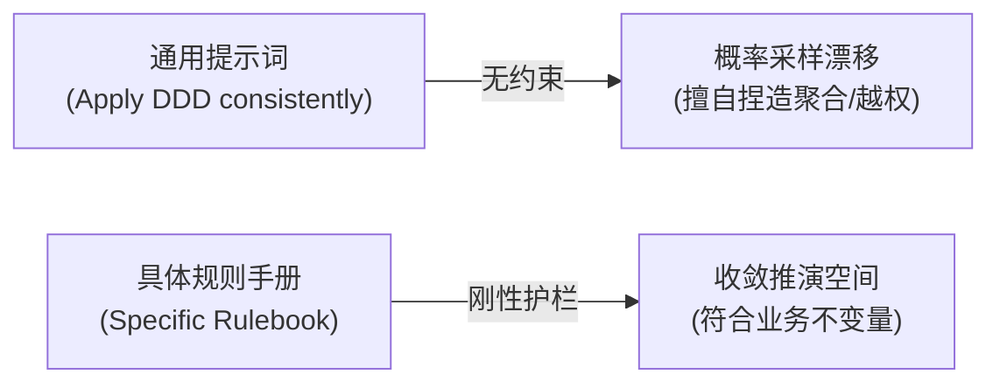
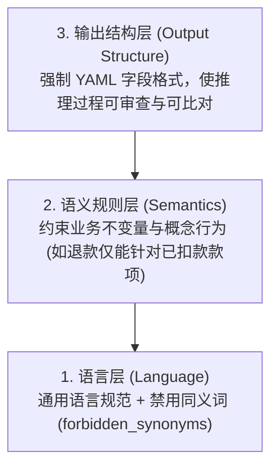

# 核心实战精炼：定义规则手册 (Rulebook)

## 1. 核心矛盾：提示词与规则的区别

- **提示词（Prompt）**：指定执行目标（What to do）。
- **规则手册（Rulebook）**：施加推演约束（How to reason）。
- **问题本质**：大语言模型根据概率采样填补空白。泛化指令（如“请遵循 DDD 原则”）属于已学习常识，无法收敛当前项目的概率分布。
- **失误特征**：输出符合语法与命名习惯，但在业务规则与归属权上产生隐蔽错误（Silently Wrong），例如捏造聚合或越权调用。



## 2. 规则手册的三层架构

规则手册是针对单一限界上下文编写的最小刚性约束集合，分为三层：



1. **语言层**：
   - 规定通用语言标准词汇。
   - 显式声明 `forbidden_synonyms`。利用注意力机制阻断模型滑向通用近义词（如将 Payment 误称为 Charge）。
2. **语义规则层**：
   - 约束概念行为与生命周期。
   - 声明业务不变量（如“退款仅能针对已扣款发起，严禁对已授权款项发起”）。
3. **输出结构层**：
   - 强制使用 YAML/JSON 表达。
   - 包含命令、事件、聚合与未决问题字段，将散文输出转化为结构化制品。

## 3. 护栏的三大工程容器

不要将人设、任务与数据源混合在单一提示词中，应按生命周期解耦：

| 容器 | 职责定位 | 生命周期 | DDD 落地示例 |
| :--- | :--- | :--- | :--- |
| **Agent (智能体)** | **Who**：思考视角与全局姿态 | 会话级持久 | 维持 DDD 架构师姿态；严格隔离限界上下文；确立“遇缺则问”原则。 |
| **Skill (技能)** | **How**：具体规程与操作任务 | 显式调用激活 | 独立执行任务规程（如提取领域事件）；校验并输出固定 Schema。 |
| **MCP 服务器** | **What**：受信任项目数据源 | 运行时检索工具 | 暴露词汇表、上下文映射图（Context Map）。将概率臆测转为确定性查表。 |

> **收敛原则**：规则应在满足需求的最宽容器（Agent）中声明一次；仅在特定任务需要进一步收紧时，在较窄容器（Skill）中重申。

## 4. 规则来源与沉淀路径

1. **生产事故与实际失误**：
   - 禁用词表仅需记录实际引发过歧义或 Bug 的词汇，无需穷举。
2. **领域研讨中的排他词汇**：
   - 将工作坊中明确区分的概念（如 Order submitted 与 Order received）沉淀为排他规则。
3. **未决问题（Open Questions）**：
   - 权属不明或前置条件缺失时，指令模型停止推断，将其显式列为待决问题。

## 5. 生产级规则手册 YAML 模版

```yaml
# rules/payment-context.yaml
context: Payment
vocabulary:
  - Payment
  - Authorization
  - Capture
  - Refund
  - Settlement

forbidden_synonyms:
  - Charge
  - Transaction
  - OrderPayment

invariants:
  - "Currency at authorization must equal the order currency. No conversion at payment time."
  - "An authorization expires 30 minutes after issuance; capture must occur within that window."
  - "Refunds are issued only against captured payments, never against authorizations."
  - "Partial refunds are allowed; partial captures are not."

ownership_rules:
  - "Payment context only owns Payment aggregate."
  - "Do not invent aggregates that are not present in vocabulary."
  - "If concept ownership is unclear, add an open question instead of inventing rules."

output:
  format: yaml
  fields:
    - command
    - event
    - aggregate
    - open_questions
```

## 6. 避坑清单 (Do's & Don'ts)

| 错误实践 (Don't) | 正确实践 (Do) |
| :--- | :--- |
| 编写教科书式泛化检查清单（如“聚合根保护不变量”）。 | 针对单一限界上下文编写专用规则（如“严禁在支付阶段转换货币”）。 |
| 试图穷举世界上所有同义词。 | 仅记录团队遇到过的真实歧义词汇与线上故障名词。 |
| 将角色身份、执行步骤与词汇规则混在一个长 Prompt 里。 | 解耦至三大容器：Agent 定姿态，Skill 定任务，MCP 定事实。 |
| 允许模型在信息不足时进行推测。 | 设置推演中断指令：信息不足时强制输出 `open_questions`。 |

<!-- split -->

# 原著完整参考：定义规则：教会模型运用 DDD 进行思考

在上一章中，我们借助事件风暴（EventStorming）和领域叙事（Domain Storytelling）将领域知识显式外化，并沉淀了团队在全书后续内容中将持续沿用的词汇表。我们以一条实践原则收尾：“发现（Discover）、精炼（Refine）、命名（Name）、强化（Reinforce）”这一演进序列所构建的语言，其稳定性足以在与 AI 助手的多次对话中建立信任。然而，稳定的词汇并不等同于严谨自律的推理（Disciplined Reasoning）。本章将通过引入**规则手册（Rulebook）**来弥合这一差距。

:::en
> **Original**: In the previous chapter, we used EventStorming and Domain Storytelling to externalize domain knowledge and to stabilize the vocabulary the team will use for the rest of the book. We ended on a working principle: the sequence Discover, Refine, Name, Reinforce produces language stable enough to be trusted across conversations with an AI assistant. Stable vocabulary, however, is not the same as disciplined reasoning. This chapter closes that distance by introducing a rulebook.

**📌 核心术语与语境解析**：
- **Disciplined Reasoning**：*受纪律约束的推理*。特指模型不凭预训练概率直觉自由发散、而是在团队划定的架构刚性轨道内推演。
- **Rulebook**：*规则手册*。代码化、版本化的最小约束集，扮演模型在特定限界上下文内的思维护栏。
:::

规则手册是一组简短且显式的约束条件，用于管控模型在特定限界上下文（Bounded Context）内部的推理方式。团队只需编写一次，将其与代码一同进行版本控制，并在后续的每次会话中重复使用。在实践中，它是代码仓库中与代码并存的一个文件：一份 Markdown 格式的指令文件或一小段 YAML 片段，像任何其他源文件一样被编辑和评审。它的有效性取决于具体精确度（Specificity），而非篇幅的长短或构思的巧妙。规则手册在与 AI 交互中所扮演的角色，恰如限界上下文在领域驱动设计中所起的作用：它守护语义、保全设计意图，并使输出在时间的推移中始终保持可靠。

这些约束之所以不可或缺，是因为即便大语言模型（LLM）手握清晰的词汇表，依然可能会擅自扩大业务范围、无依据虚构聚合，并模糊上下文边界。这样的大模型同样可能生成看似行云流水、实则偏离实际设计的输出。这种漂移（Drift）根源于大语言模型的工作机制：它沿着提示词所暗示的方向去填补概率上的空白。而规则手册则提前规定了模型应当如何处理这些空白。

:::en
> **Original**: A rulebook is a small, explicit set of constraints that govern how the model reasons inside one bounded context. The team writes it once, versions it alongside the code, and reuses it in every session that follows. In practice, it is a file that lives in the repository next to the code: a Markdown instruction file or a short YAML fragment, edited and reviewed like any other source file. Its effectiveness depends on specificity rather than length or cleverness. The rulebook plays the role that bounded contexts play in Domain-Driven Design: it protects meaning, preserves intent, and makes output dependable over time. Those constraints are necessary because an LLM with a clear glossary in hand can still widen scope, invent aggregates, and blur context boundaries. Such an LLM can also produce fluent output that drifts away from the actual design. This drift follows from how an LLM operates: it fills probabilistic gaps in the direction suggested by the prompt. A rulebook defines in advance how the model should handle those gaps.

**📌 核心术语与语境解析**：
- **Specificity** [ˌspesɪˈfɪsəti]：*具体精确度/特异性*。规则的生命力在于与具体的单一限界上下文强绑定；泛泛而谈的常识（如“实体具有唯一标识”）无法约束采样空间。
- **Probabilistic gaps**：*概率空白*。大模型在缺乏确定性事实输入时，基于训练概率倾向推断填充的假设缝隙。
:::

故事始于 BrewUp 案例中一个切实的真实时刻：团队猛然发觉，AI 助手完全可以生成表面上极具 DDD 规范的输出，背地里却存在隐秘的错误（Silently Wrong）。顺着这一线索，本章将展示少量恰到好处的规则如何有效规避此类失误，以及如何将这些规则打包到可复用的容器中——即智能体（Agents）、技能（Skills）与 MCP 服务器（MCP Servers）——从而使其在一次又一次的会话中持续发挥效力。

:::en
> **Original**: You begin with a concrete BrewUp moment, when the team realized that an AI assistant could produce DDD-shaped output and still be silently wrong. From there, the chapter shows how a small number of well-placed rules can prevent that kind of failure, and how those rules can be packaged into reusable containers, namely agents, skills, and MCP servers, so that they keep working session after session.

**📌 核心术语与语境解析**：
- **Silently Wrong**：*隐性错误*。大模型最具欺骗性的失效模式——代码语法完全正确、名词听起来极其符合 DDD，但在业务不变量和所有权边界上犯下致命错误。
:::

在本章中，你将学到：

- 为什么形如“*始终如一地应用 DDD*”这种泛化的 DDD 指令无法真正约束模型，以及一个包含专用词汇、不变量（Invariants）和禁用同义词（Forbidden Synonyms）的支付（Payment）专属规则手册究竟长什么样。
- 智能体、技能和 MCP 服务器如何作为规则的三种不同容器协同运作。每个容器分别塑造不同的关注点：模型应当扮演的身份（Who）、它执行特定任务的方式（How），以及它能够查阅的受信任项目数据源（What）。
- 结构化输出预期（例如包含命名命令与事件字段的 YAML）如何将模型的推理过程转化为可供你评审、对比差异（Diff）以及复用的制品（Artifacts）。
- 团队如何通过批判与审视（Critique）不断迭代精炼规则手册，将模型的每一次隐性失误转化为一条崭新的规则，从而确保下一次能够精准拦截同类错误。

让我们从团队最初经历的那个场景起步：一个在纸面上看似完全正确的支付上下文（Payment Context）。

## 技术要求

本章所阐述的核心思想并不依赖于某一家特定的大模型或厂商。文中的示例假定你所使用的助手能够读取项目级配置文件，而不仅限于当前对话上下文。为了动手实践本章内容，你需要：

- 一款能够读取项目级指令文件的 AI 编程助手：取决于具体的工具，可以是 `CLAUDE.md`、`AGENTS.md` 或 `.github/copilot-instructions.md`。
- 支持具备明确命名且面向特定任务的过程机制——如技能（Skills）、自定义命令或助手中的等价物——如果你希望亲自运行本章后半部分的示例而非仅浏览阅读，还需要具备至少一个 MCP 服务器的访问权限。
- 一款能够编辑 Markdown 与 YAML 文件的文本编辑器。

本章中的规则手册、智能体代码片段和技能定义都刻意保持得非常精炼。它们旨在展示 DDD 约束在各个容器中呈现的具体形态，而非演示某款特定商业产品的配置细节，因此这些模式可以无缝迁移到团队所选定的任何 AI 助手之中。

## 为何规则远比提示词更重要

当 BrewUp 团队首次要求 AI 助手为支付上下文（Payment Context）建模时，其生成的输出乍看之下合情合理。返回的 YAML 包含一个 `Payment` 聚合，诸如 `Authorize`（授权）、`Capture`（扣款/捕获）和 `Refund`（退款）等符合直觉的命令，以及采用过去时态命名的事件。然而，一位资深工程师随即指出，模型悄悄捏造了一个 `Charge` 聚合，仅仅因为提示词中偶然提及了“*向客户收费（charge the customer）*”。此外，模型还生成了一条直接对“已授权（Authorized）”而非“已捕获（Captured）”的支付款项发起退款的流程。该结果语言流畅且语法严密，却在团队从未成文写下的一条领域规则上犯下了致命的隐性错误。

正是在那个瞬间，团队决定不再单纯编写提示词，而是开始编写规则。两者在文本表现上可能颇为相似，但回答的却是截然不同的问题：提示词要求模型“做什么”，而规则则约束模型“如何推演”。当模型给出的错误答案看起来“无比正确”时，这种区别就显得尤为关键。无论怎样重新措辞提示词，都无法阻拦无依据生成的 `Charge` 聚合，因为此前从未有人明确告知助手：`Charge` 是被严令禁用的。

:::en
> **Original**: That moment is when the team stopped writing prompts and started writing rules. The two look similar on the page, but they answer different questions. A prompt asks the model to do something. A rule constrains how it can reason. The distinction matters most when the model is wrong in a way that reads as right. No rephrasing of the prompt would have caught the invented Charge aggregate, because nobody had ever told the assistant that Charge was forbidden.

**📌 核心术语与语境解析**：
- **Prompt vs. Rule**：提示词驱动行为生成（What to do），规则定义推演边界（How to reason）。
- **Reads as right**：*假性正确/表面通顺*。大模型最具欺骗性的特征，生成文本在语法和逻辑上无懈可击，却完全违背领域未言明的硬性规则。
:::

这些规则无需复杂冗长即可发挥实效。一组简短且界定清晰的约束，通常就足以引导模型展开符合领域一致性的推理。真正的挑战在于“甄选”：找出能够迫使模型以领域驱动设计方式思考的最小规则集。

人们在构建这种规则手册时，很自然的一个初次尝试往往是把教科书里的 DDD 概念直接翻译成一份 Copilot 指令文件便草草了事。下面的代码片段就是此类早期尝试的一个典型缩影：

```text
Domain-Driven Design (DDD) Instructions

General Principles
- Apply Domain-Driven Design patterns consistently in all generated code
- Use the Ubiquitous Language of the domain
- Maintain a strict separation between architectural layers

Tactical Design Patterns
- Entities: Must have a unique and persistent identity
- Value Objects: Must be immutable
- Aggregates: Define the Aggregate Root and enforce invariants
- Repositories: Define interfaces in the Domain layer
```

这种检查清单看起来或许令人安心，但实际上几乎无法提供任何有效的约束。其中的每一行内容，不过是在重述助手早已在预训练数据中吸收过的通用常识。“*Apply DDD consistently*（始终如一地应用 DDD）”根本不是一条约束，而是一句美好的祈福祈愿。“*Entities have a unique identity*（实体具有唯一标识）”也是模型无需任何帮助就能倒背如流的公理定义。这份文件并没有收窄助手在你项目中可能生成的内容空间，因为它根本没有提及任何关于你项目的具体信息。无论是否加载该文件，模型的行为都毫无二致。篇幅长短并不是问题的症结所在——即使列出一份三倍长的检查清单，对模型的约束力依然微乎其微。因为它所缺失的是至关重要的具体精确度（Specificity）：即特定限界上下文独有的词汇表、不变量以及模型边界。

:::en
> **Original**: This kind of checklist may look reassuring, but it provides little practical constraint. Each line restates something the assistant has already absorbed from training data. '*Apply DDD consistently*' is not a constraint; it is a benediction. *Entities have a unique identity* is a definition the model can recite without help. The file does not narrow what the assistant can produce in your project, because it does not say anything about your project. The model behaves the same way whether the file is loaded or not. Length is not the problem. A checklist three times longer would constrain the model just as little, because what is missing is specificity: the vocabulary, the invariants, and the boundaries of one bounded context.

**📌 核心术语与语境解析**：
- **Benediction** [ˌbenɪˈdɪkʃn]：*祈福/祝词*。“始终遵守 DDD 规范”是典型的无约束效力的废话型提示，无法降低生成熵。
- **Specificity** [ˌspesɪˈfɪsəti]：*专属性与精确度*。规则生效的核心前提是与特定限界上下文（如支付、履约）深度绑定。
:::

一份真正有价值的规则手册，必须植根于单一限界上下文的具体特征。下面展示了将这一理念应用于 BrewUp 支付上下文的实例，团队将通过代价高昂的线上生产 Bug 所换来的惨痛教训，全部凝练编码进了规则之中：

```yaml
context: Payment
vocabulary: Payment, Authorization, Capture, Refund, Settlement
forbidden_synonyms: Charge, Transaction, OrderPayment

invariants:
- Currency at authorization must equal the order currency. No conversion at
payment time.
- An authorization expires 30 minutes after issuance; capture must occur within
that window.
- Refunds are issued only against captured payments, never against authorizations.
- Partial refunds are allowed; partial captures are not.

events:
- Use past-tense names rooted in the Payment vocabulary, e.g. PaymentAuthorized,
PaymentCaptured, PaymentRefunded.
```

该片段中的每一行内容，都在实实在在地收拢助手可能生成的空间。模型绝不可能无依据创建 `Charge` 聚合，因为早在模型首次犯错的那一天，`Charge` 就已被列入禁用名单；模型绝不可能提议在支付环节进行货币转换，因为业务不变量明令禁止；模型也绝不可能针对仍处于授权状态的支付发起退款，因为本章开篇提及的那套错误的退款逻辑，如今已被正式沉淀为一条刚性规则。这份文件虽然更加短小精悍，其约束却无比具体精准。这正是泛化检查清单与领域规则手册之间的本质区别。

:::en
> **Original**: Every line in this fragment narrows what the assistant can produce. The file cannot invent a Charge aggregate, because Charge went on the forbidden list the day the model invented it. The file cannot propose currency conversion at payment time, because the invariant forbids it. The file cannot emit a refund against a still-authorized payment, because the refund flow that opened this chapter is now written down as a rule. The file is shorter, but its constraints are more specific. That is the difference between a generic checklist and a domain rulebook.

**📌 核心术语与语境解析**：
- **Narrow the space**：*收拢生成空间*。通过刚性否定规则剪裁大模型的可能分支，使其推演轨迹严格落在领域安全区内。
- **Domain Rulebook**：*领域规则手册*。以代码化形式管理的不变量、禁用词与事件命名规范集合。
:::

### 规则从何而来

如此具体的规则手册，乍看之下似乎必须大费周章地组织专门的工作坊才能产出。然而在 BrewUp 中，团队绝大部分的规则手册都是通过忠实记录此前遭遇过的现实问题构建起来的。这些规则绝大部分源于三大渠道：

第一个来源是**团队已经遭遇过的实际问题**。`forbidden_synonyms: Charge, Transaction, OrderPayment` 这份禁用名词列表，记录的全都是曾经在不恰当场合出现过的词汇，而非凭空猜测模型可能会捏造什么。`Charge` 之所以赫然在列，正是因为本章开篇的那次建模会话。规则中的各项不变量同样具有完全相同的出处溯源（Provenance）：每一条都是某人通过付出高昂代价的实际故障总结得出、并记录在案以确保无人重蹈覆辙的真知。这份列表同时也是对一种合理质疑的绝佳回应——有人认为禁用同义词是在“自证其无”，穷举永远没有尽头。事实上，根本没有人需要提前枚举世间所有的错误名词；列表只需记录那些已经让团队产生过实际故障与返工成本的词汇即可，这使其天然保持有限，且新增速度会逐渐衰减。

:::en
> **Original**: The first source is the problems the team has already encountered. `forbidden_synonyms`: Charge, Transaction, `OrderPayment` is a list of names that had already turned up where they did not belong, rather than a guess about what a model might invent. Charge is there because of the modeling session that opens this chapter. The invariants have the same provenance: each one is a rule someone learned through costly experience and wrote down so that nobody has to learn it twice. The list is also the answer to a fair objection – that banning synonyms means proving a negative, and you can never finish. Nobody is enumerating every wrong name in advance; the list only records the ones that have already cost something, which makes it finite and shrinking.

**📌 核心术语与语境解析**：
- **Provenance** [ˈprɒvənəns]：*出处溯源/起源凭据*。规则并非凭空构想，必须有线上真实 Bug 或设计研讨作为起源依据。
- **Invariants**：*业务不变量*。业务生命周期中任何合法状态转换都绝不可违背的刚性真理。
- **Proving a negative**：*自证其无*。对禁用词穷举不可能性的逻辑反驳——工程上只需记录已产生故障的已知项。
:::

第二个来源是**团队业已维护的词汇表**。上一章的结尾包含一个专门的“词汇排他块（Vocabulary Exclusions Block）”——例如“*切勿使用 Order received 作为 Order submitted 的同义词*”；“*当领域事实仅仅是授权时，切勿使用 Payment completed*”——这些是在工作坊中正式研讨确立的，而非源于后期的试错摸索。这个排他块本身就是一份现成的禁用同义词清单；团队只需将其搬入规则手册中即可，完全无需另行构思。在词汇表中，只要有人费心去区分两个在常规流畅文笔下容易混用的词汇，就意味着一条规则正呼之欲出。

第三个来源是**工作坊未能解决的悬而未决问题（Open Questions）**。*第 4 章*遗留了若干未决事项——例如库存预留（Stock reservation）到底由谁掌管、在订单被确认之前必须满足哪些前置条件——每一个悬置的问题，都是模型在缺乏约束时极易凭借直觉去填充合理答案的潜在漏洞。针对悬而未决的问题所制定的规则，往往不是陈述一个确凿事实，而是一条“终止推演并记录疑问”的中断指令：**如果概念的归属权尚不清晰，请将其列为待决问题，而不是擅自虚构规则**。

在此之后，规则将通过循环演进不断沉淀积累：将现有的规则手册提供给模型，以人类专家的领域判断力审视其返回的结果，并将每一次修正提炼为一条崭新的规则，以确保下一次能够直接拦截同类错误。本章最后一节将带领大家在订单管理（Order Management）的两次迭代中完整体验这一闭环。这正是成熟规则手册的主要成因：当一个团队经历过几次这样的循环后，他们便不再纠结于“到底该写哪些规则”，而是能够敏锐地识别并提炼出规则。

:::en
> **Original**: The third source is the questions the workshops could not close. *Chapter 4* left several open – who owns a Stock reservation, which conditions must be satisfied before an Order can be confirmed – and every one of them is a gap the model will otherwise fill with something plausible. The rule that comes out of an open question is rarely a fact. It is usually an instruction to stop: if ownership is unclear, add an open question instead of inventing a rule. After that, rules accumulate by running the loop. Give the model the current rulebook, read what comes back with domain judgment, and promote each correction into a rule that catches the same mistake next time. The last section of this chapter follows that loop through two iterations of Order Management. It is where most of a mature rulebook comes from: a team who has run it a few times stops asking which rules to write and starts recognizing them.

**📌 核心术语与语境解析**：
- **Instruction to stop**：*中断推演指令*。防止模型在遇到事实信息缺失时凭借概率倾向自行填充，强制转为悬置待决项。
- **Promote correction into a rule**：*将纠偏晋升为规则*。将代码审查与对话中发现的单次偶发错误，固化为全局版本化护栏。
:::

洞悉规则从何而来只是完成了一半的工作，另一半则是清晰地界定你所编写的规则属于何种类别。前面展示的支付代码片段实际上承担了三项截然不同的职责：它规定了模型可以如何命名事物、这些事物被允许如何运转，以及最终给出的答案必须呈现怎样的格式形态。

## DDD 规则手册的三层架构

一份规则手册由三个层级自底向上堆叠构建而成：**语言（Language）**、**语义（Semantics）**以及**输出结构（Output Structure）**。每一层的稳固性完全依赖于其下层的支撑。

第一层是**语言层**。模型必须始终如一地使用该限界上下文的通用语言（Ubiquitous Language），避免滑向通用的技术黑话或擅自创造的同义词。语言层在形式上类似风格约定，在实效上则扮演着坚固的护栏（Guardrail）。*第 2 章与第 3 章*揭示了其背后的作用机理：重复出现的术语会通过注意力机制自我强化，每一次强化都会收窄模型从中采样的概率分布。因此，稳定的词汇表能产生实质效用——它极大地缩减了模型可能肆意游荡的潜在语义空间。在支付规则手册中，这一层精炼为单一的一行：`forbidden_synonyms: Charge, Transaction, OrderPayment`。

第二层是**语义规则层**。这些规则向模型传达领域概念被允许如何表现与运转。例如：事件代表已经发生的事实；聚合通过其聚合根保护内部不变量；仓储（Repository）属于领域契约的一部分，即便其技术实现位于别处。缺乏了语义层，模型依然能输出行云流水般的文本，但往往会抹平或曲解真实的领域本质。支付规则中就包含这样一条规则：“*退款仅能针对已扣款的支付发起，绝不能针对已授权的支付发起*”。这条规则丝毫不涉及命名规范，它直接对系统“被允许执行什么操作”施加了硬性约束。

第三层是**输出结构层**。要求模型以 YAML 或 JSON 表达其结果，能够强迫它围绕具有明确业务内涵的分类组织答案，而非任由其自由发散抒写散文。命令、事件、聚合、策略（Policies）以及上下文边界得以变得清晰可见、便于评审且可重复利用。支付规则手册中的 `events` 块便是这一层极具代表性的微缩体现：它并没有逐一罗列事件，而是严格规定了事件必须呈现的格式形态。

:::en
> **Original**: A rulebook is built from three layers, and they stack: **language**, **semantics**, and **output structure**. Each one is only as strong as the one beneath it. The first layer is language. The model must use the Ubiquitous Language of the bounded context consistently and avoid drifting into generic technical vocabulary or invented synonyms. The language layer looks like a style rule and works like a guardrail. *Chapters 2 and 3* explained the mechanism: repeated terms reinforce each other through attention, and each reinforcement narrows the probability distribution the model samples from. Stable vocabulary therefore does real work – it shrinks the space the model can wander into. In the Payment rulebook, that layer is a single line: `forbidden_synonyms`: Charge, Transaction, `OrderPayment`. The second layer consists of semantic rules. These tell the model how domain concepts are allowed to behave. An event is something that has already happened, an aggregate protects its invariants through its root, and repositories belong to the domain contract even if their implementation lives elsewhere. Without them, the model still produces fluent output, but it flattens or distorts the domain. Payment carries one of these: refunds are issued only against captured payments, never against authorizations. That rule says nothing about naming. It constrains what the system is allowed to do. The third layer is output structure. Asking the model to express its result in YAML or JSON forces it to organize the answer around meaningful categories instead of free-form prose. Commands, events, aggregates, policies, and boundaries become visible, reviewable, and reusable. The events block in the Payment rulebook is the smallest possible version of this: it does not list the events; it dictates the form they must take.

**📌 核心术语与语境解析**：
- **Three-layer Stack**：*三层堆叠架构*。语言层（稳定词汇）→ 语义层（不变量与行为准则）→ 结构层（机器可评审的输出契约）。
- **Flattens or distorts**：*压平或扭曲*。缺乏语义护栏时，模型倾向于将富领域模型退化为贫血的 CRUD 结构。
:::

以下是 BrewUp 订单管理（Order Management）的极简规则手册：

```yaml
context: BrewUp Order Management
rules:
  - Use only the defined domain vocabulary: Order, Payment, Stock
  - An event must represent something that has already happened
  - Each successful state-changing command should produce at least one domain event
  - Do not introduce new aggregates
output:
  format: yaml
  fields:
    - command
    - event
    - aggregate
```

对照三层架构来审视，这份文件的职责划分清晰明了。词汇约束行对应**语言层**：严格限定为这三个词汇，其余任何术语均不被接纳。关于事件、命令与聚合的规则构成了**语义层**，因为它们管束的是领域概念必须如何运转，而非其名称叫什么。输出块则属于**结构层**，它的存在使得针对同一提示词的两次运行结果能够逐行进行精准比对。

:::en
> **Original**: Even this small set of constraints changes the interaction. The model is no longer free to improvise a generic solution: it has to operate inside a defined linguistic and structural boundary. The rulebook constrains where the model may reason instead of asking it to reason better. The file is just as interesting for what it leaves out. The file lists Order, Payment, and Stock as the vocabulary of this context, and never says which of the three Order Management actually owns. That silence is deliberate, and we will come back to it at the end of the chapter, once we have a durable place to store the rules that emerge from critique.

**📌 核心术语与语境解析**：
- **Constrain where to reason**：*约束推理范畴*。规则手册的精髓不在于教授推理技巧，而在于圈定推理的边界围栏。
- **Improvise a generic solution**：*即兴推测通用方案*。大模型在没有上下文锚定时习惯性地输出泛化但无针对性的样板代码。
:::

## 智能体、技能与 MCP 服务器：DDD 护栏的三大容器

将这些关注点解耦拆分到具有不同生命周期的**三大容器**之中：
- **智能体（Agent）**承载模型在整个会话期间始终保持的常态化姿态（Posture）；
- **技能（Skill）**的范围更为收敛聚焦：它是一个独立的过程规程，仅在被显式调用时激活，其余时间保持休眠；
- 基于模型上下文协议（Model Context Protocol）构建的 **MCP 服务器（MCP Server）**则承担了截然不同的职能：它向模型开放可供查阅的权威项目数据源，从根本上杜绝毫无根据的凭空臆测。

作为一条极为实用的工程法则：**如果某项约束无论面对何种任务都必须始终成立，它就归属于智能体；如果某项约束仅在特定任务执行期间生效，它就归属于技能；如果某项约束依赖于当前对话上下文之外的既成事实，它就应当被置于 MCP 之后。**

:::en
> **Original**: Agents, skills, and MCP servers operate as three different containers for rules. Each container shapes a different concern: **who** the model is supposed to be, **how** it performs a specific task, and **what** trusted project sources it can consult. As a practical engineering rule: *if a constraint must hold no matter the task, it belongs in an agent; if it only applies during a specific task, it belongs in a skill; and if it depends on facts outside the conversation, it belongs behind an MCP server.*

**📌 核心术语与语境解析**：
- **Posture** [ˈpɒstʃə(r)]：*常态化姿态/心智立场*。Agent 在整个会话期间始终坚守的角色定位（如严守限界上下文边界，遇缺则问）。
- **Procedure** [prəˈsiːdʒə(r)]：*独立规程*。Skill 承载的任务级操作规程，具备明确触发与终止生命周期。
- **Grounding**：*事实扎根*。借助 MCP 等协议将模型的推演锚定在真实项目资料上，消除缺乏依据的臆测。
:::

### 智能体

**智能体（Agents）**运作在最高控制层级。它们界定了模型在特定交互场景下的身份、角色以及思考视角。智能体的生命周期超越了单次提示词的范畴：它规范的是整个会话周期的模型行为，而非单次一问一答的交互。在 DDD 语境下，智能体可以通过强制推行通用语言、严守限界上下文边界以及维持架构规范，来具象化扮演领域架构师的角色。智能体回答了一个最根本的问题：**在展开推理时，模型到底应该扮演何种角色？**

具体而言，这种全局定调通常栖身于项目级指令文件中：取决于你使用的助手，可以是 `CLAUDE.md`、`AGENTS.md` 或 `.github/copilot-instructions.md`。

```markdown
## DDD Guardrails

- Act as a domain-focused software architect, not as a generic code generator.
- Use the project's ubiquitous language exactly as defined. Do not introduce synonyms unless explicitly requested.
- Treat bounded contexts as strict semantic boundaries. Do not merge concepts across contexts.
- Never invent aggregates, invariants, or business rules that are not supported by the provided context.
- If domain constraints are missing, ask for clarification instead of filling gaps with plausible assumptions.
- Prefer domain behaviors, business rules, and events over CRUD-oriented explanations.
```

:::en
> **Original**: An agent persists beyond a single prompt: it frames the model's behavior for a whole session rather than one exchange. In a DDD context, an agent can embody the role of a domain architect by enforcing the Ubiquitous Language, respecting bounded contexts, and maintaining architectural discipline. Agents answer a fundamental question: who is the model supposed to be while reasoning?

**📌 核心术语与语境解析**：
- **Session-level Persistence**：*会话级持久姿态*。Agent 决定整个交互周期的基调与防守立场，无需在每次提问中重复强调。
- **Architectural Discipline**：*架构刚性纪律*。严守限界上下文边界，遇缺必问，拒绝做无原则的顺从型生成器。
:::

### 技能

**技能（Skills）**专注于执行单一的具体任务。它是一个具备明确命名的规程过程，在触发条件满足时由模型执行，而在不需要时保持休眠。在 DDD 工作流中，诸如从业务场景中提取领域事件、校验聚合边界、审查专业术语，或是将核心业务事实与技术副作用彻底剥离等具体操作规程，都沉淀于此。

```yaml
---
name: extract-domain-events
description: Extract core domain events from a business scenario using DDD rules
---

## Instructions

1. Read the scenario and identify candidate events.
2. Keep only events that represent meaningful business facts.
3. Remove UI actions, technical side effects, and infrastructure reactions.
4. Use past-tense event names only.
5. Do not introduce new aggregates that are not present in the provided context.
6. If two events appear to be synonyms, normalize them using the canonical vocabulary.

## Output format

Return YAML with these fields only:
- event
- aggregate
- reason
- open_questions
```

:::en
> **Original**: Where an agent sets posture, a **skill** performs one job. It is a named procedure the model runs when the conditions for it are met and leaves dormant when it is not needed. In DDD workflows, this is where we encode procedures such as extracting domain events from a scenario, checking aggregate boundaries, reviewing terminology, or separating business facts from technical side effects. An assistant that has been told to think like a domain architect still has to be told how this team extracts events. That gap is what a skill fills. The value here is repeatability: a general instruction such as 'think in DDD' can produce a different answer each time it is invoked, whereas a skill produces answers in the same output schema every time, so the team can compare one run with the last.

**📌 核心术语与语境解析**：
- **Repeatability** [rɪˌpiːtəˈbɪləti]：*可重复性与可比性*。将复杂分析拆解为固定出入参规程，确保不同会话产出的制品格式完全自洽。
- **Dormant** [ˈdɔːmənt]：*休眠状态*。仅在触发任务时加载上下文，防止规则过多导致注意力分散。
:::

### MCP 服务器

MCP 服务器向模型开放可供查阅的权威项目数据源：包括助手可以调用的工具、可以查阅的文档，以及可以依凭的项目制品。在 DDD 工作中，一旦人机交互开始依赖于权威词汇表、上下文映射图、架构决策记录 ADR 等，MCP 的价值就会立刻凸显。通过将对话牢牢锚定在真实的项目资料上，MCP 服务器使“词汇表里究竟是怎么定义的？”这一问题，从模型“凭概率推测回答”转变成了“通过确定性查表检索回答”。

```yaml
tools:
  - name: glossary.lookup
    description: Returns canonical domain terms and forbidden synonyms
  - name: contextmap.get
    description: Returns bounded contexts and allowed relationships
  - name: eventstorming.search
    description: Searches validated workshop events and notes

usage_rules:
  - Always check glossary.lookup before normalizing domain terminology.
  - Use contextmap.get before suggesting interactions across bounded contexts.
  - If an event is not found in the validated workshop material, mark it as proposed, not confirmed.
```

三大容器各司其职：**智能体锁定了模型“是谁”（Who），技能规范了模型“如何工作”（How），而 MCP 则锚定了模型“知道什么”（What）**。

:::en
> **Original**: Agents and skills both shape how the model reasons. **MCP servers** change the material it reasons over. The protocol, introduced by Anthropic in late 2024, is an open standard for connecting an assistant to sources outside its own conversation through a single uniform interface. An MCP server is one such source, exposed under rules the team writes: tools the assistant may call, documents it may read, project artifacts it may rely on. In DDD work, this matters as soon as the interaction depends on knowledge that should not be guessed from general training data: canonical glossaries, EventStorming exports, context maps, architecture decision records. By anchoring the conversation in real project material, MCP servers turn "*what does the glossary say?*" from a question the model answers by inference into one it answers by lookup.

**📌 核心术语与语境解析**：
- **Lookup vs. Inference**：*确定性查表 vs. 概率性推断*。通过标准协议（MCP）向模型注入真实项目资产，从根本上终结无根据推测。
- **Grounding**：*事实锚定*。让大模型的推演逻辑始终与项目真实代码和领域文档保持严格一致。
:::

## 迭代迈向自洽统一的领域词汇

实际的工作流十分明确：**使用当前的规则集运行模型，审视其对与错，随后将修正意见沉淀为一条崭新的规则**。

在 BrewUp 订单管理第二次迭代中，模型返回了包含 `Payment` 聚合与 `Stock` 聚合的内容。团队识别出：模型错误地将该上下文仅仅引用的外部概念，跃升为了本上下文拥有的聚合，瓦解了限界上下文边界。

因此，下一阶段的规则精准脱胎于上述的批判性审视：

```text
- Order Management owns the Order aggregate only.
- Payment and Stock are external concepts for this context.
- Events produced by other bounded contexts must be marked as external inputs.
- Do not treat external events as internal state changes.
- Use the canonical event names from the glossary: OrderSubmitted, OrderConfirmed, OrderCancelled.
- If ownership is unclear, add an open question instead of inventing a rule.
```

:::en
> **Original**: Read against the context boundary, the draft has the problem the rulebook was supposed to prevent. `PaymentCompleted` is attributed to a Payment aggregate and `StockReserved` to a Stock aggregate, inside a file that is supposed to describe Order Management. The rulebook said not to introduce new aggregates, and two appeared. The model did not invent the names: Payment and Stock are both on the vocabulary line. It promoted terms the context merely refers to into aggregates the context owns. Payment belongs to the Payment context, and Stock to the warehouse responsibility *Chapter 4* identified; Order Management only hears about them. If Order Management treats them as its own, the model has silently collapsed bounded contexts. The language looks correct, but the ownership is wrong. This mistake is exactly the kind of mistake that a fluent LLM can hide unless the rulebook forces the distinction to become visible.

**📌 核心术语与语境解析**：
- **Collapsed bounded contexts**：*坍塌上下文边界*。跨上下文概念被模型误认为是本上下文的内聚聚合，造成所有权严重越界。
- **Semantic Ownership**：*语义所有权*。限界上下文不仅约束词汇，更核心的是确定状态变更命令与领域事件的归属权。
:::

注入新规则后，模型输出蜕变为：

```yaml
owned_aggregate: Order
command:
  - Submit Order
  - Confirm Order
  - Cancel Order
internal_event:
  - OrderSubmitted
  - OrderConfirmed
  - OrderCancelled
external_input:
  - Payment
  - Stock
policy:
  - After OrderSubmitted, Payment and Stock are external inputs.
  - Confirm Order only after Payment and Stock indicate success.
  - Confirm Order produces OrderConfirmed.
  - Cancel Order produces OrderCancelled.
open_question:
  - What are the canonical external event names from Payment and Stock?
  - Should an unsuccessful Payment or Stock cause Cancel Order?
```

这正是本章通篇致力于构建的实战闭环：**不要直接向模型索要最终答案，而是要求其提供一份结构化的初稿，运用 DDD 专业判断力对其进行严谨审查，随后将修正意见提炼为一条崭新的规则**。

:::en
> **Original**: This is the practical loop the chapter has been building toward. You do not ask the model for the final answer. You ask it for a structured draft, criticize the draft using DDD judgment, and then promote the criticism into a new rule. Over time, the rulebook becomes a living record of domain knowledge.

**📌 核心术语与语境解析**：
- **Living record of domain knowledge**：*持续演进的领域知识底账*。规则手册不是静态死板的文档，而是随团队业务探索与 AI 纠偏不断增量演化的架构契约。
- **Draft-Critique-Rule Loop**：*初稿-审查-规则提炼闭环*。人机协作的可靠范式：模型产出结构化草案，专家把关架构决策，纠偏沉淀为刚性规则。
:::
读取对照初稿，三处发生了变化。Order 现在是文件声明的唯一聚合；Payment 与 Stock 已移动到 `external_input`；事件名称与词汇表一致，而不是模型的偏好。未决问题尤其重要：模型没有为自己不拥有的事件发明名称，而是反问 Payment 与 Stock 实际如何称呼它们。关于“归属权不清”的规则正在起作用。

有两处没有变化。命令返回的是 `Submit Order` 而不是 `SubmitOrder`，因为规则手册固定了规范的事件名称，却没有对命令做出任何规定。`external_input` 列出的是两个上下文而非两个事件，这也是模型自己提出的理由。两者都成为下一轮迭代的输入，说明规则手册是如何逐步演化的。

这正是本章一直在构建的实战闭环：**你不是要求模型给出最终答案，而是要求它提供结构化初稿，运用 DDD 专业判断对其进行审查，然后把审查意见提炼为一条新规则**。随着时间推移，规则手册会变成持续演进的领域知识底账：一组保护词汇、所有权、边界与不变量的紧凑约束。

当规则精确、小巧且持续精化时，助手就能在团队定义的领域约束内更一致地运作。

## 本章小结

本章从稳定的领域词汇推进到有纪律的推理。我们看到，即使拥有清晰的通用语言，LLM 仍可能产出违反底层设计的流畅输出。防御手段不只是更好的提示词，而是一小组约束模型在单个限界上下文内如何推理的规则。

BrewUp Payment 的时刻让通用指令的代价变得具体：模型悄悄发明了 Charge 聚合。一份教科书式的 DDD 清单对此无能为力，因为它对项目只字未提。而一份简短的 Payment 专属规则手册，通过禁止同义词、货币不变量与退款前置条件，收窄了模型可探索的空间。规则只有在使用单个上下文的语言时，才真正发挥作用。

你学到了：

- 一个有用的规则手册始于单个限界上下文的词汇、不变量与边界。教科书定义听起来严谨，但往往约束甚少，因为模型已经知道它们。
- 每份规则手册都可以读作三层：**语言层**固定模型可以如何称呼事物，**语义层**固定这些事物被允许如何表现，**结构层**固定答案必须采取什么形状。Payment 文件在十几行里同时做了这三件事。
- **Agent、Skill 与 MCP Server** 是规则的三种不同容器。Agent 稳定模型推理时“应当是谁”；Skill 稳定特定建模任务“应当如何执行”；MCP Server 暴露助手在显式规则下可查阅的可信项目来源。
- **结构化输出**通过让模型的推理更易审查与比较，充当护栏。要求以具名字段的 YAML 输出命令、事件与聚合，使模型的推理可审查、可跨迭代比较、可在后续建模中复用。
- 规则手册通过审查逐步演化。最初的规则来自团队已经付出代价的 bug、来自词汇表、以及工作坊未能关闭的问题；其余规则来自运行模型、发现它在何处悄悄坍塌了限界上下文，并把每次纠偏晋升为新规则。

下一章，你将从定义规则推进到在限界上下文的迭代精化中使用它们。你将看到团队与助手之间的反馈循环如何逐步把事件、命令、聚合与策略塑造成连贯设计，并以 **命令查询职责分离（CQRS）** 作为把模型推理组织在清晰命令与查询角色之上的透镜。

## 参考文献

- Anthropic (2024). Model Context Protocol specification. https://modelcontextprotocol.io/ (accessed September 2026).


## 本章图示


