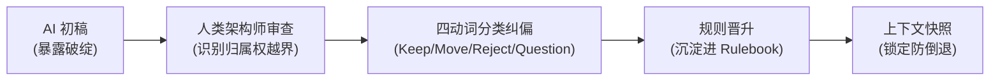
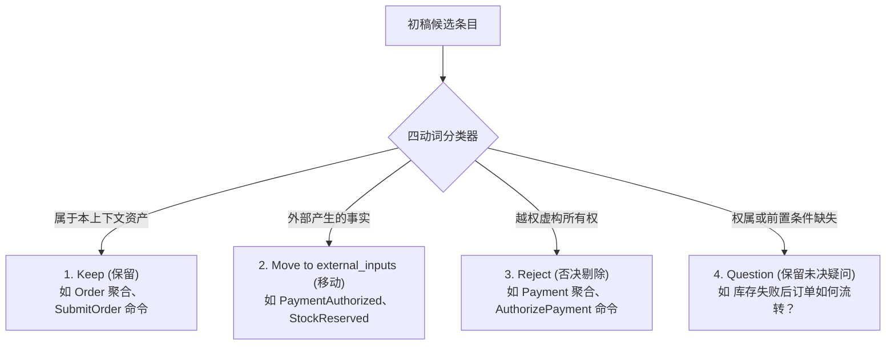

# 核心实战精炼：迭代精化限界上下文

## 1. 核心认知：AI 初稿的破绽价值

- **首发初稿定位**：AI 输出的首个模型不是最终方案，而是显性化靶子。
- **价值所在**：AI 能够快速将一种对领域的潜在理解具象化。其破绽暴露得越直观，架构师越能准确指出边界缺陷。
- **迭代目标**：让错误显性化，将纠偏提炼为可复用规则，收窄后续推理空间。



## 2. 致命区别：命名错误 vs 归属权错误

| 错误类别 | 定义与表现 | 纠偏手段 | 危害等级 |
| :--- | :--- | :--- | :--- |
| **命名错误 (Naming)** | 对本上下文的概念使用了不恰当同义词（如将 `OrderSubmitted` 误叫为 `OrderPlaced`）。 | 词汇表标准化。 | 低（修饰性） |
| **归属权错误 (Ownership)** | 将属于外部上下文的概念建模为当前上下文的自有聚合或命令（如订单管理拥有 Payment 聚合）。 | 制定显式归属规则并剥离为 external_inputs。 | **致命（结构性）** |

> **关键准则**：严禁用更贴切的名词掩盖归属权错误（例如将 Payment 简单改名为 PaymentInfo 毫无意义，概念依然放错了位置）。

## 3. 审查工具：四动词分类过滤器

在审查 AI 初稿时，强制执行四个动作的分类：



### 规则晋升机制 (Rule Promotion)
每次审查发现的归属权越界，必须晋升为规则手册中的硬性条款：
- 否决 `AuthorizePayment` $\rightarrow$ 晋升规则：`支付命令不属于 Order Management。`
- 移动 `PaymentAuthorized` $\rightarrow$ 晋升规则：`外部事实绝不能建模为 Order 聚合抛出的内部事件。`

## 4. CQRS 角色分离透镜

CQRS 在 AI 推理中的首要使命是**分离语义**（区分意图与观察），防止模型将交互压平为流水账：

| 领域角色 | 语义本质 | 订单管理实战定义 |
| :--- | :--- | :--- |
| **Command (命令)** | 改变状态的意图（包含用户发起与策略触发） | `SubmitOrder` (用户发起)<br>`ConfirmOrder` (**策略触发**) |
| **Internal Event (内部事件)** | 由自身聚合抛出的既成事实 | `OrderSubmitted`, `OrderConfirmed` |
| **External Input (外部输入)** | 其他上下文产生的既成事实 | `PaymentAuthorized`, `StockReserved` |
| **Policy (策略)** | 反应规则：观察到事实后下发新命令 | 观察到支付与库存均成功时，触发 ConfirmOrder |
| **Query (查询)** | 纯粹观察状态，无副作用 | `GetOrderStatus` |
| **Read Model (读模型)** | 为查询侧优化的数据投影 | `OrderSummaryProjection` |

> **策略触发的命令 (Policy-triggered Command)**：`ConfirmOrder` 依然是命令，但由内部策略在观察到外部事实就绪时代为下发，而非客户直接触发。

## 5. 精化聚合边界：协作不等于拥有

模型天然倾向于将时序上频繁一起出现的概念塞入同一个聚合。

### 聚合防膨胀 5 连问
1. 该聚合真正守护的核心业务不变量是什么？
2. 哪些决策必须要求强事务一致性？
3. 聚合自身真正抛出哪些事件？
4. 哪些概念实际上属于外部上下文？
5. 哪些行为是外部流程反应，而非内部固有效权？

> **结论**：Order 聚合可以记录派生自外部事实的最小状态（如是否观察到支付成功），但绝不能占有产生该事实的业务流程。

## 6. 上下文快照 (Context Snapshot) 规格模版

用于将精炼结果固化为版本控制工件，作为后续所有 AI 交互的基础底座：

```yaml
# docs/ddd/contexts/order-management-snapshot.yaml
bounded_context: Order Management
version: 1.0.0
last_refined: "2026-10-24"

purpose:
  - "管理客户订单生命周期，守护订单确认与取消的不变量。"

owned_concepts:
  aggregates:
    confirmed:
      - Order
    proposed: []

  commands:
    confirmed:
      user_initiated:
        - SubmitOrder
      policy_triggered:
        - ConfirmOrder
    proposed:
      user_initiated:
        - CancelOrder
      policy_triggered:
        - ExpireOrder

  internal_events:
    confirmed:
      - OrderSubmitted
      - OrderConfirmed
    proposed:
      - OrderCancelled
      - OrderExpired

external_inputs:
  - PaymentAuthorized
  - StockReserved
  - StockReservationFailed

policies:
  confirmed:
    - "当观察到 PaymentAuthorized 且 StockReserved 均成功时，触发 ConfirmOrder。"

ownership_constraints:
  - "Payment、StockReservation、Shipment、Invoice 均不归 Order Management 所有。"
  - "绝不能将外部输入建模为由 Order 聚合发出的事件。"
  - "协作绝不意味着拥有：可观察外部事实，严禁占有外部流程。"

open_questions:
  - "在收到 StockReservationFailed 后，订单是立即取消还是发起重试？"
  - "未确认状态下的订单最长超时时间是多少？"
```

## 7. 怀疑式自洽性审计提示词

```yaml
# 审计提示词模版
Context:
  审查当前的 Order Management 限界上下文快照（见上方 YAML）。

Task:
  以严格审慎、怀疑的态度评估快照的上下文自洽性（Contextual Coherence）。

Checklist:
  1. 检查是否存在与该上下文所有权声明冲突的聚合或命令。
  2. 检查是否有外部输入被错误当成了内部事件。
  3. 检查是否有属于其他上下文的命令。
  4. 检查是否有提议中的概念被草率晋升为 confirmed。
  5. 检查是否有策略无依据虚构缺失的业务规则。

  6. 检查是否有未决问题在未经确认的情况下被悄悄移除。

Strict Constraints:
  - 严禁擅自解答 open_questions！未决问题必须原样保留。
  - 除非有快照事实直接支持，严禁添加新领域规则。
  - 模型扮演审计员，而非生成器。

Output Format:
  assessment: <"coherent_with_open_questions" | "inconsistent">
  detected_inconsistencies: []
  recommended_corrections: []
  rules_to_add: []
  open_questions_to_preserve: []
```

## 8. 避坑清单 (Do's & Don'ts)

| 错误实践 (Don't) | 正确实践 (Do) |
| :--- | :--- |
| 把 AI 初稿里的外部聚合简单重命名（如改叫 PaymentInfo）。 | 彻底剥离所有权，移至 `external_inputs`。 |
| 将跨上下文交互压平为一段无角色的流水账。 | 用 CQRS 透镜拆分为 Command、Internal Event、External Input、Policy。 |
| 允许 AI 为了追求假性完备而擅自发明业务策略。 | 保留 `open_questions` 留白，区分 `confirmed` 与 `proposed`。 |
| 在单次对话中手工纠正错误后直接进行后续编码。 | 将纠偏晋升为 Rulebook 与 Context Snapshot，防止设计倒退。 |

<!-- split -->

在前面的章节中，我们将与 AI 的协作从一种模糊随意的交互转变为一种遵循纪律的建模实践。*第 4 章* 展示了如何利用事件风暴（EventStorming）与领域叙事（Domain Storytelling）将原始的领域探索转化为结构化素材。*第 5 章* 则阐明了如何通过规则、约束以及可复用的输出结构来保护这些素材。然而，仅凭规则本身并不能直接孕育出一个内聚自洽的限界上下文。

限界上下文是通过反复的精化（Refinement）才变得明晰的。模型生成一种候选解释；架构师依据领域知识对其展开批判性审查，并将纠偏措施沉淀为规则；随后团队在更加严苛明确的约束下再次运行模型。每一个循环都让边界更加清晰，并使 AI 的推理环境褪去通用性，变得更加契合特定领域。

本章将这一循环应用于 BrewUp 系统的 Order Management（订单管理）上下文。你将从一份由 AI 生成的初稿起步——该草稿表面上看颇为合理，却在悄无声息间将 Order（订单）、Payment（支付）和 Stock（库存）的归属权混为一谈。以此为起点，你将运用反馈循环将自身拥有的概念与外部输入分离开来；引入**命令查询职责分离**（**Command-Query Responsibility Segregation**，**CQRS**）作为角色分离的透镜；进一步精化命令、事件与聚合；并最终评估该限界上下文是否已具备足够的自洽性，从而支撑下一步的设计工作。

我们的目标绝不是寄希望于通过单次提示词就得到一个完美的模型。其核心目标在于让错误显现出来，将纠偏转化为可复用的约束，并让同样的错误越来越难以再次发生。

在本章中，你将学到：

- **生成–审查–纠偏循环**（**generate–critique–correct loops**）如何将存在缺陷的 AI 输出转化为可复用的建模约束。
- 如何区分命名错误与归属权错误，以及为何绝不能允许模型将外部事实当作由错误聚合所发出的事件。
- CQRS 如何将命令与查询清晰分离，以及在 AI 辅助推理过程中，互为补充的 DDD 角色如何守护事件、策略、读模型和外部输入的真实意图。
- 如何通过将协作与归属权区分开、将已确认概念与提议中概念区分开，从而精化聚合边界。
- 如何识别**上下文自洽性**（**contextual coherence**），并将其捕获到限界**上下文快照**（**context snapshot**）中，从而沉淀决策、被否决的概念以及未决问题（Open Questions）。

## 通过反馈循环引导模型

AI 生成的首个模型之所以有价值，恰恰在于它直观地暴露了设计缺陷：其破绽为团队提供了切实可见的审查基准。直观显现的错误听起来似乎有悖常理，特别是在强调规则与约束之后，但这恰恰是核心所在。团队之所以借助 AI，并非因为它的第一版输出足够可靠；而是因为它能迅速将一种看似合理的领域理解具象化、外显化。一旦这种理解清晰呈现，团队便可以审视它、评估它，并将暴露出的一项项错误转化为更加精准严密的规则。这种审视，正是迭代精化的真正起点。

:::en
> **Original**:
>
> Iterative Refinement: Building the Bounded Context In the previous chapters, we turned AI collaboration from a vague interaction into a disciplined modeling practice. Chapter 4 showed how EventStorming and Domain Storytelling can transform raw domain exploration into structured material. Chapter 5 showed how to protect that material through rules, constraints, and reusable output structures. However, rules alone do not produce a coherent bounded context. A bounded context becomes clear through repeated refinement. The model generates a candidate interpretation. The architect critiques it against domain knowledge and promotes corrections into rules. The team runs the model again under sharper constraints. Each cycle makes the boundary more explicit, and the reasoning environment less generic. This chapter applies that loop to the BrewUp Order Management context. You start from a first AI-generated draft that looks reasonable on the surface but silently collapses ownership across Order, Payment, and Stock. From there, you use feedback loops to separate owned concepts from external inputs, introduce command-query responsibility segregation (CQRS) as a role-separation lens, refine commands, events, and aggregates, and finally evaluate whether the bounded context is coherent enough to support the next design step. The goal is not to obtain a perfect model in one prompt. The goal is to make mistakes visible, turn corrections into reusable constraints, and make the same mistakes progressively harder to repeat. In this chapter, you will learn: • How generate–critique–correct loops turn flawed AI output into reusable modeling constraints.
>
> • How to distinguish naming mistakes from ownership mistakes, and why external facts must not be treated by the model as events emitted by the wrong aggregate. • How CQRS separates commands from queries, while complementary DDD roles preserve the meaning of events, policies, read models, and external inputs during AIassisted reasoning. • How to refine aggregate boundaries by separating collaboration from ownership and confirmed concepts from proposed ones. • How to recognize contextual coherence and capture it in a bounded context snapshot that preserves decisions, rejected concepts, and open questions.
>
> Guiding the model through feedback loops The first AI-generated model is useful because it is wrong in a visible way: its errors give the team something concrete to inspect and challenge. The visible error may sound counterintuitive, especially after the emphasis on rules and constraints, but that is precisely the point. You do not use AI because the first output is reliable; you use it because it can quickly externalize a plausible interpretation of the domain. Once that interpretation is visible, you can inspect it, criticize it, and transform its errors into sharper rules. That inspection is where iterative refinement begins. To see the loop in action, consider this first draft produced by an AI assistant after the author asked it to model the Order Management context:
>
> context: Order Management
>
> aggregates: - Order - Payment - StockReservation
>
> commands: - SubmitOrder - AuthorizePayment - ReserveStock - ConfirmOrder
>
> events: - OrderSubmitted - PaymentAuthorized
>
> - StockReserved - OrderConfirmed
>
> At first glance, this output looks good. The output uses DDD-shaped language and defines aggregates, commands, and events. The names are clear: commands use the imperative form, and events use the past tense. The sequence also resembles a reasonable e-commerce flow: the customer submits an order, the payment service authorizes payment, the stock service reserves stock, and the system confirms the order. The output reads fluently, which is precisely what makes it difficult to question. The AI has produced something that looks like a domain model while quietly violating the ownership rules established in the previous chapter. The primary problem is semantic ownership rather than naming. More precisely, there are multiple violations: • Order Management does not own Payment. • Order Management does not own StockReservation. • AuthorizePayment is not an Order Management command.
>
> • ReserveStock is not an Order Management command.
>
> • PaymentAuthorized is not an internal Order Management event.
>
> • StockReserved is not an internal Order Management event.
:::

为了直观体会这一循环的实际运转，不妨审视作者在要求 AI 助手对 Order Management 上下文进行建模后，AI 给出的第一版草案：

```yaml
context: Order Management

aggregates:
  - Order
  - Payment
  - StockReservation

commands:
  - SubmitOrder
  - AuthorizePayment
  - ReserveStock
  - ConfirmOrder

events:
  - OrderSubmitted
  - PaymentAuthorized
  - StockReserved
  - OrderConfirmed
```

初看起来，这份输出相当不错。它使用了符合 DDD 规范的表述，清晰地定义了聚合、命令与事件。命名也无可挑剔：命令采用祈使句式，事件采用过去时态。其流转时序同样酷似一套合理的电商业务流程：客户提交订单，支付服务授权付款，库存服务预留库存，最后系统确认订单。

这份输出行文非常流畅，而这恰恰让它变得极具迷惑性、难以轻易质疑。AI 产出的成果看似一个像模像样的领域模型，却在暗中打破了我们在前一章确立的归属权规则。这里最根本的问题在于语义归属权，而非命名措辞。更确切地说，存在多项严重的违规：

- Order Management 并不拥有 `Payment`。
- Order Management 并不拥有 `StockReservation`。
- `AuthorizePayment` 不是 Order Management 的命令。
- `ReserveStock` 不是 Order Management 的命令。
- `PaymentAuthorized` 不是 Order Management 的内部事件。
- `StockReserved` 不是 Order Management 的内部事件。

这些归属权违背绝非细枝末节的修饰性瑕疵；它们彻底改变了该限界上下文的本质内涵。

如果你仅仅是将 Payment 重命名为 `PaymentInfo`，或者将 `StockReservation` 改为 `ReservedStock`，你根本没有修复模型。你只不过是用更加圆滑温和的名称掩盖了错误。症结不在于用词晦涩；而在于模型将职责错配给了错误的上下文。

Order Management 只拥有 Order 聚合。Order Management 不拥有 `Payment`，也不拥有 Stock。`PaymentAuthorized` 和 `StockReserved` 或许与 Order Management 息息相关，但它们是由其他限界上下文产生的。在这个限界上下文内部，Order Management 必须将它们视为外部输入，而不是由 Order 聚合自身抛出的内部事件。

这两类失误有着本质的区别。命名错误意味着模型对本就属于当前上下文的概念用错了词；而归属权错误则意味着它把概念完完全全放错了限界上下文。

第一类错误通常可以通过词汇标准化来解决；第二类错误则必须依赖显式规则予以纠正。如果不建立起硬性规则，模型在后续的交互中极可能会重蹈覆辙，哪怕它换上了更优美贴切的名称和更有说服力的论述。

:::en
> **Original**:
>
> These ownership violations are not cosmetic adjustments; they change the meaning of the bounded context. If you simply rename Payment to PaymentInfo or StockReservation to ReservedStock, you have not fixed the model. You have only hidden the error behind softer names. The problem is not awkward wording; the model has assigned responsibility to the wrong context. Order Management owns the Order aggregate. Order Management does not own Payment. Order Management does not own Stock. PaymentAuthorized and StockReserved might be relevant to Order Management, but other bounded contexts produce them. Inside this bounded context, Order Management must treat them as external inputs, not as internal events raised by the Order aggregate. These two failures differ in kind. A naming error means the model used the wrong word for a concept that does belong here; an ownership error means it placed the concept in the wrong bounded context altogether. You can usually address the first kind of error through vocabulary stabilization; the second requires an explicit rule. If you do not add that rule, the model will likely repeat the same mistake in a later interaction, even with better names and more convincing prose.
>
> Telling those two kinds of error apart is the first job of the refinement loop shown in Figure 6.1. The loop lays out the six steps of a single pass. These steps are to generate, critique, correct, promote the correction into a rule, re-run, and compare.
>
> Figure 6.1 – Refinement loop
>
> The loop is a modeling discipline. The rest of this chapter applies it four times. The applications are first to ownership, then to reasoning roles through CQRS, then to aggregate boundaries, and finally to the coherence of the whole bounded context. Each pass leaves behind a rule that the next pass inherits.
:::

单轮迭代包含六个步骤：生成、审查、纠偏、将纠偏沉淀为规则、重新运行，以及对比评估。

审查步骤由人类依据领域知识、归属权与边界做出审慎判断；纠偏步骤据此产出模型的改进版本。紧接着是最关键的一步：纠偏措施必须转化为可复用的规则。唯有如此，当你再次运行模型时，才能将新输出与之前的成果进行对比并验证其进步。

如果没有“规则晋升（Promotion）”这一步，你将陷入无休止的手动纠偏循环。而有了它，每一次修正都能显著改良推理环境。下面给出一个实用的提示词，将这种纪律贯彻到 BrewUp Order Management 草案的精化中：

:::en
> **Original**:
>
> The generation step gives you a visible draft. The critique step applies human judgment against domain knowledge, ownership, and boundaries, while the correction step produces a better version of the model. The important move comes next: the correction must become a reusable rule. Only then do you run the model again and compare the new output with the previous one. Without that promotion step, you will keep correcting the same failure manually. With it, every correction improves the reasoning environment. Here is a practical prompt that applies this discipline to the BrewUp Order Management draft:
>
> Context: We are refining the BrewUp Order Management bounded context.
>
> Known rules:
>
> - Order Management owns the Order aggregate only. - Payment and Stock are external concepts. - Events produced by other bounded contexts must be marked as external inputs. - If ownership is unclear, add an open question instead of inventing a rule.
>
> Task: Review the draft model below.
>
> For each item: 1. Keep it if it belongs to Order Management. 2. Move it to external_inputs if it is produced by another bounded context. 3. Reject it if it invents ownership. 4. Preserve existing open questions and add a new one only if the critique exposes unresolved ownership.
>
> Return YAML with: - accepted_items - moved_to_external_inputs - rejected_items - open_questions - new_rules
>
> Notice the shape of the prompt. The prompt does not ask the model to improve the design in a generic way. A generic request would invite the model to invent more structure. Instead, it gives the model a classification task under known ownership rules. Figure 6.2 shows the four verbs that carry the weight here – keep, move, reject, and question – because each one narrows what the model is allowed to do with an item.
>
> Figure 6.2 – The classification filter used during critique
>
> The assistant is not allowed to absorb everything into Order Management. The assistant must decide whether each item belongs inside the context, crosses into it from outside, should be rejected by the assistant because it invents ownership, or exposes a question that the current domain knowledge cannot answer.
>
> A refined output might look like this:
>
> accepted_items: aggregates: - Order
>
> commands: - SubmitOrder - ConfirmOrder
>
> internal_events: - OrderSubmitted - OrderConfirmed
>
> moved_to_external_inputs: - PaymentAuthorized - StockReserved
>
> rejected_items: aggregates: - Payment - StockReservation
>
> commands: - AuthorizePayment - ReserveStock
>
> open_questions: - What happens when stock reservation fails after payment authorization? - How long can an order wait before expiration? - Is cancellation always allowed before confirmation?
>
> new_rules: - Payment commands are not part of Order Management. - Stock reservation commands are not part of Order Management. - External inputs may influence Order Management, but they must not be modeled as events emitted by the Order aggregate. - If an external input causes an Order decision, model the resulting Order-owned command, policy, or event explicitly.
>
> 115 Iterative Refinement: Building the Bounded Context
>
> This output is not yet the final model, but it is already a stronger modeling artifact. The output keeps Order as the only aggregate owned by Order Management, moves PaymentAuthorized and StockReserved to external_inputs, and rejects Payment, StockReservation, AuthorizePayment, and ReserveStock because they imply ownership this bounded context does not have. The more important result is the new rule set. PaymentAuthorized is not merely moved once; its classification confirms an existing rule: events produced by other bounded contexts must remain external inputs. ReserveStock, however, exposes a more specific constraint worth preserving: stock reservation commands are not part of Order Management. The rulebook grows this way: concrete failures become reusable modeling constraints. The refined output exposes what the happy path hides: what happens if stock reservation fails after payment authorization, whether cancellation is always allowed before confirmation, and how long an order can remain unconfirmed. These questions should not be answered by invention. The following listing shows the resulting open questions: StockReservationFailed belongs in external input; what Order Management should do after receiving it remains an open question. Expiration might become part of the Order life cycle, but the timing rule is still missing. At this stage, visible uncertainty is more useful than artificial completeness.
>
> context: Order Management owned_aggregate: - Order
>
> commands: confirmed: user_initiated: - SubmitOrder
>
> policy_triggered: - ConfirmOrder
>
> proposed: policy_triggered: - ExpireOrder
>
> internal_events: confirmed: - OrderSubmitted
>
> - OrderConfirmed
>
> proposed: - OrderExpired
>
> external_inputs: - PaymentAuthorized - StockReserved - StockReservationFailed
>
> open_questions: - Is cancellation always allowed before confirmation? - How long can an order remain unconfirmed before it expires? - What should Order Management do after StockReservationFailed?
>
> Notice that ExpireOrder is marked as proposed. The refinement loop has surfaced expiration as a likely Order life cycle concern, but the business rule that governs it is still missing. The model can identify a candidate transition, but it cannot confirm the policy that would make it valid. This draft is therefore intentionally incomplete. This draft does not decide how the coordination around payment and stock will later be implemented: through a saga, process manager, application service, or another coordination mechanism. That decision belongs to a later architectural step. For now, the important modeling distinction is simpler and more foundational: Order Management can react to external inputs, but it must not claim ownership of the processes that produce them. ConfirmOrder is therefore better understood as a policy-triggered command. It is still a command because it requests a state transition in the Order aggregate. What changes is its origin: it is not issued directly by the customer but triggered by an Order Management policy once the required external facts have been observed. PaymentAuthorized and StockReserved do not become internal Order events merely because they influence that decision. They remain external inputs. If the policy decides that the order can be confirmed, the resulting Orderowned transition is expressed through ConfirmOrder and, if successful, through the internal event OrderConfirmed. LLMs often blur exactly this kind of distinction. The model sees a familiar e-commerce sequence and tends to place related concepts together unless ownership has been made explicit. That is why feedback loops must keep applying pressure to the boundary: they prevent a familiar narrative from flattening the domain into a generic retail workflow.
>
> 117 Iterative Refinement: Building the Bounded Context
>
> Maintaining that pressure is your job, and in practice it means asking one question each time the model crosses the boundary: • When the model introduces Payment as an aggregate, ask: who owns it? • When the model proposes AuthorizePayment, ask: who can issue that command? • When the model emits PaymentAuthorized internally, ask: which aggregate raised it? • When the model invents a rule for cancellation, ask: is this known domain knowledge or a plausible assumption? If the answer is unclear, the correct output is not a fabricated rule. It is an open question. Preserving that gap is one of the most important habits in AI-assisted modeling: open questions prevent plausible assumptions from hardening into structure before the team has made a decision. After each iteration, the architect should ask two questions: • What did the model get wrong? • What rule would prevent this class of error from returning? That second question turns feedback from a comment into an asset. The assistant becomes less generic not because it has learned in the human sense, but because the reasoning environment has become narrower, clearer, and more domain-specific. Before CQRS can help you separate commands from queries, and before you can classify the surrounding domain roles consistently, you must first establish who owns each concept.
>
> Introducing CQRS and role separation in AI reasoning Ownership refinement has taken you as far as it can: it settles that context a concept belongs to, but not what type of thing that concept is once it is inside. At this point, in the refinement process, the problem is no longer discovering events or stabilizing vocabulary. The challenge becomes more subtle: preventing the model from collapsing different responsibilities into the same conceptual space. Command Query Responsibility Segregation (CQRS) gives us the first axis of separation. In many software discussions, CQRS is introduced as an architectural pattern focused on separating reads from writes. While technically correct, that framing is too narrow for the modeling work you are doing here. In the context of AI-assisted Domain-Driven Design, its value begins with a simpler distinction: separating intentions that might change state from requests that only observe it. Around that distinction, you can make the other domain roles explicit instead of allowing the model to collapse them into a single flow.
>
> When an LLM receives a partially refined domain flow, it naturally tends to compress related concepts into a single narrative. Commands become events, events become process steps, queries become business decisions, and policies disappear entirely inside generic prose. The result is not obviously wrong. In fact, it often looks fluent and coherent. However, the semantic distinctions that make a bounded context stable begin to dissolve. CQRS gives you one axis of separation: commands express intent to change state, while queries request information without changing it. This distinction does not define the rest of the classification used here. Alongside that CQRS axis, you keep four additional domain roles explicit: internal events, external inputs, policies, and read models. An internal event expresses a fact produced within the bounded context. An external input represents a fact produced elsewhere but relevant to its decisions. A policy expresses the reaction rule that might turn an observed fact into a new command. A read model organizes information for the query side. Keeping these roles distinct prevents the model from collapsing ownership, reaction, and observation into the command/query distinction. Consider the following BrewUp example:
>
> commands: - SubmitOrder - ConfirmOrder
>
> events: - OrderSubmitted - OrderConfirmed - PaymentAuthorized - StockReserved
>
> queries: - GetOrderStatus
>
> At first glance, the structure appears reasonable. However, semantically, several elements are still mixed together. Neither the event named PaymentAuthorized nor the event named StockReserved is an internal Order Management event. They are external facts produced by other bounded contexts. ConfirmOrder is a command, although the customer does not initiate it, because it requests a state transition. In this chapter, policy_triggered describes the command's origin, not a separate CQRS category. Because the query named GetOrderStatus observes state without requesting a state transition, it belongs on the query side of the model.
>
> 119 Iterative Refinement: Building the Bounded Context
>
> Without explicit classification, the model tends to flatten these distinctions into a single sequential flow:
>
> Customer submits order payment is authorized stock is reserved order is confirmed user checks status
>
> The sequence is coherent from a linguistic perspective, but it hides ownership, decision boundaries, and responsibility separation. The CQRS command/query split gives you one axis of separation, while the surrounding domain roles keep ownership, reactions, and external facts from collapsing into the same narrative. Ask the model this question:
>
> Design the order flow.
>
> You can ask:
>
> Classify the following elements according to their role: - command - internal event - external input - policy - query - read model
>
> This classification changes the interaction dramatically. The task no longer rewards a smooth narrative. It rewards the preservation of distinctions.
:::

```yaml
Context:
我们正在精化 BrewUp 的 Order Management 限界上下文。

Known rules:
- Order Management 仅拥有 Order 聚合。
- Payment 和 Stock 是外部概念。
- 由其他限界上下文产生的事件必须标记为 external_inputs。
- 如果归属权不明确，请添加一个未决问题（open question），而不是无依据虚构规则。

Task:
请审查下方的模型草案。

对于每一项：
1. 若其属于 Order Management，则予以保留（Keep）。
2. 若其由其他限界上下文产生，则移至 external_inputs。
3. 若其捏造了归属权，则予以否决（Reject）。
4. 保留现有的未决问题；仅在审查暴露出未决的归属权争议时，才添加新的未决问题。

请返回包含以下字段的 YAML：
- accepted_items
- moved_to_external_inputs
- rejected_items
- open_questions
- new_rules
```

精化后的输出如下：

```yaml
accepted_items:
  aggregates:
    - Order

  commands:
    - SubmitOrder
    - ConfirmOrder

  internal_events:
    - OrderSubmitted
    - OrderConfirmed

moved_to_external_inputs:
  - PaymentAuthorized
  - StockReserved

rejected_items:
  aggregates:
    - Payment
    - StockReservation

  commands:
    - AuthorizePayment
    - ReserveStock

open_questions:
  - 支付授权成功后，库存预留失败该如何处理？
  - 订单在超时失效前最多可以等待多长时间？
  - 在确认之前是否始终允许取消订单？

new_rules:
  - 支付相关命令不属于 Order Management。
  - 库存预留相关命令不属于 Order Management。
  - 外部输入可以影响 Order Management，但绝不能将其建模为由 Order 聚合发出的事件。
  - 如果外部输入引发了 Order 决策，请显式建模由此产生的、归属于 Order 的命令、策略或事件。
```

这份输出将 Order 保留为 Order Management 拥有的唯一聚合，把 `PaymentAuthorized` 和 `StockReserved` 归入 `external_inputs`，并坚决剔除了暗示越权的条目。具体的失误演化为了可复用的建模约束。

:::en
> **Original**:
>
> In practice, explicit role classification reduces semantic drift because it narrows the probability space available to the model. CQRS provides the command/query separation; the additional DDD categories preserve ownership, reaction, and event semantics. Once an element has been classified by the model as an external input, the model is less likely to reinterpret it later as an internally owned event. Once a query is separated from commands, the model is less likely to invent side effects around read operations. CQRS also arrives relatively late in the refinement process for a reason. EventStorming and Domain Storytelling help you discover the domain; iterative refinement helps us critique and stabilize the emerging model. Only once ownership is visible does CQRS add anything as a role-separation lens.
:::

## 在 AI 推理中引入 CQRS 与角色分离

归属权精化解决了概念隶属于哪个上下文的问题，但尚未界定概念在上下文内部的角色性质。

**命令查询职责分离（CQRS）** 为我们提供了第一条分离坐标轴。在 AI 辅助领域驱动设计语境下，CQRS 的价值始于一个更为朴素的区分：将可能改变状态的“意图”与纯粹观察状态的“请求”清晰剥离开来。围绕这一根本区分，将内部事件、外部输入、策略与读模型保持显式独立：

不要向模型提出这类笼统的问题：
`Design the order flow.`

而是提出显式分类任务：
```text
Classify the following elements according to their role:
- command
- internal event
- external input
- policy
- query
- read model
```

显式的角色分类能显著遏制语义漂移。一旦某个元素被模型归类为外部输入，后续交互中模型将其曲解为内部事件的概率大幅降低。一旦查询与命令明确切割，模型也极少再围绕只读操作编造出副作用。

引入 CQRS 是为了分离“语义”，而非分离“技术实现”。

:::en
> **Original**:
>
> At this stage, CQRS is about protecting conceptual integrity rather than handlers, buses, or distributed architecture. The important shift is subtle but fundamental. Here, CQRS is introduced to help you separate meanings, not technologies. Once the reasoning environment consistently distinguishes intentions, facts, reactions, and reads, the bounded context stops behaving like a generic workflow description and starts behaving like a structured domain model. What role separation does not tell us is how those elements group together, and that is what the next round of refinement has to settle.
>
> Refining events, commands, and aggregates Once commands, events, queries, and policies have been separated conceptually, the refinement process can move to a deeper level. The question is no longer only: what type of element is this? The question becomes: Which elements truly belong together inside the same consistency boundary? At this stage, however, we must be careful not to approach aggregates as technical containers or persistence structures. In AI-assisted modeling, aggregates are first and foremost semantic boundaries. They define where invariants are protected, where decisions are made, and which events can legitimately emerge from the same transactional consistency boundary. This distinction matters because
:::

## 精化事件、命令与聚合

聚合首先且最关键的是一个语义边界。它们界定了在哪里守护不变量、在哪里做出业务决策，以及哪些事件能够合乎逻辑地从同一个事务一致性边界中产出。

大语言模型极其倾向于把在业务工作流中频繁共同出现的概念打包归类在一起。如果支付、库存预留和订单确认反复联袂登场，模型便很容易推断它们隶属于同一个聚合。

审视与批判这类由 AI 生成的草案，抛出一连串直指归属权核心的问题：
- 该聚合究竟在守护哪些不变量？
- 哪些决策必须要求事务一致性？
- 聚合自身真正抛出哪些事件？
- 哪些概念实际上属于另一个限界上下文？
- 哪些行为纯粹是做出反应，而非聚合自身固有的内生行为？

精化后的 Order 聚合变得更加聚焦：

```yaml
aggregate:
  name: Order

responsibilities:
  - 追踪客户订单的生命周期
  - 决定订单是否可以确认
  - 发出归属于订单的事件

commands:
  confirmed:
    - SubmitOrder
    - ConfirmOrder
  proposed:
    - CancelOrder
    - ExpireOrder

internal_events:
  confirmed:
    - OrderSubmitted
    - OrderConfirmed
  proposed:
    - OrderCancelled
    - OrderExpired

required_external_inputs:
  - PaymentAuthorized
  - StockReserved
  - StockReservationFailed
```

业务流程本身并未简化：支付、库存、物流、过期和取消依然客观存在。变得更加清晰的是归属权。

:::en
> **Original**:
>
> LLMs tend to group concepts that frequently appear together in business workflows. If payment, stock reservation, and order confirmation appear together repeatedly, the model might infer that they belong to the same aggregate or bounded context. On the surface, that compression looks coherent. Architecturally, it might be wrong. Consider this early AI-generated refinement for BrewUp Order Management:
>
> aggregate: name: Order
>
> properties: - orderLines - paymentStatus - reservedStock - shipmentTracking
>
> commands: - SubmitOrder - AuthorizePayment - ReserveStock
>
> 121 Iterative Refinement: Building the Bounded Context
>
> - ConfirmOrder - ShipOrder
>
> events: - OrderSubmitted - PaymentAuthorized - StockReserved - OrderConfirmed - ShipmentCreated
>
> The output looks structured, fluent, and superficially aligned with DDD terminology. Yet almost every modeling boundary has collapsed. The aggregate now appears responsible for: • Accepting orders • Authorizing payments • Reserving inventory • Tracking shipments These concepts participate in the same collaboration without sharing ownership. The Order aggregate might depend on external facts produced by Payment or stock contexts, but dependency does not imply containment. An aggregate should not absorb every concept that participates in the same business flow. Separating coordination from ownership is the refinement challenge here. The most useful way to critique these AI-generated drafts is not to ask whether the model understood DDD, but to ask a sequence of ownership-oriented questions: • Which invariants does the aggregate protect? • Which decisions require transactional consistency? • Which events does the aggregate truly emit? • Which concepts belong to another bounded context? • Which actions are reactions rather than owned behavior? When you apply these questions to the previous example, several corrections immediately emerge. AuthorizePayment and ReserveStock are not Order commands, and ShipmentCreated is not an Order event.
>
> PaymentStatus and ReservedStock should not represent internally owned lifecycles. The Order aggregate might store minimal state derived from external facts, such as whether
>
> payment authorization or stock reservation has been observed. Observing an external fact is legitimate; owning the process that produces it is not. The refined version becomes much narrower:
>
> aggregate: name: Order
>
> responsibilities: - Track the lifecycle of a customer order - Decide whether the order can be confirmed - Emit order-owned events
>
> commands: confirmed: - SubmitOrder - ConfirmOrder proposed: - CancelOrder - ExpireOrder
>
> internal_events: confirmed: - OrderSubmitted - OrderConfirmed proposed: - OrderCancelled - OrderExpired
>
> required_external_inputs: - PaymentAuthorized - StockReserved - StockReservationFailed
>
> Notice what changed. The business process did not become simpler: payment, stock, shipment, expiration, and cancellation still exist. What became clearer is ownership. Those concerns no longer collapse into the Order aggregate. An oversized aggregate is one of the useful side effects of an AI-generated draft: it makes hidden ambiguity visible.
>
> 123 Iterative Refinement: Building the Bounded Context
>
> The same principle applies to events. During early iterations, models frequently produce events that are technically plausible but semantically weak:
>
> OrderProcessed PaymentCompleted InventoryUpdated OrderHandled
>
> These names sound reasonable because they match generic enterprise software patterns. However, they often hide important domain distinctions. PaymentCompleted may incorrectly collapse authorization, capture, and settlement into a single business transition. InventoryUpdated says almost nothing about the business meaning of the change.
>
> OrderProcessed usually describes a workflow phase rather than a meaningful domain fact.
>
> Refinement forces the team to ask: • What exactly happened? • Who recognizes this fact as meaningful? • Which bounded context owns it? • What downstream decision depends on it? Meaningful domain facts therefore tend to become more precise over time rather than more generic:
>
> PaymentAuthorized StockReserved OrderConfirmed StockReservationFailed OrderExpired
>
> Not all of these facts are emitted by the Order aggregate. Order Management observes the events named PaymentAuthorized, StockReserved, and StockReservationFailed as external facts, while OrderConfirmed and OrderExpired are emitted by the Order aggregate as orderowned events. What matters here is the naming quality: each name describes a specific business transition rather than a generic processing step.
>
> A refined command vocabulary follows the same direction. The command vocabulary becomes narrower, more intentional, and more aligned with business decisions:
>
> SubmitOrder ConfirmOrder CancelOrder ExpireOrder
>
> Refinement often removes ambiguity rather than adding concepts. Every iteration removes interpretations that the model might otherwise consider plausible. Over time, the reasoning space becomes narrower. Feedback loops become essential here too. The model alone cannot determine whether an aggregate boundary is correct because aggregate boundaries are not statistical truths. They are business decisions shaped by consistency requirements, ownership, organizational structure, and domain semantics. The AI helps accelerate the refinement cycle by exposing collapsed boundaries, proposing candidate separations, surfacing missing transitions, revealing naming inconsistencies, and externalizing implicit assumptions. The architect still owns the decision; the model helps expose the choices required to define the aggregate.
:::

## 通过迭代达成上下文自洽性

当一个限界上下文的语言、职责、规则与边界在反复的迭代中能够相互印证、彼此强化时，它便具备了自洽性。

一个自洽的模型依然会包含未决问题；而如果一个模型过快地将所有疑难问题悉数“解决”，反而应当引发高度警觉。保留未决问题是一道至关重要的安全防护机制，避免虚构规则在后续迭代中固化。

团队通过维护一份**上下文快照（Context Snapshot）**，精准记录历经精化考验而沉淀下来的决策、必须保持稳固的关键区分，以及依然处于开放状态的未决问题。在实践中，快照是作为受版本控制的文档与其所描述的限界上下文保存在一起的，作为后续任何 AI 会话的第一手资料。

当反复的迭代不再引发重大的结构性剧变，并且残留的不确定性已被显式暴露而非深藏于隐性假设之中时，限界上下文便达到了足够自洽的标准。

### 自洽性源于反复比较

一个常见误区，是把每次 AI 输出当作孤立产物：团队请求一个模型、审查它、纠正它，然后继续下一步。但只有在跨轮次比较输出时，迭代精化才会真正产生力量。

与其只问“当前输出是否正确”，不如把它与上一轮迭代对比，问：**所有权、角色与未决问题是否变得更加自洽**。

这种比较让进展变得可见：哪些歧义已经消失，哪些边界已经稳定，哪些不确定性仍然存在。

限界上下文不是在一步之内发现完美边界而形成的，而是在多轮迭代中逐步消除那些本不该共存于同一模型中的矛盾而形成的。

阅读每一轮迭代时，一个有用的问题清单是：

- 已拥有的聚合是否保持稳定？
- 外部输入是否仍然是外部的？
- 内部事件是否仍然由内部产生？
- 命令是否保持了其角色？
- 策略是否从隐含叙述变成了显式声明？
- 不清楚的决策是否变成了未决问题？
- 模型是否避免重新引入已被拒绝的概念？

如果答案持续为“是”，限界上下文就在向更稳定的表达收敛。

如果同样的错误反复出现，说明推理环境仍然太弱：规则手册需要更锋利的约束，词汇可能需要更精确，或者提示词在一步之内要求了太多。因此，上下文自洽性是在多轮迭代中观察到的，而不是单次模型输出就能提供的。

### 稳定的所有权与稳定的角色

如果概念的所有权不断摇摆，限界上下文就不可能自洽。如果 `Payment` 在一轮迭代中属于 Order Management，下一轮又跑到别处，模型就不是在精化，而是在漂移。

在 BrewUp Order Management 中，所有权边界应在各轮迭代中保持稳定：

```yaml
owned_by_order_management:
  - Order

not_owned_by_order_management:
  - Payment
  - StockReservation
  - Shipment
  - Invoice
```

重要的不是这些关系曾被团队定义过一次，而是后续迭代会保留它们。角色也需要同样的稳定性：命令、内部事件、外部输入与策略应在连续迭代中保持相同的语义角色。

对于 BrewUp Order Management，分类可能稳定为：

```yaml
commands:
  confirmed:
    user_initiated:
      - SubmitOrder
    policy_triggered:
      - ConfirmOrder
  proposed:
    user_initiated:
      - CancelOrder
    policy_triggered:
      - ExpireOrder

internal_events:
  confirmed:
    - OrderSubmitted
    - OrderConfirmed
  proposed:
    - OrderCancelled
    - OrderExpired

external_inputs:
  - PaymentAuthorized
  - StockReserved
  - StockReservationFailed

policies:
  confirmed:
    - Confirm an order when payment authorization and stock reservation
      have both been observed.
```

与所有权一样，分类的重要性低于其持久性。外部输入不会变成内部事件，提议中的转换不会悄悄变成已确认，**策略触发的命令**也不会变成用户动作。这些区分保护上下文不发生语义坍塌。

### 未决问题也是自洽性的一部分

一个自洽的模型仍然会有未决问题；而如果一个模型过快地把所有疑难“解决”，反而应该引起更仔细的审视。LLM 天然倾向于补齐缺失结构，即使完成它所需的领域知识尚未提供。这正是未决问题作为安全机制而非弱点的原因。

比较下面两种输出：

```yaml
policy:
  - If stock reservation fails, automatically cancel the order.
```

与：

```yaml
open_questions:
  - What should Order Management do after StockReservationFailed?
  - Should the order be cancelled immediately, kept pending, or retried?
  - What should happen to the existing payment authorization?
```

第一种输出是“完整的”；第二种输出更“自洽”。

第一种虚构了一条业务规则；第二种保留了不确定性，并暴露了团队仍需做出的决策。

一条虚构的规则很容易在后续迭代中存活下来，因为它已经成为上下文的一部分。未决问题通过标出已知领域知识与合理推测之间的边界，阻止这种倒退。

这种行为本身也应该沉淀为可复用约束：

```yaml
uncertainty_rules:
  - Do not invent domain rules to complete the model.
  - If ownership, policy, or reaction behavior is unclear, preserve it as an open
    question.
  - Keep proposed concepts separate from confirmed concepts.
```

### 上下文快照强化自洽性

随着迭代累积，团队需要一个稳定产物来表示限界上下文的当前状态。否则，某一轮精化中存活下来的决策可能在下一轮消失或倒退。因此，团队维护一份**上下文快照（Context Snapshot）**。

上下文快照是对当前限界上下文的紧凑、可复用表示，而不是完整规格。它捕获精化后存活下来的决策、必须保持稳定的关键区分，以及仍然开放的问题。实践中，快照作为受版本控制的文档与它所描述的限界上下文放在一起，而不是放在聊天记录里；它也是后续任何关于 Order Management 的 AI 会话的第一手资料。*第 7 章* 会进一步把这种习惯变成可维护的领域载体。

对于 BrewUp Order Management，快照可能如下：

```yaml
bounded_context: Order Management

purpose:
  - Manage the Order-owned lifecycle of a customer order and the decisions
    that belong to Order Management.

owned_concepts:
  aggregates:
    confirmed:
      - Order

  commands:
    confirmed:
      user_initiated:
        - SubmitOrder
      policy_triggered:
        - ConfirmOrder
    proposed:
      user_initiated:
        - CancelOrder
      policy_triggered:
        - ExpireOrder

  internal_events:
    confirmed:
      - OrderSubmitted
      - OrderConfirmed
    proposed:
      - OrderCancelled
      - OrderExpired

external_inputs:
  - PaymentAuthorized
  - StockReserved
  - StockReservationFailed

policies:
  confirmed:
    - Confirm an order when payment authorization and stock reservation
      have both been observed.

ownership_constraints:
  - Payment is not owned by Order Management.
  - StockReservation is not owned by Order Management.
  - Shipment is not owned by Order Management.
  - Invoice is not owned by Order Management.
  - External inputs must not be modeled as events emitted by the Order aggregate.

open_questions:
  - Is cancellation always allowed before confirmation?
  - How long can an order remain unconfirmed before it expires?
  - What should Order Management do after StockReservationFailed?
```

这个产物把迭代变成累积的知识。快照给模型一个稳定起点，把已确认与提议中的概念分开，保留未决问题，并防止先前已解决的所有权与建模决策在后续迭代中倒退。没有上下文快照，团队只有对话；有了它，团队就有了后续会话可以检视与保留的持久记录。

### 用最终审查提示词测试自洽性

一旦快照存在，就可以让模型审查它内部是否存在矛盾，而不是让它宣布“正确”。

一个有用的提示词是有意保持怀疑的：

```yaml
Context:
You are reviewing the current BrewUp Order Management bounded context snapshot.

Task:
Evaluate the snapshot for contextual coherence.

Check for:
1. Concepts whose ownership contradicts the bounded context.
2. External inputs incorrectly treated as internal events.
3. Commands that belong to another bounded context.
4. Proposed concepts promoted to confirmed without supporting domain knowledge.
5. Policies that invent missing business rules.
6. Open questions that have been silently resolved without domain input.
7. Naming or role inconsistencies across commands, events, policies, and external
   inputs.

Return:
- assessment
- detected_inconsistencies
- recommended_corrections
- rules_to_add
- open_questions_to_preserve

Do not add new domain rules unless they are directly supported by the snapshot.
Do not resolve open questions.
```

最后两条指令至关重要：它们防止审查变成另一轮生成。提示词要求 `recommended_corrections` 与 `rules_to_add`，这看起来像生成，因此必须明确告诉模型，这两者必须来自快照而非它自己的判断：它是在按既定标准审计快照，而不是完成设计。一个可能的审查结果如下：

```yaml
assessment: coherent_with_open_questions

detected_inconsistencies: []
recommended_corrections: []
rules_to_add: []

open_questions_to_preserve:
  - Is cancellation always allowed before confirmation?
  - How long can an order remain unconfirmed before it expires?
  - What should Order Management do after StockReservationFailed?
```

这个输出之所以有用，恰恰在于它**没有**试图完成领域模型。审查没有发现当前快照中的矛盾，但它保留了仍需领域输入的决策。这个区分很重要。上下文自洽性并不意味着所有问题都已回答；它意味着团队提出的内容、提议中的内容与仍不确定的内容可以共存，而不相互矛盾。

### 何时限界上下文足够自洽

团队最终必须继续前进；迭代不能无限进行。精化的目的是把歧义降低到足以安全开展下一步设计活动的程度。

当反复迭代不再产生重大的结构性变化，并且残余的不确定性是显式暴露的，而不是隐藏在假设之中时，限界上下文就足够自洽了。

对于 BrewUp Order Management，这些问题的答案现在都是“是”。所有权保持住了：Order 仍然是唯一拥有的聚合，Payment、Stock、Shipment 与 Invoice 没有重新出现为被拥有的概念。角色也保持住了：`PaymentAuthorized`、`StockReserved` 与 `StockReservationFailed` 仍然是外部输入，内部事件仍然只由 Order 聚合发出，命令仍然按来源分类。没有任何东西悄悄“硬化”：已确认与提议中的概念保持分离，未决问题保持开放而不是被转换成虚构规则，先前解决的所有权或角色决策也没有倒退。

这些标准是语义标准，而不是实现标准：在这个阶段，问题不在于最终架构或代码是否正确，而在于限界上下文是否对领域表达了**一致**的内容。

因此，本章的输出是一个可以支撑未来决策的稳定限界上下文模型，而不是最终架构。

自洽的模型为后续架构决策提供了更坚实的基础。

模型生成候选方案，架构师施加判断，规则手册保留纠正，快照稳定限界上下文。一旦限界上下文达到这种稳定水平，快照就可以成为更持久的 AI 协作形式的基础。下一章就从这一点出发，把保留下来的领域理解转化为可复用的工作上下文。


:::en
> **Original**:
>
> Achieving contextual coherence through iteration At this point, the BrewUp Order Management context has gone through the full refinement loop. Ownership has been corrected, reasoning roles have been separated, and the Order aggregate has been narrowed to the decisions it actually owns. The next question is practical: when is the bounded context coherent enough for the team to move forward? The rest of this section builds the answer in five steps: comparing outputs across cycles, checking that ownership and roles hold still, treating open questions as part of coherence, freezing the result in a context snapshot, and finally asking the model to audit that snapshot. A bounded context becomes coherent when its language, responsibilities, rules, and boundaries reinforce each other across repeated iterations. Coherence is a weaker claim than completeness: the answers already available fit together without semantic contradiction, while unanswered questions remain visible. In early domain modeling, this is the safer target. A coherent model with visible open questions is more useful than a complete-looking model built on unstable ownership.
>
> 125 Iterative Refinement: Building the Bounded Context
>
> Consider the refined BrewUp model again. Because of the first pass, it has gained only two things: cancellation as a proposed user-initiated command and its matching event:
>
> commands: proposed: user_initiated: - CancelOrder
>
> internal_events: proposed: - OrderCancelled
>
> Everything else remains unchanged from the earlier listing: the single owned aggregate, the confirmed commands, the external inputs, and the three open questions. The stability is the point. The model is incomplete. It still contains open questions, does not define every policy, and leaves implementation concerns such as coordination and message transport undecided. Yet it is already more coherent than the first AI-generated draft. The reason is the stability of the model's boundaries and roles. Order Management owns the Order aggregate. Payment and Stock remain outside Order Management. Events raised by other bounded contexts Order Management treats as external inputs. Commands you classify by origin. Internal events the Order aggregate emits only. Missing domain knowledge appears as open questions instead of fabricated rules. This stability is contextual coherence: stable ownership, explicit roles, clear external inputs, internal events emitted only by the Order aggregate, and visible uncertainty where domain knowledge is still missing. That level of maturity is what you want before moving into a deeper design or implementation.
>
> Coherence emerges from repeated comparison A common mistake is to treat each AI output as an isolated artifact. The team asks for a model, reviews it, corrects it, and then moves on. But iterative refinement becomes powerful only when the team compares outputs across cycles. Instead of asking only whether the current output is correct, compare it with the previous iteration and ask whether its ownership, roles, and unresolved questions are becoming more coherent. This comparison makes progress visible by showing which ambiguities have disappeared, which boundaries have stabilized, and which uncertainties remain.
>
> The bounded context takes shape that way, not by discovering a perfect boundary in one step but by progressively eliminating contradictions that should not survive inside the same model. A useful way to read each iteration is to ask what changed: • Did owned aggregates remain stable? • Did external inputs stay external? • Did internal events remain internally produced? • Did commands preserve their role? • Did policies become explicit instead of hidden in prose? • Did unclear decisions become open questions? • Did the model avoid reintroducing rejected concepts? If the answer is consistently yes, the bounded context is converging toward a more stable representation. If the same mistakes keep returning, the reasoning environment is still too weak. The rulebook needs sharper constraints, the vocabulary might need more precision, or the prompt might be asking for too much in one step. Contextual coherence is therefore observed across iterations rather than supplied by a single model output.
>
> Stable ownership and stable roles A bounded context cannot be coherent if the ownership of concepts keeps shifting. If Payment belongs to Order Management in one iteration and somewhere else in the next, the model is not refining; it is drifting. In BrewUp Order Management, the ownership boundary should remain stable across iterations:
>
> owned_by_order_management: - Order
>
> not_owned_by_order_management: - Payment - StockReservation - Shipment - Invoice
>
> What counts is not that these relationships have been defined once by the team, but that later iterations preserve them. Roles need the same stability: commands, internal events, external inputs, and policies should preserve the same semantic role across successive iterations.
>
> 127 Iterative Refinement: Building the Bounded Context
>
> For BrewUp Order Management, the classification might stabilize like this:
>
> commands: confirmed: user_initiated: - SubmitOrder policy_triggered: - ConfirmOrder proposed: user_initiated: - CancelOrder policy_triggered: - ExpireOrder
>
> internal_events: confirmed: - OrderSubmitted - OrderConfirmed proposed: - OrderCancelled - OrderExpired
>
> external_inputs: - PaymentAuthorized - StockReserved - StockReservationFailed
>
> policies: confirmed: - Confirm an order when payment authorization and stock reservation have both been observed.
>
> As with ownership, the classification matters less than its persistence. External inputs do not become internal events, proposed transitions do not silently become confirmed, and policytriggered commands do not turn into user actions. These distinctions protect the context from semantic collapse.
>
> Open questions are part of coherence A coherent model still has open questions, and a model that resolves them too quickly should prompt closer scrutiny. LLMs naturally tend to complete missing structure, even when the
>
> domain knowledge required to complete it has not been provided. This tendency is why open questions are a safety mechanism rather than a weakness. Compare these two outputs:
>
> policy: - If stock reservation fails, automatically cancel the order.
>
> and:
>
> open_questions: - What should Order Management do after StockReservationFailed? - Should the order be cancelled immediately, kept pending, or retried? - What should happen to the existing payment authorization?
>
> The first output is complete. The second output is more coherent. The first invents a business rule. The second preserves uncertainty and exposes the decision that the team still needs to make. A fabricated rule can easily survive into later iterations simply because it has become part of the context. Open questions prevent that regression by marking the boundary between known domain knowledge and plausible speculation. This behavior should itself become a reusable constraint:
>
> uncertainty_rules: - Do not invent domain rules to complete the model. - If ownership, policy, or reaction behavior is unclear, preserve it as an open question. - Keep proposed concepts separate from confirmed concepts.
>
> Coherence is reinforced by a context snapshot As iterations accumulate, the team needs a stable artifact that represents the current state of the bounded context. Otherwise, the decision that survived one refinement cycle might disappear or regress in the next. The team therefore maintains a context snapshot. A context snapshot is a compact, reusable representation of the current bounded context rather than a full specification. It captures the decisions that have survived refinement, the distinctions that must remain stable, and the questions that remain open. In practice, the snapshot is kept as a versioned document alongside the bounded context it describes, not in
>
> 129 Iterative Refinement: Building the Bounded Context
>
> chat history, and it is the first thing handed to any later AI session about Order Management. Chapter 7 takes that habit further and turns the snapshot into a maintained domain carrier. For BrewUp Order Management, a snapshot might look like this:
>
> bounded_context: Order Management
>
> purpose: - Manage the Order-owned lifecycle of a customer order and the decisions that belong to Order Management.
>
> owned_concepts: aggregates: confirmed: - Order
>
> commands: confirmed: user_initiated: - SubmitOrder policy_triggered: - ConfirmOrder proposed: user_initiated: - CancelOrder policy_triggered: - ExpireOrder
>
> internal_events: confirmed: - OrderSubmitted - OrderConfirmed proposed: - OrderCancelled - OrderExpired
>
> external_inputs: - PaymentAuthorized - StockReserved - StockReservationFailed
>
> policies: confirmed: - Confirm an order when payment authorization and stock reservation have both been observed.
>
> ownership_constraints: - Payment is not owned by Order Management. - StockReservation is not owned by Order Management. - Shipment is not owned by Order Management. - Invoice is not owned by Order Management. - External inputs must not be modeled as events emitted by the Order aggregate.
>
> open_questions: - Is cancellation always allowed before confirmation? - How long can an order remain unconfirmed before it expires? - What should Order Management do after StockReservationFailed?
>
> This artifact turns iteration into accumulated knowledge. The snapshot gives the model a stable starting point, keeps confirmed decisions separate from proposed ones, preserves open questions, and prevents previously resolved ownership and modeling decisions from regressing in later iterations. Without a context snapshot, the team has a conversation. With one, the team has a durable record that later sessions can inspect and preserve.
>
> Testing coherence with a final review prompt Once the snapshot exists, you can use the model to review it for internal contradictions rather than to declare it correct. A useful prompt is deliberately skeptical:
>
> Context: You are reviewing the current BrewUp Order Management bounded context snapshot.
>
> Task: Evaluate the snapshot for contextual coherence.
>
> Check for: 1. Concepts whose ownership contradicts the bounded context. 2. External inputs incorrectly treated as internal events. 3. Commands that belong to another bounded context. 4. Proposed concepts promoted to confirmed without supporting domain knowledge. 5. Policies that invent missing business rules.
>
> 131 Iterative Refinement: Building the Bounded Context
>
> 6. Open questions that have been silently resolved without domain input. 7. Naming or role inconsistencies across commands, events, policies, and external inputs.
>
> Return: - assessment - detected_inconsistencies - recommended_corrections - rules_to_add - open_questions_to_preserve
>
> Do not add new domain rules unless they are directly supported by the snapshot. Do not resolve open questions.
>
> Those last two instructions are what keep the review from turning into another generation step. The prompt asks for recommended_corrections and rules_to_add, which look like generation, so you must tell the model that both must come out of the snapshot rather than out of its own judgment: it is auditing the snapshot against stated criteria, not completing the design. A possible review might return:
>
> assessment: coherent_with_open_questions
>
> detected_inconsistencies: [] recommended_corrections: [] rules_to_add: []
>
> open_questions_to_preserve: - Is cancellation always allowed before confirmation? - How long can an order remain unconfirmed before it expires? - What should Order Management do after StockReservationFailed?
>
> This output is useful precisely because it does not attempt to complete the domain model. The review finds no contradiction in the current snapshot, but it preserves the decisions that still require domain input. That distinction matters. Contextual coherence does not mean that every question has been answered. Contextual coherence means that what the team proposes, what is proposed, and what remains uncertain can coexist without contradicting each other.
>
> When the bounded context is coherent enough The team eventually needs to move forward; iteration cannot continue indefinitely. The purpose of refinement is to reduce ambiguity enough for the next design activity to proceed safely. A bounded context is coherent enough when repeated iterations stop producing major structural changes, and the remaining uncertainty is explicit rather than hidden inside assumptions. For BrewUp Order Management, the answer to each of those questions is now yes. Ownership has held: Order is still the only owned aggregate, and Payment, Stock, Shipment, and Invoice have not reappeared as owned concepts. The roles have held too: PaymentAuthorized, StockReserved, and StockReservationFailed are still external inputs, internal events are still emitted only by the Order aggregate, and commands are still classified by origin. Nothing has quietly hardened: confirmed concepts remain separate from proposed ones, open questions remain open rather than converted into invented rules, and no ownership or role decision resolved earlier has regressed. These criteria are semantic rather than implementation criteria: at this stage the question is not whether the eventual architecture or code is correct, but whether the bounded context says one consistent thing about the domain. The output of this chapter is therefore a stable bounded context model that can support future decisions, not a final architecture. Coherent models provide a stronger foundation for later architectural decisions. The model generates candidates, the architect applies judgment, the rulebook preserves corrections, and the snapshot stabilizes the bounded context. Once the bounded context reaches this level of stability, the snapshot can become the foundation for more durable forms of AI collaboration. The next chapter builds on exactly this point, turning preserved domain understanding into reusable working context.
>
> Summary In this chapter, you moved from defining rules to applying them through iterative refinement. The first AI-generated model of BrewUp Order Management looked plausible, but it silently collapsed Order, Payment, and StockReservation. This made the central problem visible: the model was not only making naming mistakes, but ownership mistakes. You used this flawed draft as the starting point for a generate–critique–correct loop. Each correction became more than a local fix: it was promoted into a reusable rule.
>
> 133 Iterative Refinement: Building the Bounded Context
>
> PaymentAuthorized and StockReserved were moved to external_inputs, Payment and StockReservation were removed from the concepts owned by Order Management, and missing decisions became open questions instead of fabricated policies. CQRS provided an additional role-separation lens. It helped distinguish intentions that might change state from requests that only observe it, while the broader domain classification kept internal events, external inputs, and policies semantically distinct. This made it possible to preserve ConfirmOrder as a policy-triggered command, while keeping PaymentAuthorized and StockReserved as external facts observed by Order Management.
>
> You also refined the Order aggregate by separating collaboration from ownership. Concepts can participate in the same business flow without belonging to the same consistency boundary. The Order aggregate can react to external facts, but it must not own the processes that produce them. Finally, you introduced contextual coherence: the point where ownership, roles, confirmed and proposed concepts, and open questions fit together without contradiction, and the context snapshot that holds that state from one cycle to the next. You learned that: • The value of the first AI-generated draft is that it makes a flawed interpretation visible. • Feedback becomes valuable when you promote each correction into a reusable rule. • Ownership mistakes are more dangerous than naming mistakes because they change the meaning of the bounded context. • CQRS can be used as a role-separation lens before it becomes an implementation pattern. • Collaboration does not imply ownership: a bounded context can react to external facts without owning the processes that produce them. • Open questions are part of coherence: they keep uncertainty visible until the team can decide. • A context snapshot turns iterative refinement into accumulated domain knowledge by preserving confirmed concepts, proposed concepts, ownership boundaries, and unresolved questions. In the next chapter, you build on this result and explore how the domain understanding preserved in the context snapshot can become reusable working context for future AI interactions.
>
> Subscribe to Deep Engineering Join thousands of developers and architects who want to understand how software is changing, deepen their expertise, and build systems that last. Deep Engineering is a weekly expert-led newsletter for experienced practitioners, featuring original analysis, technical interviews, and curated insights on architecture, system design, and modern programming practice. Scan the QR or visit the link to subscribe for free.
>
> https://packt.link/deep-engineering-newsletter
>
> Prompt as Domain Carrier In the previous chapter, we used iterative feedback loops to refine a bounded context until ownership, events, commands, aggregates, and policies became semantically coherent. The result was a bounded context snapshot: a representation of the team's current understanding of the domain. However, a snapshot alone is not enough. If the knowledge discovered during modeling remains buried inside a conversation, the same ambiguities eventually return. Rejected concepts reappear, open questions become assumptions, and previously resolved decisions must be rediscovered. This chapter explores how to preserve and reuse that knowledge through a new part of the domain: BrewUp Stock Management. Working in a second bounded context keeps the emphasis on applying the workflow rather than revisiting it, and shows that the technique is not tied to Order Management. The same discipline can preserve meaning across classification, specification, review, change workflows, and later agent-oriented collaboration. Instead of treating prompts as disposable requests, you begin treating them as domain carriers: artifacts that encode what a bounded context owns and what it refuses to assume, so that future interactions can build on a stable foundation. The chapter also examines a deeper shift. Once domain knowledge becomes part of the prompt itself, an AI output reveals how the model is interpreting the domain. The output also reveals whether the surrounding reasoning environment is strong enough to preserve meaning consistently. By the end of this chapter, you will understand: • Why prompts can evolve from temporary instructions into reusable domain carriers • How to encode domain knowledge so it can be preserved across interactions • How to use domain carriers to reduce semantic drift and regression
:::


## 本章图示


