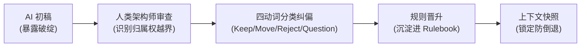
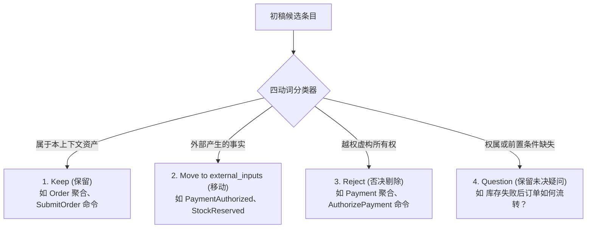

# 核心实战精炼：迭代精化限界上下文

## 1. 核心认知：AI 初稿的破绽价值

- **首发初稿定位**：AI 输出的首个模型不是最终方案，而是显性化靶子。
- **价值所在**：AI 能够快速将一种对领域的潜在理解具象化。其破绽暴露得越直观，架构师越能准确指出边界缺陷。
- **迭代目标**：让错误显性化，将纠偏提炼为可复用规则，收窄后续推理空间。



## 2. 致命区别：命名错误 vs 归属权错误

| 错误类别 | 定义与表现 | 纠偏手段 | 危害等级 |
| :--- | :--- | :--- | :--- |
| **命名错误 (Naming)** | 对本上下文的概念使用了不恰当同义词（如将 `OrderSubmitted` 误叫为 `OrderPlaced`）。 | 词汇表标准化。 | 低（修饰性） |
| **归属权错误 (Ownership)** | 将属于外部上下文的概念建模为当前上下文的自有聚合或命令（如订单管理拥有 Payment 聚合）。 | 制定显式归属规则并剥离为 external_inputs。 | **致命（结构性）** |

> **关键准则**：严禁用更贴切的名词掩盖归属权错误（例如将 Payment 简单改名为 PaymentInfo 毫无意义，概念依然放错了位置）。

## 3. 审查工具：四动词分类过滤器

在审查 AI 初稿时，强制执行四个动作的分类：



### 规则晋升机制 (Rule Promotion)
每次审查发现的归属权越界，必须晋升为规则手册中的硬性条款：
- 否决 `AuthorizePayment` $\rightarrow$ 晋升规则：`支付命令不属于 Order Management。`
- 移动 `PaymentAuthorized` $\rightarrow$ 晋升规则：`外部事实绝不能建模为 Order 聚合抛出的内部事件。`

## 4. CQRS 角色分离透镜

CQRS 在 AI 推理中的首要使命是**分离语义**（区分意图与观察），防止模型将交互压平为流水账：

| 领域角色 | 语义本质 | 订单管理实战定义 |
| :--- | :--- | :--- |
| **Command (命令)** | 改变状态的意图（包含用户发起与策略触发） | `SubmitOrder` (用户发起)<br>`ConfirmOrder` (**策略触发**) |
| **Internal Event (内部事件)** | 由自身聚合抛出的既成事实 | `OrderSubmitted`, `OrderConfirmed` |
| **External Input (外部输入)** | 其他上下文产生的既成事实 | `PaymentAuthorized`, `StockReserved` |
| **Policy (策略)** | 反应规则：观察到事实后下发新命令 | 观察到支付与库存均成功时，触发 ConfirmOrder |
| **Query (查询)** | 纯粹观察状态，无副作用 | `GetOrderStatus` |
| **Read Model (读模型)** | 为查询侧优化的数据投影 | `OrderSummaryProjection` |

> **策略触发的命令 (Policy-triggered Command)**：`ConfirmOrder` 依然是命令，但由内部策略在观察到外部事实就绪时代为下发，而非客户直接触发。

## 5. 精化聚合边界：协作不等于拥有

模型天然倾向于将时序上频繁一起出现的概念塞入同一个聚合。

### 聚合防膨胀 5 连问
1. 该聚合真正守护的核心业务不变量是什么？
2. 哪些决策必须要求强事务一致性？
3. 聚合自身真正抛出哪些事件？
4. 哪些概念实际上属于外部上下文？
5. 哪些行为是外部流程反应，而非内部固有效权？

> **结论**：Order 聚合可以记录派生自外部事实的最小状态（如是否观察到支付成功），但绝不能占有产生该事实的业务流程。

## 6. 上下文快照 (Context Snapshot) 规格模版

用于将精炼结果固化为版本控制工件，作为后续所有 AI 交互的基础底座：

```yaml
# docs/ddd/contexts/order-management-snapshot.yaml
bounded_context: Order Management
version: 1.0.0
last_refined: "2026-10-24"

purpose:
  - "管理客户订单生命周期，守护订单确认与取消的不变量。"

owned_concepts:
  aggregates:
    confirmed:
      - Order
    proposed: []

  commands:
    confirmed:
      user_initiated:
        - SubmitOrder
      policy_triggered:
        - ConfirmOrder
    proposed:
      user_initiated:
        - CancelOrder
      policy_triggered:
        - ExpireOrder

  internal_events:
    confirmed:
      - OrderSubmitted
      - OrderConfirmed
    proposed:
      - OrderCancelled
      - OrderExpired

external_inputs:
  - PaymentAuthorized
  - StockReserved
  - StockReservationFailed

policies:
  confirmed:
    - "当观察到 PaymentAuthorized 且 StockReserved 均成功时，触发 ConfirmOrder。"

ownership_constraints:
  - "Payment、StockReservation、Shipment、Invoice 均不归 Order Management 所有。"
  - "绝不能将外部输入建模为由 Order 聚合发出的事件。"
  - "协作绝不意味着拥有：可观察外部事实，严禁占有外部流程。"

open_questions:
  - "在收到 StockReservationFailed 后，订单是立即取消还是发起重试？"
  - "未确认状态下的订单最长超时时间是多少？"
```

## 7. 怀疑式自洽性审计提示词

```yaml
# 审计提示词模版
Context:
  审查当前的 Order Management 限界上下文快照（见上方 YAML）。

Task:
  以严格审慎、怀疑的态度评估快照的上下文自洽性（Contextual Coherence）。

Checklist:
  1. 检查是否存在与该上下文所有权声明冲突的聚合或命令。
  2. 检查是否有外部输入被错误当成了内部事件。
  3. 检查是否有属于其他上下文的命令。
  4. 检查是否有提议中的概念被草率晋升为 confirmed。
  5. 检查是否有策略无依据虚构缺失的业务规则。

  6. 检查是否有未决问题在未经确认的情况下被悄悄移除。

Strict Constraints:
  - 严禁擅自解答 open_questions！未决问题必须原样保留。
  - 除非有快照事实直接支持，严禁添加新领域规则。
  - 模型扮演审计员，而非生成器。

Output Format:
  assessment: <"coherent_with_open_questions" | "inconsistent">
  detected_inconsistencies: []
  recommended_corrections: []
  rules_to_add: []
  open_questions_to_preserve: []
```

## 8. 避坑清单 (Do's & Don'ts)

| 错误实践 (Don't) | 正确实践 (Do) |
| :--- | :--- |
| 把 AI 初稿里的外部聚合简单重命名（如改叫 PaymentInfo）。 | 彻底剥离所有权，移至 `external_inputs`。 |
| 将跨上下文交互压平为一段无角色的流水账。 | 用 CQRS 透镜拆分为 Command、Internal Event、External Input、Policy。 |
| 允许 AI 为了追求假性完备而擅自发明业务策略。 | 保留 `open_questions` 留白，区分 `confirmed` 与 `proposed`。 |
| 在单次对话中手工纠正错误后直接进行后续编码。 | 将纠偏晋升为 Rulebook 与 Context Snapshot，防止设计倒退。 |

<!-- split -->

# 原著完整参考：迭代精化：构建限界上下文

在前面的章节中，我们将与 AI 的协作从一种模糊随意的交互转变为一种遵循纪律的建模实践。*第 4 章* 展示了如何利用事件风暴（EventStorming）与领域叙事（Domain Storytelling）将原始的领域探索转化为结构化素材。*第 5 章* 则阐明了如何通过规则、约束以及可复用的输出结构来保护这些素材。然而，仅凭规则本身并不能直接孕育出一个内聚自洽的限界上下文。

限界上下文是通过反复的精化（Refinement）才变得明晰的。模型生成一种候选解释；架构师依据领域知识对其展开批判性审查，并将纠偏措施沉淀为规则；随后团队在更加严苛明确的约束下再次运行模型。每一个循环都让边界更加清晰，并使 AI 的推理环境褪去通用性，变得更加契合特定领域。

本章将这一循环应用于 BrewUp 系统的 Order Management（订单管理）上下文。你将从一份由 AI 生成的初稿起步——该草稿表面上看颇为合理，却在悄无声息间将 Order（订单）、Payment（支付）和 Stock（库存）的归属权混为一谈。以此为起点，你将运用反馈循环将自身拥有的概念与外部输入分离开来；引入**命令查询职责分离**（**Command-Query Responsibility Segregation**，**CQRS**）作为角色分离的透镜；进一步精化命令、事件与聚合；并最终评估该限界上下文是否已具备足够的自洽性，从而支撑下一步的设计工作。

我们的目标绝不是寄希望于通过单次提示词就得到一个完美的模型。其核心目标在于让错误显现出来，将纠偏转化为可复用的约束，并让同样的错误越来越难以再次发生。

在本章中，你将学到：

- **生成–审查–纠偏循环**（**generate–critique–correct loops**）如何将存在缺陷的 AI 输出转化为可复用的建模约束。
- 如何区分命名错误与归属权错误，以及为何绝不能允许模型将外部事实当作由错误聚合所发出的事件。
- CQRS 如何将命令与查询清晰分离，以及在 AI 辅助推理过程中，互为补充的 DDD 角色如何守护事件、策略、读模型和外部输入的真实意图。
- 如何通过将协作与归属权区分开、将已确认概念与提议中概念区分开，从而精化聚合边界。
- 如何识别**上下文自洽性**（**contextual coherence**），并将其捕获到限界**上下文快照**（**context snapshot**）中，从而沉淀决策、被否决的概念以及未决问题（Open Questions）。

## 通过反馈循环引导模型

AI 生成的首个模型之所以有价值，恰恰在于它直观地暴露了设计缺陷：其破绽为团队提供了切实可见的审查基准。直观显现的错误听起来似乎有悖常理，特别是在强调规则与约束之后，但这恰恰是核心所在。团队之所以借助 AI，并非因为它的第一版输出足够可靠；而是因为它能迅速将一种看似合理的领域理解具象化、外显化。一旦这种理解清晰呈现，团队便可以审视它、评估它，并将暴露出的一项项错误转化为更加精准严密的规则。这种审视，正是迭代精化的真正起点。

:::en
> **Original**: The first AI-generated model is useful because it is wrong in a visible way: its errors give the team something concrete to inspect and challenge. You do not use AI because the first output is reliable; you use it because it can quickly externalize a plausible interpretation of the domain. Once that interpretation is visible, you can inspect it, criticize it, and transform its errors into sharper rules.

**📌 核心术语与语境解析**：
- **Wrong in a visible way**：*以具象可视的方式暴露缺陷*。初版生成物虽不完善，但能迅速将模糊的领域理解外显化，提供审查靶标。
- **Plausible interpretation**：*看似合理的解读*。大模型基于概率生成的“假性自洽”推演，必须由领域专家介入核验。
:::

为了直观体会这一循环的实际运转，不妨审视作者在要求 AI 助手对 Order Management 上下文进行建模后，AI 给出的第一版草案：

```yaml
context: Order Management

aggregates:
  - Order
  - Payment
  - StockReservation

commands:
  - SubmitOrder
  - AuthorizePayment
  - ReserveStock
  - ConfirmOrder

events:
  - OrderSubmitted
  - PaymentAuthorized
  - StockReserved
  - OrderConfirmed
```

初看起来，这份输出相当不错。它使用了符合 DDD 规范的表述，清晰地定义了聚合、命令与事件。命名也无可挑剔：命令采用祈使句式，事件采用过去时态。其流转时序同样酷似一套合理的电商业务流程：客户提交订单，支付服务授权付款，库存服务预留库存，最后系统确认订单。

这份输出行文非常流畅，而这恰恰让它变得极具迷惑性、难以轻易质疑。AI 产出的成果看似一个像模像样的领域模型，却在暗中打破了我们在前一章确立的归属权规则。这里最根本的问题在于语义归属权，而非命名措辞。更确切地说，存在多项严重的违规：

- Order Management 并不拥有 `Payment`。
- Order Management 并不拥有 `StockReservation`。
- `AuthorizePayment` 不是 Order Management 的命令。
- `ReserveStock` 不是 Order Management 的命令。
- `PaymentAuthorized` 不是 Order Management 的内部事件。
- `StockReserved` 不是 Order Management 的内部事件。

这些归属权违背绝非细枝末节的修饰性瑕疵；它们彻底改变了该限界上下文的本质内涵。

如果你仅仅是将 Payment 重命名为 `PaymentInfo`，或者将 `StockReservation` 改为 `ReservedStock`，你根本没有修复模型。你只不过是用更加圆滑温和的名称掩盖了错误。症结不在于用词晦涩；而在于模型将职责错配给了错误的上下文。

Order Management 只拥有 Order 聚合。Order Management 不拥有 `Payment`，也不拥有 Stock。`PaymentAuthorized` 和 `StockReserved` 或许与 Order Management 息息相关，但它们是由其他限界上下文产生的。在这个限界上下文内部，Order Management 必须将它们视为外部输入，而不是由 Order 聚合自身抛出的内部事件。

这两类失误有着本质的区别。命名错误意味着模型对本就属于当前上下文的概念用错了词；而归属权错误则意味着它把概念完完全全放错了限界上下文。

第一类错误通常可以通过词汇标准化来解决；第二类错误则必须依赖显式规则予以纠正。如果不建立起硬性规则，模型在后续的交互中极可能会重蹈覆辙，哪怕它换上了更优美贴切的名称和更有说服力的论述。

:::en
> **Original**: These ownership violations are not cosmetic adjustments; they change the meaning of the bounded context. If you simply rename Payment to PaymentInfo, you have not fixed the model. You have only hidden the error behind softer names... A naming error means the model used the wrong word for a concept that does belong here; an ownership error means it placed the concept in the wrong bounded context altogether.

**📌 核心术语与语境解析**：
- **Ownership Violations**：*归属权违规*。概念被错误归入不属于自身的限界上下文，破坏了状态管理边界。
- **Cosmetic Adjustments**：*修饰性调整*。仅通过重命名掩盖领域归属权错误，无法解决职责错配问题。
- **Naming Error vs. Ownership Error**：*命名失误 vs. 归属权错误*。前者通过术语归一化修正；后者必须通过硬性边界规则裁决。
:::

单轮迭代包含六个步骤：生成、审查、纠偏、将纠偏沉淀为规则、重新运行，以及对比评估。

审查步骤由人类依据领域知识、归属权与边界做出审慎判断；纠偏步骤据此产出模型的改进版本。紧接着是最关键的一步：纠偏措施必须转化为可复用的规则。唯有如此，当你再次运行模型时，才能将新输出与之前的成果进行对比并验证其进步。

如果没有“规则晋升（Promotion）”这一步，你将陷入无休止的手动纠偏循环。而有了它，每一次修正都能显著改良推理环境。下面给出一个实用的提示词，将这种纪律贯彻到 BrewUp Order Management 草案的精化中：

:::en
> **Original**: The generation step gives you a visible draft. The critique step applies human judgment against domain knowledge, ownership, and boundaries, while the correction step produces a better version of the model. The important move comes next: the correction must become a reusable rule. Without that promotion step, you will keep correcting the same failure manually. With it, every correction improves the reasoning environment.

**📌 核心术语与语境解析**：
- **Promotion to a Rule**：*将纠偏晋升为规则*。每一次人工纠错都必须被提取为版本化约束，防止同类错误在后续交互中重现。
- **Reasoning Environment**：*推理环境*。由 Agent、Rulebook 与 MCP 共同搭建的约束空间，通过迭代持续收敛。
:::

```yaml
Context:
我们正在精化 BrewUp 的 Order Management 限界上下文。

Known rules:
- Order Management 仅拥有 Order 聚合。
- Payment 和 Stock 是外部概念。
- 由其他限界上下文产生的事件必须标记为 external_inputs。
- 如果归属权不明确，请添加一个未决问题（open question），而不是无依据虚构规则。

Task:
请审查下方的模型草案。

对于每一项：
1. 若其属于 Order Management，则予以保留（Keep）。
2. 若其由其他限界上下文产生，则移至 external_inputs。
3. 若其捏造了归属权，则予以否决（Reject）。
4. 保留现有的未决问题；仅在审查暴露出未决的归属权争议时，才添加新的未决问题。

请返回包含以下字段的 YAML：
- accepted_items
- moved_to_external_inputs
- rejected_items
- open_questions
- new_rules
```

精化后的输出如下：

```yaml
accepted_items:
  aggregates:
    - Order

  commands:
    - SubmitOrder
    - ConfirmOrder

  internal_events:
    - OrderSubmitted
    - OrderConfirmed

moved_to_external_inputs:
  - PaymentAuthorized
  - StockReserved

rejected_items:
  aggregates:
    - Payment
    - StockReservation

  commands:
    - AuthorizePayment
    - ReserveStock

open_questions:
  - 支付授权成功后，库存预留失败该如何处理？
  - 订单在超时失效前最多可以等待多长时间？
  - 在确认之前是否始终允许取消订单？

new_rules:
  - 支付相关命令不属于 Order Management。
  - 库存预留相关命令不属于 Order Management。
  - 外部输入可以影响 Order Management，但绝不能将其建模为由 Order 聚合发出的事件。
  - 如果外部输入引发了 Order 决策，请显式建模由此产生的、归属于 Order 的命令、策略或事件。
```

这份输出将 Order 保留为 Order Management 拥有的唯一聚合，把 `PaymentAuthorized` 和 `StockReserved` 归入 `external_inputs`，并坚决剔除了暗示越权的条目。具体的失误演化为了可复用的建模约束。

:::en
> **Original**: In practice, explicit role classification reduces semantic drift because it narrows the probability space available to the model. CQRS provides the command/query separation; the additional DDD categories preserve ownership, reaction, and event semantics. Once an element has been classified by the model as an external input, the model is less likely to reinterpret it later as an internally owned event.

**📌 核心术语与语境解析**：
- **Role Classification**：*显式角色分类*。通过 Command、Internal Event、External Input 等角色契约，防止跨限界概念在流转中发生语义滑移。
- **Semantic Drift**：*语义漂移*。大模型在没有严格角色区分时，随着生成步骤推进，逐步偏离原始架构契约的退化过程。
:::

## 在 AI 推理中引入 CQRS 与角色分离

归属权精化解决了概念隶属于哪个上下文的问题，但尚未界定概念在上下文内部的角色性质。

**命令查询职责分离（CQRS）** 为我们提供了第一条分离坐标轴。在 AI 辅助领域驱动设计语境下，CQRS 的价值始于一个更为朴素的区分：将可能改变状态的“意图”与纯粹观察状态的“请求”清晰剥离开来。围绕这一根本区分，将内部事件、外部输入、策略与读模型保持显式独立：

不要向模型提出这类笼统的问题：
`Design the order flow.`

而是提出显式分类任务：
```text
Classify the following elements according to their role:
- command
- internal event
- external input
- policy
- query
- read model
```

显式的角色分类能显著遏制语义漂移。一旦某个元素被模型归类为外部输入，后续交互中模型将其曲解为内部事件的概率大幅降低。一旦查询与命令明确切割，模型也极少再围绕只读操作编造出副作用。

引入 CQRS 是为了分离“语义”，而非分离“技术实现”。

:::en
> **Original**: At this stage, CQRS is about protecting conceptual integrity rather than handlers, buses, or distributed architecture... Here, *CQRS is introduced to help you separate meanings, not technologies*.

**📌 核心术语与语境解析**：
- **Separate Meanings, Not Technologies**：*分离业务语义而非技术实现*。在 AI 辅助建模阶段，CQRS 首先作为澄清职责边界的心智模型，而非事件驱动的技术套件。
- **Conceptual Integrity**：*概念完整性与自洽度*。确保状态变更（Command）与状态视图（Query）在推演空间内互不干扰。
:::

## 精化事件、命令与聚合

聚合首先且最关键的是一个语义边界。它们界定了在哪里守护不变量、在哪里做出业务决策，以及哪些事件能够合乎逻辑地从同一个事务一致性边界中产出。

大语言模型极其倾向于把在业务工作流中频繁共同出现的概念打包归类在一起。如果支付、库存预留和订单确认反复联袂登场，模型便很容易推断它们隶属于同一个聚合。

审视与批判这类由 AI 生成的草案，抛出一连串直指归属权核心的问题：
- 该聚合究竟在守护哪些不变量？
- 哪些决策必须要求事务一致性？
- 聚合自身真正抛出哪些事件？
- 哪些概念实际上属于另一个限界上下文？
- 哪些行为纯粹是做出反应，而非聚合自身固有的内生行为？

精化后的 Order 聚合变得更加聚焦：

```yaml
aggregate:
  name: Order

responsibilities:
  - 追踪客户订单的生命周期
  - 决定订单是否可以确认
  - 发出归属于订单的事件

commands:
  confirmed:
    - SubmitOrder
    - ConfirmOrder
  proposed:
    - CancelOrder
    - ExpireOrder

internal_events:
  confirmed:
    - OrderSubmitted
    - OrderConfirmed
  proposed:
    - OrderCancelled
    - OrderExpired

required_external_inputs:
  - PaymentAuthorized
  - StockReserved
  - StockReservationFailed
```

业务流程本身并未简化：支付、库存、物流、过期和取消依然客观存在。变得更加清晰的是归属权。

:::en
> **Original**: LLMs are prone to bundling concepts that frequently co-occur in business workflows... You refined the Order aggregate by separating collaboration from ownership. Concepts can participate in the same business flow without belonging to the same consistency boundary. The Order aggregate can react to external facts, but it must not own the processes that produce them.

**📌 核心术语与语境解析**：
- **Co-occurrence Drift**：*共现偏差*。模型容易因某些名词频繁在同一步骤中出现，就误将其绑定到同一个聚合根内。
- **Collaboration vs. Ownership**：*业务协作 vs. 语义所有权*。协同流转不等于所有权归属；聚合根仅对其内部不变量负责。
:::

## 通过迭代达成上下文自洽性

当一个限界上下文的语言、职责、规则与边界在反复的迭代中能够相互印证、彼此强化时，它便具备了自洽性。

一个自洽的模型依然会包含未决问题；而如果一个模型过快地将所有疑难问题悉数“解决”，反而应当引发高度警觉。保留未决问题是一道至关重要的安全防护机制，避免虚构规则在后续迭代中固化。

团队通过维护一份**上下文快照（Context Snapshot）**，精准记录历经精化考验而沉淀下来的决策、必须保持稳固的关键区分，以及依然处于开放状态的未决问题。在实践中，快照是作为受版本控制的文档与其所描述的限界上下文保存在一起的，作为后续任何 AI 会话的第一手资料。

当反复的迭代不再引发重大的结构性剧变，并且残留的不确定性已被显式暴露而非深藏于隐性假设之中时，限界上下文便达到了足够自洽的标准。

:::en
> **Original**: A bounded context is coherent when its language, responsibilities, rules, and boundaries support each other across iterations... Open questions are part of coherence: they keep uncertainty visible until the team can decide. A context snapshot turns iterative refinement into accumulated domain knowledge by preserving confirmed concepts, proposed concepts, ownership boundaries, and unresolved questions.

**📌 核心术语与语境解析**：
- **Contextual Coherence**：*上下文自洽性*。语言、边界与规则在多轮推演中形成闭环，不再产生结构性矛盾。
- **Context Snapshot**：*限界上下文快照*。代码化记录已确认事实、提议项与未决问题的架构状态档案。
- **Visible Uncertainty**：*显式不确定性*。用 `open_questions` 留白保留真实业务未知，防止模型以概率臆测掩盖歧义。
:::

