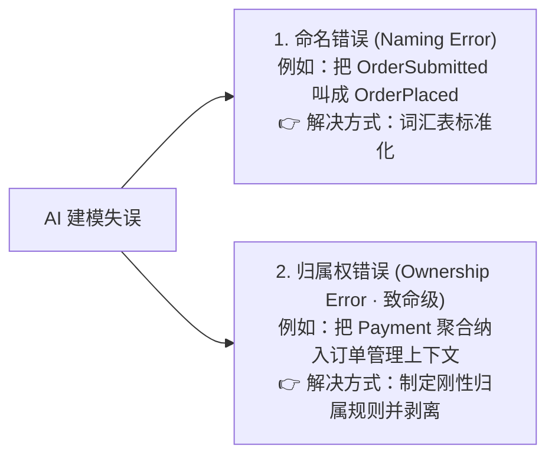
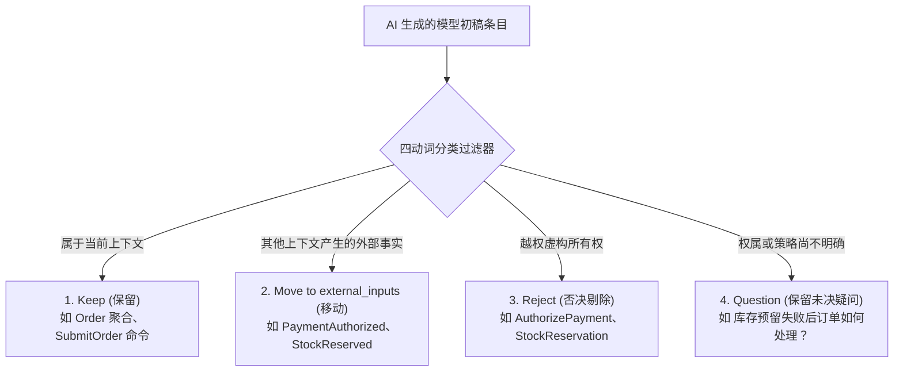

> 💡 **学习导读**：本文收录于专栏 [《AI 增强的领域驱动设计》](/columns/ai-ddd)。
> 📦 **配套工程资产**：本篇核心沉淀的上下文快照规格与怀疑式审计提示词已收录于技能包：[获取 DDD 规则与精化技能包](/skills/ddd-context-refiner)。

---

## 学习导航：为什么需要这套笔记？

即使有了第 5 章的规则手册，大语言模型在面对复杂业务流时，依然具有强大的**“概念压缩本能”**——它会把在业务时序上连续出现的事物（下单、支付、锁库、发货）强行合并进同一个聚合或同一个限界上下文里。

本文采用 **「🎯 实战精粹（高信噪比学习主线）」** 与 **「📖 原书论述（溯源背景对照）」** 的双重视角编排，带你掌握如何通过 **“生成–审查–纠偏–规则晋升”** 循环，将模糊的业务初稿精化为内聚自洽的限界上下文。

---

## 一、 核心反直觉认知：AI 初稿错得直观是最大价值

| 🎯 实战精粹（心智模型） | 📖 原书论述对照（溯源背景） |
| :--- | :--- |
| **初稿是靶子，不是终点**<br>• 不要妄图单次 Prompt 产出完美架构。<br>• AI 生成的首个模型之所以极其宝贵，恰恰在于它**错得很直观（Visibly Wrong）**。<br>• 它的破绽为人类架构师提供了切实可见的切入点，把隐性的领域认知逼入显性化的讨论中。 | **BrewUp 订单管理的迷惑性初稿**<br>AI 返回的初稿看似标准：<br>`aggregates: [Order, Payment, StockReservation]`<br>`commands: [SubmitOrder, AuthorizePayment, ReserveStock, ConfirmOrder]`<br>命名符合规范，时序酷似合理电商流。但资深工程师一眼看破：这根本不是订单管理，这是把整个公司业务大包大揽的巨型怪物！<br>*[溯源: 原著第 23-56 行]* |

---

## 二、 核心辨析：命名错误 vs 归属权错误

这是领域建模中最关键的分水岭：



* **误区警示**：如果仅仅把 `Payment` 重命名为 `PaymentInfo`，你根本没有修复模型，只是**用更优雅的名词粉饰了架构错误**。
* **本质**：命名错误是当前上下文用错了词；归属权错误则是把概念完完全全放错了限界上下文，彻底颠覆了架构边界。

---

## 三、 审查武器：四动词分类过滤器 (Keep / Move / Reject / Question)

在审查 AI 初稿时，切忌泛泛提出“请优化设计”这种模糊要求，而是强制 AI 执行**四动词分类任务**：



### 规则晋升法则（Rule Promotion）
纠偏不能停留在单次口头指正，必须**将纠偏沉淀为新规则**：
* 剔除 `AuthorizePayment` $\rightarrow$ 晋升规则：*“支付相关命令绝不属于 Order Management。”*
* 移动 `PaymentAuthorized` $\rightarrow$ 晋升规则：*“外部事实可以触发内部决策，但绝不能建模为 Order 聚合抛出的内部事件。”*

---

## 四、 CQRS 作为 AI 推理的“角色分离透镜”

在 AI 辅助建模中，**CQRS 的首要价值是“分离语义”，而非分离数据库或总线**。它配合互补的 DDD 角色，能有效阻断 AI 把复杂交互坍塌为一条平铺叙事：

| 领域角色 | 语义本质 | 订单管理实战示例 |
| :--- | :--- | :--- |
| **Command（命令）** | 改变状态的意图（分为用户发起与策略触发） | `SubmitOrder` (用户发起)<br>`ConfirmOrder` (**策略触发**) |
| **Internal Event（内部事件）** | 本上下文聚合产生的既成事实 | `OrderSubmitted`, `OrderConfirmed` |
| **External Input（外部输入）** | 其他上下文产生、本上下文关心的外部事实 | `PaymentAuthorized`, `StockReserved` |
| **Policy（策略）** | 反应机制：将观察到的事实转化为新命令 | “当观察到支付授权与库存预留均成功，触发 ConfirmOrder” |
| **Query（查询）** | 只读观察，严禁产生任何副作用 | `GetOrderStatus` |
| **Read Model（读模型）** | 为查询端优化的数据投影 | `OrderSummaryProjection` |

> 💡 **关键心智**：`ConfirmOrder` 依然是命令，但它是**策略触发的命令（Policy-triggered Command）**。客户不会直接点“确认订单”，而是由系统观察到外部输入全部就绪后，由内部策略代为下发。

---

## 五、 精化聚合边界：“协作不等于拥有”

大模型极其倾向于把“一起工作的事物”打包成“同一个聚合”。

### 聚合防膨胀 5 连问
在审视聚合时，连续向 AI 抛出 5 个灵魂拷问：
1. **该聚合到底在守护哪些核心业务不变量？**
2. **哪些决策必须在同一个事务一致性边界内做出？**
3. **聚合自身真正抛出哪些事件？**
4. **哪些概念实际上属于另一个限界上下文？**
5. **哪些行为纯粹是做出反应，而非聚合固有的内生行为？**

* **结论**：Order 聚合固然依赖 Payment 和 Stock，但**依赖绝不等于包含**。Order 聚合只需保存派生自外部事实的最小状态（如是否观察到支付成功），妄图霸占整个支付生命周期属于越俎代庖。

---

## 六、 防倒退神器：上下文快照（Context Snapshot）

为了防止千辛万苦确立的决策在下一次会话中被 AI 推翻，团队必须将成果固化为受版本控制的 **上下文快照**：

```yaml
# docs/ddd/contexts/order-management-snapshot.yaml
bounded_context: Order Management
owned_concepts:
  aggregates:
    confirmed: [Order]
  commands:
    confirmed:
      user_initiated: [SubmitOrder]
      policy_triggered: [ConfirmOrder]
    proposed:
      user_initiated: [CancelOrder]
      policy_triggered: [ExpireOrder]
  internal_events:
    confirmed: [OrderSubmitted, OrderConfirmed]
    proposed: [OrderCancelled, OrderExpired]
external_inputs:
  - PaymentAuthorized
  - StockReserved
  - StockReservationFailed
policies:
  confirmed:
    - "当观察到支付授权与库存预留均已完成时，确认订单。"
ownership_constraints:
  - "Payment、StockReservation、Shipment、Invoice 均不属于订单管理。"
  - "绝不能将外部输入建模为 Order 聚合发出的事件。"
open_questions:
  - "收到 StockReservationFailed 后，订单是立即取消还是发起重试？"
  - "未确认状态的超时时间限制是多少？"
```

### 诚实留白 vs 虚假完备
* **未决问题（Open Questions）是自洽性不可或缺的一部分**。
* 大模型具有为了强求完备而胡乱脑补规则的倾向（如擅自决定“库存失败就自动退款取消”）。
* **诚实保留未决问题，并在审查提示词中严厉勒令 AI “严禁擅自解答未决问题”**，是守护架构严谨性的最强护栏。

---

## 七、 避坑指南（Do's & Don'ts）

* ❌ **Don't**：把 AI 初稿里的外部聚合仅仅改个名字（如改叫 `PaymentInfo`）便自欺欺人。
* ✅ **Do**：彻底剥离归属权，将其降级为 `external_inputs`。
* ❌ **Don't**：把复杂的跨上下文交互写成一段流水账散文。
* ✅ **Do**：用 CQRS 透镜拆解为 Command、Event、Policy、External Input。
* ❌ **Don't**：允许 AI 为了回答问题而擅自发明业务规则。
* ✅ **Do**：用未决问题（Open Questions）阻断盲目补全，区分 `confirmed` 与 `proposed`。

---

> 🛠️ **动手实践**：本章配套的快照规格模版与审计提示词已发布至技能中心，可前往 [DDD 限界上下文规则与精化技能包](/skills/ddd-context-refiner) 查阅并下载。
