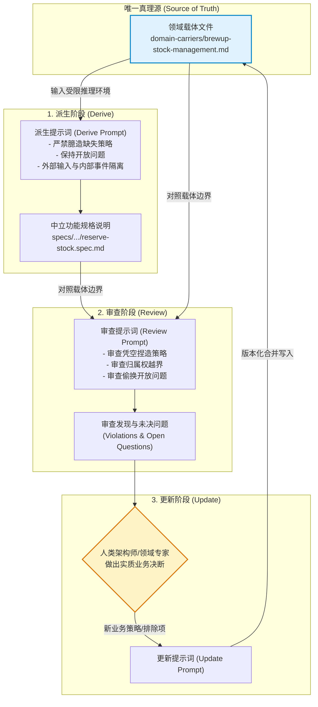
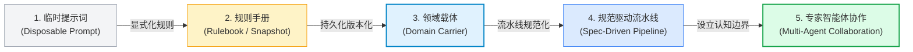

# 核心实战精炼：作为领域载体的提示词 (Prompt as Domain Carrier)

## 1. 架构选型与决策矩阵

在将领域驱动设计（DDD）与大语言模型（LLM）结合的实践中，团队对领域知识的承载方式直接决定了推理的稳定性与复利价值。下表对四种典型承载形态进行工程化对比：

| 评估维度 | 临时提示词 (Disposable Prompt) | 上下文快照 (Context Snapshot) | 领域载体 (Domain Carrier) | 编排工作流与脚手架 (Harness / Adapters) |
| :--- | :--- | :--- | :--- | :--- |
| **物理形态** | 交互会话中的临时输入文本 | 阶段性分析产出的 Markdown/YAML 备忘 | 与代码并存的受控 Markdown 文件（`domain-carriers/`） | 集成框架工件库（如 Spec Kit / BMAD / OpenSpec） |
| **生命周期** | 单次交互，会话结束即销毁 | 阶段评审后归档，容易逐步落后于实现 | 伴随限界上下文全生命周期，持续版本演进 | 工具执行期存在，充当工件流转的适配管道 |
| **约束定位** | **What to do**：即时任务诉求 | **As-is**：记录当前已知事实与疑点 | **Boundary**：定义所有权、排他性与推演边界 | **How to orchestrate**：调度角色与工件流动 |
| **版本管理** | 无版本控制（仅存留于对话日志） | 静态文档，极少参与 PR 差异比对 | 纳入 Git 版本控制，与领域代码同级审查 | 配置文件版本化，与具体执行脚手架绑定 |
| **抗语义回归** | 极低（每次会话面临概率漂移与退化） | 中等（需人工手动重新喂给模型） | **极高**（作为每次交互的强制推理环境） | **高**（借助门禁守卫自动检验工件偏离） |
| **推荐适用场景** | 探索初期的即兴头脑风暴 | 事件风暴工作坊的阶段性共识归档 | **生产级架构推演、规格派生与一致性审查** | 多智能体分布式协作与端到端代码交付流水线 |

## 2. 领域载体核心闭环：派生–审查–更新

领域载体（Domain Carrier）并非静态参考文档，而是驱动 AI 推理的唯一真理源（Single Source of Truth）。通过“推导–评审–更新（Derive-Review-Update）”三阶段闭环，团队在不依赖特定框架的前提下，实现业务知识的持续累积与刚性防护：



### 核心运作原则
1. **单向依赖规则**：外部功能规格说明（Spec）、工作流计划（Plan）及任务列表（Tasks）必须由领域载体派生而来，绝不允许反向污染或覆盖载体。
2. **工具解耦原则**：框架与脚手架仅作为自动化执行适配器。更换工具链时，仅需替换载体文件末尾的脚手架指令，业务核心边界保持绝对稳定。
3. **闭环收敛原则**：审查中暴露的业务决策必须回填至载体；未获决策的疑点强制保留在开放问题中，严禁在下游实现中由模型自发闭合。

## 3. 生产级领域载体标准模版

以下为符合生产级工程规范的库存管理限界上下文领域载体标准模版（`domain-carriers/brewup-stock-management.md`），完整覆盖前 10 个领域核心小节与末尾机械运转小节：

```markdown
# BrewUp Stock Management Domain Carrier

## 1. Purpose
Stock Management 负责管理 BrewUp 订单的商品物理库存可用性与库存预留决策。
- 它不拥有客户订单的完整生命周期。
- 它不负责确认订单。
- 它不负责执行支付授权与资金结算。
- 它不负责生成物理物流出货与配送单据。

## 2. Domain Authorities
- **Sales Context**：拥有客户商业承诺与销售订单（Sales Order）状态跃迁的所有权。
- **Payment Context**：拥有支付授权凭证（PaymentAuthorizationId）与资金交易结果的所有权。
- **Warehouse Context**：拥有物理库位管理与货品实际出库履约的所有权。

## 3. Ubiquitous Language
- **Stock Availability**：某一时刻仓库中未经预留的物理商品可分配数量（瞬态事实）。
- **Stock Reservation**：为特定销售订单锁定的专属库存分配配额（具备业务效力的持久凭证）。
- **Reservation Window**：库存预留从创建到自动失效的合法保持时间窗口。

## 4. Owned Concepts
- **Aggregates**：`ProductStock`（商品库存聚合）。
- **Commands**：`ReserveStock`、`ReleaseStockReservation`。
- **Internal Events**：`StockReserved`、`StockReservationFailed`、`StockReservationExpired`、`StockReleased`。

## 5. External Inputs
该上下文仅监听以下外部事件作为触发信号，严禁反向发射或重新定义这些事件：
- `OrderSubmitted`（来自 Sales）
- `OrderConfirmed`（来自 Sales）
- `OrderCancelled`（来自 Sales）
- `OrderExpired`（来自 Sales）

## 6. Bounded Context Rules
- **BC-001**：Stock Management 拥有库存可用性判断与库存预留分配的唯一决策权。
- **BC-002**：Stock Management 严禁将 Order 建模为自有聚合根或内部实体。
- **BC-003**：Stock Management 仅通过发出领域事件暴露库存状态变更，不直接调用外部服务的写接口。
- **BC-004**：销售订单确认必须以 Stock Management 签发的持久凭证 `StockReservationId` 为必要前提。

## 7. Confirmed Policies
- **POL-001**：仅当请求的全部商品行均具备充足可用库存时，方可执行预留（全有或全无策略）。
- **POL-002**：已成功预留的库存立即从可用数量中等额扣减，防止并发超卖。
- **POL-003**：收到关联订单的 `OrderCancelled` 或 `OrderExpired` 事件后，已预留库存必须原额释放重回可用池。

## 8. Proposed Policies
- **PROP-001**：库存预留设立 15 分钟临时保留窗口；超时未收到确认信号则自动触发失效（待与销售团队对齐确认）。

## 9. Open Questions
- **OQ-001**：预留失败时，是否需要向上游显式区分“可用库存不足”与“商品SKU无效”？
- **OQ-002**：预留失败后的重试策略应由销售 Saga 负责还是由库存上下文内部自愈？
- **OQ-003**：在供应链补货延迟时，是否允许进入积压排队预留状态？

## 10. Forbidden Assumptions
- 严禁假设库存预留成功即等同于销售订单已确认。
- 严禁假设支付已授权即可推定库存必定充足。
- 严禁在 Stock Management 内部引入物流发货（Shipment）相关逻辑与状态。
- 严禁将订单生命周期事件（如确认/取消）当成本上下文内部事件进行发射。

---
## 11. Machinery & Harness Instructions
- **Constraint Enforcement**：执行任何推导或代码审查任务时，必须以本文件作为排他性依据。
- **Output Schema**：所有派生工件必须包含 `In Scope`、`Out of Scope`、`Confirmed Rules`、`Open Questions` 结构。
- **Prohibited Action**：若遇到 OQ-001 ~ OQ-003 所列问题，必须原样透传至输出，严禁模型自行推演闭合。
```

## 4. 从 Prompt 到 Agent 的演进蓝图

领域载体是软件工程从散漫的自然语言提示词跃迁为高度自主且受控的多智能体系统的桥梁。整个演进蓝图分为五个成熟度阶段：



### 五阶演进特征矩阵

| 演进阶段 | 核心驱动物 | 上下文边界机制 | 失效模式与风险 |
| :--- | :--- | :--- | :--- |
| **Stage 1: 临时提示词** | 临时查询句子（“实现库存预留”） | 无边界，依赖预训练模型通用常识 | 概率漂移严重，擅自捏造跨上下文依赖 |
| **Stage 2: 规则快照** | 会话备忘、通用语言列表 | 局部软约束，依赖人工反复复制粘贴 | 会话切换后规则丢失，被否决概念卷土重来 |
| **Stage 3: 领域载体** | Git 受控的 Markdown/YAML 文件 | **刚性排他边界**：显式禁止假设与开放问题 | 载体维护若脱节，将导致生成工件依据陈旧事实 |
| **Stage 4: 规范驱动** | Spec Kit / OpenSpec 工件流水线 | 工件链式过滤（Carrier -> Spec -> Plan -> Task） | 行政性打勾（Checked Task）脱离真实行为测试 |
| **Stage 5: 专家智能体** | 专业守卫与角色智能体（BMAD/Guards） | **认知边界（Cognitive Boundary）**：禁止越权推断 | 守卫沦为无依据的主观偏见（需挂载显式规则编号） |

## 5. AI 输出镜像认知论与诊断信号

### 认知论核心：输出是推理环境的标尺
大语言模型不具备跨会话持久的内部心智模型。模型输出的流畅性（Fluency）极易掩盖语义归属权错误。因此，**生成的工件不仅是交付成果，更是评估提示词与载体环境刚性强度的诊断探针**。

| 异常生成表象 (Symptom) | 根因诊断 (Root Cause in Reasoning Environment) | 纠偏与载体升级动作 (Promote to Carrier) |
| :--- | :--- | :--- |
| 生成的库存规格中包含 `CreateShipment` 动作 | 载体中未显式排除发货职责；模型依据电商统计概率自发缝合共现概念。 | 在 `Forbidden Assumptions` 中追加：“严禁在 Stock 内部引入物流发货关注点”。 |
| 模型擅自添加“重试 3 次预留失败则取消订单” | 弹性诉求未指派归属权；模型试图通过微服务通用套路填补未决疑点。 | 将重试决策写入 `Open Questions`，并显式禁止模型自行制定容错方案。 |
| 模型将 `OrderConfirmed` 当作内部领域事件发出 | 上下文事件流向未解耦；CQRS 读写分离与外部输入约束表达模糊。 | 在 `External Inputs` 严格固化该事件，并在所有权规则中禁止反向发射。 |
| 上一次修复过的命名错误在数天后再次复现 | 纠偏仅停留在聊天窗口会话记忆中，未固化为持久工件。 | 执行 Update Prompt，将修正晋升为载体中带编号的刚性规则（BC Rules）。 |

## 6. 架构避坑清单 (Do's & Don'ts)

| 错误实践 (Don't) | 正确实践 (Do) |
| :--- | :--- |
| **Don't**：仅在聊天记录中进行提示词调试与口头纠偏，寄希望于大模型能“记住”上下文。 | **Do**：将纠偏结果沉淀为领域载体文件（`domain-carriers/*.md`），纳入 Git 进行版本管理与 PR 审查。 |
| **Don't**：撰写泛泛而谈的常识性指令（如“请遵循最佳架构设计与 DDD 原则”）。 | **Do**：编写包含排他性声明（`Forbidden Assumptions`）与未决疑点（`Open Questions`）的高特异性载体。 |
| **Don't**：允许大模型在业务规则不明确时进行“看似合理的自发补全”（Plausible Completion）。 | **Do**：强制设立推演中断指令，要求模型将一切未授权假设原样暴露在开放问题中。 |
| **Don't**：让下游生成工件（如 `spec.md` 或设计图）成为脱离载体的知识孤岛。 | **Do**：建立“派生–审查–更新”闭环，确保团队的业务裁决能够闭环回写至领域载体。 |
| **Don't**：将工具专属语法（如特定框架 CLI 命令、文件目录结构）与业务领域深度耦合。 | **Do**：保持领域载体核心业务章节与工具无关，仅在文件末尾附加可插拔的脚手架指令尾缀。 |

<!-- split -->

# 原著完整参考：作为领域载体的提示词

在上一章中，我们利用迭代反馈回路对限界上下文进行了持续精炼，直到归属权（ownership）、事件、命令、聚合和策略在语义上达到自洽连贯。其产物是一个限界上下文快照（bounded context snapshot）：它代表了团队当前对业务领域的理解。然而，仅仅拥有快照是远远不够的。如果在建模过程中发掘出的领域知识依然被深埋在某次对话记录中，同样的含糊不清最终仍会卷土重来。被否决的概念会死灰复燃，开放问题会悄然蜕变为不加求证的假设，而先前已经达成共识的决断又不得不重新推演一遍。

:::en
> **Original**: In the previous chapter, we used iterative feedback loops to refine a bounded context until ownership, events, commands, aggregates, and policies became semantically coherent. The result was a bounded context snapshot: a representation of the team's current understanding of the domain. However, a snapshot alone is not enough. If the knowledge discovered during modeling remains buried inside a conversation, the same ambiguities eventually return. Rejected concepts reappear, open questions become assumptions, and previously resolved decisions must be rediscovered.

**📌 核心术语与语境解析**：
- **Bounded Context Snapshot**：*限界上下文快照*。迭代建模阶段性产物，静态记录当前认可的归属权、事件、命令与未决问题。
- **Buried inside a conversation**：*深埋于对话会话*。大语言模型会话窗口具备易失性，未沉淀为外部持久化文件的共识将在新会话中丢失。
:::

本章将通过业务领域的一个新部分——BrewUp 库存管理（Stock Management）——来探讨如何沉淀并复用这些知识。在一个全新的第二限界上下文中展开工作，能让我们专注于工作流的实际应用而非单纯回顾，同时也证明了该方法绝非仅适用于订单管理（Order Management）。同样的工程纪律可以在概念分类、规格说明、设计评审、变更工作流以及后续面向智能体的协作中持续守卫语义的完整性。

我们不再将提示词视为一次性的请求，而是开始将其视为**领域载体（domain carrier）**：即对限界上下文“拥有什么”以及“拒绝假设什么”进行形式化编码的工件，从而让后续的所有交互都能构筑在稳固的基石之上。

:::en
> **Original**: Instead of treating prompts as disposable requests, you begin treating them as **domain carriers**: artifacts that encode what a bounded context owns and what it refuses to assume, so that future interactions can build on a stable foundation.

**📌 核心术语与语境解析**：
- **Domain Carrier**：*领域载体*。显式编码限界上下文所拥有概念与拒绝假设的持久化工件，而非用后即弃的查询提示词。
- **Disposable Requests**：*一次性/随用随弃的请求*。缺乏上下文边界约束与历史决策记忆的单次问答。
:::

本章还将探讨一次更深层次的范式跃迁。一旦领域知识成为提示词本身的一部分，AI 的输出就会清晰折射出模型是如何理解该领域的。同时，该输出也能揭示出环绕在其周围的推理环境是否足够坚固，以至于能够始终如一地守卫语义。

读完本章，你将理解：

- 为什么提示词可以从临时性的指令演进为可复用的领域载体
- 如何对领域知识进行形式化编码，使其在跨交互会话中得以完整保留
- 如何利用领域载体来遏制语义漂移与回归（semantic drift and regression）
- 为什么应当将 AI 输出视为“理解的镜像反映”，而非“理解的确凿证明”
- 反复的迭代精炼如何在人机之间建立起**共享语义对齐（shared semantic alignment）**
- 为什么领域驱动设计（DDD）提供的边界构成了支撑长期 AI 辅助建模的基石

## 从询问到编码：认知的跃迁

在上一章的结尾，BrewUp 的订单管理（Order Management）上下文已经达到了实用的连贯性水平。尽管它仍不完备，但核心决策已经清晰可见：归属权、外部输入、内部事件、已确认概念、提议概念以及开放问题。这一成果为我们带来了一个限界上下文快照。

快照捕获了领域理解的当前状态。它记录了团队当前认可的内容、否决的内容、尚不确定的疑点，以及指导后续推理所应遵循的规则。然而，若仅仅单独使用，快照依然只是一份参考文档。快照描述了模型，却无法自动塑造下一次与模型的交互。

接下来的关键一步，是将这些记录下来的知识转化为可复用的工作上下文（working context）。

与其每次都向模型询问领域知识，不如对相关领域知识进行编码，迫使模型必须在这些知识的约束下展开工作。这种认知跃迁的核心在于：提示词不再仅仅是一个单纯的请求，而是开始承载回答所必须恪守的规则、语言与约束。

:::en
> **Original**: Instead of asking the model about the domain each time, you encode the relevant domain knowledge so the model has to work inside it. The knowledge shift is this: the prompt stops being only a request and starts carrying the rules, language, and constraints the answer must respect.

**📌 核心术语与语境解析**：
- **Knowledge Shift**：*认知/知识范式跃迁*。从被动“向模型提问知识”转变为主动“将领域知识编码为模型推演的刚性容器”。
- **Working Context**：*工作上下文*。在当前会话激活并施加有效约束的确定性规则集合。
:::

早期的 AI 交互通常表现为简单的请求：

```text
识别该限界上下文的事件。
```

或者：

```text
为该领域生成命令和聚合。
```

这类提示词对于生成初稿可能有所帮助，但它们同样极易被用后即弃。一旦得到了回答，提示词便失去了进一步的价值。它无法保留评审期间做出的决策；它记不住哪些概念曾被否决；它不能将已确认的规则与开放问题区分开来。它只是索取输出，随后便烟消云散。

领域载体则截然不同。它是为了承载领域知识而专门编写的提示词，绝非仅仅为了索取一个结果。领域载体为模型提供了一个由前期建模工作沉淀构建的推理环境，而非一个需要从零作答的问题。

普通的提示词会说：

```text
这是我想要你做的事情。
```

而领域载体则明确告知：

```text
这是你在执行任务时必须恪守的领域知识。
```

:::en
> **Original**: A normal prompt says: "Here is what I want you to do." A domain carrier says: "Here is the domain knowledge you must preserve while doing it." The change alters the role of the prompt. The prompt becomes a maintained modeling artifact instead of a temporary instruction.

**📌 核心术语与语境解析**：
- **Maintained Modeling Artifact**：*持续维护的建模工件*。像管理源代码一样进行版本控制、代码评审（PR）与差异对比的领域资产。
- **Temporary Instruction**：*临时性指令*。用完即弃的会话提示词，无法随软件生命周期共同演进。
:::

这一转变彻底改变了提示词的角色定位。提示词演进为一个需要持续维护的建模工件，而非临时的执行指令。如果一条提示词包含了保护限界上下文的核心规则，那么它理应受到与其他设计物料同等规格的呵护。提示词应当经过严格评审与校正，因为随心所欲地重写它，就意味着丢失了模型的一部分。

这正是*第 6 章*在此发挥作用的原因所在。限界上下文快照正是构建领域载体的原材料。两者的演进关系如下所示：

```text
上下文快照 (context snapshot)
    ↓
领域载体 (domain carrier)
    ↓
可重复的 AI 辅助推理 (repeatable AI-assisted reasoning)
```

上下文快照记录了当前理解的状态，而领域载体则将这种理解转化为操作性的指导准则。一旦领域载体确立，模型便可利用它来对新元素进行分类、评审提议的变更、生成候选策略、检测不一致性，或是为具体实现准备规格说明。

### 领域载体的构成要素

到目前为止，我们主要是从“功能”的角度来描述领域载体的。在动手构建之前，有必要清晰界定它究竟“是什么”，因为本章接下来的内容会将其视为一个具体的物理文件，而非一种空泛的提示词编写风格。

领域载体是一个 Markdown 文件，每个限界上下文各有一份，并以其所描述的上下文命名。BrewUp 的载体文件统一保存在 `domain-carriers` 目录下，因此本章通篇使用的载体文件是 `domain-carriers/brewup-stock-management.md`，它与 `domain-carriers/brewup-sales-order-confirmation.md` 并列存放。该目录的具体物理位置取决于团队所采用的脚手架环境（harness）：在配套代码仓库中，它使用的是规范驱动的脚手架，路径为 `specify/memory/domain-carriers/`。你可以将该目录放置在助手平时寻找持久项目上下文的任何位置，但请确保文件名始终与限界上下文强绑定，因为即便脚手架发生变动，这部分名称也绝不能改变。

该文件包含若干章节，其排列顺序经过深思熟虑。文件以业务领域开篇，以机械运转机制收尾：

- *Purpose（职责目标）* – 上下文负责什么，并连同其不负责什么一并声明。
- *Domain authorities（领域职权）* – 相邻的上下文，以及它们各自拥有哪些业务结果。
- *Ubiquitous Language（通用语言）* – 该上下文的专业术语，每个术语都附带其在该边界内部所承载的精确含义。
- *Owned concepts（归属概念）* – 该上下文所产生的聚合、命令和内部事件。
- *External inputs（外部输入）* – 该上下文所观察到但并不由其自身发出的领域事实。
- *Bounded context rules（限界上下文规则）* – 编号规则（如 BC-001 等），以一种可供生成工件对照校验的形式声明边界。
- *Confirmed policies（已确认策略）* – 团队已经确定的规则，生成的工件可以依赖这些规则。
- *Proposed policies（提议策略）* – 仍在讨论中的规则，生成的工件必须将其明确标记为提议中。
- *Open questions（开放问题）* – 尚未做出的决策，必须作为开放问题保留在输出中。
- *Forbidden assumptions（禁用假设）* – 点名排除模型原本倾向于自动补全的内容。

此后的一切都属于机械运转机制而非业务领域本身：智能体不得虚构什么、生成的工件预期应包含什么，以及一小段特定于脚手架环境的指令尾缀（harness-specific instructions）。当团队更换工具时，只有这部分尾缀需要调整。

*它应该有多长？* 在库存管理（Stock Management）示例中，载体在 400 行以内：足以维系边界，又简短到可以在评审前轻松读完。请将这一长度视为实践参考而非死板硬指标。更重要的是载体所包含的内容：如果它作为一个单一的限界上下文变得难以评审，请审视它是否承载了不止一个边界。反之，精简载体绝不能以牺牲那些赋予其核心价值的决策与排除项为代价。

*谁来维护它？* 维护模型的是谁，维护它的就是谁：即任何有资格参与该上下文“事件风暴（EventStorming）”工作坊的人。团队像评审任何其他设计物料一样在 Pull Request 中对其进行审查，因为对载体的修改本质上就是对模型的修改。

*什么时候更新它？* 在团队做出决策之后，而非在模型给出回答之后。本章后文展示的“推导–评审–更新（derive–review–update）”闭环明确规定了这一铁律。

*如何区分强效载体与薄弱载体？* 薄弱的载体读起来像普通文档：它只罗列上下文能做什么。强效的载体读起来像清晰的边界：它还会明确指出该上下文拒绝做什么，以及你绝不可擅自假设什么。排除项与开放问题正是区分两者的分水岭，而仓促草就的载体最先遗失的往往也正是这两个部分。

:::en
> **Original**: How can you tell a strong carrier from a weak one? A weak carrier reads like documentation: it says what the context does. A strong carrier reads like a boundary: it also says what the context refuses to do and what you must not assume. Exclusions and open questions are what separate the two, and they are the first sections a rushed carrier loses.

**📌 核心术语与语境解析**：
- **Boundary vs. Documentation**：*边界约束 vs. 叙述性文档*。强大的领域载体核心在于定义“排他性”（Exclusions）与“开放问题”（Open Questions），阻断模型依据概率自发补全。
- **Forbidden Assumptions**：*明令禁止的假设*。模型倾向于根据行业常识自动补充的推论（如认为库存预留即确认订单），必须显式切断。
:::

*载体如何传递给模型？* 向模型提供载体作为上下文有四种切实可行的途径。第一种是通过文件路径：拥有项目访问权限的助手被明确告知哪个文件具有权威性，将持久上下文存放在已知目录下的测试与执行脚手架通常以这种方式运作。第二种是在提示词中显式提及文件，例如 `@brewup-stock-management.md` 或其等价语法；显式文件提及尤为有用，因为交互转录日志会准确记录引用了哪个工件。第三种是通过 MCP（Model Context Protocol）暴露载体，这适用于跨仓库、跨工具或跨团队共享的知识。第四种是将载体直接粘贴到对话中；直接粘贴虽然可行，但却是最不可靠的方式，因为这种交互方式无法保留对所粘贴版本的持久引用。本专栏打印的提示词统一使用 `[此处插入领域载体]`（`[Insert domain carrier here]`），因为纸面书籍无法重现上述任何一种物理传递机制；在真实项目中，载体是通过上述途径之一注入的。

### 构建库存管理领域载体

为了使认知的跃迁更加具体，我们暂时离开订单管理，来看看 BrewUp 的另一个限界上下文——库存管理（Stock Management）。引入第二个上下文表明，该方法绝非与订单管理的例子捆绑在一起。

在*第 6 章*中，库存管理是从外部视角的角度出现的。从订单管理的视角来看，诸如 `StockReserved`（库存已预留）和 `StockReservationFailed`（库存预留失败）等事件都是外部输入，是订单管理观察到的事实，而不是由 Order 聚合发出的事件。

现在，我们将视角反转。

在库存管理内部，这些相同的事实变成了内部领域事件。这种边界划分正是限界上下文的核心精髓所在：含义取决于边界。一个上下文从外部观察到的事实，可能是另一个上下文所拥有并产生的。

BrewUp 中库存管理的职责目标，是管理客户订单的商品可用性与库存预留。库存管理不拥有客户订单的生命周期，不负责授权支付，也不创建物流出货。它的职责更为专注：决定所请求的库存是否可以预留、跟踪预留状态、在必要时释放已预留的库存，并向其他上下文暴露与库存相关的事实。

以下节选自单个完整文件，而非由多个零散文件拼凑而成。它保留了该文件中的四个章节：职责目标（purpose）、限界上下文规则（bounded context rules）、开放问题（open questions）以及禁用假设（forbidden assumptions）。它对前两个章节进行了浓缩精炼，对后两个章节则进行了逐字逐句的完整复现，因为本章随后的内容会将生成的输出直接追溯回它们。完整文件存放在配套代码仓库中，路径为 `domain-carriers/brewup-stock-management.md`：

**库存管理领域载体（节选）**

```markdown
# BrewUp Stock Management Domain Carrier（BrewUp 库存管理领域载体）

## Purpose（职责目标）

Stock Management manages product availability and stock reservation for BrewUp
orders.
（Stock Management 负责管理 BrewUp 订单的商品可用性与库存预留。）

It does not own the customer order lifecycle.
（它不拥有客户订单生命周期。）
It does not confirm orders.
（它不负责确认订单。）
It does not authorize payments.
（它不负责授权支付。）
It does not create shipments.
（它不负责创建物流出货。）

## Bounded Context Rules (condensed)（限界上下文规则，精简版）

- Stock Management owns stock availability and stock reservation decisions.
  （Stock Management 拥有库存可用性与库存预留的决策权。）
- Stock Management does not own the Order aggregate.
  （Stock Management 不拥有 Order 聚合。）
- Stock Management does not decide whether an order is confirmed.
  （Stock Management 不决定订单是否已确认。）
- Stock Management emits stock-related events that other contexts may observe.
  （Stock Management 发出可供其他上下文观察的库存相关事件。）
- Order lifecycle events are external inputs, not internal Stock Management
events.
  （订单生命周期事件是外部输入，而非 Stock Management 内部事件。）

## Open Questions（开放问题）

- How long should a stock reservation remain valid?
  （库存预留应维持多长时间的有效性？）
- Can stock be partially reserved?
  （库存是否允许部分预留？）
- Should a failed reservation distinguish between unavailable stock and invalid
product?
  （预留失败是否需要区分“库存不足”与“商品无效”？）
- Which context decides whether to retry a failed reservation?
  （哪个上下文负责决定是否重试失败的预留？）

## Forbidden Assumptions（禁用假设）
- Do not assume that stock reservation confirms the order.
  （严禁假设库存预留意味着确认了订单。）
- Do not assume that payment authorization guarantees stock availability.
  （严禁假设支付授权保证了库存可用性。）
- Do not introduce shipment concerns inside Stock Management.
  （严禁在 Stock Management 内部引入物流出货关注点。）
- Do not model Order as an aggregate owned by Stock Management.
  （严禁将 Order 建模为 Stock Management 所拥有的聚合。）
```

该工件刻意保持了“不完备”的状态。它的使命是沉淀团队已知的知识、让不确定性保持可见，并防止未来的交互在不知不觉中篡改上下文的语义边界。该载体经过刻意精简，仅采用了前文所述的核心章节。

这正是“单纯提示（prompting）”与“形式化编码（encoding）”之间的本质工程差异：单纯提示是要求模型从当前语句顺流而下进行续写；形式化编码则是预先塑造一个世界，规定续写只能在这个世界的边界之内合法发生。

### 让载体投入实战

假设你随后要求模型对一份新的概念元素清单进行分类。此时的检验标准在于：载体能否让归属元素与外部输入泾渭分明，并保留未决问题，而非放任模型通过主观臆断擅自解决它们：

**分类提示词（Classification prompt）**

```yaml
Context:
使用以下领域载体作为 BrewUp Stock Management 限界上下文的唯一事实来源。

[此处插入领域载体]

Task:
对以下元素进行分类：

- ReserveStock
- OrderConfirmed
- StockReserved
- PaymentAuthorized
- StockReservationExpired
- ShipmentCreated

对于每个元素，将其分类为：
- owned command（归属命令）
- internal event（内部事件）
- external input（外部输入）
- rejected concept（否决概念）
- open question（开放问题）

返回 YAML 格式，包含：
- element
- classification
- reason
- rule_applied
```

如果没有领域载体，模型可能会给出一个文笔流畅却质量平庸的回答。模型可能会将 `OrderConfirmed` 视为同一业务流程的一部分；可能会引入 `PaymentAuthorized`，因为在电商案例中支付与库存经常如影随形；或者可能会采纳 `ShipmentCreated`，因为物流出货通常紧随订单确认之后。

而一旦载体到位，回答的范围将被大幅收敛。`ReserveStock` 是一条归属命令（owned command）；`StockReserved` 和 `StockReservationExpired` 是内部事件（internal events）；`PaymentAuthorized` 和 `ShipmentCreated` 应当被直接否决，因为载体中的“禁用假设”明确将支付和出货关注点隔绝在 Stock Management 之外。`OrderConfirmed` 则属于另一种情况：它是一个订单生命周期的事实，而 Stock Management 已经消费了订单生命周期的事实——`OrderSubmitted`、`OrderCancelled` 和 `OrderExpired` 都已被列为外部输入。它绝非一个无关的外来概念，而是一个合情合理、但未被显式声明的输入。由于载体中并未列出它，最稳妥的分类是将其视为一个**开放问题**。模型可能会推测 Stock Management 应该对其做出响应，但载体并不允许模型凭空虚构这种关联。

该工件并没有直接递给模型一个现成的结论；它施加了严密约束，阻止了模型凭空捏造结论。模型不会跨会话记忆业务领域；正是该工件将这些领域知识重新注入回了当前上下文窗口之中。

这种防范机制至关重要，因为 AI 辅助建模往往因**回归（regression）**而功亏一篑。团队好不容易纠正了模型一次，随后这一纠正在下一次会话中便消失得无影无踪。昨天刚刚否决的概念，今天换了个名称又卷土重来。一个悬而未决的开放问题，因为模型极力试图“补全结构”的内在倾向，被悄然捏造为既成策略。限界上下文的边界在潜移默化中不断被侵蚀磨损，只因提示词未能守住当初划定边界的那些决策。

:::en
> **Original**: The regression matters because AI-assisted modeling often fails by regression. A team corrects the model once, then the correction disappears in the next session. A concept rejected yesterday returns under a different name today. An open question becomes an invented policy because the model tries to complete the structure. A bounded context boundary slowly weakens because the prompt does not preserve the decisions that created it.

**📌 核心术语与语境解析**：
- **Semantic Regression**：*语义回归/语义倒退*。上一轮会话已纠偏的错误在后续会话中死灰复燃，或被否决的概念改头换面重新出现的架构退化现象。
- **Completion Pressure**：*补全压力*。大模型自回归生成机制在遇到信息空缺时，强烈倾向于依据统计概率编造假想策略以完成结构。
:::

领域载体有力遏制了这种语义回归：它为团队提供了一个明确物理实体来沉淀校正结果，使每一次纠偏都能融入工作上下文的一部分，而非深埋于过去对话的故纸堆中。每一项建模决策都应触发一个简单的自问：**这项决策是否应当被写入领域载体？**

一套行之有效的工作流如下：

```text
生成或评审候选模型
对照领域知识进行批判性审查
将校正提炼晋升为明确规则
更新领域载体
在下一次交互中复用该载体
```

最后一步至关重要：如果不及时更新载体，每一次纠偏就只能局限在当前对话中；而一旦更新了载体，知识与校正便能实现复利累积。

这同样改变了提示词理应存放的物理位置。如果提示词承载着核心领域知识，它们就绝不能仅停留在聊天记录中。对于需要持续维护的领域知识而言，聊天历史是一个极其脆弱的载体——它难以评审、难以进行 Git diff 比对、难以与团队共享，更难以长期归档沉淀。领域载体应当存放在能够对设计知识进行工程化维护的地方，如前所述：存放在规格说明、架构决策记录（ADR）、测试用例或其他建模工件的身旁。

关键法则在于：

*如果该工件会影响理性推理，它就必须清晰可见。*

*如果它被反复复用，它就必须纳入版本控制。*

*如果它发生了变更，该变更就必须是可供审查的（reviewable）。*

这正是你早已在源代码和架构决策中所贯彻的工程纪律。AI 并没有废除这套纪律；相反，它进一步扩大了理应享受这套纪律呵护的工件范围。这一切均不与任何特定工具捆绑，下一节将对此展开详尽论述。这里至关重要的是：文件名、智能体约定和规格格式今后都会不断演进变迁，而这恰恰正是为什么知识必须栖身于不随工具更迭而动摇的稳定居所的原因：

```text
领域知识必须先被形式化编码，然后才能被有效复用。
```

当提示词能够切实承载未来回答所必须恪守的领域知识时，它的价值便会随着时间的推移历久弥坚。到目前为止，Stock Management 载体只执行了一项任务：判断某个概念元素是否属于该上下文。对元素进行分类只是它能胜任的最小工作，绝非构建它的根本目的。本章接下来的部分将在保持载体自身完整稳定的前提下切换任务——首先推导一份功能规格说明，继而对推导结果展开严格评审，最后将团队决策重新融入模型闭环。唯有能够经受住任务变迁考验的载体，才真正对得起维护它所付出的工程心血。

## 跨工作流复用领域载体

到目前为止，载体只完成了一项单一任务：根据上下文已有的边界对元素进行分类。然而，其真正的核心价值在于：任务可以任意切换，而载体本身始终巍然不动。任务可以从分类流转为规格说明，从规格说明流转为设计评审，再从评审流转为实现规划——贯穿这所有环节，载体始终扮演着稳定不变的基础输入。

一个极简的提示词看起来人畜无害：

**缺乏载体时的提示词**

```text
为 BrewUp 中的库存预留生成规格说明。
```

这里的指令十分简短，但缺失的上下文实在太多了。该提示词没有定义限界上下文；没有指明 Stock Management 拥有哪些概念；没有防范订单管理、支付或物流出货被强行扯入同一个模型之中；也没有给模型任何理由去保留开放问题。助手或许依然能够生成一份光鲜亮丽的功能规格说明，而这种虚假的表面完备性恰恰潜藏着最大的架构风险。

一场更优雅的交互，始于上一节构建的 Stock Management 领域载体。载体为模型划定了一个更为聚焦的工作场域。提示词不再要求模型去凭空发明业务领域；相反，它要求模型复用已经捕获的领域知识。

在此时，代码仓库中开始出现与载体并列存放的其他文件：

```text
/specs/stock-management/reserve-stock.spec.md
/ai/workflows/stock-management.md
```

特定的开发框架可能会生成各自的目录结构，但物理布局的重要性远不及依赖关系的走向：**这些文件必须由载体推导而来，绝不可反向依赖。**请将各类框架视为适配器（adapters），而非唯一事实来源。

:::en
> **Original**: A BMAD-like workflow might use the carrier as shared context for agents that reason about analysis, architecture, or implementation planning. A SpecKit-like workflow might use the same carrier to derive a feature specification before code generates. An OpenSpec-like workflow might use it to keep proposed changes explicit before they become tasks. The surface changes while the domain knowledge should not.

**📌 核心术语与语境解析**：
- **Harness / Adapter**：*脚手架与适配器*。外部工具链与智能体编排框架属于技术适配器，领域载体才是领域知识的不变真理源（Single Source of Truth）。
- **Spec-driven Workflow**：*规范驱动工作流*。在编写具体实现代码之前，严格基于领域载体生成功能规范与任务清单的工程范式。
:::

类似 BMAD 的工作流可以使用该载体作为共享上下文，供负责分析、架构或实现规划的智能体使用。类似 SpecKit 的工作流可以使用同一个载体在代码生成前推导出功能规格说明。类似 OpenSpec 的工作流可以使用它在提议的变更转化为具体任务之前使其保持显式可见。工具的外在形态千变万化，而底层的领域知识应当坚如磐石。这三者都是开源的真实工具，本章末尾的参考文献列出了它们的链接。然而在本专栏中，它们代表的是工作流的门类而非具体产品。这一论断适用于以类似形态组织智能体、规格说明或变更提议的任何工具。

最有价值的对比在于载体在不同工作流中所扮演的角色，如*表 7.1* 所示：

| 工作流角色 | 从载体中摄取的内容 | 产出成果 |
|---|---|---|
| **智能体工作流 (Agent workflow)** | 职责目标、词汇表、归属规则、排除项 | 共享智能体上下文 |
| **规格工作流 (Spec workflow)** | 策略、事件、命令、开放问题 | 功能规格说明 |
| **变更工作流 (Change workflow)** | 当前模型、提议行为、未决决策 | 变更提议与评审任务 |

*表 7.1 – 领域载体在不同工作流中扮演的角色*

*表 7.1* 界定了本章的范围——几页之后的*图 7.1* 则展现了不同的侧重点：展示了单条载体规则如何拦截单个错误回答。在当前阶段，你还没有开始设计多智能体系统，也没有要求编码助手去具体实现某个功能；这两项进阶工作将在后文展开。你在此刻所做的，是精心打造可供这些工作流消费的核心工件，以确保领域的真实业务含义在跨工作流交接中完好无损。

### 推导–评审–更新工作流

*表 7.1* 中的工件源自你在*第 6 章*中运行的同一精炼循环，现在通过三个具体的提示词将其工程落地：推导（derive）、评审（review）和更新（update）。这三者构成了一个闭环循环，每一次遍历该循环，都会使载体比以往更加严谨精确。第一个提示词从载体推导出一份规格说明，并且刻意保持了与实现细节的完全解耦。

**推导提示词（Derive prompt）**

```yaml
Context:
以 BrewUp Stock Management 领域载体作为唯一的事实来源。

Task:
推导一份与具体实现无关（implementation-neutral）的库存预留功能规格说明。

Rules:
- 严禁臆造缺失的策略。
- 完整保留开放问题。
- 保持 Stock Management 与 Order Management、Payment 及 Shipment 的严格分离。
- 将 OrderSubmitted、OrderCancelled 和 OrderExpired 视为外部输入。
- 使用已确认策略和已确认内部事件作为规格说明的原材料。
- 将提议的行为单独标记。

返回 Markdown 格式，包含：
- Feature purpose（功能目标）
- In scope（范围内）
- Out of scope（范围外）
- Confirmed rules（已确认规则）
- Proposed rules（提议规则）
- Open questions（开放问题）
```

以下精简后的模型输出，其结构组织比具体内容更值得细品：各个章节与领域载体一一镜像呼应，而最为关键的两个标题则清晰呈现了模型将哪些内容划在了范围之外，以及它拒绝擅自裁决哪些问题。

**模型输出**：推导出的规格说明（节选）

```markdown
# Stock Reservation Feature Specification（库存预留功能规格说明）

## Purpose（功能目标）

Allow Stock Management to reserve product stock for submitted BrewUp orders.
（允许 Stock Management 为已提交的 BrewUp 订单预留商品库存。）

## In Scope（范围内）

- Receive OrderSubmitted as an external input.
  （接收 OrderSubmitted 作为外部输入。）
- Check whether enough stock is available.
  （检查是否有足够库存可用。）
- Reserve stock when the requested quantity is available.
  （当请求的数量充足时预留库存。）
- Emit StockReserved after a successful reservation.
  （在预留成功后发出 StockReserved 事件。）
- Emit StockReservationFailed when stock cannot be reserved.
  （在无法预留库存时发出 StockReservationFailed 事件。）

## Out of Scope（范围外）

- Confirming the order.
  （确认订单。）
- Authorizing payment.
  （授权支付。）
- Creating shipments.
  （创建物流出货。）
- Modeling Order as an aggregate owned by Stock Management.
  （将 Order 建模为 Stock Management 所拥有的聚合。）
- Deciding how Order Management reacts to a failed reservation.
  （决定 Order Management 如何响应预留失败。）

## Confirmed Rules（已确认规则）

- Stock can be reserved only if enough quantity is available.
  （仅当可用数量充足时方可预留库存。）
- Reserved stock reduces the quantity available for other reservations.
  （已预留的库存会扣减其他预留的可用数量。）
- Released stock becomes available again.
  （已释放的库存将重新恢复为可用。）

## Proposed Rules（提议规则）

- A stock reservation may expire after a defined reservation window.
  （库存预留可在设定的预留窗口期过后失效。）

## Open Questions（开放问题）

- How long should a stock reservation remain valid?
  （库存预留应维持多长时间的有效性？）
- Can stock be partially reserved?
  （库存是否允许部分预留？）
- Should a failed reservation distinguish between unavailable stock and invalid
product?
  （预留失败是否需要区分“库存不足”与“商品无效”？）
- Which context decides whether to retry a failed reservation?
  （哪个上下文负责决定是否重试失败的预留？）
```

这一输出的价值恰恰在于规格说明**拒绝做什么**，而每一次拒绝都可以追溯到载体中指名的具体章节——其中三条更直接对应于上文节选的代码行。确认订单、授权支付以及创建物流出货之所以处于范围之外，是因为“禁用假设”中逐行明确排除了它们（每条各占一行）。失效之所以保持标记为提议中，是因为在完整文件中预留窗口期出现在“提议策略”下，而在本节选则出现在“开放问题”中，从未被列为已确认规则。部分预留同样保持开放状态：四个开放问题中的第二个明确询问了库存是否允许部分预留，而载体并未给出回答。对预留失败的响应之所以被排除在范围之外，是因为“限界上下文规则”将订单生命周期划分给了 Order Management。在这里，没有任何内容是凭空捏造的；所有内容要么承袭自领域载体，要么被其明确推迟裁决。

同样的纪律也延伸到了模型返回的纯文本之外。*表 7.1* 列出了不同工作流从载体中获取的内容，而*图 7.1* 则展示了其中一种工作流在规格驱动工具中的实际运作：该工具没有擅自替团队裁决“预留失败是否应区分数量不足与商品无效”，而是将这一未决问题浮出水面，将决策权郑重交还给团队。


*图 7.1 – 领域载体中所保留的开放问题被呈现给团队，而非由模型擅自代答*

领域载体在此奠定了其不可替代的地位。模型依然在生成文本，但唯有载体才能裁决哪些文本才算具备现实依据（grounded）。团队应当将一份看似完备、实则违背了载体约束的规格说明，视为一次彻底失败的转译。

第二个提示词负责检验这一转译，它要求模型对照载体对规格说明进行严格审查，而非发挥创造力去擅自扩充它。与前面的推导提示词一样，它通过名称引用载体，而非通篇复制载体内容；在实际会话中，团队可以通过前文所述的四种机制之一将载体注入。

**评审提示词（Review prompt）**

```yaml
Context:
你正在评审一份从 BrewUp Stock Management 领域载体推导出的功能规格说明。

Task:
检查该规格说明是否忠实维系了领域载体的边界。

Review for（审查重点）:
1. 凭空捏造的策略（Invented policies）
2. 被分配到错误限界上下文的概念（Concepts assigned to the wrong bounded context）
3. 被当成内部事件处理的外部输入（External inputs treated as internal events）
4. 被擅自晋升为确认规则的提议规则（Proposed rules promoted to confirmed rules）
5. 被悄然代答的开放问题（Open questions silently answered）
6. 违反禁用假设的情况（Forbidden assumptions violated）

返回 Markdown 格式，包含：
- Accepted parts（认可的部分）
- Violations（违规项）
- Corrections required（所需的校正）
- Open questions to preserve（应保留的开放问题）

切勿发挥创造力去改进该规格说明。
仅对照领域载体对其进行严格审查。
```

最后这条指令至关重要。如果没有它，助手可能会尝试通过添加缺失的行为来“提供帮助”。在早期的设计工作中，这种自作聪明的“帮助”代价极其昂贵——它抹杀了已知的确定性领域知识与似是而非的合理补全之间的界限。评审提示词应当让模型变得更加审慎保守，而非更加富于想象。

:::en
> **Original**: That last instruction matters. Without it, the assistant might try to help by adding missing behavior. In early design work, that help is expensive. It hides the difference between known domain knowledge and plausible completion. Review prompts should make the model more conservative, not more imaginative.

**📌 核心术语与语境解析**：
- **Conservative vs. Imaginative**：*保守严谨 vs. 发散想象*。审查阶段指令的核心目标是遏制模型的发散生成欲望，强制将推演收敛在已确认边界之内。
- **Plausible Completion**：*看似合理但缺乏依据的补全*。大模型最具欺骗性的输出形态，表面符合业务逻辑，实则未经领域专家批准。
:::

第三个提示词在团队做出真正的业务决策后对载体进行更新。这就形成了闭环。规格说明绝不能演变为一个脱离主干的知识侧枝。评审期间新发掘出的决策必须回流到载体中；否则，下一次工作流又将不得不从陈旧过时的上下文中重新启航。

:::en
> **Original**: The third prompt updates the carrier after the team makes a real decision. This closes the loop. The specification must not become a side branch of knowledge. Decisions discovered during review must flow back into the carrier; otherwise, the next workflow starts from stale context.

**📌 核心术语与语境解析**：
- **Close the Loop**：*完成闭环*。评审阶段发现的领域决断必须及时反哺更新到领域载体中，杜绝规范演变为孤立脱节的侧枝知识。
- **Stale Context**：*过期陈旧上下文*。未与最新架构决断同步的上下文，将导致后续智能体流水线建立在虚假前提之上。
:::

**更新提示词（Update prompt）**

```yaml
Context:
团队已对 BrewUp Stock Management 规格说明完成评审。

New domain decision:
[此处插入业务决策]

Task:
更新领域载体。

Rules:
- 仅将已确认的决策追加至已确认章节。
- 仅当决策明确验证了提议概念时，才移动它们。
- 将未决争议点保留为开放问题。
- 若决策否决了某个反复出现的错误，将其作为禁用假设追加。
- 除非新决策明确替换了既有规则，否则不得删除任何现有规则。

返回内容：
- Sections to update（需要更新的章节）
- Exact text to add or change（要添加或修改的准确文本）
- Reason for each change（每项变更的原因）
```

假设团队做出决定：除非订单已确认，否则库存预留在 15 分钟后自动失效。这一决断绝不应被深埋在某次会议纪要或助手的最后一条回复中。领域载体应当立即更新：提议的预留窗口期晋升为已确认策略，`StockReservationExpired` 保持为内部事件，后续的所有规格说明均可信赖该规则。如果团队决定不允许部分预留，被否决的行为同样应当被捕获记录下来。被否决的行为同样是宝贵的领域知识。

这一闭环完全不需要依赖任何复杂的外部框架。你仅凭三个提示词与一次人类决策，就流畅完成了推导、评审与更新，而领域载体则稳稳吸收了最终成果。框架在此刻登场的意义，绝非增加额外的步骤，而是将你手中已有的这三步自动化：整个循环可以封装在面向智能体的、规格驱动的或变更驱动的工作流中，而框架消费载体的方式与这三个提示词如出一辙。这也正是框架所能为你提供的能力上限：载体才是确保工作流不至于偏离业务领域的定海神针。

> **提示：OpenSpec 与轻量级变更纪律**
>
> 当团队希望在具体实现之前使提议的变更清晰可见时，类似 OpenSpec 的工作流尤为有用。特定于工具的命令或目录结构相比于工程纪律本身是次要的：一项变更应当包含一份提议（proposal）、一份规格说明（specification）、必要时的设计说明（design notes）以及可供评审的任务清单（reviewable tasks）。Stock Management 载体通过将已确认知识、提议行为与开放问题清晰隔离开来，为该工作流提供高质量输入，从而避免未决的领域决策草率沦为实现需求。

这里潜藏着一个小小的认知陷阱。一旦某个框架为你提供了一套清爽高效的工作流，*你就很容易陷入对工作流的信任超过对领域的信任的诱惑中*。这就本末倒置了。框架能够妥善组织工作流，但它无法替你核验业务含义的真实性。如果载体本身薄弱松散，工作流只会将软弱无力的推理加速自动化；唯有载体精确严密，工作流才有值得捍卫的核心价值。

这也解释了为什么领域载体应当保持与工具中立（tool-agnostic）。载体不应包含敏捷 AI 驱动开发突破方法（Breakthrough Method for Agile AI-Driven Development，BMAD）的专属命令、`SpecKit` 的特定语法或 `OpenSpec` 的文件夹约定，除非团队有非常强烈的特殊理由。这些技术细节属于适配器、示例或配套仓库资料；这也是为什么前文列出的业务领域章节排在文件的最前面，而脚手架专属指令排在最后面的原因——这样即使随时替换工具，也丝毫不会伤及业务领域本身。前面的领域章节，才是团队绝对承受不起丢失的核心资产。

到目前为止，所有的努力都聚焦在一个方向上：把业务领域装进提示词里。本章接下来的部分将调转视角，仔细审读模型吐出的产出。一旦载体被转译为规格说明或工作流工件，核心问题就从“模型是否生成了有用的东西”，转变为“当对照领域载体进行审视时，该输出是否经得起推敲”，并进一步深挖“该输出究竟折射出了载体自身的哪些本质特质”。

## 将 AI 输出解读为理解的镜像反映

到了这个阶段，提示词的角色已经发生了根本性的蜕变。模型不再身处泛化的“请求–响应”交互中，而是在由载体所塑造的受限推理环境中运转。

这同样深刻改变了你解读输出物本身的方式。

在与 AI 协作了一段时间之后，一个颇为耐人寻味的现象会浮出水面：有时，一个回答中最有价值的部分，恰恰不是回答本身。

假设你要求模型为 BrewUp 库存管理（Stock Management）上下文生成一份规格说明。你提供了领域载体，定义了归属边界，并显式声明了库存管理不处理物流出货。

然而，生成的规格说明中赫然包含了一条类似这样的规则：

```text
Create a shipment after stock has been reserved.
```

（在库存预留后创建物流出货。）

乍看之下，这似乎只是一个低级的疏忽。最自然的第一反应往往是顺手改掉规格说明，然后继续推进。然而，这里存在一个远为深刻的追问：

*模型一开始究竟为什么会生成这条规则？*

在许多电子商务的工作流中，创建物流出货都是极其常见的一步。从模型的视角来看，库存预留与物流发货在统计学上频繁共现。如果限界上下文的边界表达得不够有力，模型自然而然会将那些在统计概率上密不可分的概念重新缝合在一起。

因此，生成的规则提供了一个极具价值的**诊断信号（diagnostic signal）**。它所暴露出的薄弱之处，不仅存在于答案本身，更暴露在你所划定的边界之中。

:::en
> **Original**: Read a generated artifact as a diagnostic signal as well as a deliverable. A recurring mistake often reveals a missing constraint, an ambiguous ownership rule, an undefined concept, or an open question that the model is trying to complete automatically. Seen from this perspective, the output becomes a reflection of the current state of understanding.

**📌 核心术语与语境解析**：
- **Diagnostic Signal**：*诊断信号*。将模型输出的异常与偏差视作检测推理环境刚性强度的测量探针，而非单纯的代码交付物。
- **Mirror of Reasoning Environment**：*推理环境的镜像*。大语言模型输出的质量是团队为其构建的规则与上下文质量的直接投影。
:::

请将生成的工件既视为交付成果，同时也视为诊断信号。一个反复出现的错误，往往揭示了一个缺失的约束、一条含糊的归属规则、一个未定义的概念，或者一个模型试图自动“补全”的悬空开放问题。从这一视角来看，输出变成了当前领域理解状态的一面镜像。

正确与否只是最表层的问题；更深层的问题在于，这个回答究竟揭示了模型对业务领域的何种理解方式。

这正是为什么文笔流畅的 AI 输出往往暗藏凶险的原因。流畅性制造了一种“理解”的幻觉。模型可以生成语法完美、架构熟悉且在技术上看似合情合理的数据结构，但在归属权、上下文或业务本质含义上却可能依然存在根本性的误解。

这正是我们在最初几轮 BrewUp 订单管理迭代中所遭遇的真实困境。请注意，在最初看似头头是道的模型中，支付、库存和订单概念是如何混杂纠缠在一起的：

- PaymentAuthorized
- StockReserved
- ConfirmOrder
- Payment
- StockReservation

这一连串概念极像典型的电商工作流，其术语也完全吻合 DDD 的通用命名惯例。然而，该输出却在暗地里将多个独立的限界上下文暴力塌缩到了同一个语义空间之内。语法本身挑不出毛病，致命的是输出击垮了业务领域的归属权边界。

要以这种视角审视输出，我们必须在底层机理上保持极度的清醒。

大语言模型并不具备一个能够通过反思而自我提升的稳定内部领域模型。每一次请求，都是模型基于当前的上下文窗口、提示词、示例、规则手册、领域载体以及在预训练阶段习得的概率分布重新重构出来的。团队所体会到的前后连贯性，完全来自于环绕在交互周围所精心维系的推理环境，而非模型内部具有某种持久的领域记忆。

:::en
> **Original**: LLMs do not possess a stable internal domain model that improves through reflection. Each request is reconstructed by the model from the current context window, the prompt, the examples, the rulebook, the domain carrier, and the probability distributions learned during training. The continuity a team perceives comes from the reasoning environment maintained around the interaction, not from persistent domain memory inside the model.

**📌 核心术语与语境解析**：
- **No Persistent Domain Memory**：*缺乏持久领域记忆*。大语言模型本身不具备跨会话的记忆累积机制；团队感受到的自洽连贯性完全来自于外部脚手架维护的推理环境。
- **Reconstructed from Context**：*从上下文重新构建*。模型每次推演均是在当前上下文窗口与训练概率空间交集下的即时重构。
:::

因此，生成的工件实际上成了**你所构建的推理环境的一面镜子**。

一场严谨的评审应当主动寻找这种信号。假设助手生成了这样一条策略：

```text
Automatically retry stock reservation three times before failing the order.
```

（在将订单标记为失败前自动重试库存预留三次。）

重试是否是一个好主意是第二个问题。第一个问题是：

*这个假设究竟是从何而来的？*

领域载体可能从未澄清过重试行为；提示词可能要求具备弹性容错能力，却未定义归属权；先前的示例可能包含了重试逻辑；或者模型仅仅是在习惯性补全一个熟悉的微服务架构模式。

无论成因如何，该输出都敏锐暴露了推理环境中的一处真空。按照这种思路去读，每一个反复出现的错误都能精准指向推理环境中的盲区。

如果物流概念反复在库存管理内部冒头，可能暗示着物流职责从未被显式排除；如果订单取消规则总是自作主张地浮现，说明开放问题没有在模型的补全压力面前得到有效保护；如果助手屡次将外部输入与内部领域事件混为一谈，说明 CQRS 角色分离仍然过于脆弱，或者表达不够一致。

每一个屡次出现的错误，都在向你传递关于你所构建的上下文质量的关键情报。这正是 AI 生成的产出值得被拿到放大镜下仔细审读的原因：绝非为了对模型本身品头论足，而是将其作为测量你为模型所打造环境的一把标尺。一个可被测量的环境，就是一个可被持续改进的环境。而当一个团队在一次又一次的会话中持续改进它时，究竟会发生什么？这正是本章剩余部分所要探讨的宏大命题。

## 在人机之间建立共享语义对齐

经过足够多次的迭代，人机交互开始趋向稳定，相同的概念在跨会话中开始稳定保持相同的含义。

一开始很少能达到这种境界。在项目的早期阶段，与模型的交互往往令人感到捉摸不定。同一个领域概念可能在不同会话中被解读出完全不同的含义；昨天看似清晰无比的限界上下文边界，今天突然又变得模糊不清；被显式否决的概念改换名称再次出现。

模型可能显得很殷切，但交互却极度脆弱。然而，在经历了几轮扎实的精炼之后，其行为便会展现出显著的稳定性。

假设你在进行了数天甚至数周的建模工作后，重新回到 BrewUp 订单管理上下文。你递给它最新的领域载体，并要求助手评审一项提议的变更。

此时的回答开始稳稳坚守此前频频发生漂移的边界区分。助手不再建议将 Payment 作为聚合；它不再将 `PaymentAuthorized` 当作内部事件；它不再在订单管理内部提议与物流相关的行为。

当取消规则尚不明确时，它不会擅作主张去捏造，而是规规矩矩地将其保留为开放问题。底层的基座模型并没有任何变化——运行的依然是同一个 LLM。

发生质变的，是人机交互的结构。在这一刻，许多团队常常会用这样的感叹来描述这种体验：

*“AI 理解你的架构了。”* 或者 *“助手懂你的业务领域了。”*

这些感叹情有可原，但在字面意义上却绝非事实。模型并不具备人类意义上的心智模型。模型没有持久的概念理解能力，没有主观意向性（intentionality），在跨对话之间也根本不存在对业务领域的持久感知。

团队所真切体验到的，其实是另一回事：**交互结构已经变得足够稳定，以至于相同的概念在跨迭代中倾向于始终如一地保全其本意。**

**共享语义对齐（Shared semantic alignment）**绝非 AI 内部所拥有的一种固有特质。它是在交互过程中涌现出来的，依托于领域理解、结构化上下文、可复用约束、稳定的词汇表、反馈回路以及持续的迭代精炼得以长久维系。

:::en
> **Original**: Shared semantic alignment is not something the AI holds internally. It emerges through the interaction, sustained by domain understanding, structured context, reusable constraints, stable vocabulary, feedback loops, and iterative refinement.

**📌 核心术语与语境解析**：
- **Shared Semantic Alignment**：*共享语义对齐*。人机之间对领域概念、边界和不变量的共识，是借助工程工件与反馈闭环在交互中涌现出的稳定态。
- **Emergent Property**：*涌现特性*。并非智能体内置的心智模型，而是严谨工程约束系统共同作用下的宏观表现。
:::

这一本质区别至关重要，因为稳定性来自于被严谨维系的交互体系，而非模型内部具有什么持久的顿悟。

如果语义对齐是 AI 内部能够持久维系的东西，那么我们只需换一个更聪明的基座模型就能一劳永逸。然而，你所观察到的稳定性，其源头截然不同——它完全来自于随着时间推移用来维系上下文的工程纪律。

领域载体、归属规则、词汇定义、评审提示词以及晋升为可复用约束的校正指令，共同编织成了一个强大的场域环境。该环境使得某些特定的合理解读变得极具概率优势，而让其他离谱的臆断变得在统计上几乎不可能发生。

在许多方面，这与人类团队构建共识的过程惊人相似。

通用语言（Ubiquitous Language）绝非在项目的第一天便横空出世。它是在持续的对话、分歧、澄清、校正与反复实践中磨砺成型的。随着时间的推移，团队逐渐心领神会哪些解读属于该限界上下文，而哪些必须坚决驱逐。

AI 辅助建模遵循着如出一辙的演化轨迹，但存在一个致命的区别：**人类会将理解内化于心，而模型却不会。**

如果缺乏持久的工件来承载既定的语言与约束并将其传递下去，人机之间的这种对齐就会在会话切换之间瞬间烟消云散。

领域载体充当了**人机协作的外置记忆（externalized memory）**。失去它，每一次崭新的会话都面临着从零重新摸索领域的巨大风险：归属边界日益松垮，被否决的概念死灰复燃，而悬而未决的开放问题则在不知不觉中悄然蜕变为既成事实的虚妄假设。

拥有了它，交互便获得了复利累积效应。每一次迭代都可以直接从上一次迭代结束的地方整装出发。这也解释了为什么随着时间的推移，助手在执行特定评审任务时会变得越来越得心应手。

助手在评审规格说明、识别自相矛盾、揪出归属权越界、概念精准分类，以及提出符合限界上下文的精炼提议方面，表现得越来越专业。

这种质的飞跃，绝非源于模型在内部永久掌握了领域知识，而是源于人机交互已经被收敛约束得足够严密，足以始终如一地捍卫语义的完整性。

这标志着 AI 辅助软件设计中的一道关键分水岭：缺乏持久的上下文，提示词便沦为一场场毫无沉淀的泛泛清谈；拥有了持久的上下文，每一次微小的精炼都能为下一次交互筑牢根基。

在这一刻，架构师的角色也随之发生了升华。架构师不再仅仅是代码与工件的审阅者，而是演进为了**共享语义环境的策展人（curator of the shared semantic environment）**。

:::en
> **Original**: At that point, the architect's role changes as well. The architect is no longer only reviewing generated artifacts. The architect becomes the curator of the shared semantic environment. Protecting ownership boundaries, preserving uncertainty, stabilizing vocabulary, capturing rejected concepts, and maintaining the domain carrier become just as important as reviewing the outputs themselves.

**📌 核心术语与语境解析**：
- **Curator of Semantic Environment**：*语义环境的策展人/守护者*。AI 时代架构师的核心职责转型：从繁重的手工代码审查转向设计并维护高质量的领域语义护栏与规则载体。
- **Preserving Uncertainty**：*保全不确定性*。主动防止大模型将未决问题自动闭合为确定性业务逻辑，维护设计的开放与严谨。
:::

捍卫归属边界、保留未决的不确定性、锚定业务词汇、捕获被否决的概念并持续维护领域载体，变得与审阅生成物本身同等重要，甚至犹有过之。

这也正是为什么领域驱动设计（DDD）在 AI 时代焕发出全新生命力的原因。限界上下文、通用语言、归属权、聚合和领域词汇，不再仅仅是组织软件代码的工具。

它们演进为**塑造机器理性推理的核心机制**。限界上下文不再仅仅用来对齐人与人之间的认知，它同时也在对齐人与机器之间的交互。一旦实现这一跃迁，提示词便不再是用后即弃的临时消耗品：**它们已经成为了理解架构（architecture of understanding）本身的有机组成部分。**

## 本章小结

在本章中，我们超越了“将提示词作为索取答案手段”的初级认知，深入探讨了提示词如何演进为在跨会话交互中持久沉淀领域知识的核心工件。

我们从通过迭代精炼所构建的限界上下文快照出发，引入了**领域载体（domain carrier）**的概念：它是一种承载了本章所述各个核心章节的特殊提示词，使得相同的领域知识能够跨越时间被始终如一地有效复用。

以 BrewUp 的库存管理（Stock Management）上下文为例，我们见证了领域载体如何帮助防范语义回归、使不确定性保持可见，并为 AI 辅助推理奠定稳固基石。我们不再强求模型在每次对话中重新探索领域，而是循序渐进地将领域知识捕获为一种可评审、可精炼、可版本化管理且可反复复用的工程形式。

我们还探讨了一种解读 AI 输出的全新视角。生成的工件远非仅仅是等待评估的答案，它们更是模型在所施加约束下如何理解业务领域的“镜像反映”。相较于正确的答案，模型产出的错误、遗漏与意外建议往往能够更加犀利地暴露出推理环境中所存在的缺陷与盲区。

最后，我们剖析了持续的迭代精炼如何在人机之间逐步构筑起**共享语义对齐**。这种对齐并非固化在大语言模型内部，而是在人机交互中动态涌现的，它依托于领域语言、反馈回路、归属权边界以及跨越时间守卫语义的领域载体得以长久维系。

在本章中，你学到了如何：

- 区分用后即弃的临时提示词与可复用的领域载体
- 将限界上下文快照转化为能够沉淀领域知识的持久工件
- 将归属规则、业务策略、硬性约束与开放问题形式化编码进可复用的提示词中
- 利用领域载体遏制跨交互会话中的语义漂移与回归
- 将 AI 输出解读为“理解的镜像反映”，而非“理解的确凿证明”
- 领会共享语义对齐如何在反复的迭代精炼中逐步涌现
- 理解为什么持久沉淀的领域知识是迈向更高级 AI 协作范式的基石

在下一章中，你将在此基石之上更进一步，从“可复用的知识”迈向“可复用的协作者”，探索多个各司其职的专业 AI 智能体如何在清晰明确的职责分工与认知边界内协同工作。

## 参考文献

- BMAD Code (2025). BMAD-METHOD: Breakthrough Method for Agile AI-Driven Development. <https://github.com/bmad-code-org/BMAD-METHOD> (accessed September 2026).
- GitHub (2025). Spec Kit: a toolkit for spec-driven development. <https://github.com/github/spec-kit> (accessed September 2026).
- Fission AI (2025). OpenSpec: spec-driven development for AI coding assistants. <https://github.com/Fission-AI/OpenSpec> (accessed September 2026).
