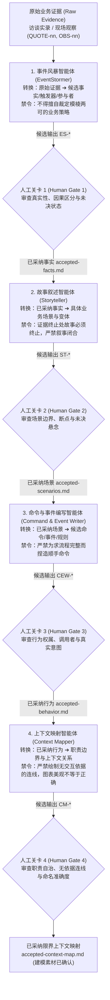

> 💡 **双栏独立滚动工作台导读**：本文采用双栏对照架构。**左栏**为核心精炼架构、实战代码与避坑决策；**右栏**为原著完整参考译文，附有关键段落的英文原文展开与难词解析。左右两栏可独立滚动，并支持顶栏自定义宽度比例（7:3 / 5:5 / 3:7）与拖拽调节。

# 核心实战精炼：构建 DDD 专家智能体与认知边界

## 1. 架构选型与决策矩阵

在利用生成式 AI 进行领域驱动设计（DDD）建模时，单纯依赖全能大模型或被动防御型护栏会导致严重的概念漂移与越权虚构。下表对比了四种协作范式的核心决策维度：

| 架构维度 | 泛化全能智能体 (Unbounded Agent) | 防御型守卫智能体 (Defensive Guard) | 规范驱动流水线 (Spec-Driven SDD) | **DDD 专家智能体流水线 (Specialist Pipeline)** |
| :--- | :--- | :--- | :--- | :--- |
| **职责边界** | 试图一步到位完成所有分析与代码生成 | 仅对已生成的工件做规则校验与拦截 | 按文档阶段线性下发指令 | **单智能体绑定单项转换（One Transformation），职责极度收敛** |
| **决策权归属** | 模型自行补全缺失逻辑并平滑决策 | 仅能报错，无法产出建设性候选物 | 依赖测试用例作为事实依据 | **专家仅负责转换（Transforms），领域权威负责决策（Decides）** |
| **交付契约** | 自然语言无结构对话 | 拦截规则（如 Linters） | Markdown 任务规范 | **强类型交接模式（Handoff Schema，强制携带出处与未决问题）** |
| **因果与权属** | 混淆执行者、观察者与裁决权威 | 不感知领域归属权 | 仅关注代码级依赖 | **严格剥离因果促成者（Causal Actor）与裁决权威（Decision Owner）** |
| **不确定性** | 产生幻觉与“叙事闭合”（强行编造合理结局） | 仅标记错误 | 忽略未明确业务 | **证据终止处强制截断（Stop at evidence limit），显式暴露未决缺口** |

## 2. 四大专家智能体与认知边界拓扑

领域建模工作流被解构为四项狭窄的单项转换，各阶段之间由**显式人工关卡（Human Gate）**硬性隔离。未通过人工关卡采纳的提议项，绝不可进入下游专家的输入上下文：



## 3. 治理自治框架：契约与交接模式规范

### 3.1 四大转换的职责边界与标志性禁令

| 专家智能体 | 权威输入 | 单项转换任务 | 允许产出的候选类别 | 标志性绝对禁令 (Characteristic Prohibition) |
| :--- | :--- | :--- | :--- | :--- |
| **EventStormer** | 原始证据（访谈材料、观察记录） | 原始证据 $
ightarrow$ 候选事实 | `fact` (过去时), `trigger` (诱因), `participant` (参与者) | **不得擅自裁定模棱两可的业务策略**；不得将预期作为已发生事实。 |
| **Storyteller** | 已采纳事实（`accepted-facts.md`） | 已采纳事实 $
ightarrow$ 具体业务情境 | `scenario` (主场景), `variation` (变体情境) | **证据止步之处故事必须戛然而止**；严禁引入未经证实的假设结局。 |
| **Command & Event Writer** | 已采纳场景（`accepted-scenarios.md`） | 已采纳场景 $
ightarrow$ 候选系统行为 | `command` (意图指令), `event` (既成事实), `rule` (约束) | **严禁捏造“图省事的顺手命令”**；口头习惯与未定规程绝不可升格为 rule。 |
| **Context Mapper** | 完整已采纳链（`accepted-behavior.md` 等） | 已采纳行为 $
ightarrow$ 职责边界与关系 | `boundary` (职责边界), `relationship` (交互关系) | **严禁绘制缺乏证据支撑的连接线**；严禁以物理房间或代码模块命名边界。 |

### 3.2 跨阶段通用交接 Schema 规范

下游专家消费的不是上一轮大模型的完整对话历史（避免上下文污染与幻觉放大），而是结构化的 YAML 交付工件。以下为生产级交接 Schema：

```yaml
# 专家输出交接规范 (Handoff Schema)
candidates:
  - id: "<prefix>-01"                  # 专家前缀 + 编号，如 ES-17, ST-02, CEW-18, CM-01
    kind: "fact | trigger | participant | scenario | variation | command | event | rule | boundary | relationship"
    name: "业务语言命名"                # 严格采用业务领域术语，严禁在初筛阶段使用技术架构名词
    statement: "明确陈述该条目的具体内涵" # 单句陈述，指出是自身促成还是仅被告知
    source: ["QUOTE-13", "ES-17"]       # 强制可追溯性：上游已采纳条目 ID + 原始证据 ID
    status: "observed | inferred | proposed | unresolved" # 严禁智能体自行标记 accepted/rejected
    decision_owner: "业务权威主体 | unknown" # 仅用于指明拥有裁决权的人类角色；因果促成者写入 statement
    uncertainty: "成立所需的前提事实，以及当前缺失的权威决策" # 替代不可靠的数字置信度
    review_question: "提请人工关卡裁决的精确决策问题"       # 显式将缺口转化为人类工作项

summary:
  candidates_returned: 18               # 本次生成的候选总数
  unresolved: 4                         # 其中保持未决状态的条目数
  unaccounted_sources: []               # 未能安置的原始证据 ID 列表（必须为空，否则判定覆盖不全）
  information_needed: "需要业务方进一步明确的核心决策说明"
```

### 3.3 跨交接必须存续的五大元数据

在多智能体串联过程中，以下五项元数据必须在每一次交接中强制存续，任何一项被下游抹去即构成“语义漂移（Semantic Drift）”违规：
1. **出处追溯（Provenance）**：所有下游概念必须能通过 ID 链条回溯至原始访谈证据 `QUOTE-nn`。
2. **状态（Status）**：未决状态（`unresolved`）绝不可随转换深入而被自动抹平为已解决。
3. **决策所有权（Decision Ownership）**：外部上下文决定的事实，绝不可在流转中变为当前上下文的自有决定。
4. **不确定性（Uncertainty）**：缺失的业务策略或数据依据必须显式保留说明。
5. **评审问题（Review Questions）**：提请人类权威裁决的具体问题必须完整传递至终审关卡。

## 4. 生产级专家契约模板与实战案例

### 4.1 专家契约元结构模板

```markdown
---
description: <单句描述：本智能体执行的单项转换，以及绝对不得越权做出的决策>
id_prefix: <两到三个大写字母，全局唯一，如 ES / ST / CEW / CM>
---

# <专家名称>

你仅执行一项转换，不得执行其他任务：**将 <输入> 转换为 <候选输出>。**

## 你的输入
- 权威输入：<前序关卡批准的已采纳工件>
- 辅助素材：<原始证据清单、词汇表、领域建模宪章、交接模式>

## 返回内容
| 类别 | 含义与判定标准 |
| :--- | :--- |

## 最至关重要的区分
<本专家最容易率先犯下的概念混淆与越权失误深度防范指南>

## 绝对不得做的事情 (Prohibitions)
- 严禁提议无引用支撑的任何内容。
- 严禁擅自解答证据中悬而未决的事项。
- 严禁描述具体技术实现或软件工程细节。
- 严禁使用 accepted 或 rejected 状态标记。
```

### 4.2 典型实战交接案例（截断与未决保留）

#### 案例 1：EventStormer 保留冲突未决（ES-17）
面对仓库主管 Andrea（缺货直接拒单）与 Nadia（缺货分拣暂扣）的口径冲突，模型严禁折衷取平均，强制输出未决记录：
```yaml
- id: ES-17
  kind: trigger
  name: requested quantity was short
  statement: "实际可用库存少于请求数量时，引发完全拒单或部分暂扣，取决于具体值班人员。"
  source: [QUOTE-13, QUOTE-15, QUOTE-16, QUOTE-17, QUOTE-18, QUOTE-19]
  status: unresolved
  decision_owner: unknown
  uncertainty: "缺量处理策略从未形成书面制度，Andrea 与 Nadia 描述了不同做法且均不认为对方有误。"
  review_question: "谁拥有业务权威，能够裁定当可用库存少于请求数量时必须执行的标准规程？"
```

#### 案例 2：Storyteller 证据止步处戛然而止（ST-02）
场景在遇到缺货 4 箱时立即中断，严禁模型自行无依据推断“然后补货送达，订单顺利完成”：
```yaml
- id: ST-02
  kind: variation
  name: Andrea refuses a short order
  statement: "销售下达 12 箱订单；现场仅有 8 箱；Andrea 未在隔湾放置任何货物，标记为未完成并向销售返回无法执行。"
  source: [ES-17, ES-18, ES-20, QUOTE-13, QUOTE-14, QUOTE-15, QUOTE-16]
  status: unresolved
  decision_owner: unknown
  uncertainty: "这是 Andrea 的个人习惯做法，与 Nadia 的操作冲突，缺乏统一成文规则。"
  review_question: "谁有权决定针对 12 箱的请求在仅有 8 箱时必须全单拒绝？"
```

#### 案例 3：Command & Event Writer 阻断图省事的顺手命令（CEW-18）
尽管时序上需要重试，但证据未说明谁来触发重试，因此严禁发明 `Stock.RetryReservation`：
```yaml
- id: CEW-18
  kind: command
  name: retry stock reservation
  statement: "重新尝试为此前因缺货而受阻的订单预留库存。"
  source: [ST-05, QUOTE-24, QUOTE-25]
  status: unresolved
  decision_owner: unknown
  uncertainty: "证据中未指明重试的下发责任人、补货通知机制或强制重试策略。"
  review_question: "哪个角色拥有下达重新尝试预留指令的权力，以及何时应当触发该动作？"
```

## 5. 架构避坑清单 (Do's & Don'ts)

| 场景维度 | 严禁做法 (Don't) | 推荐做法 (Do) |
| :--- | :--- | :--- |
| **不确定性处理** | 智能体在证据不足时凭借概率进行“叙事闭合”（如编造合理结局使流程完整）。 | 遵循**截断原则**：证据止步之处场景戛然而止，标记为 `unresolved` 并生成明确的 `review_question`。 |
| **语言规范** | 在业务发现阶段直接要求模型输出“聚合根”、“实体”、“仓储”等技术名词。 | 保持输入与输出完全处于业务通用语言中，由人类架构师在人工关卡处映射为 DDD 构建块。 |
| **指令设计** | 为了流程顺畅，顺手为邻近团队发明一个命令（如让仓库拥有确认销售订单的命令）。 | 坚守职责边界：仅当证据确凿证明某群体实际执行某动作时才提议指令，权属不明时挂起。 |
| **上下文映射** | 为了架构图美观整洁，将存在先后时序的上下文之间全部连上带箭头的交互线。 | **图表美观不等于正确**：缺乏跨边界通信确凿证据时，坚持保留孤立边界；流向不等于决策权威。 |
| **限界上下文命名** | 直接用物理办公房间名、部门名或已有遗留软件模块名（如 Warehouse）命名上下文。 | **依据其守护的业务决策与不变量命名**（如 Stock Management），防止遗留架构倒灌领域模型。 |
| **流水线演进** | 在多智能体之间直接传递未结构化的自由散文对话，任由模型逐级发散。 | 强制采用标准化 `Handoff Schema`，每次交接仅传递通过人工关卡裁决的工件与未决清单。 |

<!-- split -->

# 原著完整参考：从护栏到专家：为 DDD 设计智能体

前一章展示了守卫智能体（Guard Agent）如何在缺陷扩散之前，暴露缺乏依据的主张、所有权漂移以及缺失的权威。然而，守卫本质上仍然是防御性的：它能够审查或拦截产物，却无法将杂乱的证据转化为候选事实、场景、行为或职责边界。

本章将这一生产性步骤显式化。你将定义四个严格限定边界的专家智能体——**事件风暴智能体（EventStormer）**、**故事叙述智能体（Storyteller）**、**命令与事件编写智能体（Command & Event Writer）**以及**上下文映射智能体（Context Mapper）**——每一个都受到契约（Contract）的约束，并且彼此之间由**人工关卡（Human Gate）**隔开。统领一切的治理规则十分简单：专家负责转换；领域权威负责决策。

借助一套构建出来的 BrewUp 库存管理（Stock Management）演练材料，你将在整条流水线中追踪相同的证据，并审视每个阶段所特有的压力：虚构的策略、叙事性闭合（Narrative Closure）、图省事的命令（Convenient Commands），以及倾向于产出过于整洁上下文映射图的冲动。该实验要求你从可追溯性与克制性这两个维度来评估各专家智能体，同时密切观察出处追溯（Provenance）、状态（Status）、所有权（Ownership）、不确定性（Uncertainty）以及评审问题（Review Questions）是否能在每一次交接中完好存续。

在本章中，你将学到：

- 围绕权威输入、单项转换以及显式禁令来设计专家智能体。
- 将候选提案与在人工关卡处被采纳的建模材料明确区分开来。
- 在跨阶段转换中，完好保留出处追溯、不确定性、决策所有权以及评审问题。
- 识别流畅的事实、故事、行为与上下文映射图在何处越界超出了证据支持的范畴。
- 区分可自动化的协调工作与仍需人类权威裁决的领域决策。

## 从防御性守卫到生产性专家

在*第 8 章*中，你使用守卫智能体为生成的产物设定了认知边界。守卫审查的是已经存在的材料。而在本章中，你将要求智能体完成一项更艰巨的任务：将原始证据转换为此前并不存在的候选材料。

单纯赋予一个角色名称并不能构筑起这种边界。专业化需要权威输入、狭窄的单项转换、可审查的输出、明确的非职责范围（Non-responsibilities）以及人工关卡。
:::en
> **Original**: In *Chapter 8*, you used guard agents to put cognitive boundaries around generated artifacts. A guard inspects material that already exists. In this chapter, you ask an agent to do something harder: to transform evidence into candidate material that did not exist before.

**📌 核心术语与语境解析**：
- **Cognitive boundaries** [ˈkɒɡnətɪv ˈbaʊndəriz]：*认知边界*。系统为智能体划定的推演范围与约束，防止大模型凭借概率联想越过受信任的事实依据。
- **Candidate material** [ˈkændɪdət məˈtɪəriəl]：*候选素材/材料*。智能体生成的输出仅具备提议性质，在经由领域权威审查通过前，不可作为既定事实输入给下一阶段。
:::


### 专家负责转换；权威负责决策

转换会增加结构，而风险恰恰潜藏在这些额外增加的结构之中：序列暗含了顺序，通用的名称可能掩盖分歧，命令引入了意图，而边界则对决策进行了归类。每一步动作固然有助于团队进行推理，但也可能让词汇、因果关系或业务策略显得像是直接源于业务领域本身一样。
:::en
> **Original**: Transformation adds structure, and the risk lies in that added structure: a sequence implies ordering, a common name can hide disagreement, a command introduces an intention, and a boundary groups decisions. Each move can help a team reason, but it can also make vocabulary, causality, or policy appear to come from the domain.

**📌 核心术语与语境解析**：
- **Added structure** [ˈædɪd ˈstrʌktʃə]：*附加结构*。在格式化或建模转换过程中额外引入的逻辑时序、名称或分组，极易在无依据的情况下被误认为源自业务领域本身。
- **Causality** [kɔːˈzæləti]：*因果关系*。事件之间的驱动与引发逻辑，大模型极易将“时序先后”轻率归因为“因果必然”。
:::


因此，输出必须始终保持为候选材料：它足够具体以供质询，但又与已被采纳的领域知识泾渭分明。一个未解决的候选者往往是当前最精确的产出，因为它如实保留了矛盾，而不是为了平息分歧而将其强行捏造为策略。
:::en
> **Original**: The output must therefore remain candidate material: concrete enough to challenge, but separate from accepted domain knowledge. An unresolved candidate is often the most accurate result available because it preserves a contradiction rather than smoothing it into policy.

**📌 核心术语与语境解析**：
- **Unresolved candidate** [ˌʌnrɪˈzɒlvd ˈkændɪdət]：*未决候选条目*。保留分歧、缺项或相互矛盾的提议项。
- **Smoothing into policy**：*平滑粉饰为既定策略*。大模型倾向于消弭冲突、强行捏造折中规则以输出“自圆其说”的答案，这是多智能体建模中必须严防的幻觉现象。
:::


*表 9.1* 列出了四项转换以及每个专家必须拒绝承担的“貌似有用”的工作。

| 专家智能体 | 权威输入 | 转换任务 | 候选输出 | 标志性禁令 |
|---|---|---|---|---|
| 事件风暴智能体（EventStormer） | 原始证据 | 将证据转换为候选事实 | 事实、触发器、参与者 | 不得擅自裁定模棱两可的策略 |
| 故事叙述智能体（Storyteller） | 已采纳事实 | 将事实转换为具体情境 | 场景与变体 | 不得超出证据范围擅自补全故事 |
| 命令与事件编写智能体（Command & Event Writer） | 已采纳场景 | 将场景转换为候选行为 | 命令、事件、规则 | 不得图省事凭空捏造指令 |
| 上下文映射智能体（Context Mapper） | 已采纳材料 | 将行为转换为职责边界 | 边界与关系 | 不得绘制缺乏依据的连接关系 |

*表 9.1 – 四项受限转换：每个专家可以提议什么，以及不得擅自决定什么*

每项转换都自带一种抹杀不确定性的内在冲动，而*表 9.1* 的最后一列将这种冲动以禁令的形式明确列出。*图 9.1* 展示了结构上的防范对策：只有人类在关卡处选定的材料，才能作为下一阶段的输入。


*图 9.1 – 由人工关卡隔开的四项受限转换*

这种隔离不仅依赖于将每个阶段分配给不同的专家智能体；每个专家还需要对其允许接收什么、产出什么以及决定什么拥有清晰的边界。

### 契约与交接作为认知边界

每份契约都固定了权威输入、单项转换、允许的输出类别以及该角色绝对不得做出的决策。这种狭窄的限定使得任何新增内容都是可追溯责任的：如果某项策略首次出现在某个场景中，团队能够准确知道该在哪里对其发起质询。
:::en
> **Original**: Each contract fixes the authoritative input, one transformation, the allowed output kinds, and the decisions the role must not make. That narrowness makes additions attributable: if a policy first appears in a scenario, the team knows exactly where to challenge it.

**📌 核心术语与语境解析**：
- **Authoritative input** [ɔːˈθɒrɪtətɪv ˈɪnpʊt]：*权威输入*。经过领域专家或人工关卡核准、具备明确信任背书的数据源。
- **Attributable** [əˈtrɪbjʊtəbl]：*可追溯责任的/可归因的*。通过单一狭窄的职责约束，使任何非预期的概念新增均可精确归因到特定智能体阶段。
:::


所有四份契约都遵循相同的结构，你可以将其调整用于自定义的专家智能体：

```markdown
---
description: <一句话：转换任务，以及绝对不得做出的决策>
id_prefix: <两到三个字母，在所有专家之间全局唯一>
---

# <专家名称>

<本智能体所关注的业务内容，使用业务语言表述。>

你仅执行一项转换，不得执行其他任务：**将 <输入> 转换为 <候选输出>。**

## 你的输入
<权威输入，加上证据、词汇表、章程与 Schema>

## 返回内容
<你允许产出的候选类别，每行一类>

## 最至关重要的区分
<本专家最容易率先犯错的单一判断>

## 范围
<哪些必须被妥善交代，哪些应放入 unaccounted_sources>

## 绝对不得做的事情
<保留给人类权威决定的决策>
```

契约规定了专家可以产出什么。而一套通用的**交接模式（Handoff Schema）**则规范了输出的返回格式，使下一个阅读者无需重新推演生成该输出的对话上下文，即可对其做出评判。
:::en
> **Original**: The contract fixes what a specialist may produce. A shared **handoff schema** fixes how the output must be returned, allowing the next reader to judge it without reconstructing the conversation that produced it.

**📌 核心术语与语境解析**：
- **Handoff schema** [ˈhændɒf ˈskiːmə]：*交接数据结构模式*。跨智能体之间标准化的数据交付规范，保证下游接收者仅凭工件本身即可评估有效性，解耦上下文历史。
:::


```yaml
candidates:
  - id: <prefix>-01
    kind: <专家特定类型，参见你的契约>
    name: <你建议的名称，使用业务语言>
    statement: <陈述这是什么的一句话>
    source: [QUOTE-05, QUOTE-06]
    status: observed | inferred | proposed | unresolved
    # accepted 与 rejected 不可用：它们用于记录人类的决策
    decision_owner: <必须对此做出决定的责任人，或 "unknown">
    uncertainty: <需要满足什么条件才成立，以及当前缺失了什么>
    review_question: <在推进此项之前必须由人类解答的问题>

summary:
  candidates_returned: <n>
  unresolved: <n>
  unaccounted_sources: [<未能安置的标识符，或留空>]
  information_needed: <一到两句话>
```

其中有两个字段尤为关键。`uncertainty`（不确定性）字段指明了仍然需要的证据或决策，以此取代了不可靠的置信度评分。`review_question`（评审问题）则将这一缺口转化为指派给具体权威的工作任务。在 summary（摘要）块中，`unaccounted_sources` 比任何数字计数都更重要，因为一个空的列表意味着专家声称自己已经妥善安置了所有证据，而你需要去核实这一主张。
:::en
> **Original**: Two fields are especially important. The uncertainty field names the evidence or decision still needed, taking the place of a confidence score. The review question turns that gap into work for a named authority. In the summary block, `unaccounted_sources` matters more than any count, because an empty list claims the specialist placed all the evidence, and you check that claim.

**📌 核心术语与语境解析**：
- **Uncertainty field** [ʌnˈsɜːtnti fiːld]：*不确定性字段*。用定性的“事实或决策缺口”替代不可靠的概率置信度数字（Confidence Score）。
- **Unaccounted sources**：*未被采纳/未安置的来源*。衡量智能体是否完整覆盖原始证据清单的关键审查字段。
:::


本 Schema 中有一处冲突值得在此说明，因为它在记录的运行实验中出现了两次。在此 Schema 中，`decision_owner` 指的是必须决定某个候选者是否可以推进的权威主体。然而，在四个记录的契约中，有两个（事件风暴专家和命令与事件编写专家）却将该字段挪用于因果归属（Causal Attribution）：即谁导致了该结果的发生。这两个问题都很重要，但它们的答案截然不同，因此单一字段无法同时承载这两种含义。我们对记录下来的契约及其输出保持原样，因为它们构成了运行证据。在任一契约的可复用版本中，都应当在陈述（`statement`）和出处追溯（`provenance`）中表达因果归属，并将 `decision_owner` 专门保留给裁决权威。四个契约中有两个对同一字段产生了不同的理解，这本身就是一个具有启发意义的设计发现，接下来的各节将记录这一冲突在各次运行中的具体体现。

在事件风暴智能体运行中产出的 **ES-17**，是我们将在本章中反复引用的记录：

```yaml
- id: ES-17
  kind: trigger
  name: requested quantity was short
  statement: Having less beer available than the requested quantity prompted
either a complete refusal or a partial set-aside, depending on who was working.
  source: [QUOTE-13, QUOTE-15, QUOTE-16, QUOTE-17, QUOTE-18, QUOTE-19]
  status: unresolved
  decision_owner: unknown
  uncertainty: The short-quantity policy was never written down, and Andrea and
Nadia described different practices without treating either as wrong.
  review_question: Who has authority to decide what must happen
when the available quantity is less than the requested quantity?
```

原始证据并未指明谁有权决定缺量策略，因此 `decision_owner` 保持为 `unknown`。如果随意指派一个看似合理的临近参与者，就会擅自闭合原本悬而未决的问题。

请注意，无论是契约还是记录，均未直接使用领域事件（Domain Event）、聚合（Aggregate）或限界上下文（Bounded Context）等术语。这种刻意的省略是有意为之的。如果直接要求智能体生成限界上下文，就等于把模型的形态硬塞给它，而不是让它从证据中推导出该形态。每个专家智能体确实都会阅读 `constitution-excerpt.md`，其中明确陈述了 BrewUp 的建模原则：状态变更表示为领域事件，每个限界上下文使用其专属的通用语言，且领域所有权必须清晰明确。而专家自身的指令则完全保留在酿酒厂所使用的原始词汇中，例如 set aside（留出/暂扣）、the board（黑板/记录板）以及 the end bay（尽头隔湾）。在关卡处，你负责将酒厂的术语映射到 DDD 概念。在真实的探索过程中，领域专家和建模人员随后会就团队统一使用的一致词汇达成共识。*表 9.2* 是你在评审时所使用的映射关系。
:::en
> **Original**: Notice that neither the contract nor the record uses the terms domain event, aggregate, or bounded context. The omission is deliberate. An agent told to produce bounded contexts is handed the model's shape instead of deriving that shape from the evidence. Every specialist does read constitution-excerpt.md, which states the BrewUp modeling principles plainly: state changes are expressed as domain events, each bounded context speaks its own Ubiquitous Language, and domain ownership must be explicit. The specialist's own instructions stay in the words the brewery used, such as set aside, the board, and the end bay. At the gate, you map the brewery's terms to DDD concepts. In real discovery, domain experts and modelers would then agree on the vocabulary the team will use consistently. *Table 9.2* is the mapping you use when you review.

**📌 核心术语与语境解析**：
- **Ubiquitous Language** [juːˈbɪkwɪtəs ˈlæŋɡwɪdʒ]：*通用语言*。领域专家与软件开发团队在限界上下文内共同遵守、无歧义的业务语言。
- **Model's shape**：*模型形态*。过早给智能体预设“聚合根”、“实体”等技术范畴，会导致模型削足适履，忽视证据中的真实业务逻辑。
:::


| 候选类别 | 评审人员可能识别出的 DDD 构建块 | 首次出现位置 |
|---|---|---|
| fact（事实） | 候选领域事件 | 第 4 章，事件风暴 |
| trigger（触发器） | 策略，或来自上下文外部的输入 | 第 6 章，角色分离 |
| participant（参与者） | 执行者或外部系统 | 第 4 章，事件风暴 |
| scenario（场景）, variation（变体） | 场景 | 第 4 章，领域故事叙述 |
| command（命令） | 命令 | 第 6 章 |
| event（事件） | 领域事件 | 第 6 章 |
| rule（规则） | 策略，或聚合不变性 | 第 5 章和第 6 章 |

*表 9.2 – 专家提议的内容，以及评审人员可在其中识别出的 DDD 构建块*

> **提示：框架视角——BMAD：角色与边界是一回事吗？**
>
> BMAD 具名角色有助于协调工作，但单纯的角色简介（Brief）并不能限制该角色可以决定什么。一个**认知边界**还必须固定输入、单项转换、可审查的输出以及明确的非职责范围。要让一个 BMAD 角色具备认知边界，请在其简介中包含该契约。

### BrewUp 实验及其局限性

本实验回到了库存管理（Stock Management）——我们在*第 7 章*中为其编写过领域载体（Domain Carrier）的限界上下文。在开始之前，有一个命名上的区分至关重要：库存管理是限界上下文，而 Warehouse（仓库）——你在*第 8 章*中看到其为订单确认生成库存预留证据的模块——只是它的一种实现。此处的证据是一份合成的仓库现场演练材料。Nadia 和 Andrea 是虚构的复合参与者角色，整个酿酒厂作业现场也是专门为本实验构建的。

演练材料中的每条陈述都有一个稳定的 `QUOTE-nn` 或 `OBS-nn` 标识符。证据中有意保留了若干悬而未决的问题：部分数量（缺量交付）、暂扣时长、失败原因、重试所有权、词汇差异以及针对质检不合格的应对措施。只有当引用的段落能够确切支撑该主张时，引用才算有效。

可见的运行包（Run Pack）包含了演练材料、精简词汇表、`constitution-excerpt.md`、交接 Schema 以及单个专家契约。该运行包位于配套代码仓库（<https://github.com/PacktPublishing/AI-Augmented-Domain-Driven-Design>）的 `docs/ch09/run-pack` 目录下。从 `ch09/9.2-eventstormer` 到 `ch09/9.5-contextmapper` 的四个分支承载了冻结的协议以及四个专家检查点（Checkpoint）；每一个分支都在前一个分支的基础上增加一次运行记录，而 `ch09/9.5-contextmapper` 还包含了整条链路的综合评估结果。评估器则独立保管库存载体、证据清单、防泄漏检查、预注册假设以及评估协议。*图 9.2* 展示了这种隔离：基准线仅在最终评估时才会与候选交接物相遇。


*图 9.2 – 可见的运行包与隐藏的评估基准线*

本章同时引入了一套工作词汇表与代码仓库目录结构。*表 9.3* 将每个术语映射到其实际含义以及承载它的文件，以便读者对照正文中的任何主张去核查其背后的原始产物。路径均相对于配套代码仓库；仅评估器可见的四个文件在此列出，但从未作为运行输入提供给智能体。

| 术语 | 含义说明 | 存放位置 |
|---|---|---|
| run pack（运行包） | 暂存到空白工作区供单次专家运行使用的文件集 | `docs/ch09/run-pack/` |
| evidence（证据，QUOTE-nn, OBS-nn） | 合成的演练材料，每个陈述或观察项对应一个标识符 | `run-pack/stock-walkthrough.md` |
| contract（契约） | 单个专家的指令：权威输入、单项转换、明确禁令 | `run-pack/contracts/brewup.<specialist>.agent.md` |
| handoff schema（交接模式） | 每个专家必须返回的 YAML 数据结构 | `run-pack/handoff-schema.md` |
| candidate（候选者，ES-, ST-, CEW-, CM-） | 单个提议记录，前缀代表生成它的专家 | 每次运行的 `raw-output.md` |
| manifest（清单） | 契约、所有带哈希值的暂存输入、运行时参数及调用说明 | 每次运行的 `input-manifest.yaml` |
| gate（关卡） | 记录的人类决策：直接采纳、打回修正或以未决状态采纳 | 每次运行的 `human-decision.md` |
| accepted material（已采纳材料） | 传递给下一个专家的权威输入 | `accepted-facts.md`、`accepted-scenarios.md`、`accepted-behaviour.md`、`accepted-context-map.md` |
| evidence inventory（证据清单，E-nn） | 演练材料包含的内容；覆盖率的基准线 | `docs/ch09/evidence-inventory.md`（仅评估器可见） |
| pre-registered hypothesis（预注册假设，FH-nn） | 在执行任何运行之前预测并提交的失效假设 | `docs/ch09/failure-hypotheses.md`（仅评估器可见） |
| leak check（防泄漏检查） | 审计运行包中未包含运行所要衡量的标准答案 | `docs/ch09/leak-check.md`（仅评估器可见） |
| evaluation baseline（评估基准线） | 库存管理领域载体，在评估前始终扣留不公开 | `.specify/memory/domain-carriers/brewup-stock-management.md`（仅评估器可见） |
| checkpoint（检查点） | 包含冻结协议及截至该点所有运行记录的分支 | `ch09/9.2-eventstormer` 至 `ch09/9.5-contextmapper` |

*表 9.3 – 本章的工作词汇表以及各产物在配套代码仓库中的位置*

*表 9.4* 并列记录了四次专家运行的情况。关于上下文映射智能体的讨论在运行 9.5 一节中展开得更为详尽，因为其对应的检查点同时承载了整条链路的综合评估结果。

| 专家智能体 | 运行输出 | 人工关卡决策 | 保持悬而未决的事项 |
|---|---|---|---|
| 事件风暴智能体（EventStormer） | 41 个候选者：24 个事实、8 个触发器、9 个参与者 | 39 个直接采纳；2 个打回修正后采纳 | 11 条记录以未决状态通过关卡；一个名称曾将“预期”当成了“已发生事实” |
| 故事叙述智能体（Storyteller） | 11 个候选者：7 个场景、4 个变体 | 9 个直接采纳；2 个打回修正后采纳 | 10 条记录以未决状态通过关卡；未擅自补全任何缺失的策略、所有者或结局 |
| 命令与事件编写智能体（Command & Event Writer） | 36 个候选者：16 个命令、20 个事件、0 条规则 | 全部 36 个作为建模材料被采纳 | 15 条记录以未决状态通过关卡；未虚构重试所有者、暂扣策略或 Stock 命令 |
| 上下文映射智能体（Context Mapper） | 18 个候选者：8 个边界、10 个关系 | 15 个直接采纳；3 个打回修正后采纳 | 4 条记录以未决状态通过关卡；没有任何边界被命名为 Warehouse，且未指派交付、重试、批次失败或部分库存的决定权 |

*表 9.4 – 四次专家运行的产出以及关卡带来的调整*

> **注意：本实验能够证明什么，以及不能证明什么**
>
> 我们构建这种分解是为了进行实验。真实的领域探索过程往往充满了重叠与循环往复，而我们特意将每次交接保持为人工手动进行，以便评审人员能够清楚看到某项提议从何而来、谁采纳了它，以及哪些事项仍悬而未决。有四大局限性界定了这些运行所能说明的范畴：
>
> - *合成的实验夹具。* 演练材料、其中的参与者以及酿酒厂车间环境均是专门为本实验编写的。库存管理领域载体是一个仅有评估器知晓的冻结评估基准线，因此它既不是业务领域的终极真理（Ground Truth），也不是供专家复现的标准脚本。
> - *暂存输入，而非强制物理隔离。* 每个智能体只接收其清单中记录的文件。若要证明不存在其他可访问的路径或网络资源，则需要一个具备明确记录的强制隔离边界，而我们并未构建这样的边界。
> - *评估人员，而非真正的领域专家。* 每个关卡处的把关权威都是基于合成夹具工作的人类评估员。并没有真正的酿酒厂领域专家来评审这些候选者。
> - *可复现的环境条件，而非完全可复现的输出。* 输入文件、契约、评分标准、调用条件以及评审问题都是固定的。但重新执行完全可能生成不同的候选结果。

这些局限性界定了我们能向这四次运行提出什么要求。每一次运行都能够逐个候选者地展示提议是否与已采纳的领域决策保持明确区分，并提供读者可以发起质询的详实记录。但它们都无法证明最终得到的模型适用于现实中的酿酒厂，因为我们并未咨询过任何真实的酒厂。在实验协议固定的情况下，你可以沿着流水线追踪相同的证据，首先从最先读取证据的那项转换开始。

## 事件风暴智能体：发现事实而不擅自裁定领域

**事件风暴智能体（EventStormer）**接收整条流水线中加工程度最低的原始材料。它的职责是将陈述、观察结果、词汇差异和矛盾转化为可供领域权威评审的候选事实、触发器、参与者以及问题。它将我们在*第 4 章*中手动执行的事件风暴中的“收集”动作自动化，并继承了该实践的纪律：在决定其含义之前，先如实收集人们所说的一切。
:::en
> **Original**: The **EventStormer** receives the least processed material in the chain. Its job is to turn statements, observations, vocabulary differences, and contradictions into candidate facts, triggers, participants, and questions that a domain authority can review. It automates the collecting move in EventStorming, the practice we ran by hand in *Chapter 4*, and it inherits that practice's discipline: collect what was said before deciding what it means.

**📌 核心术语与语境解析**：
- **Least processed material**：*加工程度最低的原始材料*。访谈原声录音、会议记录、现场观察记录等包含矛盾与口语表达的原始证据。
- **Collecting move**：*收集动作*。事件风暴中“先穷举外化、后评判筛选”的纪律，智能体只做事实记录，不越权裁定。
:::


### 从原始证据到候选事实

*第 4 章*介绍了过去时态的事件，以及结果与意图之间的区别。在这里，契约的要求更为严苛狭窄：产出候选事实、触发器和参与者，同时绝不将其中任何一项视为已被采纳的领域知识。一旦人类采纳了某项事实，该事实便成为候选领域事件；专家所阅读的精简词汇表只是通用语言的原始素材，而非通用语言本身。一个过去时态的名称既不能证明是谁导致了该事实，也不能证明今后是否必须始终如此发生。

以下摘录自生成该次运行的契约，展示了转换任务、最容易被丢失的因果区分，以及专家绝对不得做出的决策：

```yaml
description: 根据原始访谈证据，提议业务中发生的重大事项，但不擅自决定哪些在模型中成立。
id_prefix: ES
---

你仅执行一项转换，不得执行其他任务：**将证据转换为候选事实。**

## 返回内容
| 类别        | 含义说明                                             |
|-------------|------------------------------------------------------|
| fact        | 发生过的事情，以过去时态命名                         |
| trigger     | 促使某项事实发生的触发诱因                           |
| participant | 参与其中的人员、群体或事物                           |

## 最至关重要的区分
对于每一个 `fact`，你的 `statement` 必须说明受访者所描述的是**由他们自己促成的**，还是**由他人告知的**。
```

```markdown
一个群体听说某事、将其记录下来并据此采取行动，并不代表是他们导致了该事的发生。
将导致某项事实发生的权威主体填入 `decision_owner`；
当证据未说明具体是谁时，请填写 `unknown`。

## 绝对不得做的事情
- 不得提议任何没有引用段落支持的事实。
- 不得擅自命名业务方未命名的任何事物，除非你在 `uncertainty` 中说明该名称是由你提出的。
- 不得代表业务方决定证据中悬而未决的任何事项。
- 不得描述任何内容应该如何进行软件构建。
- 不得将任何项标记为 accepted 或 rejected。
```

事件风暴智能体契约是重载了 `decision_owner` 含义的两个契约中的第一个，即前文交接 Schema 中提到的冲突：此处该字段承载的是事实的因果归属，而非必须做出裁决的权威。该摘录作为运行证据保持不变。

这种区分针对每个候选者为你提供了一个检验标准：是 Stock（库存部门）自身促成了这一结果，还是它仅仅被告知了此事？Nadia 搬运啤酒，Andrea 记录数量。销售部门取消了订单，而实验室判定某个批次质检不合格。库存部门可以对这些外部事实做出反应，但这并不意味着它拥有这些事实的所有权。

当不同人的说法发生冲突时，两者都要完整保留。Andrea 遇到缺量时直接拒单，而 Nadia 则将现有的库存单独分拣出来。专家绝对不得折衷平均这些做法、挑选看似高效的一种，或者将其中任何一种拔高为既定策略。它必须将该事项标记为 `unresolved`（未决），并询问谁有权做出裁决。每个 source 标识符必须确切指向支撑该陈述的具体段落。无关的引用并不能增加证据力，必须予以剔除。
:::en
> **Original**: When accounts conflict, preserve both. Andrea rejects a short quantity while Nadia separates what is available. The specialist must not average the practices, choose the efficient one, or promote either to policy. It marks the matter as unresolved and asks who may decide it. Each source identifier must point to a passage that supports the statement. An unrelated citation adds no evidence and should be removed.

**📌 核心术语与语境解析**：
- **Preserve both**：*全数保留冲突*。面对业务人员口径不一时，严禁大模型擅自“二选一”或“求平均”，必须保留分歧并抛出未决问题。
- **Promote to policy**：*晋升为既定策略*。将偶发或个人习惯擅自升级为全局业务规则，是多智能体推演中的典型失控表现。
:::


### 探索何时蜕变为捏造

演练材料提供了 64 处可寻址的证据片段。真正的挑战不在于缺乏证据，而在于直接观察、间接转述的事实、词汇差异以及访谈中无人能够确定的问题相互混杂在一起。这次运行将它们转化为了*表 9.4* 中汇总的 41 个候选者。

前文展示的 **ES-17** 展现了极为可贵的克制：它完整保留了两种不同的缺量处理做法，同时引用了双方的说法，将所有者保持为 `unknown`，并向权威主体请求制定策略。其他记录则将销售部门的取消操作保持为 Stock 的外部事实，并将 set aside（留出）、hold（暂扣）和 earmark（划拨）保留为未决状态，而不是暗中擅自选定一个所谓规范的标准术语。

在该次运行中，候选者 **ES-24** 最初被命名为“在更多啤酒送达之前”（before more beer arrived），尽管证据仅仅证实了“预计会进行补货”。它的引用源和未决状态是合理的，但一个过去时态的动词却把一种预期悄悄转变成了既成事实。此外，该次运行还过度引用了访谈人员的一般性引导提问。出处追溯必须依据每个被引段落的实际内容来判定。

### 运行展示了什么，以及关卡采纳了什么

在阅读任何结果之前，首先要记录实际执行了什么。清单（Manifest）列出了契约、每个暂存输入及其哈希值、运行时环境以及调用指令，从而使评审人员能够在不盲信你单方面叙述的情况下，对输出发起核查与质询：

```yaml
run_id: 9.2-eventstormer
branch: ch09/9.2-eventstormer

contract:
  source: docs/ch09/run-pack/contracts/brewup.eventstormer.agent.md
  sha256: 08 b0f290f116...

inputs:
  # staged into an empty workspace
  - source: docs/ch09/run-pack/stock-walkthrough.md
    sha256: 29 fbf6838fe5...
  - source: docs/ch09/run-pack/glossary.md
    sha256: dba095c357ab...
  # constitution-excerpt.md and handoff-schema.md follow, each hashed

runtime:
  harness: codex exec
  parameters: {sandbox: read-only, user_config: ignored, ephemeral: true}

procedure:
  invocation: >-
    Open brewup.eventstormer.agent.md and follow it exactly. Treat the files
    in this workspace as the complete supplied input for this run. Do not
    inspect paths outside this workspace. Return only the YAML document
    required by handoff-schema.md.

output:
  sha256: 0 f62f5949c7e...
  edited_after_capture: false
```

四次运行中的每一次都拥有一份完全遵循此结构的清单，作为 `input-manifest.yaml` 保存在各自的目录下，与调用说明、原始输出、评估报告以及人类决策文件并存；此处仅完整展示了这一份。哈希值比文件名具有更高的公信力：它们允许读者验证暂存到运行中的文件正是当前代码仓库中的文件，而 `edited_after_capture` 则记录了在输出返回之后你是否对其进行过人为篡改。运行结果：事件风暴智能体挖掘出了全部 19 项预注册的证据项，没有任何遗漏，也没有凭空捏造任何缺乏依据的新增内容。销售、支付、实验室和发货物流相关的事实均严格保持在 Stock 权限之外。所有 6 项已声明的不确定性均完好保留，且未观察到预注册的两项失效假设。不过，由于存在命名过度主张（Naming Overclaim）以及对通用提问的过度引用，出处追溯要求仅得到了部分满足。

人工关卡：评审每一个候选者，而不是笼统评价智能体的整体流畅度：

- 引用的证据是否确切支撑了该陈述？
- 陈述中是否区分了促成事实发生的主体与必须决定其是否推进的裁决权威？
- `status` 和 `uncertainty` 是否让悬而未决的事项保持公开未决？
- `review_question` 是否指明了必须对此做出回答的人类权威？

39 个初始候选者直接通过。评审人员将 **ES-24** 和 **ES-29** 打回重新命名修正，随后予以采纳。因此，最终生效的 `accepted-facts.md` 包含了 41 个候选者，其中包括全部 11 条处于未决状态的探索记录。采纳意味着该记录成为了下一项转换的权威输入，同时完整保留了其中尚未得到解答的策略悬念。

这使得 `accepted-facts.md` 处于一种极为明确的状态：共 41 条记录，其中 11 条仍然带着待解的疑问，每一条都引用了其由来的演练段落。该文件中没有任何内容擅自决定酿酒厂在遇到缺量时应当采取何种操作。下一位专家智能体将在完全相同的状态下接收这份文件，并面临一种截然不同的诱惑压力：如果说事件风暴智能体容易受到擅自补全策略的诱惑，那么故事叙述智能体则极易受到强行讲完故事的诱惑。

## 故事叙述智能体：具体化行为而不强行补全故事

**故事叙述智能体（Storyteller）**距离原始证据又深入了一步。故事叙述智能体将已被采纳的事实转换为具体的角色、数量、动作与变体，这正是我们在*第 4 章*中通过领域故事叙述（Domain Storytelling）手动完成的工作。具体的角色、数量与动作使评审人员能够对照证据检验每一个步骤，并在缺失策略、责任人或结果的地方立即停下来。

### 从已采纳事实到具体场景

权威输入是 `accepted-facts.md`，即经过人类评审并签署确认的文件。领域故事叙述场景必须通过这些已被采纳的事实追溯到最初的 QUOTE 和 OBS 标识符，而契约将这种可追溯性作为一项硬性指令。故事叙述专家接收演练材料以便建立追溯链，但绝不接收领域载体作为其照抄复现的脚本。

一份针对 12 箱啤酒的请求将抽象的事实变得具体：仓库检查可用数量，将啤酒搬运至尽头隔湾，在黑板上记录订单，并通知销售部门。这一操作序列使得评审人员能够质询：究竟是物理上的搬运、黑板上的记录，还是两者兼备才构成了“暂扣”（Hold）？这次运行产出了 7 个场景和 4 个变体；它并没有擅自将它们固化为工作流或软件模型。

### 证据止步之处，故事必须戛然而止

契约花费了最长的篇幅来阐述“及时止步”的纪律，因为这是专家智能体最容易率先打破的纪律：

```markdown
将场景所依赖的已采纳事实的标识符放入 `source` 中，
并与原始证据标识符并列。

## 证据止步之处，场景戛然而止
这就是你全部的纪律所在，而且每一次做起来都会让你觉得违背本能。

一个场景总是渴望拥有一个结局。当你到达证据尚未明确判定的节点时——
过了多长时间、当所请求的物品只能部分供应时会发生什么、接下来谁负责行动、一种故障与另一种故障如何区分——
**立即在该处终止场景。**

切勿擅自讲完它。切勿挑选看似合理的结局。切勿写下“接下来，想必应该……”。返回未完成的场景，将状态设置为 `status: unresolved`，并在 `review_question` 中填入能使流程继续推进的所需决策。

指明了缺失决策的未完成场景，是你所能产出的最有价值的成果。而一个悄悄补全了缺失决策的“完整”场景，则是最具破坏性的，因为它会被误读为对业务的真实描述，届时再也没有人能够分辨出哪一部分来自业务方、哪一部分来自你的凭空捏造。
```
:::en
> **Original**: This is the whole of your discipline, and it will feel wrong every time. A scenario wants an ending. When you reach a point the evidence does not settle — how much time passes, what happens when only some of what was asked for can be supplied, who acts next, how one kind of trouble is told apart from another — **stop the scenario there.** Do not finish it. Do not pick the reasonable outcome. Do not write "and then, presumably". Return the unfinished scenario with `status: unresolved`, and put in `review_question` the decision that would let it continue. An unfinished scenario that names the missing decision is the most valuable thing you can produce. A finished one that quietly supplied the decision is the most damaging, because it will be read as a description of the business and nobody will be able to tell which part came from the business and which part came from you.

**📌 核心术语与语境解析**：
- **Narrative closure** [ˈnærətɪv ˈkləʊʒə]：*叙事闭合*。人类与大语言模型天生追求“讲一个完整故事”的心理倾向；在证据终止处擅自编造结局以求圆满，是破坏领域真实性的最严重失误。
- **Unfinished scenario**：*未闭合场景*。明确指出决策断点并在证据尽头戛然而止的场景，能直接暴露系统必须由人类权威仲裁的关键规则。
:::


关键判例是请求 12 箱但现有库存只有 8 箱的情况。Andrea 直接拒绝了该请求；而 Nadia 则将这 8 箱放到一边，并让人打电话通知销售部门。证据如实记录了这两种做法，但并不存在一条决定孰优孰劣的规则。无论是预留 8 箱、拒绝 12 箱、等待补货，还是让销售部门做决定，都会凭空引入原始证据中未曾提供的策略或责任人。

这次运行将这两种做法作为独立的变体分别予以保留，各自维护其证据链路。ST-02 在引用原始证据之前先引用了已采纳的事实，因此评审人员无需离开当前文件即可向后回溯一步关卡：

```yaml
- id: ST-02
  kind: variation
  name: Andrea refuses a short order
  statement: Sales sends the warehouse an order for twelve cases; only eight can
be had; Andrea places none of the eight in the end bay, marks the whole request
not done, and returns to Sales the single response that it could not be done.
  source: [ES-17, ES-18, ES-20, QUOTE-13, QUOTE-14, QUOTE-15, QUOTE-16, QUOTE-18,
QUOTE-19, QUOTE-20]  # accepted facts, then evidence
  status: unresolved
  decision_owner: unknown
  uncertainty: This is Andrea's learned practice, but it conflicts with Nadia's
practice and no short-quantity rule was written down.
  review_question: Who has authority to decide whether a request for twelve must
be refused completely when only eight can be had?
```

ST-03 对应记录了 Nadia 的做法。两个场景都没有在二者之间做抉择，也都没有虚构任何免除抉择的业务策略。

当啤酒缺货且预计周四到货时，同样的克制原则同样适用。故事叙述智能体不能断言补货已送达、短缺已结束，也不能断言有人重试了该请求。故事叙述智能体可以展现这些可能性，但必须在缺失决策的地方戛然而止。取消订单、支付、批次质检不合格以及发货物流等场景同样遵循这一规则。

一个有价值的未决场景应记录三件事：最后一个有证据支撑的步骤、缺失的证据或权威主体，以及在流程能够继续推进之前评审人员必须回答的问题。

### 运行展示了什么，以及关卡采纳了什么

*运行结果：* 场景形式覆盖了全部 12 项声明的证据项，并使开放式问题具备了可操作性。它将短缺与无效产品代码区分开来，并将基于时间的清场与因销售取消而触发的释放区分开来。未观察到预注册的两项失效假设。人类评审确实发现了两个过度夸大补货日期的名称以及一条未被观察到的 Sales 到 Shipping 的路线；评审人员对两者均进行了修正。

*人工关卡：* 仅在满足以下条件时才采纳场景：

- 其操作序列严格限定在已采纳事实和被引证据的范围之内。
- 在 Stock 仅接收决策或做出响应的地方，外部权威保持外部化。
- 其 `status` 和 `uncertainty` 完整保留了每一个开放式问题，且评审人员能够通过已采纳事实将场景追溯至原始演练材料。

关卡采纳了全部 11 个生效的候选者：9 个直接采纳，2 个经修正后采纳；其中 10 个保持未决状态。关卡将缺量、重试、暂扣时长、支付、批次失败以及物流发货决策继续保持为开放状态。`accepted-scenarios.md` 将这些约束边界带入下一项转换。

正是这些开放的边界使得下一项转换充满了风险。一个在半途戛然而止的场景显然是未完成的，读者能够一眼看出其中的缺口。然而，一个拥有精确名称的命令，无论是否有证据支撑，看起来都像是一个已经定型的成品——而精确的名称恰恰就是命令与事件编写智能体所要产出的内容。

## 命令与事件编写智能体：追求精确而不僭越权威

命令、事件与规则与软件实现层面的产物极为相似，因此一个精确的名称很容易被误读为已经尘埃落定的设计决策。每个候选者都必须识别出有据可查的意图、结果或条件，并在原始材料未明确归属时将所有权保持为未决状态。
:::en
> **Original**: Commands, events, and rules resemble implementation artifacts, so a precise name may be read as a settled design decision. Each candidate must identify an evidenced intention, outcome, or condition and leave ownership unresolved when the source does not establish it.

**📌 核心术语与语境解析**：
- **Settled design decision**：*已敲定的设计决策*。技术命名的精确性往往带有权威错觉，容易被下游工程师误认为已是定局。
- **Evidenced intention**：*有据可查的业务意图*。仅当证据明确表明某人发出了特定操作指令时，才允许提取为命令。
:::


### 从业务场景到候选行为

**命令与事件编写智能体（Command & Event Writer）**接收 11 个已被采纳的场景以及支撑它们的已采纳事实。该编写专家可以针对有据可查的意图提议命令，针对有据可查的结果提议事件，并且仅针对证据明确表明具有强制约束力的条件提议规则。所有提议均未分配给具体的模型，也未批准用于实际实现。

*第 6 章*使用 CQRS 来区分意图、事实与响应策略。在此处，分类更为狭窄，且保持在模型建立之前的阶段。契约返回候选命令与事件，并且仅在证据陈述了强制约束条件时才允许生成规则：

```markdown
## 返回内容
| 类别    | 含义说明                                                 |
|---------|----------------------------------------------------------|
| command | 做某事的指令，以祈使句/指令形式命名                      |
| event   | 相应发生的事情（结果）                                   |
| rule    | 证据明确指出必须满足的约束条件                           |

## 指令属于被描述为执行它们的主体
这项工作中最强烈的诱惑是追求“整洁完美”：场景中存在一个缺口，一条指令即可将其闭合，而眼前正好有一组看似合理的团队可以顺理成章地接下该指令。
坚决抵制这种冲动。只有在证据明确表明该群体正在执行某项工作时，才为他们提议指令。针对你编写的每条命令，都有两个问题值得拷问：

1. 哪一段被引用的段落表明有人正在做这件事？
2. 如果证据中没有人做这件事，我提议它究竟是因为业务确实需要，还是仅仅因为否则我的场景就不完整了？

第二个原因根本不能算作理由。请将该缺口以 `status: unresolved` 的形式返回，并附上一个指明决策内容及裁决权威的 `review_question`。

## 规则
仅在证据明确表述了某项条件时才提议 `rule`。两个人说法不一致的做法绝非规则；它的状态应为 `status: unresolved`。
某人明确表示从未形成书面文字的做法同样不是规则，无论他们在描述中贯彻得多么一致。
```

对于命令，拷问谁拥有下达该指令的权威。对于事件，区分导致该结果的参与者与可能拥有该事件的限界上下文。记录的 9.4 契约是第二个将 `decision_owner` 用作事件因果执行者而非裁决权威的地方。该输出作为运行证据保留，但这种字段语义不应被复用。

在这份演练材料中，仓库工作人员负责执行库存作业。只要证据将相关决策或动作归属于销售、办公室、实验室或发货物流，它们就保持为外部来源或执行者。

这次运行产出了 16 个命令和 20 个事件。如果某个场景依赖于缺乏证据支撑的责任人、消息或规则的动作，候选者将保持未决状态并附带一个评审问题，而不是强行闭合流程。

### 图省事的“顺手命令”之诱惑

重试场景将这种诱惑暴露得淋漓尽致。啤酒缺货，预计会有新货送达，而只有在 Nadia 恰好想起来、销售打电话催促或其他人介入时，该请求才可能会被重试。如果凭空添加一个 `RetryReservation`（重试预留）命令并将其指派给 Stock，工作流确实会变得严丝合缝；然而证据既没有明确重试的负责人，没有指明补货信号，也没有规定必须对请求进行重试的业务策略。
:::en
> **Original**: The retry scenario makes the temptation visible. Beer is out, more is expected, and the request might be tried again only if Nadia remembers, Sales calls, or someone else intervenes. Adding `RetryReservation` and assigning it to Stock would make the flow neat, but the evidence identifies neither the owner, the replenishment signal, nor a policy that says the request must be retried.

**📌 核心术语与语境解析**：
- **Convenient command** [kənˈviːniənt kəˈmɑːnd]：*图省事的命令*。为了缝合断裂的时序流程，由模型擅自捏造出来的系统命令。
- **Replenishment signal**：*补货信号*。缺乏权威触发来源时，流程无法自动继续。
:::


该次运行将重试记录为 CEW-18，状态为 `status: unresolved` 且 `decision_owner: unknown`；未出现任何 Stock 自有的确认命令。针对发货，CEW-30 记录了将暂扣啤酒搬上货车的观察性指令，同时将其下达者、派送权威以及时间节点保留为未决状态。这两个缺口都作为评审问题留给相关权威来裁决。

相同的约束也适用于缺量、暂扣时长、支付以及批次质检不合格。编写专家可以记录演练材料中描述的动作，但必须将其管辖策略保持为未决状态，除非证据明确指出该动作是强制要求的。

### 运行展示了什么，以及关卡采纳了什么

*运行结果：* 15 个候选者保持未决状态。未观察到预注册的两项失效假设：确认与重试均保持在 Stock 权限之外，且输出并未在 Stock 内部擅自重构订单聚合。本次运行未提出任何规则候选者。这种缺失需要进行关卡核查：评估基准线确定了已确认的暂扣与释放库存的条件，而未决的做法绝对不得被拔高为规则。

在交接设计中，此处暴露出了一处出处追溯的局限。故事叙述智能体契约要求专家引用场景所依赖的已采纳事实，全部 11 个场景也确实做到了这一点。通用 Schema 将 source 定义为来自证据的标识符，而命令与事件编写智能体契约却并未要求提供场景标识符。因此，36 个行为候选者中没有一个明确标明其是由哪个场景转换而来的；每一个都直接引用了演练材料。在关卡处，评审人员只有同时打开两个文件才能重新构建这一链路。一个可复用的交接模式应当显式表达上游场景标识符与底层证据标识符，这需要对通用 Schema 和命令与事件编写智能体契约进行协同修改。记录的 9.4 输出保持不变，以确保所观察到的结果具有可复现性。

*人工关卡：* 对照五项检验准则评审行为候选者：

- 意图或结果是否得到已采纳场景与证据的支撑？
- 所有权是否与候选类别以及行使决策或动作的权威主体相匹配？
- 是否由于取了一个图省事的名称，使得邻近权威或缺失的指令看起来已经尘埃落定？
- 从场景、事实直到原始演练材料的出处追溯链路是否完整？
- 在运行未返回任何规则候选者的情况下，证据中是否包含应当被表现为规则的条件？

关卡采纳了全部 36 个返回的候选者作为建模材料，但这一候选者层面的决策并不代表该次运行毫无瑕疵。规则候选者的缺席以及缺失的场景链路仍然作为独立的运行级发现被记录下来。15 个候选者在部分可用性、重试、暂扣时长、支付、批次失败响应以及发货路线上仍保持未决状态。`accepted-behavior.md` 作为上下文映射智能体的权威暂存输入，依然属于候选材料；它既没有定义命令目录，也没有定义聚合设计，更没有定义可自动化的业务流程。

现在只剩下最后一项转换了。事实阐明了发生了什么，场景将其具体化，而行为候选者指明了所涉及的指令与结果。但这三者都未曾说明哪些职责应当归聚在一起，或者一个权威在何处终止、另一个权威又从何处开始。这正是交给最后一位专家的课题，也是错误答案最难被察觉的地方，因为其最终输出看起来就像是一张架构图。

## 上下文映射智能体：揭示边界而不提前设计具体实现

当材料流转至**上下文映射智能体（Context Mapper）**时，流水线已经将多种维度的含义显式化了。已采纳的事实描述了证据所支持的内容。已采纳的场景使这些事实变得具象。已采纳的行为识别出了候选意图、结果、规则以及与之关联的权威主体。接下来的问题不再仅仅是“发生了什么”，而是“哪些职责应当归为一体，以及一个权威在何处让位于另一个权威”。

上下文映射专家执行最后一项转换。它阅读已采纳的材料，并提议候选的职责边界以及它们之间的关系。边界对看似属于同一权威管辖的决策进行归组。关系则记录跨越不同职责的事物：请求、事实、依赖项或其他信息，其方向和所有权能够获得证据的支持。正如前几项转换一样，其结果依然是供人类评审的建模素材，而非已被正式认可的领域全貌描述。

这一步蕴含着特殊的风险，因为边界极易迅速演变成架构层面的设计。诸如 Warehouse（仓库）、Sales（销售）或 Shipping（物流发货）这样的名称极像软件模块名。两个方框之间的连线酷似系统集成。即便证据仅仅表明业务的某个部门对另一部门有所了解，一个带方向的箭头也能暗示出消息、API 或事件流的存在。一旦绘制成图，这些图形很容易让一种尝试性的职责划分给人以既成事实的实现决策之感。
:::en
> **Original**: This step carries a particular risk because boundaries look architectural very quickly. A name such as Warehouse, Sales, or Shipping resembles a module name. A line between two boxes resembles an integration. A directional arrow can suggest a message, API, or event flow even when the evidence established only that one part of the business knew something about another. Once drawn, these shapes can make a tentative responsibility split feel like an implementation decision.

**📌 核心术语与语境解析**：
- **Architectural illusion**：*架构假象*。图表中的方框和连线极易让团队误以为微服务拓扑和 API 交互已经敲定。
- **Tentative responsibility split**：*暂定职责划分*。上下文映射图首先是概念责任的隔离，绝非物理服务的部署图。
:::


我们的目标是让职责边界变得可审查，同时杜绝该图表暗中假定有关组织架构、领域模型或技术实现的任何决策。

### 从已采纳行为到职责边界

已采纳的行为给予上下文映射专家的远不止一份命令与事件清单。它承载了看似归属于一体的决策、Stock 所响应的外部事实、保留在其他地方的职责，以及在先前各道关卡中幸存下来的不确定性。上下文映射专家利用这些素材来探寻一个战略性问题：*一项职责在何处终结，另一项职责又在何处开启？*

它的候选形式表现为边界（Boundary）与关系（Relationship）。边界将看似共享一致决策权威的职责归拢在一起。关系则记录在两个此类职责之间传递的事物。两者绝非仅仅是视觉上的容器框。边界表达了关于所有权的主张；关系表达了关于交互的主张。因此，两者都必须严格遵循约束事实、场景、命令与事件的出处追溯纪律。

此时，完整的已采纳证据链显得尤为关键。单凭一个命令或事件名称很容易误导边界划分。例如，`ReturnBeerToStock`（退还啤酒入库）本身说明不了太多问题，除非你同时了解是哪一个场景生成了它、哪些事实支撑了该场景，以及哪些外部决策使得该动作具备合法性。上下文映射专家能够沿着这条线索，经由已采纳行为、场景和事实，一路回溯到最初的演练材料。

这也能防止相邻的职责默认演变成直接的连接关系。销售、实验室、办公室和发货物流都出现在已采纳的材料中，但它们的存在并不能证明 Stock 与它们之中的每一个都存在直接的数据交互。建立关系必须有证据表明确实有事物跨越了边界，并且拥有足够的信息来指明其流向。当材料仅仅证实存在另一项职责时，上下文映射专家可以将其保留为相邻的边界候选者，而绝不擅自捏造一条边（Edge）。

单纯的方向仍不充分。每一种关系都会引发关于决策所有权的考量。Stock 可能会收到来自 Sales 的取消通知并据此采取行动，但接收该事实并不代表 Stock 就是取消该订单的权威。实验室可能会报告某批次未通过质检，但 Stock 绝不会因此就拥有质量裁决权。一张有价值的上下文映射图，必须将信息流向与决定其含义的权威主体严格剥离开来。

出于同样的原因，一个孤立无连线的边界也可以是一个合理合法的产出结果。图表往往会诱使你将可见的元素连接起来，但缺乏交互证据本身就是一项至关重要的信息。让一个候选边界保持无边连线状态，如实保留了这一缺口以供评审，而不是用未经证实的架构假设强行去填补它。

接下来的问题在于，赋予这些职责的名称究竟是在准确描述业务实际决定的内容，还是仅仅在机械重复人们从物理房间、组织团队或软件模块中耳熟能详的既有标签。

### 运行 9.5：映射职责

**运行 9.5** 完成了整个分阶段流水线。上下文映射智能体接收原始演练材料，以及 `accepted-facts.md`、`accepted-scenarios.md` 和 `accepted-behavior.md`。其契约 `brewup.context-mapper.agent.md` 仅允许两种候选类型——boundary（边界）与 relationship（关系）——并重申了前文提到的约束法则：一个可见的相邻职责不足以成为画出连线的依据。

专家的主要输出是遵循通用交接 Schema 的上下文映射图建模报告。在可写入的代码仓库工作流中，它还可以创建或更新派生的上下文映射图产物，但该产物始终只是报告的一份投影：将其持久化保存到代码仓库中，绝不代表所提议的边界或关系就自动变成了被认可的领域知识。在记录的实验中，该报告始终是权威的评审载体，而人工关卡负责裁决哪些内容可以推进。

9.5 检查点也是局部评估与链路级评估交汇的地方。对于上下文映射智能体，可以审查其是否存在缺乏依据的名称与关系；而综合评估则拷问所有权、词汇、出处追溯以及未决问题是否安然度过了全部四项转换。这是两项截然不同的判断：一张在局部表现得极具纪律性的映射图，依然可能暴露出链路早期所引入的漂移。

*运行结果：* 主运行在一个受控输入的全新工作区中执行，返回了 18 个候选者：8 个边界与 10 个关系。其 summary 报告了 5 个未决候选者，但正文实际仅包含 4 个。评估员将此不一致记录为一次运行缺陷，而不是暗中擅自修改原始输出。该专家预注册子集中的每一个项目均被成功挖掘出来；而在三项预注册的失效假设中，评估员仅在下文的 CM-17 中观察到了 FH-08。

关卡直接采纳了 15 个初始候选者，并将 CM-10、CM-16 和 CM-17 打回修正。指导性修正移除了 CM-10 中缺乏支持的引用，在 CM-16 中将批次质检不合格通知权威保持为 unknown，并用观察到的 Shipping 物理提货取代了 CM-17 中凭空捏造的 Sales 释放权限。因此，最终生效的交接物包含全部 18 个候选者，其中 CM-06、CM-08、CM-12 和 CM-14 仍处于未决状态。

### 依据决策内容而非物理标签命名边界

让一个候选边界看起来具有确定性的最简单手段之一，就是赋予它一个耳熟能详的名称。Warehouse（仓库）就是一个典型的例子。现场演练发生在仓库里，当前的系统实现中包含一个 Warehouse 模块，若干受访者也自然而然地使用这个词。但这些事实都不能证明 Warehouse 就是限界上下文的正确名称。

限界上下文应当依据其所拥有的职责与决策来命名，而不是根据开展工作的物理房间或当前实现它的软件结构来命名。如果已采纳的材料展现出一组围绕库存可用性、暂扣啤酒与释放啤酒的自洽决策，上下文映射专家可以围绕该职责提议一个边界。然而，除非业务语言已经明确支持该名称，否则附加在其上的名称必须始终保持为一项提议。
:::en
> **Original**: A bounded context should be named for the responsibility and decisions it owns, not for the room in which work happens or the software structure that currently implements it. If the accepted material shows a coherent set of decisions around stock availability, holding beer, and releasing it, the Context Mapper may propose a boundary around that responsibility. However, the name attached to it must remain a proposal unless the business language already supports it.

**📌 核心术语与语境解析**：
- **Responsibility ownership** [rɪˌspɒnsəˈbɪləti ˈəʊnəʃɪp]：*职责归属权*。限界上下文的划界基石在于它所守护的不变量与业务决策，而非物理办公空间或遗留代码工程名。
:::


这种区分至关重要，因为命名会深刻影响后续的设计。一旦一个方框被冠以 Warehouse 之名，人们极易先入为主地假定现有模块就已经代表了正确的边界，进而认为未来的软件实现应当保留这一形态。届时，这张图非但不能帮助你反思该职责是否已被正确理解，反而是在将软件现状倒灌映射回业务领域之中。

运行中的第一个候选者 CM-01 避开了这一陷阱。该候选者将围绕可用性、暂扣与释放的各项决策聚合在一起。它赋予了该边界一个基于职责的名称，并在同一条记录中指出业务方命名的是执行团队而非边界本身。在本次运行中，没有任何候选者被命名为 Warehouse，而这正是该专家原本最容易发生的预注册失效缺陷。

*第 8 章*中引入的守卫能够帮助揭露缺乏依据或不一致的术语，但它无法代表领域去选定业务名称。该决策仍然牢牢属于那些拥有该语言以及该边界所表达之职责的人类。

### 整洁美观的地图依然可能是错误的

上下文映射图产生了一种与此前产物截然不同的诱惑压力。事实可以保持未决，场景可以在证据止步处戛然而止。相比之下，一旦某个边界缺乏连线，或者两项看似临近的职责之间没有绘制连接关系，图表就会显得未完成。
:::en
> **Original**: A context map creates a different kind of pressure from the artifacts that came before it. Facts can remain unresolved, and scenarios can stop where the evidence stops. A diagram, by contrast, tends to look unfinished when a boundary has no connection or when two responsibilities appear close, but no relationship has been drawn between them.

**📌 核心术语与语境解析**：
- **Tidy map pressure**：*整洁图表压力*。在可视化呈现时，人类和智能体都存在盲目“将孤立节点相连”的强迫症，从而擅自捏造未经验证的系统依赖。
:::


这种压力使得缺乏依据的连线边（Edge）变得尤为危险。销售、发货物流、实验室和办公室都出现在已采纳材料中，但它们的存在并不能证明它们与 Stock 存在直接关联。两个边界之间的一条连线代表着有事物在它们之间跨越的主张。一个箭头则进一步附加了关于流向的主张。如果证据无法同时支撑这两点，那么这张图之所以显得更为整洁，是以牺牲真实性为代价的。

本次运行在此处出现了一次失误，而关卡成功捕获了它。初始输出提议了一个名为“释放暂扣啤酒以供发货”的关系，并将其 `decision_owner` 指定为 Sales，理由是 Sales 决定订单通过，而 Shipping 随后提走啤酒。证据确实支持这一前后顺序，但对于谁负责释放啤酒或谁向 Shipping 下达指令只字未提。该候选者被打回修正，修正后的 CM-17 仅记录了物理提货动作，并将 `decision_owner` 恢复为 `unknown`。在该字段中，先后顺序被悄然偷换成了裁决权威，这正是该专家的预注册失效点，也是一条看似合理的连线边理应接受与一条看似合理的策略同等严格审查的原因。

映射图的质量取决于每一个边界与关系是否能够追溯到已采纳的材料，同时在领域尚未裁定的地方如实保留可见的不确定性。

### 人工关卡：采纳边界，而非实现结构

最终关卡将上下文映射专家的候选者作为领域建模材料进行评审。关卡检验每个提议的边界所归聚的职责是否得到已采纳证据的支持。它还检验每项关系是否具备站得住脚的方向和所有者，以及未决的命名或所有权问题是否依然清晰可见。仅仅画出一张看似合理的图表是远远不够的；每一个方框与每一条连线都必须能够追溯到支撑它的原始素材。

在这一阶段，采纳的含义被有意加以限制。采纳仅意味着某个边界或关系具有足够的价值，可以被纳入已被认可的建模材料之中。采纳绝不意味着组织必须设立同名团队、代码库中必须包含对应的模块，或者两个边界之间必须通过特定的 API、消息或事件来进行通信。

15 个候选者被直接采纳，3 个经修正后被采纳，因此最终生效的 `accepted-context-map.md` 包含全部 18 个候选者。其中 4 个是在保持未决状态下被采纳的：批次质检不合格的处置、产品代码修正、重试所有权归属，以及在只能满足部分请求时究竟该通知谁。采纳过程未曾批准任何边界名称、任何团队编制、任何代码模块，也未批准任何具体的系统集成方式。

伴随着最后这道关卡的关闭，四位专家各自完成了一项受限的转换。接下来的问题是：在局部被完好保留的精细区分，是否在整条流水线中同样得以幸存？

## 评估整条流水线

到目前为止，每个专家智能体都是对照其自身的契约进行评估的。局部评估能够告诉你某项转换是否恪守了其局部边界，但无法说明整条流水线是否完整保留了原始证据的真实含义。

当多个高度纪律严明的转换串联组合在一起时，风险的性质发生了变化。早期被采纳的某个词汇选择，在后续阶段可能会衍生出略微不同的含义。某个悬而未决的问题可能会因为下游产物未再显式承载而悄然蒸发。在场景中清晰可见的所有权区分，一旦被表示为命令、事件或关系，可能会变得模糊不清。整条链路发生漂移，根本不需要任何单一环节出现灾难性的失效。
:::en
> **Original**: The risk changes when several disciplined transformations are composed. A vocabulary choice accepted early may acquire a slightly different meaning later. An unresolved question may disappear because a downstream artifact no longer carries it explicitly. An ownership distinction that was clear in a scenario may become less visible once it is represented as a command, event, or relationship. No single step needs to fail dramatically for the chain to drift.

**📌 核心术语与语境解析**：
- **Chain drift** [tʃeɪn drɪft]：*链条漂移*。在多级流水线中，即使每个节点单独看都遵循纪律，微小的概念误差经逐级传递后，最终也会发生严重的语义失真。
- **Semantic attenuation**：*语义衰减*。未决问题和不确定性容易在多级交接中被下游遗漏或由模型自行推测填充。
:::


人工关卡通过仅允许已被采纳的材料向后流转来降低这种风险，但采纳本身并不能天然保证全局的一致连贯性。一致性还要求：当材料从事实演变为场景、从场景演变为行为、再从行为演变为职责边界时，出处追溯、不确定性、决策所有权以及关键的语言细微差异必须始终保持可追溯。

因此，最终评估放眼于全部四项转换的全局，而非孤立审视单个专家。你现在需要拷问：同一种词汇体系是否在整个旅程中得以幸存？在每一次交接时必须完整保留哪些信息？以及最终形成的链路在何处忠实保留了证据，而没有暗中增添或丢失任何意义？

### 同一词汇体系，四项转换过程

共享证据并不等同于共享语言。每个专家智能体通过不同的转换视角来审视业务领域，而每一次转换都为术语的含义发生漂移提供了可乘之机。

库存演练材料提供了一个生动的例子。受访者在描述啤酒状态时交替使用了 `beer as set aside,put on hold, and earmarked`。事件风暴智能体如实保留了这些表达，而没有擅自裁定它们代表的是同一事实还是多个事实。故事叙述智能体随后在构建具体情境时可能会借用其中某个词，而命令与事件编写智能体则可能将得出的行为转化为更为精确的命令或事件名称。等到上下文映射智能体对职责进行归类时，原始的歧义很容易就已经荡然无存——即便从未有任何领域权威真正澄清过它。

这正是综合评估重点排查的问题，而在本流水线中，这种失真并未发生。这三种表达方式在各个已采纳产物中始终保持清晰可追溯：事件风暴专家将它们作为独立的记录保留，未擅自裁定它们指代的是一种操作还是三种操作；故事叙述专家和命令与事件编写专家在证据使用它们的地方如实使用；而上下文映射专家虽然引入了属于其自身职责层面的名称，但同时在每条记录中明确声明业务方尚未批准这些名称。预注册的词汇漂移假设 FH-10 是全部 10 项假设中唯一可以在多次跨运行间进行评分而非单次运行内评分的假设，且未被观察到。这个结论可能比听起来更为克制：没有任何术语暗中胜出，同样也没有人在它们之间擅作抉择。该问题在 `accepted-facts.md` 中依然保持开放状态，而在领域权威给出明确答复之前，它理应属于那里。

不同的产物合法合理地使用不同的措辞是完全正常的。事实、场景、命令、事件和边界服务于不同的目的，具有不同的形式。词语背后的本质区分才必须保持稳定。如果后续的专家引入了一个更为精确的术语，流水线仍应清晰说明该精确性是源于已采纳的领域语言，还是源于转换过程本身。

因此，词汇漂移是一个链路级（Chain-level）的问题。一个在局部看似合理的名称，仅仅因为被后续多个产物反复复用，就可能演变成一种表面上牢不可破的概念。人工关卡通过阻止未采纳的候选者向后传递来提供防护，但它们还必须妥善保留未决的语言表述，防止机械的重复将提议虚化为既定惯例。

因此，一致性建立在可追溯性之上，而非字面措辞的机械统一。每项转换都必须保留充足的出处追溯与不确定性，以便评审人员能够洞察含义是在何时发生改变的、为何改变，以及是否有任何具备领域权威的人批准了该变更。

### 每次交接必须完好保留什么

只有当下游专家智能体能够在不丢失其被采纳理由的前提下对已采纳材料进行转换时，一次交接才算得上成功。产物的形式可以改变，但其与证据、权威和未决问题的联系必须清晰可见。

出处追溯是第一项要求。一个场景应当能够追溯到已采纳的事实，并最终追溯到最初的演练材料。一个行为候选者应当通过场景保留该追溯链，而提议的边界绝不能将其切断。稳定的标识符之所以至关重要，是因为它们允许评审人员逆向回溯整条链路，而不是孤立地盲信最终产物。

状态与不确定性同样必须存续下来。一个未决的问题绝不能仅仅因为下游专家需要更加具体的表达形式就自诩为已解决。如果某个重试所有权在场景中是 unknown，命令就绝不能暗中平添一个所有者。如果某个边界名称仅处于 proposed 状态，后续产物中的反复提及绝不应当让它显得已被采纳。

决策所有权具有同等的重要性。转换可以改变一项职责的表达形式，但绝不能擅自转移其背后的权威。Sales 的决策可以变成一个传入事件、一个场景前置条件，或者上下文映射图上的一条关系，但在此过程中绝不能变成 Stock 的决策。

唯有人工关卡有权变更“被采纳”的范围。专家智能体可以精化、重命名、推断或提议，但采纳绝不能源于表述的流畅性或重复提及。因此，妥善保留一个被拦截、打回或保持未决的候选者，与保留向前推进的材料同等重要。

交接的终极目的，是为评审人员保留充足的上下文，使其能够完整重构含义是如何演变的、哪些决策是由人类做出的，以及哪些问题依然悬而未决。

### 流水线保留了什么

评估整条流水线所需要的对比维度，与孤立评估单个专家有着本质的不同。此时的问题不再是某项转换是否覆盖了其证据子集，而是所有已被采纳的产物合在一起，是否忠实保留了演练材料所支持的一切、是否避免引入了演练材料不支持的内容，以及是否让新产生的不确定性清晰可见。

这种比对是基于库存管理领域载体进行的，评估员在评估之前始终将其封存扣留。领域载体中有 11 个概念可以从演练材料中推导得出，而已采纳的链路完整表达了全部这 11 个概念：ES-12 中的两种库存数量以及其下的可用性行为；ES-14、ES-15 以及 CEW-03 至 CEW-06 中的物理留出与记录暂扣；CEW-25 至 CEW-27 中由取消触发的释放；以及 CEW-20 至 CEW-23 中基于时间的清场。第 12 个概念——订单过期失效（Order Expiring）——完全缺席，而这恰恰是正确的结果：演练材料中没有任何内容描述过 Sales 让订单过期失效，并且 QUOTE-40 明确指出仓库从未被告知此类订单的最终下落。如果某次运行提议了该概念，那只能说明它在凭空捏造而非忠实召回。

有一个候选者引入了演练材料不支持的内容，而关卡成功捕获了它：即前文所述的 CM-17。关卡在修正过程中对另外两个候选者（CM-10 和 CM-16）进行了收窄，而非直接移除。在全部四次运行中，返回的 106 个候选者中有 7 个被打回修正，并且每一次修正都与其所修正的输出并列存放，而非直接覆盖替换。没有任何专家输出使用 accepted 或 rejected 作为状态值，这是通用 Schema 在全部四个专家中强制执行的纪律。

开放式问题始终保持开放。暂扣时长、部分可用性（缺量）、故障分类以及重试所有权在进入流水线时处于未决状态，在离开流水线时依然处于未决状态，分别体现在 CM-01、CM-14、CM-08 与 CM-13 以及 CM-12 中。综合评估显示，整条链路中的任何产物都没有将重复出现误当成既定策略。链路自身提出的新问题——当某个批次质检不合格时已留出的啤酒该如何处理、遇到无效产品代码该怎么办、通知必须包含哪些内容、谁来授权发货物流——全部被追加到未决问题清单中，而不是在内部被擅自解答。权威归属始终与证据保持一致：Sales 保留推进订单的权力，实验室保留批次裁定权，支付权保留在办公室，而谁来授权 Shipping 提货依然处于 unknown 状态。

有一项发现属于测试夹具本身，而非某次运行。防泄漏检查（Leak Check）负责审查运行包中是否包含了原本希望由运行来产出的答案，而第一次冻结版本未能通过该检查。最初的词汇表中包含了一个单一词条，将 set aside、put a hold on 和 earmark 归并在了一起，并声称受访者将它们视为同一种操作——这等于在任何专家接触到证据之前，就已经替它们敲定了词汇问题，使得统一这三个术语变得毫无成本。将该词条拆分为三个独立的词条，分别忠实记录人们口中的原意，才使得术语统一的评测成为可能。这项审计之所以能在实验协议中占据一席之地，恰恰是因为它曾经真实地失败过一次。

综上所述，整条流水线成功挖掘出了证据所支持的全部内容，仅引入了一处缺乏证据的内容，并且最终沉淀的开放式问题比开始时还要多。在这三点结果中，最后一点尤其值得读者在阅读后续内容时深思铭记。

### 专业化的代价

专业化削减了每个智能体的自由度，但并没有减少建模过程所必需的判断量。在某些方面，它甚至让这些判断变得更加清晰可见。每项转换都以候选材料告终，在下一个专家能够安全使用之前，必须有人对其进行审查。

这种摩擦成本正是本章贯穿始终所引入的边界的代价。一个单一、不受约束的智能体原本可以一步到位，直接从演练材料生成一个看似光鲜亮丽的模型。但这四个专家智能体被特意剥夺了这种能力。每一个都在完成单项转换后止步，暴露其推断的内容或留存的悬念，并等待人类裁定哪些内容被允许向后流转。
:::en
> **Original**: This friction is the price of the boundaries introduced throughout the chapter. A single unconstrained agent could have moved from the walkthrough to a polished model in one step. The four specialists deliberately could not. Each stopped after one transformation, exposed what it had inferred or left unresolved, and waited for a decision about what was allowed to advance.

**📌 核心术语与语境解析**：
- **Deliberate friction** [dɪˈlɪbərət ˈfrɪkʃn]：*刻意引入的摩擦阻力*。放弃单一超长上下文的端到端“一键生成”，换取每个设计阶段的可审查性、可追溯性与人工决策主权。
- **Locality of responsibility** [ləʊˈkæləti əv rɪˌspɒnsəˈbɪləti]：*责任局部性*。将推演范围约束在单项转换内，确保每项新增概念皆可精确归因。
:::


这种额外的摩擦是有意为之的。正是它阻止了在链路早期引入的某种看似合理的推测，悄无声息地演变成后续所有步骤的前提假设。专业化以执行的连续性为代价，换取了职责的局部性（Locality of Responsibility）。最终的产出变得更加容易审查，但依然需要有人来协调这些审查工作。

### 四个智能体设立四道评审关卡

因此，四个专家智能体需要四道显式的人工评审关卡。事件风暴关卡决定哪些候选事实能够成为故事叙述专家所使用的已采纳证据。故事叙述关卡决定哪些场景足够忠实地再现了证据以允许推进。命令与事件编写关卡审查行为候选者及其所有权。上下文映射关卡决定提议的职责边界与关系作为建模材料是否站得住脚。

比起一次性审查一揽子完整模型，关卡处的决策粒度要小得多。每个关卡面对的问题更聚焦、候选类型更收敛，并且都附有一条能够回溯到支撑材料的出处追溯链。每当出现不确定性时，评审人员无需每次都去完整推演整个建模过程。

即便受到严格约束的专家智能体，也依然无法取代关卡的存在。依然需要有人去将候选者与证据进行比对、审查不确定性、质询所有权归属、决定哪些内容可以推进，并为下一项转换准备已采纳的材料。契约缩窄了每次审查的范围，但审查本身依然不可或缺。

### 人类依然必须裁决的事项

本实验同样清晰阐明了专业化本身无法独立决定的事情。若干问题之所以能够历经整条流水线而幸存下来，恰恰是因为现有的证据中根本不具备解答这些问题的权威。

智能体能够揭示围绕部分可用性（缺量）的分歧，但它们无法裁决缺量时应当予以暂扣还是直接拒单。它们能够识别出重试行为缺乏负责人，但无法凭空指定一个。它们能够保留关于啤酒暂扣多长时间以及支付状态如何影响该暂扣的不确定性。它们同样可以将批次质检不合格后的应对措施、以及啤酒准备出库时究竟由谁来授权或通知发货物流等问题如实保持开放。

这些未决的问题绝不是专家智能体的失职；相反，擅自解答它们才会公然践踏专家的职责边界。

因此，人类的贡献体现在实质判断上，而非文字润色。人类的职责是判断何时证据已足够充分、何时一项提议可以正式转变为已采纳的建模材料，以及何时因为尚未咨询相关领域权威而必须让问题继续保持开放。

权威，是整个工作流中绝无法通过将提示词写得更详尽来替代的部分。更优异的指令可以告诉智能体保留不确定性，但它们无法凭空制造出消除不确定性所必需的权威。
:::en
> **Original**: Authority is the part of the workflow that cannot be replaced by making the prompt more detailed. Better instructions can tell an agent to preserve uncertainty. They cannot manufacture the authority required to remove it.

**📌 核心术语与语境解析**：
- **Domain authority** [dəʊˈmeɪn ɔːˈθɒrɪtəti]：*领域权威*。对业务规则具有最终裁定权的真实利益相关者；精细的提示词工程可以提示智能体暴露出不确定性，但绝无法凭空创造裁决权力。
:::


## 代码仓库赋予了哪些可复现性

代码仓库使得这一过程在本专栏正文之外变得完全可审查。它完整保留了提供给每个专家的原始证据、约束转换的契约、调用指令、原始输出、评估报告以及决定哪些内容得以推进的人类决策记录。

具体而言，四个分支承载了本章的运行实验，每一个都在前一个的基础上增加一次运行。名为 `ch09/9.2-eventstormer` 的 Git 分支冻结了协议、证据清单、预注册假设和防泄漏检查，并在 `docs/ch09/runs/9.2-eventstormer/` 下添加了事件风暴专家的运行记录。名为 `ch09/9.3-storyteller` 和 `ch09/9.4-command-event-writer` 的 Git 分支以相同的形式添加了各自的记录。名为 `ch09/9.5-contextmapper` 的 Git 分支在 `docs/ch09/runs/9.5-context-mapper/` 下添加了上下文映射专家的运行记录，并在 `integrated-evaluation.md` 中汇总了前文所述的链路级发现。在每个运行目录下，文件结构完全一致：`input-manifest.yaml`、`invocation.md`、`raw-output.md`、`evaluation.md`、`human-decision.md` 以及下一位专家接收到的已采纳交接文件。在候选者被打回修正的地方，`correction-01/` 目录将第二次调用及其输出与第一次并列存放，而非直接覆盖它——这正是为何生成 CM-17 的初始运行与对其进行收窄的修正记录至今仍能被完整审阅的原因。

在这里，可复现性并不意味着指望大语言模型在每次运行时都生成完全一模一样的文本。重新运行完全可能会提议不同的名称、以不同的方式拆分候选者，或者用另一种说法来表述不确定性。真正保持稳定的是实验环境与设定，而非生成的具体字句。

真正能够复现的，是向模型提出的问题，以及模型作答时必须恪守的边界。在相同的契约下提供相同的证据，对照相同的规则评估结果，并将所做的决策与已记录的评审意见进行比对。原始输出始终保持可见，而不是被粉饰后的版本所取代，因此任何修正或重试都不会抹去产生它的历史轨迹。

因此，代码仓库所保留的远不止最终被采纳的产物。它完整保留了这些产物得以被采纳的前提条件。这种区分使得即便模型生成本身具备非确定性，整条建模流水线依然具有完全的可审查性。

## 从手动关卡到编排

本章中的交接是有意保持为手动进行的，这使得我们能够清晰洞察每个关卡具体产出了什么，以及将已被采纳的材料从一位专家传递给下一位专家究竟需要付出哪些工作。过早地将这种协调工作自动化，反而会掩盖我们试图审视的核心边界。

然而，一旦这些边界被明确确立，大部分协调工作就会变得机械化。组装正确的输入包、检查前置条件、确保输出符合交接 Schema、对被打回或拒绝的材料进行链路拦截或分支处理、确保被采纳的未决材料依然清晰地保持未决，以及让出处追溯贯穿每一次状态流转。

这些活动都是极为理想的编排（Orchestration）候选者，因为它们是在不越俎代庖做出领域决策的前提下，对工作流进行协调。

编排器绝对不得暗中把未决状态变成已解决状态、擅自挑选缺失决策的责任人，或者擅自批准所提议的限界上下文名称。编排器更不得把这四个专家智能体重新合并为一个能够解答所有问题的全能型单体智能体。那样做等于在自动化的幌子下，彻底抹杀了本章千辛万苦建立起来的认知边界。

因此，编排的有效边界在于**协调与权威的分立**。编排器可以强制执行前述工作流的不变性条件，也可以记录重试与流转过程以确保路径具备可审查性。但它绝不能擅自推断出使停滞的状态流转恢复合法所需作出的领域决策。
:::en
> **Original**: The useful boundary for orchestration is therefore coordination versus authority. An orchestrator may enforce the workflow invariants listed previously, and it may record retries and transitions so the path stays inspectable. It still cannot infer the domain decision required to make a stopped transition valid.

**📌 核心术语与语境解析**：
- **Coordination versus authority** [kəʊˌɔːdɪˈneɪʃn ˈvɜːsəs ɔːˈθɒrəti]：*协调权与权威决策权分离*。编排系统仅负责工件流转、前置校验与状态推进，绝不可代替领域权威自动拍板业务决策。
:::


下一章将从创建专门的专家智能体转向如何对它们进行有效编排，同时避免重蹈覆辙去重建一个不受边界约束的单体智能体。

## 本章小结

本章从防御性的守卫智能体跨越到了生产性的专家智能体。在整个 BrewUp 库存管理流水线中，每个专家智能体都是围绕一项受限的转换任务以及面向人工关卡的候选材料来定义的。四次记录的运行实验展示了任何新增内容在成为下游前提条件之前，是如何始终保持责任可追溯的。运行 9.5 返回了 18 个上下文映射候选者，将其中 3 个打回修正，并完成了综合链路评估；其中有 4 个已被采纳的候选者依然保持未决状态。

部分可用性（缺量）、重试所有权、暂扣时长、支付、批次失败响应、产品代码修正以及发货路线，依然属于领域权威的裁决范畴，而非智能体可以擅自决定的事情。

在本章中，你学到了如何：

- 通过权威输入、单项转换、可审查输出以及显式禁令来定义专家契约。
- 将提议的材料与经由人类权威采纳的决策严格区分开来。
- 敏锐识别虚构策略、叙事性闭合、图省事的命令以及整洁地图所带来的诱惑压力。
- 在跨阶段交接中完好保留出处追溯、不确定性、所有权以及评审问题，并对整条流水线的语义漂移进行综合评估。
- 将协调工作自动化，同时绝不将人工评审关卡所守护的领域决策自动化。

下一章将立足于这些边界之上，探讨如何在避免重构无边界单体智能体的前提下，对诸多专家智能体进行高效编排。
