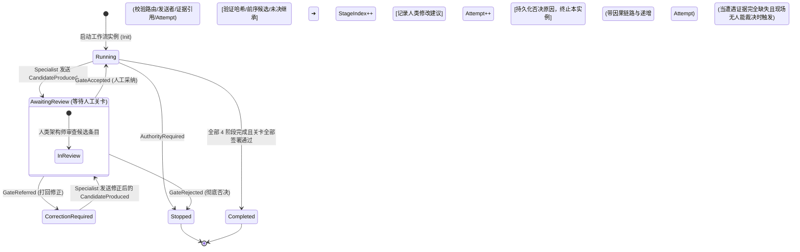

> 💡 **双栏独立滚动工作台导读**：本文采用双栏对照架构。**左栏**为核心精炼架构、实战代码与避坑决策；**右栏**为原著完整参考译文，附有关键段落的英文原文展开与难词解析。左右两栏可独立滚动，并支持顶栏自定义宽度比例（7:3 / 5:5 / 3:7）与拖拽调节。

# 核心实战精炼：构建协作编排器与多智能体状态机

## 1. 架构选型与决策矩阵

下表对比了构建多智能体系统时四种核心控制平面的技术选型与权衡：

| 架构维度 | 自由对话流 (Unstructured Chat) | 自主控制大模型 (LLM Controller) | 静态工作流引擎 (Hardcoded Pipeline) | **确定性协议状态机编排器 (Deterministic Protocol Orchestrator)** |
| :--- | :--- | :--- | :--- | :--- |
| **控制平面本质** | 纯文本 Prompt 串联（自然语言提示） | 另一个具备最高决策权的 Agent 进行协调 | 外部硬编码脚本（如 Bash / Python DAG） | **强类型应用服务 + 有限状态机（FSM）+ 契约信封** |
| **推进决策机制** | 基于大语言模型理解“Looks good”推进 | 模型自行评估质量并自主推进 | 依据退出码或文件存在推进 | **严格前置资质检查（Eligibility Check）+ 人工关卡决策记录** |
| **工件传递形态** | 裸 Markdown 或自由文本上下文 | 自由格式 JSON / 聊天历史 | 裸文件路径传递 | **类型化信封（Artifact Envelope：元数据、哈希、出处、未决列表）** |
| **失误与容错** | 错误隐蔽累积，下游全盘崩溃 | 模型无依据臆断修正，产生二次幻觉 | 阶段报错则整链失败重启 | **局部打回修正（Refer Back & In-place Loop），保留历史对照** |
| **知识完整性** | 未决问题在多轮对话中被悄然遗漏 | 模型自动替业务闭环策略 | 无法感知业务未决状态 | **代码级阻断：已采纳工件若遗漏未决条目（Unresolved ID）立即驳回** |

## 2. 编排器核心架构与状态转换拓扑图

编排器充当**协调者（Facilitator）而非控制者（Controller）**。编排器仅对状态转移、前置依赖、工件信封以及人类关卡签字进行机械校验，绝不进行领域推论：



## 3. 治理自治框架：类型化协议与信封模式

### 3.1 工件信封结构（Artifact Envelope）
跨智能体流转的任何产物均被打包进强类型信封，杜绝裸数据流转：
```yaml
# ArtifactEnvelope 结构
workflow_id: "brewup-stock-01"            # 工作流唯一追踪标识
producer: "eventstormer"                   # 产出该工件的专家标识
kind: "candidate-facts"                    # 工件类型（candidate-* 或 accepted-*）
path: "specs/001/accepted-facts.md"        # 文件存放物理相对路径
evidence_refs: ["QUOTE-13", "QUOTE-15"]    # 原始证据引用清单
unresolved: ["ES-17"]                      # 必须显式继承的未决问题 ID 列表
attempt: 1                                 # 当前阶段的尝试轮次（打回修正则递增）
content_sha256: "0f62f5949c7e..."          # 工件正文内容 SHA256 哈希
human_decision_sha256: "a4b7c12d..."       # 人工关卡审批决策单 SHA256 哈希
source_artifact_sha256: ["e2f891b0..."]    # 上游前序依赖工件的 SHA256 哈希清单
```

### 3.2 协议交互消息与处理语义矩阵

| 消息类型 (`ProtocolMessageKind`) | 发送方主体 | 触发前置状态 | 编排器处理动作与后置状态 | 架构约束 |
| :--- | :--- | :--- | :--- | :--- |
| `CandidateProduced` | Specialist | `Running` / `CorrectionRequired` | 校验发送者权限与工件信封，状态转为 `AwaitingReview` | 严禁直接触发下游专家，必须等待关卡 |
| `GateAccepted` | Human Reviewer | `AwaitingReview` | 验证人类决策哈希、前序候选哈希与未决完整性，推进 `StageIndex++` | **若遗漏任何 `Unresolved` 项立即 Block 阻断** |
| `GateReferred` | Human Reviewer | `AwaitingReview` | 记录打回原因，状态转为 `CorrectionRequired` | 保持当前阶段不变，仅递增 `Attempt` 计数 |
| `GateRejected` | Human Reviewer | `AwaitingReview` | 记录否决原因，状态转为 `Stopped` | 终止该工作流实例，禁止擅自回退状态 |
| `AuthorityRequired` | Specialist / Gate | `Running` / `AwaitingReview` | 发现业务关键规则缺失且无权裁决，转为 `Stopped` | 必须由外部真实业务权威介入重新启动关联流 |

### 3.3 编排器三大绝对不变量 (Orchestrator Invariants)
1. **资格不变量 (Eligibility Invariant)**：下游专家（如 Storyteller）绝不可直接消费上游专家的候选产物（如 `candidate-facts`），必须且只能消费经人工关卡签署的 `accepted-facts`。
2. **未决继承不变量 (Unresolved Retention Invariant)**：已采纳工件信封中的 `Unresolved` 列表必须完整包含当前候选工件中的全部未决 ID，严禁通过文本忽略隐式解决。
3. **因果与防篡改不变量 (Causation & Tamper-proof Invariant)**：每条消息必须携带前序消息的 `CausationId`；工件内容与关卡审批必须附带 SHA256 哈希，任何离线篡改均导致流程崩溃拒绝。

## 4. 生产级编排器核心实现 (C# 范式)

### 4.1 核心状态机与消息分发逻辑
```csharp
public ProtocolResult Handle(ProtocolState state, ProtocolMessage message)
{
    // 1. 幂等去重检查
    if (state.ProcessedMessageIds.Contains(message.MessageId))
        return Ignored(state, $"Message {message.MessageId} was already applied.");

    // 2. 基础合法性与因果链校验
    if (message.WorkflowId != state.WorkflowId)
        return Blocked(state, "Workflow ID mismatch.");
    if (message.Recipient != "orchestrator")
        return Blocked(state, "Protocol messages must target the orchestrator.");
    if (message.CausationId != state.LastMessageId)
        return Blocked(state, $"Expected causation {state.LastMessageId}, got {message.CausationId}.");
    if (state.Status is ProtocolStatus.Stopped or ProtocolStatus.Completed)
        return Blocked(state, $"Workflow is already {state.Status}.");

    // 3. 严格受限的状态转移分发
    return message.Kind switch
    {
        ProtocolMessageKind.CandidateProduced => RecordCandidate(state, message),
        ProtocolMessageKind.GateAccepted     => AcceptCandidate(state, message),
        ProtocolMessageKind.GateReferred     => ReferCandidate(state, message),
        ProtocolMessageKind.GateRejected     => StopFromGate(state, message),
        ProtocolMessageKind.AuthorityRequired=> StopForAuthority(state, message),
        _ => Blocked(state, "Unsupported message kind.")
    };
}
```

### 4.2 采纳推进时的未决问题防护检查
```csharp
private ProtocolResult AcceptCandidate(ProtocolState state, ProtocolMessage message)
{
    var accepted = message.Artifact;
    
    // 强制防篡改与出处追溯校验
    if (!IsSha256(accepted.HumanDecisionSha256))
        return Blocked(state, "Human decision SHA256 signature is missing or invalid.");
    if (!accepted.SourceArtifactSha256.Contains(state.Candidate.ContentSha256))
        return Blocked(state, "Accepted artifact does not cite the candidate under review.");
    if (accepted.Attempt != state.Candidate.Attempt)
        return Blocked(state, "Accepted artifact attempt number mismatch.");

    // 刚性未决问题继承防护：严禁在未获人类书面决策前遗漏任何未决议题
    var lost = state.Candidate.Unresolved.Except(accepted.Unresolved).ToArray();
    if (lost.Length > 0)
        return Blocked(state, $"Accepted artifact drops unresolved issues: {string.Join(", ", lost)}");

    var next = AppliedState(state with
    {
        StageIndex = state.StageIndex + 1,
        Status = state.StageIndex + 1 >= state.Routes.Length ? ProtocolStatus.Completed : ProtocolStatus.Running,
        AcceptedArtifacts = state.AcceptedArtifacts.Add(accepted),
        Candidate = null
    }, message);

    return new(next, true, $"APPLIED: Accepted {accepted.Kind}. Advanced to stage {next.StageIndex}.");
}
```

## 5. 架构避坑清单 (Do's & Don'ts)

| 场景维度 | 严禁做法 (Don't) | 推荐做法 (Do) |
| :--- | :--- | :--- |
| **编排器定位** | 赋予编排器大模型思考能力，让其在工件缺失时“智能推断”替代输入。 | **保持编排器为纯确定性薄控制平面**，仅校验资格与合法状态转移；业务思考留在专家与人类端。 |
| **消息流转** | 采用聊天窗口（Free-form Chat）传递指令，依赖大模型自我汇报进度。 | **采用强类型协议消息与工件信封（Envelope）**，通过哈希与因果链追踪唯一事实来源。 |
| **流程被打回** | 某阶段审查未通过时，将整条多智能体链路推倒从头全部重新运行。 | **支持就地局部修正（In-place Correction）**，保持上游已采纳工件不变，仅在当前阶段递增 Attempt。 |
| **未决问题处理** | 认为“工作流完成（Completed）”代表所有业务问题已彻底澄清并闭环。 | **区分流程完成与领域澄清**：工作流完成仅代表控制流走通，未决问题清单必须作为工件显式交付。 |
| **异常拦截** | 遇到非法消息或权限缺失时，强行让工作流继续推进以维持系统可用性。 | **及时阻断（BLOCKED / STOPPED）**：在证据或权限缺失时，停止流转才是最正确的系统响应。 |

<!-- split -->

# 原著完整参考：编排器：构建协调智能体

*第 9 章*围绕一条共享规则构建了四个有界专家智能体：每个专家智能体都可以将已被接受的素材转换为候选成果，但只有人工关卡才能决定什么可以作为下一阶段的权威输入。记录下来的 BrewUp 链路让这些边界清晰可查，但各环节之间的交接仍然依赖手动协调。

本章将这种手动协调转变为一个可执行的控制平面。你将从一个资格检查开始，用类型化消息和合法状态转换取代自由形式的智能体对话，进而运行完整的 BrewUp 专家智能体链路。编排器负责路由已被接受的工作成果，记录进度为何暂停，并保留未决知识。而领域解释权依然归属于专家智能体与人类评审人员。

该实现使用 C# 和 .NET，但其架构设计独立于具体的模型或编排框架。其最终成果是一个可重放的工作流，在其中，每一个候选提案、修改修正、关卡决策和暂停终止，都可以追溯到产出它的证据与权威主体。

在本章中，你将学到：

- 如何界定编排器的决策权，而不将其变成另一个建模专家智能体。
- 如何将多智能体交互建模为类型化消息与合法状态转换。
- 如何在交接过程中完整保留因果关系、出处追溯、未决知识以及人类权威。
- 如何运行、修正、暂停、持久化和恢复执行完整的 BrewUp 专家智能体链路。
:::en
> **Original**: In this chapter, you learned how to: Define the orchestrator's decision rights without turning it into another modeling specialist. Model multi-agent exchanges as typed messages and legal state transitions. Preserve causation, provenance, unresolved knowledge, and human authority across handoffs. Run, correct, stop, persist, and resume the complete BrewUp specialist chain.

**📌 核心术语与语境解析**：
- **Decision rights** [dɪˈsɪʒn raɪts]：*决策权边界*。编排器守住程序性协调权，人类守住领域裁决权，专家守住推演提议权。
:::

- 如何在有仓储支持的前提下验证完成状态，同时不把工作流的完成误当作每个领域问题都已解决的证明。

## 技术要求

本章中的编排模块是本专栏贯穿使用的 BrewUp 解决方案的一部分。保存下来的版本可在配套代码仓分支 <https://github.com/PacktPublishing/AI-Augmented-Domain-Driven-Design/tree/ch10/orchestrator> 中获取。该代码面向 .NET 10，位于 `src/Orchestration` 目录下。`BrewUp.Orchestration.Application` 包含协调相关的类型：`EligibilityEvaluator.cs`、`ConversationProtocol.cs`、`BrewUpOrchestrationLoop.cs` 以及 `WorkflowPersistence.cs`。`BrewUp.Orchestration.Infrastructure` 包含适配器：`JsonWorkflowStore.cs`、`RepositoryCatalog.cs`、`GateVerifier.cs`、`RepositoryScenario.cs` 以及两个专家智能体运行器。最后一节重放所使用的已被接受的*第 9 章*工件直接引用自 `docs/ch09`，无需重复复制。

可执行的演示用例位于 `BrewUp.Orchestration.Tests` 中：`EligibilityEvaluatorTests.cs`、`ConversationProtocolTests.cs`、`BrewUpOrchestrationLoopTests.cs` 以及 `RepositoryCatalogTests.cs`。本章中的代码清单是该保存代码的摘录，而非需要逐字敲入的练习。仅凭本章内容即可完整理解所有论述；只有在需要运行测试和检查完整实现时，才需要克隆该分支。

## 作为协调者而非控制者的编排器

我们从面向 BrewUp 库存管理（Stock Management）的最小可用协调器开始。协调器将判定 Storyteller 是否具备运行资格、在缺失关卡时拒绝状态转换、记录人类决策，并重新评估同一个请求。该示例使用了 EventStormer 和 Storyteller。这两个名称是来自*第 9 章*的专家智能体名称，而非 C# 类名；本章引入的 C# 类型是协调器及其协议。后续章节将把该机制扩展至完整的链路。

该协调器强制执行了来自*第 9 章*的一条不变量：在人工关卡记录下 Storyteller 可消费的已接受事实（accepted-facts）工件之前，候选事实绝不能成为 Storyteller 的输入。如果这种状态转换依然保持隐式，引入更多智能体只会掩盖故障。
:::en
> **Original**: The coordinator enforces one invariant from *Chapter 9*: candidate facts do not become Storyteller input until a human gate records the accepted-facts artifact that Storyteller might consume. If this transition remains implicit, adding agents hides the failure.

**📌 核心术语与语境解析**：
- **Invariant** [ɪnˈveəriənt]：*不变量*。在系统所有合法状态转换中必须始终得到满足的刚性约束条件。
- **Implicit transition**：*隐式状态转换*。未经严格校验而在系统内部私自推进的步骤，极易掩盖智能体产出的质量缺陷。
:::


上一章结尾所强调的区别，在本节中被转化为可执行的代码：协调与权威。编排器可以强制执行工作流不变量，例如检验已接受工件是否具备作为输入的资格，以及模式（schema）、出处追溯（provenance）和必要关卡是否完备。但它绝对不能做的是：擅自推断出足以让一个已被阻止的转换重新生效的领域决策。
:::en
> **Original**: The last chapter ended on the distinction this section makes executable: coordination versus authority. An orchestrator might enforce workflow invariants, such as that accepted artifact is eligible as input and whether schema, provenance, and a required gate are intact. What it cannot do is infer the domain decision that would make a stopped transition valid.

**📌 核心术语与语境解析**：
- **Coordination versus authority**：*协调权与权威决策权分离*。编排器只负责按规则流转工件，绝无权替业务推断缺失的领域规则。
- **Workflow invariants** [ˈwɜːkfləʊ ɪnˈveəriənts]：*工作流不变量*。工件类型匹配、出处追溯完备、前置关卡具备签名等结构性先决条件。
:::


### 创建编排工作区

在 `src/Orchestration` 目录下与其他源码模块并列创建编排工作区，并将其可供审查的证据保存在 `docs/ch10` 目录下：

```text
src/
  BrewUp.slnx
  Orchestration/
    BrewUp.Orchestration.Application/
      EligibilityEvaluator.cs
      ConversationProtocol.cs
      BrewUpOrchestrationLoop.cs
      WorkflowPersistence.cs
    BrewUp.Orchestration.Infrastructure/
      JsonWorkflowStore.cs
      RepositoryCatalog.cs
      GateVerifier.cs
      RepositoryScenario.cs
    BrewUp.Orchestration.Tests/
      EligibilityEvaluatorTests.cs
      ConversationProtocolTests.cs
      BrewUpOrchestrationLoopTests.cs
      RepositoryCatalogTests.cs
docs/ch10/
```

该工作区已经存在于配套分支上；它包含两个类库和一个可执行测试项目。基础设施库引用应用库，而测试项目同时引用这两个库。所有三个项目均已在 `src/BrewUp.slnx` 中注册，而 `src/BrewUp.Rest/Program.cs` 依然作为应用程序的组合根（composition root）：

```text
Application      class library: protocol, state, orchestration loop
Infrastructure   class library: JSON store, repository catalog, runners
Tests            xUnit project: executable demonstrations and invariants
```

Application 拥有协议与工作流类型，Infrastructure 拥有持久化和仓储适配器，Tests 项目拥有可执行的演示用例。第一个测试固件解答了一个程序性问题：所请求的专家智能体是否具备运行资格？该测试固件并不会去评估已接受事实的质量。

### 注册两个有界专家智能体

`EligibilityEvaluatorTests.cs` 测试固件从*第 9 章*的前两个转换开始。EventStormer 消费原始证据（raw evidence），且没有前置关卡。Storyteller 消费已接受事实，因此需要 EventStormer 的评审关卡：

```csharp
private readonly IReadOnlyDictionary<string, Specialist> _registry=
    new Dictionary<string, Specialist>(StringComparer.Ordinal)
    {
        ["eventstormer"] = new(
            "raw-evidence", "candidate-facts", RequiresGate: null),
        ["storyteller"] = new(
            "accepted-facts", "candidate-scenarios", "eventstormer-review")
    };
```

该字典充当能力注册表而非角色编目。每个条目声明了路由所需的输入类型、候选输出类型以及前置关卡。专家智能体的行为契约则保存在别处。

### 记录首个工作流状态

在同一个测试固件中创建初始的 `WorkflowState`。在运行开始时，只有来自“库存排查演练（Stock walkthrough）”的证据才是权威输入：

```csharp
private readonly WorkflowState _state=new(
    "brewup-stock-01",
    new Dictionary<string, string>(StringComparer.Ordinal)
    {
        ["raw-evidence"] =
            "docs/ch09/run-pack/stock-walkthrough.md"
    });
```

该测试固件刻意不包含任何已接受事实。候选输出可能已经存在于仓储中，但唯有已记录的关卡才能使其成为下一阶段转换的权威输入。

### 实现资格检查

第一个协调器是以应用服务的形式实现的，而非另一个控制台应用程序。`EligibilityEvaluator` 接收专家智能体名称、状态、注册表以及关卡目录。该服务检查所需的关卡，提供该关卡的生效工件，并验证其类型是否与专家智能体声明的输入匹配。

```csharp
public static EvaluationResult Evaluate(
    string specialistName,
    WorkflowState state,
    IReadOnlyDictionary<string, Specialist> registry,
    string gateDirectory)
{
    if (!registry.TryGetValue(specialistName, out var specialist))
        return Blocked(
            state.Artifacts,
            $"unknown specialist {specialistName}");

    var available=new Dictionary<string, string>(
        state.Artifacts,
        StringComparer.Ordinal);
    var unresolved= Array.Empty<string>();

    if (specialist.RequiresGate is { } requiredGate)
    {
        var path= Path.Combine(gateDirectory, $"{requiredGate}.json");
        if (!File.Exists(path))
            return Blocked(
                available,
                $"required gate {requiredGate} is missing");

        GateRecord? gate;
        try
        {
            gate = JsonSerializer.Deserialize<GateRecord>(
                File.ReadAllText(path),
                JsonDefaults.Options);
        }
        catch (JsonException exception)
        {
            return Blocked(
                available,
                $"gate {requiredGate} is invalid: {exception.Message}");
        }
        if (gate is null)
            return Blocked(available, $"gate {requiredGate} is empty");

        if (!string.Equals(
                gate.GateId,
                requiredGate,
                StringComparison.Ordinal))
            return Blocked(
                available,
                $"gate id {gate.GateId} does not match {requiredGate}");

        if (!string.Equals(
                gate.Decision,
                "accepted",
                StringComparison.OrdinalIgnoreCase))
            return Blocked(
                available,
                $"gate {requiredGate} is {gate.Decision}");

        available[gate.EffectiveArtifact.Kind] =
            gate.EffectiveArtifact.Path;
        unresolved = gate.PreservesUnresolved ?? [];
    }

    if (!available.TryGetValue(specialist.Consumes, out var artifactPath))
        return Blocked(
            available,
            $"required artifact {specialist.Consumes} is missing",
            unresolved);

    var message= $"READY: {specialistName} can consume " +
                  $"{specialist.Consumes} from {artifactPath}";
    if (unresolved.Length > 0)
        message += $"; unresolved preserved: {string.Join(", ", unresolved)}";

    return new EvaluationResult(true, message, available, unresolved);
}
```

`EligibilityEvaluator` 检查关卡是否存在及其决议状态，暴露关卡的生效工件，并验证所需的输入类型。它绝不对领域素材做任何解释。

### 在关卡存在之前运行状态转换

在写入任何关卡之前先运行 Storyteller 的资格测试。测试固件创建一个空的临时关卡目录，评估请求，并期望获得精确的阻塞结果：

```csharp
var result= EligibilityEvaluator.Evaluate(
    "storyteller", _state, _registry, _gateDirectory);
Assert.False(result.Ready);
Assert.Equal(
    "BLOCKED: required gate eventstormer-review is missing",
    result.Message);
```

这种拒绝机制阻止了 Storyteller 消费尚未被接受的工件。如果由协调器直接读取 EventStormer 的原始输出并挑选看似合理的事实，就等于协调器擅自替人工关卡做出了决策。返回缺失的关卡标识符，既守护了*第 9 章*中界定的边界，又明确告知了操作员接下来必须发生什么。

一个针对性强的 `xUnit` 测试同时保护了被阻止的结果以及精确缺失的关卡标识符。

### 记录人工关卡并恢复执行

EventStormer 关卡创建了权威的交接凭据。测试向临时关卡目录写入一个 `GateRecord`，其中包含决议结论、生效工件以及必须在状态转换中得以保留的未决标识符：

```csharp
WriteGate(new GateRecord(
    "eventstormer-review",
    "accepted",
    new EffectiveArtifact(
        "accepted-facts",
        "docs/ch09/runs/9.2-eventstormer/accepted-facts.md"),
    ["ES-17"]));
```

该关卡并未解决 ES-17。它接受了该记录作为可用的交接凭据，同时将该分歧保留为供 Storyteller 展开推演的开放前提。

再次评估同一请求，并断言已接受工件成功变为可用状态，且 ES-17 没有丢失：

```csharp
var result= EligibilityEvaluator.Evaluate(
    "storyteller", _state, _registry, _gateDirectory);

Assert.True(result.Ready);
Assert.Equal(["ES-17"], result.Unresolved);
Assert.Contains("unresolved preserved: ES-17", result.Message);
```

追踪记录中同样保留了 ES-17，因此后续阶段绝不可能将这个开放式问题误当成已接受的既定策略。

从仓库根目录运行针对性的资格测试套件：

```text
$ dotnet test src/Orchestration/BrewUp.Orchestration.Tests/
BrewUp.Orchestration.Tests.csproj --nologo \
    --filter FullyQualifiedName~EligibilityEvaluatorTests
Passed! - Failed: 0, Passed: 4, Skipped: 0, Total: 4
```

### 从运行示例中提炼通用边界

这个运行示例让这条边界变得清晰具体。编排器可以挑选符合资格的状态转换、组装已接受的输入、验证声明的条件、记录拒绝原因，并向前传递未决标识符。但编排器不能创建关卡、不能将 Referred（转交修正）擅自更改为 accepted（已接受），也不能丢弃 ES-17。
:::en
> **Original**: The working example makes this boundary concrete. The orchestrator can select an eligible transition, assemble accepted input, validate declared conditions, record a refusal, and carry unresolved identifiers forward. The orchestrator cannot create a gate, change Referred to accepted, or drop ES-17.

**📌 核心术语与语境解析**：
- **Eligible transition** [ˈelɪdʒəbl trænˈzɪʃn]：*具备资质的状态转换*。满足全部前置工件与关卡要求、被允许执行的下一阶段转换。
- **Carry unresolved identifiers forward**：*向前透传未决标识符*。确保上游发现的业务疑难问题在下游流水线中始终保留，严禁隐式吞没。
:::


*表 10.1* 对这个精简程序中所行使的决策权进行了提炼，将*第 9 章*中“协调与权威”的边界转化为逐行的操作规范。每一行代表一项操作和三个答案：编排器可以机械化地执行什么、唯有专家智能体可以执行什么、唯有人类权威才能决定什么。这些行经过了刻意的具体化设计：在完整的工作流中，每一行日后都可以转化为一个函数、验证规则、持久化记录或人工操作。

| 操作 | 编排器 | 专家智能体 | 人类权威 |
|---|---|---|---|
| 选择下一个符合资格的步骤 | 根据记录的状态进行路由 | 不能自行选择 | 无需介入 |
| 准备输入包 | 组装已被接受的工件 | 消费准备好的输入包 | 确立哪些内容已被接受 |
| 转换领域素材 | 绝不能进行转换 | 产出候选成果 | 评审提案 |
| 检查模式与出处追溯 | 验证声明的规则 | 提供必填字段 | 可对证据提出质疑 |
| 接受、转交修正或拒绝 | 记录并应用该决策 | 无权做出决策 | 在关卡处做出决策 |
| 裁决策略或所有权分歧 | 暂停并暴露断层 | 保留不确定性 | 在获得授权时做出裁决 |
| 记录运行或状态转换 | 维护追踪记录 | 提供原始输出 | 签署关卡记录 |

*表 10.1 – 跨越编排边界的决策权分配*

> **注意：何时停止工作流才是正确的结果**
>
> 当缺失证据、工件或必要的决策时，盲目继续执行才是一种缺陷。编排器的可靠性，既取决于它能执行合法的转换，同样也取决于它能拒绝非法的转换。
:::en
> **Original**: When evidence, an artifact, or a required decision is missing, continuation is the defect. The orchestrator's reliability depends on refusing invalid transitions as well as performing valid ones.

**📌 核心术语与语境解析**：
- **Continuation is the defect**：*强行继续流转即是系统缺陷*。在关键决策或证据缺失时，盲目让工作流继续推进只会放大幻觉并产生毒化产物；及时阻断才是可靠系统的标准行为。
:::


其最终成果是一个轻量化的控制平面。确定性的代码负责检查资格、工件类型、关卡记录、标识符和出处追溯。有界专家智能体负责转换领域素材，人类评审员则负责接受、转交修正或拒绝候选成果。任何新的综合归纳工作都必须指派给另一个订立了明确契约的专家智能体，而不能隐匿在协调器内部。

这个双角色协调器从机械层面杜绝了未授权的状态转换，并能解释每次拒绝的原因。到目前为止，它所做的一切都是针对单一交接环节。要将这种严谨性推广到整条链路，就必须让交互本身具备可供编排器检查的形式，而这正是下一节的起点。

## 设计多智能体对话

资格检查决定了专家智能体能否启动。但资格检查并不负责管控候选成果产出之后的流程：评审、修正、接受、拒绝、重复投递，或在缺失权威时暂停。`ConversationProtocol` 用类型化消息、发送者权限、证据要求以及合法状态转换，取代了对对话记录的主观解释。专家智能体专注于生成性工作，而人工关卡始终保有最终决定权。
:::en
> **Original**: Multi-agent systems often start with unstructured chat. Unstructured chat works well for brainstorming, but it does not tell you why progress stopped, who made a decision, or which inputs an agent read. That uncertainty becomes acute when you try to trace a defect through multiple steps.

**📌 核心术语与语境解析**：
- **Unstructured chat** [ʌnˈstrʌktʃəd tʃæt]：*无结构对话*。依赖自然语言 Prompt 驱动的多智能体交互，缺乏确定性状态边界与审计追溯能力。
- **Defect traceability**：*缺陷可追溯性*。当模型产物出错时，能够准确定位到是哪一次转换、哪份输入、哪个人类关卡批准导致的责任闭环能力。
:::


### 从自由形式的闲聊到显式协议

考虑下面这段看似合理的交互。它读起来通顺流畅，但在执行上却极不安全：

```yaml
EventStormer: I found the short-quantity exception.
Orchestrator: Looks good. Storyteller, continue from it.
Storyteller: I will write the scenario.
```

“*Looks good*”（看起来不错）这句话根本无法授权一次状态转换。这句话可能是在描述一个有效文件、一个看似合理的候选提案，也可能代表人类的正式接受。此外，该对话还遗漏了工作流标识符、确切的工件、证据引用、ES-17 以及促使 Storyteller 具备运行资格的消息，因此在重放时无法证实究竟是什么授权了这次交接。

对于每次交互，协议必须解答四个操作性问题：

- 身份标识（Identity）：这次交互属于哪个工作流和哪条消息？
- 权限（Authority）：发送者是否有权发表该陈述？
- 因果关系（Causation）：本条消息紧随哪一条先前已应用的消息之后？
- 效果（Effect）：若消息有效，哪种状态转换是合法的？

*图 10.1* 回答了一个完整阶段的这四个问题。它将上述自由形式闲聊所尝试的交接，重构为通过编排器进行的有序交互，并显式展示了人工关卡。


*图 10.1 – 单个编排阶段：候选成果、人工关卡与下一位获得运行资格的专家智能体*

现在，类型化消息成为了协调的基本单元。编排器根据协议来应用、阻止或忽略消息。可供人类阅读的解释性文本只是用来报告该结果，而非取代协议本身。

> **注意：框架视角 – BMAD：是什么授权了不同角色之间的交接？**
>
> BMAD 在指定角色之间传递工作，其交接读起来非常类似于上面的对话：一个角色汇报，另一个角色批准，下一个角色开始。角色简报说明了一个角色可以做什么，但并没有说明哪条消息可以改变工作的状态。记录授权交接的发送者、工件和决策，而不要只记录口头赞同。

### 定义工件封套

协议位于应用项目的 `ConversationProtocol.cs` 中。协议从为每个候选或已接受工件定义封套开始：
:::en
> **Original**: The protocol lives in `ConversationProtocol.cs` in the application project. The protocol starts with an envelope for every candidate or accepted artifact:

**📌 核心术语与语境解析**：
- **Artifact envelope** [ˈɑːtɪfækt ˈenvələʊp]：*工件信封*。对生成数据、元数据、SHA256 哈希、出处引用及未决状态进行统一封装的强类型结构体。
:::


```csharp
public sealed record ArtifactEnvelope(
    string WorkflowId,
    string Producer,
    string Kind,
    string Path,
    string[] EvidenceRefs,
    string[] Unresolved,
    int Attempt,
    string ContentSha256,
    string[]? SourceArtifactSha256 = null,
    string? HumanDecisionSha256 = null);
```

工件的有效负载保留在消息之外。`Path` 指向供评审的工件，而封套则携带协调数据。`Producer` 和 `Kind` 将其与发送者及路由绑定，`EvidenceRefs` 暴露出其来源证据集，`ContentSha256` 则精确标识了被评审的字节内容。

`Unresolved` 让开放性问题具备强制约束力：接受动作可以推动它们前进，但绝不能抹去它们。`Attempt` 用于区分修正常试与重放。已接受的封套还会携带源工件与人类决策的哈希值，将每次交接与产生它的候选成果和权威记录紧密关联。

> **提示：保持封套的轻量**
>
> 系统不需要将完整的候选成果拷贝到编排状态中。只需将工件持久化一次，并在消息中传递类型化引用。协议应当用于验证协调事实，而不是变成另一个领域模型。

### 定义消息与路由

协议包含五种消息类型。`CandidateProduced` 提交待评审的工作成果。`GateAccepted` 创建权威交接。`GateReferred` 请求同一产出方进行修正。`GateRejected` 终止该候选路径。`AuthorityRequired` 则在当前专家智能体缺少自身无权做出的决策而无法继续时暂停执行：

```csharp
public enum ProtocolMessageKind
{
    CandidateProduced,
    GateAccepted,
    GateReferred,
    GateRejected,
    AuthorityRequired
}

public sealed record ProtocolMessage(
    string MessageId,
    string WorkflowId,
    string CausationId,
    ProtocolMessageKind Kind,
    string Sender,
    string Recipient,
    ArtifactEnvelope? Artifact = null,
    string? Reason = null);
```

每条入站消息都以编排器为目标，因为点对点的对等交接会绕过状态验证和中央追踪记录。`CausationId` 必须等于上一条已应用的消息 ID，从而将每个提案与赋予其资格的已接受知识连接起来。重试可以重用工作流和工件路径，但不能重用消息标识符。

现在声明四阶段契约。该列表描述了协议的形态，此时尚未实际运行 BrewUp 循环：

```text
ProtocolRoute[] routes=
[
    new("eventstormer",
        "candidate-facts", "accepted-facts"),
    new("storyteller",
        "candidate-scenarios", "accepted-scenarios"),
    new("command-event-writer",
        "candidate-behavior", "accepted-behavior"),
    new("context-mapper",
        "candidate-context-map", "accepted-context-map")
];
```

路由将专家智能体与其候选工件类型及已接受工件类型绑定在一起。提示词、模型和领域决策都保留在协议外部。变更路由并不会改变允许跨越关卡的内容。

### 编码对话状态

对话还需要一个独立于对话记录的可序列化状态。使用一个紧凑的 `enum` 和一个 record。编排循环会将该状态与其当前输入、已处理的运行命令以及追踪记录一同持久化：

```csharp
public enum ProtocolStatus
{
    Running,
    AwaitingReview,
    CorrectionRequired,
    Stopped,
    Completed
}

public sealed record ProtocolState(
    string WorkflowId,
    int StageIndex,
    ProtocolStatus Status,
    string LastMessageId,
    ArtifactEnvelope? Candidate,
    ArtifactEnvelope[] AcceptedArtifacts,
    string[] PreservedUnresolved,
    string[] ProcessedMessageIds,
    string? StopReason = null);
```

`StageIndex` 标识当前活跃的路由。`Candidate` 存在于评审或修正期间，而 `AwaitingReview` 让提案权与接受权在权威归属上表现出显式差异。`AcceptedArtifacts` 记录权威交接。`LastMessageId` 和 `ProcessedMessageIds` 提供因果顺序保障与幂等投递能力，而外层的快照使这些保证在系统重启后依然有效。

启动一次运行会创建一个显式的因果根，而不是让第一条消息处于无锚定状态：

```csharp
public ProtocolState Start(string workflowId) => new(
    workflowId,
    StageIndex: 0,
    ProtocolStatus.Running,
    LastMessageId: "workflow-start",
    Candidate: null,
    AcceptedArtifacts: [],
    PreservedUnresolved: [],
    ProcessedMessageIds: []);
```

*表 10.2* 在实现之前先对状态机进行全面审视。将每一行读作一条规则：此类消息仅在列出的状态下合法，仅能由列出的发送者发送，并且会将工作流推向最后一列中的状态。“授权发送者”列是一道决策权边界。“产生的新状态”列是编排器针对该消息所能应用的唯一状态变更。最后一行是幂等性规则：已经被应用过的消息会被直接忽略而不是阻止，因此重复投递不会产生任何改变。

| 消息 | 有效状态 | 授权发送者 | 产生的新状态 |
|---|---|---|---|
| CandidateProduced | Running 或 CorrectionRequired | 当前专家智能体 | AwaitingReview |
| GateAccepted | AwaitingReview | 人类评审员 | Running 或 Completed |
| GateReferred | AwaitingReview | 人类评审员 | CorrectionRequired |
| GateRejected | AwaitingReview | 人类评审员 | Stopped |
| AuthorityRequired | Running 或 CorrectionRequired | 当前专家智能体 | Stopped |
| 重复的消息 ID | 任意状态 | 任意发送者 | 保持不变；直接忽略 |

*表 10.2 – 对话协议中的合法消息*

*图 10.2* 以图表形式展示了相同的状态机。实线箭头代表人类决策，虚线箭头代表专家智能体消息，两类权威一目了然。


*图 10.2 – ProtocolStatus 的合法状态转换*

### 仅允许合法转换

`ConversationProtocol.Handle` 是唯一的入口点。重复检测排在最前，因此重复投递是无害的。工作流、接收者和因果顺序检查随后进行，优先于任何特定于状态转换的规则：

```csharp
public ProtocolResult Handle(
    ProtocolState state,
    ProtocolMessage message)
{
    if (state.ProcessedMessageIds.Contains(message.MessageId))
        return Ignored(state,
            $"message {message.MessageId} was already applied");

    if (message.WorkflowId != state.WorkflowId)
        return Blocked(state, "workflow id does not match");

    if (message.Recipient != "orchestrator")
        return Blocked(state,
            "protocol messages must target the orchestrator");

    if (message.CausationId != state.LastMessageId)
        return Blocked(state,
            $"expected causation {state.LastMessageId}");
    if (state.Status is ProtocolStatus.Stopped
        or ProtocolStatus.Completed)
        return Blocked(state, $"workflow is {state.Status}");

    return message.Kind switch
    {
        ProtocolMessageKind.CandidateProduced
            => RecordCandidate(state, message),
        ProtocolMessageKind.GateAccepted
            => AcceptCandidate(state, message),
        ProtocolMessageKind.GateReferred
            => ReferCandidate(state, message),
        ProtocolMessageKind.GateRejected
            => StopFromGate(state, message),
        ProtocolMessageKind.AuthorityRequired
            => StopForAuthority(state, message),
        _ => Blocked(state, "unsupported message kind")
    };
}
```

被阻止的消息（BLOCKED）会使状态保持不变。被阻止的消息与“已停止”（STOPPED）不同。BLOCKED 意味着尝试发送的消息是不合法的，因此从未成为对话的一部分。STOPPED 状态则是一个已应用的协议结果，它记录了工作流无法继续的原因。操作员在决定是修复投递问题还是获取领域决策时，需要明确这一区别。*表 10.3* 用两行进行了说明。
:::en
> **Original**: A blocked message leaves state unchanged. A blocked message is different from Stopped. BLOCKED means that the attempted message was not legal and therefore never became part of the conversation. The STOPPED state is an applied protocol outcome that records why the workflow cannot continue. Operators need that distinction when deciding whether to fix a delivery or obtain a domain decision. *Table 10.3* states it in two rows.

**📌 核心术语与语境解析**：
- **BLOCKED versus STOPPED**：*被驳回与已停止的区别*。BLOCKED 是通信层面的非法消息（系统状态未变）；STOPPED 是领域层面的终态结果（工作流因缺失必要权威而受控挂起并持久化）。
:::


| 结果 | 发生了什么 | 工作流状态 | 操作员该做什么 |
|---|---|---|---|
| BLOCKED（被阻止） | 消息不合法，因此从未成为对话的一部分，未应用任何变更。 | 保持不变 | 修复投递逻辑并发送合法的消息。 |
| STOPPED（已停止） | 一个已应用的结果，记录了工作流为何无法继续。 | Stopped，并持久化记录停止原因 | 获取缺失的领域决策，然后启动一个因果关联的新工作流。 |

*表 10.3 – 被阻止的消息与已停止的工作流*

`RecordCandidate` 在存储候选工件并转移到 `AwaitingReview` 之前，先验证活跃路由、发送者、出处追溯、工件类型、证据以及修正常试次数。它绝不会去调用下一个专家智能体：

```csharp
if (state.Status is not(ProtocolStatus.Running
    or ProtocolStatus.CorrectionRequired))
    return Blocked(state,
        $"CandidateProduced is not valid while {state.Status}");
if (message.Sender != route.Specialist)
    return Blocked(state, $"expected sender {route.Specialist}");
if (artifact.Kind != route.CandidateKind)
    return Blocked(state,
        $"expected artifact kind {route.CandidateKind}");
if (artifact.EvidenceRefs.Length == 0)
    return Blocked(state, "candidate has no evidence references");

var next= AppliedState(
    state with
    {
        Status = ProtocolStatus.AwaitingReview,
        Candidate = artifact
    },
    message);
return new(next, true,
    $"APPLIED: awaiting review of {artifact.Kind}");
```

### 接受候选成果并推进

接受是唯一能推进 `StageIndex` 的消息。接受操作需要人类评审员身份、预期的已接受工件类型、经过验证的内容与决策哈希值、引用受审候选成果的出处追溯、匹配的尝试次数，以及完整保留的未决标识符：
:::en
> **Original**: Acceptance is the only message that advances `StageIndex`. Acceptance requires the human reviewer, the expected accepted artifact kind, verified content and decision hashes, provenance that cites the candidate under review, a matching attempt, and preserved unresolved identifiers:

**📌 核心术语与语境解析**：
- **Stage advancement** [steɪdʒ ədˈvɑːnsmənt]：*阶段推进*。工作流向下一位专家推进的唯一合法途径是人工关卡的正式 `GateAccepted` 签署，任何模型自评均无效。
- **Preserved unresolved identifiers**：*存续的未决标识符*。验收检查强制比对未决列表，防止模型在转换中悄悄消除业务疑义。
:::


```csharp
if (!IsSha256(accepted.HumanDecisionSha256))
    return Blocked(state,
        "accepted artifact human decision hash is missing or invalid");
if (accepted.SourceArtifactSha256 is not { Length: > 0 } sources ||
    !sources.Contains(state.Candidate.ContentSha256))
    return Blocked(state,
        "accepted artifact does not cite the candidate under review");
if (accepted.Attempt != state.Candidate.Attempt)
    return Blocked(state, "accepted artifact attempt does not match");

var lost= state.Candidate.Unresolved
    .Except(accepted.Unresolved)
    .ToArray();
if (lost.Length > 0)
    return Blocked(state,
        $"accepted artifact drops unresolved: {string.Join(", ", lost)}");
```

ES-17 并不需要永远保持未决，但解决它需要记录在案的人类决策以及新的已接受工件。在接受过程中直接省略该标识符并不构成合法的转换。

### 转交候选成果进行修正而不推进阶段

转交修正保持相同的阶段和已接受输入，记录人类给出的原因，并将状态更改为 `CorrectionRequired`。专家智能体必须回复一条因果关联的消息，并附带更高的 Attempt。其修正后的候选成果重新回到 `AwaitingReview`，从而让当前阶段形成循环回路，同时避免赋予其自我接受的权限。
:::en
> **Original**: A referral keeps the same stage and accepted input, records the human reason, and changes the status to `CorrectionRequired`. The specialist must answer with a causally linked message and a higher Attempt. Its corrected candidate returns to `AwaitingReview`, so the stage can loop without granting self-acceptance.

**📌 核心术语与语境解析**：
- **Referral (打回/驳回)** [rɪˈfɜːrəl]：*针对当前阶段的就地修正要求*。保持既有上游事实输入不变，递增轮次并提供人类反馈，避免推倒重来。
- **Correction loop**：*修正循环*。受控的有界重试闭环，严禁智能体跳过人工直接“自证通过”。
:::


### 在缺失权威时停止工作流

团队无法通过修正来解决所有的阻碍。假设 `EventStormer` 能够证明库存排查演练中存在不一致的“缺货少件（short-quantity）”行为，但没有任何有权限的负责人能够决定未来的业务场景应当遵循何种策略。如果要求 `EventStormer` 做出选择，就会把一个证据专家智能体硬变成策略权威。盲目重试只会围绕同一个缺失的决策生成更多的废话文本。

使用 `AuthorityRequired` 来表示这种状况。这是一个已应用的协议结果：状态变为 `Stopped`，且 `StopReason` 成为持久化快照和追踪记录的一部分。
:::en
> **Original**: Some obstacles the team cannot resolve through correction. Suppose `EventStormer` can prove that the Stock walkthrough contains inconsistent short-quantity behavior, but no authorized owner can decide which policy should govern future scenarios. Asking `EventStormer` to choose would convert an evidence specialist into a policy authority. Retrying would produce more text around the same missing decision.

**📌 核心术语与语境解析**：
- **Policy authority conversion**：*擅自转变为策略制定权威*。在缺乏业务方定论时逼迫大模型做决定，会将其由“客观证据提取者”异化为“越权决策者”。
- **AuthorityRequired**：*需要权威介入*。协议中的明确终态信号，提示系统已到达业务知识盲区，必须人类利益相关者裁决。
:::


STOPPED 对当前协议实例而言是终态。继续工作需要明确的操作动作，例如记录下缺失的决策并启动一个因果关联的工作流。将 Stopped 硬性修改回 Running 会抹杀掉让该停止机制值得信赖的边界。

### 测试协议不变量

测试套件重点关注可能破坏编排状态的故障：重复投递、过期的因果链、有损交接、断裂的候选链接以及伪造的出处追溯。重新投递相同的工作成果绝不能创造出第二种解释。
:::en
> **Original**: The suite focuses on failures that can corrupt orchestration state: duplicate delivery, stale causation, lossy handoffs, broken candidate linkage, and fabricated provenance. Redelivering the same work must not create a second interpretation.

**📌 核心术语与语境解析**：
- **Orchestration state corruption**：*编排状态损坏*。重复投递、陈旧因果链、丢失未决问题或伪造出处导致的流程逻辑失控。
- **Idempotency** [ˌaɪdəmˈpəʊtənsi]：*幂等性*。重复投递相同消息不产生副作用，直接安全忽略。
:::


重复消息会被忽略，因为其效果已经生效；因果关联错误的消息会被阻止，因为它们不属于当前对话的时间点。这两种情况都不是领域层面的故障，因此都不会导致工作流停止。

最后，证明已接受封套绝不能让不确定性凭空消失：

```csharp
[Fact]
public void AcceptedArtifactCannotDropAnUnresolvedItem()
{
    var awaitingReview= AwaitingReview();

    var result= _protocol.Handle(
        awaitingReview,
        Accepted("gate-1", "candidate-1", []));

    Assert.False(result.Applied);
    Assert.Contains("drops unresolved: ES-17",
        result.Message);
    Assert.Equal(0, result.State.StageIndex);
}
```

在迭代过程中仅运行协议测试套件，之后再运行完整的*第 10 章*测试项目。在最终分支上，完整项目还包含编排循环和仓储重放测试：

```text
$ dotnet test src/Orchestration/BrewUp.Orchestration.Tests/
BrewUp.Orchestration.Tests.csproj --nologo \
    --filter FullyQualifiedName~ConversationProtocolTests
Passed! - Failed: 0, Passed: 9, Skipped: 0, Total: 9

$ dotnet test src/Orchestration/BrewUp.Orchestration.Tests/
BrewUp.Orchestration.Tests.csproj --nologo
Passed! - Failed: 0, Passed: 25, Skipped: 0, Total: 25
```

九个协议测试覆盖了合法状态转换、发送者权限、因果关系、幂等性、修正常试、未决项保留、候选链接以及人类决策出处追溯。它们与四个资格测试一道，在每次交互之前和交互期间筑牢边界。

至此，协议围绕每个专家智能体的转换定义了合法的词汇表与状态机。其核心要义在于：权威已经成为消息本身的属性，而非回复语气的属性。一次状态转换之所以发生，是因为来自已授权发送者的类型化、因果关联的消息明确要求如此，否则就绝不会发生。下一节将把这套机制连接到*第 9 章*已被接受的工件上，并运行完整的链路。

## BrewUp 编排循环

上一节中的协议可以验证候选工件、应用人工关卡并推进单一路由，但它无法调用专家智能体，也无法为其组装工作区。`BrewUpOrchestrationLoop` 在不把生成式判断引入协议的前提下，补全了这些操作步骤。

完整的库存管理链路首先通过确定性的测试固件运行，然后通过针对*第 9 章*已验证记录的仓储重放测试运行。针对性的测试使一次修正过程清晰可见，并验证了链路背后记录的权威与出处追溯。

### 围绕协议构建编排循环

职责被清晰划分为三部分。`ConversationProtocol` 决定消息是否可以改变状态。`ISpecialistRunner` 调用专家智能体并返回候选封套。`BrewUpOrchestrationLoop` 组装输入、调用运行器、将结果提交给协议，并记录状态转换。

添加 `BrewUpOrchestrationLoop.cs`。一个阶段声明跨越其两个边界的工件类型，而 `SpecialistInput` 将主要交接工件与为其提供支撑的已接受上下文区分开来：

```csharp
public sealed record LoopStage(
    string Specialist,
    string InputKind,
    string CandidateKind,
    string AcceptedKind);

public sealed record SpecialistInput(
    ArtifactEnvelope Primary,
    ArtifactEnvelope[] Context);

public interface ISpecialistRunner
{
    Task<ArtifactEnvelope> RunAsync(
        LoopStage stage,
        SpecialistInput input,
        int attempt,
        CancellationToken cancellationToken = default);
}
```

该接口返回一个候选封套。具体的运行器可以负责准备文件、渲染提示词、调用模型、验证输出并持久化结果。`CandidateProduced` 和人工关卡依然控制着该结果能否推进。

> **提示：将模型调用保持在协议之外**
>
> 状态机应当保持确定性。编排循环负责模型调用；`ConversationProtocol` 负责验证生成的封套。因此，重放协议状态不会触发新的模型输出。

编排循环将阶段定义映射到 `ConversationProtocol` 已经使用的 `ProtocolRoute` 契约中；它并没有引入第二个状态机。

### 准备已接受工件

*第 9 章*已经产出了交接词汇表。不要要求编排器从散文中重新提取；显式注册这四个阶段：

```csharp
LoopStage[] stages=
[
    new("eventstormer",
        "raw-evidence",
        "candidate-facts", "accepted-facts"),
    new("storyteller",
        "accepted-facts",
        "candidate-scenarios", "accepted-scenarios"),
    new("command-event-writer",
        "accepted-scenarios",
        "candidate-behavior", "accepted-behavior"),
    new("context-mapper",
        "accepted-behavior",
        "candidate-context-map", "accepted-context-map")
];
```

每个阶段指明了运行所需的已接受输入、可能提议的候选工件，以及能够解锁下一阶段的已接受交接工件。

初始封套暂存了原始的库存排查演练及其证据清单：

```csharp
var rawEvidence=new ArtifactEnvelope(
    WorkflowId: "brewup-stock-01",
    Producer: "evidence-store",
    Kind: "raw-evidence",
    Path: "docs/ch09/run-pack/stock-walkthrough.md",
    EvidenceRefs: ["OBS-01", "OBS-02", "OBS-03"],
    Unresolved: ["ES-17"],
    Attempt: 0,
    ContentSha256: ArtifactHash.Sha256(
        repositoryRoot,
        "docs/ch09/run-pack/stock-walkthrough.md"));
```

编排循环保留原始封套和每一次已接受的交接工件。每个专家智能体接收最新的已接受工件作为 Primary（主要输入），并将更早的已接受素材作为 Context（上下文）。在仓储重放之前，`RepositoryCatalog` 验证工件记录的完成状态以及每个声明的源哈希和决策哈希，然后提取证据和未决标识符。

### 运行首个专家智能体并暂停等待评审

`RunCurrentAsync` 是副作用的边界。该方法在调用 `ISpecialistRunner` 之前，先拒绝重复的命令 ID、非法状态以及错误的输入类型。在调用之后再检查 `CandidateProduced` 就太晚了，因为此时模型可能已经被运行了两次。

```csharp
public async Task<ProtocolResult> RunCurrentAsync(
    string commandId,
    CancellationToken cancellationToken = default)
{
    if (_processedRunCommands.Contains(commandId))
        return Ignored(
            $"run command {commandId} was already applied");
    if (State.Status is not(ProtocolStatus.Running
        or ProtocolStatus.CorrectionRequired))
        return Blocked(
            $"cannot run a specialist while {State.Status}");
    var stage= CurrentStage;
    if (_currentInput.Kind != stage.InputKind)
        return Blocked(
            $"{stage.Specialist} requires {stage.InputKind}, " +
            $"not {_currentInput.Kind}");
```

在完成这些检查之后，编排循环计算尝试次数、组装上下文，并调用运行器：

```csharp
    var attempt= State.Status == ProtocolStatus.CorrectionRequired
        ? (State.Candidate?.Attempt ?? 0) + 1
        : 1;
    var context= State.StageIndex == 0
        ? []
        : new[] { _initialInput }
            .Concat(State.AcceptedArtifacts[..^1])
            .ToArray();
    var candidate= await _runner.RunAsync(
        stage,
        new SpecialistInput(_currentInput, context),
        attempt,
        cancellationToken);
```

编排循环将返回的候选工件包装在 `CandidateProduced` 中，并通过 `ConversationProtocol` 发送。只有已应用的协议结果才会将运行命令标记为已处理，并进入追踪记录：

```csharp
    var message=new ProtocolMessage(
        MessageId: $"{commandId}-candidate",
        WorkflowId: State.WorkflowId,
        CausationId: State.LastMessageId,
        Kind: ProtocolMessageKind.CandidateProduced,
        Sender: stage.Specialist,
        Recipient: "orchestrator",
        Artifact: candidate);
    var result= _protocol.Handle(State, message);
    if (!result.Applied)
        return result;
    _processedRunCommands.Add(commandId);
    Apply(result, message, stage.Specialist, "candidate-produced");
    return result;
}
```

调用 `RunCurrentAsync("run-1")` 会调用一次 `EventStormer`，并让工作流停留在 `AwaitingReview` 状态。Storyteller 不会启动；候选工件及其出处追溯现在已供评审员查阅。

这种“暂停”是本章其余一切的基础，因此值得从外部角度来审视它。在这次单次调用之后渲染状态，向评审员展示决策所针对的具体内容，除此无他：

```text
workflow brewup-stock-01    stage 1 of 4    status AwaitingReview

candidate      artifacts/candidate-facts-attempt-1.md
produced by    eventstormer, attempt 1
kind           candidate-facts
evidence       OBS-01, OBS-02, OBS-03
unresolved     ES-17
content hash   aaaaaaaa...  (deterministic fixture value)
caused by      run-1-candidate
decision required: accept, refer, or reject.
storyteller cannot start until this gate records one.
```

该视图中的任何内容都不是领域观点。编排器仅仅报告了哪份工件正在等待评审、由谁生成、基于何种证据、哪个问题仍未解决，以及评审员必须做出何种决策。ES-17 随候选工件一同传递，因此接受该候选成果绝不能悄无声息地关闭该未决项。

> **注意：在分发前使命令认领持久化**
>
> 持久化的状态可以防止已应用的命令在重启后再次运行。在生产环境中，应在发起远程调用之前持久化认领命令 ID，并通过发件箱（outbox）或等效机制持久化候选工件。协议的幂等性防止的是重复的状态转换，而不是外部模型的严格恰好一次执行。

### 推进四个 BrewUp 阶段

人工评审适配器读取记录的决策和已接受工件，然后调用 `AcceptCurrent`。该方法记录并应用外部决策；`ConversationProtocol` 依然会验证评审员身份、已接受类型、出处追溯、证据以及未决项的保留。

在仓储重放中，这些已接受工件来自*第 9 章*已验证的交接凭据，带有其确切的内容哈希、源输出哈希和人类决策哈希。

每个阶段都遵循相同的节奏：产出候选工件、暂停等待评审，并且仅在 `GateAccepted` 之后推进。`JsonWorkflowStore` 以原子方式持久化状态、当前输入、已处理命令以及追踪记录，以便另一个进程无需解读对话记录即可恢复执行。
:::en
> **Original**: Building the loop around the protocol... The orchestration loop brings the pieces together: the capability registry, the state machine, the artifact envelopes, and the human gates. It coordinates the execution of the specialist chain while keeping every step attributable and inspectable.

**📌 核心术语与语境解析**：
- **Orchestration loop** [ˌɔːkɪˈstreɪʃn luːp]：*编排循环*。调度能力注册表、驱动状态机转移、装配工件信封并阻断等待人工审批的主执行引擎。
- **Attributable and inspectable**：*可归因且可审查*。每一步动作都有明确的责任主体、输入依据与校验记录。
:::


> **注意：框架视角 – Spec Kit：什么代表阶段回退？**
>
> 在*第 8 章*的 Spec Kit 运行中，从规范到计划再到任务的序列是单向可检查的：在运行下一条命令之前，可以对每个工件进行评审。但该记录的工作流并没有保留一等的转交修正、修正常试或指出缺失权威的暂停机制。此处引入的编排状态使这种向后回退变得显式，且无需重新运行已被接受的阶段。

### 修正单个阶段而无需重启链路

第一个 Storyteller 候选工件过于草率地终结了缺货少件的故事。评审员以“*将观察到的缺货与补货策略区分开*”为由将其转交修正。这次调用记录了将观察到的缺货与补货策略区分开的转交操作：`GateReferred` 将状态更改为 `CorrectionRequired`，但将 `StageIndex` 保留在 Storyteller，并保留了为第 1 次尝试提供输入的已接受事实。
:::en
> **Original**: When an artifact is referred back, the loop allows in-place correction without restarting the entire chain. The correction produces a new version of the artifact, linked to the original by provenance, while earlier accepted stages remain valid.

**📌 核心术语与语境解析**：
- **In-place correction**：*就地局部修正*。仅要求被驳回的当前专家针对反馈重跑，前序已确认阶段保持冻结，极大节省成本与时间。
:::


```csharp
var referred= loop.ReferCurrent(
    "refer-storyteller",
    "Separate the observed shortage from the " +
    "replenishment policy.");

var corrected= await loop.RunCurrentAsync(
    "run-storyteller-2");

Assert.True(referred.Applied);
Assert.True(corrected.Applied);
Assert.Equal(
    ["eventstormer", "storyteller", "storyteller"],
    runner.Invocations);
Assert.Equal(1, loop.State.StageIndex);
Assert.Equal(2, loop.State.Candidate!.Attempt);
```

调用断言证明了 `EventStormer` 没有重复执行，Storyteller 恰好运行了两次，而 Command & Event Writer 没有提前启动。修正后的候选工件依然会回到 AwaitingReview；修正本身不会赋予自我接受的特权。

> **注意：对蓄意重试使用新的命令 ID**
>
> 重新投递 run-Storyteller-1 属于重复投递，协议必须将其忽略。转交修正创造了新的工作，因此修正需要使用新的命令 ID 和 Attempt 2。幂等性与重试是两种不同的操作。

### 持久化可重放的运行追踪记录

仅凭最终状态无法解释工作流是如何到达该状态的。记录每个已应用的状态转换，并附带足够的信息以便对其进行排序、关联其成因、定位其工件，以及检查跨越边界的不确定性。将该追踪记录与恢复执行所需的状态一同持久化：
:::en
> **Original**: A run trace records every event in the execution: dispatches, candidate outputs, gate decisions, corrections, and stops. Because every artifact is hashed and every transition is typed, the trace can be replayed to verify that the result matches the recorded path.

**📌 核心术语与语境解析**：
- **Replayable run trace** [rɪˈpleɪəbl rʌn treɪs]：*可重放运行追踪*。以确定性时序日志记录所有事件与哈希，使外部审计人员可随时精确复现推演全过程。
:::


```csharp
public sealed record WorkflowSnapshot(
    ProtocolState State,
    ArtifactEnvelope CurrentInput,
    string[] ProcessedRunCommands,
    RunTraceEntry[] Trace);

private void Persist() => _store.Save(new WorkflowSnapshot(
    State,
    _currentInput,
    [.. _processedRunCommands],
    [.. _trace]));
```

`JsonWorkflowStore` 以原子方式替换先前的快照。持久化恢复测试从该存储中重构编排循环，并重新投递相同的命令：

```csharp
var resumed = new BrewUpOrchestrationLoop(
    "brewup-stock-01",
    TestFixtures.Stages,
    TestFixtures.RawEvidence,
    resumedRunner,
    new SteppingClock(),
    store);
var replay = await resumed.RunCurrentAsync("run-1");

Assert.Equal(ProtocolStatus.AwaitingReview, resumed.State.Status);
Assert.Single(resumed.Trace);
Assert.False(replay.Applied);
Assert.StartsWith("IGNORED", replay.Message);
Assert.Empty(resumedRunner.Invocations);
```

这些断言表明，重启后的循环重新加载了其 `AwaitingReview` 状态和追踪记录，忽略了重复命令，并且没有调用任何专家智能体。独立的转交测试证明，修正只重新运行了 Storyteller，而已被接受的 `EventStormer` 工作成果完好无损。

### 仅在最终人工关卡之后完成

Context Mapper 的候选工件依然让工作流停留在 `AwaitingReview`。正常路径测试证明，`ConversationProtocol` 仅在应用了最终的 `GateAccepted` 消息后才会达到 Completed 状态：
:::en
> **Original**: Workflow completion is a statement about the control plane, not about the domain. The workflow completes when all declared stages have finished and all required gates have recorded decisions. It does not prove that every domain question has been answered, or that the resulting model is free of contradictions.

**📌 核心术语与语境解析**：
- **Control plane completion**：*控制平面完成*。流程合规走通的标志，绝不代表业务领域中所有矛盾均已平息，未决问题依然必须被严肃跟进。
:::


```text
Assert.Equal(ProtocolStatus.Completed, loop.State.Status);
Assert.Equal(4, loop.State.AcceptedArtifacts.Length);
Assert.Equal(["ES-17"], loop.State.PreservedUnresolved);
```

`accepted=4` 的值意味着每个阶段都拥有权威交接凭据；`unresolved=ES-17` 意味着完成状态并没有人为捏造一项策略。Completed 仅表示规划的链路及其关卡已执行完毕，并不意味着每个领域问题都已得到解答。

现在，通过 `RepositoryCatalog`、`GateVerifier` 和 `RepositoryScenario` 重放已保存的运行记录。仓储测试要求精确的完成状态，重新计算每个声明的源哈希和人类决策哈希，并重现记录的修正路径。这些哈希值确立了工件和关卡决策的出处追溯，但它们并不能追溯性地填补*第 9 章*在 Storyteller 与 Command & Event Writer 之间发现的候选级出处断层：

```csharp
var store = new JsonWorkflowStore(directory);
var loop = await RepositoryScenario.RunAsync(
    FindRepositoryRoot(),
    store);
var resumed = await RepositoryScenario.RunAsync(
    FindRepositoryRoot(),
    store);

Assert.Equal(ProtocolStatus.Completed, loop.State.Status);
Assert.Equal(4, loop.State.AcceptedArtifacts.Length);
Assert.Equal(40, loop.State.PreservedUnresolved.Length);
Assert.Equal(14, loop.Trace.Count);
Assert.Equal(
    loop.Trace.Select(entry => entry.MessageId),
    resumed.Trace.Select(entry => entry.MessageId));
Assert.Equal(14, resumed.Trace.Count);
```

这 40 个标识符是跨越*第 9 章*四个已接受交接记录所累积的未决标识符集合，而不是新发现的问题。绝不能将它们误读为 40 个候选工件之间的血统链接。再次加载包含 14 个状态转换的持久化快照不会执行任何专家智能体工作。

拒绝是另一条终态路径：`GateRejected` 记录人类给出的原因，使编排循环保持 Stopped 状态，并在调用专家智能体之前阻止后续的运行命令。

### 端到端测试编排循环

最终的测试套件涵盖了终态决策、无效输入、重复命令、候选泄露、追踪因果关系、仓储出处追溯以及持久化恢复。以下断言验证了提供给 Context Mapper 的已接受上下文：

```csharp
var input = runner.Inputs[^1];

Assert.Equal("accepted-behavior",
    input.Primary.Kind);
Assert.Equal(
    ["raw-evidence",
     "accepted-facts",
     "accepted-scenarios"],
    input.Context.Select(artifact => artifact.Kind));
```

运行完整的测试项目：

```text
$ dotnet test src/Orchestration/BrewUp.Orchestration.Tests/
BrewUp.Orchestration.Tests.csproj --nologo
Passed! - Failed: 0, Passed: 25, Skipped: 0, Total: 25
```

这些测试验证的是编排逻辑本身，而非业务场景的生成质量。它们确立了专家智能体是否运行、接收了哪些字节、哪条消息引发了状态转换，以及哪些未决标识符得以保留。

BrewUp 链路现在已经成为可执行的工作流，同时没有将编排器变成第五个建模专家智能体。它路由已接受的输入、暂停等待人类决策、保留修正历史，并在缺失权威时停止执行。如果说你从本章只能汲取一条核心经验，那就是编排器绝不应越界：它可以将协调工作自动化，因为协调本质上是机械性的。但编排器必须将权威留给人类，因为权威涉及对领域的价值判断。剩下的设计问题在于：一个专家智能体可以在多大程度上行使自由，而不至于偏离已被接受的证据、共享语言或显式的决策权。

## 本章小结

本章将*第 9 章*中的手动交接转化为了一个可执行的协调层。`EligibilityEvaluator` 阻止了未授权的输入。`ConversationProtocol` 强制执行了类型化消息、合法状态、因果关系、幂等性以及人工关卡。`BrewUpOrchestrationLoop` 运行了四个阶段、转交修正了受影响的阶段、持久化了可重放的追踪记录，并在最终的已接受交接后顺利完成。仓储重放最终完成了四个已接受工件，并保留了全部 40 个未决标识符——这是跨越*第 9 章*四个已接受交接凭据所累积的集合，而非新发现的 40 个问题。

在本章中，你学到了如何：

- 将编排决策与专家智能体转换及人类领域权威区分开来。
- 使用类型化消息、合法状态和因果关系来治理多智能体协作。
- 阻止重复、过期或有损的交接修改权威状态。
- 在不重复执行已接受工作或提前启动下一阶段的情况下，修正单个阶段。
- 在保留未决问题的同时持久化并重放运行过程。

*第 11 章*将在此控制平面的基础上，进一步界定**受治理的自主性**（governed autonomy）：专家智能体可以探索什么、语义漂移如何变得清晰可见，以及哪些决策依然需要人类权威的裁决。
