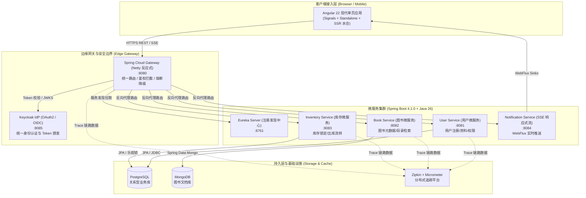

# 核心实战精炼：全栈微服务架构全景工作台

## 1. 技术栈选型与核心决策矩阵

在企业级现代全栈工程落地中，技术选型直接决定了系统的吞吐性能、伸缩性与可维护性。本专栏全面基于当前最新的生产级技术底座构建：

| 架构层级 | 选型技术与版本 | 核心技术特性 | 选型权衡考量 (Trade-offs) |
| :--- | :--- | :--- | :--- |
| **语言与运行时** | Java 26 + Node.js 24 LTS | 结构化并发、虚拟线程（Virtual Threads）、现代模式匹配 | 选用 LTS/最新稳定特性，兼顾极限并发吞吐与代码简洁度 |
| **微服务后端** | Spring Boot 4.1.0 + Spring Cloud | 响应式非阻塞、自动装配优化、声明式 HTTP Client | 摒弃历史遗留单体模式，采用高内聚低耦合微服务集群 |
| **持久层与存储** | PostgreSQL + MongoDB | 多范式持久化（Polyglot Persistence）、强事务与文档灵活性结合 | 核心交易用关系型保障 ACID，非结构化图书元数据用文档模型 |
| **微服务网关** | Spring Cloud Gateway (Netty) | 反应式统一路由、安全标头剥离清洗、微服务动态发现 | 规避 Tomcat 传统阻塞线程池瓶颈，支撑高并发 I/O 多路复用 |
| **安全与认证** | Keycloak + OAuth2 / JWT | 中心化身份治理、PKCE 授权码流、无状态 JWT 验签 | 避免各微服务自建鉴权逻辑，网关统一清洗，内网零信任 |
| **前端框架** | Angular 22 (Standalone) | 纯 Standalone 组件、Signals 响应式系统、Zoneless 检测机制 | 彻底抛弃 NgModule 繁重声明，获得细粒度 DOM 变更触发性能 |
| **前端状态管理** | NgRx SignalStore | 基于 Signals 的轻量事件驱动架构、高内聚单向数据流 | 避免传统 NgRx 模板代码繁琐，保留可预测状态机流转优势 |
| **渲染模式** | Angular SSR + Prerendering | 现代水合（Event Replay）、差异化路由预渲染策略 | 兼顾首屏 SEO、极速首字节响应（TTFB）与 SPA 交互流畅度 |
| **容器编排** | Docker Compose + 多阶段构建 | 8 节点全栈集群声明式编排、轻量化 Distroless 镜像 | 保证研发环境、CI/CD 与生产运行环境 100% 结构一致性 |

---

## 2. 核心案例：在线书店全栈微服务架构拓扑

全专栏围绕生产级**在线书店系统（Bookstore Platform）**展开，全链路拓扑如下：

---

## 3. 四阶段演进路线规划表

| 阶段 | 篇目范围 | 核心学习目标 | 关键工程产物 |
| :--- | :--- | :--- | :--- |
| **阶段一：架构基石与 AI 辅助** | 第 01 ~ 03 篇 | 确立全栈分层规范，配置生产级 AI 编程智能体规则 | 微服务工程骨架、AI 编码指令文件、架构全景图 |
| **阶段二：Spring Boot 微服务落地** | 第 04 ~ 10 篇 | 落地高并发微服务集群，打通持久化、网关、鉴权与容器化 | 多数据源持久层、Gateway 动态路由、Keycloak JWT 安全链、多阶段 Docker 镜像 |
| **阶段三：Angular 22 前端响应式** | 第 11 ~ 20 篇 | 纯 Standalone 架构，Signals 细粒度状态机与 SSR 现代水合 | 响应式表单验证流、NgRx SignalStore 状态流、SSR 服务端渲染引擎、SSE 实时订阅 |
| **阶段四：全链路联调与容器化交付** | 第 21 篇 | 打通前后端跨域与生产网关代理，实现单机一键编排 | 8 节点 Docker Compose 完整编排、生产级容灾与链路排障指南 |

---

## 4. 架构避坑清单 (Do's & Don'ts)

| 错误实践 (Don't) | 正确实践 (Do) |
| :--- | :--- |
| 在微服务内部直接暴露数据库实体（Entity）作为对外 REST 契约。 | 建立严格的 DTO 契约转换层，配合 Bean Validation 校验输入。 |
| 在 Spring Cloud Gateway 响应式网关内部编写阻塞型 JDBC 数据库查询。 | 网关专注于轻量反应式路由与 JWT 验签；必须查询时交由异步调度池或独立微服务。 |
| 在 Angular 22 仍混用传统 NgModule 并在组件中肆意注入全局 BehaviorSubject。 | 采用纯 Standalone 组件，以 Signal 与 NgRx SignalStore 统一收敛响应式状态。 |
| 本地开发依赖单机散装安装各种中间件，导致环境与线上生产脱节。 | 统一使用 `docker-compose.yml` 启动数据库、中间件与微服务，保证环境一致性。 |

<!-- split -->

# 原著完整参考：现代微服务与响应式前端全景路线图

在现代化企业级 Web 应用的架构选型中，Java（Spring Boot）与 TypeScript（Angular）长期以来都是工业界生产力最高、工程严谨度最强的全栈黄金搭档之一。

Spring Boot 提供了稳健、高内聚且“约定优于配置（Convention over Configuration）”的后端开发体系，帮助团队快速落地高并发微服务；而 Angular 则以其高度结构化的工程标准、开箱即用的响应式体系和强类型约束，成为构建大型复杂前端应用的首选平台。

:::en
> **Original**: In modern enterprise web application architecture, Java with Spring Boot and TypeScript with Angular represent one of the industry's most battle-tested, high-productivity fullstack technology pairings. Spring Boot provides an opinionated, highly cohesive backend ecosystem centered around convention over configuration, enabling engineering teams to build resilient microservices rapidly. Angular delivers an enterprise-grade structured platform equipped with built-in reactivity, strict type safety, and first-class tooling designed for large-scale frontend engineering.

**📌 核心术语与语境解析**：
- **Convention over Configuration**：*约定优于配置*。Spring Boot 核心设计哲学，通过合理的默认行为大幅减少开发者的样板配置代码。
- **Reactivity & Type Safety**：*响应式与类型安全*。Angular 框架依托 TypeScript 静态类型推导与 Signals 响应式原语，从编译期杜绝运行时类型缺陷。
:::

随着技术生态的飞速演进，当下的微服务架构与前端技术均发生了深远变革：

在后端领域，Java 26 的现代化语法特性、Spring Boot 4.1.0、Spring Cloud 统一微服务治理、基于 OAuth2 / JWT 的安全授权、Spring WebFlux 异步响应式流与 SSE 实时传输，已成为现代生产级架构的基石。

在前端领域，Angular 22 彻底拥抱了独立组件（Standalone Components）、基于 Signals 的细粒度响应式系统、无 Zone.js 变更检测机制（Zoneless）、基于 Vitest 的现代测试工具链，以及围绕 `AngularNodeAppEngine` 重新构筑的服务端渲染（SSR）体系。

在研发协作上，生成式 AI（GenAI）辅助开发已深度融入现代工程流。通过规范化的指令文件，AI 辅助代码补全与重构已成为加速全栈研发的倍增器。

:::en
> **Original**: Both backend microservices and frontend engineering paradigms have undergone profound transformations. On the backend, modern Java 26 language capabilities, Spring Boot 4.1.0, Spring Cloud unified service governance, OAuth2/JWT-based security token pipelines, and asynchronous reactive streams via Spring WebFlux with Server-Sent Events have become architectural baselines. On the frontend, Angular 22 has embraced Standalone Components, fine-grained Signals reactivity, zoneless change detection, modern Vitest testing harnesses, and overhauled Server-Side Rendering driven by AngularNodeAppEngine.

**📌 核心术语与语境解析**：
- **Zoneless Change Detection**：*无 Zone.js 变更检测*。Angular 摆脱猴子补丁机制，直接由 Signals 细粒度通知框架触发必要视图刷新，大幅降低运行时性能开销。
- **Polyglot Persistence**：*多范式持久化*。依据不同业务领域模型的数据特征，混合使用关系型数据库（PostgreSQL）与非关系型文档库（MongoDB）。
:::

本专栏将通过一个具备真实业务场景的在线书店系统（Bookstore Application），带你从零到一打通从后端微服务设计、数据库持久化、服务注册与网关路由、安全拦截、前端工程架构、响应式状态管理、SSR 水合优化到全链路 Docker 容器化编排的完整闭环。

:::en
> **Original**: Throughout this series, we build a production-grade online Bookstore Application, walking through the end-to-end engineering journey: domain boundary decomposition, multi-paradigm database persistence, dynamic service registration, gateway routing, edge security filtering, standalone frontend architecture, Signals state management, SSR hydration, and fullstack containerized orchestration with Docker Compose.

**📌 核心术语与语境解析**：
- **Edge Security Filtering**：*边缘安全过滤*。在 API 网关处统一进行身份验证、Token 解析与黑客注入标头清洗，防止未经授权的请求穿透至内网微服务。
- **Hydration Optimization**：*水合优化*。服务端渲染生成的静态 HTML 在客户端被 JavaScript 激活接管时，通过事件重放（Event Replay）防止页面闪烁与事件丢失。
:::
