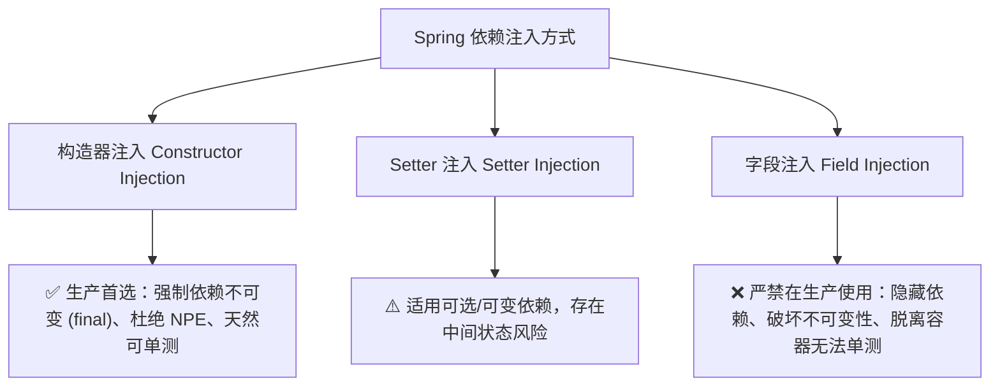

> 💡 **专栏导读**：本文收录于专栏 [《Spring Boot 4 & Angular 22 全栈微服务实战》](/columns/spring-boot-angular)。全专栏共 22 篇，深度覆盖 Java 26 微服务拆分、Spring Cloud 网关与安全鉴权、Angular 22 Signals 状态治理以及端到端容器化交付的全链路工程实践。

---

在上一篇中，我们构建了多范式持久层，完成了关系型数据库 PostgreSQL 与 NoSQL 文档数据库 MongoDB 的实体映射与 Repository 检索能力。

然而，数据持久化只是整个微服务架构的地基。真正赋予微服务业务生命力的是**应用服务层（Service Layer）**——它承载了领域规则的编排、事务边界的管控、跨实体的协调，以及实体模型与传输契约之间的转换。

在服务层之上，微服务还需要对外暴露优雅、安全、高容错、自解释的 **RESTful API**。一个糟糕的 API 会让前端开发者与集成方苦不堪言；而一个设计严谨的 API，能够通过精确的 HTTP 动词、标准的状态码、严格的入参校验与统一的错误信封，让客户端无缝对接。

本篇我们将以书店系统的**库存微服务（Inventory Service）**为核心，深度落地 Spring Boot 的服务分层架构与企业级 RESTful API 实战。

---

## 1. Spring Boot 依赖注入与组件立体化模型

在深入业务逻辑之前，必须彻底掌握 Spring IoC 容器与组件扫描（Component Scanning）的立体化设计。Spring 的注解不仅是语法糖，更是定义各层级职责边界（Separation of Concerns）与基础设施编排的核心凭据。

### 1.1 组件模型分层图谱

Spring 提供了从通用到高度特化的组件注解，帮助开发者表达架构意图：


1. **`@Component`（通用 Spring Bean）**：
   最基础的立体化注解。当一个类不属于 Controller、Service 或 Repository 时使用。例如实体与 DTO 互相转换的辅助映射器 `BookMapper`。
2. **`@Repository`（数据访问层）**：
   用于持久层组件。除了标记为 Spring Bean 外，Spring 还会自动为其装配异常转换切面（`PersistenceExceptionTranslationPostProcessor`），将底层的数据库特定异常（如 JDBC 错误、Hibernate 异常）统一定义并封装为 Spring 的 `DataAccessException` 层次体系，屏蔽具体存储技术的差异。
3. **`@Service`（业务逻辑层）**：
   用于封装领域用例、服务编排、状态流转与事务管理。此处的类应保持**无状态（Stateless）**，专注于业务逻辑执行，不应掺杂底层持久化细节或 Web 请求处理。
4. **`@RestController`（API 入口层）**：
   组合了 `@Controller` 与 `@ResponseBody`。它告诉 Spring MVC：当前类的所有方法返回值均直接序列化为 HTTP 响应体（默认 JSON），充当纯粹的 REST API 端点。
5. **`@Configuration` 与 `@Bean`（显式基础设施配置）**：
   用于第三方库接入或全局基础组件的声明（如自定义 `ObjectMapper`、时间戳 `Clock`、缓存管理器等）。

---

### 1.2 依赖注入（DI）最佳实践：为什么必须坚持构造器注入？

依赖注入是实现松耦合、高内聚和可测试性的核心。Spring 支持三种主要的注入方式：



#### 1. 构造器注入（Constructor Injection）—— 生产级唯一推荐

```java
@Service
public class BookService implements IBookService {
    private final BookRepository bookRepository;
    private final AuthorRepository authorRepository;
    private final BookMapper bookMapper;

    // 推荐显式构造器声明，Spring 4.3+ 起单构造器无需标注 @Autowired
    public BookService(BookRepository bookRepository, 
                       AuthorRepository authorRepository, 
                       BookMapper bookMapper) {
        this.bookRepository = bookRepository;
        this.authorRepository = authorRepository;
        this.bookMapper = bookMapper;
    }
}
```

> [!TIP]
> 构造器注入将依赖声明为 `final`，在对象实例化时即完成装配，确保对象在任何时刻都处于完整且合法的状态。在单元测试中，无需启动耗时的 Spring 上下文或通过反射破解私有字段，直接 `new BookService(mockRepo, ...)` 即可完成极速测试。

#### 2. 字段注入（Field Injection）的致命隐患

```java
@Service
public class BookService {
    @Autowired // ❌ 生产环境反模式
    private BookRepository bookRepository;
}
```

字段注入看似省去了样板代码，但带来了严重问题：
- 破坏封装性：依赖被私有修饰符隐藏，调用方在查看类接口时无法获知其依赖；
- 难以进行纯单元测试：如果不通过 Spring 容器反射注入，实例化该类将必定抛出 `NullPointerException`；
- 易引发循环依赖（Circular Dependencies）并在运行时意外掩盖架构设计缺陷。

---

## 2. 业务服务层（Service Layer）设计与异常感知工作流

服务层的设计直接决定了微服务的健壮程度。我们将服务层设计为**“契约-实现”**分离模式，并引入统一的 DTO 映射与异常感知边界。

### 2.1 服务契约接口：`IBookService`

Web 控制器层应当严格依赖服务契约，而非直接操作实体或持久层：

```java
package com.packt.bookstore.inventory.service;

import com.packt.bookstore.inventory.dto.BookRequest;
import com.packt.bookstore.inventory.dto.BookResponse;

import java.util.List;

public interface IBookService {
    List<BookResponse> findAll(int page, int size, String sort);
    BookResponse findOne(Long id);
    BookResponse create(BookRequest req);
    BookResponse replace(Long id, BookRequest req);
    BookResponse patch(Long id, BookRequest req);
    void delete(Long id);
}
```

---

### 2.2 实体与 DTO 映射器：`BookMapper`

领域实体（`Book`）包含了数据库结构、外键与 JPA 审计元数据，**决不能直接暴露给外界 API**。通过独立的 `@Component` 映射器，我们在 API 契约（DTO）与内部领域模型之间建立坚固的防火墙：

```java
package com.packt.bookstore.inventory.mapper;

import com.packt.bookstore.inventory.dto.AuthorResponse;
import com.packt.bookstore.inventory.dto.BookRequest;
import com.packt.bookstore.inventory.dto.BookResponse;
import com.packt.bookstore.inventory.entity.Author;
import com.packt.bookstore.inventory.entity.Book;
import org.springframework.stereotype.Component;

@Component
public class BookMapper {

    public Book toEntity(BookRequest req, Author author) {
        return Book.builder()
                .title(req.title())
                .isbn(req.isbn())
                .author(author)
                .price(req.price())
                .quantity(req.quantity() != null ? req.quantity() : 0)
                .genre(req.genre())
                .published(req.published())
                .description(req.description())
                .pageCount(req.pageCount())
                .coverImageUrl(req.coverImageUrl())
                .build();
    }

    public BookResponse toResponse(Book book) {
        AuthorResponse authorResp = null;
        if (book.getAuthor() != null) {
            authorResp = new AuthorResponse(
                    book.getAuthor().getId(),
                    book.getAuthor().getName(),
                    book.getAuthor().getNationality(),
                    null
            );
        }
        return new BookResponse(
                book.getId(),
                book.getTitle(),
                book.getIsbn(),
                authorResp,
                book.getPrice(),
                book.getQuantity(),
                book.getGenre(),
                book.getPublished(),
                book.getDescription(),
                book.getPageCount(),
                book.getCoverImageUrl()
        );
    }

    public void overwrite(Book target, BookRequest req, Author author) {
        target.setTitle(req.title());
        target.setIsbn(req.isbn());
        target.setAuthor(author);
        target.setPrice(req.price());
        target.setQuantity(req.quantity() != null ? req.quantity() : target.getQuantity());
        target.setGenre(req.genre());
        target.setPublished(req.published());
        target.setDescription(req.description());
        target.setPageCount(req.pageCount());
        target.setCoverImageUrl(req.coverImageUrl());
    }

    public void patch(Book target, BookRequest req, Author author) {
        if (req.title() != null) target.setTitle(req.title());
        if (req.isbn() != null) target.setIsbn(req.isbn());
        if (author != null) target.setAuthor(author);
        if (req.price() != null) target.setPrice(req.price());
        if (req.quantity() != null) target.setQuantity(req.quantity());
        if (req.genre() != null) target.setGenre(req.genre());
        if (req.published() != null) target.setPublished(req.published());
        if (req.description() != null) target.setDescription(req.description());
        if (req.pageCount() != null) target.setPageCount(req.pageCount());
        if (req.coverImageUrl() != null) target.setCoverImageUrl(req.coverImageUrl());
    }
}
```

---

### 2.3 业务服务层完整实现与用例解析

下面是生产级的 `BookService` 实现，涵盖分页排序、幂等读取、创建、全量更新、部分增量更新、幂等删除以及严苛的业务语义校验：

```java
package com.packt.bookstore.inventory.service.impl;

import com.packt.bookstore.inventory.dto.BookRequest;
import com.packt.bookstore.inventory.dto.BookResponse;
import com.packt.bookstore.inventory.entity.Author;
import com.packt.bookstore.inventory.entity.Book;
import com.packt.bookstore.inventory.exception.DomainRuleViolationException;
import com.packt.bookstore.inventory.exception.ResourceNotFoundException;
import com.packt.bookstore.inventory.mapper.BookMapper;
import com.packt.bookstore.inventory.repository.AuthorRepository;
import com.packt.bookstore.inventory.repository.BookRepository;
import com.packt.bookstore.inventory.service.IBookService;
import org.springframework.dao.DataIntegrityViolationException;
import org.springframework.data.domain.Page;
import org.springframework.data.domain.PageRequest;
import org.springframework.data.domain.Sort;
import org.springframework.stereotype.Service;
import org.springframework.transaction.annotation.Transactional;

import java.math.BigDecimal;
import java.util.List;

@Service
public class BookService implements IBookService {

    private final BookRepository bookRepository;
    private final AuthorRepository authorRepository;
    private final BookMapper bookMapper;

    public BookService(BookRepository bookRepository, 
                       AuthorRepository authorRepository, 
                       BookMapper bookMapper) {
        this.bookRepository = bookRepository;
        this.authorRepository = authorRepository;
        this.bookMapper = bookMapper;
    }

    // 1. 只读用例：分页与动态排序
    @Override
    @Transactional(readOnly = true)
    public List<BookResponse> findAll(int page, int size, String sortSpec) {
        Sort sortBy = parseSort(sortSpec);
        PageRequest pageRequest = PageRequest.of(page, size, sortBy);
        Page<Book> books = bookRepository.findAll(pageRequest);
        return books.getContent().stream()
                .map(bookMapper::toResponse)
                .toList();
    }

    // 2. 只读用例：根据 ID 查询单一实体（防御式 404）
    @Override
    @Transactional(readOnly = true)
    public BookResponse findOne(Long id) {
        Book book = bookRepository.findById(id)
                .orElseThrow(() -> new ResourceNotFoundException("Book with ID " + id + " not found"));
        return bookMapper.toResponse(book);
    }

    // 3. 写入用例：创建图书（前置语义检查 + 事务保障）
    @Override
    @Transactional
    public BookResponse create(BookRequest req) {
        validateSemanticsForCreate(req);
        Author author = resolveAuthorById(req.authorId());
        Book toSave = bookMapper.toEntity(req, author);
        Book saved = trySave(toSave);
        return bookMapper.toResponse(saved);
    }

    // 4. 写入用例：全量覆盖更新（PUT 语义）
    @Override
    @Transactional
    public BookResponse replace(Long id, BookRequest req) {
        validateSemanticsForReplace(req);
        Book existing = bookRepository.findById(id)
                .orElseThrow(() -> new ResourceNotFoundException("Book with ID " + id + " not found"));
        Author author = resolveAuthorById(req.authorId());
        bookMapper.overwrite(existing, req, author);
        Book saved = trySave(existing);
        return bookMapper.toResponse(saved);
    }

    // 5. 写入用例：部分增量更新（PATCH 语义）
    @Override
    @Transactional
    public BookResponse patch(Long id, BookRequest req) {
        Book existing = bookRepository.findById(id)
                .orElseThrow(() -> new ResourceNotFoundException("Book with ID " + id + " not found"));
        validateSemanticsForPatch(req, existing);
        Author author = null;
        if (req.authorId() != null) {
            author = resolveAuthorById(req.authorId());
        }
        bookMapper.patch(existing, req, author);
        Book saved = trySave(existing);
        return bookMapper.toResponse(saved);
    }

    // 6. 删除用例：幂等移除
    @Override
    @Transactional
    public void delete(Long id) {
        if (!bookRepository.existsById(id)) {
            throw new ResourceNotFoundException("Book with ID " + id + " not found");
        }
        bookRepository.deleteById(id);
    }

    // --- 内部横切辅助与语义校验私有方法 ---

    private Sort parseSort(String sortSpec) {
        if (sortSpec == null || sortSpec.isBlank()) {
            return Sort.by("title").ascending();
        }
        String[] parts = sortSpec.split(",", 2);
        String field = parts[0].trim();
        String dir = parts.length > 1 ? parts[1].trim().toLowerCase() : "asc";
        return "desc".equals(dir) ? Sort.by(field).descending() : Sort.by(field).ascending();
    }

    private Author resolveAuthorById(Long authorId) {
        if (authorId == null) {
            throw new DomainRuleViolationException("Author ID is required");
        }
        return authorRepository.findById(authorId)
                .orElseThrow(() -> new ResourceNotFoundException("Author with ID " + authorId + " not found"));
    }

    private Book trySave(Book entity) {
        try {
            return bookRepository.save(entity);
        } catch (DataIntegrityViolationException e) {
            // 数据库层面唯一索引冲突兜底抛出
            throw e;
        }
    }

    private void validateSemanticsForCreate(BookRequest req) {
        if (req.authorId() == null) {
            throw new DomainRuleViolationException("Author ID is required");
        }
        if (req.price() != null && req.price().compareTo(BigDecimal.ZERO) < 0) {
            throw new DomainRuleViolationException("Price cannot be negative");
        }
        if (req.isbn() != null && bookRepository.existsByIsbnIgnoreCase(req.isbn())) {
            throw new DomainRuleViolationException("ISBN must be unique within the catalog");
        }
    }

    private void validateSemanticsForReplace(BookRequest req) {
        if (req.authorId() == null) {
            throw new DomainRuleViolationException("Author ID is required");
        }
        if (req.price() != null && req.price().compareTo(BigDecimal.ZERO) < 0) {
            throw new DomainRuleViolationException("Price cannot be negative");
        }
    }

    private void validateSemanticsForPatch(BookRequest req, Book existing) {
        if (req.price() != null && req.price().compareTo(BigDecimal.ZERO) < 0) {
            throw new DomainRuleViolationException("Price cannot be negative");
        }
        if (req.isbn() != null && !req.isbn().equalsIgnoreCase(existing.getIsbn())) {
            if (bookRepository.existsByIsbnIgnoreCase(req.isbn())) {
                throw new DomainRuleViolationException("ISBN must be unique within the catalog");
            }
        }
    }
}
```

#### 架构设计亮点复盘：
1. **语义校验 vs 结构校验**：
   - DTO 上的 `@NotBlank`、`@Pattern` 属于**结构/格式校验**，用于防御恶意的格式入参；
   - 服务层的 `validateSemanticsForCreate` 属于**业务语义校验**，用于校验“ISBN 在全目录中是否已被占用”、“价格不能小于 0”等依赖领域上下文的规则，违反时抛出明确的 `DomainRuleViolationException`（映射为 HTTP 422），而不是等到数据库抛出难以解读的 SQL 异常。
2. **PATCH 更新的空值哲学**：
   - 在轻量级 PATCH 中，`null` 字段被视为“未传递”，因此保留原值；
   - 若业务需要支持显式将某字段重置为 NULL，应引入高级的 **RFC 6902 JSON Patch** 或 **RFC 7396 JSON Merge Patch** 规范。

---

## 3. 服务层自动化单元测试实战（Mockito + JUnit 5）

服务层的业务逻辑应当能够脱离真实的数据库与 Web 容器，在毫秒级内完成高密度单元测试：

```java
package com.packt.bookstore.inventory.service;

import com.packt.bookstore.inventory.dto.AuthorResponse;
import com.packt.bookstore.inventory.dto.BookRequest;
import com.packt.bookstore.inventory.dto.BookResponse;
import com.packt.bookstore.inventory.entity.Author;
import com.packt.bookstore.inventory.entity.Book;
import com.packt.bookstore.inventory.exception.DomainRuleViolationException;
import com.packt.bookstore.inventory.exception.ResourceNotFoundException;
import com.packt.bookstore.inventory.mapper.BookMapper;
import com.packt.bookstore.inventory.repository.AuthorRepository;
import com.packt.bookstore.inventory.repository.BookRepository;
import com.packt.bookstore.inventory.service.impl.BookService;
import org.junit.jupiter.api.BeforeEach;
import org.junit.jupiter.api.DisplayName;
import org.junit.jupiter.api.Test;
import org.junit.jupiter.api.extension.ExtendWith;
import org.mockito.InjectMocks;
import org.mockito.Mock;
import org.mockito.junit.jupiter.MockitoExtension;
import org.springframework.data.domain.PageImpl;
import org.springframework.data.domain.PageRequest;

import java.math.BigDecimal;
import java.util.List;
import java.util.Optional;

import static org.junit.jupiter.api.Assertions.*;
import static org.mockito.ArgumentMatchers.any;
import static org.mockito.Mockito.*;

@ExtendWith(MockitoExtension.class)
class BookServiceTest {

    @Mock
    private BookRepository bookRepository;

    @Mock
    private AuthorRepository authorRepository;

    @Mock
    private BookMapper bookMapper;

    @InjectMocks
    private BookService bookService;

    private Author author;
    private Book book;
    private BookRequest bookRequest;
    private BookResponse bookResponse;

    @BeforeEach
    void setUp() {
        author = Author.builder().id(1L).name("Ahmad Gohar").build();
        AuthorResponse authorResp = new AuthorResponse(1L, "Ahmad Gohar", "Egyptian", null);

        book = Book.builder()
                .id(1L)
                .title("Spring Boot and Angular 2E")
                .isbn("978-1805123456")
                .author(author)
                .price(BigDecimal.valueOf(49.99))
                .quantity(50)
                .build();

        bookRequest = new BookRequest(
                "Spring Boot and Angular 2E",
                "978-1805123456",
                1L,
                BigDecimal.valueOf(49.99),
                50,
                "Tech",
                null,
                "Description",
                450,
                "cover.png"
        );

        bookResponse = new BookResponse(
                1L,
                "Spring Boot and Angular 2E",
                "978-1805123456",
                authorResp,
                BigDecimal.valueOf(49.99),
                50,
                "Tech",
                null,
                "Description",
                450,
                "cover.png"
        );
    }

    @Test
    @DisplayName("分页查询正常流：返回格式化 DTO 列表")
    void findAll_shouldReturnBookResponses() {
        when(bookRepository.findAll(any(PageRequest.class))).thenReturn(new PageImpl<>(List.of(book)));
        when(bookMapper.toResponse(book)).thenReturn(bookResponse);

        List<BookResponse> result = bookService.findAll(0, 10, "title,asc");

        assertEquals(1, result.size());
        assertEquals("Spring Boot and Angular 2E", result.get(0).title());
        verify(bookRepository).findAll(any(PageRequest.class));
    }

    @Test
    @DisplayName("根据 ID 查询未找到实体：断言 ResourceNotFoundException 404")
    void findOne_shouldThrowResourceNotFoundException() {
        when(bookRepository.findById(99L)).thenReturn(Optional.empty());

        assertThrows(ResourceNotFoundException.class, () -> bookService.findOne(99L));
    }

    @Test
    @DisplayName("创建图书前置校验：价格为负数时抛出 DomainRuleViolationException 422")
    void create_shouldThrowForNegativePrice() {
        BookRequest invalidReq = new BookRequest(
                "Invalid Book",
                "978-1805123456",
                1L,
                BigDecimal.valueOf(-10.0),
                10,
                null, null, null, null, null
        );

        assertThrows(DomainRuleViolationException.class, () -> bookService.create(invalidReq));
        verify(bookRepository, never()).save(any());
    }

    @Test
    @DisplayName("幂等删除：实体不存在时抛出 404 异常")
    void delete_shouldThrowWhenNotFound() {
        when(bookRepository.existsById(99L)).thenReturn(false);

        assertThrows(ResourceNotFoundException.class, () -> bookService.delete(99L));
        verify(bookRepository, never()).deleteById(anyLong());
    }
}
```

---

## 4. 企业级 RESTful API 设计实战

现在，我们将经过严格测试的业务服务通过 RESTful API 暴露给前端与外部系统。

### 4.1 HTTP 语义契约矩阵

在微服务架构中，遵循严谨的 REST 语义能够最大程度降低客户端集成成本：

| HTTP 方法 | 资源 URI 示例 | 幂等性 | 安全性 | 预期成功状态码 | 典型业务场景 |
| :--- | :--- | :--- | :--- | :--- | :--- |
| **GET** | `/api/v1/books` | 是 | 是 | `200 OK` | 获取图书分页列表或检索结果 |
| **GET** | `/api/v1/books/{id}` | 是 | 是 | `200 OK` | 根据主键获取图书详情（不存在时返回 `404`） |
| **POST** | `/api/v1/books` | 否 | 否 | `201 Created` | 创建新图书，响应 Header 带上 `Location` |
| **PUT** | `/api/v1/books/{id}` | 是 | 否 | `200 OK` | 全量替换图书所有字段（全量更新） |
| **PATCH** | `/api/v1/books/{id}` | 视设计而定 | 否 | `200 OK` | 局部微调（如仅修改价格或库存） |
| **DELETE** | `/api/v1/books/{id}` | 是 | 否 | `204 No Content` | 幂等删除资源，响应体为空 |

---

### 4.2 基于 Java Record 与 Bean Validation 的 DTO 建模

Java 17+ 引入的 `record` 是构建不可变 DTO 的理想容器。搭配 `jakarta.validation-constraints` 注解，可在 HTTP 入口处筑牢安全防线：

```java
package com.packt.bookstore.inventory.dto;

import jakarta.validation.constraints.NotBlank;
import jakarta.validation.constraints.NotNull;
import jakarta.validation.constraints.Pattern;
import jakarta.validation.constraints.PositiveOrZero;

import java.math.BigDecimal;
import java.time.LocalDate;

public record BookRequest(
        @NotBlank(message = "Title is required and cannot be blank")
        String title,

        @NotBlank(message = "ISBN is required")
        @Pattern(regexp = "^[0-9-]{10,17}$", message = "ISBN must be 10-17 digits and may include dashes")
        String isbn,

        @NotNull(message = "Author ID is required")
        Long authorId,

        @NotNull(message = "Price is required")
        @PositiveOrZero(message = "Price must be greater than or equal to 0")
        BigDecimal price,

        @PositiveOrZero(message = "Quantity must be >= 0")
        Integer quantity,

        String genre,
        LocalDate published,
        String description,
        Integer pageCount,
        String coverImageUrl
) {}
```

出参 DTO `BookResponse` 则保持纯粹的数据载体角色，不包含任何验证注解：

```java
package com.packt.bookstore.inventory.dto;

import java.math.BigDecimal;
import java.time.LocalDate;

public record BookResponse(
        Long id,
        String title,
        String isbn,
        AuthorResponse author,
        BigDecimal price,
        Integer quantity,
        String genre,
        LocalDate published,
        String description,
        Integer pageCount,
        String coverImageUrl
) {}
```

---

### 4.3 `BookController` 完整实现

在 `application.yml` 中配置统一端口与上下文根路径：

```yaml
spring:
  application:
    name: inventory-service
server:
  port: 8081
  servlet:
    context-path: /inventory
```

完整的控制器实现如下。我们保持控制器极度“轻量（Thin Controller）”，所有实际计算均委托给 `BookService`：

```java
package com.packt.bookstore.inventory.controller;

import com.packt.bookstore.inventory.dto.BookRequest;
import com.packt.bookstore.inventory.dto.BookResponse;
import com.packt.bookstore.inventory.service.IBookService;
import jakarta.validation.Valid;
import org.springframework.http.ResponseEntity;
import org.springframework.web.bind.annotation.*;
import org.springframework.web.servlet.support.ServletUriComponentsBuilder;

import java.net.URI;
import java.util.List;

@RestController
@RequestMapping("/api/v1/books")
public class BookController {

    private final IBookService bookService;

    public BookController(IBookService bookService) {
        this.bookService = bookService;
    }

    // 1. 分页与动态排序查询
    @GetMapping
    public ResponseEntity<List<BookResponse>> getAllBooks(
            @RequestParam(defaultValue = "0") int page,
            @RequestParam(defaultValue = "10") int size,
            @RequestParam(required = false) String sort
    ) {
        List<BookResponse> books = bookService.findAll(page, size, sort);
        return ResponseEntity.ok(books);
    }

    // 2. 根据主键获取图书详情
    @GetMapping("/{id}")
    public ResponseEntity<BookResponse> getBookById(@PathVariable Long id) {
        BookResponse book = bookService.findOne(id);
        return ResponseEntity.ok(book);
    }

    // 3. 创建图书（返回 201 Created 与标准 Location Header）
    @PostMapping
    public ResponseEntity<BookResponse> createBook(@Valid @RequestBody BookRequest request) {
        BookResponse created = bookService.create(request);
        URI location = ServletUriComponentsBuilder.fromCurrentRequest()
                .path("/{id}")
                .buildAndExpand(created.id())
                .toUri();
        return ResponseEntity.created(location).body(created);
    }

    // 4. 全量覆盖更新（PUT 语义）
    @PutMapping("/{id}")
    public ResponseEntity<BookResponse> replaceBook(
            @PathVariable Long id,
            @Valid @RequestBody BookRequest request
    ) {
        BookResponse updated = bookService.replace(id, request);
        return ResponseEntity.ok(updated);
    }

    // 5. 局部修补更新（PATCH 语义）
    @PatchMapping("/{id}")
    public ResponseEntity<BookResponse> updateBook(
            @PathVariable Long id,
            @RequestBody BookRequest request
    ) {
        BookResponse patched = bookService.patch(id, request);
        return ResponseEntity.ok(patched);
    }

    // 6. 幂等删除（返回 204 No Content）
    @DeleteMapping("/{id}")
    public ResponseEntity<Void> deleteBook(@PathVariable Long id) {
        bookService.delete(id);
        return ResponseEntity.noContent().build();
    }
}
```

---

## 5. API 版本治理策略与权衡

在微服务持续演进中，API 绝不能轻易破坏向后兼容性（Breaking Changes）。Spring Boot 支持以下三种主流版本化策略：

### 5.1 URI 路径版本化（业界首选推荐）

将版本号直接置于 URL 路径中（如 `/api/v1/books`）：


```java
@RestController
@RequestMapping("/api/v1/books")
public class BookControllerV1 { /* ... */ }

@RestController
@RequestMapping("/api/v2/books")
public class BookControllerV2 { /* ... */ }
```

- **优点**：肉眼可见、便于调试、CDN/网关缓存极其友好，符合绝大多数公共 API（如 Stripe, GitHub）的标准；
- **缺点**：版本迭代频繁时，URL 路径会产生碎片。

---

### 5.2 自定义请求头版本化（Header Versioning）

保持 URL 纯净不变，通过专属 Header（如 `X-API-VERSION: 2`）路由请求：


```java
@RestController
@RequestMapping("/api/books")
public class BookControllerHeader {

    @GetMapping(value = "/{id}", headers = "X-API-VERSION=2")
    public ResponseEntity<String> getBookV2(@PathVariable Long id) {
        return ResponseEntity.ok("Book V2 payload for ID: " + id);
    }
}
```

- **优点**：URI 保持长期稳定优雅；
- **缺点**：浏览器或 cURL 测试不直观，CDN 缓存策略较复杂。

---

### 5.3 MIME 内容协商版本化（Content Negotiation）

利用 HTTP 标准的 `Accept` 请求头传递特定媒体类型：


```java
@RestController
@RequestMapping("/api/books")
public class BookControllerContentNegotiation {

    @GetMapping(value = "/{id}", produces = "application/vnd.bookstore.v3+json")
    public ResponseEntity<String> getBookV3(@PathVariable Long id) {
        return ResponseEntity.ok("Book V3 payload for ID: " + id);
    }
}
```

- **权衡总结**：对于企业内部服务与面向前后端分离的全栈系统，**URI 路径版本化**拥有最高的透明度与最低的运维认知负载，是我们的首选落地策略。

---

## 6. 全局异常治理与 RFC 9457 统一错误信封

在生产系统中，绝对不能把原始的 Java 堆栈或底层 SQL 错误直接抛给客户端。这不仅是不专业的 API 表现，更会带来严重的代码结构泄露与安全隐患。

我们将构建符合 **RFC 9457（Problem Details for HTTP APIs）** 标准的统一错误治理切面。

### 6.1 异常到 HTTP 响应映射流


上图揭示了请求异常在各层之间的拦截与转化流：
1. **Web 入口层校验失败**（如标题为空、ISBN 格式错误）$\rightarrow$ 触发 `MethodArgumentNotValidException` $\rightarrow$ 映射为 `400 Bad Request`；
2. **领域业务规则受损**（如价格为负、ISBN 冲突）$\rightarrow$ 抛出 `DomainRuleViolationException` $\rightarrow$ 映射为 `422 Unprocessable Entity`；
3. **主键检索落空** $\rightarrow$ 抛出 `ResourceNotFoundException` $\rightarrow$ 映射为 `404 Not Found`；
4. **数据库底层索引冲突** $\rightarrow$ 抛出 `DataIntegrityViolationException` $\rightarrow$ 映射为 `409 Conflict`；
5. **未知系统崩溃** $\rightarrow$ 兜底捕获 `Exception` $\rightarrow$ 映射为 `500 Internal Server Error` 并记录 Error 日志。

---

### 6.2 领域特定异常定义

```java
package com.packt.bookstore.inventory.exception;

public class ResourceNotFoundException extends RuntimeException {
    public ResourceNotFoundException(String message) {
        super(message);
    }
}

public class DomainRuleViolationException extends RuntimeException {
    public DomainRuleViolationException(String message) {
        super(message);
    }
}
```

---

### 6.3 RFC 9457 标准错误载荷：`ApiError`

```java
package com.packt.bookstore.inventory.dto;

import java.time.Instant;

public record ApiError(
        String type,
        String title,
        int status,
        String detail,
        String instance,
        Instant timestamp
) {
    private static final String BASE_TYPE_URL = "https://api.bookstore.com/errors/";

    public static ApiError of(String errorKey, String title, int status, String detail, String instance) {
        return new ApiError(BASE_TYPE_URL + errorKey, title, status, detail, instance, Instant.now());
    }
}
```

---

### 6.4 全局异常拦截切面：`GlobalExceptionHandler`

借助 `@RestControllerAdvice`，实现全局异常拦截与格式化响应：

```java
package com.packt.bookstore.inventory.exception;

import com.packt.bookstore.inventory.dto.ApiError;
import jakarta.servlet.http.HttpServletRequest;
import org.slf4j.Logger;
import org.slf4j.LoggerFactory;
import org.springframework.dao.DataIntegrityViolationException;
import org.springframework.http.HttpStatus;
import org.springframework.http.ResponseEntity;
import org.springframework.web.bind.MethodArgumentNotValidException;
import org.springframework.web.bind.annotation.ExceptionHandler;
import org.springframework.web.bind.annotation.RestControllerAdvice;

@RestControllerAdvice
public class GlobalExceptionHandler {

    private static final Logger log = LoggerFactory.getLogger(GlobalExceptionHandler.class);

    // 1. 资源未找到：404
    @ExceptionHandler(ResourceNotFoundException.class)
    public ResponseEntity<ApiError> handleNotFound(ResourceNotFoundException ex, HttpServletRequest req) {
        ApiError error = ApiError.of("not-found", "Not Found", 404, ex.getMessage(), req.getRequestURI());
        return ResponseEntity.status(HttpStatus.NOT_FOUND).body(error);
    }

    // 2. DTO 参数格式校验失败：400
    @ExceptionHandler(MethodArgumentNotValidException.class)
    public ResponseEntity<ApiError> handleValidation(MethodArgumentNotValidException ex, HttpServletRequest req) {
        String detail = ex.getBindingResult().getFieldErrors().stream()
                .map(fe -> fe.getField() + ": " + fe.getDefaultMessage())
                .findFirst()
                .orElse("Validation failed");

        ApiError error = ApiError.of("bad-request", "Bad Request", 400, detail, req.getRequestURI());
        return ResponseEntity.badRequest().body(error);
    }

    // 3. 业务规则冲突（语义校验失败）：422
    @ExceptionHandler(DomainRuleViolationException.class)
    public ResponseEntity<ApiError> handleDomainRule(DomainRuleViolationException ex, HttpServletRequest req) {
        ApiError error = ApiError.of("unprocessable-entity", "Domain Rule Violation", 422, ex.getMessage(), req.getRequestURI());
        return ResponseEntity.status(HttpStatus.UNPROCESSABLE_ENTITY).body(error);
    }

    // 4. 数据完整性违反（如唯一约束）：409
    @ExceptionHandler(DataIntegrityViolationException.class)
    public ResponseEntity<ApiError> handleConflict(DataIntegrityViolationException ex, HttpServletRequest req) {
        ApiError error = ApiError.of("conflict", "Data Conflict", 409, "A data conflict occurred in database", req.getRequestURI());
        return ResponseEntity.status(HttpStatus.CONFLICT).body(error);
    }

    // 5. 兜底未知异常：500
    @ExceptionHandler(Exception.class)
    public ResponseEntity<ApiError> handleGeneric(Exception ex, HttpServletRequest req) {
        log.error("Unhandled system error at [{}]: ", req.getRequestURI(), ex);
        ApiError error = ApiError.of("internal-error", "Internal Server Error", 500, "An unexpected server error occurred", req.getRequestURI());
        return ResponseEntity.status(HttpStatus.INTERNAL_SERVER_ERROR).body(error);
    }
}
```

---

## 7. Web 层切片测试实战（`@WebMvcTest` + `MockMvc`）

Web 层测试的重点是验证：**路由映射、URL 参数提取、JSON 序列化/反序列化、Bean Validation 是否生效，以及全局异常捕获**。

使用 `@WebMvcTest` 不会启动整个 Spring 上下文或数据库，测试能在数百毫秒内完成：

```java
package com.packt.bookstore.inventory.controller;

import com.fasterxml.jackson.databind.ObjectMapper;
import com.packt.bookstore.inventory.dto.AuthorResponse;
import com.packt.bookstore.inventory.dto.BookRequest;
import com.packt.bookstore.inventory.dto.BookResponse;
import com.packt.bookstore.inventory.exception.GlobalExceptionHandler;
import com.packt.bookstore.inventory.service.IBookService;
import org.junit.jupiter.api.BeforeEach;
import org.junit.jupiter.api.DisplayName;
import org.junit.jupiter.api.Test;
import org.springframework.beans.factory.annotation.Autowired;
import org.springframework.boot.test.autoconfigure.web.servlet.WebMvcTest;
import org.springframework.boot.test.mock.mockito.MockBean;
import org.springframework.context.annotation.Import;
import org.springframework.http.MediaType;
import org.springframework.test.web.servlet.MockMvc;

import java.math.BigDecimal;
import java.util.List;

import static org.mockito.ArgumentMatchers.*;
import static org.mockito.Mockito.when;
import static org.springframework.test.web.servlet.request.MockMvcRequestBuilders.*;
import static org.springframework.test.web.servlet.result.MockMvcResultMatchers.*;

@WebMvcTest(controllers = BookController.class)
@Import(GlobalExceptionHandler.class) // 显式引入全局异常处理切面
class BookControllerTest {

    @Autowired
    private MockMvc mockMvc;

    @Autowired
    private ObjectMapper objectMapper;

    @MockBean
    private IBookService bookService;

    private BookRequest validRequest;
    private BookResponse bookResponse;

    @BeforeEach
    void setUp() {
        validRequest = new BookRequest(
                "Spring Boot and Angular 2E",
                "978-1805123456",
                1L,
                BigDecimal.valueOf(49.99),
                100,
                "Technology",
                null,
                "Fullstack guide",
                500,
                "https://example.com/cover.png"
        );

        bookResponse = new BookResponse(
                1L,
                "Spring Boot and Angular 2E",
                "978-1805123456",
                new AuthorResponse(1L, "Ahmad Gohar", "Egyptian", null),
                BigDecimal.valueOf(49.99),
                100,
                "Technology",
                null,
                "Fullstack guide",
                500,
                "https://example.com/cover.png"
        );
    }

    @Test
    @DisplayName("GET /api/v1/books 成功流：验证分页参数与 JSON 数组结构")
    void getAllBooks_shouldReturnList() throws Exception {
        when(bookService.findAll(anyInt(), anyInt(), any())).thenReturn(List.of(bookResponse));

        mockMvc.perform(get("/api/v1/books")
                        .param("page", "0")
                        .param("size", "10")
                        .param("sort", "title,asc")
                        .accept(MediaType.APPLICATION_JSON))
                .andExpect(status().isOk())
                .andExpect(jsonPath("$").isArray())
                .andExpect(jsonPath("$[0].id").value(1L))
                .andExpect(jsonPath("$[0].title").value("Spring Boot and Angular 2E"))
                .andExpect(jsonPath("$[0].price").value(49.99));
    }

    @Test
    @DisplayName("POST /api/v1/books 成功流：返回 201 Created 与 Location 头")
    void createBook_shouldReturn201() throws Exception {
        when(bookService.create(any(BookRequest.class))).thenReturn(bookResponse);

        mockMvc.perform(post("/api/v1/books")
                        .contentType(MediaType.APPLICATION_JSON)
                        .content(objectMapper.writeValueAsString(validRequest)))
                .andExpect(status().isCreated())
                .andExpect(header().exists("Location"))
                .andExpect(jsonPath("$.id").value(1L))
                .andExpect(jsonPath("$.isbn").value("978-1805123456"));
    }

    @Test
    @DisplayName("POST /api/v1/books 结构校验失败：空标题触发 400 Bad Request")
    void createBook_invalidTitle_shouldReturn400() throws Exception {
        BookRequest badRequest = new BookRequest(
                "", // 空标题，违反 @NotBlank
                "978-1805123456",
                1L,
                BigDecimal.valueOf(49.99),
                10,
                null, null, null, null, null
        );

        mockMvc.perform(post("/api/v1/books")
                        .contentType(MediaType.APPLICATION_JSON)
                        .content(objectMapper.writeValueAsString(badRequest)))
                .andExpect(status().isBadRequest())
                .andExpect(jsonPath("$.status").value(400))
                .andExpect(jsonPath("$.title").value("Bad Request"))
                .andExpect(jsonPath("$.detail").isNotEmpty());
    }

    @Test
    @DisplayName("DELETE /api/v1/books/{id} 成功流：返回 204 No Content")
    void deleteBook_shouldReturn204() throws Exception {
        mockMvc.perform(delete("/api/v1/books/1"))
                .andExpect(status().isNoContent());
    }
}
```

---

## 8. 生产级架构设计守则（Do's and Don'ts）

在日积月累的企业级项目演进中，坚守清晰的工程边界是代码库不腐化的核心保证：

| 推荐做法（Do） | 严厉杜绝（Don't） |
| :--- | :--- |
| **保持 Controller 轻量（Thin）**，仅负责请求派发、参数绑定与响应封装 | 在 Controller 中编写 SQL、事务处理或复杂业务规则计算 |
| **服务层契约化设计（`IBookService`）**，高内聚业务逻辑并声明 `@Transactional` | 让 Web 控制器绕过 Service 直接注入并调用 Repository |
| **强制使用 Record DTO 进行内外数据隔离** | 直接把 `@Entity` 或 `@Document` 序列化返回给外部客户端 |
| **使用 `@RestControllerAdvice` 集中治理异常**，产出统一 Problem Details 规范 | 在每个 Controller 方法中层层包裹 `try/catch` 吞没异常 |
| **一律采用构造器注入（Constructor Injection）**，保证依赖显式且不可变 | 在生产代码中盲目依赖 `@Autowired` 字段注入 |
| **前置业务语义校验（Semantic Validation）**，主动抛出 422 语义异常 | 仅仅依赖数据库底层唯一索引报错来通知客户端业务冲突 |
| **严格遵从 HTTP 动词与标准状态码（200/201/204/400/404/422）** | 全量 API 一律返回 `200 OK`，在 JSON 体内自造 `code: 500` 错误码 |

---

## 9. 本篇小结与下篇展望

在本篇中，我们构建了坚实的应用服务层与企业级 RESTful API：
1. **依赖注入与组件分层**：理清了 Spring 立体化注解的职责边界，明确了构造器注入的架构优势；
2. **应用服务层落地**：通过 `BookService` 与 `BookMapper` 实现了读写分离用例、语义校验与事务边界控制；
3. **企业级 RESTful API 实战**：遵循严谨的 HTTP 规范，设计了具备 Java Record 校验、分页排序与幂等语义的 API 接口；
4. **统一错误治理**：引入 RFC 9457 Problem Details 规范与 `@RestControllerAdvice`，实现端到端的结构化异常拦截；
5. **分层测试闭环**：通过 Mockito 单元测试与 `@WebMvcTest` 切片测试，确保业务逻辑与 HTTP 契约万无一失。

在单体或基础微服务构建完毕后，当系统微服务节点逐渐增多时，如何将各个散落的微服务能力向外统一暴露？如何处理跨域、统一认证拦截与动态路由？

在下一篇 **《Spring Boot & Angular 全栈实战（六）：Spring Cloud Gateway 统一网关与路由设计》** 中，我们将深入微服务的流量第一站——API 网关，掌握边缘路由、全局过滤器、动态负载均衡与安全限流的核心实战。敬请期待！
