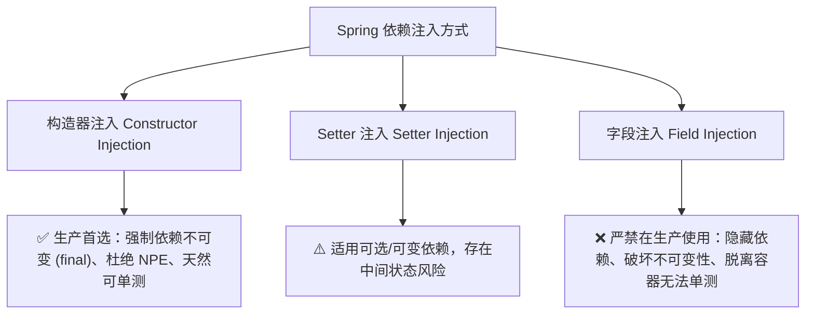

## 1. 架构选型与决策矩阵

### 1.1 依赖注入模式决策矩阵

| 注入模式 | 声明形式 | 不可变性保障 | 纯单元测试友好度 | 循环依赖风险 | 架构推荐级别 |
| :--- | :--- | :--- | :--- | :--- | :--- |
| **构造器注入 (Constructor)** | `private final Dep dep; public Service(Dep dep) {...}` | **完全不可变 (final)** | **极佳（直接 new 传入 Mock 对象）** | 启动期即刻显式暴露并失败 | **生产唯一推荐首选** |
| **Setter 注入** | `@Autowired public void setDep(Dep dep) {...}` | 允许运行时二次篡改 | 需调用 setter 手动设值 | 运行时可能掩盖架构设计异味 | 仅在极少数可选依赖使用 |
| **字段注入 (Field)** | `@Autowired private Dep dep;` | 破坏封装与不可变性 | 恶劣（强依赖反射或 Spring 容器） | 难以追踪与防御循环依赖 | **严禁在生产代码中使用** |

### 1.2 RESTful API 版本化策略决策矩阵

| 版本策略 | 实现范例 | URL 纯净度 | 网关与 CDN 缓存友好度 | 客户端调试成本 | 生产适用场景 |
| :--- | :--- | :--- | :--- | :--- | :--- |
| **URI 路径版本化** | `/api/v1/books` | 含有版本前缀 | **极高（天然作为缓存 Key）** | **极低（浏览器与 cURL 直接可测）** | **企业公网与前后端分离系统首选** |
| **Header 请求头版本化** | `X-API-VERSION: 2` | 保持纯净 | 中等（需配置 Vary 头协同缓存） | 较高（需构造自定义 Header） | 内部微服务调用或协议严格稳定的系统 |
| **MIME 内容协商版本化** | `Accept: application/vnd.bookstore.v2+json` | 保持纯净 | 较低（多维度 Vary 规则较重） | 高（需要精确请求 Accept 报文） | 成熟超媒体 RESTful 规范（HATEOAS） |

## 2. 生产级高内聚服务与 API 代码范式

### 2.1 不可变 Record DTO 与 Bean Validation 校验契约

```java
package com.packt.bookstore.inventory.dto;

import jakarta.validation.constraints.*;
import java.math.BigDecimal;
import java.time.LocalDate;

public record BookRequest(
        @NotBlank(message = "Title is required and cannot be blank")
        String title,

        @NotBlank(message = "ISBN is required")
        @Pattern(regexp = "^[0-9-]{10,17}$", message = "ISBN must be 10-17 digits and may include dashes")
        String isbn,

        @NotNull(message = "Author ID is required")
        Long authorId,

        @NotNull(message = "Price is required")
        @PositiveOrZero(message = "Price must be greater than or equal to 0")
        BigDecimal price,

        @PositiveOrZero(message = "Quantity must be >= 0")
        Integer quantity,

        String genre,
        LocalDate published,
        String description,
        Integer pageCount,
        String coverImageUrl
) {}
```

### 2.2 生产级业务服务层（`BookService` 核心逻辑与语义校验）

```java
package com.packt.bookstore.inventory.service.impl;

import com.packt.bookstore.inventory.dto.*;
import com.packt.bookstore.inventory.entity.*;
import com.packt.bookstore.inventory.exception.*;
import com.packt.bookstore.inventory.mapper.BookMapper;
import com.packt.bookstore.inventory.repository.*;
import com.packt.bookstore.inventory.service.IBookService;
import org.springframework.data.domain.*;
import org.springframework.stereotype.Service;
import org.springframework.transaction.annotation.Transactional;

import java.math.BigDecimal;
import java.util.List;

@Service
public class BookService implements IBookService {

    private final BookRepository bookRepository;
    private final AuthorRepository authorRepository;
    private final BookMapper bookMapper;

    public BookService(BookRepository bookRepository, 
                       AuthorRepository authorRepository, 
                       BookMapper bookMapper) {
        this.bookRepository = bookRepository;
        this.authorRepository = authorRepository;
        this.bookMapper = bookMapper;
    }

    @Override
    @Transactional(readOnly = true)
    public List<BookResponse> findAll(int page, int size, String sortSpec) {
        PageRequest pageRequest = PageRequest.of(page, size, Sort.by("title").ascending());
        return bookRepository.findAll(pageRequest).getContent().stream()
                .map(bookMapper::toResponse)
                .toList();
    }

    @Override
    @Transactional(readOnly = true)
    public BookResponse findOne(Long id) {
        Book book = bookRepository.findById(id)
                .orElseThrow(() -> new ResourceNotFoundException("Book with ID " + id + " not found"));
        return bookMapper.toResponse(book);
    }

    @Override
    @Transactional
    public BookResponse create(BookRequest req) {
        if (req.authorId() == null) {
            throw new DomainRuleViolationException("Author ID is required");
        }
        if (req.price() != null && req.price().compareTo(BigDecimal.ZERO) < 0) {
            throw new DomainRuleViolationException("Price cannot be negative");
        }
        if (req.isbn() != null && bookRepository.existsByIsbnIgnoreCase(req.isbn())) {
            throw new DomainRuleViolationException("ISBN must be unique within the catalog");
        }
        Author author = authorRepository.findById(req.authorId())
                .orElseThrow(() -> new ResourceNotFoundException("Author with ID " + req.authorId() + " not found"));
        Book saved = bookRepository.save(bookMapper.toEntity(req, author));
        return bookMapper.toResponse(saved);
    }

    @Override
    @Transactional
    public void delete(Long id) {
        if (!bookRepository.existsById(id)) {
            throw new ResourceNotFoundException("Book with ID " + id + " not found");
        }
        bookRepository.deleteById(id);
    }
}
```

### 2.3 RFC 9457 统一错误信封与全局异常切面

```java
package com.packt.bookstore.inventory.dto;

import java.time.Instant;

public record ApiError(
        String type,
        String title,
        int status,
        String detail,
        String instance,
        Instant timestamp
) {
    private static final String BASE_TYPE_URL = "https://api.bookstore.com/errors/";

    public static ApiError of(String errorKey, String title, int status, String detail, String instance) {
        return new ApiError(BASE_TYPE_URL + errorKey, title, status, detail, instance, Instant.now());
    }
}
```

```java
package com.packt.bookstore.inventory.exception;

import com.packt.bookstore.inventory.dto.ApiError;
import jakarta.servlet.http.HttpServletRequest;
import org.springframework.dao.DataIntegrityViolationException;
import org.springframework.http.HttpStatus;
import org.springframework.http.ResponseEntity;
import org.springframework.web.bind.MethodArgumentNotValidException;
import org.springframework.web.bind.annotation.ExceptionHandler;
import org.springframework.web.bind.annotation.RestControllerAdvice;

@RestControllerAdvice
public class GlobalExceptionHandler {

    @ExceptionHandler(ResourceNotFoundException.class)
    public ResponseEntity<ApiError> handleNotFound(ResourceNotFoundException ex, HttpServletRequest req) {
        return ResponseEntity.status(HttpStatus.NOT_FOUND)
                .body(ApiError.of("not-found", "Not Found", 404, ex.getMessage(), req.getRequestURI()));
    }

    @ExceptionHandler(MethodArgumentNotValidException.class)
    public ResponseEntity<ApiError> handleValidation(MethodArgumentNotValidException ex, HttpServletRequest req) {
        String detail = ex.getBindingResult().getFieldErrors().stream()
                .map(fe -> fe.getField() + ": " + fe.getDefaultMessage())
                .findFirst().orElse("Validation failed");
        return ResponseEntity.badRequest()
                .body(ApiError.of("bad-request", "Bad Request", 400, detail, req.getRequestURI()));
    }

    @ExceptionHandler(DomainRuleViolationException.class)
    public ResponseEntity<ApiError> handleDomainRule(DomainRuleViolationException ex, HttpServletRequest req) {
        return ResponseEntity.status(HttpStatus.UNPROCESSABLE_ENTITY)
                .body(ApiError.of("unprocessable-entity", "Domain Rule Violation", 422, ex.getMessage(), req.getRequestURI()));
    }

    @ExceptionHandler(DataIntegrityViolationException.class)
    public ResponseEntity<ApiError> handleConflict(DataIntegrityViolationException ex, HttpServletRequest req) {
        return ResponseEntity.status(HttpStatus.CONFLICT)
                .body(ApiError.of("conflict", "Data Conflict", 409, "A data conflict occurred in database", req.getRequestURI()));
    }
}
```

## 3. 全局参数校验与异常状态码映射拓扑流图

```text
[ 客户端 HTTP 请求 ]
       │
       ▼
[ Web 控制器层: @Valid 参数结构校验 ] ──(格式校验失败)──> [ 400 Bad Request ]
       │ (结构合法)
       ▼
[ 服务层: validateSemantics 业务语义校验 ] ──(语义冲突)──> [ 422 Unprocessable Entity ]
       │ (业务合法)
       ▼
[ 仓储与实体检索: findById ] ──────────(主键未命中)───> [ 404 Not Found ]
       │ (找到实体)
       ▼
[ 持久化写入: save ] ──────────────────(唯一索引冲突)─> [ 409 Conflict ]
       │ (持久化成功)
       ▼
[ 成功响应: 200 OK / 201 Created (Location Header) / 204 No Content ]
```

## 4. API 与服务层避坑清单 (Do's & Don'ts)

| 错误实践 (Don't) | 正确实践 (Do) |
| :--- | :--- |
| 在 Controller 中混杂业务规则计算、直接操作 Repository 或开启事务。 | 保持 Thin Controller 设计，所有业务与事务一律封装在 `IBookService` 服务契约中。 |
| 在生产代码中盲目依赖 `@Autowired` 字段注入。 | 强制采用构造器注入（Constructor Injection），声明 `private final` 字段。 |
| 直接把内部 `@Entity` 持久化对象序列化返回给外部客户端。 | 使用 Java `record` 作为不可变 DTO，通过独立 Mapper 隔绝持久化细节与外部契约。 |
| 全量 API 一律返回 `200 OK`，并在 JSON 内部自造 `{ code: 500, msg: "..." }`。 | 严格遵从 HTTP 动词与 RFC 9457 标准状态码（200/201/204/400/404/422/500）。 |
| 在每个 Controller 方法中层层包裹 `try/catch` 吞没异常。 | 使用 `@RestControllerAdvice` 集中捕获特定异常并统一映射为标准化错误信封。 |

<!-- split -->

# 原著完整参考：应用服务层与企业级 RESTful API 实战

在微服务分层体系中，数据持久化构成了系统的存储底座，而赋予微服务业务生命力的是**应用服务层（Service Layer）**——它承载了领域规则的编排、事务边界的管控、跨实体的协调，以及实体模型与外部传输契约之间的转换隔离。

在服务层之上，微服务对外暴露优雅、安全、高容错、自解释的 **RESTful API**。严谨的 API 设计通过精确的 HTTP 动词、标准的状态码、严格的入参校验与统一的错误信封，保障前后端与外部系统的高效对接。

本文以书店系统的**库存微服务（Inventory Service）**为核心，深入落地 Spring Boot 的服务分层架构与企业级 RESTful API 实战。

:::en
> **Original**: The application service layer orchestrates domain business rules and controls transaction boundaries, isolating internal persistent models from public REST contracts.

**📌 核心术语与语境解析**：
- **Service Layer** [ˈsɜːvɪs ˈleɪə]：*应用服务层*。组织领域逻辑、调度持久化仓储并定义事务边界的无状态核心分层。
- **Separation of Concerns** [ˌsepəˈreɪʃn əv kənˈsɜːnz]：*关注点分离*。将业务规则、HTTP 协议编解码与持久化操作分门别类的工程架构法则。
:::

---

## 1. Spring Boot 依赖注入与组件立体化模型

在构建业务逻辑之前，必须掌握 Spring IoC 容器与组件扫描（Component Scanning）的立体化设计。Spring 的组件注解定义了各层级的职责边界与基础设施编排：

### 1.1 组件模型分层图谱


1. **`@Component`（通用 Spring Bean）**：
   最基础的组件注解，适用于映射器（如 `BookMapper`）等通用工具类；
2. **`@Repository`（数据访问层）**：
   用于持久层组件，Spring 自动装配异常转换切面，将底层数据库特定异常封装为通用的 `DataAccessException`；
3. **`@Service`（业务逻辑层）**：
   用于封装领域用例、服务编排与事务管理，组件保持无状态（Stateless），不掺杂底层持久化细节或 HTTP 报文处理；
4. **`@RestController`（API 入口层）**：
   组合了 `@Controller` 与 `@ResponseBody`，指示当前类的方法返回值直接序列化为 HTTP 响应体（默认 JSON）；
5. **`@Configuration` 与 `@Bean`（显式基础设施配置）**：
   用于第三方库接入或全局基础组件的声明（如 `ObjectMapper`、时钟源与安全过滤链）。

---

### 1.2 依赖注入（DI）最佳实践：为什么必须坚持构造器注入？

依赖注入是实现松耦合、高内聚和可测试性的核心机制：



#### 1. 构造器注入（Constructor Injection）—— 生产推荐

```java
@Service
public class BookService implements IBookService {
    private final BookRepository bookRepository;
    private final AuthorRepository authorRepository;
    private final BookMapper bookMapper;

    public BookService(BookRepository bookRepository, 
                       AuthorRepository authorRepository, 
                       BookMapper bookMapper) {
        this.bookRepository = bookRepository;
        this.authorRepository = authorRepository;
        this.bookMapper = bookMapper;
    }
}
```

> [!TIP]
> 构造器注入将依赖显式声明为 `final`，在实例化时完成装配，确保对象在任何时刻都处于完整且合法的状态。在单元测试中，无需启动 Spring 容器或借助反射，直接 `new BookService(mockRepo, ...)` 即可完成测试。

#### 2. 字段注入（Field Injection）的隐患

```java
@Service
public class BookService {
    @Autowired // ❌ 生产环境反模式
    private BookRepository bookRepository;
}
```

字段注入存在明显弊端：
- 隐藏类依赖关系，破坏封装性；
- 脱离 Spring 容器无法直接实例化与单元测试；
- 容易掩盖循环依赖问题。

:::en
> **Original**: Constructor injection enforces immutability by requiring mandatory dependencies via `final` fields, enabling direct instantiation during unit tests without reflection overhead.

**📌 核心术语与语境解析**：
- **Constructor Injection** [kənˈstrʌktə ɪnˈdʒekʃn]：*构造器注入*。通过类的构造函数提供依赖项，强制依赖项不可变且不为 null 的注入方式。
- **Immutability** [ɪˌmjuːtəˈbɪləti]：*不可变性*。对象创建后内部状态无法被修改的特征，有效避免并发数据竞争。
:::

---

## 2. 业务服务层（Service Layer）设计与异常感知工作流

服务层设计采用**“契约-实现”**分离模式，并引入统一的 DTO 映射与异常感知边界。

### 2.1 服务契约接口：`IBookService`

Web 控制器层应当严格依赖服务契约，而非直接操作实体或持久层：

```java
package com.packt.bookstore.inventory.service;

import com.packt.bookstore.inventory.dto.BookRequest;
import com.packt.bookstore.inventory.dto.BookResponse;

import java.util.List;

public interface IBookService {
    List<BookResponse> findAll(int page, int size, String sort);
    BookResponse findOne(Long id);
    BookResponse create(BookRequest req);
    BookResponse replace(Long id, BookRequest req);
    BookResponse patch(Long id, BookRequest req);
    void delete(Long id);
}
```

---

### 2.2 实体与 DTO 映射器：`BookMapper`

领域实体（`Book`）包含了数据库结构、外键与 JPA 审计元数据，不应直接暴露给外界 API。通过独立的 `@Component` 映射器建立隔离屏障：

```java
package com.packt.bookstore.inventory.mapper;

import com.packt.bookstore.inventory.dto.AuthorResponse;
import com.packt.bookstore.inventory.dto.BookRequest;
import com.packt.bookstore.inventory.dto.BookResponse;
import com.packt.bookstore.inventory.entity.Author;
import com.packt.bookstore.inventory.entity.Book;
import org.springframework.stereotype.Component;

@Component
public class BookMapper {

    public Book toEntity(BookRequest req, Author author) {
        return Book.builder()
                .title(req.title())
                .isbn(req.isbn())
                .author(author)
                .price(req.price())
                .quantity(req.quantity() != null ? req.quantity() : 0)
                .genre(req.genre())
                .published(req.published())
                .description(req.description())
                .pageCount(req.pageCount())
                .coverImageUrl(req.coverImageUrl())
                .build();
    }

    public BookResponse toResponse(Book book) {
        AuthorResponse authorResp = null;
        if (book.getAuthor() != null) {
            authorResp = new AuthorResponse(
                    book.getAuthor().getId(),
                    book.getAuthor().getName(),
                    book.getAuthor().getNationality(),
                    null
            );
        }
        return new BookResponse(
                book.getId(),
                book.getTitle(),
                book.getIsbn(),
                authorResp,
                book.getPrice(),
                book.getQuantity(),
                book.getGenre(),
                book.getPublished(),
                book.getDescription(),
                book.getPageCount(),
                book.getCoverImageUrl()
        );
    }

    public void overwrite(Book target, BookRequest req, Author author) {
        target.setTitle(req.title());
        target.setIsbn(req.isbn());
        target.setAuthor(author);
        target.setPrice(req.price());
        target.setQuantity(req.quantity() != null ? req.quantity() : target.getQuantity());
        target.setGenre(req.genre());
        target.setPublished(req.published());
        target.setDescription(req.description());
        target.setPageCount(req.pageCount());
        target.setCoverImageUrl(req.coverImageUrl());
    }

    public void patch(Book target, BookRequest req, Author author) {
        if (req.title() != null) target.setTitle(req.title());
        if (req.isbn() != null) target.setIsbn(req.isbn());
        if (author != null) target.setAuthor(author);
        if (req.price() != null) target.setPrice(req.price());
        if (req.quantity() != null) target.setQuantity(req.quantity());
        if (req.genre() != null) target.setGenre(req.genre());
        if (req.published() != null) target.setPublished(req.published());
        if (req.description() != null) target.setDescription(req.description());
        if (req.pageCount() != null) target.setPageCount(req.pageCount());
        if (req.coverImageUrl() != null) target.setCoverImageUrl(req.coverImageUrl());
    }
}
```

---

### 2.3 业务服务层完整实现与用例解析

`BookService` 实现涵盖分页排序、幂等读取、创建、全量更新、部分增量更新、幂等删除以及业务语义校验：

```java
package com.packt.bookstore.inventory.service.impl;

import com.packt.bookstore.inventory.dto.BookRequest;
import com.packt.bookstore.inventory.dto.BookResponse;
import com.packt.bookstore.inventory.entity.Author;
import com.packt.bookstore.inventory.entity.Book;
import com.packt.bookstore.inventory.exception.DomainRuleViolationException;
import com.packt.bookstore.inventory.exception.ResourceNotFoundException;
import com.packt.bookstore.inventory.mapper.BookMapper;
import com.packt.bookstore.inventory.repository.AuthorRepository;
import com.packt.bookstore.inventory.repository.BookRepository;
import com.packt.bookstore.inventory.service.IBookService;
import org.springframework.dao.DataIntegrityViolationException;
import org.springframework.data.domain.Page;
import org.springframework.data.domain.PageRequest;
import org.springframework.data.domain.Sort;
import org.springframework.stereotype.Service;
import org.springframework.transaction.annotation.Transactional;

import java.math.BigDecimal;
import java.util.List;

@Service
public class BookService implements IBookService {

    private final BookRepository bookRepository;
    private final AuthorRepository authorRepository;
    private final BookMapper bookMapper;

    public BookService(BookRepository bookRepository, 
                       AuthorRepository authorRepository, 
                       BookMapper bookMapper) {
        this.bookRepository = bookRepository;
        this.authorRepository = authorRepository;
        this.bookMapper = bookMapper;
    }

    // 1. 只读用例：分页与动态排序
    @Override
    @Transactional(readOnly = true)
    public List<BookResponse> findAll(int page, int size, String sortSpec) {
        Sort sortBy = parseSort(sortSpec);
        PageRequest pageRequest = PageRequest.of(page, size, sortBy);
        Page<Book> books = bookRepository.findAll(pageRequest);
        return books.getContent().stream()
                .map(bookMapper::toResponse)
                .toList();
    }

    // 2. 只读用例：根据 ID 查询单一实体（404 防御）
    @Override
    @Transactional(readOnly = true)
    public BookResponse findOne(Long id) {
        Book book = bookRepository.findById(id)
                .orElseThrow(() -> new ResourceNotFoundException("Book with ID " + id + " not found"));
        return bookMapper.toResponse(book);
    }

    // 3. 写入用例：创建图书（前置语义检查与事务控制）
    @Override
    @Transactional
    public BookResponse create(BookRequest req) {
        validateSemanticsForCreate(req);
        Author author = resolveAuthorById(req.authorId());
        Book toSave = bookMapper.toEntity(req, author);
        Book saved = trySave(toSave);
        return bookMapper.toResponse(saved);
    }

    // 4. 写入用例：全量覆盖更新（PUT 语义）
    @Override
    @Transactional
    public BookResponse replace(Long id, BookRequest req) {
        validateSemanticsForReplace(req);
        Book existing = bookRepository.findById(id)
                .orElseThrow(() -> new ResourceNotFoundException("Book with ID " + id + " not found"));
        Author author = resolveAuthorById(req.authorId());
        bookMapper.overwrite(existing, req, author);
        Book saved = trySave(existing);
        return bookMapper.toResponse(saved);
    }

    // 5. 写入用例：部分增量更新（PATCH 语义）
    @Override
    @Transactional
    public BookResponse patch(Long id, BookRequest req) {
        Book existing = bookRepository.findById(id)
                .orElseThrow(() -> new ResourceNotFoundException("Book with ID " + id + " not found"));
        validateSemanticsForPatch(req, existing);
        Author author = null;
        if (req.authorId() != null) {
            author = resolveAuthorById(req.authorId());
        }
        bookMapper.patch(existing, req, author);
        Book saved = trySave(existing);
        return bookMapper.toResponse(saved);
    }

    // 6. 删除用例：幂等移除
    @Override
    @Transactional
    public void delete(Long id) {
        if (!bookRepository.existsById(id)) {
            throw new ResourceNotFoundException("Book with ID " + id + " not found");
        }
        bookRepository.deleteById(id);
    }

    // --- 内部横切辅助与语义校验私有方法 ---

    private Sort parseSort(String sortSpec) {
        if (sortSpec == null || sortSpec.isBlank()) {
            return Sort.by("title").ascending();
        }
        String[] parts = sortSpec.split(",", 2);
        String field = parts[0].trim();
        String dir = parts.length > 1 ? parts[1].trim().toLowerCase() : "asc";
        return "desc".equals(dir) ? Sort.by(field).descending() : Sort.by(field).ascending();
    }

    private Author resolveAuthorById(Long authorId) {
        if (authorId == null) {
            throw new DomainRuleViolationException("Author ID is required");
        }
        return authorRepository.findById(authorId)
                .orElseThrow(() -> new ResourceNotFoundException("Author with ID " + authorId + " not found"));
    }

    private Book trySave(Book entity) {
        try {
            return bookRepository.save(entity);
        } catch (DataIntegrityViolationException e) {
            throw e;
        }
    }

    private void validateSemanticsForCreate(BookRequest req) {
        if (req.authorId() == null) {
            throw new DomainRuleViolationException("Author ID is required");
        }
        if (req.price() != null && req.price().compareTo(BigDecimal.ZERO) < 0) {
            throw new DomainRuleViolationException("Price cannot be negative");
        }
        if (req.isbn() != null && bookRepository.existsByIsbnIgnoreCase(req.isbn())) {
            throw new DomainRuleViolationException("ISBN must be unique within the catalog");
        }
    }

    private void validateSemanticsForReplace(BookRequest req) {
        if (req.authorId() == null) {
            throw new DomainRuleViolationException("Author ID is required");
        }
        if (req.price() != null && req.price().compareTo(BigDecimal.ZERO) < 0) {
            throw new DomainRuleViolationException("Price cannot be negative");
        }
    }

    private void validateSemanticsForPatch(BookRequest req, Book existing) {
        if (req.price() != null && req.price().compareTo(BigDecimal.ZERO) < 0) {
            throw new DomainRuleViolationException("Price cannot be negative");
        }
        if (req.isbn() != null && !req.isbn().equalsIgnoreCase(existing.getIsbn())) {
            if (bookRepository.existsByIsbnIgnoreCase(req.isbn())) {
                throw new DomainRuleViolationException("ISBN must be unique within the catalog");
            }
        }
    }
}
```

:::en
> **Original**: DTOs separate input validation from core domain logic: Bean Validation annotations enforce syntactic invariants, while service methods validate semantic rules against repository states.

**📌 核心术语与语境解析**：
- **Syntactic vs Semantic Validation** [sɪnˈtæktɪk / sɪˈmæntɪk ˌvælɪˈdeɪʃn]：*语法结构校验与业务语义校验*。前者校验字段非空或格式，后者结合数据库上下文检验业务约束合规性。
- **Domain Rule Violation** [dəʊˈmeɪn ruːl ˌvaɪəˈleɪʃn]：*领域规则冲突*。当请求合法但违反特定业务契约时触发的异常，标准映射为 HTTP 422 状态码。
:::

---

## 3. 服务层自动化单元测试实战（Mockito + JUnit 5）

服务层的业务逻辑能够在脱离真实数据库与 Web 容器的环境下，在毫秒级内完成单元测试：

```java
package com.packt.bookstore.inventory.service;

import com.packt.bookstore.inventory.dto.AuthorResponse;
import com.packt.bookstore.inventory.dto.BookRequest;
import com.packt.bookstore.inventory.dto.BookResponse;
import com.packt.bookstore.inventory.entity.Author;
import com.packt.bookstore.inventory.entity.Book;
import com.packt.bookstore.inventory.exception.DomainRuleViolationException;
import com.packt.bookstore.inventory.exception.ResourceNotFoundException;
import com.packt.bookstore.inventory.mapper.BookMapper;
import com.packt.bookstore.inventory.repository.AuthorRepository;
import com.packt.bookstore.inventory.repository.BookRepository;
import com.packt.bookstore.inventory.service.impl.BookService;
import org.junit.jupiter.api.BeforeEach;
import org.junit.jupiter.api.DisplayName;
import org.junit.jupiter.api.Test;
import org.junit.jupiter.api.extension.ExtendWith;
import org.mockito.InjectMocks;
import org.mockito.Mock;
import org.mockito.junit.jupiter.MockitoExtension;
import org.springframework.data.domain.PageImpl;
import org.springframework.data.domain.PageRequest;

import java.math.BigDecimal;
import java.util.List;
import java.util.Optional;

import static org.junit.jupiter.api.Assertions.*;
import static org.mockito.ArgumentMatchers.any;
import static org.mockito.Mockito.*;

@ExtendWith(MockitoExtension.class)
class BookServiceTest {

    @Mock
    private BookRepository bookRepository;

    @Mock
    private AuthorRepository authorRepository;

    @Mock
    private BookMapper bookMapper;

    @InjectMocks
    private BookService bookService;

    private Author author;
    private Book book;
    private BookRequest bookRequest;
    private BookResponse bookResponse;

    @BeforeEach
    void setUp() {
        author = Author.builder().id(1L).name("Ahmad Gohar").build();
        AuthorResponse authorResp = new AuthorResponse(1L, "Ahmad Gohar", "Egyptian", null);

        book = Book.builder()
                .id(1L)
                .title("Spring Boot and Angular 2E")
                .isbn("978-1805123456")
                .author(author)
                .price(BigDecimal.valueOf(49.99))
                .quantity(50)
                .build();

        bookRequest = new BookRequest(
                "Spring Boot and Angular 2E",
                "978-1805123456",
                1L,
                BigDecimal.valueOf(49.99),
                50,
                "Tech",
                null,
                "Description",
                450,
                "cover.png"
        );

        bookResponse = new BookResponse(
                1L,
                "Spring Boot and Angular 2E",
                "978-1805123456",
                authorResp,
                BigDecimal.valueOf(49.99),
                50,
                "Tech",
                null,
                "Description",
                450,
                "cover.png"
        );
    }

    @Test
    @DisplayName("分页查询正常流：返回格式化 DTO 列表")
    void findAll_shouldReturnBookResponses() {
        when(bookRepository.findAll(any(PageRequest.class))).thenReturn(new PageImpl<>(List.of(book)));
        when(bookMapper.toResponse(book)).thenReturn(bookResponse);

        List<BookResponse> result = bookService.findAll(0, 10, "title,asc");

        assertEquals(1, result.size());
        assertEquals("Spring Boot and Angular 2E", result.get(0).title());
        verify(bookRepository).findAll(any(PageRequest.class));
    }

    @Test
    @DisplayName("根据 ID 查询未找到实体：断言 ResourceNotFoundException 404")
    void findOne_shouldThrowResourceNotFoundException() {
        when(bookRepository.findById(99L)).thenReturn(Optional.empty());

        assertThrows(ResourceNotFoundException.class, () -> bookService.findOne(99L));
    }

    @Test
    @DisplayName("创建图书前置校验：价格为负数时抛出 DomainRuleViolationException 422")
    void create_shouldThrowForNegativePrice() {
        BookRequest invalidReq = new BookRequest(
                "Invalid Book",
                "978-1805123456",
                1L,
                BigDecimal.valueOf(-10.0),
                10,
                null, null, null, null, null
        );

        assertThrows(DomainRuleViolationException.class, () -> bookService.create(invalidReq));
        verify(bookRepository, never()).save(any());
    }

    @Test
    @DisplayName("幂等删除：实体不存在时抛出 404 异常")
    void delete_shouldThrowWhenNotFound() {
        when(bookRepository.existsById(99L)).thenReturn(false);

        assertThrows(ResourceNotFoundException.class, () -> bookService.delete(99L));
        verify(bookRepository, never()).deleteById(anyLong());
    }
}
```

:::en
> **Original**: Mockito extensions allow fast and isolated unit tests on service implementations without initiating database drivers or Spring application contexts.

**📌 核心术语与语境解析**：
- **Unit Testing** [ˈjuːnɪt ˈtestɪŋ]：*单元测试*。对代码最小可测试单元（如业务方法）在隔离外部依赖状态下进行的验证。
- **Mocking** [ˈmɒkɪŋ]：*模拟打桩*。在测试中构造可编程假对象以模拟真实协作者行为的测试技巧。
:::

---

## 4. 企业级 RESTful API 设计实战

### 4.1 HTTP 语义契约矩阵

遵循严谨的 REST 语义能够降低客户端集成成本：

| HTTP 方法 | 资源 URI 示例 | 幂等性 | 安全性 | 预期成功状态码 | 典型业务场景 |
| :--- | :--- | :--- | :--- | :--- | :--- |
| **GET** | `/api/v1/books` | 是 | 是 | `200 OK` | 获取图书分页列表或检索结果 |
| **GET** | `/api/v1/books/{id}` | 是 | 是 | `200 OK` | 根据主键获取图书详情（不存在返回 `404`） |
| **POST** | `/api/v1/books` | 否 | 否 | `201 Created` | 创建新图书，响应 Header 带上 `Location` |
| **PUT** | `/api/v1/books/{id}` | 是 | 否 | `200 OK` | 全量替换图书所有字段（全量更新） |
| **PATCH** | `/api/v1/books/{id}` | 视设计而定 | 否 | `200 OK` | 局部微调（如修改价格或库存） |
| **DELETE** | `/api/v1/books/{id}` | 是 | 否 | `204 No Content` | 幂等删除资源，响应体为空 |

---

### 4.2 基于 Java Record 与 Bean Validation 的 DTO 建模

Java `record` 是构建不可变 DTO 的理想载体。搭配 `jakarta.validation.constraints` 注解，可在 HTTP 入口处完成格式防护：

```java
package com.packt.bookstore.inventory.dto;

import jakarta.validation.constraints.NotBlank;
import jakarta.validation.constraints.NotNull;
import jakarta.validation.constraints.Pattern;
import jakarta.validation.constraints.PositiveOrZero;

import java.math.BigDecimal;
import java.time.LocalDate;

public record BookRequest(
        @NotBlank(message = "Title is required and cannot be blank")
        String title,

        @NotBlank(message = "ISBN is required")
        @Pattern(regexp = "^[0-9-]{10,17}$", message = "ISBN must be 10-17 digits and may include dashes")
        String isbn,

        @NotNull(message = "Author ID is required")
        Long authorId,

        @NotNull(message = "Price is required")
        @PositiveOrZero(message = "Price must be greater than or equal to 0")
        BigDecimal price,

        @PositiveOrZero(message = "Quantity must be >= 0")
        Integer quantity,

        String genre,
        LocalDate published,
        String description,
        Integer pageCount,
        String coverImageUrl
) {}
```

出参 DTO `BookResponse` 保持纯粹的数据载体角色：

```java
package com.packt.bookstore.inventory.dto;

import java.math.BigDecimal;
import java.time.LocalDate;

public record BookResponse(
        Long id,
        String title,
        String isbn,
        AuthorResponse author,
        BigDecimal price,
        Integer quantity,
        String genre,
        LocalDate published,
        String description,
        Integer pageCount,
        String coverImageUrl
) {}
```

---

### 4.3 `BookController` 完整实现

在 `application.yml` 中配置统一端口与上下文根路径：

```yaml
spring:
  application:
    name: inventory-service
server:
  port: 8081
  servlet:
    context-path: /inventory
```

保持控制器轻量（Thin Controller），所有实际计算委托给 `BookService`：

```java
package com.packt.bookstore.inventory.controller;

import com.packt.bookstore.inventory.dto.BookRequest;
import com.packt.bookstore.inventory.dto.BookResponse;
import com.packt.bookstore.inventory.service.IBookService;
import jakarta.validation.Valid;
import org.springframework.http.ResponseEntity;
import org.springframework.web.bind.annotation.*;
import org.springframework.web.servlet.support.ServletUriComponentsBuilder;

import java.net.URI;
import java.util.List;

@RestController
@RequestMapping("/api/v1/books")
public class BookController {

    private final IBookService bookService;

    public BookController(IBookService bookService) {
        this.bookService = bookService;
    }

    // 1. 分页与动态排序查询
    @GetMapping
    public ResponseEntity<List<BookResponse>> getAllBooks(
            @RequestParam(defaultValue = "0") int page,
            @RequestParam(defaultValue = "10") int size,
            @RequestParam(required = false) String sort
    ) {
        List<BookResponse> books = bookService.findAll(page, size, sort);
        return ResponseEntity.ok(books);
    }

    // 2. 根据主键获取图书详情
    @GetMapping("/{id}")
    public ResponseEntity<BookResponse> getBookById(@PathVariable Long id) {
        BookResponse book = bookService.findOne(id);
        return ResponseEntity.ok(book);
    }

    // 3. 创建图书（返回 201 Created 与标准 Location Header）
    @PostMapping
    public ResponseEntity<BookResponse> createBook(@Valid @RequestBody BookRequest request) {
        BookResponse created = bookService.create(request);
        URI location = ServletUriComponentsBuilder.fromCurrentRequest()
                .path("/{id}")
                .buildAndExpand(created.id())
                .toUri();
        return ResponseEntity.created(location).body(created);
    }

    // 4. 全量覆盖更新（PUT 语义）
    @PutMapping("/{id}")
    public ResponseEntity<BookResponse> replaceBook(
            @PathVariable Long id,
            @Valid @RequestBody BookRequest request
    ) {
        BookResponse updated = bookService.replace(id, request);
        return ResponseEntity.ok(updated);
    }

    // 5. 局部修补更新（PATCH 语义）
    @PatchMapping("/{id}")
    public ResponseEntity<BookResponse> updateBook(
            @PathVariable Long id,
            @RequestBody BookRequest request
    ) {
        BookResponse patched = bookService.patch(id, request);
        return ResponseEntity.ok(patched);
    }

    // 6. 幂等删除（返回 204 No Content）
    @DeleteMapping("/{id}")
    public ResponseEntity<Void> deleteBook(@PathVariable Long id) {
        bookService.delete(id);
        return ResponseEntity.noContent().build();
    }
}
```

:::en
> **Original**: Restful API design maps standardized HTTP semantics (GET, POST, PUT, PATCH, DELETE) to idempotent CRUD workflows while returning appropriate HTTP status codes.

**📌 核心术语与语境解析**：
- **RESTful Architecture** [ˈrestfl ˈɑːkɪtektʃə]：*RESTful 架构风格*。基于 HTTP 协议原语，以无状态、统一接口和资源标识符为核心的 Web 服务设计理念。
- **Idempotence** [ˌaɪdɪmˈpəʊtəns]：*幂等性*。多次执行相同请求所产生的系统副作用与单次执行完全一致的数学与网络特征（如 GET、PUT、DELETE）。
:::

---

## 5. API 版本治理策略与权衡

API 演进过程不可随意破坏向后兼容性（Breaking Changes）。Spring Boot 支持三种主流版本化策略：

### 5.1 URI 路径版本化（业界推荐）

将版本号置于 URL 路径中（如 `/api/v1/books`）：


```java
@RestController
@RequestMapping("/api/v1/books")
public class BookControllerV1 { /* ... */ }

@RestController
@RequestMapping("/api/v2/books")
public class BookControllerV2 { /* ... */ }
```

- **优点**：肉眼可见、便于调试、CDN/网关缓存友好；
- **缺点**：大版本繁多时可能带来 URL 碎片化。

### 5.2 自定义请求头版本化（Header Versioning）

保持 URL 不变，通过专属 Header（如 `X-API-VERSION: 2`）路由请求：


```java
@RestController
@RequestMapping("/api/books")
public class BookControllerHeader {

    @GetMapping(value = "/{id}", headers = "X-API-VERSION=2")
    public ResponseEntity<String> getBookV2(@PathVariable Long id) {
        return ResponseEntity.ok("Book V2 payload for ID: " + id);
    }
}
```

### 5.3 MIME 内容协商版本化（Content Negotiation）

利用 HTTP 标准的 `Accept` 请求头传递特定媒体类型：


```java
@RestController
@RequestMapping("/api/books")
public class BookControllerContentNegotiation {

    @GetMapping(value = "/{id}", produces = "application/vnd.bookstore.v3+json")
    public ResponseEntity<String> getBookV3(@PathVariable Long id) {
        return ResponseEntity.ok("Book V3 payload for ID: " + id);
    }
}
```

对于面向前后端分离的全栈系统，**URI 路径版本化**具有极高的透明度与最低的认知成本，是首选策略。

:::en
> **Original**: URI path versioning offers clear traceability and straightforward routing for gateways and caches, striking an optimal balance for decoupled full-stack ecosystems.

**📌 核心术语与语境解析**：
- **API Versioning** [ˌeɪ piː ˈaɪ ˈvɜːʃnɪŋ]：*API 版本化*。在系统持续迭代中隔离破坏性变更并维护旧客户端契约兼容性的工程机制。
- **Content Negotiation** [ˈkɒntent nɪˌɡəʊʃiˈeɪʃn]：*内容协商*。客户端与服务端通过 HTTP Header（如 Accept）协商确定数据表示格式的过程。
:::

---

## 6. 全局异常治理与 RFC 9457 统一错误信封

在生产系统中，避免将原始 Java 堆栈或底层 SQL 错误直接抛出给客户端。构建符合 **RFC 9457（Problem Details for HTTP APIs）** 标准的统一错误治理切面：

### 6.1 异常到 HTTP 响应映射流


请求异常在各层之间的拦截与转化流：
1. **Web 入口层校验失败**（如标题为空、ISBN 格式错误）$\rightarrow$ 触发 `MethodArgumentNotValidException` $\rightarrow$ 映射为 `400 Bad Request`；
2. **领域业务规则受损**（如价格为负、ISBN 冲突）$\rightarrow$ 抛出 `DomainRuleViolationException` $\rightarrow$ 映射为 `422 Unprocessable Entity`；
3. **主键检索落空** $\rightarrow$ 抛出 `ResourceNotFoundException` $\rightarrow$ 映射为 `404 Not Found`；
4. **数据库底层索引冲突** $\rightarrow$ 抛出 `DataIntegrityViolationException` $\rightarrow$ 映射为 `409 Conflict`；
5. **未知系统崩溃** $\rightarrow$ 兜底捕获 `Exception` $\rightarrow$ 映射为 `500 Internal Server Error` 并记录日志。

### 6.2 领域特定异常定义

```java
package com.packt.bookstore.inventory.exception;

public class ResourceNotFoundException extends RuntimeException {
    public ResourceNotFoundException(String message) {
        super(message);
    }
}

public class DomainRuleViolationException extends RuntimeException {
    public DomainRuleViolationException(String message) {
        super(message);
    }
}
```

### 6.3 RFC 9457 标准错误载荷：`ApiError`

```java
package com.packt.bookstore.inventory.dto;

import java.time.Instant;

public record ApiError(
        String type,
        String title,
        int status,
        String detail,
        String instance,
        Instant timestamp
) {
    private static final String BASE_TYPE_URL = "https://api.bookstore.com/errors/";

    public static ApiError of(String errorKey, String title, int status, String detail, String instance) {
        return new ApiError(BASE_TYPE_URL + errorKey, title, status, detail, instance, Instant.now());
    }
}
```

### 6.4 全局异常拦截切面：`GlobalExceptionHandler`

借助 `@RestControllerAdvice` 实现全局异常拦截：

```java
package com.packt.bookstore.inventory.exception;

import com.packt.bookstore.inventory.dto.ApiError;
import jakarta.servlet.http.HttpServletRequest;
import org.slf4j.Logger;
import org.slf4j.LoggerFactory;
import org.springframework.dao.DataIntegrityViolationException;
import org.springframework.http.HttpStatus;
import org.springframework.http.ResponseEntity;
import org.springframework.web.bind.MethodArgumentNotValidException;
import org.springframework.web.bind.annotation.ExceptionHandler;
import org.springframework.web.bind.annotation.RestControllerAdvice;

@RestControllerAdvice
public class GlobalExceptionHandler {

    private static final Logger log = LoggerFactory.getLogger(GlobalExceptionHandler.class);

    // 1. 资源未找到：404
    @ExceptionHandler(ResourceNotFoundException.class)
    public ResponseEntity<ApiError> handleNotFound(ResourceNotFoundException ex, HttpServletRequest req) {
        ApiError error = ApiError.of("not-found", "Not Found", 404, ex.getMessage(), req.getRequestURI());
        return ResponseEntity.status(HttpStatus.NOT_FOUND).body(error);
    }

    // 2. DTO 参数格式校验失败：400
    @ExceptionHandler(MethodArgumentNotValidException.class)
    public ResponseEntity<ApiError> handleValidation(MethodArgumentNotValidException ex, HttpServletRequest req) {
        String detail = ex.getBindingResult().getFieldErrors().stream()
                .map(fe -> fe.getField() + ": " + fe.getDefaultMessage())
                .findFirst()
                .orElse("Validation failed");

        ApiError error = ApiError.of("bad-request", "Bad Request", 400, detail, req.getRequestURI());
        return ResponseEntity.badRequest().body(error);
    }

    // 3. 业务规则冲突（语义校验失败）：422
    @ExceptionHandler(DomainRuleViolationException.class)
    public ResponseEntity<ApiError> handleDomainRule(DomainRuleViolationException ex, HttpServletRequest req) {
        ApiError error = ApiError.of("unprocessable-entity", "Domain Rule Violation", 422, ex.getMessage(), req.getRequestURI());
        return ResponseEntity.status(HttpStatus.UNPROCESSABLE_ENTITY).body(error);
    }

    // 4. 数据完整性违反（如唯一约束）：409
    @ExceptionHandler(DataIntegrityViolationException.class)
    public ResponseEntity<ApiError> handleConflict(DataIntegrityViolationException ex, HttpServletRequest req) {
        ApiError error = ApiError.of("conflict", "Data Conflict", 409, "A data conflict occurred in database", req.getRequestURI());
        return ResponseEntity.status(HttpStatus.CONFLICT).body(error);
    }

    // 5. 兜底未知异常：500
    @ExceptionHandler(Exception.class)
    public ResponseEntity<ApiError> handleGeneric(Exception ex, HttpServletRequest req) {
        log.error("Unhandled system error at [{}]: ", req.getRequestURI(), ex);
        ApiError error = ApiError.of("internal-error", "Internal Server Error", 500, "An unexpected server error occurred", req.getRequestURI());
        return ResponseEntity.status(HttpStatus.INTERNAL_SERVER_ERROR).body(error);
    }
}
```

:::en
> **Original**: Adopting RFC 9457 Problem Details standardizes HTTP error payloads, presenting clients with uniform error keys, HTTP status codes, and localized request URIs.

**📌 核心术语与语境解析**：
- **Problem Details (RFC 9457)** [ˈprɒbləm dɪˈteɪlz]：*HTTP API 问题详情规范*。IETF 颁布的标准化错误响应结构定义，包含 type、title、status、detail 等字段。
- **Cross-Cutting Concern** [krɒs ˈkʌtɪŋ kənˈsɜːn]：*横切关注点*。跨越多个业务模块的通用支撑能力（如日志、安全、全局异常处理）。
:::

---

## 7. Web 层切片测试实战（`@WebMvcTest` + `MockMvc`）

Web 层测试重点验证：**路由映射、URL 参数提取、JSON 序列化/反序列化、Bean Validation 与全局异常捕获**。

```java
package com.packt.bookstore.inventory.controller;

import com.fasterxml.jackson.databind.ObjectMapper;
import com.packt.bookstore.inventory.dto.AuthorResponse;
import com.packt.bookstore.inventory.dto.BookRequest;
import com.packt.bookstore.inventory.dto.BookResponse;
import com.packt.bookstore.inventory.exception.GlobalExceptionHandler;
import com.packt.bookstore.inventory.service.IBookService;
import org.junit.jupiter.api.BeforeEach;
import org.junit.jupiter.api.DisplayName;
import org.junit.jupiter.api.Test;
import org.springframework.beans.factory.annotation.Autowired;
import org.springframework.boot.test.autoconfigure.web.servlet.WebMvcTest;
import org.springframework.boot.test.mock.mockito.MockBean;
import org.springframework.context.annotation.Import;
import org.springframework.http.MediaType;
import org.springframework.test.web.servlet.MockMvc;

import java.math.BigDecimal;
import java.util.List;

import static org.mockito.ArgumentMatchers.*;
import static org.mockito.Mockito.when;
import static org.springframework.test.web.servlet.request.MockMvcRequestBuilders.*;
import static org.springframework.test.web.servlet.result.MockMvcResultMatchers.*;

@WebMvcTest(controllers = BookController.class)
@Import(GlobalExceptionHandler.class)
class BookControllerTest {

    @Autowired
    private MockMvc mockMvc;

    @Autowired
    private ObjectMapper objectMapper;

    @MockBean
    private IBookService bookService;

    private BookRequest validRequest;
    private BookResponse bookResponse;

    @BeforeEach
    void setUp() {
        validRequest = new BookRequest(
                "Spring Boot and Angular 2E",
                "978-1805123456",
                1L,
                BigDecimal.valueOf(49.99),
                100,
                "Technology",
                null,
                "Fullstack guide",
                500,
                "https://example.com/cover.png"
        );

        bookResponse = new BookResponse(
                1L,
                "Spring Boot and Angular 2E",
                "978-1805123456",
                new AuthorResponse(1L, "Ahmad Gohar", "Egyptian", null),
                BigDecimal.valueOf(49.99),
                100,
                "Technology",
                null,
                "Fullstack guide",
                500,
                "https://example.com/cover.png"
        );
    }

    @Test
    @DisplayName("GET /api/v1/books 成功流：验证分页参数与 JSON 数组结构")
    void getAllBooks_shouldReturnList() throws Exception {
        when(bookService.findAll(anyInt(), anyInt(), any())).thenReturn(List.of(bookResponse));

        mockMvc.perform(get("/api/v1/books")
                        .param("page", "0")
                        .param("size", "10")
                        .param("sort", "title,asc")
                        .accept(MediaType.APPLICATION_JSON))
                .andExpect(status().isOk())
                .andExpect(jsonPath("$").isArray())
                .andExpect(jsonPath("$[0].id").value(1L))
                .andExpect(jsonPath("$[0].title").value("Spring Boot and Angular 2E"))
                .andExpect(jsonPath("$[0].price").value(49.99));
    }

    @Test
    @DisplayName("POST /api/v1/books 成功流：返回 201 Created 与 Location 头")
    void createBook_shouldReturn201() throws Exception {
        when(bookService.create(any(BookRequest.class))).thenReturn(bookResponse);

        mockMvc.perform(post("/api/v1/books")
                        .contentType(MediaType.APPLICATION_JSON)
                        .content(objectMapper.writeValueAsString(validRequest)))
                .andExpect(status().isCreated())
                .andExpect(header().exists("Location"))
                .andExpect(jsonPath("$.id").value(1L))
                .andExpect(jsonPath("$.isbn").value("978-1805123456"));
    }

    @Test
    @DisplayName("POST /api/v1/books 结构校验失败：空标题触发 400 Bad Request")
    void createBook_invalidTitle_shouldReturn400() throws Exception {
        BookRequest badRequest = new BookRequest(
                "", // 空标题，违反 @NotBlank
                "978-1805123456",
                1L,
                BigDecimal.valueOf(49.99),
                10,
                null, null, null, null, null
        );

        mockMvc.perform(post("/api/v1/books")
                        .contentType(MediaType.APPLICATION_JSON)
                        .content(objectMapper.writeValueAsString(badRequest)))
                .andExpect(status().isBadRequest())
                .andExpect(jsonPath("$.status").value(400))
                .andExpect(jsonPath("$.title").value("Bad Request"))
                .andExpect(jsonPath("$.detail").isNotEmpty());
    }

    @Test
    @DisplayName("DELETE /api/v1/books/{id} 成功流：返回 204 No Content")
    void deleteBook_shouldReturn204() throws Exception {
        mockMvc.perform(delete("/api/v1/books/1"))
                .andExpect(status().isNoContent());
    }
}
```

:::en
> **Original**: Web slice tests (`@WebMvcTest`) bypass server startup while validating HTTP verb bindings, JSON serialization, and `@RestControllerAdvice` error mappers.

**📌 核心术语与语境解析**：
- **Web Slice Testing** [web slaɪs ˈtestɪŋ]：*Web 层切片测试*。Spring Boot 仅引导 MVC 核心控制器与校验器，不加载完整数据库或服务 Bean 的轻量化测试技术。
- **MockMvc** [mɒk em viː siː]：*MockMvc 测试工具*。在无须启动真实 HTTP Servlet 容器的前提下，向 Controller 发起完整 HTTP 请求并断言响应的测试类。
:::
