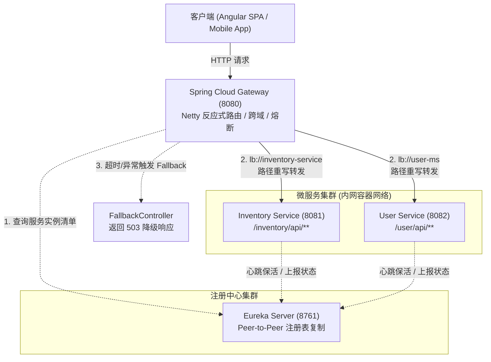

## 1. 服务寻址与 API 网关技术决策矩阵

### 1.1 服务发现与寻址方案对比

| 方案维度 | 静态配置 (Static IP/DNS) | 平台级 DNS (K8s Service) | 应用级注册中心 (Eureka / Consul) |
| :--- | :--- | :--- | :--- |
| **实例感知时效** | 需手动修改配置或滚动重启 | 依赖 DNS TTL 刷新，故障剔除存在秒级延迟 | 毫秒/秒级心跳感知，实时剔除失效节点 |
| **元数据支撑** | 无元数据支持 | 仅限 IP 与端口映射 | 支持自定义版本号、灰度权重与健康探针详情 |
| **客户端负载均衡** | 依赖外部 L4/L7 硬件或 Nginx | 服务端代理转发 (kube-proxy) | 客户端软负载均衡 (Spring Cloud LoadBalancer) |
| **基础设施依赖** | 低 | 强绑定 Kubernetes 基础设施 | 独立于底层容器平台，开发调试开箱即用 |

### 1.2 微服务 API 网关方案选型

| 网关方案 | 运行时底座 | 协议支持 | 架构优势与选型依据 |
| :--- | :--- | :--- | :--- |
| **Netflix Zuul 1.x** | 阻塞式 Servlet I/O (Tomcat) | HTTP/1.1 | 早期方案，高并发长连接吞吐受限，官方已停更 |
| **Kong (OpenResty)** | Nginx + Lua / C 扩展 | HTTP/1.1, HTTP/2, gRPC | 极致 C 级性能，但 Java 生态定制与复杂鉴权门槛较高 |
| **Spring Cloud Gateway** | **Project Reactor + Netty** | **HTTP/1.1, HTTP/2, WebSockets** | **Spring 原生首选**：与 Spring Cloud、Actuator、Security 深度契合，支持灵活断言与反应式过滤链 |

---

## 2. Eureka 注册中心与微服务客户端生产配置范式

### 2.1 Eureka Server 生产级高可用配置范式

```yaml
server:
  port: 8761

spring:
  application:
    name: discovery-server

eureka:
  instance:
    hostname: discovery-server-01
  client:
    # 单机开发模式关闭自注册；集群高可用模式下需设置为 true 并配置 peer 节点 URL
    register-with-eureka: false
    fetch-registry: false
    service-url:
      defaultZone: http://discovery-server-01:8761/eureka/
  server:
    # 生产建议保留自我保护机制 (true)；开发测试环境可关闭以加快下线剔除
    enable-self-preservation: true
    # 租约续约阈值与清理周期
    eviction-interval-timer-in-ms: 5000
    renewal-percent-threshold: 0.85
```

### 2.2 微服务 Eureka Client 动态注册与健康探针范式

```yaml
server:
  port: 8081
  servlet:
    context-path: /inventory

spring:
  application:
    name: inventory-service

eureka:
  client:
    service-url:
      defaultZone: http://localhost:8761/eureka/
  instance:
    # 容器化与跨网络部署必须优先上报物理/容器 IP，杜绝内部 hostname 寻址失败
    prefer-ip-address: true
    instance-id: ${spring.application.name}:${random.uuid}
    lease-renewal-interval-in-seconds: 10
    lease-expiration-duration-in-seconds: 30

management:
  endpoints:
    web:
      exposure:
        include: health, info
  endpoint:
    health:
      show-details: always
```

---

## 3. Spring Cloud Gateway 动态路由与过滤器链范式

采用编程式 Java DSL 构建类型安全、支持动态断言与路径正则重写的网关路由管线：

```java
package com.packt.bookstore.gateway_server.config;

import org.springframework.cloud.gateway.route.RouteLocator;
import org.springframework.cloud.gateway.route.builder.RouteLocatorBuilder;
import org.springframework.context.annotation.Bean;
import org.springframework.context.annotation.Configuration;

@Configuration
public class GatewayRouteConfig {

    @Bean
    public RouteLocator customRouteLocator(RouteLocatorBuilder builder) {
        return builder.routes()
                // 1. 库存微服务路由：负载均衡 + 路径重写 + 链路响应头注入
                .route("packt-inventory-service", r -> r
                        .path("/packt/inventory/api/**")
                        .filters(f -> f
                                .rewritePath("/packt/inventory/api/(?<segment>.*)", "/inventory/api/${segment}")
                                .addResponseHeader("X-Gateway-Route", "inventory-service")
                                .circuitBreaker(config -> config
                                        .setName("inventoryCircuitBreaker")
                                        .setFallbackUri("forward:/fallback/inventory")
                                )
                        )
                        .uri("lb://inventory-service")
                )
                // 2. 用户微服务路由
                .route("packt-user-service", r -> r
                        .path("/packt/user/api/**")
                        .filters(f -> f
                                .rewritePath("/packt/user/api/(?<segment>.*)", "/user/api/${segment}")
                                .addResponseHeader("X-Gateway-Route", "user-ms")
                        )
                        .uri("lb://user-ms")
                )
                .build();
    }
}
```

---

## 4. Resilience4j 反应式网关熔断与降级管道

网关作为单点流量枢纽，当下游服务发生故障或超时时，必须通过熔断机制就地降级，避免级联耗尽网关 Netty 资源：

```java
package com.packt.bookstore.gateway_server.controller;

import org.springframework.http.HttpStatus;
import org.springframework.http.ResponseEntity;
import org.springframework.web.bind.annotation.GetMapping;
import org.springframework.web.bind.annotation.RequestMapping;
import org.springframework.web.bind.annotation.RestController;

import java.time.Instant;
import java.util.Map;

@RestController
@RequestMapping("/fallback")
public class FallbackController {

    @GetMapping("/inventory")
    public ResponseEntity<Map<String, Object>> inventoryFallback() {
        return ResponseEntity.status(HttpStatus.SERVICE_UNAVAILABLE)
                .body(Map.of(
                        "status", HttpStatus.SERVICE_UNAVAILABLE.value(),
                        "error", "Service Unavailable",
                        "message", "图书库存服务暂时不可用或响应超时，触发网关级熔断防护。",
                        "timestamp", Instant.now().toString()
                ));
    }
}
```

---

## 5. 服务发现与网关流量拓扑图



---

## 6. 架构避坑清单 (Do's & Don'ts)

| 错误实践 (Don't) | 正确实践 (Do) |
| :--- | :--- |
| 在 `gateway-server` 中同时引入 `spring-boot-starter-web` (Tomcat)。 | 仅引入 `spring-cloud-starter-gateway-server-webflux`，保持纯粹的反应式 Netty 运行时，避免启动冲突崩溃。 |
| 在容器化或 K8s 环境中使用默认的主机名注册（`prefer-ip-address: false`）。 | 显式开启 `eureka.instance.prefer-ip-address: true`，确保实例通过实际可路由的容器 IP 寻址。 |
| 在客户端直接向各微服务的实际独立端口发起 HTTP 请求。 | 所有外部流量收敛至 API Gateway，由网关统一处理路径重写、CORS 跨域策略与安全认证。 |
| 下游微服务发生超时或异常时网关无限等待导致请求堆积。 | 装配 Resilience4j 反应式熔断器，设置确定的超时阈值，并在熔断触发时路由到本地 Fallback 降级端点。 |
| 开发与生产环境混用同一套 Eureka 自我保护策略配置。 | 本地测试时可关闭自我保护加速失效剔除；生产环境必须开启自我保护以抵御网络抖动与分区故障。 |

<!-- split -->


在上一章中，我们设计并实现了业务服务层与 REST API，为在线书店（Bookstore）应用程序公开了核心业务功能。尽管我们的服务现在已经具备模块化和可测试性，但它们在分布式系统中的通信与伸缩扩展方面仍存在局限性。在生产级微服务架构中，服务必须能够动态定位彼此、从容优雅地应对故障，并以安全受控的方式路由客户端流量。这正是**服务发现（Service Discovery）**与 **API 网关（API Gateway）**模式发挥关键作用的地方。这些基础构件在微服务与客户端之间搭建起了灵活通信的桥梁。

在本章中，我们将首先深入探讨服务发现的核心概念，并基于 Spring Cloud Eureka 实现一个专用的服务发现中心（Eureka Discovery Server）。在将库存服务（inventory-ms）与用户服务（user-ms）注册到 Eureka 之后，我们将构建一个 Spring Cloud Gateway 统一网关，将外部客户端请求动态路由至正确的微服务。

学完本章后，你将拥有一个功能完备的服务注册中心与 API 网关层，支持动态路由编排、流量治理以及 Bookstore 各微服务之间的弹性通信，使系统具备生产就绪性与可观测性。

本章核心涵盖以下主题：
- 理解微服务中的服务发现机制
- 使用 Eureka 实现服务发现注册中心
- 引入 API 网关模式
- 深入理解 Spring Cloud Gateway 核心架构
- 实现 Spring Cloud Gateway 统一网关
- 使用 Resilience4j 实战网关熔断机制

> **注意**
>
> 本章中的部分图片在纸质图书排版中字体可能偏小。我们保留了这些截图，因为它们真实反映了实际控制台界面的操作细节，方便你在自己的屏幕上比对演练。你也可以在本书前言提供的 *Graphics Bundle* 链接中查看并放大所有高清原图。

## 技术准备要求（Technical requirement）

本章涉及的完整源代码可通过以下链接获取：
`https://github.com/PacktPublishing/Spring-Boot-and-Angular-2E_Backend/tree/main/chapter-06`

---

## 理解微服务中的服务发现机制（Understanding service discovery in microservices）

在单体应用中，组件间的调用极为直接，所有业务模块均在同一进程内存中通过方法调用相互交互。但在微服务架构中，每个微服务都运行在独立的隔离环境中——通常是独立的容器或虚拟机，拥有各自的 IP 地址、端口与独立的生命周期。当服务副本随着负载弹性伸缩（横向扩容或缩容）时，我们如何确保一个服务能够可靠地定位并访问另一个服务？

这就是**服务发现（Service Discovery）**的核心使命。微服务需要一种无需依赖固定网络地址或繁琐人工配置即可自动定位彼此并相互通信的机制。硬编码 IP 地址完全无法应对弹性扩缩容；维护静态配置文件很快会演变为运维噩梦；而在服务实例频繁创建与销毁的容器化环境中，仅依赖传统 DNS 解析也往往力不从心。

在本节中，我们将揭开服务发现的神秘面纱，对比静态与动态寻址解析模型，并评估不同的架构选型方案，为构建低摩擦、高弹性且易于横向扩展的微服务通信拓扑打下坚实基础。

### 静态服务寻址与动态服务解析对比（Static versus dynamic service resolution）

在任何分布式系统中，服务之间都必须频繁通信——无论是前端调用后端 API，还是某个微服务调用下游微服务。实现该目标最简单的方式是将 IP 地址或域名 URL 直接硬编码写入配置文件。这种方式被称为**静态服务解析（Static Service Resolution）**。虽然它在小型单体架构、本地演示或早期原型开发中尚可应付，但随着系统规模扩大，该模式将迅速崩溃。

设想一下：在多套环境（开发、预发、生产）中部署了 20 个微服务，每个微服务都配置了自动弹性扩缩容、容器自动编排与滚动发布。瞬间，硬编码的 URL 就会变得脆弱不堪、难以维护且极易出错。这正是**动态服务解析（Dynamic Service Resolution）**大显身手之处——在该模型中，微服务在运行时通过集中的服务注册中心（Service Registry）自动宣告自身并动态定位下游依赖。

下表详细对比了静态与动态服务发现方式，剖析了静态解析的痛点，并阐明了为何动态服务发现在诸如 Bookstore 这类云原生微服务架构中必不可少：

| 评估维度 | 静态服务发现（Static Discovery） | 动态服务发现（Dynamic Discovery） |
| :--- | :--- | :--- |
| **服务网络位置** | 在 properties 或 YAML 配置文件中手动硬编码配置 | 启动时自动在服务注册中心完成登记注销 |
| **扩缩容更新机制** | 实例数量变化时需要人工手动修改配置并重新部署 | 注册中心实时感知实例上下线并自动广播变更 |
| **故障转移与负载均衡** | 手动切换配置或依赖较为粗糙的 DNS 轮询解析 | 基于健康检查与实例可用性状态进行智能动态路由 |
| **最适适用场景** | 小型系统、极简本地开发与简单测试环境 | 大规模、云原生及高动态容器弹性伸缩架构 |

*表 6.1：静态服务发现与动态服务发现的核心差异对比*

对于我们的 Bookstore 平台而言，动态服务发现消除了对特定机器和端口的脆弱依赖。无论是由于流量高峰由 Kubernetes 自动扩容了三个库存服务副本，还是某个不健康的实例被调度销毁，注册中心都会在毫无人工介入的情况下实时调整路由拓扑。

现在我们已经理解了动态服务发现的必要性，接下来让我们对比业界最常用的服务发现选型方案。

### 服务发现注册中心选型对比（Comparing discovery server options）

选择合适的服务发现技术取决于你的部署基础设施、团队技术栈以及系统对生态集成的深度要求。在微服务领域，两种最主流的方案分别是基于应用层的专属注册中心（如 **Netflix Eureka**）与基于基础设施层编排的原生发现机制（如 **Kubernetes 原生服务发现**）。

#### Netflix Eureka

**Eureka** 是 Netflix 开源的服务发现组件，并且是 Spring Cloud 早期最为核心的基石之一。它采用**客户端发现（Client-Side Discovery）**模式，微服务实例不仅主动向 Eureka Server 发送心跳登记自身，还会定期在本地缓存全量服务注册表，从而在发起远程调用时直接在客户端完成软负载均衡寻址。

核心特性：
- **对等双向复制架构（Peer-to-Peer）**：多个 Eureka Server 节点之间相互同步注册信息，没有严格的 Master/Slave 领袖选举限制，具备极高的可用性与容错抗灾能力。
- **基于 REST 的交互契约**：微服务通过标准的 HTTP REST 端点进行注册与心跳续约，使得 Eureka 本质上跨语言且极易于网络抓包与调试排错。
- **基于周期性心跳的健康探针**：客户端每隔固定周期（默认 30 秒）向 Eureka 发送心跳信号维持租约；若在超时窗口内未收到心跳，Eureka 会判定该实例下线并从可用列表中剔除。
- **Spring Boot 自动装配开箱即用**：依托 `spring-cloud-starter-netflix-eureka-server` 与 `client` starter，绝大多数底层配置由 Spring 自动装配搞定，大幅削减了样本代码。

最佳适用场景：
- 基于 Spring Boot 构建的纯 Java 微服务生态。
- 部署在裸金属虚拟机、经典云主机或轻量自建环境中的微服务系统。

局限性：
- **对非 JVM 客户端生态支持有限**：尽管 Eureka 提供了 REST API，但其他语言若无专用客户端封装，心跳维护与本地注册表缓存刷新较为繁琐。
- **缺乏原生 DNS 深度集成与精细 ACL 控制**：Eureka 自身不提供原生 DNS 级别的解析映射与复杂的企业级安全访问控制列表（ACL），在严格安全合规的复杂基建中需要额外加固。

#### Kubernetes 原生服务发现（Kubernetes-native service discovery）

**Kubernetes**（简称 **K8s**）通过内置的 **ClusterIP 虚拟服务**、**CoreDNS** 以及 **Endpoints/EndpointSlice** 资源原生提供了开箱即用的服务发现体系，完全不需要在业务应用层单独引入额外的注册中心组件。

核心特性：
- **自动注册服务 DNS 记录**：Kubernetes 集群内创建的每一个 Service 都会由 CoreDNS 自动分配一个标准集群内解析域名（例如 `<service-name>.<namespace>.svc.cluster.local`），Pod 之间可以通过熟悉的主机名轻松寻址。
- **CoreDNS 高效集成**：作为集群内部默认的 DNS 服务器，CoreDNS 提供了高速、高效且可定制的内部域名到 ClusterIP 的解析能力。
- **通过 kube-proxy 实现透明负载均衡**：底层的 `kube-proxy` 配合 iptables 或 IPVS 规则，在网络层自动将流向 ClusterIP 的流量负载均衡分发至后端各个健康的 Pod 实例，上层应用对此完全无感。

最佳适用场景：
- 整体技术架构完全托管在 Kubernetes 容器平台中运行的应用。
- 依赖 Pod 容器就绪探针（Readiness Probe）与存活探针（Liveness Probe）的无状态云原生微服务。

局限性：
- **强绑定于 Kubernetes 运行时环境**：K8s 原生发现机制仅在集群内部生效，如果某些业务系统部署在外部虚拟机或物理服务器上，跨环境直连访问将非常繁琐。
- **跨集群或集群外暴露较复杂**：将集群内部微服务直接向外部客户端暴露，或与非 K8s 遗留系统混合编排，需要借助 Ingress Controller、API Gateway 或 Service Mesh 等复杂基础设施组件，增大了网络拓扑的认知与运维复杂度。

技术选型没有绝对的优劣，关键在于当前所处的架构阶段与演进方向。如果你的微服务主要基于 Spring Boot 构建，并且当前处于本地开发、敏捷工作坊、轻量虚拟机或初级容器化环境，Netflix Eureka 依然是一个极其实用、丝滑的选择——它与 Spring Cloud 生态无缝贴合、启动极其迅速、开箱支持客户端软负载均衡，并在本地联调时拥有直观清晰的可视化仪表盘。

相反，当企业的整套微服务基础设施已经全面依托成熟的 Kubernetes 集群运维时，K8s 原生服务发现无疑是更具云原生优势的选择。该模式下服务注册、DNS 域名解析、健康探针感知与网络层负载均衡均由调度平台统一接管，无需在业务层维护独立的 Eureka 注册集群，简化了技术栈分层。

对于我们本书的在线书店（Bookstore）项目而言，在当前阶段选用 Eureka 是最为契合教学实战与工程落地的方案。该方案紧紧围绕 Spring Cloud 生态展开，能够以最低的本地环境依赖，完整演示动态注册、运行时服务发现、客户端负载均衡以及网关路由集成的核心微服务范式，避免了在本阶段引入繁重复杂的 Kubernetes 集群运维负担。

现在，理论铺垫已毕，让我们将理论付诸实战。在下一节中，我们将从零构建 Eureka 注册中心，完成核心配置，并将 Bookstore 微服务逐一接入注册。

---

## 使用 Eureka 实现服务发现注册中心（Implementing the discovery server with Eureka）

在深刻理解了服务发现对于微服务架构的核心价值后，现在我们正式在 Bookstore 平台中落地这一体系。在本节中，我们将引入 **Spring Cloud Netflix Eureka** 作为动态服务解析的基石组件。

Eureka 扮演着服务注册中心的角色——它是一个中央目录，微服务在启动时主动将自身元数据（名称、IP、端口等）登记于此，并在运行时查询该目录以定位其他协作服务。这彻底解耦了硬编码的物理地址，为跨生命周期、跨环境的服务间弹性交互提供了坚实保障。


*图 6.1：Inventory 服务发现流程*

我们将首先构建一个独立的 Spring Boot 注册中心服务（discovery-server）。接着，我们将配置库存服务（inventory-ms）与用户服务（user-ms），让它们在启动时自动完成自我注册。最后，我们将演示如何通过 Eureka 内置支持的负载均衡 REST 调用实现客户端服务发现，展示平滑的运行时解析与故障转移效果。学完本节后，你的 Bookstore 微服务将像熟识的老友一样顺畅对话，而无需事先硬编码知道彼此的具体物理地址。

### 基于 Spring Boot 创建服务发现注册中心（Creating a discovery server using Spring Boot）

在微服务能够相互注册或发现之前，必须先有一个集中式的注册中心。这就是 *Eureka Discovery Server* 的使命。Spring Cloud 极大地简化了这一过程，仅需引入少量依赖和几行配置即可拉起一个高可用就绪的 Eureka 服务器。在本小节中，我们将搭建一个运行在专属端口（8761）上的注册中心工程，并探索其自带的 Web 监控仪表盘。

#### 步骤 1：创建 discovery-server 工程（Step 1: Create the discovery-server project）

让我们创建一个新的 Java Spring Boot 应用，作为基于 Spring Cloud Eureka 的中央服务发现服务。你可以使用 **Spring Initializr** 或 **VS Code** 来初始化该工程。

核心依赖组件：
- **Eureka Server** (`spring-cloud-starter-netflix-eureka-server`)
- **Spring Boot Actuator** (`spring-boot-starter-actuator`)
- **Spring Boot DevTools** (`spring-boot-devtools`)


*图 6.2：用于 discovery-server 的 Spring Initializr 配置*

工程核心元数据：
- **Project Name**: `eureka-server` (或 `discovery-server`)
- **Java Version**: `26` 或更高
- **Spring Boot**: `4.1.0`
- **Packaging**: `Jar`

以下是 `pom.xml` 中的核心父工程与属性声明片段：

```xml
<parent>
  <groupId>org.springframework.boot</groupId>
  <artifactId>spring-boot-starter-parent</artifactId>
  <version>4.1.0</version>
  <relativePath /> <!-- lookup parent from repository -->
</parent>

<properties>
  <java.version>26</java.version>
  <spring-cloud.version>2025.1.2</spring-cloud.version>
</properties>
```

#### 步骤 2：启用 Eureka Server 注解（Step 2: Enable Eureka Server）

打开主程序引导入口类，在类级别添加 `@EnableEurekaServer` 注解：

```java
@SpringBootApplication
@EnableEurekaServer
public class EurekaServerApplication {
    public static void main(String[] args) {
        SpringApplication.run(DiscoveryServerApplication.class, args);
    }
}
```

添加该注解后，Spring 容器将在启动阶段自动装配 Eureka 注册表管理器、心跳检测通道以及专用的 Web 监控端点。

你也可以通过以下注释提示让 GitHub Copilot 自动生成整个启动类：

```
// Create a Spring Boot main class and enable Eureka Server
```

`@EnableEurekaServer` 注解激活了服务端工作模式，对外暴露 Eureka Dashboard 管理界面以及全套供微服务调用的 REST 注册 API。

#### 步骤 3：配置 application.yml 核心参数（Step 3: Configure application.yml）

在 `src/main/resources/application.yml` 中配置注册中心端口与自注册关闭策略。Eureka 默认的标准仪表盘端口为 `8761`。作为独立的注册中心服务端，它不需要将自己注册到自身，因此需显式配置 `register-with-eureka: false`；同时它也无需从其他节点同步注册表，因此配置 `fetch-registry: false`：

```yaml
server:
  port: 8761
spring:
  application:
    name: eureka-server
eureka:
  client:
    register-with-eureka: false
    fetch-registry: false
  server:
    wait-time-in-ms-when-sync-empty: 0
```

上述配置的详细语义剖析如下：
- `server.port: 8761`：指定 Eureka 控制台的标准网络端口。
- `spring.application.name: eureka-server`：指定该微服务的逻辑应用名，用于日志追踪与统一监控。
- `eureka.client.register-with-eureka: false`：明确禁止该服务端节点尝试向注册表注册自己，防止抛出连接自循环异常。
- `eureka.client.fetch-registry: false`：禁止从集群中拉取注册表，表明当前是以单节点独立模式运行。
- `eureka.server.wait-time-in-ms-when-sync-empty: 0`：在单机开发模式下将注册表初始化等待同步时间设为 0，避免服务启动后出现不必要的等待挂起。

#### 步骤 4：运行并验证 Eureka 仪表盘（Step 4: Run and verify）

在终端中执行以下命令启动注册中心：

```bash
mvn spring-boot:run
```

启动完成后，在浏览器中访问 Eureka 专属可视化控制台：

```
http://localhost:8761/
```


*图 6.3：尚未注册任何服务的 Eureka 控制台仪表盘*

此时，你将看到一个清晰的 Eureka 系统状态面板。在 **Instances currently registered with Eureka** 列表中显示为空，这正是预期的状态，因为我们尚未启动并接入任何 Bookstore 业务微服务。现在，注册中心已经就绪，静待客户端接入。

### 将 Bookstore 微服务接入注册中心（Registering Bookstore microservices）

现在注册中心已经在线，接下来我们将配置 Bookstore 的核心业务微服务——`inventory-ms`（库存微服务）与 `user-ms`（用户微服务），让它们在启动阶段自动入网登记并上报健康状态。

#### 步骤 1：引入 Eureka Client 客户端依赖（Step 1: Adding Eureka client dependency）

在 `inventory-ms` 与 `user-ms` 的 `pom.xml` 文件中，引入 Spring Cloud Eureka 客户端依赖 starter：

```xml
<dependency>
  <groupId>org.springframework.cloud</groupId>
  <artifactId>spring-cloud-starter-netflix-eureka-client</artifactId>
</dependency>
```

在引入该依赖后，Spring Boot 将在类路径中检测到 Eureka 客户端组件，并在应用启动时自动触发注册生命周期管理。

#### 步骤 2：标记微服务主类注解（Step 2: Annotating the application）

打开微服务主启动类（以 `inventory-ms` 为例）：

```java
@SpringBootApplication
@EnableDiscoveryClient
public class InventoryServiceApplication {
    public static void main(String[] args) {
        SpringApplication.run(InventoryServiceApplication.class, args);
    }
}
```

> **注意**
>
> `@EnableDiscoveryClient` 是 Spring Cloud 的通用服务发现注解（支持 Eureka、Consul、Zookeeper 等）。在现代 Spring Boot 版本中，只要类路径中存在客户端依赖，该注解哪怕省略也会触发自动配置，但显式保留该注解能够清晰传递架构意图。

你可以使用如下 Copilot 提示词快速搭建主类：

```
// Create a Spring Boot application enabled for Eureka discovery
```

#### 步骤 3：在 application.yml 中配置客户端行为（Step 3: Configuring application.yml）

在 `inventory-ms` 的 `src/main/resources/application.yml` 中添加以下客户端配置：

```yaml
spring:
  application:
    name: inventory-service
server:
  port: 8081
eureka:
  client:
    service-url:
      defaultZone: http://localhost:8761/eureka/
  instance:
    prefer-ip-address: true
    instance-id: ${spring.application.name}:${server.port}
```

配置核心要点剖析：
- `spring.application.name: inventory-service`：定义服务逻辑标识，网关与下游调用者后续正是通过该大写或小写名称（如 `INVENTORY-SERVICE`）进行动态寻址与路由分发的。
- `eureka.client.service-url.defaultZone`：指向 Eureka Server 的注册地址（注意末尾必须包含 `/eureka/` 路径）。
- `prefer-ip-address: true`：极为重要的一项配置。指示服务在向注册中心宣告自身时，强制使用其实际的宿主机 IP 地址而非不稳定的本地 hostname。这在 Docker 容器化或跨网络环境部署中是确保服务可达的关键。
- `instance-id: ${spring.application.name}:${server.port}`：为服务实例生成清晰唯一定义的标识符（如 `inventory-service:8081`），在注册中心控制台列表中一目了然。

#### 步骤 4：添加 Actuator 生产级健康检查支持（Step 4: Adding health check support）

默认情况下，Eureka 仅依赖客户端是否按时发送心跳来判断节点是否存活。如果微服务内部数据库连接池已枯竭，但心跳后台线程仍正常运行，Eureka 依然会误判该实例处于正常状态。为了消除这一隐患，我们需要引入 Spring Boot Actuator，将 Eureka 实例状态与应用的综合健康探针深度绑定。

在 `pom.xml` 中引入 Actuator：

```xml
<dependency>
  <groupId>org.springframework.boot</groupId>
  <artifactId>spring-boot-starter-actuator</artifactId>
</dependency>
```

并在 `application.yml` 中暴露健康端点详情：

```yaml
management:
  endpoints:
    web:
      exposure:
        include: health, info
  endpoint:
    health:
      show-details: always
```

> **注意**
>
> 引入此配置后，Eureka 将主动通过 `/actuator/health` 探针检查微服务的综合运行状况。若数据库异常导致健康检查变为 DOWN，Eureka 将自动将该实例从可用列表中隔离。

依照完全相同的步骤，对 `user-ms` 进行配置，将其 `spring.application.name` 设为 `user-ms`（或 `user-service`），端口配置为 `8082`。

#### 步骤 5：启动微服务并在控制台验证（Step 5: Start and verify registration）

分别在三个独立的终端窗口中依次启动服务：

```bash
cd discovery-server && mvn spring-boot:run
cd inventory-ms && mvn spring-boot:run
cd user-ms && mvn spring-boot:run
```

重新刷新浏览器中的 Eureka 页面：
`http://localhost:8761/`


*图 6.4：展示两个活跃 Bookstore 微服务的 Eureka 注册中心仪表盘*

此时，你将在 **Instances currently registered with Eureka** 列表中清晰地看到 `INVENTORY-SERVICE` 与 `USER-MS` 两个服务，且状态均为 **UP (n) - [IP:port]**。Eureka 服务端将持续接收来自它们的心跳续约信号。

通过搭建 Eureka 注册中心并将 Bookstore 微服务接入注册，我们彻底打破了静态配置的僵化束缚，解锁了系统高弹性与动态协作的崭新能力。微服务如今具备了彼此感知的认知基础，为后续开展运行时路由、客户端智能负载均衡以及面向多环境的动态伸缩打好了坚实基石。

接下来，我们将探讨为何现代微服务架构离不开统一的 API 网关，剖析其设计哲学，并使用 Spring Cloud Gateway 正式搭建统一流量接入层。

---

## 引入 API 网关模式（Introducing the API Gateway Pattern）

在典型的微服务架构中，客户端（如 Web 单页前端、移动端 App、第三方合作伙伴）往往需要与底层的多个微服务频繁交互。如果没有统一的流量入口，客户端就必须精确掌握每一个后端微服务的物理地址与端口，并各自处理身份认证、协议转换、路径路由、日志审计与异常容错。随着系统规模扩张，这会导致前端代码逻辑急剧膨胀，微服务间产生大量重复建设，同时将内部敏捷演进的服务拓扑完全暴露在公共网络中。

**API 网关模式（API Gateway Pattern）**正是解决该架构困境的经典方案。网关在外部客户端与内部微服务之间构筑了一道统一的控制防线。所有客户端请求首先到达网关，由网关集中执行跨切面治理策略（如身份鉴权、可观测性监控、路由分发与速率限制），再安全高效地将流量转发至具体的后端微服务。

在我们的 Bookstore 平台中，API 网关将扮演全站外部请求的**中央流量调度指挥官**。这不仅极大简化了前端调用契约，屏蔽了底层微服务的部署拓扑，更提供了一个集中统一的架构锚点来实现统一鉴权、限流熔断、链路追踪与跨域治理。

### 什么是 API 网关模式？（What is the API Gateway pattern?）

从本质上讲，API 网关是一个高度智能化、业务感知型的**反向代理（Reverse Proxy）**。它驻留在客户端与后端微服务之间，截获所有入站流量。根据预设的路由断言、请求头、URL 路径甚至用户身份令牌，网关智能裁决哪个内部服务应该响应该请求。简而言之，它成为了整个微服务集群的**策略执行总管（Policy Enforcement Point）**，兼顾了控制力与演进敏捷性。

为了更透彻地理解该模式的实战价值，下表汇总了 API 网关的核心收益及其在生产工程中的具体体现：

| 核心收益 | 详细架构描述 |
| :--- | :--- |
| **集中式流量路由** | 将所有客户端流量收敛至单一入口，内部微服务的物理 IP 与端口对公网完全透明隐形。 |
| **统一安全边界（第 8 章）** | 在网关层集中实现 JWT 令牌校验、基于角色的权限控制（RBAC）与 IP 白名单拦截，减轻下游服务负担。 |
| **API 平滑版本管理** | 无缝将 `/v1/` 与 `/v2/` 端点请求映射转发至不同生命周期的微服务集群，保证向后兼容性。 |
| **灰度金丝雀与 A/B 测试** | 依据权重、用户组或特定 Cookie/Header 将特定比例的流量分流至新功能副本进行试运行。 |
| **动态服务寻址** | 与 Eureka 注册中心无缝集成，直接基于抽象服务名（如 `lb://inventory-service`）分发请求，告别硬编码。 |
| **全链路可观测性（第 7 章）** | 在流量入口集中采集请求日志、端到端响应耗时监控指标以及分布式追踪 Trace ID。 |

*表 6.2：API 网关的核心架构收益与实战价值*

这种设计极大地简化了系统架构，解除了下游微服务的重复包袱，使业务研发团队能够全神贯注于核心领域逻辑的实现。

### 架构全景视角（Architectural perspective）

API 网关在架构拓扑中充当客户端与各微服务交互的交通枢纽，统一处理跨切面关注点。


*图 6.5：网关将请求重定向至对应微服务的基础流程*

上图清晰呈现了 Spring Cloud Gateway 作为统一入口如何动态分发流量：
当外部客户端向运行在 `8080` 端口的网关发起请求 `/packt/inventory/api/books` 时，网关依据路由规则完成路径剥离与重写，将请求转发给运行在 `8081` 端口的 Inventory Service；同理，针对 `/packt/user/api/users` 的请求被精准转交至运行在 `8082` 端口的 User Service。这种架构不仅对客户端完全隐藏了内部服务拓扑，而且在网关层完成了路由编排、跨域策略收敛与统一监控。

让我们结合实际开发场景进一步分析：假设 Angular 前端需要同时展示用户个人资料与推荐图书列表。在没有网关时，前端必须同时向 `8081` 和 `8082` 两个独立端口发起请求，处理两套跨域 CORS 规则并管理复杂的令牌凭据；而在引入 API 网关后，前端仅与 `8080` 交互，内部网络的调整、实例端口的变更与下游重构对前端毫无感知干扰。

随着业务进一步发展，还可以在网关层演进出 **BFF（Backend for Frontend，服务于前端的后端）**架构：针对桌面浏览器 Web 端设立轻量级 BFF 网关聚合页面复杂数据；针对移动端建立专注于紧凑 JSON 报文的数据网关；针对企业内部运营后台建立配备精细权限与独立限流规则的 Admin 网关。及早拥抱网关模式，能让底层微服务轻装上阵，而将网络接入的复杂性完全收敛至边缘层。

### API 网关主流技术选型对比（Gateway implementation options）

在明确了 API 网关的价值后，摆在架构师面前的下一个课题是选型。当前市场上并不缺乏优秀的网关产品：有的专注于极限性能吞吐，有的拥有丰富的插件市场与商业化生态。但在使用 Spring Boot 构建云原生 Java 微服务时，极少有选型能与 **Spring Cloud Gateway** 的原生契合度、开发效率与响应式能力相提并论。

让我们快速盘点业界常见的四种 API 网关方案：

#### Netflix Zuul

**Zuul 1.x** 是 Netflix 早期开源的网关组件，曾长年作为 Spring Cloud 官方默认网关。它基于经典的 Servlet 阻塞 I/O 模型构建，通常与 Eureka 深度协同。其优势在于历史悠久、概念简单；但缺点也十分致命——阻塞式线程模型在高并发下极易耗尽线程池，且社区早已停止演进，功能严重落后于现代响应式标准。

> **注意**
>
> Spring Cloud 官方早已明确宣布废弃 Zuul 1.x，并全面由 Spring Cloud Gateway 取代。强烈建议不要在任何新项目中使用 Zuul。

#### Kong

**Kong** 是业界久负盛名、基于 Nginx 与 Lua/OpenResty 构建的高性能 API 网关。它拥有极致的并发吞吐能力、庞大的开源/商业插件市场与完善的企业级技术支持，在跨语言多技术栈的复杂异构大厂环境中非常流行。然而其局限在于它并非 Spring 生态的原生组件，需要依赖外部存储（如 PostgreSQL），且无法直接与 Spring Security、Spring Boot Actuator 或本地 Java 代码逻辑实现零成本无缝集成。

> **提示**
>
> 非常适合异构多语言大型企业架构，或需要开箱即用高级企业治理插件的场景。

#### Apigee

**Apigee**（Google Cloud 旗下产品）是一套全生命周期的企业级 API 管理与商业化平台。除了基础的网关路由外，它还提供了深度的 API 计费变现、开发者门户、配额策略管理与极其强大的商业化报表分析。但对于轻量级内部微服务网关而言，Apigee 成本高昂、配置繁杂，且脱离了 Spring Boot 代码级控制闭环。

> **提示**
>
> 适合面对公众开发者开放、存在 API 商业化变现与严苛 SLA 治理的大型开放平台。

#### Spring Cloud Gateway

**Spring Cloud Gateway** 是 Spring 官方推出的次世代响应式 API 网关，旨在全面取代过时的 Zuul。它完全基于 **Project Reactor** 反应式流与 Netty 高性能非阻塞事件循环模型构建，与 Spring Boot 自动装配、Spring Security 及 Spring Cloud 服务发现实现原生级深度整合。

其核心竞争优势包括：
- **完全响应式非阻塞架构**：基于 Netty 运行时，使用少量事件循环线程即可轻松支撑数十万高并发连接，内存占用极低。
- **与 Spring 生态无缝协同**：开箱支持与 Eureka、Consul、Kubernetes 服务发现的集成，路由配置完全融入 Spring 配置文件或 Fluent Java DSL。
- **丰富的断言谓词（Predicates）与过滤器（Filters）**：内置几十种强大的规则，支持按 Path、Host、Header、Method 匹配，以及动态重写请求/响应、限流与熔断。
- **卓越的开发者生产力**：可以直接复用 Java 语言生态工具链，开发人员能够在同一 IDE 中完成业务逻辑与网关过滤器的联合调试，无需额外学习 Lua 或配置外部繁杂系统。

对于 Bookstore 而言，Spring Cloud Gateway 是当之无愧的最佳首选。它不仅能让后端全栈代码库保持统一的 Java 规范，还天然支持我们后续将要落地的 Resilience4j 熔断器、JWT 安全过滤器以及 WebFlux 响应式流。

---

## 深入理解 Spring Cloud Gateway 核心架构（Understanding Spring Cloud Gateway's architecture）

在编写网关代码前，透彻理解其内部的数据流向与核心架构抽象至关重要。Spring Cloud Gateway 的核心工作流围绕三大核心概念展开：
1. **路由（Route）**：网关的基础构成单元，包含一个唯一 ID、一个目标 URI、一组断言工厂与一组过滤器链。
2. **断言谓词（Predicate）**：基于 Java 8 `Predicate` 接口，用于匹配当前 HTTP 请求的各种属性（如路径、方法、参数、请求头），只有断言全部通过，该路由才会被选中。
3. **过滤器（Filter）**：基于 Spring `GatewayFilter` 实例，在请求转交至目标微服务之前（前置 Pre）或从目标服务获取到响应之后（后置 Post）对流量进行修改、校验与装饰。


*图 6.6：API 网关内部组件与处理阶段的基础流程*

上图完整揭示了请求穿透网关的生命周期阶段：
客户端请求进入网关后，首先由 **Route Predicates** 判定是否匹配当前路由；随后进入 **Pre-Filters** 阶段，执行诸如路径重写、认证鉴权、限流校验等操作；接着通过 **Handler Mapping 与 URI Resolution** 将抽象服务名（如 `lb://inventory-service`）解析为实际物理节点并派发网络调用；最后当下游响应返回时，进入 **Post-Filters** 阶段，执行响应头注入、耗时指标统计与报文格式修正，最终交还给客户端。

### 路由断言谓词（Route predicates）

断言谓词是网关路由的“门禁系统”。它们根据请求元数据判断该请求是否命中规则。Spring Cloud Gateway 提供了大量开箱即用的内置断言工厂：

- **Path 路由断言**：最常用的断言，匹配请求的 URL 路径模式（支持 Ant 风格通配符，如 `/packt/inventory/api/**`）。
- **Method 路由断言**：匹配特定的 HTTP 动词，例如仅对 `POST`、`PUT` 请求应用特定审计路由，而对 `GET` 采用缓存路由。
- **Header 路由断言**：匹配请求头中是否存在指定 Key 及其值是否符合正则表达式（例如要求必须携带 `X-Client-Type: mobile`）。
- **Host 路由断言**：依据请求头中的 Host 主机名进行匹配，常用于基于域名的多租户分流（如 `api.bookstore.com`）。
- **Query 路由断言**：根据 URL 中的查询参数存在性及取值进行过滤。
- **DateTime 断言（After/Before/Between）**：根据当前时间戳是否在指定时间窗口内进行匹配，非常适用于系统停机维护公告或限时抢购活动。

断言之间可以任意组合（逻辑与关系），只有当列表中所有断言均返回 `true` 时，网关才会将流量引导至该路由。

### 前置过滤器（Pre-filters）

前置过滤器在请求派发给下游微服务**之前**执行。它们是实现跨切面治理的核心抓手，常见应用场景包括：

- `RewritePath`：重写请求路径。例如将客户端看到的外部统一路径 `/packt/inventory/api/books` 转换为后端库存微服务实际期望的内部路径 `/inventory/api/books`。
- `AddRequestHeader`：向下游传递额外的上下文元数据（如租户标识 `X-Tenant-ID` 或由网关解析出的用户身份信息）。
- `StripPrefix`：剥离指定数量的路径前缀段，便于统一路由重构。
- `SetPath`：直接通过模板参数强行覆盖目标路径。

### 处理器映射与 URI 动态解析（Handler mapping and URI resolution）

一旦某个路由的所有断言均判定成功，网关的处理器映射（Handler Mapping）机制将接管请求，并将请求的目标 URI 解析为可路由的网络地址。URI 解析支持三种模式：
1. **服务发现负载均衡 URI（`lb://<service-name>`）**：与 Eureka 等注册中心协同，在客户端发起动态寻址与轮询/随机负载均衡。
2. **静态绝对 URI（`http://localhost:8082`）**：直接转发至指定的目标物理地址。
3. **长连接与双向通信（WebSocket 与 gRPC）**：支持将底层长连接会话安全代理到下游服务。

### 后置过滤器（Post-filters）

后置过滤器在下游微服务已完成处理并返回响应、但在响应最终吐回给外部客户端**之前**执行。典型应用包括：

- `AddResponseHeader`：在响应中打上统一标记（例如返回网关版本或当前处理节点的跟踪 ID，如 `X-Processed-By: Spring-Gateway`）。
- `ModifyResponseBody`：对下游响应报文进行数据脱敏、结构包装或统一信封协议封装。
- `LogResponse`：记录完整的端到端耗时日志、排查网络抖动与延迟毛刺。

> **提示**
>
> 后置过滤器对于建立全链路监控与响应标准化极其有用，尤其是当前端客户端期望后端各类异常与成功报文保持一致的包装格式时。

深入理解这一内部流水线，能让你在设计复杂的路由网关时做到游刃有余。当线上遇到请求异常时，你可以迅速定位问题究竟出在断言未命中、前置过滤器重写错误、Eureka 实例寻址失效还是后置过滤器包装崩溃上。

---

## 实现 Spring Cloud Gateway 统一网关（Implementing Spring Cloud Gateway）

现在架构全景已清晰呈现，接下来我们亲自动手创建 `gateway-server` 工程，将其接入 Eureka 注册中心，并配置路由规则以反向代理 Bookstore 微服务。

### 步骤 1：创建 gateway-server 工程（Step 1: Creating the gateway-server Project）

使用 Spring Initializr 或 VS Code 创建一个新的 Spring Boot 项目，引入以下核心依赖：

- **Spring Cloud Gateway** (`spring-cloud-starter-gateway-server-webflux`)
- **Spring Cloud Discovery Client** (`spring-cloud-starter-netflix-eureka-client`)
- **Spring Boot Actuator** (`spring-boot-starter-actuator`)


*图 6.7：用于 API 网关服务器的 Spring Initializr 配置*

工程核心元数据：
- **Project name**: `gateway-server`
- **Base package**: `com.packt.bookstore.gateway_server`
- **Spring Boot version**: `4.1.0`

`pom.xml` 中的核心依赖定义如下：

```xml
<dependencies>
  <dependency>
    <groupId>org.springframework.cloud</groupId>
    <artifactId>spring-cloud-starter-gateway-server-webflux</artifactId>
  </dependency>
  <dependency>
    <groupId>org.springframework.cloud</groupId>
    <artifactId>spring-cloud-starter-netflix-eureka-client</artifactId>
  </dependency>
  <dependency>
    <groupId>org.springframework.boot</groupId>
    <artifactId>spring-boot-starter-actuator</artifactId>
  </dependency>
</dependencies>
```

> **重要警告**
>
> 绝不要在网关工程中引入 `spring-boot-starter-web`（传统的阻塞式 Tomcat 容器）！Spring Cloud Gateway 必须依托 Netty 在纯粹的响应式 WebFlux 环境下运行。引入传统 Web Starter 会导致严重的类加载冲突与启动崩溃。

你可以使用 Copilot 快速生成依赖骨架：

```
// Create a gateway project that uses Spring Cloud Gateway and Eureka Client
```

### 步骤 2：引导启动 Gateway 主程序（Step 2: Bootstrapping the Gateway application）

主应用启动类保持极其简洁，Spring Cloud Gateway 不需要任何额外的专有注解：

```java
@SpringBootApplication
public class GatewayServerApplication {
    public static void main(String[] args) {
        SpringApplication.run(GatewayServerApplication.class, args);
    }
}
```

Spring Boot 将根据类路径中的 starter 自动装配 Netty 运行时与 Gateway 路由管道。此外，我们在 `application.yml` 中暴露 Actuator 的 Gateway 管理端点，方便运维人员实时查看动态路由状态：

```yaml
management:
  endpoints:
    web:
      exposure:
        include: health, info, gateway
  endpoint:
    health:
      show-details: always
    gateway:
      access: read-only
```

### 步骤 3：在 application.yml 中配置网关路由（Step 3: Gateway configuration with application.yml）

Spring Cloud Gateway 提供了两种强大的路由配置方式：
1. **基于 YAML 的声明式配置（YAML-based configuration）**：直观、优雅，极适合静态路由定义以及将路由规则外置到集中配置中心（如 Spring Cloud Config）。
2. **基于 Java DSL 的编程式配置（Java-based configuration）**：灵活性极高，适合路由规则依赖动态数据库、复杂条件判定或需要编织自定义代码过滤器的场景。

两种方式在网关内部的执行行为完全等价。让我们逐一学习这两种配置方式。

#### 方案 1：基于 YAML 的声明式配置（Option 1: YAML-based configuration）

在 `src/main/resources/application.yml` 中添加如下配置：

```yaml
server:
  port: 8080
spring:
  application:
    name: gateway-server
  cloud:
    gateway:
      server:
        webflux:
          discovery:
            locator:
              enabled: true
              lower-case-service-id: true
          routes:
            - id: packt-inventory-service
              uri: lb://inventory-service
              predicates:
                - Path=/packt/inventory/api/**
              filters:
                - RewritePath=/packt/inventory/api/(?<segment>.*), /inventory/api/${segment}
            - id: packt-user-service
              uri: lb://user-ms
              predicates:
                - Path=/packt/user/api/**
              filters:
                - RewritePath=/packt/user/api/(?<segment>.*), /user/api/${segment}
```

配置核心参数逐行深度解析：
- `server.port: 8080`：将 API 网关绑定在标准的 `8080` 端口上，作为全站对外的唯一入口。
- `spring.cloud.gateway.server.webflux.discovery.locator.enabled: true`：启用基于服务发现的路由定位器，允许网关自动联动 Eureka 注册表进行动态节点寻址。
- `lower-case-service-id: true`：统一将服务 ID 转换为小写格式进行匹配，避免 Eureka 大小写规范差异引发的寻址失败。
- `routes`：定义具体的路由规则列表。
  - `id: packt-inventory-service`：路由唯一标识符，用于监控日志与端点查询。
  - `uri: lb://inventory-service`：核心寻址协议！`lb://` 表示启用客户端负载均衡（LoadBalancer），网关将根据微服务名称 `inventory-service` 向 Eureka 查找所有可用实例，并在它们之间进行请求分发。
  - `predicates: Path=/packt/inventory/api/**`：断言规则，只要客户端请求的 URL 路径以 `/packt/inventory/api/` 开头，便匹配此条路由。
  - `filters: RewritePath`：利用强大的正则表达式捕获组重写路径。客户端发起的外部请求 `/packt/inventory/api/books` 中的后半段 `books` 会被正则命名组 `(?<segment>.*)` 捕获，并替换为后端库存服务实际暴露的内部接口 `/inventory/api/books`。

针对 `user-ms` 的第二条路由也遵循完全相同的优雅设计，将外部 `/packt/user/api/**` 流量平滑重定向至内部的 `lb://user-ms`。

#### 方案 2：基于 Java DSL 的编程式配置（Option 2: Java-based configuration）

当路由需要根据多租户标识、请求头上下文动态计算目标地址，或者需要链式编排复杂的自定义拦截器时，Java DSL 是更具表达力的方式。

首先，在 `application.yml` 中保留基础端口，并将自动路由发现定位器关闭（因为我们将完全在 Java 代码中显式控制路由）：

```yaml
server:
  port: 8080
spring:
  application:
    name: gateway-server
  cloud:
    gateway:
      server:
        webflux:
          discovery:
            locator:
              enabled: false # 关闭全自动发现，采用下方 Java Bean 显式编排
```

接着，创建一个配置类，注入 `RouteLocatorBuilder` 并构建自定义 `RouteLocator` Bean：

```java
@Configuration
public class GatewayRouteConfig {

    @Bean
    public RouteLocator customRouteLocator(RouteLocatorBuilder builder) {
        return builder.routes()
                // 路由 1：库存微服务路由编排
                .route("packt-inventory-service", r -> r
                        .path("/packt/inventory/api/**") // 断言谓词：路径匹配
                        .filters(f -> f
                                .rewritePath("/packt/inventory/api/(?<segment>.*)", "/inventory/api/${segment}") // 前置过滤器：路径重写
                                .addResponseHeader("X-Processed-By", "Spring-Gateway") // 后置过滤器：注入网关标识响应头
                                .circuitBreaker(config -> config
                                        .setName("inventoryCB")
                                        .setFallbackUri("forward:/fallback/inventory")
                                        .setRouteId("packt-inventory-service")
                                )
                        )
                        .uri("lb://inventory-service") // 处理器映射：基于 Eureka 客户端负载均衡寻址
                )
                // 路由 2：用户微服务路由编排
                .route("packt-user-service", r -> r
                        .path("/packt/user/api/**")
                        .filters(f -> f
                                .rewritePath("/packt/user/api/(?<segment>.*)", "/user/api/${segment}"))
                        .uri("lb://user-ms")
                )
                .build();
    }
}
```

这段 Java 配置淋漓尽致地展现了 Spring Cloud Gateway 的 Fluent API 魅力。开发者可以极度灵活地在过滤器链条中自由组合路径重写（`rewritePath`）、响应头追加（`addResponseHeader`）以及我们下一节即将展开的断路器（`circuitBreaker`）降级逻辑。

### 步骤 4：联调与测试网关路由（Step 4: Testing the Gateway）

为了完整验证网关的路由效果，请按照严格的微服务生命周期依赖顺序启动各工程：
1. 首先启动 Eureka 注册中心（`discovery-server`，运行在端口 `8761`）；
2. 接着启动业务微服务（`inventory-ms` 端口 `8081`，`user-ms` 端口 `8082`）；
3. 最后启动统一网关（`gateway-server`，端口 `8080`）。

打开浏览器访问 Eureka 控制台：
`http://localhost:8761`


*图 6.8：显示网关与两个活跃 Bookstore 微服务的 Eureka 注册中心仪表盘*

确认列表中同时出现了 `GATEWAY-SERVER`、`INVENTORY-SERVICE` 与 `USER-MS`。

现在，打开 Postman、Curl 或直接在浏览器中测试通过统一网关（`8080`）发起的业务请求：

```bash
# 测试库存微服务路由与路径重写
curl -i http://localhost:8080/packt/inventory/api/books

# 测试用户微服务路由
curl -i http://localhost:8080/packt/user/api/users
```

调用成功后，你会观察到以下关键现象：
- 响应状态码为 `200 OK`，并且成功返回了图书或用户列表数据。
- 检查返回的 HTTP 响应头，可以看到我们在 Java DSL 配置中注入的 `X-Processed-By: Spring-Gateway` 自定义标头。
- 客户端自始至终只知道网关的 `8080` 端口，微服务背后的实际端口 `8081` 与 `8082` 被完美封装隐藏。

---

## 使用 Resilience4j 实战网关熔断机制（Exploring circuit breaking with Resilience4j）

在分布式系统中，远程网络调用本质上是不可靠的。下游微服务可能由于数据库死锁、内存泄露 GC 停顿或突发流量高峰而出现响应严重变慢甚至宕机无响应。如果网关在接收到大量客户端并发请求后，依然机械地向不健康的下游微服务转发并长时间等待超时，网关的连接资源与线程资源将在极短时间内被彻底耗尽。这种现象被称为**级联故障（Cascading Failure）**，它可能导致整个企业应用架构雪崩瘫痪。

为了斩断级联故障，微服务架构广泛采用了**断路器模式（Circuit Breaker Pattern）**。断路器像家庭电路中的空气开关一样实时监控调用的健康状况：
- **关闭状态（CLOSED）**：服务正常，请求正常放行，统计调用失败率。
- **打开状态（OPEN）**：当失败率或超时率超过预设阈值时，断路器瞬间“跳闸”进入打开状态。在此状态下，后续所有流向该服务的请求都会被网关立即拦截，不再发送给下游，并瞬间执行**本地降级回退（Fallback）**，保护下游服务免受流量冲垮。
- **半开状态（HALF-OPEN）**：在经过设定的冷却休眠窗口后，断路器自动进入半开状态，谨慎尝试放行少量探测请求。若探测请求成功率达标，断路器自动恢复到关闭状态；反之若依然失败，则重新跌回打开状态。

在 Spring Cloud Gateway 中，我们可以基于工业级轻量容错库 **Resilience4j** 实现网关层级的断路器保护。

### 步骤 1：配置 Resilience4j 断路器与降级（Step 1: Configuration in fallback）

首先在 `gateway-server` 的 `pom.xml` 中引入 Resilience4j 响应式断路器组件与 AOP 支持：

```xml
<dependency>
  <groupId>org.springframework.cloud</groupId>
  <artifactId>spring-cloud-starter-circuitbreaker-reactor-resilience4j</artifactId>
</dependency>
<dependency>
  <groupId>org.springframework.boot</groupId>
  <artifactId>spring-boot-starter-aop</artifactId>
</dependency>
```

接着在 `application.yml` 中精细化配置断路器的核心参数：

```yaml
resilience4j:
  circuitbreaker:
    instances:
      inventoryCB:
        slidingWindowSize: 10 # 滑动窗口统计样本数
        failureRateThreshold: 50 # 失败率达到 50% 时跳闸触发熔断
        waitDurationInOpenState: 10000 # 熔断打开后的冷却等待时间（毫秒），10秒后尝试半开
        permittedNumberOfCallsInHalfOpenState: 3 # 半开状态下允许放行的试探请求数
        automaticTransitionFromOpenToHalfOpenEnabled: true
  timelimiter:
    instances:
      inventoryCB:
        timeoutDuration: 3s # 超过 3 秒未响应即判定为超时失败
```

上述配置清晰界定了断路器的运行边界：针对名为 `inventoryCB` 的断路器实例，网关以最近 10 次请求为滑动窗口进行统计；一旦请求失败率达到 50% 或调用超过 3 秒，断路器立即跳闸进入 OPEN 状态；在接下来的 10 秒冷却期内，所有请求直接转交本地降级路由 `/fallback/inventory`，彻底避免级联阻塞。

你可以通过以下 Copilot 提示词生成配置：

```
// Add a circuit breaker for /books with a fallback route if inventory service fails
```

### 步骤 2：在网关内部实现降级处理器（Step 2: Creating the fallback handler）

当断路器跳闸后，网关需要向客户端返回一个优雅友好的兜底响应，而不是冰冷的 HTTP 500 报错或网关超时异常。在我们的架构中，降级端点直接实现在 API 网关自身进程内，以实现故障隔离与降级逻辑的集中管控。

在 `gateway-server` 中创建一个降级控制器：

```java
@RestController
@RequestMapping("/fallback")
public class FallbackController {

    @GetMapping("/inventory")
    public ResponseEntity<String> inventoryFallback() {
        return ResponseEntity.status(HttpStatus.SERVICE_UNAVAILABLE)
                .body("库存微服务当前暂不可用，系统已触发自动保护，请稍后重试。（Inventory Service is temporarily unavailable. Please try again later.）");
    }
}
```

这个轻量级的 REST 控制器在下游库存服务宕机时充当安全气囊。当网关内部触发断路器降级转发至 `forward:/fallback/inventory` 时，该控制器会立即返回 HTTP 503 Service Unavailable 状态码以及清晰安抚的用户提示。

#### 故障演练与熔断验证（Testing the Circuit Breaker）

让我们通过一次真实的微服务故障注入实验来验证断路器的工作表现：

1. **正常验证**：确保 `discovery-server`、`inventory-ms` 与 `gateway-server` 均已正常运行。
   通过浏览器或 Curl 访问：
   `GET http://localhost:8080/packt/inventory/api/books`
   确认能够正常获得库存服务返回的图书 JSON 列表。

2. **故障注入**：在终端中手动按下 `Ctrl + C` 强行终止 `inventory-ms` 进程，模拟库存服务突发宕机或节点故障。

3. **观测熔断降级**：再次向网关发起相同的请求：
   `GET http://localhost:8080/packt/inventory/api/books`

此时，你将不再经历漫长无助的 HTTP 网关连接超时等待，而是会**毫秒级瞬间收到**由 `FallbackController` 返回的友好提示：
> *库存微服务当前暂不可用，系统已触发自动保护，请稍后重试。*

这标志着网关层的 Resilience4j 断路器与降级机制已经完美生效！它成功拦截了瘫痪链路，阻断了雪崩蔓延，使得前端应用可以依据该明确响应向终端用户展示友好的重试提示，赋予了系统极高的韧性与生产可用度。

---

## 本章小结（Summary）

在本章中，我们通过将动态服务发现与智能化统一 API 网关深度融合，全面重构并加固了在线书店（Bookstore）微服务系统的通信架构，打造了一个高可用、易伸缩的现代化微服务流量入口。

我们首先剖析了静态硬编码服务地址的弊端与痛点，对比了应用层 Eureka 与基础设施层 Kubernetes 原生发现的适用场景，并从零实现了一个轻量级的 Eureka 服务发现中心。紧接着，我们将库存微服务与用户微服务成功接入注册，赋予了微服务动态自愈与弹性上下线的能力。随后，我们系统探讨了 API 网关的设计哲学，选用基于 Netty 响应式内核的 Spring Cloud Gateway 打造了统一流量中心，通过断言谓词与过滤器链实现了优雅的路径重写、服务动态寻址以及声明式/编程式双模路由。最后，我们引入 Resilience4j 落地了工业级断路器模式，完成了故障隔离与本地优雅降级。

无论是构建全新的云原生架构，还是对存量遗留单体进行微服务化改造，本章所掌握的服务发现、网关动态路由编排与熔断防雪崩技术，都为你提供了极具复用价值的标准工程蓝图。

在下一章中，我们将百尺竿头更进一步，探讨微服务架构的“眼睛与神经”——使用 OpenAPI 规范自动化生成交互式 API 文档，并依托 Spring Boot Actuator、Prometheus 与分布式链路追踪体系构建全链路可观测性。准备好让你的微服务运维如虎添翼吧！
