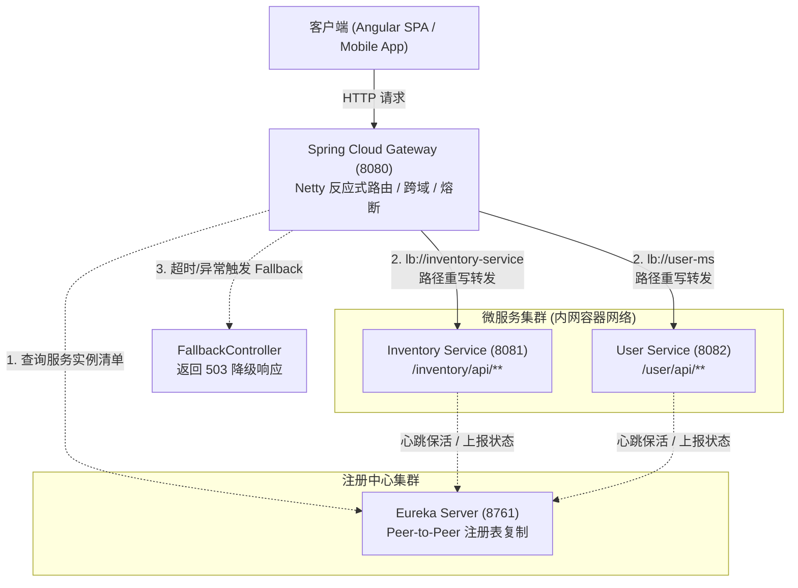

> 💡 **双栏独立滚动工作台导读**：本文采用双栏对照架构。**左栏**为核心技术决策矩阵、生产级代码范式与避坑清单；**右栏**为技术实现演化参考，并提供关键段落的英文原文展开与难词解析。左右两栏可独立滚动，并支持顶栏自定义宽度比例（7:3 / 5:5 / 3:7）与拖拽调节。

## 1. 服务寻址与 API 网关技术决策矩阵

### 1.1 服务发现与寻址方案对比

| 方案维度 | 静态配置 (Static IP/DNS) | 平台级 DNS (K8s Service) | 应用级注册中心 (Eureka / Consul) |
| :--- | :--- | :--- | :--- |
| **实例感知时效** | 需手动修改配置或滚动重启 | 依赖 DNS TTL 刷新，故障剔除存在秒级延迟 | 毫秒/秒级心跳感知，实时剔除失效节点 |
| **元数据支撑** | 无元数据支持 | 仅限 IP 与端口映射 | 支持自定义版本号、灰度权重与健康探针详情 |
| **客户端负载均衡** | 依赖外部 L4/L7 硬件或 Nginx | 服务端代理转发 (kube-proxy) | 客户端软负载均衡 (Spring Cloud LoadBalancer) |
| **基础设施依赖** | 低 | 强绑定 Kubernetes 基础设施 | 独立于底层容器平台，开发调试开箱即用 |

### 1.2 微服务 API 网关方案选型

| 网关方案 | 运行时底座 | 协议支持 | 架构优势与选型依据 |
| :--- | :--- | :--- | :--- |
| **Netflix Zuul 1.x** | 阻塞式 Servlet I/O (Tomcat) | HTTP/1.1 | 早期方案，高并发长连接吞吐受限，官方已停更 |
| **Kong (OpenResty)** | Nginx + Lua / C 扩展 | HTTP/1.1, HTTP/2, gRPC | 极致 C 级性能，但 Java 生态定制与复杂鉴权门槛较高 |
| **Spring Cloud Gateway** | **Project Reactor + Netty** | **HTTP/1.1, HTTP/2, WebSockets** | **Spring 原生首选**：与 Spring Cloud、Actuator、Security 深度契合，支持灵活断言与反应式过滤链 |

---

## 2. Eureka 注册中心与微服务客户端生产配置范式

### 2.1 Eureka Server 生产级高可用配置范式

```yaml
server:
  port: 8761

spring:
  application:
    name: discovery-server

eureka:
  instance:
    hostname: discovery-server-01
  client:
    # 单机开发模式关闭自注册；集群高可用模式下需设置为 true 并配置 peer 节点 URL
    register-with-eureka: false
    fetch-registry: false
    service-url:
      defaultZone: http://discovery-server-01:8761/eureka/
  server:
    # 生产建议保留自我保护机制 (true)；开发测试环境可关闭以加快下线剔除
    enable-self-preservation: true
    # 租约续约阈值与清理周期
    eviction-interval-timer-in-ms: 5000
    renewal-percent-threshold: 0.85
```

### 2.2 微服务 Eureka Client 动态注册与健康探针范式

```yaml
server:
  port: 8081
  servlet:
    context-path: /inventory

spring:
  application:
    name: inventory-service

eureka:
  client:
    service-url:
      defaultZone: http://localhost:8761/eureka/
  instance:
    # 容器化与跨网络部署必须优先上报物理/容器 IP，杜绝内部 hostname 寻址失败
    prefer-ip-address: true
    instance-id: ${spring.application.name}:${random.uuid}
    lease-renewal-interval-in-seconds: 10
    lease-expiration-duration-in-seconds: 30

management:
  endpoints:
    web:
      exposure:
        include: health, info
  endpoint:
    health:
      show-details: always
```

---

## 3. Spring Cloud Gateway 动态路由与过滤器链范式

采用编程式 Java DSL 构建类型安全、支持动态断言与路径正则重写的网关路由管线：

```java
package com.packt.bookstore.gateway_server.config;

import org.springframework.cloud.gateway.route.RouteLocator;
import org.springframework.cloud.gateway.route.builder.RouteLocatorBuilder;
import org.springframework.context.annotation.Bean;
import org.springframework.context.annotation.Configuration;

@Configuration
public class GatewayRouteConfig {

    @Bean
    public RouteLocator customRouteLocator(RouteLocatorBuilder builder) {
        return builder.routes()
                // 1. 库存微服务路由：负载均衡 + 路径重写 + 链路响应头注入
                .route("packt-inventory-service", r -> r
                        .path("/packt/inventory/api/**")
                        .filters(f -> f
                                .rewritePath("/packt/inventory/api/(?<segment>.*)", "/inventory/api/${segment}")
                                .addResponseHeader("X-Gateway-Route", "inventory-service")
                                .circuitBreaker(config -> config
                                        .setName("inventoryCircuitBreaker")
                                        .setFallbackUri("forward:/fallback/inventory")
                                )
                        )
                        .uri("lb://inventory-service")
                )
                // 2. 用户微服务路由
                .route("packt-user-service", r -> r
                        .path("/packt/user/api/**")
                        .filters(f -> f
                                .rewritePath("/packt/user/api/(?<segment>.*)", "/user/api/${segment}")
                                .addResponseHeader("X-Gateway-Route", "user-ms")
                        )
                        .uri("lb://user-ms")
                )
                .build();
    }
}
```

---

## 4. Resilience4j 反应式网关熔断与降级管道

网关作为单点流量枢纽，当下游服务发生故障或超时时，必须通过熔断机制就地降级，避免级联耗尽网关 Netty 资源：

```java
package com.packt.bookstore.gateway_server.controller;

import org.springframework.http.HttpStatus;
import org.springframework.http.ResponseEntity;
import org.springframework.web.bind.annotation.GetMapping;
import org.springframework.web.bind.annotation.RequestMapping;
import org.springframework.web.bind.annotation.RestController;

import java.time.Instant;
import java.util.Map;

@RestController
@RequestMapping("/fallback")
public class FallbackController {

    @GetMapping("/inventory")
    public ResponseEntity<Map<String, Object>> inventoryFallback() {
        return ResponseEntity.status(HttpStatus.SERVICE_UNAVAILABLE)
                .body(Map.of(
                        "status", HttpStatus.SERVICE_UNAVAILABLE.value(),
                        "error", "Service Unavailable",
                        "message", "图书库存服务暂时不可用或响应超时，触发网关级熔断防护。",
                        "timestamp", Instant.now().toString()
                ));
    }
}
```

---

## 5. 服务发现与网关流量拓扑图



---

## 6. 架构避坑清单 (Do's & Don'ts)

| 错误实践 (Don't) | 正确实践 (Do) |
| :--- | :--- |
| 在 `gateway-server` 中同时引入 `spring-boot-starter-web` (Tomcat)。 | 仅引入 `spring-cloud-starter-gateway-server-webflux`，保持纯粹的反应式 Netty 运行时，避免启动冲突崩溃。 |
| 在容器化或 K8s 环境中使用默认的主机名注册（`prefer-ip-address: false`）。 | 显式开启 `eureka.instance.prefer-ip-address: true`，确保实例通过实际可路由的容器 IP 寻址。 |
| 在客户端直接向各微服务的实际独立端口发起 HTTP 请求。 | 所有外部流量收敛至 API Gateway，由网关统一处理路径重写、CORS 跨域策略与安全认证。 |
| 下游微服务发生超时或异常时网关无限等待导致请求堆积。 | 装配 Resilience4j 反应式熔断器，设置确定的超时阈值，并在熔断触发时路由到本地 Fallback 降级端点。 |
| 开发与生产环境混用同一套 Eureka 自我保护策略配置。 | 本地测试时可关闭自我保护加速失效剔除；生产环境必须开启自我保护以抵御网络抖动与分区故障。 |

<!-- split -->

# 原著完整参考：Spring Cloud 服务发现与统一 API 网关

在现代企业级微服务架构中，单体业务被拆解为高内聚、轻量级的独立服务进程。随着业务扩展，微服务实例的宿主网络标识（IP 地址与端口）表现出高度动态变动的特征。容器调度漂移、节点弹性伸缩以及基础设施故障自愈均会实时改变服务物理位置。

若服务间直接依赖硬编码的静态地址，系统拓扑将极其脆弱。此外，前端单页应用直接面对分散在不同端口的微服务，会面临跨域阻碍、安全鉴权重复实现与内部架构过度暴露等问题。

解决该问题的工业级标准方案包含两项基石组件：
1. **服务发现（Service Discovery）**：基于注册中心实现微服务实例的自动入网登记、周期性心跳探测与动态寻址解析；
2. **API 网关（API Gateway）**：采用非阻塞反应式网关构建统一流量接入层，承担动态路由、协议与路径转换、跨域收敛以及网关级熔断防护。

:::en
> **Original**: Service discovery allows microservices to locate each other dynamically without hardcoded hostnames or IP addresses, adapting seamlessly to elastic scaling and pod rescheduling.

**📌 核心术语与语境解析**：
- **Service Discovery** [ˈsɜːrvɪs dɪˈskʌvəri]：*服务发现*。微服务实例启动时主动向注册中心登记网络标识，消费方通过逻辑服务名动态解析健康节点列表的寻址机制。
- **Peer-to-Peer Replication** [pɪr tu pɪr ˌreplɪˈkeɪʃn]：*对等复制*。Eureka Server 节点间去中心化（AP）双向同步注册表的高可用数据同步模式。
:::

---

## 1. 微服务寻址困境与动态服务发现机制

### 1.1 静态配置寻址的局限性

在单体架构向分布式演化的初期，最直接的服务寻址方式是将下游实例的物理 IP 与端口硬编码于配置文件中：

```properties
# 静态配置示例：脆弱且缺乏弹性自愈能力
book.user-service.url=http://192.168.1.105:8082
```

当系统在不同环境迁移或在 Kubernetes 集群中触发 Pod 重新调度时，静态地址配置将产生以下缺陷：
- 节点崩溃或漂移后，调用方因本地缓存静态地址而持续请求失效节点，导致请求超时堆积；
- 节点动态扩容时，调用方无法自动感知新增算力，必须重新编辑配置文件并滚动重启客户端。

动态服务解析彻底解耦了服务调用者与提供者的物理网络绑定。服务提供方在引导启动阶段主动将自身元数据（IP 地址、端口、应用逻辑名称与健康状态）注册至注册中心。服务消费方仅需持有名为 `inventory-service` 或 `user-ms` 的逻辑名称，由注册中心与客户端负载均衡组件完成透明寻址。

| 对比维度 | 静态解析 (Static Discovery) | 动态服务发现 (Dynamic Discovery) |
| :--- | :--- | :--- |
| **实例寻址方式** | 配置文件或环境变量手动硬编码物理坐标 | 启动自上报至中央注册表，基于逻辑服务名解析 |
| **弹性伸缩适应力** | 需人工介入修改配置并重新部署客户端 | 实例上下线秒级广播，客户端无感平滑切换 |
| **故障剔除效率** | 依赖外部反向代理或 TCP 超时报错 | 结合健康检测探针与心跳剔除机制实现自动摘除 |
| **适用场景** | 小型双机静态架构、单体应用阶段 | 云原生容器化微服务集群、弹性伸缩业务系统 |

### 1.2 DNS 寻址与应用级注册中心的工程权衡

在网络基础设施层，DNS 提供了基于域名的解析能力。但在微服务运行时，纯 DNS 寻址存在固有短板：

| 评估维度 | 基础设施级 DNS (CoreDNS / 外部 DNS) | 应用级注册中心 (Eureka / Consul) |
| :--- | :--- | :--- |
| **切换时效性** | 易受操作系统与 JVM DNS 缓存（TTL）制约，故障摘除延迟大 | 基于实时心跳租约管理，秒级感知并更新可用列表 |
| **元数据丰富度** | 仅支持记录 IP 与端口映射 | 支持携带服务版本号、机房区域、灰度权重与探针详情 |
| **负载均衡策略** | 通常仅支持简单的轮询 (Round Robin) | 支持基于加权轮询、最小连接数与就近区域路由的客户端策略 |
| **开发与运维开销** | 依赖底层平台或网络团队维护 | Spring Boot 生态高度集成，本地与测试环境即时拉起 |

在技术栈选型中，选用 Netflix Eureka 与 Spring Cloud 体系构建服务注册中心，能够在无需复杂容器网络插件支撑的前提下，构建完整的动态注册、健康探测与软负载均衡闭环。

:::en
> **Original**: Eureka implements an AP (Available/Partition tolerant) architecture where server instances synchronize registries through peer replication, ensuring high availability over strict consistency.

**📌 核心术语与语境解析**：
- **Heartbeat Mechanism** [ˈhɑːrtbiːt ˈmekənɪzəm]：*心跳保活机制*。客户端以固定时间间隔向注册中心发送轻量 HTTP 续约请求以维持活跃租约。
- **Self-Preservation Mode** [sɛlf ˌprɛzərˈveɪʃən moʊd]：*自我保护模式*。当短时间内丢失心跳比例超过阈值时，Eureka 认为发生了网络分区故障而暂停注销实例，防止因网络抖动造成雪崩式误杀。
:::

---

## 2. 搭建 Eureka Server 服务注册中心

Eureka 采用无主对等（P2P）的高可用架构。各个 Server 实例之间通过对等复制同步注册表，无需复杂的 Leader 选举等待过程，在分布式 CAP 定理中偏向可用性（AP）。


### 2.1 创建 `discovery-server` 模块与依赖声明

在父 POM 管理下引入 Spring Cloud Eureka Server 启动器：

```xml
<parent>
  <groupId>org.springframework.boot</groupId>
  <artifactId>spring-boot-starter-parent</artifactId>
  <version>4.1.0</version>
  <relativePath />
</parent>

<properties>
  <java.version>26</java.version>
  <spring-cloud.version>2025.1.2</spring-cloud.version>
</properties>

<dependencyManagement>
  <dependencies>
    <dependency>
      <groupId>org.springframework.cloud</groupId>
      <artifactId>spring-cloud-dependencies</artifactId>
      <version>${spring-cloud.version}</version>
      <type>pom</type>
      <scope>import</scope>
    </dependency>
  </dependencies>
</dependencyManagement>

<dependencies>
  <dependency>
    <groupId>org.springframework.cloud</groupId>
    <artifactId>spring-cloud-starter-netflix-eureka-server</artifactId>
  </dependency>
  <dependency>
    <groupId>org.springframework.boot</groupId>
    <artifactId>spring-boot-starter-actuator</artifactId>
  </dependency>
</dependencies>
```

### 2.2 激活 Eureka Server 运行时

在 Spring Boot 引导主类上添加 `@EnableEurekaServer` 注解：

```java
package com.packt.bookstore.discovery_server;

import org.springframework.boot.SpringApplication;
import org.springframework.boot.autoconfigure.SpringBootApplication;
import org.springframework.cloud.netflix.eureka.server.EnableEurekaServer;

@SpringBootApplication
@EnableEurekaServer
public class DiscoveryServerApplication {
    public static void main(String[] args) {
        SpringApplication.run(DiscoveryServerApplication.class, args);
    }
}
```

### 2.3 配置单机开发模式

单机开发模式下，Eureka Server 默认会作为客户端尝试寻找对等节点。需显式关闭自注册行为：

```yaml
server:
  port: 8761

spring:
  application:
    name: eureka-server

eureka:
  client:
    register-with-eureka: false
    fetch-registry: false
  server:
    wait-time-in-ms-when-sync-empty: 0
```

启动 `DiscoveryServerApplication` 并访问 `http://localhost:8761/`，可查看 Eureka 运维控制台：


---

## 3. 微服务自动化注册与健康探测实战

将库存微服务（`inventory-ms`）与用户微服务（`user-ms`）配置为 Eureka Client。

### 3.1 引入 Client 依赖与监控探针

```xml
<dependency>
  <groupId>org.springframework.cloud</groupId>
  <artifactId>spring-cloud-starter-netflix-eureka-client</artifactId>
</dependency>
<dependency>
  <groupId>org.springframework.boot</groupId>
  <artifactId>spring-boot-starter-actuator</artifactId>
</dependency>
```

在现代 Spring Cloud 体系中，只要类路径包含 `spring-cloud-starter-netflix-eureka-client`，应用即会自动启用客户端行为，无需在引导类上显式声明 `@EnableEurekaClient`。

### 3.2 配置心跳续约与注册元数据

在 `inventory-ms` 的 `application.yml` 中完成配置：

```yaml
server:
  port: 8081
  servlet:
    context-path: /inventory

spring:
  application:
    name: inventory-service

eureka:
  client:
    service-url:
      defaultZone: http://localhost:8761/eureka/
  instance:
    hostname: localhost
    prefer-ip-address: true
    metadata-map:
      instanceId: ${spring.application.name}:${server.port}

management:
  endpoints:
    web:
      exposure:
        include: health, info
  endpoint:
    health:
      show-details: always
```

- `spring.application.name: inventory-service`：定义微服务在注册中心的逻辑名称，API 网关将据此通过 `lb://inventory-service` 进行流量路由；
- `eureka.instance.prefer-ip-address: true`：优先向注册中心上报 IP 地址，避免容器内部不可解析的主机名导致调用失败；
- `management.endpoint.health.show-details: always`：结合 Actuator 对数据库连接池与磁盘指标进行深度探测，异常时主动标记状态为 DOWN。

同样地，配置 `user-ms`（服务名 `user-ms`，端口 `8082`，`context-path: /user`）。

### 3.3 实例启动与控制台验证

依次启动 Eureka Server、库存微服务与用户微服务：

```bash
cd discovery-server && ./mvnw spring-boot:run
cd inventory-ms && ./mvnw spring-boot:run
cd user-ms && ./mvnw spring-boot:run
```

刷新控制台 `http://localhost:8761/`，业务实例均已成功注册：


---

## 4. API 网关模式的核心价值与技术演进

在微服务拆解后，如果外部前端应用直接调用各个业务微服务，系统将迅速面临如下挑战：
1. **客户端网络复杂度过高**：前端需管理大量内网微服务的域名与端口映射；
2. **安全攻击面暴露**：各微服务均需暴露独立端口，且需重复实现鉴权与防刷限流；
3. **架构重构成本高昂**：后端的合并拆解将直接引发前端契约变更。


**API 网关模式（API Gateway Pattern）**将反向代理部署于系统最外层，统一治理所有入站流量：
- **统一聚合路由**：外部调用者仅需与单一域名通信，隐藏内部网络拓扑；
- **契约重写与抹平**：通过路径正则重写，抹平各服务不同的 `context-path` 差异；
- **横切关注点统管**：集中收敛认证鉴权、跨域策略（CORS）、链路耗时记录与访问审计；
- **BFF 架构支撑**：可针对 Web 端、移动 App 端分别提供定制化的网关适配层。

:::en
> **Original**: An API Gateway serves as a single entry point for all clients, decoupling frontend consumers from backend microservice topology while centralizing cross-cutting concerns like security, rate limiting, and telemetry.

**📌 核心术语与语境解析**：
- **API Gateway Pattern** [ˌeɪ piː ˈaɪ ˈɡeɪtweɪ ˈpætərn]：*API 网关模式*。位于客户端与内部微服务群之间的核心反向代理组件，统一负责路由编排与协议中继。
- **Cross-Cutting Concerns** [krɔːs ˈkʌtɪŋ kənˈsɜːrnz]：*横切关注点*。跨越多个业务领域的通用基础设施职责，如认证、限流与审计日志。
:::

---

## 5. Spring Cloud Gateway 核心架构与处理管线

Spring Cloud Gateway 摒弃传统的 Servlet 阻塞模型，完全基于 Netty 和 Spring WebFlux 响应式运行时构建。其核心由三大基础组件构成：
1. **Route（路由）**：网关的基础处理单元，包含 ID、目标 URI、断言集合与过滤器集合；
2. **Predicate（断言）**：基于 Java 8 `Predicate` 函数式接口，依据 HTTP 请求属性（路径、Method、请求头等）判定是否命中该路由；
3. **Filter（过滤器）**：包含 `GatewayFilter` 与 `GlobalFilter`，在请求转发下游前（Pre 阶段）修改入站数据，或在下游返回后（Post 阶段）注入响应头或记录监控指标。


请求生命周期流转流程：
1. 客户端发起请求进入 Gateway Handler Mapping；
2. 路由断言引擎逐条匹配配置规则，所有 Predicates 返回 `true` 时确认命中路由；
3. 依次执行 Pre-Filter 链（路径重写、认证提取、耗时计时）；
4. 通过 `lb://service-name` 协议触发 Spring Cloud LoadBalancer 向 Eureka 解析目标实例网络坐标，完成请求代理转发；
5. 接收下游服务响应；
6. 逆序执行 Post-Filter 链（追加安全响应头、收集遥测指标）；
7. 将最终响应数据流式写回客户端。

:::en
> **Original**: Spring Cloud Gateway is built on Spring WebFlux and Project Reactor, executing non-blocking predicate evaluations and filter pipelines on top of Netty event loops.

**📌 核心术语与语境解析**：
- **Route Predicate** [ruːt ˈpredɪkət]：*路由断言*。基于 HTTP 请求属性判断是否命中目标路由规则的布尔断言器。
- **Gateway Filter** [ˈɡeɪtweɪ ˈfɪltər]：*网关过滤器*。在请求代理转发前后对请求头、路径或响应进行拦截处理的链式组件。
:::

---

## 6. 构建与配置 Spring Cloud Gateway

### 6.1 依赖引入与工程骨架

创建 `gateway-server` 模块，配置核心依赖：

```xml
<dependencies>
  <dependency>
    <groupId>org.springframework.cloud</groupId>
    <artifactId>spring-cloud-starter-gateway-server-webflux</artifactId>
  </dependency>
  <dependency>
    <groupId>org.springframework.cloud</groupId>
    <artifactId>spring-cloud-starter-netflix-eureka-client</artifactId>
  </dependency>
  <dependency>
    <groupId>org.springframework.boot</groupId>
    <artifactId>spring-boot-starter-actuator</artifactId>
  </dependency>
</dependencies>
```

> ⚠️ **运行环境纪律**：Spring Cloud Gateway 依赖响应式 WebFlux。工程中严禁引入 `spring-boot-starter-web`，否则将引发 Servlet 与 Netty 运行容器冲突导致启动崩溃。

### 6.2 路由编排：声明式 YAML 与编程式 Java DSL

#### 声明式 YAML 路由配置

```yaml
server:
  port: 8080

spring:
  application:
    name: gateway-server
  cloud:
    gateway:
      server:
        webflux:
          discovery:
            locator:
              enabled: true
              lower-case-service-id: true
          routes:
            - id: bookstore-inventory-route
              uri: lb://inventory-service
              predicates:
                - Path=/packt/inventory/api/**
              filters:
                - RewritePath=/packt/inventory/api/(?<segment>.*), /inventory/api/${segment}

            - id: bookstore-user-route
              uri: lb://user-ms
              predicates:
                - Path=/packt/user/api/**
              filters:
                - RewritePath=/packt/user/api/(?<segment>.*), /user/api/${segment}
```

#### 编程式 Java DSL 路由配置

编程式 DSL 支持更高级的动态策略注入与编译期类型校验：

```java
package com.packt.bookstore.gateway_server.config;

import org.springframework.cloud.gateway.route.RouteLocator;
import org.springframework.cloud.gateway.route.builder.RouteLocatorBuilder;
import org.springframework.context.annotation.Bean;
import org.springframework.context.annotation.Configuration;

@Configuration
public class GatewayRouteConfig {

    @Bean
    public RouteLocator customRouteLocator(RouteLocatorBuilder builder) {
        return builder.routes()
                .route("packt-inventory-service", r -> r
                        .path("/packt/inventory/api/**")
                        .filters(f -> f
                                .rewritePath("/packt/inventory/api/(?<segment>.*)", "/inventory/api/${segment}")
                                .addResponseHeader("X-Processed-By", "Spring-Cloud-Gateway")
                        )
                        .uri("lb://inventory-service")
                )
                .route("packt-user-service", r -> r
                        .path("/packt/user/api/**")
                        .filters(f -> f
                                .rewritePath("/packt/user/api/(?<segment>.*)", "/user/api/${segment}")
                                .addResponseHeader("X-Processed-By", "Spring-Cloud-Gateway")
                        )
                        .uri("lb://user-ms")
                )
                .build();
    }
}
```

### 6.3 路由代理端到端验证

启动网关工程（端口 8080）。Eureka 控制台中将显示 3 个活跃服务节点：


发起验证请求：

```bash
curl -i http://localhost:8080/packt/inventory/api/authors
curl -i http://localhost:8080/packt/user/api/users
```

响应头中包含网关注入的标头：

```http
HTTP/1.1 200 OK
Content-Type: application/json
X-Processed-By: Spring-Cloud-Gateway
```

---

## 7. 基于 Resilience4j 实现网关级熔断降级

在分布式系统中，级联故障（Cascading Failures）是引发系统雪崩的根本诱因。当下游服务因死锁或高负载响应迟缓时，网关的连接资源可能被长时间挂起，进而影响其他正常业务链路。

熔断器模式（Circuit Breaker）持续监控下游健康度。当错误率或超时率超过预设阈值时，熔断器跳闸开启，快速拒绝请求并重定向至本地降级端点（Fallback），保护系统整体的吞吐可用性。

:::en
> **Original**: The Circuit Breaker pattern isolates failing microservices and prevents cascading failures across the distributed system, failing fast and routing traffic to a localized fallback mechanism.

**📌 核心术语与语境解析**：
- **Circuit Breaker** [ˈsɜːrkɪt ˈbreɪkər]：*熔断器*。监控远程调用失败率，在故障超标时主动跳闸快速失败的系统保护机制。
- **Cascading Failure** [kæˈskeɪdɪŋ ˈfeɪljər]：*级联故障/雪崩*。下游单一服务延迟或崩溃耗尽上游线程池，引发整个分布式系统瘫痪的连锁反应。
:::

### 7.1 引入 Resilience4j 反应式依赖

在 `gateway-server` 中引入反应式熔断器启动器：

```xml
<dependency>
  <groupId>org.springframework.cloud</groupId>
  <artifactId>spring-cloud-starter-circuitbreaker-reactor-resilience4j</artifactId>
</dependency>
```

### 7.2 装配熔断过滤器与 Fallback 路由

在 Java DSL 路由配置中为库存路由挂载熔断拦截：

```java
@Bean
public RouteLocator customRouteLocator(RouteLocatorBuilder builder) {
    return builder.routes()
            .route("packt-inventory-service", r -> r
                    .path("/packt/inventory/api/**")
                    .filters(f -> f
                            .rewritePath("/packt/inventory/api/(?<segment>.*)", "/inventory/api/${segment}")
                            .addResponseHeader("X-Processed-By", "Spring-Cloud-Gateway")
                            .circuitBreaker(config -> config
                                    .setName("inventoryCircuitBreaker")
                                    .setFallbackUri("forward:/fallback/inventory")
                                    .setRouteId("packt-inventory-service")
                            )
                    )
                    .uri("lb://inventory-service")
            )
            .build();
}
```

### 7.3 实现本地降级控制器

降级端点由网关本地直接响应，杜绝再次发起远端调用：

```java
package com.packt.bookstore.gateway_server.controller;

import org.springframework.http.HttpStatus;
import org.springframework.http.ResponseEntity;
import org.springframework.web.bind.annotation.GetMapping;
import org.springframework.web.bind.annotation.RequestMapping;
import org.springframework.web.bind.annotation.RestController;

import java.util.Map;

@RestController
@RequestMapping("/fallback")
public class FallbackController {

    @GetMapping("/inventory")
    public ResponseEntity<Map<String, Object>> inventoryFallback() {
        return ResponseEntity.status(HttpStatus.SERVICE_UNAVAILABLE)
                .body(Map.of(
                        "status", 503,
                        "error", "Service Unavailable",
                        "message", "图书库存服务暂时不可用或响应超时，请稍后重试。",
                        "timestamp", System.currentTimeMillis()
                ));
    }
}
```

### 7.4 故障降级自愈演练

1. 正常运行状态下请求 `GET http://localhost:8080/packt/inventory/api/books`，返回有效 JSON 数据；
2. 中止 `inventory-ms` 进程模拟节点宕机；
3. 再次发起请求，网关熔断机制毫秒级生效，返回标准 503 降级响应：
   ```json
   {
     "status": 503,
     "error": "Service Unavailable",
     "message": "图书库存服务暂时不可用或响应超时，请稍后重试。",
     "timestamp": 1730000000000
   }
   ```
4. 此时请求用户服务接口仍正常响应，成功阻断单点故障的级联蔓延。

---

## 8. 总结与下篇演进

在本文中，系统基础设施完成了由静态配置向动态治理的关键跨越：
- **服务发现治理**：利用 Eureka 搭建了无主对等的高可用注册中心，支持实例动态注册与软负载均衡；
- **API 网关统一收敛**：通过 Spring Cloud Gateway 打造反应式流量入口，以断言和过滤器完成了路径重写与跨域治理；
- **系统韧性加固**：借助 Resilience4j 构建了网关层熔断降级防线，保障系统高可用。

在下一篇中，我们将进一步完善系统的工程契约与运维能力，探讨 **OpenAPI 规范驱动与全链路可观测性落地**，基于 SpringDoc 自动生成 Swagger 契约文档，并结合 Actuator、Micrometer Tracing 与 Zipkin 搭建端到端分布式链路追踪体系。
