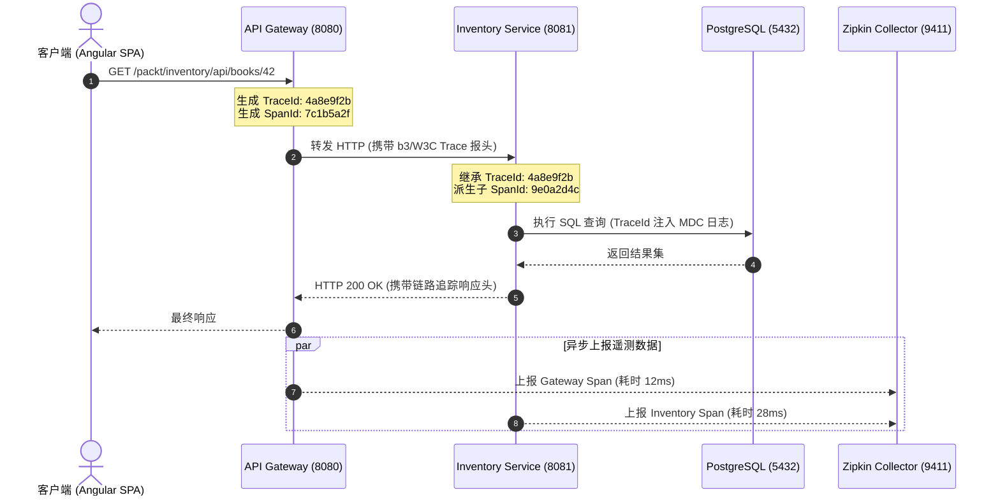

## 1. 契约驱动与分布式可观测性技术决策矩阵

### 1.1 OpenAPI 契约引擎选型对比

| 评估维度 | springdoc-openapi (推荐首选) | springfox-swagger2 (已弃用) | 手写静态 YAML/JSON |
| :--- | :--- | :--- | :--- |
| **运行时基线** | 原生兼容 Spring Boot 3/4 & Jakarta EE | 停更于 Spring Boot 2 时代，无法运行 | 独立于代码语言，纯静态维护 |
| **标准遵循** | 全面遵循 OpenAPI 3.0 / 3.1 规范 | 仅支持旧版 Swagger 2.0 规范 | 取决于编写者是否符合标准 |
| **注解生命周期** | 与 Controller 代码强绑定，随编译同步更新 | 需手工声明繁琐的 Docket Bean | 与代码解耦，极易发生契约漂移 (Contract Drift) |
| **Swagger UI 交互** | Starter 自动装配，开箱即用 | 依赖外部 UI 模块且存在路径冲突 | 需独立部署静态 HTTP 服务器托管 |

### 1.2 分布式链路追踪方案选型

| 方案 | 追踪门面 (Facade) | 收集与传输层 | 展示与检索端 | 选型权衡 |
| :--- | :--- | :--- | :--- | :--- |
| **Spring Boot 原生推荐** | Micrometer Tracing | Brave / Zipkin Reporter | Zipkin Server | **开发首选**：轻量级依赖，配置简洁，零字节码注入侵入 |
| **云原生工业级** | OpenTelemetry API | OTel Collector (gRPC) | Jaeger / Tempo | 适用于混合语言集群或已具备 OTel 基础设施的企业平台 |
| **传统方案 (已废弃)** | Spring Cloud Sleuth | Spring Cloud Sleuth Zipkin | Zipkin Server | Sleuth 在 Spring Boot 3 之后已被 Micrometer Tracing 彻底取代 |

---

## 2. SpringDoc OpenAPI 3 契约声明生产范式

在 Controller 中通过细粒度注解定义接口摘要、分页参数、成功载荷及标准化异常模型：

```java
package com.packt.bookstore.inventory_service.controller;

import com.packt.bookstore.inventory_service.dto.ApiError;
import com.packt.bookstore.inventory_service.dto.BookResponse;
import com.packt.bookstore.inventory_service.service.BookService;
import io.swagger.v3.oas.annotations.Operation;
import io.swagger.v3.oas.annotations.Parameter;
import io.swagger.v3.oas.annotations.media.ArraySchema;
import io.swagger.v3.oas.annotations.media.Content;
import io.swagger.v3.oas.annotations.media.ExampleObject;
import io.swagger.v3.oas.annotations.media.Schema;
import io.swagger.v3.oas.annotations.responses.ApiResponse;
import io.swagger.v3.oas.annotations.responses.ApiResponses;
import io.swagger.v3.oas.annotations.tags.Tag;
import org.springframework.data.domain.Page;
import org.springframework.data.domain.PageRequest;
import org.springframework.data.domain.Sort;
import org.springframework.http.ResponseEntity;
import org.springframework.web.bind.annotation.*;

@RestController
@RequestMapping("/api/books")
@Tag(name = "Book Inventory", description = "图书库存核心管理 API：分页检索、条件过滤与明细查询")
public class BookController {

    private final BookService bookService;

    public BookController(BookService bookService) {
        this.bookService = bookService;
    }

    @Operation(
            summary = "分页与排序检索图书清单",
            description = "支持基于页码、每页容量与指定字段方向（如 publishedYear,desc）进行动态排序分页查询。"
    )
    @ApiResponses(value = {
            @ApiResponse(
                    responseCode = "200",
                    description = "成功检索图书分页数据",
                    content = @Content(
                            mediaType = "application/json",
                            array = @ArraySchema(schema = @Schema(implementation = BookResponse.class)),
                            examples = @ExampleObject(
                                    name = "分页成功响应示例",
                                    value = """
                                            [
                                              {
                                                "id": 1,
                                                "isbn": "978-0134494166",
                                                "title": "Clean Architecture",
                                                "price": 49.99,
                                                "authorName": "Robert C. Martin",
                                                "publishedYear": 2017
                                              }
                                            ]
                                            """
                            )
                    )
            ),
            @ApiResponse(
                    responseCode = "400",
                    description = "请求参数不合法（如非法页码或未识别排序列）",
                    content = @Content(schema = @Schema(implementation = ApiError.class))
            ),
            @ApiResponse(
                    responseCode = "500",
                    description = "服务端内部未决异常",
                    content = @Content(schema = @Schema(implementation = ApiError.class))
            )
    })
    @GetMapping
    public ResponseEntity<Page<BookResponse>> getAllBooks(
            @Parameter(description = "分页索引（基于 0 开始）", example = "0")
            @RequestParam(defaultValue = "0") int page,
            @Parameter(description = "每页展示数量", example = "10")
            @RequestParam(defaultValue = "10") int size,
            @Parameter(description = "排序规则（格式：字段,方向）", example = "title,asc")
            @RequestParam(defaultValue = "title,asc") String sort
    ) {
        String[] sortParams = sort.split(",");
        Sort.Direction direction = sortParams.length > 1 && sortParams[1].equalsIgnoreCase("desc")
                ? Sort.Direction.DESC : Sort.Direction.ASC;
        PageRequest pageRequest = PageRequest.of(page, size, Sort.by(direction, sortParams[0]));
        return ResponseEntity.ok(bookService.findAll(pageRequest));
    }
}
```

---

## 3. MDC 结构化日志与 Micrometer Tracing 生产配置范式

在 `application.yml` 中配置 SLF4J MDC 链路注入、文件滚动策略与 Zipkin 全量/动态采样：

```yaml
spring:
  application:
    name: inventory-service

logging:
  pattern:
    # 注入标准链路坐标：[应用名, TraceID, SpanID]
    correlation: "[${spring.application.name:},%X{traceId:-},%X{spanId:-}]"
  include-application-name: false
  file:
    name: logs/inventory-service.log
  logback:
    rollingpolicy:
      max-file-size: 50MB
      max-history: 30
      total-size-cap: 1GB

management:
  tracing:
    sampling:
      # 开发测试环境设置为 1.0 (100% 采样)；高并发生产建议调优为 0.1 (10% 采样)
      probability: 1.0
    baggage:
      correlation:
        enabled: true
    export:
      zipkin:
        endpoint: http://localhost:9411/api/v2/spans
  endpoints:
    web:
      exposure:
        # 生产严禁使用 '*'，按需最小化暴露监控端点
        include: health, info, metrics, prometheus
  endpoint:
    health:
      show-details: when-authorized
```

---

## 4. 全链路可观测性排障闭环拓扑图



---

## 5. 架构避坑清单 (Do's & Don'ts)

| 错误实践 (Don't) | 正确实践 (Do) |
| :--- | :--- |
| 仅标注 200 成功响应，忽略 4xx/5xx 错误响应规范。 | 显式声明 `@ApiResponses`，并将通用异常结构统一建模为 `ApiError` 呈现给前端。 |
| 在 Spring Boot 3/4 架构中继续引入旧版 `springfox-swagger2`。 | 统一使用 `springdoc-openapi-starter-webmvc-ui`，拥抱标准 Jakarta 注解。 |
| 日志仅输出纯文本描述，缺少全局统一的分布式追踪标识。 | 配置 `logging.pattern.correlation`，通过 MDC 自动将 `traceId` 与 `spanId` 注入每行日志。 |
| 在反应式或异步线程池切换中直接丢失 MDC 上下文。 | 开启 Micrometer Tracing 上下文传播机制，或使用 `Hooks.enableAutomaticContextPropagation()`。 |
| 生产环境直接公网暴露 `/actuator/env`、`/actuator/heapdump` 等高危端点。 | 隔离管理端口（`management.server.port`），并在生产环境仅暴露 `health, metrics` 等必要探针。 |

<!-- split -->

在上一章中，我们通过引入 Netflix Eureka 服务发现机制与 Spring Cloud Gateway 网关路由，为在线书店（Bookstore）构建了一套弹性高可用的通信基础设施。微服务之间得以动态寻址感知与协同交互，外部客户端也能通过统一规范的网关入口平滑消费后端微服务。

当服务具备了动态发现与外部可达能力之后，架构演进的下一个关键闭环便是让微服务变得**清晰可懂（Understandable）**与**全面可观测（Observable）**。在分布式团队协作、故障深度排查、新员工快速入职以及生产高可靠保障中，完善的 API 文档契约与立体化的可观测性体系是无可替代的核心生命线。

本章紧紧围绕两大工业级基石展开：
1. **基于 OpenAPI（前身为 Swagger）的 API 文档规范化**：对外输出机器可读、人机友好的微服务契约，让前端与第三方集成者一目了然；
2. **立体化可观测性与分布式链路追踪（Distributed Tracing）**：依托日志（Logs）、指标（Metrics）与追踪（Traces）三大支柱，精准洞察单次请求穿透分布式微服务集群的真实旅程。

学完本章后，你的微服务不仅能够在网络拓扑中顺畅对话，更能以标准化语言清晰阐述自身的 API 语义，并提供可信赖的遥测数据，为运维排障提供坚实支撑。

本章核心涵盖以下主题：
- 理解微服务中文档与可观测性的核心价值
- 使用 OpenAPI 为微服务构建自描述文档
- API 文档常见陷阱与最佳实践
- 分布式可观测性核心基石（Logs / Metrics / Traces）
- 基于 SLF4J、Micrometer、Brave 与 Zipkin 落地分布式追踪
- 可观测性落地避坑指南与端点安全防护

> **注意**
>
> 本章中的部分图片在纸质图书排版中字体可能偏小。我们保留了这些截图，因为它们真实反映了实际控制台界面的操作细节，方便你在自己的屏幕上比对演练。你也可以在本书前言提供的 *Graphics Bundle* 链接中查看并放大所有高清原图。

## 技术准备要求（Technical requirement）

本章涉及的完整源代码可通过以下链接获取：
`https://github.com/PacktPublishing/Spring-Boot-and-Angular-2E_Backend/tree/main/chapter-07`

---

## 理解微服务中文档与可观测性的核心价值（Understanding the role of documentation and observability in microservices）

作为构建可扩展微服务系统的开发人员与架构师，我们往往习惯于将精力全部倾注在“让功能跑通”上——服务能够启动、Controller 端点能够响应、数据能够入库。但在现实复杂的生产环境中，仅仅“能跑通”是远远不够的。你必须确保系统对于其他研发同事、测试工程师、DevOps 运维团队、安全审计人员乃至外部调用方而言，都是清晰透明、可理解且具备运维可见性的。

这正是 API 文档与可观测性的使命所在。在类似 Bookstore 这样的分布式架构中，我们面对的不再是单一庞大的单体应用，而是由众多独立部署、各自暴露接口、各自打印日志的微服务协同运作的网络。缺乏文档，前端与下游开发者只能靠“盲猜”和看源码来揣摩 API；缺乏可观测性，当线上业务出现异样或卡顿时，运维人员就如同盲人摸象。

### 为什么文档至关重要（Documentation matters）

想象一下，当你走进一座宏伟的图书馆，所有的藏书都被锁在只标有冰冷数字的房间里，四周没有任何路标指示牌、没有图书检索目录，也没有图书管理员。你该如何找到一本深入讲解 Java 核心技术或软件架构的书籍？一个缺乏文档的 API 给开发者的感受正是如此。API 文档就是你的数字索引目录、操作导览图与新手指引。它明确告知调用者：该接口承担什么职责、如何正确构造入参，以及成功或失败时会返回怎样的响应体。

在微服务架构中，文档的刚需性更为迫切：
- 系统中往往存在数十个微服务，依赖关系错综复杂；
- 开发者经常需要消费并非由自己编写的第三方或跨团队服务；
- 接口在敏捷迭代中持续演进，版本升级与变更必须显式声明；
- QA 测试团队需要依据接口边界构造自动化测试用例；
- 前端 Angular 研发工程师极度依赖清晰确定、强类型的契约模型。

因此，自动化生成并持续维护精准的 API 文档绝非可有可无的装饰品，而是维系微服务团队协作的生命线。

### 可观测性是分布式架构的 GPS 导航仪（Observability is your GPS）

如果说 **API 文档明确了系统“应当如何运转”（What should happen）**，那么 **可观测性则揭示了系统“实际上发生了什么”（What did happen）**。

设想一下：在线书店的用户在前端点击结账下单时，界面突然弹出一个模糊的通用错误提示。此时故障究竟发生在哪里？是库存扣减失败？是第三方支付通道超时？是用户微服务鉴权失效？还是网关层熔断拦截？

在没有现代化可观测性工具武装的传统架构中，排查故障往往演变为耗时耗力的“福尔摩斯探案”——多名工程师登录不同服务器翻查数以万计的杂乱文本日志。而具备立体可观测性的系统则像装载了高精度 GPS：
- 能够沿着调用链条跨越服务边界追踪单次请求的完整链路；
- 能够通过全局唯一的关联 ID（Correlation ID）在海量日志中秒级过滤出关联上下文；
- 能够实时监控各微服务的吞吐量、响应耗时分位数（P95/P99）与错误率；
- 能够清晰指出瓶颈发生在哪个服务节点或慢 SQL 阶段。

API 文档让微服务变得易于发现与集成，可观测性则解答了“系统何时出错、错在何处、因何而错”。二者相辅相成，共同铸就了微服务架构卓越运维（Operational Excellence）的坚固基石。

---

## 使用 OpenAPI 为微服务构建自描述文档（Documenting microservices with OpenAPI）

在微服务领域，编写接口文档最忌讳的是依靠人工手写 Markdown 或 Word 维护静态文档。这种文档与代码脱节极其严重，往往代码改动后文档未能及时同步，最终沦为误导开发的陈旧垃圾。行业标准做法是**契约即代码（Docs as Code）**——直接利用代码注解与元数据，在服务运行时动态自动化生成标准化的交互式接口文档。

### 什么是 OpenAPI？（What is OpenAPI?）

**OpenAPI Specification（OAS）** 是由 OpenAPI Initiative（隶属于 Linux 基金会）维护的行业公认标准，用于对 RESTful API 进行与编程语言无关的标准化描述。其前身正是风靡全球的 **Swagger 规范**。通过标准化的 JSON 或 YAML 格式，OpenAPI 详细描述了：
- 基础访问基准路径与服务元数据；
- 所有可用的 API 端点路径与支持的 HTTP 动词（GET、POST、PUT、DELETE 等）；
- 请求头、Query 参数、Path 路径变量与请求体（Request Body）的强类型约束；
- 每种 HTTP 状态码对应的响应结构与具体错误模型；
- 认证授权机制（如 Bearer JWT、OAuth2 等）。

借助规范化的 OpenAPI 描述文件，我们可以自动渲染出开箱即用的交互式网页界面（Swagger UI），允许开发者与测试人员直接在浏览器中发起“Try it out”在线调试；还可以利用代码生成器（如 OpenAPI Generator）直接为前端 Angular 生成强类型的 TypeScript 客户端接口与 Model 模型。

### 技术选型对比：Springdoc 与 Springfox（Choosing the right tool: Springdoc versus Swagger-Springfox）

在 Java 与 Spring Boot 生态中，历史上曾有两个主要的 Swagger/OpenAPI 集成框架：**Springfox** 与 **Springdoc-openapi**。对于现代 Spring 架构而言，做出正确选型至关重要：

- **Springfox Swagger2**：早期的霸主，广泛用于 Spring Boot 1.x 与 2.x。然而该项目早在数年前便已停更废弃，**完全不支持 Spring Boot 3.x 及 4.x**，无法处理底层的 Jakarta EE 命名空间迁移与现代响应式路由。
- **Springdoc-openapi**：专为现代 Spring Boot 3 及更高版本打造的官方推荐方案。全面支持 OpenAPI 3 规范与 Jakarta EE，完美契合 Spring Boot 4.1.0，开箱整合 WebMvc 与 WebFlux，并内置了无需繁琐配置的现代化 Swagger UI。

下表总结了 Springdoc 与 Springfox 的核心能力差异：

| 关键特性 | springdoc-openapi | springfox-swagger2 |
| :--- | :--- | :--- |
| **Spring Boot 4+ / 3+ 支持** | 完美原生支持（全面适配 Jakarta EE） | 完全不支持（项目已停止维护废弃） |
| **内置 Swagger UI 集成** | 自动装配开箱即用，零配置渲染 | 需手动引入独立模块并编写配置 Bean |
| **规范标准注解集** | 采用官方标准注解（`@Operation`, `@Tag` 等） | 依赖过时的 Swagger 2.x 旧注解（`@ApiOperation`） |
| **配置复杂度** | 极简开箱即用，即插即用（Plug-and-Play） | 配置繁冗，需显式声明复杂的 `Docket` Bean |
| **社区生态与更新活跃度** | 社区高度活跃，与 Spring 官方版本同步迭代 | 已事实废弃归档，无人维护 |

*表 7.1：Spring Boot API 文档工具选型横向对比*

> **提示**
>
> 在基于 Spring Boot 4+ 构建现代全栈微服务时，请毫不犹豫地选用 `springdoc-openapi`。

### 实战演练：在 Bookstore 微服务中接入 Springdoc（Step-by-Step: Adding Springdoc to the Bookstore microservices）

接下来，我们将 OpenAPI 文档规范深度集成到 `InventoryService`（库存微服务）中。同样的步骤完全适用于 `UserService`。

#### 步骤 1：引入 Springdoc Starter 依赖（Step 1: Adding the dependency）

在 `inventory-ms` 的 `pom.xml` 中引入 `springdoc-openapi-starter-webmvc-ui`：

```xml
<dependency>
  <groupId>org.springdoc</groupId>
  <artifactId>springdoc-openapi-starter-webmvc-ui</artifactId>
  <version>3.0.3</version>
</dependency>
```

引入该依赖后，Springdoc 将在 Spring Boot 启动阶段自动扫描所有标注了 `@RestController` 的类与方法，并在底层实现以下关键能力：
- 自动生成符合 OpenAPI 3.0 标准的机器可读 JSON 契约，默认通过 `/v3/api-docs` 端点对外公开；
- 自动配置并挂载 Swagger UI 交互式控制台，默认访问路径为 `/swagger-ui.html`。

启动库存微服务，在浏览器中访问以下地址验证集成：
- OpenAPI 规范原始文档：`http://localhost:8081/inventory/v3/api-docs`
- 交互式 Swagger UI 界面：`http://localhost:8081/inventory/swagger-ui.html`

你将看到一个设计典雅的交互式页面，所有由 Controller 暴露的接口均已按类名自动分组展示：


*图 7.1：未做任何修改时的原生 Swagger UI 界面*

> **提示**
>
> 即使你没有在代码中添加任何注解，Springdoc 也能自动推断出接口的基础签名与返回值。但为了打造工业级专业 API 文档，显式添加方法描述、状态码语义与示例报文是强烈推荐的工程实践。

#### 步骤 2：使用 OpenAPI 注解丰富接口语义（Step 2: Annotating your API endpoints with OpenAPI annotations）

打开 `inventory-ms` 中的 `BookController.java`，让我们通过一系列标准 OpenAPI 注解对图书查询接口（`getAllBooks`）进行全方位强化。

#### @Operation：描述接口职责与操作意图

`@Operation` 是描述接口意图的核心注解。它清晰回答了调用者的两个疑问：*“这个接口负责完成什么操作？我为什么需要调用它？”*

```java
@Operation(
    summary = "分页与排序检索全量图书列表（Retrieve all books with pagination and sorting）",
    description = """
        从库存系统中分页获取图书列表。该端点支持：
        - 通过 'page' 与 'size' 查询参数进行弹性分页控制
        - 通过 'sort' 参数指定图书任意字段进行升序或降序排列
        - 返回完整的图书聚合信息，包括图书详情与关联作者元数据

        典型调用示例：
        - GET /inventory/api/books?page=0&size=20&sort=title,asc
        - GET /inventory/api/books?page=1&size=5&sort=published,desc
        """
)
```

- `summary` 属性：在 Swagger UI 的折叠列表上显示的精炼概括。要求简明扼要、动宾明确。
- `description` 属性：点击展开后展示的完整详尽描述。支持 Markdown 语法与文本块（Text Blocks），可在此详细阐明业务限制、默认值与边界场景。

#### @ApiResponses 与 @ApiResponse：明确预期的 HTTP 状态码与响应体

优秀的 RESTful API 必须让调用方能够清晰预知所有可能的返回结果，涵盖成功、参数非法与服务端故障：

```java
@ApiResponses(value = {
    @ApiResponse(
        responseCode = "200", 
        description = "成功检索图书列表（Books successfully retrieved）", 
        content = @Content(mediaType = "application/json", array = @ArraySchema(schema = @Schema(implementation = BookResponse.class)))
    ),
    @ApiResponse(
        responseCode = "400", 
        description = "请求参数非法，如页码越界或排序字段不存在（Invalid request parameters）", 
        content = @Content(schema = @Schema(implementation = ApiError.class))
    ),
    @ApiResponse(
        responseCode = "500", 
        description = "服务端内部发生非预期异常（Unexpected server error）", 
        content = @Content(schema = @Schema(implementation = ApiError.class))
    )
})
```

`responseCode` 声明了 HTTP 状态码（如 200、400、404、500）；`description` 说明了触发该状态的具体业务原因；`content` 则绑定了具体的响应报文架构模型。

#### @Content：精确定义响应报文的格式与内容

`@Content` 用于描述响应体的 MIME 类型（如 `application/json`）以及对应的数据模型。当接口返回集合或数组时，配合 `@ArraySchema` 明确声明列表泛型类型：

```java
@Content(
    mediaType = "application/json",
    array = @ArraySchema(schema = @Schema(implementation = BookResponse.class)),
    examples = @ExampleObject(
        name = "图书列表响应示例", 
        value = "[{\"id\":1,\"title\":\"Clean Architecture\",\"isbn\":\"9780134494166\",\"price\":39.99}]"
    )
)
```

这不仅使 Swagger UI 能够渲染出直观的数据示例，还能指导代码生成器生成强类型的数组契约。

#### @ArraySchema 与 @Schema：绑定强类型数据实体模型

`@Schema`（针对单对象）与 `@ArraySchema`（针对集合）直接指示 OpenAPI 解析指定的 Java Class 或 Record DTO。通过反射分析，OpenAPI 会自动提取 DTO 类的所有字段名称、数据类型、是否必填（结合 Jakarta Bean Validation 注解如 `@NotNull`）以及嵌套对象关系。

#### @ExampleObject：提供沉浸式示例 Payload

开发者对具体直观的示例报文天然更具亲和力。`@ExampleObject` 可以在 Swagger UI 界面中预置真实生动的 JSON 示例数据，使调用者在无需翻阅代码的情况下直观感受字段结构。

#### @Parameter：详尽标注查询参数与路径变量

针对 URL Query 参数或 Path 占位符，使用 `@Parameter` 明确其业务含义、默认值与格式范式：

```java
@GetMapping
public ResponseEntity<Page<BookResponse>> getAllBooks(
    @Parameter(description = "页码索引，从 0 开始计数（Zero-based page index）", example = "0") 
    @RequestParam(defaultValue = "0") int page,
    @Parameter(description = "每页展示的记录条数（Page size）", example = "20") 
    @RequestParam(defaultValue = "20") int size,
    @Parameter(description = "排序规则，格式为 '字段名,asc|desc'（Sorting criteria）", example = "title,asc") 
    @RequestParam(defaultValue = "id,asc") String sort
) {
    // 业务调用逻辑...
}
```

#### @Tag：在 Controller 层面进行业务逻辑分组

在类级别使用 `@Tag` 注解，可以将分散的 API 接口按照业务领域聚合展示，避免所有接口混杂堆叠在一起：

```java
@RestController
@RequestMapping("/inventory/api/books")
@Tag(name = "图书库存管理接口（Book Inventory Management）", description = "提供图书目录的检索、分页查询、库存增删改查等全生命周期服务")
public class BookController {
    // ...
}
```

#### 使用 GitHub Copilot 快速生成 OpenAPI 注解脚手架

在日常开发中，为每一个 Controller 手动编写详尽的 OpenAPI 注解可能会比较繁琐。你可以借助 GitHub Copilot 等生成式 AI 工具，通过自然语言注释快速自动生成高质量注解：

```java
// 为此 Controller 方法生成符合 OpenAPI 3 规范的详尽注解，
// 包含 200、400、404、500 状态码说明，并引用 BookResponse 实体类
```

Copilot 会敏锐地解析上下文中的方法入参与返回值，在几秒内生成格式规范、描述精准的 OpenAPI 注解骨架。

---

## API 文档常见陷阱与最佳实践（API documentation pitfalls and best practices）

自动化文档工具极大降低了维护成本，但在生产团队协作中，如果不加规范约束，依然极易滑入反模式陷阱。

### 常见陷阱剖析（API documentation common pitfalls）

下表总结了微服务文档落地中最易发生的典型失误及其危害：

| 典型反模式 | 具体现象描述 | 产生的负面影响 |
| :--- | :--- | :--- |
| **文档与代码版本脱节** | 修改了 Controller 代码或 DTO 字段后，未同步更新注解语义 | 前端按旧文档开发引发联调崩溃，破坏协作信任 |
| **注解过度滥用与视觉噪音** | 每个微小 Getter/Setter 或基础字段都堆叠大段重复注解 | 代码严重臃肿，掩盖了核心业务逻辑的可读性 |
| **缺失错误响应模型定义** | 文档只定义了 200 成功响应，遗漏了 4xx 与 5xx 状态 | 前端无法设计健全的全局异常兜底与错误交互 |
| **测试调试参数遗留** | 在文档示例中硬编码内部测试数据或临时环境变量 | 误导外部调用者，甚至造成非预期参数越权 |

*表 7.2：API 文档常见陷阱与潜在危害*

### 最佳实践指南（API documentation best practices）

为了确保 API 文档长期保持高可用与可维护性，建议团队在开发流程中落实以下规范：
- **依托 CI/CD 进行文档契约校验**：在流水线中自动化导出 OpenAPI JSON 规范，并通过契约比对工具检查是否存在非向后兼容的破坏性变更（Breaking Changes）。
- **善用领域分组（@Tag）**：按业务用例或限界上下文划分 Tag，使微服务 Swagger 页面保持结构井然。
- **提供真实生动的响应示例（@ExampleObject）**：展示包含边缘场景的样例 JSON，提升前端研发联调效率。
- **与 Bean Validation 深度联动**：充分利用 `@NotNull`、`@Size`、`@Min` 等标准校验注解，Springdoc 会自动将其提取并渲染为文档中的必填项与取值范围约束，无需重复声明。

---

## 分布式可观测性核心基石（Observability fundamentals）

### 什么是可观测性？（What is observability?）

可观测性源于控制工程理论：**如果一个系统的内部运行状态能够完全通过其外部输出（Telemetry Data）推断出来，那么该系统就是可观测的。**

在软件工程中，可观测性意味着无需重新修改代码、无需重新打包发布，我们仅凭系统主动吐出的遥测数据，便能精准回答关于系统运行状态的任意疑问——即使是那些从未预想过的全新未知问题。

### 可观测性的三大核心支柱（The three pillars of observability）

构建现代分布式系统的可观测性体系，核心依赖于三大支柱的紧密协同：

```
                ┌──────────────────────────────────┐
                │        可观测性三支柱            │
                ├─────────────────┬────────────────┤
                │  日志 (Logs)    │  指标 (Metrics)│
                ├─────────────────┴────────────────┤
                │           追踪 (Traces)          │
                └──────────────────────────────────┘
```

1. **日志（Logs）**：特定时间点发生的离散事件记录。包含详尽的时间戳、日志级别、当前线程与结构化上下文字符串。擅长揭示事件发生的精确细节。
2. **指标（Metrics）**：在固定时间窗口内聚合统计的可度量数值（如 CPU 利用率、JVM 堆内存占用、每秒请求数 QPS、接口 P99 响应耗时）。擅长反映系统的整体宏观脉搏与长期趋势。
3. **追踪（Traces）**：单个请求在穿越由 API 网关、各个微服务、消息队列及数据库构成的分布式网络时所留下的端到端完整路径。擅长呈现跨进程调用的因果关系与延迟分布。

### 现实场景映射：以 Bookstore 下单为例剖析三大支柱

为了加深理解，让我们以在线书店用户完成一次“图书加入购物车并结账下单”的完整场景为例，对比三者的不同视角：

- **日志（Logs）——事件的精密时间线**：
  记录各个节点离散发生的业务事实：
  `10:02:15.120 [INFO] 用户 user_42 开始发起结算请求`
  `10:02:15.350 [INFO] 锁定库存图书 book_88 数量 1 件成功`
  `10:02:16.890 [ERROR] 调用第三方支付网关网络超时连接拒绝`
- **指标（Metrics）——系统的实时健康脉搏**：
  仪表盘上的实时走势图：
  过去 5 分钟内结账接口的 QPS 达到 240，HTTP 5xx 错误率突然从 0.01% 飙升至 12%，网关与库存服务之间的网络延迟 P95 突破 2500ms。警报系统立即向运维值班群派发 P1 级别告警通知。
- **追踪（Traces）——单次请求的分布式全景旅程**：
  通过图形化时序泳道图，完整复现该特定结账请求的内部流转轨迹：


*图 7.2：微服务全链路可观测性时序示意图*

通过时序追踪图，排障人员能在数秒内锁定结论：网关耗时 5ms，用户微服务鉴权耗时 15ms，而在库存服务尝试调用底层数据库行级锁排队等待了 2800ms！三大支柱相互印证、有机融合，彻底清除了分布式架构下的排障盲区。

---

## 落地结构化日志与分布式链路追踪（Implementing logging and distributed tracing）

在这一节中，我们将基于 **Spring Boot 4.1.0**、**SLF4J + Logback**、**Micrometer Tracing**、**Brave** 以及 **Zipkin**，为 Bookstore 搭建一套全链路追踪与结构化日志体系。

核心目标极其明确：**让每一行日志都具备追踪上下文，让每一次跨服务调用都拥有清晰的可视化时间轴。**

### 基于 SLF4J 与 Logback 启用上下文日志（Enabling contextual logging with SLF4J and Logback）

Spring Boot 默认采用 SLF4J 门面与 Logback 实现，开箱即用。在业务 Controller 中，我们可以直接通过标准的 Logger 记录业务日志：

```java
import org.slf4j.Logger;
import org.slf4j.LoggerFactory;

@RestController
@RequestMapping("/inventory/api/books")
public class BookController {
    private static final Logger log = LoggerFactory.getLogger(BookController.class);

    @GetMapping("/{id}")
    public ResponseEntity<BookResponse> getBookById(@PathVariable Long id) {
        log.info("正在检索指定 ID 的图书详情（Fetching book with ID）: {}", id);
        return ResponseEntity.ok(bookService.findOne(id));
    }
}
```

为了让单条日志在分布式环境中具备跨服务串联能力，我们需要借助 **MDC（Mapped Diagnostic Context，映射诊断上下文）**，自动将链路追踪生成的 `traceId` 与 `spanId` 注入到日志前缀中。在 `application.yml` 中配置如下日志格式：

```yaml
logging:
  pattern:
    correlation: "[${spring.application.name:},%X{traceId:-},%X{spanId:-}]"
  include-application-name: false
  level:
    "[org.hibernate.SQL]": DEBUG
    "[org.hibernate.orm.jdbc.bind]": TRACE
    "[com.packt.bookstore]": INFO
    "[org.springframework.web]": INFO
  file:
    name: logs/inventory-service.log
  logback:
    rollingpolicy:
      max-file-size: 50MB
      max-history: 30
      total-size-cap: 1GB
```

参数深度解析：
- `pattern.correlation`：格式化模板。`%X{traceId:-}` 与 `%X{spanId:-}` 会从 MDC 中自动提取当前请求的全局追踪标识符。如果存在，日志输出将变为 `[inventory-service,abc123xyz,span456]`；若无上下文则留空。
- `level`：将应用核心业务包设为 `INFO`，将 Hibernate SQL 设为 `DEBUG`，将 JDBC 参数绑定设为 `TRACE`，便于在开发排错时清晰观测真实 SQL 执行。
- `rollingpolicy`：生产级滚动日志归档策略。限制单个日志文件最大 50MB，保留最多 30 天历史切片，全局日志总量上限 1GB，防止无节制占用物理磁盘。

### 理解 OpenTelemetry（OTel）的生态地位（Understanding where OpenTelemetry fits）

在配置追踪前，有必要厘清现代可观测性标准。在 CNCF 主导下，**OpenTelemetry（OTel）** 已成为行业统一的遥测数据规范标准。

Spring Boot 依托 **Micrometer Observability** 实现了高度解耦的抽象编程模型。研发人员在代码中面向 Micrometer 编写监控，底层可以通过适配桥接层无缝接入不同的实现：
- 既可以接入轻量级、开箱即用的 **Brave + Zipkin** 方案；
- 也可以无缝切换为生产环境大规模采纳的 **OpenTelemetry + Grafana Tempo / Prometheus** 架构。

在 Bookstore 项目中，我们选用 **Micrometer Tracing + Brave + Zipkin**，因为这套技术栈配置极其轻量纯粹，能够用最少的本地资源占用最直观地演示分布式追踪全流程，且所掌握的核心概念（Trace ID 传播、Span 生命期、Baggage 隐式传递）在 OpenTelemetry 生态中完全通用。

### 集成 Micrometer Tracing 与 Zipkin 链路收集器（Setting up Micrometer Tracing and Zipkin）

#### 步骤 1：引入追踪依赖（Step 1: Add required dependencies）

在 `inventory-ms`、`user-ms` 以及 `gateway-server` 的 `pom.xml` 中引入 Brave 适配桥与 Zipkin 上报器：

```xml
<!-- Micrometer Tracing 针对 Brave 的桥接支持 -->
<dependency>
  <groupId>io.micrometer</groupId>
  <artifactId>micrometer-tracing-bridge-brave</artifactId>
</dependency>

<!-- Zipkin 链路数据上报器 -->
<dependency>
  <groupId>io.zipkin.reporter2</groupId>
  <artifactId>zipkin-reporter-brave</artifactId>
</dependency>
```

#### 步骤 2：在 application.yml 中配置链路采样与 Zipkin 端点（Step 2: Configure tracing in application.yml）

在各微服务的 `src/main/resources/application.yml` 中添加链路追踪配置：

```yaml
spring:
  application:
    name: inventory-service
management:
  tracing:
    sampling:
      probability: 1.0 # 采样率：1.0 表示在开发测试阶段对 100% 的流量进行全量追踪采样
    baggage:
      correlation:
        enabled: true
    export:
      zipkin:
        endpoint: http://localhost:9411/api/v2/spans # Zipkin 链路接收端点
```

> **提示**
>
> 在生产环境中，为了避免对高并发业务造成不必要的网络开销与存储压力，采样率通常调低至 `0.1`（10%）或更低；而在本地开发与测试环境中，设为 `1.0` 可确保我们发起的每一次调试调用都能被 Zipkin 完整记录。

#### 步骤 3：启动 Zipkin 服务端容器

Zipkin 官方提供了即插即用的轻量级 Docker 镜像，只需在终端中执行一行命令即可在本地启动：

```bash
docker run -d -p 9411:9411 --name bookstore-zipkin openzipkin/zipkin
```

容器启动后，在浏览器中访问 Zipkin 控制台仪表盘：
`http://localhost:9411`


*图 7.3：Zipkin 链路追踪控制台*

### 验证全链路追踪与日志贯通（Tracing a book fetch request & Visualizing in Zipkin）

现在整套基础设施均已就绪。让我们发起一次真实的业务调用，观察日志输出与 Zipkin 追踪的联动表现：

通过统一网关（端口 8080）发起图书查询请求：

```bash
curl -i http://localhost:8080/packt/inventory/api/books/1
```

此时，观察 `gateway-server` 与 `inventory-ms` 两个终端的控制台日志输出。你会发现日志前缀中自动打印出了完全相同的 `traceId`（例如 `66f0a3e8b1d9c4f2`）：

```
[inventory-service,66f0a3e8b1d9c4f2,89a1c2d3e4f506a7] INFO 4120 --- [nio-8081-exec-2] c.p.b.controller.BookController : 正在检索指定 ID 的图书详情: 1
```

刷新浏览器中的 Zipkin 界面（`http://localhost:9411`），点击 **Run Query** 按钮。你会立即看到刚刚发起的这次请求调用，点击进入该次调用的详细链路视图：


*图 7.4：特定请求的 Zipkin 分布式调用耗时链路详情*

在这张可视化的甘特图上，清晰呈现了：
- 全局总耗时（如 `45ms`）；
- 第一阶段：网关层（`gateway-server`）接收到入站请求、执行断言、完成路径重写的耗时（`12ms`）；
- 第二阶段：通过 HTTP B3 标准请求头（`X-B3-TraceId`, `X-B3-SpanId`）将上下文透明传播给库存服务（`inventory-service`）；
- 第三阶段：库存服务 Controller、Service 及底层数据库 SQL 查询的各自耗时细分（`33ms`）。

一旦某个微服务处理超时或发生崩溃，对应的泳道柱将直接标红警示，点开即可直接查阅异常堆栈。微服务的端到端可观测性至此真正落地！

---

## 可观测性避坑指南与生产安全防护（Observability pitfalls and best practices）

### 可观测性常见陷阱（Observability pitfalls）

下表列举了生产环境中构建可观测体系时最常见的失误与隐患：

| 陷阱与失误 | 具体表现形式 | 产生的破坏性后果 |
| :--- | :--- | :--- |
| **过度冗余打印日志（Over-logging）** | 在热点循环中打印海量日志，或打印整个巨型实体对象 | 占用大量 CPU 与 I/O 资源，产生巨大噪声，掩盖关键错误 |
| **缺失分布式追踪上下文** | 未配置 MDC 关联，微服务间发起调用未向下游透传请求头 | 日志碎片化孤立，线上故障发生时无法跨微服务还原链路 |
| **敏感信息泄露（PII / Secrets）** | 在日志中以明文输出明文密码、银行卡号、JWT Token 或私密信息 | 引发严重的数据合规与隐私安全风险（违反 GDPR/等保要求） |
| **只关注系统指标，忽略业务指标** | 监控仪表盘上仅有 CPU 与内存图表，缺乏业务量度 | 无法衡量“每分钟成交订单数”、“支付失败率”等业务核心 KPI |
| **裸奔暴露管理端点** | 在生产公网未做防护直接暴露 `/actuator` 或 Swagger 界面 | 攻击者可轻易探测微服务架构拓扑、拉取配置环境变量与敏感凭据 |

*表 7.3：可观测性反模式与潜在危害*

### 生产环境最佳实践矩阵（Observability best practices）

为了规避上述隐患，我们总结了推荐的最佳工程实践：

| 领域维度 | 推荐最佳工程实践 | 具体落地示例 |
| :--- | :--- | :--- |
| **日志分级规范** | 严格遵循日志级别语义规范 | 关键业务成功用 `INFO`，排错调试用 `DEBUG`，捕获异常用 `ERROR` |
| **全链路 ID 穿透** | 确保所有 HTTP/RPC 调用均携带标准化追踪标头 | 使用 Micrometer Tracing 结合 W3C TraceContext 或 B3 标头规范 |
| **业务上下文关联** | 日志中主动输出关键业务标识 | `log.info("用户 [{}] 成功下单，订单编号: [{}]", userId, orderId);` |
| **敏感字段脱敏** | 引入日志脱敏插件或过滤器 | 对手机号、身份证号、密码字段采用掩码脱敏（如 `138****1234`） |

*表 7.4：可观测性生产级最佳实践建议*

### 保护敏感可观测性端点（Securing observability endpoints）

一个关键的生产安全准则必须时刻牢记：**内部可见性并不等同于可以向公网无限制开放访问（Visibility ≠ Accessibility）！**

在生产环境中，未经访问控制直接暴露 Actuator 或 Swagger UI 会带来严重的安全风险：

| 敏感端点 | 潜在的严重安全风险 |
| :--- | :--- |
| `/actuator/env` | 攻击者可通过该端点读取应用的全部环境变量、数据库连接密码与加解密私钥 |
| `/actuator/beans` | 完整暴露应用内部装配的所有 Spring Bean 及类加载结构 |
| `/v3/api-docs` | 向潜在攻击者全盘奉上应用的所有内部 API 结构、隐藏参数与攻击面 |
| `/swagger-ui.html` | 为公网攻击者提供开箱即用的在线接口渗透调试平台 |
| `/actuator/heapdump` | 允许匿名下载整个 JVM 内存快照，可能导致内存中驻留的用户明文数据全盘泄露 |

*表 7.5：未加防护的敏感端点风险矩阵*

因此，在投入生产部署前，必须在架构层面收敛访问策略：
1. **网络层隔离**：网关只对外暴露业务路径，禁止路由 `/actuator/**` 端点至公网；
2. **安全层鉴权**：在微服务内部结合 Spring Security 设立严格的管理权限，只有持有特定运维角色的凭据方可访问管理接口。

在下一章中，我们将正式引入 **Spring Security** 与 **Keycloak** 统一身份认证中心，深入解决微服务 API 与管理端点的安全鉴权与访问控制。

---

## 本章小结（Summary）

在本章中，我们超越了“单纯暴露接口”的初级阶段，为在线书店（Bookstore）微服务全栈系统赋予了清晰自我表述的能力与透明的分布式洞察力。

我们首先通过 **Springdoc-openapi** 为微服务无缝集成了符合现代 OpenAPI 3.0 规范的交互式文档体系。借助 `@Operation`、`@ApiResponse`、`@Schema` 与 `@Tag` 等标准注解，我们将原本模糊的代码端点转化为前端开发者、QA 团队与第三方伙伴皆可清晰阅读、在线调试的交互式 Swagger UI 控制台，并借助 GitHub Copilot 实现了文档注解的敏捷生成。

随后，我们系统构建了微服务立体化可观测性体系。通过 SLF4J 与 Logback 配置了带有滚动归档与 MDC 追踪标识的结构化日志规范；引入了 Micrometer Tracing 与 Brave 实现了分布式请求链路的生成与下游透传；最后结合 Zipkin 可视化服务，达成了端到端请求时延与跨服务因果关系的图形化呈现。此外，我们深刻探讨了可观测性的反模式陷阱，确立了敏感端点的防护准则。

至此，我们的微服务不仅健壮可扩展，而且契约明确、全链路透明。在下一章中，我们将进入现代微服务架构最为核心的防御纵深——探索如何基于 **Spring Security** 与 **Keycloak** 落地无状态 JWT 身份认证、基于角色的权限控制（RBAC）以及跨微服务的安全令牌流转。
