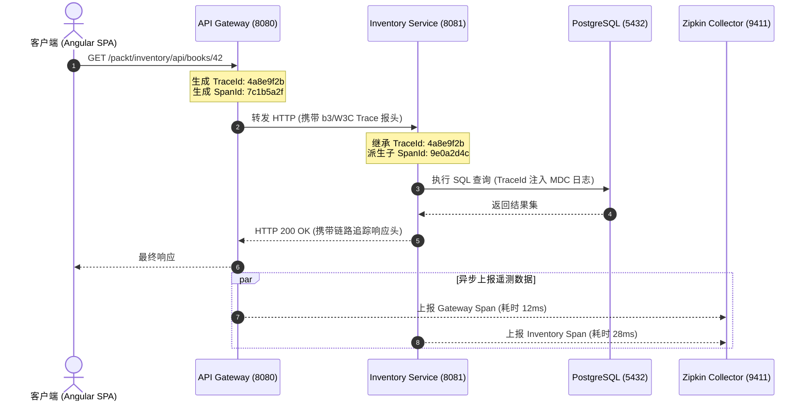

## 1. 契约驱动与分布式可观测性技术决策矩阵

### 1.1 OpenAPI 契约引擎选型对比

| 评估维度 | springdoc-openapi (推荐首选) | springfox-swagger2 (已弃用) | 手写静态 YAML/JSON |
| :--- | :--- | :--- | :--- |
| **运行时基线** | 原生兼容 Spring Boot 3/4 & Jakarta EE | 停更于 Spring Boot 2 时代，无法运行 | 独立于代码语言，纯静态维护 |
| **标准遵循** | 全面遵循 OpenAPI 3.0 / 3.1 规范 | 仅支持旧版 Swagger 2.0 规范 | 取决于编写者是否符合标准 |
| **注解生命周期** | 与 Controller 代码强绑定，随编译同步更新 | 需手工声明繁琐的 Docket Bean | 与代码解耦，极易发生契约漂移 (Contract Drift) |
| **Swagger UI 交互** | Starter 自动装配，开箱即用 | 依赖外部 UI 模块且存在路径冲突 | 需独立部署静态 HTTP 服务器托管 |

### 1.2 分布式链路追踪方案选型

| 方案 | 追踪门面 (Facade) | 收集与传输层 | 展示与检索端 | 选型权衡 |
| :--- | :--- | :--- | :--- | :--- |
| **Spring Boot 原生推荐** | Micrometer Tracing | Brave / Zipkin Reporter | Zipkin Server | **开发首选**：轻量级依赖，配置简洁，零字节码注入侵入 |
| **云原生工业级** | OpenTelemetry API | OTel Collector (gRPC) | Jaeger / Tempo | 适用于混合语言集群或已具备 OTel 基础设施的企业平台 |
| **传统方案 (已废弃)** | Spring Cloud Sleuth | Spring Cloud Sleuth Zipkin | Zipkin Server | Sleuth 在 Spring Boot 3 之后已被 Micrometer Tracing 彻底取代 |

---

## 2. SpringDoc OpenAPI 3 契约声明生产范式

在 Controller 中通过细粒度注解定义接口摘要、分页参数、成功载荷及标准化异常模型：

```java
package com.packt.bookstore.inventory_service.controller;

import com.packt.bookstore.inventory_service.dto.ApiError;
import com.packt.bookstore.inventory_service.dto.BookResponse;
import com.packt.bookstore.inventory_service.service.BookService;
import io.swagger.v3.oas.annotations.Operation;
import io.swagger.v3.oas.annotations.Parameter;
import io.swagger.v3.oas.annotations.media.ArraySchema;
import io.swagger.v3.oas.annotations.media.Content;
import io.swagger.v3.oas.annotations.media.ExampleObject;
import io.swagger.v3.oas.annotations.media.Schema;
import io.swagger.v3.oas.annotations.responses.ApiResponse;
import io.swagger.v3.oas.annotations.responses.ApiResponses;
import io.swagger.v3.oas.annotations.tags.Tag;
import org.springframework.data.domain.Page;
import org.springframework.data.domain.PageRequest;
import org.springframework.data.domain.Sort;
import org.springframework.http.ResponseEntity;
import org.springframework.web.bind.annotation.*;

@RestController
@RequestMapping("/api/books")
@Tag(name = "Book Inventory", description = "图书库存核心管理 API：分页检索、条件过滤与明细查询")
public class BookController {

    private final BookService bookService;

    public BookController(BookService bookService) {
        this.bookService = bookService;
    }

    @Operation(
            summary = "分页与排序检索图书清单",
            description = "支持基于页码、每页容量与指定字段方向（如 publishedYear,desc）进行动态排序分页查询。"
    )
    @ApiResponses(value = {
            @ApiResponse(
                    responseCode = "200",
                    description = "成功检索图书分页数据",
                    content = @Content(
                            mediaType = "application/json",
                            array = @ArraySchema(schema = @Schema(implementation = BookResponse.class)),
                            examples = @ExampleObject(
                                    name = "分页成功响应示例",
                                    value = """
                                            [
                                              {
                                                "id": 1,
                                                "isbn": "978-0134494166",
                                                "title": "Clean Architecture",
                                                "price": 49.99,
                                                "authorName": "Robert C. Martin",
                                                "publishedYear": 2017
                                              }
                                            ]
                                            """
                            )
                    )
            ),
            @ApiResponse(
                    responseCode = "400",
                    description = "请求参数不合法（如非法页码或未识别排序列）",
                    content = @Content(schema = @Schema(implementation = ApiError.class))
            ),
            @ApiResponse(
                    responseCode = "500",
                    description = "服务端内部未决异常",
                    content = @Content(schema = @Schema(implementation = ApiError.class))
            )
    })
    @GetMapping
    public ResponseEntity<Page<BookResponse>> getAllBooks(
            @Parameter(description = "分页索引（基于 0 开始）", example = "0")
            @RequestParam(defaultValue = "0") int page,
            @Parameter(description = "每页展示数量", example = "10")
            @RequestParam(defaultValue = "10") int size,
            @Parameter(description = "排序规则（格式：字段,方向）", example = "title,asc")
            @RequestParam(defaultValue = "title,asc") String sort
    ) {
        String[] sortParams = sort.split(",");
        Sort.Direction direction = sortParams.length > 1 && sortParams[1].equalsIgnoreCase("desc")
                ? Sort.Direction.DESC : Sort.Direction.ASC;
        PageRequest pageRequest = PageRequest.of(page, size, Sort.by(direction, sortParams[0]));
        return ResponseEntity.ok(bookService.findAll(pageRequest));
    }
}
```

---

## 3. MDC 结构化日志与 Micrometer Tracing 生产配置范式

在 `application.yml` 中配置 SLF4J MDC 链路注入、文件滚动策略与 Zipkin 全量/动态采样：

```yaml
spring:
  application:
    name: inventory-service

logging:
  pattern:
    # 注入标准链路坐标：[应用名, TraceID, SpanID]
    correlation: "[${spring.application.name:},%X{traceId:-},%X{spanId:-}]"
  include-application-name: false
  file:
    name: logs/inventory-service.log
  logback:
    rollingpolicy:
      max-file-size: 50MB
      max-history: 30
      total-size-cap: 1GB

management:
  tracing:
    sampling:
      # 开发测试环境设置为 1.0 (100% 采样)；高并发生产建议调优为 0.1 (10% 采样)
      probability: 1.0
    baggage:
      correlation:
        enabled: true
    export:
      zipkin:
        endpoint: http://localhost:9411/api/v2/spans
  endpoints:
    web:
      exposure:
        # 生产严禁使用 '*'，按需最小化暴露监控端点
        include: health, info, metrics, prometheus
  endpoint:
    health:
      show-details: when-authorized
```

---

## 4. 全链路可观测性排障闭环拓扑图



---

## 5. 架构避坑清单 (Do's & Don'ts)

| 错误实践 (Don't) | 正确实践 (Do) |
| :--- | :--- |
| 仅标注 200 成功响应，忽略 4xx/5xx 错误响应规范。 | 显式声明 `@ApiResponses`，并将通用异常结构统一建模为 `ApiError` 呈现给前端。 |
| 在 Spring Boot 3/4 架构中继续引入旧版 `springfox-swagger2`。 | 统一使用 `springdoc-openapi-starter-webmvc-ui`，拥抱标准 Jakarta 注解。 |
| 日志仅输出纯文本描述，缺少全局统一的分布式追踪标识。 | 配置 `logging.pattern.correlation`，通过 MDC 自动将 `traceId` 与 `spanId` 注入每行日志。 |
| 在反应式或异步线程池切换中直接丢失 MDC 上下文。 | 开启 Micrometer Tracing 上下文传播机制，或使用 `Hooks.enableAutomaticContextPropagation()`。 |
| 生产环境直接公网暴露 `/actuator/env`、`/actuator/heapdump` 等高危端点。 | 隔离管理端口（`management.server.port`），并在生产环境仅暴露 `health, metrics` 等必要探针。 |

<!-- split -->

# 原著完整参考：OpenAPI 规范驱动与全链路可观测性落地

在完成服务发现中心与 API 网关的基础建设后，微服务集群已具备动态互联与统一接入能力。然而，在复杂分布式工程实践中，服务协同摩擦与线上排障成本会随节点增长呈现几何级上升：
1. **接口协作鸿沟**：前端工程、移动端团队与第三方系统在联调后端接口时，若缺乏机器与人脑双重可读的权威契约，参数类型、必填校验与错误码全凭口头约定，导致集成效率低下；
2. **排障黑盒现象**：一次跨多节点的业务请求发生超时或报错时，若缺乏全链路因果关系追踪，排查人员不得不在离散的各节点日志中盲目检索。

为彻底解决上述工程痛点，分布式微服务必须确立两大支柱：
- **OpenAPI 规范驱动（OpenAPI 3 / Swagger）**：以标准契约形式明确定义系统对外暴露的交互结构；
- **全链路可观测性（Observability）**：融合指标（Metrics）、日志（Logs）与分布式追踪（Traces），实时还原系统运行状态。

:::en
> **Original**: OpenAPI specifications define clear contractual boundaries for RESTful services, while observability provides internal visibility through the unified collection of metrics, logs, and distributed traces.

**📌 核心术语与语境解析**：
- **Contract-First Development** [ˈkɑːntrækt fɜːrst dɪˈveləpmənt]：*契约优先开发*。在编码前后通过标准化规范确立接口出入参模型，指导端到端协同。
- **Observability** [əbˌzɜːrvəˈbɪləti]：*可观测性*。依据系统外部暴露的遥测输出（Logs, Metrics, Traces）推断系统内部实时健康状态的能力。
:::

---

## 1. OpenAPI 3.0 规范核心要素与 SpringDoc 架构演进

### 1.1 OpenAPI 规范关键要素构成

OpenAPI 规范（OAS）是目前行业描述 RESTful API 的通用事实标准。完整的 OAS 描述文件涵盖以下核心部分：

| 规范要素 | 说明与技术内涵 |
| :--- | :--- |
| **Paths（路径）** | 系统暴露的所有 URI 资源路径（如 `/api/books`、`/api/users/{id}`） |
| **Methods（操作动词）** | 端点支持的 HTTP 行为语义（GET 查询、POST 创建、PUT 全量替换、DELETE 删除） |
| **Parameters（入参声明）** | 路径参数（Path）、查询参数（Query）、请求头（Header）的必填与类型约束 |
| **Schemas（数据架构）** | 请求体与响应体 DTO 的结构定义、字段规则、校验约束与示例取值 |
| **Responses（响应清单）** | 明确约定的 HTTP 状态码及其关联的数据模型（200 OK、400 Bad Request、404 Not Found） |

### 1.2 选型演化：从 Springfox 到 SpringDoc

在 Spring Boot 2 时代广泛采用的 `Swagger-Springfox` 已经彻底停止维护，无法运行于现代 Spring Boot 3/4 与 Jakarta EE 运行时。

**springdoc-openapi** 是现代 Spring 生态的标准官方推荐方案：
- 原生兼容 Spring 6、Spring Boot 3/4 与 Jakarta EE 命名空间；
- 开箱集成 Swagger UI，仅需引入单个 Starter 依赖即可自动完成装配；
- 完全基于 `io.swagger.v3.oas.annotations` 标准注解，摆脱非标专有注解；
- 紧跟 Spring Framework 核心版本迭代，支持 WebMvc 与 WebFlux 两种运行时。

### 1.3 依赖引入与端点暴露验证

在微服务工程 `pom.xml` 中引入 SpringDoc WebMvc Starter：

```xml
<dependency>
  <groupId>org.springdoc</groupId>
  <artifactId>springdoc-openapi-starter-webmvc-ui</artifactId>
  <version>3.0.3</version>
</dependency>
```

Spring Boot 启动时会自动扫描 `@RestController` 并暴露两组标准端点：
- **机器可读 OpenAPI 契约 JSON**：`http://localhost:8081/inventory/v3/api-docs`（可直接供前端类型生成器或自动化测试工具消费）；
- **人机交互可视化控制台**：`http://localhost:8081/inventory/swagger-ui.html`。

启动服务并访问 UI 控制台，即可展示由 SpringDoc 动态推导生成的接口界面：


---

## 2. 规范驱动实战：高可用 API 元数据标注

SpringDoc 虽具备反射推导能力，但在生产环境中必须通过注解显式补齐业务语义与异常模型。

### 2.1 核心注解作用域

1. **`@Tag`**：控制器层面的业务分组标签（如“图书库存管理”）；
2. **`@Operation`**：端点方法级摘要（summary）与技术描述（description），支持 Markdown 语法；
3. **`@Parameter`**：明确入参语义、是否必须、默认值及调试样本；
4. **`@ApiResponses` / `@ApiResponse`**：枚举端点可能产出的全部状态码；
5. **`@Content` / `@Schema`**：描述载荷数据模型；
6. **`@ExampleObject`**：提供真实场景的 Mock 响应样本。

### 2.2 生产级 Controller 契约实现

```java
package com.packt.bookstore.inventory_service.controller;

import com.packt.bookstore.inventory_service.dto.ApiError;
import com.packt.bookstore.inventory_service.dto.BookResponse;
import com.packt.bookstore.inventory_service.service.BookService;
import io.swagger.v3.oas.annotations.Operation;
import io.swagger.v3.oas.annotations.Parameter;
import io.swagger.v3.oas.annotations.media.ArraySchema;
import io.swagger.v3.oas.annotations.media.Content;
import io.swagger.v3.oas.annotations.media.ExampleObject;
import io.swagger.v3.oas.annotations.media.Schema;
import io.swagger.v3.oas.annotations.responses.ApiResponse;
import io.swagger.v3.oas.annotations.responses.ApiResponses;
import io.swagger.v3.oas.annotations.tags.Tag;
import org.slf4j.Logger;
import org.slf4j.LoggerFactory;
import org.springframework.data.domain.Page;
import org.springframework.data.domain.PageRequest;
import org.springframework.data.domain.Sort;
import org.springframework.http.ResponseEntity;
import org.springframework.web.bind.annotation.*;

@RestController
@RequestMapping("/api/books")
@Tag(name = "Book Inventory", description = "图书库存管理核心 API：涵盖分页查询、详情检索与上架管理")
public class BookController {

    private static final Logger log = LoggerFactory.getLogger(BookController.class);
    private final BookService bookService;

    public BookController(BookService bookService) {
        this.bookService = bookService;
    }

    @Operation(
            summary = "分页与排序获取图书列表",
            description = """
                    从库存微服务中按分页检索图书集合，提供全功能过滤与多字段动态排序。
                    
                    **调用示例：**
                    - 第一页（每页 10 条）：`GET /api/books?page=0&size=10`
                    - 按出版年份降序：`GET /api/books?page=0&size=10&sort=publishedYear,desc`
                    """
    )
    @ApiResponses(value = {
            @ApiResponse(
                    responseCode = "200",
                    description = "成功查询并返回图书分页列表",
                    content = @Content(
                            mediaType = "application/json",
                            array = @ArraySchema(schema = @Schema(implementation = BookResponse.class)),
                            examples = @ExampleObject(
                                    name = "标准成功分页响应样本",
                                    value = """
                                            [
                                              {
                                                "id": 1,
                                                "isbn": "978-0134494166",
                                                "title": "Clean Architecture",
                                                "price": 49.99,
                                                "authorName": "Robert C. Martin",
                                                "publishedYear": 2017
                                              }
                                            ]
                                            """
                            )
                    )
            ),
            @ApiResponse(
                    responseCode = "400",
                    description = "请求参数非法（如页码为负数、非法排序列等）",
                    content = @Content(schema = @Schema(implementation = ApiError.class))
            ),
            @ApiResponse(
                    responseCode = "500",
                    description = "服务器内部未知异常",
                    content = @Content(schema = @Schema(implementation = ApiError.class))
            )
    })
    @GetMapping
    public ResponseEntity<Page<BookResponse>> getAllBooks(
            @Parameter(description = "页码索引，基于 0 开始", example = "0")
            @RequestParam(defaultValue = "0") int page,
            @Parameter(description = "每页展示条数", example = "10")
            @RequestParam(defaultValue = "10") int size,
            @Parameter(description = "排序字段及方向（如 title,asc）", example = "title,asc")
            @RequestParam(defaultValue = "title,asc") String sort
    ) {
        log.info("Fetching books - page: {}, size: {}, sort: {}", page, size, sort);
        String[] sortParams = sort.split(",");
        Sort.Direction direction = sortParams.length > 1 && sortParams[1].equalsIgnoreCase("desc")
                ? Sort.Direction.DESC : Sort.Direction.ASC;
        PageRequest pageRequest = PageRequest.of(page, size, Sort.by(direction, sortParams[0]));
        return ResponseEntity.ok(bookService.findAll(pageRequest));
    }

    @Operation(summary = "按唯一 ID 获取图书详情", description = "依据全局自增主键检索图书详情，若不存在则返回 404")
    @ApiResponses(value = {
            @ApiResponse(responseCode = "200", description = "图书存在并返回详情", content = @Content(schema = @Schema(implementation = BookResponse.class))),
            @ApiResponse(responseCode = "404", description = "指定 ID 图书不存在", content = @Content(schema = @Schema(implementation = ApiError.class)))
    })
    @GetMapping("/{id}")
    public ResponseEntity<BookResponse> getBookById(
            @Parameter(description = "图书全局唯一 ID", example = "42", required = true)
            @PathVariable Long id
    ) {
        log.info("Fetching book with id {}", id);
        BookResponse book = bookService.findOne(id);
        log.info("Successfully retrieved book: {}", book.title());
        return ResponseEntity.ok(book);
    }
}
```

---

## 3. 微服务可观测性三大支柱

微服务在运行态是动态交织的网络。可观测性的核心在于**能否通过系统外部暴露的数据完全推导出系统内部当前真实运行状态**。


| 支柱维度 | 数据特征 | 核心职能与场景 |
| :--- | :--- | :--- |
| **Logs（日志）** | 携带时间戳的离散事件文本流 | 记录调用入参、堆栈上下文与 SQL 明细，用于**根因分析与安全审计** |
| **Metrics（指标）** | 按时间聚合的可度量数值（Counter, Gauge, Timer） | 反映系统运行大盘与吞吐走势（QPS、JVM 堆内存、P99 响应耗时），用于**阈值预警** |
| **Traces（追踪）** | 单次请求横跨多服务的时序有向无环图 | 绘制请求跨越各微服务与持久层的跳点与耗时，用于**定位链路瓶颈与级联延迟** |

:::en
> **Original**: Distributed tracing records the path of requests through a microservice network, correlating logs and metrics via unique Trace and Span IDs across process boundaries.

**📌 核心术语与语境解析**：
- **Trace ID** [treɪs aɪˈdiː]：*链路全局追踪标识*。贯穿一次请求全生命周期的唯一标示，跨所有微服务节点保持一致。
- **Span ID** [spæn aɪˈdiː]：*工作单元分段标识*。单次网络跳转、服务处理或数据库查询的局部唯一标识，具有父子嵌套关系。
:::

---

## 4. 结构化日志与 MDC 链路元数据注入

在微服务并发场景下，若无链路标识，多实例并发输出的日志将交织混杂。通过 **SLF4J + Logback** 的 **MDC（Mapped Diagnostic Context）** 机制，可将请求上下文中的 `traceId` 与 `spanId` 自动注入日志模板中。

### 4.1 配置 `application.yml` 格式规范与文件滚动

```yaml
logging:
  pattern:
    correlation: "[${spring.application.name:},%X{traceId:-},%X{spanId:-}]"
  include-application-name: false
  
  level:
    "[com.packt.bookstore]": INFO
    "[org.hibernate.SQL]": DEBUG
    "[org.hibernate.orm.jdbc.bind]": TRACE
    "[org.springframework.web]": INFO

  file:
    name: logs/inventory-service.log
  logback:
    rollingpolicy:
      max-file-size: 50MB
      max-history: 30
      total-size-cap: 1GB
```

运行输出的日志格式具备统一的链路特征：

```text
2026-10-23T10:15:30.102+08:00  INFO [inventory-service,4a8e9f2b1d3c0e12,7c1b5a2f8e4d3c2a] 48210 --- [nio-8081-exec-2] c.p.b.i.c.BookController : Fetching book with id 42
2026-10-23T10:15:30.125+08:00 DEBUG [inventory-service,4a8e9f2b1d3c0e12,7c1b5a2f8e4d3c2a] 48210 --- [nio-8081-exec-2] org.hibernate.SQL        : select b1_0.id,b1_0.title,b1_0.price from books b1_0 where b1_0.id=?
2026-10-23T10:15:30.130+08:00  INFO [inventory-service,4a8e9f2b1d3c0e12,7c1b5a2f8e4d3c2a] 48210 --- [nio-8081-exec-2] c.p.b.i.c.BookController : Successfully retrieved book: Clean Architecture
```

虽产生多行不同层级的输出，但它们具有相同的 `traceId`（`4a8e9f2b1d3c0e12`），使得分布式日志归集与精确检索变得简单可靠。

:::en
> **Original**: Mapped Diagnostic Context (MDC) allows developers to enrich log statements with context-specific key-value pairs that are managed on a per-thread basis.

**📌 核心术语与语境解析**：
- **Mapped Diagnostic Context (MDC)** [mæpt ˌdaɪəɡˈnɑːstɪk ˈkɑːntekst]：*诊断上下文映射*。在线程本地变量中维护键值对上下文，并自动嵌入日志格式输出的底层技术。
- **Log Correlation** [lɔːɡ ˌkɔːrəˈleɪʃn]：*日志链路关联*。利用全局追踪 ID 聚合不同服务实例日志的审计追踪手段。
:::

---

## 5. 分布式链路追踪实战：Micrometer Tracing + Brave + Zipkin

### 5.1 架构演进与门面抽象

在 Spring Boot 3/4 中，**Micrometer Tracing** 作为统一的追踪门面，底层解耦了具体追踪引擎，可无缝对接 **Brave**（Zipkin 官方驱动）或 **OpenTelemetry**。


### 5.2 依赖引入与采样配置

在网关与各微服务中统一添加依赖：

```xml
<dependency>
  <groupId>io.micrometer</groupId>
  <artifactId>micrometer-tracing-bridge-brave</artifactId>
</dependency>
<dependency>
  <groupId>io.zipkin.reporter2</groupId>
  <artifactId>zipkin-reporter-brave</artifactId>
</dependency>
```

在 `application.yml` 中配置采样策略与上报地址：

```yaml
spring:
  application:
    name: inventory-service

management:
  tracing:
    sampling:
      probability: 1.0
    baggage:
      correlation:
        enabled: true
    export:
      zipkin:
        endpoint: http://localhost:9411/api/v2/spans
```

### 5.3 运行 Zipkin 收集服务

通过 Docker 一行命令启动 Zipkin 实例：

```bash
docker run -d -p 9411:9411 --name zipkin openzipkin/zipkin
```

### 5.4 端到端追踪验证与拓扑展开

通过 API 网关发起请求测试：

```bash
curl -i http://localhost:8080/packt/inventory/api/books/42
```

访问 `http://localhost:9411`，在 Zipkin 检索页面点击链路详情，可展开完整的调用时序图谱：


图谱完整还原了调用链路：
1. **Gateway 阶段**：请求到达 `gateway-server`，完成断言匹配与路径重写，耗时 12ms；
2. **RPC 转发阶段**：网关向 `inventory-service` 发起非阻塞 HTTP 调用；
3. **微服务内部阶段**：`inventory-service` 进入 Controller、执行 JPA 查询并序列化响应，总耗时 28ms。

若出现异常，Zipkin 会以高亮红色标明故障 Span 并展示异常堆栈，实现故障快速归因。

---

## 6. 生产环境安全加固：治理可观测性端点暴露面

在生产环境中，**系统的内部可见性绝不能等同于公网开放性**。未受防护的 Actuator 端点可能泄露致命攻击面：

| 暴露端点 | 潜在安全风险 |
| :--- | :--- |
| `/actuator/env` | 泄露系统环境变量、配置中心明文、数据库密码与秘钥 |
| `/actuator/beans` | 暴露容器中全部 Bean 依赖网络与全限定类名 |
| `/actuator/heapdump` | 允许外部下载 JVM 内存堆镜像，窃取明文会话与敏感凭据 |
| `/v3/api-docs` / `/swagger-ui.html` | 为攻击者提供系统未公开内部 API 的完整攻击靶场清单 |

:::en
> **Original**: Actuator management endpoints must be isolated and protected behind strict network policies and role-based authorization to prevent unauthorized access to sensitive runtime configurations.

**📌 核心术语与语境解析**：
- **Attack Surface** [əˈtæk ˈsɜːrfɪs]：*攻击面*。未授权用户或恶意程序能够访问并尝试利用的系统可访问端点集合。
- **Principle of Least Privilege** [ˈprɪnsəpl əv liːst ˈprɪvəlɪdʒ]：*最小特权原则*。仅为特定主体开放完成其职责所必须的最小权限与暴露面。
:::

### 生产防护核心策略

1. **管理端口独立隔离**：配置 `management.server.port=8089`，使 Actuator 监听内网专属运维网卡，反向代理禁止将该端口对公网透传；
2. **最小暴露原则**：生产环境严禁配置 `include: "*"`，仅暴露业务运行探针（如 `health, metrics`）；
3. **基于安全框架实施 RBAC 管控**：所有管理端点接入 Spring Security，实施严格的身份认证与访问控制。

---

## 7. 总结与下篇展望

本文确立了微服务的两大稳健基石：
- **OpenAPI 3 契约工程**：借助 `springdoc-openapi` 将接口注解与代码生命周期合二为一，生成了标准化契约与交互式控制台；
- **结构化日志与 MDC 机制**：将 `traceId` 与 `spanId` 自动注入每行日志，实现跨服务因果追溯；
- **分布式链路追踪**：依托 Micrometer Tracing 与 Zipkin，实现了跨网关、微服务与持久层的毫秒级调用监控与时序可视化；
- **端点安全防护**：明确了生产环境监控端点的最小暴露与网络隔离防线。

在下一篇文章中，我们将步入系统安全的核心地带：**集成 Spring Security 与 Keycloak 构建企业级身份认证与授权中心（IAM）**，落地基于 OAuth2 / OpenID Connect 的全站无状态 JWT 验签与细粒度 RBAC 权限控制！
