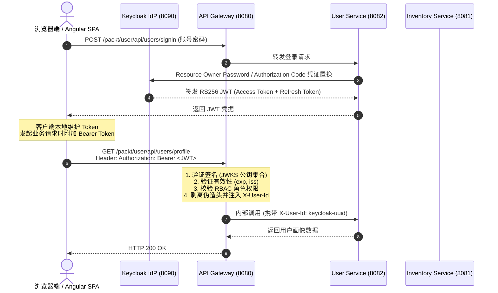

## 1. 身份认证与微服务安全技术决策矩阵

### 1.1 身份提供商 (IdP) 选型对比

| 方案 | 部署形态 | 协议标准支持 | 适用场景与决策依据 |
| :--- | :--- | :--- | :--- |
| **Keycloak (推荐)** | 自托管容器化 (Docker/K8s) | OAuth2, OIDC, SAML 2.0 | **企业自建首选**：开箱即用用户管理界面、多租户 Realm 隔离、完善的 REST Admin API |
| **Auth0 / Okta** | 全托管 SaaS 云服务 | OAuth2, OIDC | 适合无自建运维预算的团队，但存在数据合规要求与高并发商业计费成本 |
| **Spring Authorization Server** | 嵌入式 Java 框架 | OAuth2, OIDC | 灵活度极高，但需要自行开发全部控制台、用户注册与凭证重置等通用支撑业务 |

### 1.2 微服务安全拓扑架构对比

| 模式 | 鉴权发生位置 | 内部传递凭证 | 优势与弊端 |
| :--- | :--- | :--- | :--- |
| **网关中心化鉴权 (采用)** | API Gateway (边缘层) | 剥离伪造头后传递 `X-User-Id` | **推荐**：下游服务彻底轻量化，零 Security 依赖，性能最佳；要求严格隔离内网网络 |
| **分布式全节点验签** | Gateway + 各个下游微服务 | 透传原始 Bearer JWT | 安全边界高，但每个微服务均需挂载 Security 依赖与 JWKS 缓存，增加依赖版本冲突风险 |
| **单体式 Session 共享** | 共享 Redis Session | Cookie 会话标识 | 违背微服务无状态设计，限制前端移动端多通道复用能力 |

---

## 2. API 网关反应式安全过滤链与 JWT 角色适配器范式

在 Spring Cloud Gateway 中配置响应式 WebFlux 安全链，并将 Keycloak 嵌套的 `realm_access.roles` 映射为 Spring Security 标准权限：

```java
package com.packt.bookstore.gateway_server.config;

import org.springframework.context.annotation.Bean;
import org.springframework.context.annotation.Configuration;
import org.springframework.http.HttpMethod;
import org.springframework.security.config.annotation.web.reactive.EnableWebFluxSecurity;
import org.springframework.security.config.web.server.ServerHttpSecurity;
import org.springframework.security.core.authority.SimpleGrantedAuthority;
import org.springframework.security.oauth2.server.resource.authentication.JwtAuthenticationConverter;
import org.springframework.security.oauth2.server.resource.authentication.ReactiveJwtAuthenticationConverterAdapter;
import org.springframework.security.web.server.SecurityWebFilterChain;
import org.springframework.web.cors.CorsConfiguration;
import org.springframework.web.cors.reactive.CorsConfigurationSource;
import org.springframework.web.cors.reactive.UrlBasedCorsConfigurationSource;

import java.util.Collection;
import java.util.Collections;
import java.util.List;
import java.util.Map;
import java.util.stream.Collectors;

@Configuration
@EnableWebFluxSecurity
public class SecurityConfig {

    @Bean
    public SecurityWebFilterChain securityWebFilterChain(ServerHttpSecurity http) {
        return http
                .csrf(ServerHttpSecurity.CsrfSpec::disable)
                .cors(cors -> cors.configurationSource(corsConfigurationSource()))
                .authorizeExchange(exchanges -> exchanges
                        // 1. 公开端点放行
                        .pathMatchers("/actuator/**").permitAll()
                        .pathMatchers(HttpMethod.POST, "/packt/user/api/users/signup").permitAll()
                        .pathMatchers(HttpMethod.POST, "/packt/user/api/users/signin").permitAll()
                        .pathMatchers(HttpMethod.GET, "/packt/inventory/api/books/**").permitAll()
                        // 2. 细粒度 RBAC 权限拦截
                        .pathMatchers(HttpMethod.DELETE, "/packt/inventory/api/books/**").hasRole("ADMIN")
                        .pathMatchers(HttpMethod.POST, "/packt/inventory/api/books/**").hasAnyRole("ADMIN", "AUTHOR")
                        .pathMatchers(HttpMethod.PUT, "/packt/inventory/api/books/**").hasAnyRole("ADMIN", "AUTHOR")
                        .pathMatchers(HttpMethod.PATCH, "/packt/inventory/api/books/**").hasAnyRole("ADMIN", "AUTHOR")
                        // 3. 用户资料保护端点
                        .pathMatchers("/packt/user/api/users/profile/**").authenticated()
                        .anyExchange().authenticated()
                )
                .oauth2ResourceServer(oauth2 -> oauth2
                        .jwt(jwt -> jwt.jwtAuthenticationConverter(jwtAuthenticationConverter())))
                .build();
    }

    private ReactiveJwtAuthenticationConverterAdapter jwtAuthenticationConverter() {
        JwtAuthenticationConverter converter = new JwtAuthenticationConverter();
        converter.setJwtGrantedAuthoritiesConverter(jwt -> {
            Map<String, Object> realmAccess = jwt.getClaim("realm_access");
            if (realmAccess == null || !realmAccess.containsKey("roles")) {
                return Collections.emptyList();
            }
            Collection<String> roles = (Collection<String>) realmAccess.get("roles");
            return roles.stream()
                    .map(role -> new SimpleGrantedAuthority("ROLE_" + role.toUpperCase()))
                    .collect(Collectors.toList());
        });
        return new ReactiveJwtAuthenticationConverterAdapter(converter);
    }

    @Bean
    public CorsConfigurationSource corsConfigurationSource() {
        CorsConfiguration config = new CorsConfiguration();
        config.setAllowedOrigins(List.of("http://localhost:4200", "http://localhost:8080"));
        config.setAllowedMethods(List.of("GET", "POST", "PUT", "PATCH", "DELETE", "OPTIONS"));
        config.setAllowedHeaders(List.of("*"));
        config.setAllowCredentials(true);
        UrlBasedCorsConfigurationSource source = new UrlBasedCorsConfigurationSource();
        source.registerCorsConfiguration("/**", config);
        return source;
    }
}
```

---

## 3. 防注入安全头剥离与身份传递过滤器范式

网关在将请求转发至内部微服务前，必须先剔除客户端可能自行伪造的上行标头，再将经过非对称签名校验的用户主体注入受信任标头：

```java
package com.packt.bookstore.gateway_server.filter;

import org.springframework.cloud.gateway.filter.GatewayFilter;
import org.springframework.cloud.gateway.filter.factory.AbstractGatewayFilterFactory;
import org.springframework.http.server.reactive.ServerHttpRequest;
import org.springframework.security.oauth2.server.resource.authentication.JwtAuthenticationToken;
import org.springframework.stereotype.Component;

@Component
public class AddUserIdHeaderGatewayFilter extends AbstractGatewayFilterFactory<Object> {

    @Override
    public GatewayFilter apply(Object config) {
        return (exchange, chain) -> exchange.getPrincipal()
                .filter(principal -> principal instanceof JwtAuthenticationToken)
                .cast(JwtAuthenticationToken.class)
                .map(JwtAuthenticationToken::getToken)
                .map(jwt -> {
                    String userId = jwt.getSubject();
                    String email = jwt.getClaimAsString("email");
                    String preferredUsername = jwt.getClaimAsString("preferred_username");

                    // 核心安全防御：剔除客户端自送伪造头，仅透传受信任的 JWT 签名提取数据
                    ServerHttpRequest mutatedRequest = exchange.getRequest().mutate()
                            .headers(headers -> {
                                headers.remove("X-User-Id");
                                headers.remove("X-User-Email");
                                headers.remove("X-User-Name");
                            })
                            .header("X-User-Id", userId)
                            .header("X-User-Email", email != null ? email : "")
                            .header("X-User-Name", preferredUsername != null ? preferredUsername : "")
                            .build();

                    return exchange.mutate().request(mutatedRequest).build();
                })
                .defaultIfEmpty(exchange)
                .flatMap(chain::filter);
    }
}
```

---

## 4. 轻量级下游业务微服务与 Keycloak 集成范式

下游微服务无需引入厚重的 Spring Security 依赖，直接通过 `@RequestHeader("X-User-Id")` 消费网关注入的身份上下文：

```java
package com.packt.bookstore.user_service.controller;

import com.packt.bookstore.user_service.dto.UserProfileDTO;
import com.packt.bookstore.user_service.dto.UpdateProfileRequest;
import com.packt.bookstore.user_service.service.UserService;
import jakarta.validation.Valid;
import org.springframework.http.ResponseEntity;
import org.springframework.web.bind.annotation.*;

@RestController
@RequestMapping("/api/users")
public class UserController {

    private final UserService userService;

    public UserController(UserService userService) {
        this.userService = userService;
    }

    @GetMapping("/profile")
    public ResponseEntity<UserProfileDTO> getProfile(
            @RequestHeader("X-User-Id") String keycloakId) {
        return ResponseEntity.ok(userService.getProfile(keycloakId));
    }

    @PutMapping("/profile")
    public ResponseEntity<UserProfileDTO> updateProfile(
            @RequestHeader("X-User-Id") String keycloakId,
            @Valid @RequestBody UpdateProfileRequest request) {
        return ResponseEntity.ok(userService.updateProfile(keycloakId, request));
    }
}
```

---

## 5. 微服务三层安全拓扑与 Token 流转图



---

## 6. 架构避坑清单 (Do's & Don'ts)

| 错误实践 (Don't) | 正确实践 (Do) |
| :--- | :--- |
| 直接信任入站请求中携带的 `X-User-Id` 等内部身份标头。 | 网关必须在 Pre-Filter 链中显式执行 `headers.remove("X-User-Id")`，防止外部伪造请求头穿透内网。 |
| 在响应式 WebFlux 网关中调用阻塞式 I/O 代码（如 `jwt.block()`）。 | 严格采用响应式安全组件 `ReactiveJwtAuthenticationConverterAdapter` 与非阻塞响应式操作。 |
| 在下游每个微服务中均重复引入 `spring-boot-starter-security`。 | 坚持网关中心化鉴权边界，下游服务作为纯粹领域执行单元消费 `X-User-Id`，避免依赖冲突与性能损耗。 |
| 在生产环境中直接使用 Keycloak 的 `start-dev` 模式。 | 生产环境挂载独立 PostgreSQL 数据库，配置强 TLS 证书，并禁用直接公网暴露的管理端口。 |
| 每次请求均通过 RPC 向认证中心发起 Token 校验。 | 采用自包含 JWT 与非对称算法（RS256），网关缓存 JWKS 公钥集合进行本地毫秒级离线验签。 |

<!-- split -->

在前面的章节中，我们已经构建了现代化微服务架构的核心基石：将单体业务解耦为独立的微服务、实现了动态服务发现，并引入了 API 网关作为外部客户端的统一接入入口。这些基础设施让我们的服务能够可靠交互、独立水平伸缩，并向外部展现整洁一致的调用界面。然而，一旦服务面向网络暴露，**安全便成为了最高优先级的头等架构关注点（First-Class Architectural Concern）**。在分布式系统中，每一次跨网络跳转都是潜在的受攻击面，所有跨进程调用在默认情况下都必须被视作不可信。缺乏健壮的安全防御体系，微服务架构将极其脆弱、混乱并漏洞百出。

本章专注于为在线书店（Bookstore）系统建立一个集中化、标准化的安全防御架构。我们将引入现代身份管理理念，将认证职责全权委托给专用的身份提供商（Identity Provider, IdP），并依托 **Spring Boot Security** 与 **JSON Web Token（JWT）** 统一步骤地实施细粒度访问控制。通过将外部身份提供商与 Spring Security 深度整合，并在 API 网关层筑起第一道安全防线，我们确保进入系统的每一个 HTTP 请求都经过了严格的认证（Authentication）、授权（Authorization）与链路审计追踪。

学完本章后，你的微服务将不仅处于可寻址与可观测状态，更会被一套可水平扩展、无状态且生产就绪的安全模型严密保护。身份识别集中化、权限控制严格化，网关与下游各微服务的安全职责边界也将彻底划清。

本章核心涵盖以下主题：
- 微服务世界中的安全挑战与分层职责
- 安装与运行 Keycloak 身份认证中心
- 在 Bookstore 应用程序中实现微服务安全架构
- 全链路安全校验与角色访问权限演练

> **注意**
>
> 本章中的部分图片在纸质图书排版中字体可能偏小。我们保留了这些截图，因为它们真实反映了实际控制台界面的操作细节，方便你在自己的屏幕上比对演练。你也可以在本书前言提供的 *Graphics Bundle* 链接中查看并放大所有高清原图。

## 技术准备要求（Technical requirement）

本章涉及的完整源代码可通过以下链接获取：
`https://github.com/PacktPublishing/Spring-Boot-and-Angular-2E_Backend/tree/main/chapter-08`

---

## 微服务世界中的安全挑战与分层职责（Introducing security in a microservices world）

微服务架构中的安全问题与传统单体架构存在着本质差异。在单体应用中，系统只需在最外层的唯一入口（例如过滤器链）完成一次安全检查，后续调用均发生在受信任的进程内存中；而在微服务系统中，存在多个独立运行的服务进程，每一个服务都可能面临外部或内部的调用诉求。这种分布式物理分散性，导致跨系统管理用户身份凭据、授权策略与合规审计的复杂度呈指数级上升。

**以网关为中心的安全模型（Gateway-Centric Security Model）**是破解这一难题的标准答案。该架构将安全执行策略统筹收敛至 API 网关层，而非让每一个微服务各自重复编写认证鉴权逻辑。网关扮演着整个系统的**安全边界防线（Security Perimeter）**：它负责截获所有入站请求、校验 JWT 签名与有效期、实施粗粒度基于路径和角色的权限拦截，仅当请求合法有效时，才向下游微服务放行转发。下游微服务接收到的均是经过网关前置认证的“预清洗”请求，从而能够彻底摆脱繁杂的安全样板代码，纯粹专注于业务领域逻辑。

本章将详细介绍如何使用 **Spring Cloud Gateway**、**Spring Security** 以及 **Keycloak**（作为企业级身份提供商）落地该架构。这种模式契合现代**零信任（Zero-Trust）**安全准则——“永不信任，始终验证”，并通过响应式非阻塞事件循环为未来的高并发大流量提供了强劲的吞吐能力支撑。

### 按架构分层的安全职责划分（Security responsibilities by layer）

在 Bookstore 架构设计中，安全职责是有意进行纵深分层的：
- **API 网关（API Gateway）**：负责认证请求、校验 JWT 完整性与签名、执行粗粒度权限拦截，并在边缘层及早将未授权非法流量阻断；
- **各业务微服务（Microservices）**：假定所接收到的流量均已通过网关前置认证，按需在方法级执行细粒度领域授权；
- **身份提供商（Identity Provider, IdP）**：作为整个系统的安全大脑，统一集中管理用户生命周期、角色分配、公私钥密钥对以及令牌发放与吊销。


*图 8.1：按架构分层的安全职责划分模型*

### 身份管理的演进脉络（The evolution of identity management）

在过去，应用程序通常将用户表（包含用户名与哈希密码）直接保存在本地业务数据库中。这种做法在微服务时代暴露出严重缺陷：
- 每个微服务都需要直连用户表，产生紧耦合；
- 密码加密算法升级困难，难以统一实施防暴力破解、双因素认证（2FA）及密码过期策略；
- 无法支持跨系统单点登录（SSO）与第三方社交登录（如 Google、GitHub 账号登录）。

现代架构演进将**身份认证（Identity & Authentication）**作为独立的基础设施完全外置，交由专业的 IAM（Identity and Access Management）平台接管。业务服务不再接触、存储任何用户密码，仅通过标准数字令牌感知用户身份。

### 核心概念与行业标准（Core concepts and standards）

为了实现无状态且标准化的安全通信，微服务安全依托于三大国际开放标准：

#### JSON Web Token (JWT)

**JWT（RFC 7519）** 是一种开放的紧凑型自包含数字令牌规范。它由三部分经 Base64URL 编码后通过英文句号（`.`）连接而成：
1. **Header（标头）**：声明令牌类型（`JWT`）与所使用的非对称数字签名算法（如 `RS256`）；
2. **Payload（载荷）**：存储声明数据（Claims），包括发行者（`iss`）、用户唯一标识（`sub`）、过期时间（`exp`）以及用户所属角色权限（如 `realm_access.roles`）；
3. **Signature（签名）**：由认证中心使用私钥对 Header 和 Payload 进行哈希签名，资源服务器使用认证中心的公钥即可在本地无状态离线验签。

#### OAuth 2.0

**OAuth 2.0（RFC 6749）** 是全球通用的行业标准授权框架。它定义了四种核心角色（资源所有者、客户端、授权服务器、资源服务器）以及多种授权模式（如授权码模式 Authorization Code Flow、客户端凭据模式 Client Credentials Flow），使得第三方客户端可以在无需知晓用户明文账号密码的前提下，获得对受保护资源的受限访问授权。

#### OpenID Connect (OIDC)

**OpenID Connect（OIDC）** 是构建在 OAuth 2.0 基础之上的轻量级身份认证层。OAuth 2.0 专注于“你能访问什么（授权）”，而 OIDC 则通过引入标准的 **ID Token** 规范解答了“你是谁（认证）”，并标准化了 `/userinfo` 与元数据自动发现端点（`/.well-known/openid-configuration`）。

### Spring Security 核心原理（Spring Security fundamentals）

Spring Security 是 Java 企业级应用安全的黄金标准。在传统的 Servlet 环境中，它通过一组级联的 `Filter` 拦截链对请求进行过滤审查；而在 Spring Cloud Gateway 这种基于 Netty 的响应式环境（WebFlux）下，它采用了非阻塞的 `WebFilter` 反应式管道。

权限规则通过声明式语法指定哪些路径和 HTTP 动词需要哪些角色权限：
- `hasRole("ADMIN")`：检查当前主体是否持有指定角色（在 Spring 体系下自动补齐 `ROLE_` 前缀）；
- `hasAnyRole("USER", "AUTHOR", "ADMIN")`：允许持有任一角色的用户访问；
- Ant 风格通配符路径匹配器（如 `/packt/inventory/api/**`）。


*图 8.2：Spring Security 安全上下文流转图*

在网关层，安全配置通过 `ServerHttpSecurity` DSL 进行编排，并返回一个响应式的 `SecurityWebFilterChain` 对象，确保所有的安全验签与权限判定都在非阻塞的 Reactor 线程池中毫秒级完成，毫无线程挂起阻塞。

---

## 安装与运行 Keycloak 统一身份认证中心（Installing and running Keycloak）

**Keycloak** 是由 Red Hat 赞助维护的顶级开源 IAM 解决方案，全面支持 OAuth 2.0、OpenID Connect 和 SAML 2.0，提供单点登录、细粒度授权、用户联合及完善的管理控制台。

为了在本地敏捷搭建，我们使用官方 Docker 镜像拉起一个 Keycloak 26.0.0 实例：

```bash
docker run -d \
  --name bookstore-keycloak \
  -e KEYCLOAK_ADMIN=admin \
  -e KEYCLOAK_ADMIN_PASSWORD=admin \
  -e KC_HTTP_PORT=8090 \
  -p 8090:8090 \
  quay.io/keycloak/keycloak:26.0.0 \
  start-dev
```

命令核心参数说明：
- `-d`：后台常驻运行；
- `-e KEYCLOAK_ADMIN=admin` 与 `-e KEYCLOAK_ADMIN_PASSWORD=admin`：设置初始超级管理员账号与密码；
- `-e KC_HTTP_PORT=8090 -p 8090:8090`：将 Keycloak 服务端口映射至宿主机的 `8090`，避免与网关的 8080 或微服务的 8081/8082 产生端口冲突；
- `start-dev`：以开发模式启动（内置轻量 H2 数据库，免去外部数据库配置）。

> **注意**
>
> `start-dev` 命令禁用了 TLS 证书强制校验并使用内存数据库，仅供本地开发与工作坊快速演练。生产环境中必须指定独立的持久化 PostgreSQL 数据库，并挂载正式的 HTTPS/TLS 证书文件。

执行以下命令确认容器正常就绪：

```bash
docker ps | grep keycloak
```

### 访问 Keycloak 管理控制台（Accessing the Keycloak admin console）

在浏览器中打开：
`http://localhost:8090/admin`

输入初始管理员凭据（用户名 `admin`，密码 `admin`）登录：


*图 8.3：Keycloak 管理员登录控制台界面*

登录成功后，即可进入 Keycloak 管理控制台的全局首页视图：


*图 8.4：Keycloak 管理后台首页*

### 创建 bookstore 专用安全领域（Creating the bookstore realm）

在 Keycloak 中，**Realm（领域）** 是一个完全隔离的安全命名空间，拥有各自独立的用户群、角色集合、客户端应用与安全策略。

点击控制台左上角的 Realm 选择下拉框（当前为 `master`），选择 **Create Realm**。在领域名称输入框中填入 `bookstore`，确认 **Enabled** 开关处于开启状态，点击 **Create**：


*图 8.5：创建 bookstore 专属领域（Realm）*

创建完毕后，浏览器地址栏将显示 `/admin/master/console/#/bookstore`。后续所有的配置操作均在该领域内进行。

### 为在线书店平台创建角色（Creating roles for the bookstore platform）

点击左侧导航栏的 **Realm roles**，点击 **Create role**，依次创建 Bookstore 业务所需的三大核心角色：
1. `admin`：系统超级管理员，具备全量图书增删改查、用户冻结及全域运维权限；
2. `author`：图书作者角色，具备向库存服务录入新书、修改自身图书元数据的权限；
3. `user`：普通终端消费者，具备浏览书单、检索商品及下单购买的通用权限。


*图 8.6：在 Keycloak 中创建角色*

### 创建测试用户并分配角色映射（Creating test users and assigning roles）

为了支持本地调试与端到端安全测试，我们在控制台中创建三类代表性用户：

#### 创建管理员用户（admin-user）
1. 点击左侧 **Users** -> **Add user**；
2. 填写 Username 为 `admin-user`，Email 为 `admin@bookstore.com`，First name 为 `Admin`，Last name 为 `User`，开启 **Email verified**，点击 **Create**；

*图 8.7：在 Keycloak 中创建测试用户*
3. 进入 **Credentials** 标签页，点击 **Set password**，设置密码为 `Password123!`，将 **Temporary**（临时密码强制重置）开关关闭，点击 **Save** 保存；

*图 8.8：配置用户凭据与初始密码*
4. 进入 **Role mapping** 标签页，点击 **Assign role**，将先前创建的 `admin` 角色分配给该用户。

*图 8.9：为用户分配角色权限映射*

按照完全相同的步骤，分别创建：
- 作者用户：`author-user`，邮箱 `author@bookstore.com`，密码 `Password123!`，分配 `author` 角色；
- 普通用户：`test-user`，邮箱 `user@bookstore.com`，密码 `Password123!`，分配 `user` 角色。

完成后，用户列表视图应如图所示：


*图 8.10：Keycloak 用户管理列表视图*

### 注册 API 网关客户端应用（Registering the API gateway as a client）

在 Keycloak 中，任何需要与认证中心交互的应用程序都被视作 **Client（客户端）**。

点击左侧 **Clients** -> **Create client**：
1. **General Settings**：Client ID 填入 `bookstore-gateway`，Name 填入 `Bookstore Gateway Client`，点击 **Next**；

*图 8.11：Keycloak 创建客户端基础配置*
2. **Capability Config**：勾选 **Client authentication**（将其配置为机密客户端），并在 Authentication flow 中勾选 **Standard flow** 与 **Direct access grants**（允许通过用户名密码直接换取令牌，方便命令行 Curl 与移动端/Postman 测试），点击 **Next**；

*图 8.12：Keycloak 客户端功能与授权流配置*
3. **Login Settings**：在 Valid redirect URIs 中填入 `*` 或前端 Angular 本地调试地址（如 `http://localhost:4200/*`），Web origins 填入 `*`，点击 **Save**。

*图 8.13：Keycloak 客户端登录重定向设置*

### 开启用户自助注册与强密码策略（Enabling user self-registration and password policies）

为了允许终端读者直接在前端注册账号，进入 **Realm settings** -> **Login** 标签页，将 **User registration**、**Forgot password** 与 **Remember me** 开关全部开启并保存：


*图 8.14：Keycloak 领域设置启用自主注册*

接着进入 **Authentication** -> **Policies** -> **Password policy**，添加密码安全基线规则：最小长度 8 位、至少 1 个大写字母、1 个数字与 1 个特殊字符，防范弱口令风险：


*图 8.15：Keycloak 强密码安全策略配置*

至此，Keycloak 认证中心全量就绪。它现在扮演着 Bookstore 全局唯一的可信身份源，负责密码哈希、强类型 JWT 签发以及跨系统公钥广播。

---

## 在 Bookstore 应用程序中实现微服务安全架构（Implementing security in the Bookstore application）

身份认证中心准备就绪后，我们正式在 Spring Boot 微服务架构中落地安全执行机制。


*图 8.16：API 网关统一安全鉴权与请求流转图*

回顾上图所示的宏观安全拓扑：
1. **User 微服务（user-ms）** 纯粹处理用户档案等业务领域逻辑。它**不包含任何 Spring Security 依赖，不校验 JWT**，其注册与登录接口负责通过 REST 代理与 Keycloak 的 Admin API 和 Token 端点交互；
2. **API 网关（gateway-server）** 充当 OAuth2 Resource Server。所有外部请求由网关拦截并对 JWT 验签；验签通过后，网关从 JWT 的声明中解析出用户的唯一 Keycloak ID，并将其作为受信任的 HTTP 请求头（`X-User-Id`）注入转发给下游微服务；
3. **受信任的内部微服务** 直接消费 `X-User-Id` 进行用户档案查询与修改，无需承担重复验签开销。

### 用户微服务（User service）工程实战

`user-ms` 是用户领域的主数据中心。它持有用户扩展档案（地址、电话、偏好设置），并通过 Keycloak Admin Client 协助完成用户账号的开户与密码认证。

#### 步骤 1：引入 Maven 依赖

打开 `user-ms` 的 `pom.xml`。注意：这里故意**不引入** `spring-boot-starter-security`，只引入 Keycloak 管理客户端与 WebFlux WebClient 依赖：

```xml
<!-- Keycloak Admin Client：仅用于通过管理接口创建用户账号 -->
<dependency>
  <groupId>org.keycloak</groupId>
  <artifactId>keycloak-admin-client</artifactId>
  <version>26.0.11</version>
</dependency>
<!-- WebFlux WebClient：用于向 Keycloak Token 端点发起非阻塞 HTTP 请求 -->
<dependency>
  <groupId>org.springframework.boot</groupId>
  <artifactId>spring-boot-starter-webflux</artifactId>
</dependency>
```

#### 步骤 2：配置 application.yml

在 `user-ms` 的 `application.yml` 中声明与 Keycloak 通信的端点参数：

```yaml
keycloak:
  auth-server-url: http://localhost:8090
  realm: bookstore
  admin-username: admin
  admin-password: admin
  admin-realm: master
  client-id: bookstore-gateway
```

#### 步骤 3：定义领域传输对象（DTOs）

在用户注册与登录过程中，定义明确的数据传输对象以实现参数校验：

```java
// 登录请求对象
@Data
public class SignInRequest {
    @NotBlank(message = "邮箱不能为空（Email is required）")
    @Email(message = "邮箱格式不合法（Email must be valid）")
    private String email;

    @NotBlank(message = "密码不能为空（Password is required）")
    private String password;
}

// 登录成功响应体（打包返回 JWT 与用户基础档案）
@Data
@Builder
@NoArgsConstructor
@AllArgsConstructor
public class SignInResponse {
    private String accessToken;
    private String refreshToken;
    private String tokenType;
    private Long expiresIn;
    private UserProfileDTO user;
}
```

#### 步骤 4：实现用户控制器与受信任身份头契约

在 `UserController` 中，将需要鉴权的接口与无需鉴权的公开接口清晰区分：

```java
@RestController
@RequestMapping("/user/api/users")
@RequiredArgsConstructor
public class UserController {

    private final UserService userService;

    // 公开端点：新用户注册（由微服务调用 Keycloak Admin API 开户）
    @PostMapping("/signup")
    public ResponseEntity<UserProfileDTO> signUp(@Valid @RequestBody SignUpRequest request) {
        return ResponseEntity.status(HttpStatus.CREATED).body(userService.signUp(request));
    }

    // 公开端点：用户登录（代理调用 Keycloak Token 端点换取 JWT）
    @PostMapping("/signin")
    public ResponseEntity<SignInResponse> signIn(@Valid @RequestBody SignInRequest request) {
        return ResponseEntity.ok(userService.signIn(request));
    }

    // 受保护端点：获取个人档案（从网关透传的 X-User-Id 请求头中直接读取身份）
    @GetMapping("/profile")
    public ResponseEntity<UserProfileDTO> getProfile(
            @RequestHeader(value = "X-User-Id", required = true) String keycloakId) {
        return ResponseEntity.ok(userService.getProfileByKeycloakId(keycloakId));
    }
}
```

> **重要安全红线**
>
> 业务微服务直接信任 `X-User-Id` 头的前提，是**必须且只能由网关注入**。在网关层，必须在前置过滤器中强制移除所有外部客户端携带的假冒 `X-User-Id` 请求头，彻底杜绝请求头伪造攻击（Header Spoofing）。

---

### API 网关安全防御与身份透传（API Gateway, security enforcement, and identity propagation）

API 网关是整套系统的安全边界总管。它被配置为标准的 OAuth2 资源服务器，并实现统一的路由鉴权与身份信息下发。

#### 步骤 1：引入网关安全依赖

在 `gateway-server` 的 `pom.xml` 中引入响应式 Spring Security 与 OAuth2 资源服务器支持：

```xml
<!-- 响应式 Spring Security -->
<dependency>
  <groupId>org.springframework.boot</groupId>
  <artifactId>spring-boot-starter-security</artifactId>
</dependency>
<!-- OAuth2 资源服务器与 JWT 验签 -->
<dependency>
  <groupId>org.springframework.security</groupId>
  <artifactId>spring-security-oauth2-resource-server</artifactId>
</dependency>
<dependency>
  <groupId>org.springframework.security</groupId>
  <artifactId>spring-security-oauth2-jose</artifactId>
</dependency>
```

#### 步骤 2：在 application.yml 中配置 Keycloak JWT 校验中心

```yaml
spring:
  security:
    oauth2:
      resourceserver:
        jwt:
          issuer-uri: http://localhost:8090/realms/bookstore
```

配置 `issuer-uri` 后，Spring Boot 会自动访问 Keycloak 的标准元数据端点 `http://localhost:8090/realms/bookstore/.well-known/openid-configuration`，拉取公钥证书集（JWKS），并在本地对收到的 Bearer Token 实行高并发无状态非对称验签。

#### 步骤 3：编写网关安全配置类与角色映射器

在 `gateway-server` 中创建 `SecurityConfig.java`：

```java
@Configuration
@EnableWebFluxSecurity
public class SecurityConfig {

    @Bean
    public SecurityWebFilterChain securityWebFilterChain(ServerHttpSecurity http) {
        return http
            .csrf(ServerHttpSecurity.CsrfSpec::disable)
            .cors(Customizer.withDefaults())
            .authorizeExchange(exchanges -> exchanges
                // 1. 公开端点放行：用户注册、登录、刷新令牌与静态文档
                .pathMatchers(HttpMethod.POST, "/packt/user/api/users/signup", "/packt/user/api/users/signin", "/packt/user/api/users/refresh-token").permitAll()
                .pathMatchers("/actuator/health/**", "/swagger-ui/**", "/v3/api-docs/**").permitAll()
                
                // 2. 库存端点细粒度 RBAC 权限控制：
                // 任何已登录认证的用户均可检索图书
                .pathMatchers(HttpMethod.GET, "/packt/inventory/api/books/**").hasAnyRole("USER", "AUTHOR", "ADMIN")
                // 只有作者和管理员能够发布与修改图书
                .pathMatchers(HttpMethod.POST, "/packt/inventory/api/books/**").hasAnyRole("AUTHOR", "ADMIN")
                .pathMatchers(HttpMethod.PUT, "/packt/inventory/api/books/**").hasAnyRole("AUTHOR", "ADMIN")
                // 只有超级管理员有权删除图书
                .pathMatchers(HttpMethod.DELETE, "/packt/inventory/api/books/**").hasRole("ADMIN")
                
                // 3. 其余所有流量均需有效身份认证
                .anyExchange().authenticated()
            )
            .oauth2ResourceServer(oauth2 -> oauth2
                .jwt(jwt -> jwt.jwtAuthenticationConverter(grantedAuthoritiesExtractor()))
            )
            .build();
    }

    // 将 Keycloak 的 realm_access.roles 提取为 Spring Security 的 ROLE_xxx 权限格式
    private Converter<Jwt, Mono<AbstractAuthenticationToken>> grantedAuthoritiesExtractor() {
        JwtAuthenticationConverter jwtAuthenticationConverter = new JwtAuthenticationConverter();
        jwtAuthenticationConverter.setJwtGrantedAuthoritiesConverter(jwt -> {
            Map<String, Object> realmAccess = jwt.getClaim("realm_access");
            if (realmAccess == null || !realmAccess.containsKey("roles")) {
                return Collections.emptyList();
            }
            @SuppressWarnings("unchecked")
            List<String> roles = (List<String>) realmAccess.get("roles");
            return roles.stream()
                .map(roleName -> "ROLE_" + roleName.toUpperCase())
                .map(SimpleGrantedAuthority::new)
                .collect(Collectors.toList());
        });
        return new ReactiveJwtAuthenticationConverterAdapter(jwtAuthenticationConverter);
    }
}
```

#### 步骤 4：编写网关身份透传自定义过滤器

在 `gateway-server` 中创建一个全局网关过滤器，负责擦除潜在的伪造头，并将验签后的真实用户 ID 注入 `X-User-Id`：

```java
@Component
public class AddUserIdHeaderGatewayFilter implements GlobalFilter, Ordered {

    @Override
    public Mono<Void> filter(ServerWebExchange exchange, GatewayFilterChain chain) {
        return ReactiveSecurityContextHolder.getContext()
            .map(SecurityContext::getAuthentication)
            .filter(Authentication::isAuthenticated)
            .map(Authentication::getPrincipal)
            .filter(principal -> principal instanceof Jwt)
            .cast(Jwt.class)
            .map(jwt -> {
                String keycloakUserId = jwt.getSubject();
                // 强行覆盖或注入经过认证的真实 X-User-Id 请求头
                ServerHttpRequest mutatedRequest = exchange.getRequest().mutate()
                    .header("X-User-Id", keycloakUserId)
                    .build();
                return exchange.mutate().request(mutatedRequest).build();
            })
            .defaultIfEmpty(exchange)
            .flatMap(chain::filter);
    }

    @Override
    public int getOrder() {
        return Ordered.LOWEST_PRECEDENCE;
    }
}
```

---

## 全链路安全校验与角色访问权限演练（Security validation）

现在整套安全微服务集群已完全就绪，让我们通过严密的测试用例，从命令行验证各种角色的访问边界。

### 1. 验证公开端点（无需令牌即可调用）

向注册中心网关发起注册或登录请求，应当成功返回而无需任何 Authorization 标头：

```bash
curl -s -X POST http://localhost:8080/packt/user/api/users/signin \
  -H "Content-Type: application/json" \
  -d '{"email":"user@bookstore.com","password":"Password123!"}'
```

服务端将返回包含 `accessToken` 与用户概要档案的完整 JSON 数据。将返回的访问令牌提取为环境变量：
`USER_TOKEN="eyJhbGciOiJSUzI1NiIsInR5cCI6..."`

### 2. 普通读者角色权限验证（ROLE_USER）

- **测试读权限（应当成功）**：普通用户读取图书列表：
```bash
curl -i -X GET http://localhost:8080/packt/inventory/api/books \
  -H "Authorization: Bearer ${USER_TOKEN}"
```
返回：`HTTP/1.1 200 OK`。

- **测试越权写操作（应当被网关阻断）**：普通用户尝试新增图书：
```bash
curl -i -X POST http://localhost:8080/packt/inventory/api/books \
  -H "Authorization: Bearer ${USER_TOKEN}" \
  -H "Content-Type: application/json" \
  -d '{"title":"Hacker Book","isbn":"978-0000000000","price":99.9}'
```
返回：`HTTP/1.1 403 Forbidden`！网关成功拦截了越权请求，下游库存服务根本没有接收到该非法流量。

### 3. 作者角色权限验证（ROLE_AUTHOR）

使用作者账号换取令牌：

```bash
curl -s -X POST http://localhost:8080/packt/user/api/users/signin \
  -H "Content-Type: application/json" \
  -d '{"email":"author@bookstore.com","password":"Password123!"}'
```
提取为 `AUTHOR_TOKEN`。

- **测试创建图书（应当成功）**：
```bash
curl -i -X POST http://localhost:8080/packt/inventory/api/books \
  -H "Authorization: Bearer ${AUTHOR_TOKEN}" \
  -H "Content-Type: application/json" \
  -d '{"title":"Spring Cloud in Practice","isbn":"978-1-23456-789-0","price":49.99,"authorId":1}'
```
返回：`HTTP/1.1 201 Created`！

- **测试越权删除（应当被拦截）**：作者尝试删除已有图书：
```bash
curl -i -X DELETE http://localhost:8080/packt/inventory/api/books/1 \
  -H "Authorization: Bearer ${AUTHOR_TOKEN}"
```
返回：`HTTP/1.1 403 Forbidden`。

### 4. 超级管理员角色权限验证（ROLE_ADMIN）

使用管理员账号换取 `ADMIN_TOKEN`：

```bash
curl -s -X POST http://localhost:8080/packt/user/api/users/signin \
  -H "Content-Type: application/json" \
  -d '{"email":"admin@bookstore.com","password":"Password123!"}'
```

- **测试删除图书（应当成功）**：
```bash
curl -i -X DELETE http://localhost:8080/packt/inventory/api/books/1 \
  -H "Authorization: Bearer ${ADMIN_TOKEN}"
```
返回：`HTTP/1.1 204 No Content`（或 200 OK）。删除成功！

### 5. 身份头透传与受保护个人档案验证

使用任意有效用户的 Token 访问个人资料端点：

```bash
curl -i -X GET http://localhost:8080/packt/user/api/users/profile \
  -H "Authorization: Bearer ${USER_TOKEN}"
```

返回：`HTTP/1.1 200 OK`，成功查出了该用户的完整数据库档案！这证明网关已成功完成 JWT 验签、提取了 `sub` 声明、注入了 `X-User-Id` 头，且下游 `user-ms` 顺利完成了身份识别与数据绑定。

---

## 本章小结（Summary）

在本章中，我们为在线书店微服务架构建立了坚固完备的企业级安全防线。

我们首先梳理了微服务环境下的独特安全挑战，摆脱了传统将凭据散落在业务库中的过时模式，确立了集中化、基于行业开放标准（OAuth 2.0、OIDC 与 JWT）的现代身份架构。我们通过 Docker 快速搭建并配置了 Keycloak 26 身份提供商，建立了 `bookstore` 领域、精细划分了 `admin`、`author` 与 `user` 角色权限体系，并完成了客户端注册与强密码策略加固。

随后，我们落地了“以网关为中心”的防御纵深架构。利用响应式 Spring Security 将 Spring Cloud Gateway 配置为标准的 OAuth2 资源服务器，在流量边缘实现了全量无状态 JWT 验签与声明式 RBAC 路由拦截；同时通过自定义全局过滤器构建了防御性的身份透传契约（`X-User-Id`），让下游业务微服务能够彻底剥离安全样板代码，轻量化地聚焦业务实现。最后，我们通过严谨的命令行演练验证了各角色维度的访问隔离。

在下一章中，我们将进入现代高并发系统的另一座技术高地——**使用 Spring WebFlux 进行响应式编程**。我们将深入探索非阻塞 Reactor 事件流、背压机制以及 Server-Sent Events（SSE）实时全双工消息推送，并将响应式编程与本章所建立的安全防御体系无缝融合。
