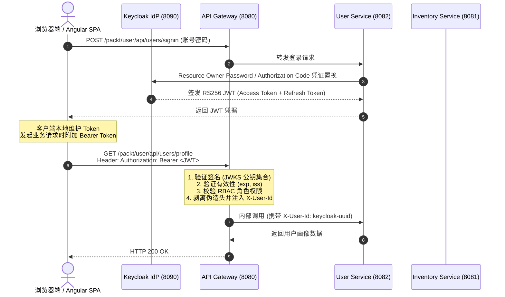

## 1. 身份认证与微服务安全技术决策矩阵

### 1.1 身份提供商 (IdP) 选型对比

| 方案 | 部署形态 | 协议标准支持 | 适用场景与决策依据 |
| :--- | :--- | :--- | :--- |
| **Keycloak (推荐)** | 自托管容器化 (Docker/K8s) | OAuth2, OIDC, SAML 2.0 | **企业自建首选**：开箱即用用户管理界面、多租户 Realm 隔离、完善的 REST Admin API |
| **Auth0 / Okta** | 全托管 SaaS 云服务 | OAuth2, OIDC | 适合无自建运维预算的团队，但存在数据合规要求与高并发商业计费成本 |
| **Spring Authorization Server** | 嵌入式 Java 框架 | OAuth2, OIDC | 灵活度极高，但需要自行开发全部控制台、用户注册与凭证重置等通用支撑业务 |

### 1.2 微服务安全拓扑架构对比

| 模式 | 鉴权发生位置 | 内部传递凭证 | 优势与弊端 |
| :--- | :--- | :--- | :--- |
| **网关中心化鉴权 (采用)** | API Gateway (边缘层) | 剥离伪造头后传递 `X-User-Id` | **推荐**：下游服务彻底轻量化，零 Security 依赖，性能最佳；要求严格隔离内网网络 |
| **分布式全节点验签** | Gateway + 各个下游微服务 | 透传原始 Bearer JWT | 安全边界高，但每个微服务均需挂载 Security 依赖与 JWKS 缓存，增加依赖版本冲突风险 |
| **单体式 Session 共享** | 共享 Redis Session | Cookie 会话标识 | 违背微服务无状态设计，限制前端移动端多通道复用能力 |

---

## 2. API 网关反应式安全过滤链与 JWT 角色适配器范式

在 Spring Cloud Gateway 中配置响应式 WebFlux 安全链，并将 Keycloak 嵌套的 `realm_access.roles` 映射为 Spring Security 标准权限：

```java
package com.packt.bookstore.gateway_server.config;

import org.springframework.context.annotation.Bean;
import org.springframework.context.annotation.Configuration;
import org.springframework.http.HttpMethod;
import org.springframework.security.config.annotation.web.reactive.EnableWebFluxSecurity;
import org.springframework.security.config.web.server.ServerHttpSecurity;
import org.springframework.security.core.authority.SimpleGrantedAuthority;
import org.springframework.security.oauth2.server.resource.authentication.JwtAuthenticationConverter;
import org.springframework.security.oauth2.server.resource.authentication.ReactiveJwtAuthenticationConverterAdapter;
import org.springframework.security.web.server.SecurityWebFilterChain;
import org.springframework.web.cors.CorsConfiguration;
import org.springframework.web.cors.reactive.CorsConfigurationSource;
import org.springframework.web.cors.reactive.UrlBasedCorsConfigurationSource;

import java.util.Collection;
import java.util.Collections;
import java.util.List;
import java.util.Map;
import java.util.stream.Collectors;

@Configuration
@EnableWebFluxSecurity
public class SecurityConfig {

    @Bean
    public SecurityWebFilterChain securityWebFilterChain(ServerHttpSecurity http) {
        return http
                .csrf(ServerHttpSecurity.CsrfSpec::disable)
                .cors(cors -> cors.configurationSource(corsConfigurationSource()))
                .authorizeExchange(exchanges -> exchanges
                        // 1. 公开端点放行
                        .pathMatchers("/actuator/**").permitAll()
                        .pathMatchers(HttpMethod.POST, "/packt/user/api/users/signup").permitAll()
                        .pathMatchers(HttpMethod.POST, "/packt/user/api/users/signin").permitAll()
                        .pathMatchers(HttpMethod.GET, "/packt/inventory/api/books/**").permitAll()
                        // 2. 细粒度 RBAC 权限拦截
                        .pathMatchers(HttpMethod.DELETE, "/packt/inventory/api/books/**").hasRole("ADMIN")
                        .pathMatchers(HttpMethod.POST, "/packt/inventory/api/books/**").hasAnyRole("ADMIN", "AUTHOR")
                        .pathMatchers(HttpMethod.PUT, "/packt/inventory/api/books/**").hasAnyRole("ADMIN", "AUTHOR")
                        .pathMatchers(HttpMethod.PATCH, "/packt/inventory/api/books/**").hasAnyRole("ADMIN", "AUTHOR")
                        // 3. 用户资料保护端点
                        .pathMatchers("/packt/user/api/users/profile/**").authenticated()
                        .anyExchange().authenticated()
                )
                .oauth2ResourceServer(oauth2 -> oauth2
                        .jwt(jwt -> jwt.jwtAuthenticationConverter(jwtAuthenticationConverter())))
                .build();
    }

    private ReactiveJwtAuthenticationConverterAdapter jwtAuthenticationConverter() {
        JwtAuthenticationConverter converter = new JwtAuthenticationConverter();
        converter.setJwtGrantedAuthoritiesConverter(jwt -> {
            Map<String, Object> realmAccess = jwt.getClaim("realm_access");
            if (realmAccess == null || !realmAccess.containsKey("roles")) {
                return Collections.emptyList();
            }
            Collection<String> roles = (Collection<String>) realmAccess.get("roles");
            return roles.stream()
                    .map(role -> new SimpleGrantedAuthority("ROLE_" + role.toUpperCase()))
                    .collect(Collectors.toList());
        });
        return new ReactiveJwtAuthenticationConverterAdapter(converter);
    }

    @Bean
    public CorsConfigurationSource corsConfigurationSource() {
        CorsConfiguration config = new CorsConfiguration();
        config.setAllowedOrigins(List.of("http://localhost:4200", "http://localhost:8080"));
        config.setAllowedMethods(List.of("GET", "POST", "PUT", "PATCH", "DELETE", "OPTIONS"));
        config.setAllowedHeaders(List.of("*"));
        config.setAllowCredentials(true);
        UrlBasedCorsConfigurationSource source = new UrlBasedCorsConfigurationSource();
        source.registerCorsConfiguration("/**", config);
        return source;
    }
}
```

---

## 3. 防注入安全头剥离与身份传递过滤器范式

网关在将请求转发至内部微服务前，必须先剔除客户端可能自行伪造的上行标头，再将经过非对称签名校验的用户主体注入受信任标头：

```java
package com.packt.bookstore.gateway_server.filter;

import org.springframework.cloud.gateway.filter.GatewayFilter;
import org.springframework.cloud.gateway.filter.factory.AbstractGatewayFilterFactory;
import org.springframework.http.server.reactive.ServerHttpRequest;
import org.springframework.security.oauth2.server.resource.authentication.JwtAuthenticationToken;
import org.springframework.stereotype.Component;

@Component
public class AddUserIdHeaderGatewayFilter extends AbstractGatewayFilterFactory<Object> {

    @Override
    public GatewayFilter apply(Object config) {
        return (exchange, chain) -> exchange.getPrincipal()
                .filter(principal -> principal instanceof JwtAuthenticationToken)
                .cast(JwtAuthenticationToken.class)
                .map(JwtAuthenticationToken::getToken)
                .map(jwt -> {
                    String userId = jwt.getSubject();
                    String email = jwt.getClaimAsString("email");
                    String preferredUsername = jwt.getClaimAsString("preferred_username");

                    // 核心安全防御：剔除客户端自送伪造头，仅透传受信任的 JWT 签名提取数据
                    ServerHttpRequest mutatedRequest = exchange.getRequest().mutate()
                            .headers(headers -> {
                                headers.remove("X-User-Id");
                                headers.remove("X-User-Email");
                                headers.remove("X-User-Name");
                            })
                            .header("X-User-Id", userId)
                            .header("X-User-Email", email != null ? email : "")
                            .header("X-User-Name", preferredUsername != null ? preferredUsername : "")
                            .build();

                    return exchange.mutate().request(mutatedRequest).build();
                })
                .defaultIfEmpty(exchange)
                .flatMap(chain::filter);
    }
}
```

---

## 4. 轻量级下游业务微服务与 Keycloak 集成范式

下游微服务无需引入厚重的 Spring Security 依赖，直接通过 `@RequestHeader("X-User-Id")` 消费网关注入的身份上下文：

```java
package com.packt.bookstore.user_service.controller;

import com.packt.bookstore.user_service.dto.UserProfileDTO;
import com.packt.bookstore.user_service.dto.UpdateProfileRequest;
import com.packt.bookstore.user_service.service.UserService;
import jakarta.validation.Valid;
import org.springframework.http.ResponseEntity;
import org.springframework.web.bind.annotation.*;

@RestController
@RequestMapping("/api/users")
public class UserController {

    private final UserService userService;

    public UserController(UserService userService) {
        this.userService = userService;
    }

    @GetMapping("/profile")
    public ResponseEntity<UserProfileDTO> getProfile(
            @RequestHeader("X-User-Id") String keycloakId) {
        return ResponseEntity.ok(userService.getProfile(keycloakId));
    }

    @PutMapping("/profile")
    public ResponseEntity<UserProfileDTO> updateProfile(
            @RequestHeader("X-User-Id") String keycloakId,
            @Valid @RequestBody UpdateProfileRequest request) {
        return ResponseEntity.ok(userService.updateProfile(keycloakId, request));
    }
}
```

---

## 5. 微服务三层安全拓扑与 Token 流转图



---

## 6. 架构避坑清单 (Do's & Don'ts)

| 错误实践 (Don't) | 正确实践 (Do) |
| :--- | :--- |
| 直接信任入站请求中携带的 `X-User-Id` 等内部身份标头。 | 网关必须在 Pre-Filter 链中显式执行 `headers.remove("X-User-Id")`，防止外部伪造请求头穿透内网。 |
| 在响应式 WebFlux 网关中调用阻塞式 I/O 代码（如 `jwt.block()`）。 | 严格采用响应式安全组件 `ReactiveJwtAuthenticationConverterAdapter` 与非阻塞响应式操作。 |
| 在下游每个微服务中均重复引入 `spring-boot-starter-security`。 | 坚持网关中心化鉴权边界，下游服务作为纯粹领域执行单元消费 `X-User-Id`，避免依赖冲突与性能损耗。 |
| 在生产环境中直接使用 Keycloak 的 `start-dev` 模式。 | 生产环境挂载独立 PostgreSQL 数据库，配置强 TLS 证书，并禁用直接公网暴露的管理端口。 |
| 每次请求均通过 RPC 向认证中心发起 Token 校验。 | 采用自包含 JWT 与非对称算法（RS256），网关缓存 JWKS 公钥集合进行本地毫秒级离线验签。 |

<!-- split -->

# 原著完整参考：基于 Spring Security 与 JWT 的微服务安全鉴权

在微服务架构中，服务实例通过动态服务注册中心与 API 网关实现高效互联。当业务端点暴露于外部网络时，**安全鉴权成为系统架构的核心关注点**。

在分布式环境下，每一次跨网络跳转均是潜在的攻击面。默认情况下，内外部交互均需遵循零信任准则。如果缺乏标准化安全模型，分布式系统将陷入凭据碎片化与鉴权逻辑重复实现的困境。

本文为书店系统落地基于工业标准的集中式安全架构：引入独立身份提供商（IdP）**Keycloak**，结合 **Spring Boot Security** 与 **JSON Web Tokens (JWT)**，在 **Spring Cloud Gateway** 边缘入口构建统一认证与鉴权屏障，并建立可靠的跨服务身份传播机制。

:::en
> **Original**: A centralized identity provider manages user credentials and token lifecycles, enabling the API gateway to act as an OAuth2 resource server that validates stateless JWTs offline using public key sets.

**📌 核心术语与语境解析**：
- **Identity Provider (IdP)** [aɪˈdentəti prəˈvaɪdər]：*身份提供商*。负责管理用户身份实体、凭证生命周期与租户域，集中颁发认证令牌的核心基础设施。
- **Stateless JWT** [ˈsteɪtləs ˌdʒeɪ dʌbljuː ˈtiː]：*无状态 JSON Web 令牌*。自包含用户信息与加密签名的令牌格式，支持消费方离线完成真实性校验。
:::

---

## 1. 微服务安全架构演进与边界设计

### 1.1 单体与分布式安全模型的本质差异

在传统单体架构中，安全控制通常驻留在单一入口点，利用内存 Session 或本地数据库表即可完成用户状态验证。但在微服务体系下：
- **服务高度分散**：每个微服务均需鉴权，若各自独立维护用户数据库，将导致用户体验割裂并带来大量冗余代码；
- **网络边界开放**：内部流量激增，单点失守易导致横向渗透；
- **水平扩展约束**：微服务要求无状态扩容，传统的 Cookie-Session 会话粘性方案违背了云原生设计理念。

为此，**网关中心化安全模型（Gateway-Centric Security Model）**成为微服务治理的标准实践。安全边界整体前移至 API Gateway：网关负责解析并校验认证令牌、执行粗粒度权限拦截，验证通过后向内部下游微服务透明传播经过清洗的身份上下文。下游业务微服务专注处理领域逻辑，无需引入厚重的 Spring Security 依赖。

### 1.2 职责分层设计

在 Bookstore 架构中，安全职责被清晰划分为三层：


1. **Identity Provider (Keycloak)**：核心身份控制中心，统管用户生命周期、凭证校验、用户角色与多租户域（Realm），签发经过非对称加密签名的标准化 JWT；
2. **API Gateway (Spring Cloud Gateway)**：外部安全屏障，负责 TLS 终止、CORS 控制、JWT 验签、粗粒度 RBAC 权限过滤、剥离伪造报头，并注入受信任的内部身份头（`X-User-Id`）；
3. **Downstream Microservices (User / Inventory)**：业务执行域，假定入站请求已通过网关安全校验，依托网关传递的身份上下文直接进行数据持久化与领域运算。

### 1.3 核心工业标准：JWT、OAuth 2.0 与 OIDC

系统底层依赖三项核心工业标准：
- **JWT (JSON Web Token)**：自包含无状态令牌，由 Header、Payload 和 Signature 组成。微服务接收到 JWT 后，基于身份中心公布的公钥进行本地离线验签，无需反向查询认证服务器；
- **OAuth 2.0**：行业通用的授权协议。在 SPA 场景中，推荐使用结合 **PKCE (Proof Key for Code Exchange)** 的授权码模式以杜绝拦截劫持攻击；
- **OpenID Connect (OIDC)**：构建于 OAuth 2.0 之上的身份认证扩展层，引入标准化发现端点（`/.well-known/openid-configuration`），支持微服务自动拉取公钥集（JWKS）。

### 1.4 响应式 Spring Security 过滤器链机制

Spring Cloud Gateway 运行于非阻塞的 **Spring WebFlux** 响应式运行时之上。其安全体系使用 `ServerHttpSecurity` 构建 `SecurityWebFilterChain`，替代了传统 Servlet 的阻塞 Filter。


当客户端发起携带 `Authorization: Bearer <JWT>` 的 HTTP 请求时：
1. `AuthenticationWebFilter` 截获请求并提取 Bearer Token；
2. 委托 `ReactiveJwtDecoder` 获取 Keycloak 的 JWKS 公钥证书集合，验签令牌的数字签名并校验 `exp` 与 `iss`；
3. 自定义 `ReactiveJwtAuthenticationConverter` 将 JWT 中的 Payload 角色声明转换为 Spring Security 权威对象 `GrantedAuthority`（带 `ROLE_` 前缀）；
4. 鉴权管理器判断当前用户是否具备目标路由所需的 Authority，放行或拦截。

:::en
> **Original**: Proof Key for Code Exchange (PKCE) mitigates authorization code injection attacks in public single-page applications, while JSON Web Key Sets (JWKS) enable automated cryptographic key rollover.

**📌 核心术语与语境解析**：
- **PKCE (Proof Key for Code Exchange)** [piː keɪ siː iː]：*用于代码交换的代码验证密钥*。防止公开客户端（如 SPA、移动端应用）授权码被恶意截获的 OAuth2 增强协议。
- **JWKS (JSON Web Key Set)** [ˈdʒeɪwəks]：*JSON Web 密钥集*。由 IdP 暴露的公钥集合端点，供资源服务器动态获取验签公钥并支持密钥平滑轮换。
:::

---

## 2. 部署与配置 Keycloak 身份认证中心

### 2.1 容器化启动 Keycloak

在开发测试阶段，采用 `start-dev` 模式启动 Keycloak 26.0.0，映射 HTTP 端口 `8090`：

```bash
docker run -d \
  --name bookstore-keycloak \
  -e KEYCLOAK_ADMIN=admin \
  -e KEYCLOAK_ADMIN_PASSWORD=admin \
  -e KC_HTTP_PORT=8090 \
  -p 8090:8090 \
  quay.io/keycloak/keycloak:26.0.0 \
  start-dev
```

访问 `http://localhost:8090/admin` 进入 Keycloak 管理后台控制台：


输入预设的初始管理员账号 `admin / admin` 登录主控制台：


### 2.2 创建 Bookstore 业务 Realm

在 Keycloak 中，**Realm（领域）**代表独立的租户隔离边界。为避免污染主管理域（master realm），建立独立的 `bookstore` 域：


### 2.3 配置领域角色（Realm Roles）

创建三级业务角色模型：


- `admin`：系统管理员，具备书籍全量删改、库存核销与用户管理最高权限；
- `author`：图书作者，具备书籍发布、库存补充与作品修改权限；
- `user`：注册买家，具备浏览书籍详情、下单采购等基础权限。

### 2.4 初始化测试用户与角色映射

创建三个场景演示账号：


1. **管理员用户**：`admin-user`（邮箱 `admin@bookstore.com`，密码 `Password123!`，分配 `admin` 角色）：


2. **作者用户**：`author-user`（邮箱 `author@bookstore.com`，分配 `author` 与 `user` 角色）：


3. **普通用户**：`regular-user`（邮箱 `user@bookstore.com`，分配 `user` 角色）。

### 2.5 注册 API Gateway 客户端（Client）

进入 **Clients** -> **Create client**，为网关注册 OIDC 接入凭据：
- **Client type**：`OpenID Connect`
- **Client ID**：`bookstore-gateway`


配置 Capability：开启 **Direct access grants** 以便通过账号密码直接置换 Token：


配置重定向与跨域来源：


### 2.6 登录策略与密码强度配置

在 **Realm settings** 中开启自主注册，并配置最小 8 位强密码规则：


---

## 3. 用户微服务（User Service）的轻量化设计

在网关中心化架构中，**User 微服务被定位为纯粹的领域组件**：


User 微服务不配置任何 Spring Security Filter，不进行 JWT 本地签名校验。它通过声明式 API 接收网关清洗并注入的 `X-User-Id` 头，专注于用户资料管理以及对接 Keycloak 管理接口。

### 3.1 依赖引入与配置

在 User 微服务中引入 Keycloak 官方管理客户端与 WebFlux（用于 WebClient 调用 Token 端点）：

```xml
<dependency>
  <groupId>org.keycloak</groupId>
  <artifactId>keycloak-admin-client</artifactId>
  <version>26.0.11</version>
</dependency>
<dependency>
  <groupId>org.springframework.boot</groupId>
  <artifactId>spring-boot-starter-webflux</artifactId>
</dependency>
```

配置 `application.yml`：

```yaml
keycloak:
  auth-server-url: http://localhost:8090
  realm: bookstore
  admin-username: admin
  admin-password: admin
  admin-realm: master
  client-id: bookstore-gateway
```

### 3.2 领域模型设计

持久层采用 MongoDB 存储扩展画像，并将 Keycloak 分配的 UUID 记录为 `keycloakId`：

```java
@Document(collection = "users")
@Data
@Builder
@NoArgsConstructor
@AllArgsConstructor
public class User {
    @Id
    private String id;
    
    @Indexed(unique = true)
    private String keycloakId;
    
    @Indexed(unique = true)
    private String email;
    
    private String firstName;
    private String lastName;
    private String phone;
    private String address;
    private String city;
    private String state;
    private String zipCode;
    private String country;
    private String profilePictureUrl;
}
```

### 3.3 注册与登录逻辑实现

```java
@Service
@RequiredArgsConstructor
@Slf4j
public class UserService {
    private final Keycloak keycloak;
    private final UserRepository userRepository;
    private final WebClient.Builder webClientBuilder;

    @Value("${keycloak.realm}")
    private String realm;
    @Value("${keycloak.auth-server-url}")
    private String authServerUrl;
    @Value("${keycloak.client-id}")
    private String clientId;

    public UserProfileDTO signUp(SignUpRequest request) {
        if (userRepository.existsByEmail(request.getEmail())) {
            throw new ResponseStatusException(HttpStatus.CONFLICT, "Email already exists");
        }

        UserRepresentation userRep = new UserRepresentation();
        userRep.setUsername(request.getEmail());
        userRep.setEmail(request.getEmail());
        userRep.setFirstName(request.getFirstName());
        userRep.setLastName(request.getLastName());
        userRep.setEnabled(true);
        userRep.setEmailVerified(true);

        CredentialRepresentation cred = new CredentialRepresentation();
        cred.setType(CredentialRepresentation.PASSWORD);
        cred.setValue(request.getPassword());
        cred.setTemporary(false);
        userRep.setCredentials(List.of(cred));

        UsersResource usersResource = keycloak.realm(realm).users();
        Response response = usersResource.create(userRep);
        if (response.getStatus() != 201) {
            throw new ResponseStatusException(HttpStatus.BAD_REQUEST, "Failed to create user in Keycloak");
        }

        String path = response.getLocation().getPath();
        String keycloakId = path.substring(path.lastIndexOf('/') + 1);

        RoleRepresentation defaultRole = keycloak.realm(realm).roles().get("user").toRepresentation();
        usersResource.get(keycloakId).roles().realmLevel().add(List.of(defaultRole));

        User user = User.builder()
                .keycloakId(keycloakId)
                .email(request.getEmail())
                .firstName(request.getFirstName())
                .lastName(request.getLastName())
                .build();
        userRepository.save(user);

        return toDto(user);
    }
}
```

---

## 4. API Gateway 边缘安全防护与 Token 传播

### 4.1 引入安全依赖与配置

在网关工程中引入 WebFlux 安全构件：

```xml
<dependency>
  <groupId>org.springframework.boot</groupId>
  <artifactId>spring-boot-starter-security</artifactId>
</dependency>
<dependency>
  <groupId>org.springframework.security</groupId>
  <artifactId>spring-security-oauth2-resource-server</artifactId>
</dependency>
<dependency>
  <groupId>org.springframework.security</groupId>
  <artifactId>spring-security-oauth2-jose</artifactId>
</dependency>
```

在网关 `application.yml` 中声明 Issuer 地址：

```yaml
spring:
  security:
    oauth2:
      resourceserver:
        jwt:
          issuer-uri: http://localhost:8090/realms/bookstore
```

网关启动时将自动通过 Discovery 端点解析 JWKS 公钥集合。

:::en
> **Original**: Stripping untrusted client headers before propagating authenticated identities downstream ensures internal microservices operate securely without redundant security frameworks.

**📌 核心术语与语境解析**：
- **Header Stripping** [ˈhedər ˈstrɪpɪŋ]：*标头剥离清洗*。在反向代理层强制剔除客户端自送的内部保留标头，抵御伪造身份注入。
- **Context Propagation** [ˈkɑːntekst ˌprɑːpəˈɡeɪʃn]：*上下文传播*。将经过认证的主体元数据通过受信任的协议标头下发至内部服务集群的过程。
:::

---

## 5. 端到端安全联调与自动化验证

### 5.1 公开端点注册与登录置换 JWT

```bash
# 1. 注册新用户
curl -i -X POST http://localhost:8080/packt/user/api/users/signup \
  -H "Content-Type: application/json" \
  -d '{
    "email": "test.security@example.com",
    "password": "Password123!",
    "firstName": "Test",
    "lastName": "Security"
  }'

# 2. 登录换取 JWT
curl -i -X POST http://localhost:8080/packt/user/api/users/signin \
  -H "Content-Type: application/json" \
  -d '{
    "email": "test.security@example.com",
    "password": "Password123!"
  }'
```

### 5.2 受保护端点访问与越权防御

```bash
export TOKEN="<access-token>"

# 携带合法 Token 访问个人资料
curl -i -X GET http://localhost:8080/packt/user/api/users/profile \
  -H "Authorization: Bearer ${TOKEN}"
# 返回 HTTP 200 OK

# 未携带 Token 请求受保护端点
curl -i -X GET http://localhost:8080/packt/user/api/users/profile
# 返回 HTTP 401 Unauthorized
```

### 5.3 基于 RBAC 权限矩阵的接口拦截

1. **普通买家（`ROLE_USER`）**：
   - `GET /packt/inventory/api/books` -> `HTTP 200 OK`
   - `POST /packt/inventory/api/books` -> `HTTP 403 Forbidden`
2. **图书作者（`ROLE_AUTHOR`）**：
   - `POST /packt/inventory/api/books` -> `HTTP 201 Created`
   - `DELETE /packt/inventory/api/books/1` -> `HTTP 403 Forbidden`
3. **超级管理员（`ROLE_ADMIN`）**：
   - `DELETE /packt/inventory/api/books/1` -> `HTTP 200 OK`

---

## 6. 总结与下篇演进

通过本文实践，系统建立了完整的集中式安全鉴权防护体系：
- **职责清晰化**：Keycloak 统管凭证与租户；API Gateway 统揽边缘防御与 RBAC 拦截；下游服务轻量消费内部身份标头；
- **零信任内网防御**：网关主动清洗外部伪造报头，确保身份传播绝对可信；
- **高性能离线验签**：利用非对称加密与 JWKS 缓存，网关实现毫秒级本地验签。

在下一篇中，我们将进一步释放系统性能潜能，深入探讨 **Spring WebFlux 响应式非阻塞编程与 Server-Sent Events (SSE)**，探索如何突破传统“每请求一线程”模型的资源天花板，构建实时流式数据通道！
