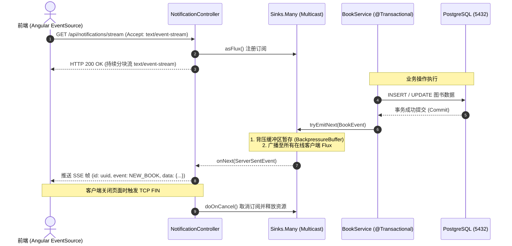

> 💡 **双栏独立滚动工作台导读**：本文采用双栏对照架构。**左栏**为核心技术决策矩阵、生产级代码范式与避坑清单；**右栏**为技术实现演化参考，并提供关键段落的英文原文展开与难词解析。左右两栏可独立滚动，并支持顶栏自定义宽度比例（7:3 / 5:5 / 3:7）与拖拽调节。

## 1. 实时消息传输与并发模型技术决策矩阵

### 1.1 实时通信协议横向对比

| 协议方案 | 通信方向 | 传输开销 | 连接复用与重连 | 适用场景与选型依据 |
| :--- | :--- | :--- | :--- | :--- |
| **Server-Sent Events (SSE)** | 服务端向客户端单向流式推送 | 极低（原生基于标准 HTTP/1.1 与 HTTP/2） | 浏览器 `EventSource` 原生支持断线自动重连 | **服务端单向广播首选**：图书上新、降价提醒、库存流式下发 |
| **WebSocket** | 全双工双向交互 | 较低（需从 HTTP 升级握手至 WS 协议） | 需前端应用层实现心跳检测与重连逻辑 | 适合实时聊天、在线协作白板、双向游戏竞技 |
| **HTTP 短轮询 (Polling)** | 客户端周期性拉取 | 极高（海量无效空请求与 TCP 握手） | 无连接状态，每次独立请求 | 仅作为老旧浏览器或无长连接支撑环境的降级备选 |

### 1.2 并发与 I/O 模型对比

| 架构维度 | 传统 Servlet 阻塞模型 (Spring MVC + Tomcat) | 反应式非阻塞模型 (Spring WebFlux + Netty) |
| :--- | :--- | :--- |
| **线程利用** | **Thread-per-request**：每个请求占用独占物理线程 | **Event Loop**：少量固定工作线程多路复用海量连接 |
| **I/O 等待开销** | 数据库查询或下游 RPC 期间线程挂起，内存消耗大 | 异步回调驱动，无阻塞等待，释放 CPU 处理其他连接 |
| **长连接承载力** | 维持数千长连接即耗尽线程池与物理内存 | 单机可维系万级以上轻量级 SSE / TCP 挂起连接 |
| **编程模型** | 命令式同步编程，堆栈清晰，易于调试 | 声明式响应式流（Reactive Streams），依赖操作符链条 |

---

## 2. 基于 Sinks.Many 的反应式事件多播生产范式

使用 Project Reactor 提供的 `Sinks.Many` 构建进程内热发布（Hot Publisher）事件分发中心，并配置背压环形缓冲区：

```java
package com.packt.bookstore.inventory_service.service;

import com.packt.bookstore.inventory_service.event.BookEvent;
import org.slf4j.Logger;
import org.slf4j.LoggerFactory;
import org.springframework.stereotype.Service;
import reactor.core.publisher.Flux;
import reactor.core.publisher.Sinks;

@Service
public class NotificationService {

    private static final Logger log = LoggerFactory.getLogger(NotificationService.class);

    // 核心事件多播器：背压缓冲 256 个溢出事件
    private final Sinks.Many<BookEvent> sink = 
            Sinks.many().multicast().onBackpressureBuffer(256);

    /**
     * 向管道推送领域事件
     */
    public void publish(BookEvent event) {
        Sinks.EmitResult result = sink.tryEmitNext(event);
        if (result.isFailure()) {
            log.warn("无法发射事件 [ID: {}]，发射结果: {}", event.getEventId(), result);
        }
    }

    /**
     * 暴露只读 Flux 供 SSE 控制器订阅
     */
    public Flux<BookEvent> getEventStream() {
        return sink.asFlux();
    }
}
```

---

## 3. WebFlux SSE 实时流式端点生产范式

控制器声明 `MediaType.TEXT_EVENT_STREAM_VALUE`，基于非阻塞管道输出带有事件名称与唯一 ID 的标准 SSE 帧，并监听连接生命周期：

```java
package com.packt.bookstore.inventory_service.controller;

import com.packt.bookstore.inventory_service.event.BookEvent;
import com.packt.bookstore.inventory_service.event.EventType;
import com.packt.bookstore.inventory_service.service.NotificationService;
import org.slf4j.Logger;
import org.slf4j.LoggerFactory;
import org.springframework.http.MediaType;
import org.springframework.http.codec.ServerSentEvent;
import org.springframework.web.bind.annotation.*;
import reactor.core.publisher.Flux;

@RestController
@RequestMapping("/api/notifications")
public class NotificationController {

    private static final Logger log = LoggerFactory.getLogger(NotificationController.class);
    private final NotificationService notificationService;

    public NotificationController(NotificationService notificationService) {
        this.notificationService = notificationService;
    }

    @GetMapping(value = "/stream", produces = MediaType.TEXT_EVENT_STREAM_VALUE)
    public Flux<ServerSentEvent<BookEvent>> streamEvents() {
        return notificationService.getEventStream()
                .map(event -> ServerSentEvent.<BookEvent>builder()
                        .id(event.getEventId())
                        .event(event.getEventType().name())
                        .data(event)
                        .build())
                .doOnSubscribe(sub -> log.info("客户端成功建立 SSE 实时通道"))
                .doOnCancel(() -> log.info("客户端主动断开 SSE 实时通道"));
    }

    @GetMapping(value = "/stream/{type}", produces = MediaType.TEXT_EVENT_STREAM_VALUE)
    public Flux<ServerSentEvent<BookEvent>> streamEventsByType(@PathVariable EventType type) {
        return notificationService.getEventStream()
                .filter(event -> event.getEventType() == type)
                .map(event -> ServerSentEvent.<BookEvent>builder()
                        .id(event.getEventId())
                        .event(event.getEventType().name())
                        .data(event)
                        .build());
    }
}
```

---

## 4. 阻塞 JPA 与非阻塞 Event Loop 隔离调度范式

在混合架构中，严禁在 Netty 事件循环线程中调用阻塞式 JPA。必须使用 `Schedulers.boundedElastic()` 将阻塞 I/O 剥离至弹性线程池：

```java
package com.packt.bookstore.inventory_service.service;

import com.packt.bookstore.inventory_service.dto.BookResponse;
import com.packt.bookstore.inventory_service.exception.ResourceNotFoundException;
import com.packt.bookstore.inventory_service.mapper.BookMapper;
import com.packt.bookstore.inventory_service.repository.BookRepository;
import org.springframework.stereotype.Service;
import reactor.core.publisher.Mono;
import reactor.core.scheduler.Schedulers;

@Service
public class ReactiveBookQueryService {

    private final BookRepository bookRepository;
    private final BookMapper bookMapper;

    public ReactiveBookQueryService(BookRepository bookRepository, BookMapper bookMapper) {
        this.bookRepository = bookRepository;
        this.bookMapper = bookMapper;
    }

    public Mono<BookResponse> findBookByIdReactive(Long id) {
        return Mono.fromCallable(() -> bookRepository.findById(id))
                // 核心隔离：强制剥离到弹性阻塞调度器执行，杜绝挂起 Netty Event Loop
                .subscribeOn(Schedulers.boundedElastic())
                .flatMap(optional -> optional
                        .map(book -> Mono.just(bookMapper.toResponse(book)))
                        .orElseGet(() -> Mono.error(new ResourceNotFoundException("Book not found with id: " + id))));
    }
}
```

---

## 5. 反应式实时流与背压时序架构图



---

## 6. 架构避坑清单 (Do's & Don'ts)

| 错误实践 (Don't) | 正确实践 (Do) |
| :--- | :--- |
| 在数据库事务提交成功前发射领域事件。 | 必须在事务提交之后再向 `Sinks.Many` 投递事件，防止事务回滚导致客户端感知到脏数据。 |
| 在 Netty Event Loop 线程中直接执行阻塞式的 JDBC/JPA 查询。 | 使用 `Mono.fromCallable(...).subscribeOn(Schedulers.boundedElastic())` 隔离阻塞调用。 |
| 使用无界队列缓冲慢消费者的实时事件。 | 显式声明背压策略（如 `onBackpressureBuffer(256)`），防止慢客户端耗尽服务端堆内存。 |
| 双向复杂交互场景盲目选用 SSE。 | SSE 仅适合服务端单向广播场景；若需高频双向低延迟交互，应选用 WebSocket。 |
| 忽略客户端断连导致后台流持续泄漏。 | 挂载 `doOnCancel()` 钩子，由框架在检测到底层 TCP 断开时自动注销订阅与释放通道资源。 |

<!-- split -->

# 原著完整参考：Spring WebFlux 响应式流与 SSE 实时消息推送

在完成了微服务网关安全与认证体系的建设后，系统已经确立了严格的信任边界。然而，在真实生产环境中，微服务不仅需要防御非法访问，还需要在突发高流量访问与实时数据交互场景下维持极高的系统吞吐能力。

在图书商城业务中，当热门书籍上线或开展限时折扣活动时，大量用户会同时在线关注图书状态。如果依然依赖传统的 Servlet 阻塞模型或客户端高频轮询机制，服务器的线程资源与数据库连接池将迅速耗尽。

本文针对库存服务进行架构演进，打破传统的“每请求一线程（Thread-per-request）”模型，引入基于 **Project Reactor** 的 **Spring WebFlux** 响应式框架，落地基于 **Server-Sent Events (SSE)** 的轻量级实时流推送通道，实现图书上新与价格变动的零轮询即时下发。

:::en
> **Original**: Server-Sent Events provide a standardized, unidirectional transport over standard HTTP, allowing servers to stream events to web clients without the protocol upgrade overhead of WebSockets.

**📌 核心术语与语境解析**：
- **Server-Sent Events (SSE)** [ˈsɜːrvər sent ɪˈvents]：*服务端发送事件*。基于标准 HTTP/1.1 与 HTTP/2 的轻量级单向长连接实时流推送协议。
- **Chunked Transfer Encoding** [tʃʌŋkt trænsˈfɜːr ɪnˈkoʊdɪŋ]：*分块传输编码*。HTTP 响应中无需预先计算内容总长度，允许服务端持续向客户端写出数据块的流式传输机制。
:::

---

## 1. 传统 Servlet 阻塞模型与高并发瓶颈

### 1.1 传统 API 调用：Thread-per-request 资源损耗

在传统的 Spring MVC 架构中，Tomcat 等 Servlet 容器为每个入站 HTTP 请求从工作线程池中分配一个独占线程。该线程负责调用 Controller、执行业务逻辑、发起阻塞式数据库查询，直至最终回写响应报文：


在高并发场景下，**系统的主要资源瓶颈通常不是 CPU 运算能力，而是网络与 I/O 阻塞等待**。在等待数据库返回结果的数十至数百毫秒内，该工作线程处于完全挂起状态：


当瞬时并发达到上千时，线程池迅速被打满。操作系统发生频繁的线程上下文切换（Context Switching），系统内存剧增，响应延迟急剧恶化。

### 1.2 轮询（Polling） vs 流式推送（Streaming）

在“图书降价与库存变动”场景中，客户端传统方案是定时发起 HTTP 轮询：
- **轮询的弊端**：在绝大多数轮询周期中，数据并未改变，但服务器却要承受海量的无效握手、SQL 解析与冗余数据传输开销；
- **流式推送的优势**：客户端仅需建立一次长连接订阅，服务端在真正发生领域状态改变时主动推送事件，无变动时维持零额外计算消耗。

但在传统 Servlet 容器中，长连接意味着独占物理线程，无法承载海量并发挂起通道。

### 1.3 非阻塞 I/O 与 Netty 事件循环（Event Loop）

为解决这一问题，必须转向**非阻塞事件驱动模型**。Spring WebFlux 默认以 **Netty** 作为底层运行时：


Netty 仅使用极少量的核心工作线程（通常为 CPU 核心数的 1~2 倍），通过 I/O 多路复用（Multiplexing）协同管理成千上万个客户端通道。当某个连接的 I/O 尚未就绪时，事件循环线程立即调度处理其他就绪通道；当底层 Socket 缓冲区就绪时，系统发出就绪信号，事件循环再执行后续业务回调。

:::en
> **Original**: The event loop model decouples connection count from thread count, utilizing non-blocking I/O multiplexing to handle tens of thousands of concurrent persistent connections on minimal system resources.

**📌 核心术语与语境解析**：
- **Event Loop** [ɪˈvent luːp]：*事件循环*。在单一线程中持续轮询并在底层 I/O 就绪时触发回调的非阻塞并发运行结构。
- **I/O Multiplexing** [ˌaɪ ˈoʊ ˌmʌltɪˈpleksɪŋ]：*I/O 多路复用*。单个进程或线程通过 select/epoll 机制同时监听多个网络套接字就绪状态的技术。
:::

---

## 2. Project Reactor 响应式内核与背压机制

Spring WebFlux 的底层核心是 **Project Reactor**。Controller 返回的 `Mono` 或 `Flux` 并非直接数据容器，而是声明式的异步执行流水线。

### 2.1 Reactive Streams 规范与背压（Backpressure）

Reactive Streams 规范由四项核心接口定义：`Publisher<T>`（发布者）、`Subscriber<T>`（订阅者）、`Subscription`（订阅关系）与 `Processor<T, R>`。其核心架构贡献在于引入了**背压（Backpressure）流控机制**：


在传统的盲目 Push 模型中，若上游生产过快，下游消费能力不足会导致堆内存溢出。而在背压机制中：
1. `Subscriber` 向 `Publisher` 发起订阅；
2. `Publisher` 颁发 `Subscription` 凭证；
3. `Subscriber` 通过 `subscription.request(n)` 显式向上游声明当前具备承载能力的元素配额；
4. `Publisher` 严格受限于该配额下发数据项。

### 2.2 Mono 与 Flux 的生命周期语义

- **`Mono<T>`**：表示包含 **0 或 1 个元素**的异步序列；
- **`Flux<T>`**：表示包含 **0 到 N 个元素（可无限流转）**的异步序列。

Reactor 遵循**惰性求值（Laziness）**法则：
> 在被显式订阅（Subscribe）之前，任何代码仅为静态执行计划，不会产生实际数据操作。

数据流驱动信号包含：
- `onNext(T)`：发出一个数据项；
- `onComplete()`：序列正常终止；
- `onError(Throwable)`：序列发生异常并终止。

:::en
> **Original**: Reactive Streams define a non-blocking backpressure contract that allows downstream subscribers to pace upstream publishers, preventing memory exhaustion under uneven consumer throughput.

**📌 核心术语与语境解析**：
- **Backpressure** [ˈbækpreʃər]：*背压/回压*。下游订阅方通过信号反馈机制限制上游生产速率，保护消费端不被瞬时流量淹没的流量调节机制。
- **Hot vs Cold Publisher** [hɑːt vɜːrsəs koʊld ˈpʌblɪʃər]：*热/冷发布者*。冷发布者在每个订阅发生时从头重新生成数据；热发布者无论是否有订阅者均持续产出数据，新订阅者仅接收后续到达的增量事件。
:::

---

## 3. 库存微服务的“渐进式响应式”混合架构

### 3.1 引入 WebFlux 依赖

在 `inventory-ms/pom.xml` 中引入 WebFlux 替换 Servlet 容器：

```xml
<dependency>
  <groupId>org.springframework.boot</groupId>
  <artifactId>spring-boot-starter-webflux</artifactId>
</dependency>
```

引入此依赖后，Spring Boot 自动卸载 Tomcat，换由 **Netty** 提供非阻塞服务底座。

### 3.2 严禁在 Netty Event Loop 上执行阻塞 I/O

JPA 与 PostgreSQL JDBC 驱动是典型的阻塞模型。若在 Netty 事件循环线程中直接调用 JPA 查询，事件循环线程被挂起，将连带阻塞由该线程负责管理的所有并发通道。

因此，在混合架构中，凡是必须调用的阻塞 JPA 操作，必须强制切换到弹性调度器（`Schedulers.boundedElastic()`）：

```java
public Mono<BookResponse> findBookByIdReactive(Long id) {
    return Mono.fromCallable(() -> bookRepository.findById(id))
            .subscribeOn(Schedulers.boundedElastic())
            .flatMap(optional -> optional
                    .map(book -> Mono.just(bookMapper.toResponse(book)))
                    .orElseGet(() -> Mono.error(new ResourceNotFoundException("Book not found"))));
}
```

而在常规的写操作业务中，维持标准的同步执行，仅在数据库事务提交完成后，向反应式管道发射领域事件。

:::en
> **Original**: Blocking database calls must be isolated to dedicated thread pools like `Schedulers.boundedElastic()` to prevent starvation of the shared Netty event loops.

**📌 核心术语与语境解析**：
- **Thread Starvation** [θred stɑːrˈveɪʃn]：*线程饥饿*。因少量任务长期阻塞关键共享线程，导致其他大量就绪任务无法获得调度的并发异常状态。
- **Bounded Elastic Scheduler** [ˈbaʊndɪd ɪˈlæstɪk ˈskedʒuːlər]：*有界弹性调度器*。Reactor 为阻塞 I/O 操作量身定制的自适应弹性线程池，具备最大容量限制与空闲回收特性。
:::

---

## 4. 领域事件模型设计：信封-载荷模式

事件流需具备自解释性与版本扩展能力，采用**信封-载荷（Envelope-and-Payload）**模式定义。

### 4.1 统一顶层信封：BookEvent

```java
package com.packt.bookstore.inventory_service.event;

import lombok.AllArgsConstructor;
import lombok.Builder;
import lombok.Data;
import lombok.NoArgsConstructor;

import java.time.LocalDateTime;

@Data
@Builder
@NoArgsConstructor
@AllArgsConstructor
public class BookEvent {
    private String eventId;
    private EventType eventType;
    private LocalDateTime timestamp;
    private Long bookId;
    private String bookTitle;
    private String isbn;
    private Object eventData;
}
```

### 4.2 业务载荷模型

价格变更载荷明确表达状态跃迁过程：

```java
package com.packt.bookstore.inventory_service.event;

import lombok.AllArgsConstructor;
import lombok.Builder;
import lombok.Data;
import lombok.NoArgsConstructor;

import java.math.BigDecimal;

@Data
@Builder
@NoArgsConstructor
@AllArgsConstructor
public class PriceChangeEventData {
    private BigDecimal oldPrice;
    private BigDecimal newPrice;
    private BigDecimal priceChange;
    private Double percentageChange;
}
```

### 4.3 核心原则：严格在事务提交后发射事件

**在事件驱动架构中，绝不能在数据持久化事务提交之前发射事件**。否则一旦事务因约束冲突回滚，前端已接收到虚假通知，产生脏数据感知：

```java
@Transactional
public BookResponse updatePrice(Long bookId, BigDecimal newPrice) {
    Book existing = bookRepository.findById(bookId)
            .orElseThrow(() -> new ResourceNotFoundException("Book not found"));
    
    BigDecimal oldPrice = existing.getPrice();
    boolean priceChanged = newPrice != null && newPrice.compareTo(oldPrice) != 0;
    
    existing.setPrice(newPrice);
    Book saved = bookRepository.save(existing);
    
    if (priceChanged) {
        publishPriceChangeEvent(saved, oldPrice, newPrice);
    }
    
    return bookMapper.toResponse(saved);
}
```

---

## 5. 响应式通知管道与 SSE 实时端点落地

### 5.1 基于 Sinks 构建进程内多播总线

在 `NotificationService` 中使用 `Sinks.Many` 构建微服务内部的热发布中心：

```java
@Service
@Slf4j
public class NotificationService {

    private final Sinks.Many<BookEvent> sink = 
            Sinks.many().multicast().onBackpressureBuffer(256);

    public void publish(BookEvent event) {
        Sinks.EmitResult result = sink.tryEmitNext(event);
        if (result.isFailure()) {
            log.warn("无法发射事件 [ID: {}]，原因: {}", event.getEventId(), result);
        }
    }

    public Flux<BookEvent> getEventStream() {
        return sink.asFlux();
    }
}
```

### 5.2 暴露 SSE 流式端点

在 `NotificationController` 中对外暴露流式接口：

```java
@RestController
@RequestMapping("/api/notifications")
@RequiredArgsConstructor
@Slf4j
public class NotificationController {

    private final NotificationService notificationService;

    @GetMapping(value = "/stream", produces = MediaType.TEXT_EVENT_STREAM_VALUE)
    public Flux<ServerSentEvent<BookEvent>> streamEvents() {
        return notificationService.getEventStream()
                .map(event -> ServerSentEvent.<BookEvent>builder()
                        .id(event.getEventId())
                        .event(event.getEventType().name())
                        .data(event)
                        .build())
                .doOnSubscribe(sub -> log.info("新的客户端建立 SSE 实时通道"))
                .doOnCancel(() -> log.info("客户端断开 SSE 实时通道"));
    }
}
```

当客户端关闭标签页时，Netty 感知到底层 TCP 断开，主动触发 `doOnCancel()` 注销订阅，彻底杜绝孤儿连接与内存泄漏。

---

## 6. 端到端测试与流式管道验证

### 6.1 终端建立 SSE 长连接监听

在终端中通过 `curl` 建立流式监听：

```bash
curl -N -H "Accept: text/event-stream" http://localhost:8080/packt/inventory/api/notifications/stream
```

> 提示：`-N` 参数（`--no-buffer`）可关闭输出缓冲，确保服务端推送的数据实时逐行呈现。

### 6.2 触发价格变更

通过网关发起图书调价请求：

```bash
curl -X PATCH http://localhost:8080/packt/inventory/api/books/1 \
  -H "Authorization: Bearer ${ADMIN_TOKEN}" \
  -H "Content-Type: application/json" \
  -d '{"price": 69.00}'
```

### 6.3 观察 SSE 推送报文

监听终端立即捕获并打印出格式化的 SSE 数据帧：

```http
id:660f9511-f30c-52e5-b827-557766551111
event:PRICE_CHANGE
data:{"eventId":"660f9511-f30c-52e5-b827-557766551111","eventType":"PRICE_CHANGE","timestamp":"2026-10-23T10:35:00","bookId":1,"bookTitle":"Reactive Spring Boot in Action","isbn":"978-7-111-88888-8","eventData":{"oldPrice":89.00,"newPrice":69.00,"priceChange":-20.00,"percentageChange":-22.47}}
```

前端接收到该事件帧后，即可直接解析载荷并在界面局部更新降价标签。

---

## 7. 总结与全栈展望

从“同步阻塞请求-响应”跃迁至“响应式实时流”带来了系统吞吐能力的显著提升：
- **资源利用率质的突破**：借助 Netty 事件循环，微服务将长连接开销从昂贵的操作系统线程转化为轻量通道对象，单机轻松支撑大规模并发推送；
- **务实的渐进式混合架构**：通过 `Schedulers.boundedElastic()` 有效隔离阻塞 JPA 与非阻塞 Event Loop，兼顾响应性能与既有业务资产；
- **自解释的领域事件信封**：以标准 `BookEvent` 规范推送完整业务状态转移，消除无意义的反向查询。

随着后端服务已经具备完整的微服务拆分、服务发现、网关安全与实时流式推送能力，下一篇我们将进入生产工程化交付阶段——**微服务容器化构建与多阶段镜像打包（Docker & OCI）**，探索如何将所有服务标准化打包并为分布式集群部署做好准备！
