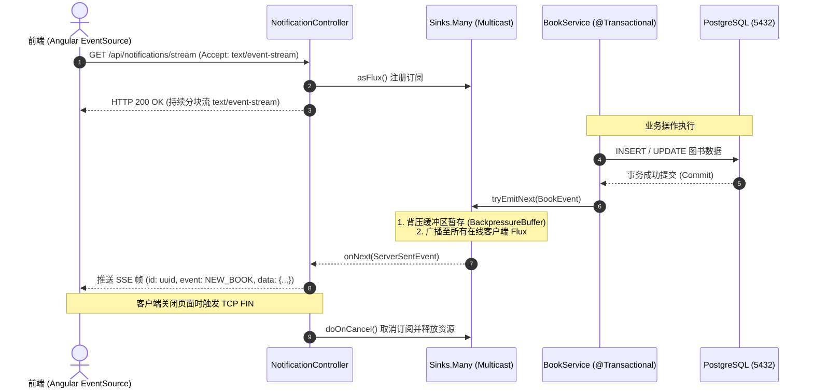

## 1. 实时消息传输与并发模型技术决策矩阵

### 1.1 实时通信协议横向对比

| 协议方案 | 通信方向 | 传输开销 | 连接复用与重连 | 适用场景与选型依据 |
| :--- | :--- | :--- | :--- | :--- |
| **Server-Sent Events (SSE)** | 服务端向客户端单向流式推送 | 极低（原生基于标准 HTTP/1.1 与 HTTP/2） | 浏览器 `EventSource` 原生支持断线自动重连 | **服务端单向广播首选**：图书上新、降价提醒、库存流式下发 |
| **WebSocket** | 全双工双向交互 | 较低（需从 HTTP 升级握手至 WS 协议） | 需前端应用层实现心跳检测与重连逻辑 | 适合实时聊天、在线协作白板、双向游戏竞技 |
| **HTTP 短轮询 (Polling)** | 客户端周期性拉取 | 极高（海量无效空请求与 TCP 握手） | 无连接状态，每次独立请求 | 仅作为老旧浏览器或无长连接支撑环境的降级备选 |

### 1.2 并发与 I/O 模型对比

| 架构维度 | 传统 Servlet 阻塞模型 (Spring MVC + Tomcat) | 反应式非阻塞模型 (Spring WebFlux + Netty) |
| :--- | :--- | :--- |
| **线程利用** | **Thread-per-request**：每个请求占用独占物理线程 | **Event Loop**：少量固定工作线程多路复用海量连接 |
| **I/O 等待开销** | 数据库查询或下游 RPC 期间线程挂起，内存消耗大 | 异步回调驱动，无阻塞等待，释放 CPU 处理其他连接 |
| **长连接承载力** | 维持数千长连接即耗尽线程池与物理内存 | 单机可维系万级以上轻量级 SSE / TCP 挂起连接 |
| **编程模型** | 命令式同步编程，堆栈清晰，易于调试 | 声明式响应式流（Reactive Streams），依赖操作符链条 |

---

## 2. 基于 Sinks.Many 的反应式事件多播生产范式

使用 Project Reactor 提供的 `Sinks.Many` 构建进程内热发布（Hot Publisher）事件分发中心，并配置背压环形缓冲区：

```java
package com.packt.bookstore.inventory_service.service;

import com.packt.bookstore.inventory_service.event.BookEvent;
import org.slf4j.Logger;
import org.slf4j.LoggerFactory;
import org.springframework.stereotype.Service;
import reactor.core.publisher.Flux;
import reactor.core.publisher.Sinks;

@Service
public class NotificationService {

    private static final Logger log = LoggerFactory.getLogger(NotificationService.class);

    // 核心事件多播器：背压缓冲 256 个溢出事件
    private final Sinks.Many<BookEvent> sink = 
            Sinks.many().multicast().onBackpressureBuffer(256);

    /**
     * 向管道推送领域事件
     */
    public void publish(BookEvent event) {
        Sinks.EmitResult result = sink.tryEmitNext(event);
        if (result.isFailure()) {
            log.warn("无法发射事件 [ID: {}]，发射结果: {}", event.getEventId(), result);
        }
    }

    /**
     * 暴露只读 Flux 供 SSE 控制器订阅
     */
    public Flux<BookEvent> getEventStream() {
        return sink.asFlux();
    }
}
```

---

## 3. WebFlux SSE 实时流式端点生产范式

控制器声明 `MediaType.TEXT_EVENT_STREAM_VALUE`，基于非阻塞管道输出带有事件名称与唯一 ID 的标准 SSE 帧，并监听连接生命周期：

```java
package com.packt.bookstore.inventory_service.controller;

import com.packt.bookstore.inventory_service.event.BookEvent;
import com.packt.bookstore.inventory_service.event.EventType;
import com.packt.bookstore.inventory_service.service.NotificationService;
import org.slf4j.Logger;
import org.slf4j.LoggerFactory;
import org.springframework.http.MediaType;
import org.springframework.http.codec.ServerSentEvent;
import org.springframework.web.bind.annotation.*;
import reactor.core.publisher.Flux;

@RestController
@RequestMapping("/api/notifications")
public class NotificationController {

    private static final Logger log = LoggerFactory.getLogger(NotificationController.class);
    private final NotificationService notificationService;

    public NotificationController(NotificationService notificationService) {
        this.notificationService = notificationService;
    }

    @GetMapping(value = "/stream", produces = MediaType.TEXT_EVENT_STREAM_VALUE)
    public Flux<ServerSentEvent<BookEvent>> streamEvents() {
        return notificationService.getEventStream()
                .map(event -> ServerSentEvent.<BookEvent>builder()
                        .id(event.getEventId())
                        .event(event.getEventType().name())
                        .data(event)
                        .build())
                .doOnSubscribe(sub -> log.info("客户端成功建立 SSE 实时通道"))
                .doOnCancel(() -> log.info("客户端主动断开 SSE 实时通道"));
    }

    @GetMapping(value = "/stream/{type}", produces = MediaType.TEXT_EVENT_STREAM_VALUE)
    public Flux<ServerSentEvent<BookEvent>> streamEventsByType(@PathVariable EventType type) {
        return notificationService.getEventStream()
                .filter(event -> event.getEventType() == type)
                .map(event -> ServerSentEvent.<BookEvent>builder()
                        .id(event.getEventId())
                        .event(event.getEventType().name())
                        .data(event)
                        .build());
    }
}
```

---

## 4. 阻塞 JPA 与非阻塞 Event Loop 隔离调度范式

在混合架构中，严禁在 Netty 事件循环线程中调用阻塞式 JPA。必须使用 `Schedulers.boundedElastic()` 将阻塞 I/O 剥离至弹性线程池：

```java
package com.packt.bookstore.inventory_service.service;

import com.packt.bookstore.inventory_service.dto.BookResponse;
import com.packt.bookstore.inventory_service.exception.ResourceNotFoundException;
import com.packt.bookstore.inventory_service.mapper.BookMapper;
import com.packt.bookstore.inventory_service.repository.BookRepository;
import org.springframework.stereotype.Service;
import reactor.core.publisher.Mono;
import reactor.core.scheduler.Schedulers;

@Service
public class ReactiveBookQueryService {

    private final BookRepository bookRepository;
    private final BookMapper bookMapper;

    public ReactiveBookQueryService(BookRepository bookRepository, BookMapper bookMapper) {
        this.bookRepository = bookRepository;
        this.bookMapper = bookMapper;
    }

    public Mono<BookResponse> findBookByIdReactive(Long id) {
        return Mono.fromCallable(() -> bookRepository.findById(id))
                // 核心隔离：强制剥离到弹性阻塞调度器执行，杜绝挂起 Netty Event Loop
                .subscribeOn(Schedulers.boundedElastic())
                .flatMap(optional -> optional
                        .map(book -> Mono.just(bookMapper.toResponse(book)))
                        .orElseGet(() -> Mono.error(new ResourceNotFoundException("Book not found with id: " + id))));
    }
}
```

---

## 5. 反应式实时流与背压时序架构图



---

## 6. 架构避坑清单 (Do's & Don'ts)

| 错误实践 (Don't) | 正确实践 (Do) |
| :--- | :--- |
| 在数据库事务提交成功前发射领域事件。 | 必须在事务提交之后再向 `Sinks.Many` 投递事件，防止事务回滚导致客户端感知到脏数据。 |
| 在 Netty Event Loop 线程中直接执行阻塞式的 JDBC/JPA 查询。 | 使用 `Mono.fromCallable(...).subscribeOn(Schedulers.boundedElastic())` 隔离阻塞调用。 |
| 使用无界队列缓冲慢消费者的实时事件。 | 显式声明背压策略（如 `onBackpressureBuffer(256)`），防止慢客户端耗尽服务端堆内存。 |
| 双向复杂交互场景盲目选用 SSE。 | SSE 仅适合服务端单向广播场景；若需高频双向低延迟交互，应选用 WebSocket。 |
| 忽略客户端断连导致后台流持续泄漏。 | 挂载 `doOnCancel()` 钩子，由框架在检测到底层 TCP 断开时自动注销订阅与释放通道资源。 |

<!-- split -->

在上一章中，我们将重心聚焦于微服务架构的纵深安全防护。通过引入基于 JWT 的轻量无状态认证、在 API 网关统一编排 Spring Security 路由规则，以及向下游微服务安全透传用户身份上下文，我们的微服务建立起了清晰可信的安全边界。然而，系统在逻辑上的安全合规并不自动等价于具备高并发下的弹性吞吐能力。

本章将推动在线书店（Bookstore）的库存微服务（Inventory Service）发生质的飞跃——将其从一个被动等待请求的传统 CRUD 组件，升级为能够以极低服务器资源开销、向成千上万客户端实时流式推送（Real-Time Streaming）业务事件的高性能系统。要实现这一架构跨越，我们必须重新审视多年来在企业级开发中视作理所当然的一项核心假设：**每个请求占用一个线程的阻塞式模型（Thread-per-Request Model）**。

学完本章后，你不仅能从底层机制上透彻领悟响应式编程与背压（Backpressure）的精髓，更能精准把握其在企业实战中的商业价值落脚点。我们将围绕统一的领域事件模型（`BookEvent` 抽象信封），在库存微服务中落地兼顾 JPA 阻塞存储与 Reactor 响应式流的混编架构，并通过 Server-Sent Events（SSE）通道向客户端实现图书上新与价格变动的零轮询实时广播。

本章核心涵盖以下主题：
- 动工编码前深刻理解响应式系统本质
- 深入探索 Project Reactor 核心抽象（Mono 与 Flux）
- 在库存微服务中平滑引入 Spring WebFlux
- 为实时通知设计领域事件模型（Domain Event Model）
- 实现响应式通知发布流水线（Reactor Sinks）
- 暴露 Server-Sent Events（SSE）长连接流式端点
- 响应式通知流水线的全链路测试与验证

> **注意**
>
> 本章中的部分图片在纸质图书排版中字体可能偏小。我们保留了这些截图，因为它们真实反映了实际控制台界面的操作细节，方便你在自己的屏幕上比对演练。你也可以在本书前言提供的 *Graphics Bundle* 链接中查看并放大所有高清原图。

## 技术准备要求（Technical requirement）

本章涉及的完整源代码可通过以下链接获取：
`https://github.com/PacktPublishing/Spring-Boot-and-Angular-2E_Backend/tree/main/chapter-09`

---

## 动工编码前深刻理解响应式系统本质（Understanding reactive systems before writing code）

在引入任何崭新技术之前，先清晰审视当前系统的架构现状至关重要。目前，我们的库存微服务依托于经典的 **Spring MVC** 构建。每个到来的 HTTP 请求均由 Servlet 容器（如 Tomcat）线程池中的一个独立线程承接。从 Controller 方法执行、Service 业务编排，到通过 JPA 访问数据库底层，该线程全程深度绑定并负责该请求的完整生命周期。

这一模型在过去数十年的企业级系统开发中立下了汗马功劳——它简单直观、时序确定、便于断点调试，完全契合传统中小规模的同步 CRUD 业务。

现在，让我们设想一个截然不同的高并发生产场景：Bookstore 独家首发了一本重磅的技术畅销新书，市场部门启动了全网秒杀促销。瞬间数以万计的读者蜂拥而至：有的在频繁刷新书单目录，有的停留在商品详情页焦急等待降价通知，还有多个外部自动化系统正以毫秒级频率监控库存余量。

在底层的 Servlet 容器中，危机正在悄然酝酿：每一个接入的 HTTP 连接都死死咬住一个操作系统线程；每一次数据库 SQL 执行或远程调用，都迫使该线程陷入无所事事的挂起等待（Blocked）。随着并发连接数指数级攀升，线程池迅速枯竭，系统虽然没有崩溃，但请求排队队列迅速暴涨，整体响应时延陡增（P99 飙升至数秒），API 吞吐量遭遇严重断崖式下跌。

这并非代码逻辑出现 Bug，而是**阻塞式 I/O（Blocking I/O）执行模型在高并发场景下的天然物理局限**。

### 为什么在阻塞模型下“等待”极其昂贵？

在阻塞式 Servlet 架构中，系统在高负载下最主要消耗的资源并非 CPU 运算能力，而是**漫长的空闲等待**。线程在生命周期的大部分时间内都处于挂起状态，苦苦等待数据库行锁释放、磁盘 I/O 完成或跨网络响应返回。

在操作系统底层，为无所事事的“等待”保留数千个线程的成本是极其沉重的：
- 每个 Java 平台线程默认分配高达 1MB 的栈内存，几千个并发线程将直接吞噬数 GB 内存；
- 操作系统内核在数千个线程之间频繁进行上下文切换（Context Switching），CPU 算力被白白浪费在保存和恢复寄存器状态上，导致真正用于业务计算的有效算力大打折扣。

现在考虑本章即将落地的核心业务特性：**实时上新与降价通知**。如果采用传统的长轮询（Long Polling）或阻塞挂起机制，每一个在线等待通知的前端读者都必须永久独占一个服务器线程。几十个用户尚可应付，成千上万个并发长连接将直接瞬间抽干服务器资源。

### 从短轮询到流式长连接推送（Shifting from polling to streaming）

在过去，前端获取数据变动通常采用定时短轮询（Polling），例如每隔 3 秒调用一次接口：
`GET /packt/inventory/api/books`

这种模式弊端极其显著：
- 99% 的轮询请求返回的都是无变化的冗余数据，产生海量无效 HTTP 头与网络开销；
- 状态变更存在固定时延（最大可达轮询间隔时间）；
- 瞬间并发放大了数据库连接池的读负载。

响应式编程从根本上颠覆了这一范式：客户端只需与后端建立**一次持久长连接**，当且仅当服务端真正发生业务变更时，服务端主动将事件增量流式推送（Streaming）给客户端。

### 传统每个请求独占一个线程的模型解析（The thread-per-request model revisited）

下图呈现了经典 Spring MVC 架构下，请求在网关、控制器、服务层与持久化层之间的流转：


*图 9.1：传统 API 调用阻塞处理机制*

在每个请求独占一个线程的阻塞执行模型中，线程数量与活跃连接数强制呈现 1:1 的硬绑定关系：


*图 9.2：每个请求独占一个线程的阻塞处理模型*

### 阻塞 I/O 与非阻塞 I/O 的根本分野（Blocking I/O versus non-blocking I/O）

与为每个连接分配一个重量级线程相反，**响应式非阻塞架构基于事件循环（Event Loop）模型运作**（通常依托 Netty 运行时）。

在这种模型下，仅需极少数的工作线程（通常等于机器的 CPU 物理核心数），便能同时高效维系数十万并发连接：
- 当一个 HTTP 请求或长连接建立时，Netty 将该 Socket 通道注册到底层的操作系统多路复用器（如 Linux 的 `epoll`）上；
- 工作线程只负责轮询就绪的 I/O 事件，当数据就绪时触发回调处理，处理完毕立即抽身去服务下一个事件，**绝不在任何网络或 I/O 阶段停下等待**。


*图 9.3：基于事件循环的非阻塞反应式请求处理模型*

这一模式将长连接维持成本降到了极限：成千上万个建立在服务器上的客户端长连接，仅仅是内存中的轻量级套接字文件描述符，不再占用宝贵的活动线程。

### 什么时候响应式编程是错误的选型？（When reactive programming is the wrong tool）

作为务实的系统架构师，绝不能盲目鼓吹“响应式银弹”。响应式编程带来了显著的思维认知转变与工程复杂度：
- 异常堆栈不再具备直观的同步线性，排错排查难度增加；
- 整个链路中一旦有任何一处无意引入了阻塞调用（例如调用了传统的 JDBC 或 `Thread.sleep`），整个事件循环线程将被彻底卡死，导致挂在同一线程上的数千个其他请求全部雪崩；
- 对于纯粹低并发、轻量内网系统的传统 CRUD 场景，使用响应式只会平白增加开发者的心智负担。

架构成熟度的核心体现在**因地制宜**。在 Bookstore 平台中，我们并未推翻原有的全部代码，而是采取**混编架构（Hybrid Architecture）**：在适合传统 CRUD 的持久层依然保留稳健的 JPA，在需要承受大规模客户端长连接的通知与事件流层精准引入 Spring WebFlux，将技术的杀伤力发挥在最核心的刀刃上。

---

## 深入探索 Project Reactor 核心抽象（Exploring Project Reactor in depth）

Spring 的响应式底座是 **Project Reactor**。Reactor 不仅是一个工具库，更是整个 Spring WebFlux 的动力引擎。当我们在 Controller 中返回 `Mono<Book>` 或 `Flux<BookEvent>` 时，我们绝非仅仅变更了方法返回值类型，而是定义了一个受 **Reactive Streams 规范** 严格约束的**惰性、异步数据流水线**。

### Reactive Streams 规范契约（The reactive streams contract）

**Reactive Streams 规范** 确立了异步非阻塞流式通信的四大基石接口：
1. `Publisher<T>`（发布者）：负责生产数据信号并对外广播；
2. `Subscriber<T>`（订阅者）：监听并消费数据信号；
3. `Subscription`（订阅令牌）：建立在发布者与订阅者之间的流量调节器；
4. `Processor<T, R>`（处理器）：同时具备发布者与订阅者双重身份的中间转换阶段。

该规范最具有划时代意义的特征是**背压（Backpressure）机制**：在传统的推模式（Push）中，生产者以自身极限速度向外狂喷数据，若消费者处理较慢，内存将迅速被撑爆；而在 Reactive Streams 契约中，改为**需求驱动（Demand-Driven）**——订阅者通过 `Subscription.request(n)` 明确告知发布者：“我现在有能力处理 n 条数据，请只给我发送 n 条”。发布者绝对不得发送超过需求配额的数据，从而在物理层面彻底消除了溢出崩溃隐患。


*图 9.4：Reactive Streams 规范与交互生命周期*

### Mono 与 Flux 的生命周期与语义（The lifecycle of Mono and Flux）

Reactor 围绕两大核心泛型类型展开：

#### 1. `Mono<T>`：0 到 1 个元素的异步序列
`Mono` 表达的是“未来某个时刻可能产出一个结果或一个错误”的契约。它类似于响应式版本的 `CompletableFuture` 或 `Optional`，但具备两个本质区别：
- **纯粹的惰性求值（Lazy Execution）**：创建 `Mono` 时没有任何业务逻辑被执行，流水线处于休眠状态；唯有当最终发生 `subscribe()`（订阅）时，流水线才被真正激活点火；
- **信号流（Signals）**：通过 `onNext`、`onComplete` 与 `onError` 信号进行通知，而非通过同步 `return` 或 `throw`。

```java
// 阻塞传统写法：方法调用立即阻塞执行并返回对象
public BookResponse findOne(Long id) {
    return repository.findById(id).orElseThrow(NotFoundException::new);
}

// 响应式写法：立即返回装配好的流水线描述符，实际查询推迟到流订阅时发生
public Mono<BookResponse> findOneReactive(Long id) {
    return Mono.fromCallable(() -> repository.findById(id))
        .flatMap(optional -> optional.map(Mono::just)
            .orElseGet(() -> Mono.error(new NotFoundException())));
}
```

#### 2. `Flux<T>`：0 到 N 个元素的异步序列
`Flux` 表达的是一个可源源不断产生事件的流。它可以是有限集合，更可以是无限流（如心跳脉冲、实时股价行情或书店领域通知事件）：

```java
// 无限心跳流示例：每隔 5 秒发射一个递增序号
Flux.interval(Duration.ofSeconds(5))
    .map(tick -> "Heartbeat Tick: " + tick);
```

#### 响应式操作符（Operators）与线程调度（Schedulers）

操作符是响应式流水线的语法糖，支持链式组合：
- `filter(predicate)`：基于业务条件过滤信号；
- `map(fn)`：同步转换元素；
- `flatMap(fn)`：将元素转换为内层异步流并打平发射；
- `onErrorResume(fn)`：捕获错误信号并转入优雅降级流；
- `subscribeOn(Schedulers.boundedElastic())`：**极其核心的隔离操作符**！它指示 Reactor 将上游执行耗时阻塞操作（如 JDBC、JPA 查询）的任务从珍贵的事件循环线程中剥离，交由专用的弹性线程池执行，坚决捍卫事件循环的非阻塞纯洁性。

---

## 在库存微服务中平滑引入 Spring WebFlux（Introducing Spring WebFlux into the Inventory microservice）

现在我们将理论化为工程实践，在 `inventory-ms` 中正式引入响应式通知能力。

### 采用混编架构（Embracing a hybrid architecture）

很多团队在听到响应式改造时往往望而却步，误以为必须将全套 JPA、Hibernate、PostgreSQL 驱动全部替换为 R2DBC 反应式驱动。实战中这往往会带来巨大的重构风险与事务模型冲击。

最成熟的演进路径是**混编架构（Hybrid Architecture）**：
- **关系存储核心**：继续采用经过充分检验的 Spring Data JPA 处理基础的图书 CRUD 与严格 ACID 事务；
- **实时网络通信与通知分发**：移交给 Spring WebFlux 与 Reactor 管理，负责维系与前端的高并发长连接；
- **桥接枢纽**：在 Service 业务操作持久化成功后，通过内存中的 Reactor Sink 触发异步事件流。

#### 依赖演进说明

在 `inventory-ms` 的 `pom.xml` 中，我们**用 `spring-boot-starter-webflux` 替代原有的传统 `spring-boot-starter-web`**：

```xml
<dependency>
  <groupId>org.springframework.boot</groupId>
  <artifactId>spring-boot-starter-webflux</artifactId>
</dependency>
```

底层运行时随之平滑切换为高性能的 Netty 容器，全栈具备了非阻塞响应式能力。

---

## 为实时通知设计领域事件模型（Designing the domain event model for real-time notifications）

在流式推送体系中，最忌讳的是直接向客户端推送原始的数据库 Entity 实体。我们必须为事件流建立规范、可扩展的**领域事件模型（Domain Event Model）**。

### 统一事件信封（The BookEvent Envelope）

我们设计通用的不可变 `BookEvent` 作为所有图书业务事件的外层标准信封：

```java
@Data
@Builder
@NoArgsConstructor
@AllArgsConstructor
public class BookEvent {
    // 事件类型枚举：NEW_BOOK（新书上架）、PRICE_CHANGE（价格变动）
    private EventType eventType;
    
    // 全局唯一事件 ID，用于链路排错与前端幂等去重
    private String eventId;
    
    // 事件发生的时间戳
    private LocalDateTime timestamp;
    
    // 关联的图书领域主键与核心摘要
    private Long bookId;
    private String bookTitle;
    private String isbn;
    
    // 具体承载的业务差异化载荷（Payload）
    private Object eventData;
}
```

### 业务载荷细化建模

针对不同的业务动因，设计强类型的专用载荷：

#### 1. 新书上架事件载荷（NewBookEventData）
当图书管理员录入一本新书时触发，包含作者、类别、首发价格与简介：

```java
@Data
@Builder
@NoArgsConstructor
@AllArgsConstructor
public class NewBookEventData {
    private String authorName;
    private String genre;
    private BigDecimal price;
    private Integer quantity;
    private LocalDate published;
    private String description;
    private Integer pageCount;
    private String coverImageUrl;
}
```

#### 2. 价格变动事件载荷（PriceChangeEventData）
记录不仅包含当前状态，更捕获了**变动的上下文差量（Delta）**，便于前端高亮呈现打折力度：

```java
@Data
@Builder
@NoArgsConstructor
@AllArgsConstructor
public class PriceChangeEventData {
    private BigDecimal oldPrice;
    private BigDecimal newPrice;
    private BigDecimal priceChange;       // 差价绝对值（例如 -10.00）
    private BigDecimal percentageChange;  // 降价百分比（例如 -20.0%）
}
```

---

## 实现响应式通知发布流水线（Implementing the reactive notification pipeline）

有了事件模型之后，谁来充当微服务内部的“事件分发调度总线”？答案是 **Reactor Sinks**。

### 基于 Reactor Sinks 打造多播发布中心

在 `inventory-ms` 中创建 `NotificationService.java`：

```java
@Service
@Slf4j
public class NotificationService {

    // 核心架构锚点：创建一个多播（Multicast）、支持背压缓冲的响应式 Sinks
    private final Sinks.Many<BookEvent> sink = 
        Sinks.many().multicast().onBackpressureBuffer(256);

    /**
     * 安全地向事件总线广播领域事件
     */
    public void publish(BookEvent event) {
        Sinks.EmitResult result = sink.tryEmitNext(event);
        if (result.isFailure()) {
            log.warn("向响应式通道发射事件失败 [Event ID: {}]，失败原因: {}", 
                event.getEventId(), result);
        } else {
            log.info("成功广播领域事件: {} - 图书: [{}]", 
                event.getEventType(), event.getBookTitle());
        }
    }

    /**
     * 对外暴露只读的 Flux 事件流供 Controller 端点订阅
     */
    public Flux<BookEvent> streamEvents() {
        return sink.asFlux();
    }
}
```

核心机制深度解析：
- `Sinks.many()`：声明这是一个面向多条数据信号的发布源；
- `multicast()`：**多播语义**。当有多个前端页面（多个 SSE 客户端）同时连接时，新发射的一个事件会被同时分发复制给所有当前活跃的订阅者；
- `onBackpressureBuffer(256)`：**背压安全缓冲区**。当某个客户端网络变慢或发生微卡顿时，允许在内存中最多暂存 256 个未消费事件，防止短时间流量突发直接导致连接熔断；
- `sink.asFlux()`：将可写的 Sink 安全转换为对外只读的 `Flux<BookEvent>` 视图，严格遵循开闭原则。

### 在业务逻辑中触发领域事件

在 `BookServiceImpl.java` 中，当图书创建或修改持久化成功后，调用 `NotificationService` 发射事件：

```java
@Transactional
public BookResponse createBook(BookRequest request) {
    Book book = bookRepository.save(bookMapper.toEntity(request));
    
    // 组装并发布新书上架领域事件
    notificationService.publish(BookEvent.builder()
        .eventType(EventType.NEW_BOOK)
        .eventId(UUID.randomUUID().toString())
        .timestamp(LocalDateTime.now())
        .bookId(book.getId())
        .bookTitle(book.getTitle())
        .isbn(book.getIsbn())
        .eventData(NewBookEventData.builder()
            .authorName(book.getAuthor().getName())
            .price(book.getPrice())
            .build())
        .build());
        
    return bookMapper.toResponse(book);
}
```

---

## 暴露 Server-Sent Events（SSE）长连接流式端点（Exposing Server-Sent Events）

现在底层的响应式发布者已经完备，接下来我们在 HTTP 协议层将其向外部客户端安全暴露。

### 为什么选择 Server-Sent Events（SSE）而非 WebSocket？

在实时 Web 通信中，两大主流协议是 WebSocket 与 SSE。在在线书店的通知场景中，我们果断选用了 **SSE**：
- **纯单向推送契约**：客户端仅需订阅被动收听通知，无需通过该长连接向服务端反向高频发送报文；
- **原生基于标准 HTTP 协议**：SSE 底层就是标准的 HTTP 响应（MIME 类型为 `text/event-stream`），对现有的企业防火墙、反向代理、API 网关及负载均衡器具备 100% 的兼容性，**绝无 WebSocket 协议升级握手失败或被中间层强制阻断的隐患**；
- **浏览器原生内置断线自动重连**：浏览器端使用原生的 `EventSource` API 即可轻松消费，连接意外中断时浏览器会自动按指数退避算法发起重连并携带 `Last-Event-ID` 标头实现无缝续传。

### 编写响应式流式控制器（NotificationController）

在 `inventory-ms` 中创建 `NotificationController.java`：

```java
@RestController
@RequestMapping("/inventory/api/notifications")
@RequiredArgsConstructor
@Tag(name = "实时通知流接口", description = "基于 Server-Sent Events (SSE) 持续流式推送图书领域变更事件")
public class NotificationController {

    private final NotificationService notificationService;

    @GetMapping(value = "/stream", produces = MediaType.TEXT_EVENT_STREAM_VALUE)
    @Operation(summary = "建立全量图书事件流 SSE 长连接")
    public Flux<ServerSentEvent<BookEvent>> streamAllEvents() {
        return notificationService.streamEvents()
            .map(event -> ServerSentEvent.<BookEvent>builder()
                .id(event.getEventId())
                .event(event.getEventType().name()) // 指定命名的 SSE 事件类型
                .data(event)                        // 实际传输的业务数据 JSON
                .build()
            );
    }

    @GetMapping(value = "/stream/{eventType}", produces = MediaType.TEXT_EVENT_STREAM_VALUE)
    @Operation(summary = "按特定事件类型精准订阅过滤事件流")
    public Flux<ServerSentEvent<BookEvent>> streamFilteredEvents(
            @PathVariable EventType eventType) {
        return notificationService.streamEvents()
            .filter(event -> event.getEventType() == eventType) // 响应式流水线过滤
            .map(event -> ServerSentEvent.<BookEvent>builder()
                .id(event.getEventId())
                .event(event.getEventType().name())
                .data(event)
                .build()
            );
    }
}
```

声明了 `produces = MediaType.TEXT_EVENT_STREAM_VALUE` 之后，Spring WebFlux 将接管底层网络套接字：
- 立即向客户端输出 HTTP 响应头：`Content-Type: text/event-stream;charset=UTF-8`、`Cache-Control: no-cache`、`Connection: keep-alive`；
- 该连接将永久保持开启状态，每当底层 Flux 发射一个 `onNext` 信号，WebFlux 自动将其实例化为标准 SSE 帧输出并即时刷入网络缓冲区（Flush），毫无内存驻留堆积。

---

## 响应式通知流水线的全链路测试与验证（Testing and validating the reactive notification pipeline）

### 1. 通过命令行建立持久 SSE 监听通道

打开第一个终端窗口，使用 `curl -N`（`-N` 或 `--no-buffer` 参数用于禁止本地缓冲，强制实时打印流式输出）通过统一网关（端口 `8080`）连接通知流端点：

```bash
curl -N -i http://localhost:8080/packt/inventory/api/notifications/stream
```

终端将打印连接成功的响应头，随后光标保持挂起，静候服务端事件脉冲：

```http
HTTP/1.1 200 OK
transfer-encoding: chunked
Content-Type: text/event-stream;charset=UTF-8
```

### 2. 模拟触发业务领域事件

保持上述监听终端不动，打开第二个终端窗口，通过网关调用图书创建接口（使用之前获取的作者或管理员令牌）：

```bash
curl -X POST http://localhost:8080/packt/inventory/api/books \
  -H "Authorization: Bearer ${AUTHOR_TOKEN}" \
  -H "Content-Type: application/json" \
  -d '{
    "title": "Reactive Spring WebFlux in Action",
    "isbn": "978-1617297571",
    "price": 49.99,
    "authorId": 1
  }'
```

### 3. 观测实时推送结果

切回第一个监听终端，你会看到在第二个终端按下回车后的**毫秒之间**，监听窗口瞬间接收到了规范的 SSE 数据帧：

```text
id:550e8400-e29b-41d4-a716-446655440000
event:NEW_BOOK
data:{"eventType":"NEW_BOOK","timestamp":"2026-10-31T10:30:00","eventId":"550e8400-e29b-41d4-a716-446655440000","bookId":42,"bookTitle":"Reactive Spring WebFlux in Action","isbn":"978-1617297571","eventData":{"authorName":"Josh Long","genre":"Technology","price":49.99,"quantity":100}}
```

### 标准事件 Payload 报文参考

#### 1. 新书上架事件报文（NEW_BOOK）
```json
{
  "eventType": "NEW_BOOK",
  "timestamp": "2026-10-31T10:30:00",
  "eventId": "550e8400-e29b-41d4-a716-446655440000",
  "bookId": 42,
  "bookTitle": "Reactive Spring WebFlux",
  "isbn": "978-1617297571",
  "eventData": {
    "authorName": "Josh Long",
    "genre": "Technology",
    "price": 49.99,
    "quantity": 100,
    "published": "2025-01-15",
    "description": "Hands-on reactive Spring guide",
    "pageCount": 420,
    "coverImageUrl": null
  }
}
```

#### 2. 价格变动事件报文（PRICE_CHANGE）
```json
{
  "eventType": "PRICE_CHANGE",
  "timestamp": "2026-10-31T10:35:00",
  "eventId": "660f9511-f30c-52e5-b827-557766551111",
  "bookId": 42,
  "bookTitle": "Reactive Spring WebFlux",
  "isbn": "978-1617297571",
  "eventData": {
    "oldPrice": 49.99,
    "newPrice": 39.99,
    "priceChange": -10.0,
    "percentageChange": -20.0
  }
}
```

前端 Angular 客户端可以直接通过 `EventSource` 监听 `event: PRICE_CHANGE` 事件，并在界面上实时呈现图书降价飘红动画，无需任何页面手动刷新与定时轮询！

---

## 本章小结（Summary）

在本章中，我们带领在线书店微服务架构成功迈入了响应式流式计算的殿堂。

我们首先从计算机底层原理出发，剖析了经典 Servlet 架构中每个请求占用一个线程模型在高并发下的物理瓶颈，对比了阻塞 I/O 与基于事件循环的非阻塞 I/O，并明确了何时该果断引入响应式、何时应恪守传统架构的选型哲学。我们创新性地确立了**混编架构（Hybrid Architecture）**：在持久层保留稳定成熟的 JPA 事务控制，在实时流层引入 Spring WebFlux 与 Netty，将阻塞操作安全调度至弹性线程池。

接着，我们深入剖析了 Project Reactor 的三大支柱：Reactive Streams 规范与背压握手协议、`Mono` 与 `Flux` 的生命周期与信号流机制，以及利用强大的操作符控制异步执行上下文。随后，围绕领域驱动设计思想，我们构建了包含 `BookEvent` 信封、`NewBookEventData` 与 `PriceChangeEventData` 的强类型业务事件体系；利用 Reactor Sinks 的多播与背压缓冲特性打造了高效的内存事件总线；并借助 Server-Sent Events（SSE）通道在网关背后建立了标准化、轻量级的单向长连接推送端点。最后，通过严密的端到端命令行业务演练，验证了全链路毫秒级实时触达能力。

至此，我们的微服务后端已经在功能解耦、服务发现、网关路由、契约文档、立体监控、严格安全以及响应式并发等方面全方位武装完备。然而，一个优秀的软件工程绝不止步于在开发机上编译通过——为了迈向真实的生产交付，所有的微服务必须以标准化、可重现的方式进行打包与镜像构建。

在下一章中，我们将进入后端的最终收官篇章——**构建与打包 Spring Boot 后端应用**。我们将系统学习分层 JAR、多阶段 Dockerfile 制作，并利用 Docker Compose 将所有微服务、数据库、网关与认证中心统一编排为可一键交付的生产级容器集群！
