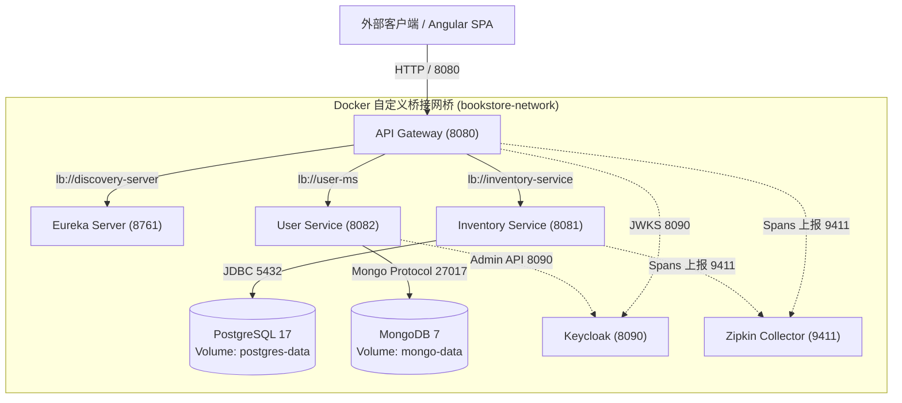

## 1. 容器化构建与编排技术决策矩阵

### 1.1 Java 打包交付形态演进对比

| 交付形态 | 打包产物 | 运行时依赖 | 环境一致性与隔离级别 |
| :--- | :--- | :--- | :--- |
| **传统 WAR 时代** | `.war` 归档文件 | 强依赖外部应用服务器（Tomcat/WebLogic） | 极差；易受宿主容器版本与共享类加载器干扰 |
| **Fat JAR 革命** | `.jar` 自包含归档 | 内嵌 Web 容器，但依赖宿主机 JRE | 良好；业务自包含，但仍依赖宿主 OS 动态库与 JVM |
| **不可变容器镜像** | OCI / Docker Image | 仅需底层容器运行时引擎（containerd） | **极致**；将最小根文件系统、JRE 与代码完全封装，无环境漂移 |

### 1.2 镜像构建工具选型对比

| 工具方案 | 是否依赖 Docker Daemon | 构建分层与缓存优化 | 适用场景与选型依据 |
| :--- | :--- | :--- | :--- |
| **多阶段 Dockerfile (推荐)** | 是 | 人工基于指令精确控制缓存命中 | **团队通用标准**：对基础镜像、系统包与探针拥有完全定制自由度 |
| **Google Jib** | **否 (可在无 Docker 的 CI 运行)** | 智能字节码级别深度分层 | CI/CD 流水线提速首选，无需守护进程与特权构建模式 |
| **Spring Boot Buildpacks** | 是 | 自动分析分层与动态 JVM 参数计算 | 适合完全遵循 Spring Boot 标准约定的团队 |

---

## 2. 生产级多阶段 Dockerfile 与分层构建范式

通过多阶段构建将 **Maven 编译环境** 与 **极简 JRE 生产运行环境** 彻底解耦，并集成 Actuator 健康探针与非 root 权限运行：

```dockerfile
# ==========================================
# 第一阶段：编译构建阶段（Builder Stage）
# ==========================================
FROM maven:3.9-eclipse-temurin-26 AS builder
WORKDIR /app

# 1. 优先拷贝 POM 文件并下载依赖，最大化利用 Docker 镜像层缓存
COPY pom.xml .
RUN mvn dependency:go-offline -B

# 2. 拷贝源码并打包，跳过单元测试以加快镜像构建速度
COPY src ./src
RUN mvn clean package -DskipTests

# ==========================================
# 第二阶段：生产运行阶段（Runtime Stage）
# ==========================================
FROM eclipse-temurin:26-jre
WORKDIR /opt/bookstore

# 声明维护元数据
LABEL maintainer="bookstore-platform"
LABEL description="Bookstore Inventory Microservice"

# 安全强化：创建非 root 专属运维系统账户
RUN groupadd -r appgroup && useradd -r -g appgroup -m -d /opt/bookstore appuser

# 仅从构建阶段拷贝最终打包 JAR
COPY --from=builder --chown=appuser:appgroup /app/target/inventory-ms-*.jar app.jar

# 切换为非特权用户
USER appuser

# 声明服务端口
EXPOSE 8081

# 集成针对 Spring Boot Actuator 的健康探针
HEALTHCHECK --interval=30s --timeout=3s --start-period=40s --retries=3 \
  CMD wget --no-verbose --tries=1 --spider http://localhost:8081/inventory/actuator/health || exit 1

# 采用 Exec 数组格式启动，保证 Java 进程作为 PID 1 正确接收 SIGTERM 信号
ENTRYPOINT ["java", "-XX:+UseContainerSupport", "-XX:MaxRAMPercentage=75.0", "-jar", "app.jar"]
```

---

## 3. 全栈微服务 Docker Compose 声明式编排范式

通过声明式编排文件管理中间件依赖、微服务启停时序、持久化存储卷与容器互联桥接网桥：

```yaml
version: '3.8'

services:
  # 1. Eureka 服务发现中心
  discovery-server:
    image: bookstore/discovery-server:v1.0.0
    container_name: discovery-server
    ports:
      - "8761:8761"
    networks:
      - bookstore-network
    restart: unless-stopped

  # 2. 关系型数据库 (PostgreSQL 17)
  postgres:
    image: postgres:17
    container_name: bookstore-postgres
    environment:
      POSTGRES_DB: inventory
      POSTGRES_USER: bookstore
      POSTGRES_PASSWORD: bookstore123
    ports:
      - "5432:5432"
    volumes:
      - postgres-data:/var/lib/postgresql/data
    networks:
      - bookstore-network
    restart: unless-stopped

  # 3. 文档型数据库 (MongoDB 7)
  mongodb:
    image: mongo:7
    container_name: bookstore-mongo
    ports:
      - "27017:27017"
    volumes:
      - mongo-data:/data/db
    networks:
      - bookstore-network
    restart: unless-stopped

  # 4. 链路追踪服务 (Zipkin)
  zipkin:
    image: openzipkin/zipkin
    container_name: bookstore-zipkin
    ports:
      - "9411:9411"
    networks:
      - bookstore-network
    restart: unless-stopped

  # 5. 身份认证中心 (Keycloak)
  keycloak:
    image: quay.io/keycloak/keycloak:26.0.0
    container_name: bookstore-keycloak
    command: start-dev
    environment:
      KEYCLOAK_ADMIN: admin
      KEYCLOAK_ADMIN_PASSWORD: admin
      KC_HTTP_PORT: 8090
    ports:
      - "8090:8090"
    networks:
      - bookstore-network
    restart: unless-stopped

  # 6. 库存微服务
  inventory-service:
    image: bookstore/inventory-service:v1.0.0
    container_name: inventory-service
    environment:
      SPRING_DATASOURCE_URL: jdbc:postgresql://postgres:5432/inventory
      EUREKA_CLIENT_SERVICEURL_DEFAULTZONE: http://discovery-server:8761/eureka/
      MANAGEMENT_ZIPKIN_TRACING_ENDPOINT: http://zipkin:9411/api/v2/spans
    depends_on:
      - postgres
      - discovery-server
    networks:
      - bookstore-network
    restart: unless-stopped

  # 7. 用户微服务
  user-service:
    image: bookstore/user-service:v1.0.0
    container_name: user-service
    environment:
      SPRING_DATA_MONGODB_URI: mongodb://mongodb:27017/userdb
      EUREKA_CLIENT_SERVICEURL_DEFAULTZONE: http://discovery-server:8761/eureka/
    depends_on:
      - mongodb
      - keycloak
      - discovery-server
    networks:
      - bookstore-network
    restart: unless-stopped

  # 8. API 网关服务 (对外唯一流量入口)
  gateway-server:
    image: bookstore/gateway-server:v1.0.0
    container_name: gateway-server
    ports:
      - "8080:8080"
    environment:
      EUREKA_CLIENT_SERVICEURL_DEFAULTZONE: http://discovery-server:8761/eureka/
    depends_on:
      - discovery-server
      - inventory-service
      - user-service
    networks:
      - bookstore-network
    restart: unless-stopped

networks:
  bookstore-network:
    driver: bridge

volumes:
  postgres-data:
  mongo-data:
```

---

## 4. 全栈微服务容器拓扑架构图



---

## 5. 架构避坑清单 (Do's & Don'ts)

| 错误实践 (Don't) | 正确实践 (Do) |
| :--- | :--- |
| 在生产镜像中使用 root 用户运行 Java 进程。 | 在 Dockerfile 中创建专属低特权系统用户并切换，防范潜在提权漏洞。 |
| 使用 Shell 格式 `ENTRYPOINT java -jar app.jar`。 | 必须使用 Exec 格式 `ENTRYPOINT ["java", "-jar", "app.jar"]`，确保容器 PID 1 正常接收系统优雅下线信号。 |
| 生产数据库容器未配置挂载外部卷（Volume）。 | 数据库目录强制挂载宿主机或外部 Docker Volume，确保容器销毁重建后数据不丢失。 |
| Dockerfile 编写时将源码拷贝置于 `pom.xml` 依赖下载之前。 | 优先拷贝 `pom.xml` 执行依赖下载，最大化复用本地依赖层缓存，避免重复下载数百兆依赖包。 |
| 生产发布使用 `latest` 镜像标签。 | 严格使用语义化版本或 Git Commit SHA 标签（如 `v1.2.0`），保证构建可溯源且故障时可稳定回滚。 |

<!-- split -->

# 原著完整参考：后端多微服务容器化构建与 Docker Compose 统一编排

在现代软件工程中，系统生命周期绝不仅限于代码在本地环境编译通过。在由多个异构微服务、数据库与分布式基础设施共同构成的企业级微服务体系中，如何将应用可靠、一致且可预测地打包与部署，是 DevOps 交付流水线的核心任务。

本文系统梳理从源码到云原生交付的全流程：从 Java 打包交付历史演变切入，深入剖析 Linux 原生容器隔离机制与镜像分层技术；随后运行 PostgreSQL、MongoDB 与 Zipkin 等支撑基础设施；为微服务编写生产级多阶段 Dockerfile，并横向对比 Buildpacks 与 Google Jib 自动化构建方案；最终通过 Docker Compose 声明式编排整个微服务拓扑，实现一键拉起全栈微服务后端。

:::en
> **Original**: Containerization packages applications with their exact runtime dependencies into immutable images, ensuring behavioral parity across local development, staging environments, and production clusters.

**📌 核心术语与语境解析**：
- **Immutable Infrastructure** [ɪˈmjuːtəbl ˈɪnfrəstrʌktʃər]：*不可变基础设施*。一旦构建打包即不再就地修改，所有变更均通过生成并部署新版本镜像进行替代的运维理念。
- **Containerization** [kənˌteɪnərəˈzeɪʃn]：*容器化*。依托操作系统内核特性将应用进程及其全部依赖项打包封装为自包含运行单元的技术。
:::

---

## 1. 后端打包策略的演进脉络

Java 企业级打包模式经历了三次标志性跃迁：

### 1.1 传统企业级 WAR 包时代

在传统单体架构时期，Java 应用通常被打包为 **WAR**（Web Application ARchive）包，并部署于独立的外部应用服务器（Tomcat、JBoss、WebLogic）中：

```xml
<packaging>war</packaging>
```

该模式存在明显的工程弊端：
- **强耦合应用服务器环境**：部署高度依赖宿主服务器的版本、类加载器配置及全局类库，极易发生环境漂移；
- **资源颗粒度粗放**：弹性扩缩容需要复制整套重量级应用服务器；
- **组件版本升级困难**：共享运行时难以支持不同子模块采用异构依赖版本。

### 1.2 Spring Boot 可执行 Fat JAR 革命

Spring Boot 倡导“嵌入式容器”理念，将 Web 容器（Tomcat/Netty）直接封装进应用内部。通过 Maven 执行打包：

```bash
mvn clean package
```

在 `target/` 目录下生成可执行 Fat/Uber JAR，仅需一行命令即可运行：

```bash
java -jar inventory-ms-0.0.1-SNAPSHOT.jar
```

这种自包含交付模式极大降低了部署复杂性。但 Fat JAR 依然未彻底脱离对宿主机环境的依赖：目标机器必须预先安装特定版本的 JRE 与动态依赖库。

### 1.3 面向微服务的容器化交付

容器化技术将“自包含”推进至操作系统层面：**不仅打包应用程序本身，还将最小 Linux 根文件系统、特定版本的 JRE 运行时、动态链接库与启动配置整体封装为不可变镜像**。

本地验证通过的镜像，可以在预发布环境与生产 Kubernetes 集群中实现毫无偏差的同构运行，彻底终结了“在本地能跑但上线就崩”的配置漂移问题。

---

## 2. 容器化底层核心原理与生命周期

### 2.1 容器与虚拟机的架构差异

传统虚拟机依赖 Hypervisor 硬件虚拟化技术，每个虚拟机内必须运行完整的 Guest OS，导致启动耗时达数分钟，磁盘与内存开销沉重。

相比之下，容器是**基于 Linux 内核的原生进程级隔离技术**：
- **Namespaces（命名空间）**：实现进程视图的六重隔离，涵盖 PID（进程号）、NET（网络栈与端口）、MNT（文件系统挂载点）、IPC（进程间通信）、UTS（主机名）与 USER（用户映射）；
- **Control Groups（cgroups）**：实现物理资源的硬性配额与度量（限制 CPU 核心、内存使用上限与 I/O 带宽）；
- **共享宿主内核**：所有容器直接复用宿主 Linux 内核，毫秒级启停，单机可高密度运行数百个微服务实例。

### 2.2 镜像分层与联合文件系统（OverlayFS）

容器镜像由多层只读层堆叠而成，底层依托联合文件系统实现：
- Dockerfile 中的每条关键指令均生成一个新的只读镜像层；
- 镜像启动为容器时，存储驱动在只读层之上附加一个可写容器层（Container Layer）；
- 所有写操作均通过写时复制（Copy-on-Write）进行，修改文件仅在可写层产生副本，绝不破坏基础镜像。

分层机制带来了显著优势：
1. **构建缓存**：基础层无变化时直接命中缓存，显著加速构建；
2. **跨镜像共享**：多个微服务可共享相同的基础 JRE 镜像层，宿主机仅需拉取并存储一份基础数据。

:::en
> **Original**: Linux namespaces partition kernel resources to give each container its own isolated system view, while control groups (cgroups) enforce hard limits on CPU, memory, and I/O consumption.

**📌 核心术语与语境解析**：
- **Linux Namespaces** [ˈlɪnəks ˈneɪmspeɪsɪz]：*Linux 命名空间*。内核提供的一种资源隔离机制，为各容器提供独立的进程树、网络设备与挂载点。
- **Control Groups (cgroups)** [kənˈtroʊl ɡruːps]：*控制组*。Linux 内核用于限制、记录与隔离进程组物理资源（CPU、内存、I/O）的使用量的机制。
:::

### 2.3 容器全生命周期工作流


1. **Build（构建）**：基于 Dockerfile 将源码编译为镜像；
2. **Push（发布）**：为镜像打上语义化标签并推送到中央镜像仓库；
3. **Pull（拉取）**：目标节点按需拉取镜像层；
4. **Run（运行）**：容器引擎启动隔离实例；
5. **Monitor & Terminate（监控与回收）**：健康探针监控，优雅终止或自动重启。

---

## 3. 本地支撑基础设施容器化部署

书店系统依赖的后端支撑组件：
- **PostgreSQL 17**：Inventory Service 的关系型数据持久层；
- **MongoDB 7**：User Service 的文档型持久层；
- **Zipkin**：分布式链路追踪集中展示看板。

### 3.1 拉取并验证官方镜像

```bash
docker pull postgres:17
docker pull mongo:7
docker pull openzipkin/zipkin
```

检查本地镜像缓存：

```bash
docker images postgres
```


### 3.2 启动 PostgreSQL 与 MongoDB 容器

启动关系型数据库：

```bash
docker run -d \
  --name bookstore-postgres \
  -e POSTGRES_DB=inventory \
  -e POSTGRES_USER=bookstore \
  -e POSTGRES_PASSWORD=bookstore123 \
  -p 5432:5432 \
  postgres:17
```

启动文档型数据库：

```bash
docker run -d \
  --name bookstore-mongo \
  -p 27017:27017 \
  mongo:7
```

启动 Zipkin 分布式追踪服务：

```bash
docker run -d \
  --name bookstore-zipkin \
  -p 9411:9411 \
  openzipkin/zipkin
```

### 3.3 容器状态巡检

执行 `docker ps` 查看所有活跃容器：

```bash
docker ps
```


---

## 4. Spring Boot 微服务自定义容器镜像构建

### 4.1 单阶段 Dockerfile 局限性

最基础的单阶段构建将宿主机打包好的 JAR 复制进镜像：

```dockerfile
FROM eclipse-temurin:26-jdk
LABEL maintainer="bookstore-platform"
WORKDIR /opt/bookstore
COPY target/inventory-service-v0.0.1.jar inventory-service.jar
EXPOSE 8081
ENTRYPOINT ["java", "-jar", "inventory-service.jar"]
```

该方式存在两项缺陷：
1. 依赖宿主机环境预先安装特定版本的 Maven 与 JDK；
2. 若在镜像内部安装构建工具，会导致产物镜像极其臃肿（动辄数百 MB 乃至 1GB 以上），并引入不必要的安全漏洞。

### 4.2 生产级多阶段构建（Multi-Stage Builds）

多阶段构建将编译环境与生产运行环境彻底解耦：

```dockerfile
# 第一阶段：编译构建阶段
FROM maven:3.9-eclipse-temurin-26 AS builder
WORKDIR /app
COPY pom.xml .
RUN mvn dependency:go-offline -B
COPY src ./src
RUN mvn clean package -DskipTests

# 第二阶段：生产运行阶段
FROM eclipse-temurin:26-jre
WORKDIR /app
COPY --from=builder /app/target/inventory-ms-*.jar app.jar
EXPOSE 8081
ENTRYPOINT ["java", "-jar", "app.jar"]
```

收益包括：
- **体积缩减**：生产镜像仅包含精简版 JRE 与应用 JAR，剔除编译器与依赖缓存，体积缩减 60% 以上；
- **构建环境一致**：宿主机仅需安装 Docker 即可完成从源码到镜像的全部构建；
- **攻击面最小化**：运行环境中无任何编译工具链，降低安全风险。

:::en
> **Original**: Multi-stage builds decouple the compile-time SDK and Maven dependencies from the production runtime image, yielding minimal, hardened container artifacts suitable for production.

**📌 核心术语与语境解析**：
- **Multi-Stage Build** [ˈmʌlti steɪdʒ bɪld]：*多阶段构建*。在单个 Dockerfile 中使用多个 FROM 指令，选择性将构建产物传递至最终轻量运行镜像的技术。
- **Hardened Image** [ˈhɑːrdnd ˈɪmɪdʒ]：*安全加固镜像*。剔除不必要系统工具、依赖库与 root 权限，降低受攻击暴露面的生产镜像。
:::

### 4.3 自动化构建工具：Buildpacks 与 Google Jib

在大型工程中，除手写 Dockerfile 外，生态还提供了两种自动化方案：

#### 方案 A：Spring Boot 官方 Cloud Native Buildpacks

无需编写 Dockerfile，直接执行：

```bash
mvn spring-boot:build-image
```

自动解析项目依赖结构，将应用拆解为依赖层、Spring Boot Loader 层与应用代码层，并根据容器内存限制智能计算 JVM 参数。

#### 方案 B：Google Jib 纯 Java 构建器

Google Jib 最大特点是**构建镜像完全不依赖宿主机的 Docker 守护进程**：

```xml
<plugin>
  <groupId>com.google.cloud.tools</groupId>
  <artifactId>jib-maven-plugin</artifactId>
  <version>3.4.0</version>
</plugin>
```

在 CI/CD 中直接将字节码编译结果组装为 OCI 镜像并直推远程仓库：

```bash
mvn compile jib:build -Dimage=your-registry.io/inventory-ms:v0.0.1
```

---

## 5. 容器运行时高级治理能力

### 5.1 容器自动重启策略

```bash
docker run -d \
  --restart=unless-stopped \
  -p 8081:8081 \
  --name inventory-service \
  bookstore/inventory-service:v0.0.1
```

`unless-stopped` 策略确保容器在崩溃或 Docker 守护进程重启时自动复活，除非被管理员显式手动停止。

### 5.2 存储卷持久化（Volumes）

容器销毁时内部临时数据将永久丢失。数据库容器必须挂载外部存储卷：

```bash
docker run -d \
  --name bookstore-postgres \
  -v pgdata:/var/lib/postgresql/data \
  -p 5432:5432 \
  postgres:17
```

即使执行 `docker rm -f bookstore-postgres`，`pgdata` 卷依然完整保存在宿主机中，重新挂载即可无损恢复数据。

### 5.3 健康检查机制（Health Checks）

在 Dockerfile 中集成针对 Spring Boot Actuator 的健康检查探针：

```dockerfile
HEALTHCHECK --interval=30s --timeout=3s --start-period=40s --retries=3 \
  CMD wget --no-verbose --tries=1 --spider http://localhost:8081/inventory/actuator/health || exit 1
```

:::en
> **Original**: Periodic health checks execute non-invasive probes against application endpoints, enabling container runtimes to detect deadlocks and restart unhealthy instances automatically.

**📌 核心术语与语境解析**：
- **Health Check Probe** [helθ tʃek proʊb]：*健康检查探针*。周期性探测容器内部应用真实服务能力的检测指令或 HTTP 端点。
- **Graceful Shutdown** [ˈɡreɪsfl ˈʃʌtdaʊn]：*优雅停机*。应用在接收到终止信号后停止接收新流量、处理完在途请求并释放数据库连接后再退出的机制。
:::

---

## 6. 基于 Docker Compose 统一编排微服务集群

在全栈体系中，手动运行数十条命令难以保障依赖拓扑与配置协同。**Docker Compose** 提供了声明式的一键多容器编排规范。

### 6.1 全栈拓扑架构图

通过 Docker Compose，全栈微服务在统一网桥中协同运行：


- **API Gateway (8080)**：统一流量入口；
- **Eureka Server (8761)**：服务注册与发现；
- **Keycloak (8090)**：身份认证中心；
- **Inventory & User Services**：业务微服务；
- **PostgreSQL & MongoDB**：持久化数据存储；
- **Zipkin (9411)**：分布式链路监控看板。

### 6.2 一键就绪开发环境工作流

```bash
# 1. 切换至编排目录
cd Spring-Boot-and-Angular-2E_Backend/containerization

# 2. 预先拉取所有基础镜像
docker compose pull

# 3. 后台一键拉起全栈集群
docker compose up -d

# 4. 查看集群容器健康状态
docker compose ps
```

控制台访问入口汇总：
- **API 网关入口**：`http://localhost:8080`
- **Eureka 注册中心**：`http://localhost:8761`
- **Zipkin 链路看板**：`http://localhost:9411`
- **Keycloak 认证后台**：`http://localhost:8090`

---

## 7. 总结与下篇展望

本文系统梳理了现代化 Spring Boot 后端微服务的交付与编排体系：
- **交付模型演进**：理解了从 WAR 包、Fat JAR 到不可变容器镜像的演进脉络；
- **底层隔离与多阶段构建**：掌握了 Linux 命名空间、cgroups、联合文件系统分层机制，并落地了多阶段 Dockerfile；
- **自动化构建方案**：横向对比了 Buildpacks 与 Google Jib 的技术特性；
- **Compose 统一编排**：利用 Volume 持久化、Actuator 探针与自定义网桥，实现了全栈多微服务拓扑的一键声明式拉起。

后端容器化基础设施现已稳固就绪。在接下来的 **第十一篇** 中，我们将全方位转向前端工程，基于最新的 **Angular 22** 构建现代化单页应用架构：拥抱纯 Standalone 独立组件体系、基于 Signals 的细粒度响应式输入输出、Smart/Dumb 分层设计，并接入基于 Vite 的极速 Vitest 单元测试框架！
