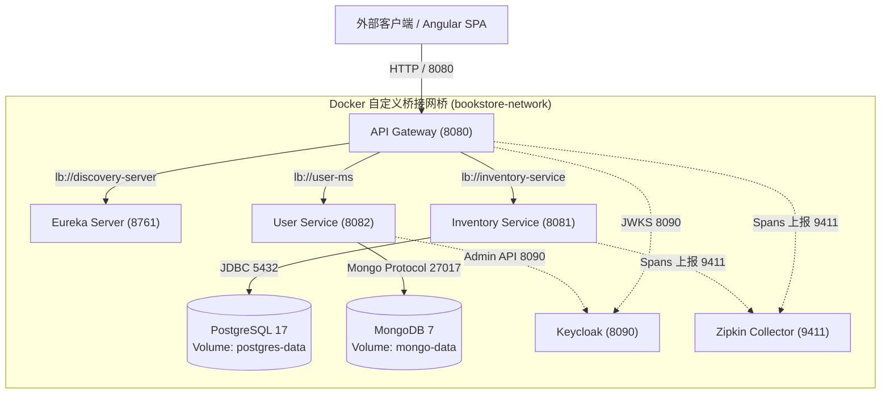

## 1. 容器化构建与编排技术决策矩阵

### 1.1 Java 打包交付形态演进对比

| 交付形态 | 打包产物 | 运行时依赖 | 环境一致性与隔离级别 |
| :--- | :--- | :--- | :--- |
| **传统 WAR 时代** | `.war` 归档文件 | 强依赖外部应用服务器（Tomcat/WebLogic） | 极差；易受宿主容器版本与共享类加载器干扰 |
| **Fat JAR 革命** | `.jar` 自包含归档 | 内嵌 Web 容器，但依赖宿主机 JRE | 良好；业务自包含，但仍依赖宿主 OS 动态库与 JVM |
| **不可变容器镜像** | OCI / Docker Image | 仅需底层容器运行时引擎（containerd） | **极致**；将最小根文件系统、JRE 与代码完全封装，无环境漂移 |

### 1.2 镜像构建工具选型对比

| 工具方案 | 是否依赖 Docker Daemon | 构建分层与缓存优化 | 适用场景与选型依据 |
| :--- | :--- | :--- | :--- |
| **多阶段 Dockerfile (推荐)** | 是 | 人工基于指令精确控制缓存命中 | **团队通用标准**：对基础镜像、系统包与探针拥有完全定制自由度 |
| **Google Jib** | **否 (可在无 Docker 的 CI 运行)** | 智能字节码级别深度分层 | CI/CD 流水线提速首选，无需守护进程与特权构建模式 |
| **Spring Boot Buildpacks** | 是 | 自动分析分层与动态 JVM 参数计算 | 适合完全遵循 Spring Boot 标准约定的团队 |

---

## 2. 生产级多阶段 Dockerfile 与分层构建范式

通过多阶段构建将 **Maven 编译环境** 与 **极简 JRE 生产运行环境** 彻底解耦，并集成 Actuator 健康探针与非 root 权限运行：

```dockerfile
# ==========================================
# 第一阶段：编译构建阶段（Builder Stage）
# ==========================================
FROM maven:3.9-eclipse-temurin-26 AS builder
WORKDIR /app

# 1. 优先拷贝 POM 文件并下载依赖，最大化利用 Docker 镜像层缓存
COPY pom.xml .
RUN mvn dependency:go-offline -B

# 2. 拷贝源码并打包，跳过单元测试以加快镜像构建速度
COPY src ./src
RUN mvn clean package -DskipTests

# ==========================================
# 第二阶段：生产运行阶段（Runtime Stage）
# ==========================================
FROM eclipse-temurin:26-jre
WORKDIR /opt/bookstore

# 声明维护元数据
LABEL maintainer="bookstore-platform"
LABEL description="Bookstore Inventory Microservice"

# 安全强化：创建非 root 专属运维系统账户
RUN groupadd -r appgroup && useradd -r -g appgroup -m -d /opt/bookstore appuser

# 仅从构建阶段拷贝最终打包 JAR
COPY --from=builder --chown=appuser:appgroup /app/target/inventory-ms-*.jar app.jar

# 切换为非特权用户
USER appuser

# 声明服务端口
EXPOSE 8081

# 集成针对 Spring Boot Actuator 的健康探针
HEALTHCHECK --interval=30s --timeout=3s --start-period=40s --retries=3 \
  CMD wget --no-verbose --tries=1 --spider http://localhost:8081/inventory/actuator/health || exit 1

# 采用 Exec 数组格式启动，保证 Java 进程作为 PID 1 正确接收 SIGTERM 信号
ENTRYPOINT ["java", "-XX:+UseContainerSupport", "-XX:MaxRAMPercentage=75.0", "-jar", "app.jar"]
```

---

## 3. 全栈微服务 Docker Compose 声明式编排范式

通过声明式编排文件管理中间件依赖、微服务启停时序、持久化存储卷与容器互联桥接网桥：

```yaml
version: '3.8'

services:
  # 1. Eureka 服务发现中心
  discovery-server:
    image: bookstore/discovery-server:v1.0.0
    container_name: discovery-server
    ports:
      - "8761:8761"
    networks:
      - bookstore-network
    restart: unless-stopped

  # 2. 关系型数据库 (PostgreSQL 17)
  postgres:
    image: postgres:17
    container_name: bookstore-postgres
    environment:
      POSTGRES_DB: inventory
      POSTGRES_USER: bookstore
      POSTGRES_PASSWORD: bookstore123
    ports:
      - "5432:5432"
    volumes:
      - postgres-data:/var/lib/postgresql/data
    networks:
      - bookstore-network
    restart: unless-stopped

  # 3. 文档型数据库 (MongoDB 7)
  mongodb:
    image: mongo:7
    container_name: bookstore-mongo
    ports:
      - "27017:27017"
    volumes:
      - mongo-data:/data/db
    networks:
      - bookstore-network
    restart: unless-stopped

  # 4. 链路追踪服务 (Zipkin)
  zipkin:
    image: openzipkin/zipkin
    container_name: bookstore-zipkin
    ports:
      - "9411:9411"
    networks:
      - bookstore-network
    restart: unless-stopped

  # 5. 身份认证中心 (Keycloak)
  keycloak:
    image: quay.io/keycloak/keycloak:26.0.0
    container_name: bookstore-keycloak
    command: start-dev
    environment:
      KEYCLOAK_ADMIN: admin
      KEYCLOAK_ADMIN_PASSWORD: admin
      KC_HTTP_PORT: 8090
    ports:
      - "8090:8090"
    networks:
      - bookstore-network
    restart: unless-stopped

  # 6. 库存微服务
  inventory-service:
    image: bookstore/inventory-service:v1.0.0
    container_name: inventory-service
    environment:
      SPRING_DATASOURCE_URL: jdbc:postgresql://postgres:5432/inventory
      EUREKA_CLIENT_SERVICEURL_DEFAULTZONE: http://discovery-server:8761/eureka/
      MANAGEMENT_ZIPKIN_TRACING_ENDPOINT: http://zipkin:9411/api/v2/spans
    depends_on:
      - postgres
      - discovery-server
    networks:
      - bookstore-network
    restart: unless-stopped

  # 7. 用户微服务
  user-service:
    image: bookstore/user-service:v1.0.0
    container_name: user-service
    environment:
      SPRING_DATA_MONGODB_URI: mongodb://mongodb:27017/userdb
      EUREKA_CLIENT_SERVICEURL_DEFAULTZONE: http://discovery-server:8761/eureka/
    depends_on:
      - mongodb
      - keycloak
      - discovery-server
    networks:
      - bookstore-network
    restart: unless-stopped

  # 8. API 网关服务 (对外唯一流量入口)
  gateway-server:
    image: bookstore/gateway-server:v1.0.0
    container_name: gateway-server
    ports:
      - "8080:8080"
    environment:
      EUREKA_CLIENT_SERVICEURL_DEFAULTZONE: http://discovery-server:8761/eureka/
    depends_on:
      - discovery-server
      - inventory-service
      - user-service
    networks:
      - bookstore-network
    restart: unless-stopped

networks:
  bookstore-network:
    driver: bridge

volumes:
  postgres-data:
  mongo-data:
```

---

## 4. 全栈微服务容器拓扑架构图



---

## 5. 架构避坑清单 (Do's & Don'ts)

| 错误实践 (Don't) | 正确实践 (Do) |
| :--- | :--- |
| 在生产镜像中使用 root 用户运行 Java 进程。 | 在 Dockerfile 中创建专属低特权系统用户并切换，防范潜在提权漏洞。 |
| 使用 Shell 格式 `ENTRYPOINT java -jar app.jar`。 | 必须使用 Exec 格式 `ENTRYPOINT ["java", "-jar", "app.jar"]`，确保容器 PID 1 正常接收系统优雅下线信号。 |
| 生产数据库容器未配置挂载外部卷（Volume）。 | 数据库目录强制挂载宿主机或外部 Docker Volume，确保容器销毁重建后数据不丢失。 |
| Dockerfile 编写时将源码拷贝置于 `pom.xml` 依赖下载之前。 | 优先拷贝 `pom.xml` 执行依赖下载，最大化复用本地依赖层缓存，避免重复下载数百兆依赖包。 |
| 生产发布使用 `latest` 镜像标签。 | 严格使用语义化版本或 Git Commit SHA 标签（如 `v1.2.0`），保证构建可溯源且故障时可稳定回滚。 |

<!-- split -->

# 原著完整参考：第 10 章 构建与打包 Spring Boot 后端应用（Building and Packaging the Spring Boot Backend）

在前面的章节中，我们依托 Spring Boot、Spring Data、Spring Security 与 Spring WebFlux 等现代 Java 全栈技术，逐步构建起了在线书店（Bookstore）完整的后端微服务体系。我们不仅实现了库存微服务（Inventory Service）与用户微服务（User Service）的核心业务，还搭建了 Eureka 注册中心、Spring Cloud Gateway 统一网关、Zipkin 全链路分布式追踪与 Keycloak 身份认证中心等一系列支撑组件。

然而，截至目前，我们的关注点主要聚焦在“本地编码实现”与“内部领域架构”上。迈向真实生产世界的必由之路，是对这些微服务进行标准化的构建、打包与工业级容器化部署。

在本章中，我们将系统探讨 Spring Boot 应用程序如何为现代云原生运行时打包。我们将掌握现成基础设施容器的拉取与运行、编写生产级多阶段（Multi-Stage）Dockerfile 构建轻量化镜像、将镜像发布至容器镜像仓库，并在运行时实施高级容器管理。最后，我们将使用 Docker Compose 将整个 Bookstore 平台编排为一套只需一条命令即可一键拉起的一体化全栈微服务集群！

学完本章后，你将拥有将 Spring Boot 微服务从单机开发代码转化为高度轻量化、不可变且在开发、预发与生产环境保持 100% 运行一致性（Parity）的云原生容器镜像的全套能力。

本章核心涵盖以下主题：
- 理解后端打包策略演进（WAR -> Fat JAR -> 容器镜像）
- 容器化核心基石（容器与虚拟机、分层文件系统与运行时）
- 为 Bookstore 平台运行基础设施就绪容器（PostgreSQL、MongoDB、Zipkin）
- 为 Spring Boot 微服务构建自定义容器镜像（Dockerfile、多阶段构建、分层 JAR）
- 基于 Java 工具自动化构建容器镜像（Spring Boot Buildpacks 与 Google Jib）
- 发布容器镜像至 Docker Hub 等远程镜像仓库
- 容器运行时治理（重启策略、数据卷挂载、网络模型与健康检查探针）
- 使用 Docker Compose 统一编排 Bookstore 完整微服务拓扑
- 开发者一键极速入职指引（One-Command Onboarding Guide）

> **注意**
>
> 本章中的部分图片在纸质图书排版中字体可能偏小。我们保留了这些截图，因为它们真实反映了实际控制台界面的操作细节，方便你在自己的屏幕上比对演练。你也可以在本书前言提供的 *Graphics Bundle* 链接中查看并放大所有高清原图。

## 技术准备要求（Technical requirement）

本章涉及的完整源代码可通过以下链接获取：
`https://github.com/PacktPublishing/Spring-Boot-and-Angular-2E_Backend/tree/main/chapter-10`

---

## 理解后端打包策略演进（Understanding backend packaging strategies）

现代软件工程绝不会在代码编译通过的那一刻画上句号。编译仅仅是漫长软件交付流水线的起点。一个企业级系统必须历经标准化打包、分发传输、环境部署、监控守护与周期性维护。在由数十个乃至上百个细粒度微服务协同构成的分布式架构中，打包与交付策略直接决定了工程团队的交付敏捷度与系统稳定性。

在 Java 生态演进的二十余年历史中，后端应用的打包模式经历了三代根本性的架构跃迁：
1. **传统的 Web Application ARchive（WAR）外部容器部署模式**；
2. **Spring Boot 倡导的自包含可执行 JAR（Fat JAR）独立运行模式**；
3. **现代云原生以不可变容器镜像（Container Image）为核心的分发模式**。

理解这一演进脉络，将有助于深刻理解为何容器化已成为当下微服务交付的绝对事实标准。

### 传统 WAR 包外部容器部署时代（Traditional Java packaging with WAR files）

长年以来，企业级 Java 应用均被打包为 `.war` 归档文件，并手动分发部署至外部应用服务器（如 Apache Tomcat、JBoss、WebLogic、WebSphere）中运行。在 Maven 中的经典配置如下：

```xml
<packaging>war</packaging>
```

在这一时代，应用服务器提供了运行底座与 Servlet 容器，WAR 包中仅包含业务 Class 文件与静态 Web 资源。这种模式虽然支撑了早期单体应用的发展，但在分布式微服务时代暴露出严重弊端：
- **强依赖服务器环境**：应用高度依赖外部服务器的版本配置与类加载器机制，极易因线上服务器配置与本地开发机细微差异而导致“在我机器上能跑，线上就崩溃”的环境漂移问题；
- **运维管理笨重**：水平扩缩容必须先部署并配置整台臃肿的应用服务器，耗时耗力；
- **依赖冲突严重**：若多个 WAR 包共享同一个应用服务器实例，公共类库版本冲突（Jar Hell）将成为运维噩梦。

### Spring Boot 可执行 Fat JAR 时代（Spring Boot executable JAR packaging）

Spring Boot 彻底颠覆了上述传统模式。它引入了**内嵌容器（Embedded Container）**理念，反向将轻量级的 Tomcat 或 Netty 直接打包进应用程序内部。

通过 `spring-boot-maven-plugin` 插件打包后，生成的是一个自包含的 **Fat JAR**：

```xml
<packaging>jar</packaging>
```

只需在安装了 JRE 的任何操作系统终端执行一条命令：

```bash
java -jar inventory-ms.jar
```

应用便能瞬间自举启动。这一重大突破解除了对外部应用服务器的人工配置依赖，应用成为了独立自治的自包含单元。但它依然存在微小短板：**它依然需要目标宿主机预先安装并正确配置特定版本的 Java 运行时环境（JRE/JDK）**。如果一台生产服务器的 Java 版本是 17，而微服务是用 Java 26 构建的，应用依然无法直接执行。

### 现代云原生容器化打包（Container-based packaging for microservices）

**容器化（Containerization）**将自包含理念推向了终极形态。

一个容器镜像不仅包含编译好的 Spring Boot JAR 包及其全部第三方依赖，还**封装了底层精简的 Linux 操作系统内核抽象、特定版本的 Java 运行时（JRE）、本地 C 类库以及环境系统变量**。开发人员交付给运维团队的不再是一个松散的 Jar 文件，而是一个在字节码级别与环境依赖层面完全不可变的、自给自足的标准软件集装箱（Software Container）。无论是 macOS 开发机、Ubuntu 测试服务器，还是公有云上的 Kubernetes 集群，只要安装了容器运行时，该镜像均能以 100% 绝对一致的确定性行为启动运行！

---

## 容器化核心基石（Understanding containerization fundamentals）

### 容器与虚拟机的根本区别（Containers versus virtual machines）

在容器技术普及之前，企业通常使用**虚拟机（Virtual Machines, VMs）**来实现环境隔离（依托 VMware、VirtualBox 或 AWS EC2）。

- **虚拟机架构**：通过虚拟机监控器（Hypervisor）在物理硬件上模拟整套虚拟硬件，每个虚拟机内必须安装一个完整、独立的**客户机操作系统（Guest OS）**，并自带独立的内核与驱动。这导致虚拟机体积极其庞大（通常数 GB 至数十 GB），启动耗时通常需要数十秒至数分钟，CPU 与内存资源损耗严重；
- **容器架构**：容器**直接共享宿主机的操作系统内核（Shared Host Kernel）**。Docker 等容器引擎依托 Linux 内核的 **命名空间（Namespaces，实现进程、网络、挂载点隔离）** 与 **控制组（Cgroups，实现 CPU、内存物理资源配额限制）** 技术，在操作系统用户空间划分出独立的轻量级沙箱。容器几乎没有额外的虚拟化开销，体积通常仅百兆级，能在百毫秒内瞬间启动！

### 容器镜像与分层写时复制文件系统（Container images and layered file systems）

容器镜像并非单一扁平的巨大二进制文件，而是基于**联合文件系统（UnionFS / Overlay2）**构建的**分层只读堆叠结构（Layered File System）**。

在 `Dockerfile` 中执行的每一条指令（如 `FROM`、`COPY`、`RUN`）都会生成一个独立的只读层：
- 基础操作系统层（如 `eclipse-temurin:26-jre-alpine`）；
- 系统工具与字体支持层；
- 第三方静态依赖 JAR 库；
- 易变的应用业务代码 Class 文件。

各镜像层通过内容寻址哈希（SHA256）进行全局缓存与复用。当多个微服务共享相同的基础镜像时，宿主机在物理磁盘上只需存储一份基础层；当重新打包微服务时，由于仅业务代码层发生改变，Docker 只需构建并传输变动的几十 KB 增量层，大幅加速了镜像拉取与持续集成（CI/CD）流水线。

在容器启动时，Docker 会在所有只读层的最顶层挂载一个轻量级的**可写容器层（Writable Container Layer）**。容器运行期间产生的所有临时文件均写入该层，容器销毁时该层随之丢弃，底层的只读镜像层永远毫发无损。

### 容器运行时（Container runtimes）

**容器运行时**是负责管理容器底层完整生命周期的核心引擎。
- **Docker**：最广为人知、开发者体验最丝滑的桌面与服务器级容器平台，整合了命令行 CLI、镜像构建引擎（BuildKit）与网络存储编排；
- **Podman**：由 Red Hat 推出的无守护进程（Daemonless）、支持无根运行（Rootless）的轻量级容器工具，命令与 Docker 保持 100% 语法兼容；
- **containerd / CRI-O**：剥离了开发工具、专注于生产高吞吐与 Kubernetes 容器运行时接口（CRI）调度的纯粹底层运行时。

### 容器全生命周期流转（Container lifecycle overview）

下图揭示了从本地源代码编写到生产集群运行的完整容器交付流水线：


*图 10.1：容器开发与镜像交付流转示意图*

1. **开发构建（Build）**：依据 `Dockerfile` 构建包含应用与依赖的本地容器镜像；
2. **打标与推送（Ship）**：为镜像打上唯一版本语义标签（Tag），推送到中央镜像仓库（Container Registry，如 Docker Hub）；
3. **部署运行（Run）**：生产服务器拉取（Pull）镜像，将其实例化为一个或多个自治容器进程。

---

## 为 Bookstore 平台运行基础设施就绪容器（Running ready-made containers for the Bookstore platform）

在将我们自己编写的 Spring Boot 微服务打成容器之前，系统依赖的一组核心基础设施服务必须先行拉起。我们的架构涵盖了：
- **PostgreSQL 17**：供库存微服务（`inventory-ms`）存储强一致性事务关系数据；
- **MongoDB 7**：供用户微服务（`user-ms`）持久化灵活文档型的用户档案数据；
- **Zipkin**：作为全链路分布式追踪数据的收集与可视化分析引擎。

利用 Docker 官方提供的标准化镜像，我们可以在本地数秒内拉起隔离干净的基础设施实例，告别繁重易冲突的本机物理安装。

### 从 Docker Hub 拉取官方基础设施镜像（Pulling container images from Docker Hub）

执行以下命令拉取官方 PostgreSQL 镜像：

```bash
docker pull postgres:17
```

Docker 会多线程并行下载各只读层。通过以下命令验证本地镜像：

```bash
docker images postgres
```


*图 10.2：本地 Docker 镜像列表中展示的 PostgreSQL 镜像*

### 启动运行 PostgreSQL 数据库容器

执行以下命令创建并后台运行 PostgreSQL 实例：

```bash
docker run -d \
  --name bookstore-postgres \
  -e POSTGRES_DB=inventory \
  -e POSTGRES_USER=bookstore \
  -e POSTGRES_PASSWORD=bookstore123 \
  -p 5432:5432 \
  postgres:17
```

核心参数解析：
- `-d`：Detached 模式，容器在后台以守护进程形式常驻运行；
- `--name bookstore-postgres`：赋予容器友好的可读名称；
- `-e POSTGRES_DB=inventory`：初始化自动创建名为 `inventory` 的数据库；
- `-e POSTGRES_USER=bookstore` 与 `-e POSTGRES_PASSWORD=bookstore123`：指定数据库超级账号与密码；
- `-p 5432:5432`：**端口映射（Port Mapping）**。将宿主机的 5432 物理端口绑定到容器内部的 5432 监听端口，允许宿主机上的应用直接通过 `localhost:5432` 建立连接。

### 启动运行 MongoDB 文档数据库容器

拉取并启动 MongoDB 7 容器供 `user-ms` 使用：

```bash
docker pull mongo:7
docker run -d \
  --name bookstore-mongo \
  -p 27017:27017 \
  mongo:7
```

### 启动运行 Zipkin 分布式追踪服务容器

拉取并启动 Zipkin 镜像：

```bash
docker pull openzipkin/zipkin
docker run -d \
  --name bookstore-zipkin \
  -p 9411:9411 \
  openzipkin/zipkin
```

启动后，访问 `http://localhost:9411` 即可打开分布式追踪的可视化控制面板。

### 查看与管理运行中的容器进程（Inspecting, logs, and lifecycle）

执行 `docker ps` 命令查看当前所有处于活跃状态的容器：

```bash
docker ps
```


*图 10.3：运行中的 Docker 容器进程列表*

常用的容器运维指令清单：
- **查看实时日志**：`docker logs bookstore-postgres -f`
- **优雅停止容器**：`docker stop bookstore-postgres`
- **销毁已停止的容器**：`docker rm bookstore-postgres`
- **清理本地旧镜像**：`docker rmi postgres:17`

---

## 为 Spring Boot 微服务构建自定义容器镜像（Building custom container images for Spring Boot applications）

基础设施服务就绪后，现在我们正式学习如何为自己的 Spring Boot 微服务（以 `inventory-ms` 为代表）制作高质量的自定义生产镜像。

### 编写多阶段构建 Dockerfile（Multi-stage container builds）

最朴素的 Dockerfile 往往直接在一个大镜像中安装 JDK、下载 Maven 并编译代码，最终生成的镜像体积动辄突破 1GB，且将源代码与编译工具全部暴露在运行环境中，存在严重的安全漏洞。

现代工业界推荐采用**多阶段构建（Multi-Stage Builds）**——将**构建环境（Build Stage）**与**生产运行环境（Runtime Stage）**彻底物理隔离！

在 `inventory-ms` 根目录下创建 `Dockerfile`：

```dockerfile
# ==========================================
# 阶段 1：构建阶段（Maven 编译与分层解压）
# ==========================================
FROM maven:3.9.9-eclipse-temurin-26-alpine AS builder

WORKDIR /build

# 先单独拷贝 pom.xml 利用 Docker 缓存拉取依赖
COPY pom.xml .
RUN mvn dependency:go-offline -B

# 拷贝源代码并执行无测试打包
COPY src ./src
RUN mvn clean package -DskipTests

# 从生成的 Fat JAR 中解压出 Spring Boot 分层目录（Layered Tools）
WORKDIR /build/target
RUN java -Djarmode=tools -jar *.jar extract --layers --destination extracted

# ==========================================
# 阶段 2：生产运行阶段（极简 Alpine JRE 基础镜像）
# ==========================================
FROM eclipse-temurin:26-jre-alpine AS runner

# 创建非 root 安全系统用户与工作目录
RUN addgroup -S bookstore && adduser -S bookstore -G bookstore
USER bookstore
WORKDIR /app

# 按照变动频率由低到高的顺序，逐层拷贝解压出来的文件
COPY --from=builder /build/target/extracted/dependencies/ ./
COPY --from=builder /build/target/extracted/spring-boot-loader/ ./
COPY --from=builder /build/target/extracted/snapshot-dependencies/ ./
COPY --from=builder /build/target/extracted/application/ ./

# 暴露微服务通信端口
EXPOSE 8081

# 声明生产级 JVM 参数与启动主类入口
ENV JAVA_OPTS="-XX:+UseContainerSupport -XX:MaxRAMPercentage=75.0"
ENTRYPOINT ["sh", "-c", "java $JAVA_OPTS org.springframework.boot.loader.launch.JarLauncher"]
```

#### 架构闪光点深度剖析：Spring Boot 分层 JAR（Layered JARs）

上述 Dockerfile 运用了 Spring Boot 的**分层 JAR（Layered JARs）**前沿技术：
- 传统直接使用 `COPY target/*.jar app.jar` 会将第三方依赖和业务代码揉成一个数百兆的单体文件。即使开发者仅仅修改了一行业务代码，由于 Jar 文件校验和改变，Docker 必须重新上传并缓存整个 100MB+ 的镜像层！
- 通过 `java -Djarmode=tools -jar *.jar extract`，Spring Boot 自动将应用解压为四个清晰的物理层：
  1. `dependencies`：第三方依赖库（几乎从不改变，缓存命中率极高）；
  2. `spring-boot-loader`：Spring 自带的引导类加载器；
  3. `snapshot-dependencies`：快照依赖；
  4. `application`：开发者真正编写的业务 Controller、Service 与配置文件（通常仅几百 KB！）。
- 在多阶段 Dockerfile 中，变动最频繁的 `application` 层放在最后拷贝。这样日常代码迭代重新构建时，Docker 能够在 1 秒内复用前三层缓存，**只构建并推送仅几百 KB 的最后一层**，将 CI/CD 传输效率提升了数十倍！

### 构建并本地运行自定义微服务容器

在 `inventory-ms` 根目录下执行镜像构建命令：

```bash
docker build -t inventory-ms:latest .
```

构建成功后，启动容器并传入数据库连接环境变量：

```bash
docker run -d \
  --name bookstore-inventory \
  -p 8081:8081 \
  -e SPRING_DATASOURCE_URL=jdbc:postgresql://host.docker.internal:5432/inventory \
  -e SPRING_DATASOURCE_USERNAME=bookstore \
  -e SPRING_DATASOURCE_PASSWORD=bookstore123 \
  inventory-ms:latest
```

使用 `docker logs bookstore-inventory -f` 观察日志，确认微服务顺利启动并成功连接到 PostgreSQL 数据库。

---

### 基于 Java 原生工具自动化构建容器镜像（Automating container image creation with Java tools）

除了手动维护 `Dockerfile`，现代 Spring Boot 生态还提供了两套完全内置于 Maven 流水线的“免 Dockerfile”自动化镜像生成工具：

#### 方案 1：Spring Boot 原生 Cloud Native Buildpacks

Spring Boot 内置了对 CNCF **Buildpacks** 的支持。无需编写任何 Dockerfile，只需在终端中执行：

```bash
mvn spring-boot:build-image
```

Spring Boot 插件会自动探测项目技术栈（Java 26、Spring Boot 4.1.0）、自动拉取标准化基础镜像包、自动将 Jar 分层打包，并直接生成优化后的容器镜像（默认标签为 `inventory-ms:0.0.1-SNAPSHOT`）。

#### 方案 2：Google Jib（免 Docker 守护进程）

**Google Jib** 是专门为 Java 应用设计的容器构建利器。其革命性优势在于：**在执行构建的机器上完全不需要安装 Docker 守护进程！**

在 `pom.xml` 中引入 Jib 插件：

```xml
<plugin>
  <groupId>com.google.cloud.tools</groupId>
  <artifactId>jib-maven-plugin</artifactId>
  <version>3.4.0</version>
</plugin>
```

直接通过 Maven 编译并一键推送至远程仓库：

```bash
mvn compile jib:build -Dimage=myregistry.com/bookstore/inventory-ms:1.0.0
```

Jib 会在内存中直接按照分层结构组装 OCI/Docker 格式镜像包并向远端仓库流式上传，在没有 Docker 运行权限的受限 CI/CD 流水线（如部分 Kubernetes Runner）中极其受欢迎。

#### 三种镜像构建方案横向选型对比

| 构建方案 | 是否依赖 Docker Daemon | 对镜像的控制自由度 | 构建与缓存速度 | 最适适用场景 |
| :--- | :--- | :--- | :--- | :--- |
| **手写 Dockerfile** | 是（Docker 环境） | 极高（可自由定制任何 Linux 工具、字体及启动脚本） | 中等 | 需要精细化调优系统层依赖与多阶段产物的场景 |
| **Spring Boot Buildpacks** | 是（依赖 Docker 守护进程） | 中等（遵循官方预置规则） | 快速（自动分层缓存） | 追求团队镜像标准化、开箱即用的 Spring 官方推荐路线 |
| **Google Jib** | **否（完全无需 Docker）** | 中等（针对纯 Java 应用优化） | 极快（细粒度 Class 级增量重构） | 容器化 CI/CD 流水线、无 Docker 环境或严格安全合规场景 |

*表 10.1：Spring Boot 容器镜像构建方案综合对比*

---

## 发布容器镜像至远程镜像仓库（Publishing container images to a container registry）

将本地构建的镜像分发给团队或部署集群，需要经过标准的三步走：**规范打标（Tagging）**、**认证登录（Login）** 与 **远端推送（Push）**。

### 1. 镜像语义化标签规范（Tagging container images）

在推送前，必须按照远程仓库的寻址规范为镜像打上统一标签：
`[registry_url/][namespace/]image_name:version_tag`

例如针对 Docker Hub（设你的账号为 `bookstoredev`）：

```bash
docker tag inventory-ms:latest bookstoredev/inventory-ms:1.0.0
docker tag inventory-ms:latest bookstoredev/inventory-ms:latest
```

### 2. 身份认证与镜像推送（Authenticating and pushing）

在终端登录 Docker Hub 账号：

```bash
docker login
```

输入你的访问令牌或密码完成认证。随后执行推送：

```bash
docker push bookstoredev/inventory-ms:1.0.0
docker push bookstoredev/inventory-ms:latest
```

Docker 将利用分层缓存机制，仅向远端传输新产生的增量镜像层。

### 3. 在目标环境中拉取并运行（Pulling and running）

在任何一台接入互联网的全新服务器上，无需配置编译环境，直接执行：

```bash
docker run -d -p 8081:8081 bookstoredev/inventory-ms:1.0.0
```

微服务瞬间拉取并就绪运行！

---

## 容器高级运行时治理（Managing containers at runtime）

在生产环境中，保证容器的健壮性与持久化需要掌握以下核心治理要素：

### 容器重启自愈策略（Restart policies）

为了防止宿主机因突发断电、物理机重启或容器内部发生 OOM 崩溃而永久中断服务，必须为容器配置重启自愈策略：

```bash
docker run -d --restart unless-stopped inventory-ms:latest
```

主流策略包括：
- `no`：默认策略，容器退出后绝不重启；
- `on-failure[:max-retries]`：仅当容器以非零状态码异常退出时才尝试重启；
- `always`：只要容器退出，无论何种原因均立即重新拉起；
- `unless-stopped`：**生产环境推荐策略**。无论何种原因退出均自动拉起，除非该容器是由管理员显式通过 `docker stop` 手动关闭的。

### 数据持久化与命名数据卷（Persistent storage with volumes）

容器内的可写层是短暂且易失的。一旦容器被销毁，数据库（如 PostgreSQL）存储的数据将全部灰飞烟灭。生产级数据库必须挂载 **Docker Volumes（数据卷）**：

```bash
docker run -d \
  --name bookstore-postgres \
  -v postgres_data:/var/lib/postgresql/data \
  -p 5432:5432 \
  postgres:17
```

通过 `-v postgres_data:/var/lib/postgresql/data`，底层数据库物理文件被永久重定向到宿主机安全独立的文件系统中。无论容器如何反复销毁、升级镜像版本并重新创建，数据均完好无损、永久保留。

### 生产级容器健康检查探针（Container health checks）

容器进程在操作系统的眼里只要尚未退出即视为“运行中”。但在实际业务中，微服务可能已经发生死锁或数据库失联，无法正常响应外部请求。通过与 Spring Boot Actuator 健康端点联动，我们可以配置容器级健康检查探针：

```bash
docker run -d \
  --health-cmd="wget -q --spider http://localhost:8081/actuator/health || exit 1" \
  --health-interval=10s \
  --health-timeout=3s \
  --health-retries=3 \
  inventory-ms:latest
```

一旦连续 3 次探针探测失败，Docker 会将容器状态标记为 `unhealthy`，并在日志中记录告警，提示调度器实施容器重启剔除。

---

## 使用 Docker Compose 统一编排 Bookstore 完整微服务拓扑（Orchestrating the Bookstore platform with Docker Compose）

如果每次启动系统都需要开发者手动记忆并敲击十余条冗长易错的 `docker run` 命令，团队的开发协作将举步维艰。

**Docker Compose** 能够以声明式的方式，在单一的 `docker-compose.yml` 描述文件中，完整定义系统依赖的**所有微服务、所有数据库、存储卷、虚拟网络与启动依赖拓扑**。

### 平台全局运行时架构全景

下图展示了通过 Docker Compose 启动后，整个 Bookstore 平台在单台物理机或开发测试环境中的完整互联拓扑：


*图 10.4：基于 Docker Compose 编排的 Bookstore 整体微服务拓扑图*

### 编写一体化 docker-compose.yml 配置文件

在项目最顶层根目录下创建 `docker-compose.yml`：

```yaml
version: '3.8'

services:
  # ----------------------------------------------------
  # 1. 基础存储与支撑基础设施
  # ----------------------------------------------------
  postgres:
    image: postgres:17
    container_name: bookstore-postgres
    environment:
      POSTGRES_DB: inventory
      POSTGRES_USER: bookstore
      POSTGRES_PASSWORD: bookstore123
    ports:
      - "5432:5432"
    volumes:
      - postgres_data:/var/lib/postgresql/data
    networks:
      - bookstore-network

  mongo:
    image: mongo:7
    container_name: bookstore-mongo
    ports:
      - "27017:27017"
    volumes:
      - mongo_data:/data/db
    networks:
      - bookstore-network

  keycloak:
    image: quay.io/keycloak/keycloak:26.0.0
    container_name: bookstore-keycloak
    command: start-dev
    environment:
      KEYCLOAK_ADMIN: admin
      KEYCLOAK_ADMIN_PASSWORD: admin
      KC_HTTP_PORT: 8090
    ports:
      - "8090:8090"
    networks:
      - bookstore-network

  zipkin:
    image: openzipkin/zipkin
    container_name: bookstore-zipkin
    ports:
      - "9411:9411"
    networks:
      - bookstore-network

  # ----------------------------------------------------
  # 2. 服务注册发现中心
  # ----------------------------------------------------
  discovery-server:
    build:
      context: ./discovery-server
      dockerfile: Dockerfile
    container_name: bookstore-discovery
    ports:
      - "8761:8761"
    networks:
      - bookstore-network

  # ----------------------------------------------------
  # 3. 业务微服务集群
  # ----------------------------------------------------
  inventory-ms:
    build:
      context: ./inventory-ms
      dockerfile: Dockerfile
    container_name: bookstore-inventory-ms
    environment:
      SPRING_DATASOURCE_URL: jdbc:postgresql://postgres:5432/inventory
      SPRING_DATASOURCE_USERNAME: bookstore
      SPRING_DATASOURCE_PASSWORD: bookstore123
      EUREKA_CLIENT_SERVICEURL_DEFAULTZONE: http://discovery-server:8761/eureka/
      MANAGEMENT_ZIPKIN_TRACING_ENDPOINT: http://zipkin:9411/api/v2/spans
    depends_on:
      - postgres
      - discovery-server
    networks:
      - bookstore-network

  user-ms:
    build:
      context: ./user-ms
      dockerfile: Dockerfile
    container_name: bookstore-user-ms
    environment:
      SPRING_DATA_MONGODB_URI: mongodb://mongo:27017/userdb
      KEYCLOAK_AUTH_SERVER_URL: http://keycloak:8090
      EUREKA_CLIENT_SERVICEURL_DEFAULTZONE: http://discovery-server:8761/eureka/
      MANAGEMENT_ZIPKIN_TRACING_ENDPOINT: http://zipkin:9411/api/v2/spans
    depends_on:
      - mongo
      - keycloak
      - discovery-server
    networks:
      - bookstore-network

  # ----------------------------------------------------
  # 4. 统一流量接入网关
  # ----------------------------------------------------
  gateway-server:
    build:
      context: ./gateway-server
      dockerfile: Dockerfile
    container_name: bookstore-gateway-server
    ports:
      - "8080:8080"
    environment:
      EUREKA_CLIENT_SERVICEURL_DEFAULTZONE: http://discovery-server:8761/eureka/
      SPRING_SECURITY_OAUTH2_RESOURCESERVER_JWT_ISSUER_URI: http://keycloak:8090/realms/bookstore
      MANAGEMENT_ZIPKIN_TRACING_ENDPOINT: http://zipkin:9411/api/v2/spans
    depends_on:
      - discovery-server
      - keycloak
    networks:
      - bookstore-network

# ----------------------------------------------------
# 声明持久卷与自定义虚拟网络
# ----------------------------------------------------
volumes:
  postgres_data:
  mongo_data:

networks:
  bookstore-network:
    driver: bridge
```

核心配置亮点深度解读：
- **容器间网络直连寻址**：所有服务均加入 `bookstore-network` 自定义桥接网络。在容器内部，可以直接使用**服务名作为主机名**进行寻址解析（例如数据库连接直接使用 `jdbc:postgresql://postgres:5432/inventory`，Eureka 注册地址直接使用 `http://discovery-server:8761/eureka/`），彻底摆脱了宿主机 IP 与端口冲突的干扰！
- **拓扑依赖编排（depends_on）**：明确界定了微服务必须在数据库、注册中心与 Keycloak 启动之后才进行自举，保障了启动时序的规范性。

---

## 开发者一键极速入职指引（One-command developer onboarding guide）

借助上述完备的 Docker Compose 体系，新入职研发人员或协作团队无需在本地花费数天时间逐一配置数据库、搭建注册中心或配置环境变量。拉取全栈环境简化为了一条优雅的命令流水线：

### 步骤 1：克隆代码仓库

```bash
git clone https://github.com/PacktPublishing/Spring-Boot-and-Angular-2E_Backend.git
cd Spring-Boot-and-Angular-2E_Backend/chapter-10
```

### 步骤 2：预拉取所有远程镜像层

```bash
docker compose pull
```

### 步骤 3：一键构建并常驻拉起全栈微服务集群

```bash
docker compose up -d --build
```

Docker Compose 将在后台自动执行以下一系列操作：
- 创建虚拟桥接子网与持久化卷；
- 启动 PostgreSQL、MongoDB、Keycloak 与 Zipkin 容器；
- 分别利用多阶段 Dockerfile 编译并打包 `discovery-server`、`inventory-ms`、`user-ms` 与 `gateway-server`；
- 按拓扑依赖关系拉起全部微服务容器并注入容器互联网络。

### 步骤 4：确认集群健康状态并访问核心可视化控制台

执行状态查询命令：

```bash
docker compose ps
```

当所有服务的状态均显示为 `Up` 或 `healthy` 时，表示全栈系统运行良好！开发者可直接在浏览器中打开如下核心端点：
- **微服务统一流量网关**：`http://localhost:8080`
- **Eureka 服务注册中心仪表盘**：`http://localhost:8761`
- **Zipkin 全链路追踪控制台**：`http://localhost:9411`
- **Keycloak 统一身份认证管理后台**：`http://localhost:8090/admin`

> **架构启示**
>
> 这种“一键化”环境编排不仅是工程上的极大便利，更是现代云原生开发体验（Developer Experience, DX）的核心飞跃。它将环境搭建耗时从数天降低至数分钟，消除了“环境不一致”这一业界经典沟通摩擦源，确保了团队所有成员均在绝对可重现的基线环境中敏捷前行。

---

## 本章小结（Summary）

在本章中，我们圆满完成了 Spring Boot 后端微服务体系从“本地开发代码”向“生产就绪可分发容器集群”的终极蜕变。

我们首先回顾了 Java 企业级打包策略从传统的外部 WAR 包、Spring Boot 可执行 Fat JAR 到现代以不变应万变的容器镜像的演进逻辑，剖析了容器与虚拟机的本质边界以及联合文件系统分层复用机制。随后，我们借助官方镜像在本地拉起了包含 PostgreSQL 17、MongoDB 7 与 Zipkin 的基础设施数据底座，并熟练掌握了容器全生命周期的治理命令。

紧接着，我们深入学习了容器镜像的高质量构建技术：通过编写生产级多阶段 Dockerfile 与 Spring Boot 分层 JAR 机制，打造出了体积轻量、安全性极高的业务镜像，大幅削减了 CI/CD 构建与传输耗时；同时探讨了 Spring Boot Buildpacks 与 Google Jib 等免 Dockerfile 自动化构建工具的选型权衡；掌握了向 Docker Hub 推送语义化标签镜像的标准姿势。

最后，我们通过 Docker Compose 编写了一体化声明式编排清单，利用自定义容器网络与服务名 DNS 解析，将网关、注册中心、各业务微服务、数据库与全链路追踪服务编织成一个有机整体，达成了只需一条命令即可全自动拉起整套后端的卓越工程体验。

至此，全书的**后端微服务体系篇（第 1–10 章）圆满落下帷幕！** 我们的后端架构具备了高内聚的业务解耦、动态服务发现、统一网关路由、OpenAPI 自动化契约、全链路可观测性、以网关为中心的安全防护、WebFlux 响应式流，以及标准化的容器化编排交付能力。

在下一章中，我们将正式开启本书的第二大部分——**Angular 现代响应式前端实战篇**！我们将搭建基于 Angular 22 的前端单页应用工程，探索 Signals 细粒度响应式系统、Zoneless 无区化运行时与模块架构，为消费本阶段打造的强悍后端微服务 API 做好准备！
