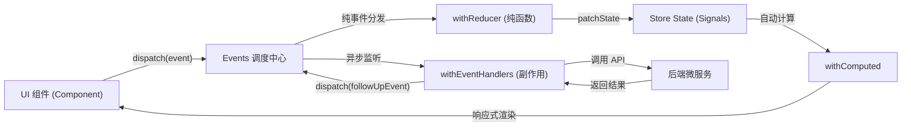

> 💡 **双栏独立滚动工作台导读**：本文采用双栏对照架构。**左栏**为核心技术决策矩阵、生产级代码范式与避坑清单；**右栏**为技术实现演化参考，并提供关键段落的英文原文展开与难词解析。左右两栏可独立滚动，并支持顶栏自定义宽度比例（7:3 / 5:5 / 3:7）与拖拽调节。

## 1. 前端状态治理选型决策矩阵

| 技术维度 | NgRx SignalStore + Events | 传统 NgRx Redux Store | Service + BehaviorSubject | 组件本地 Signals |
| :--- | :--- | :--- | :--- | :--- |
| **底层响应模型** | **Angular Signals 原生** | RxJS Observable 异步流 | RxJS Subject 事件多播 | 细粒度 `signal()` / `computed()` |
| **样板代码开销** | **极简**：函数式可插拔组合切片 | 繁重：分立 Actions/Reducers/Effects | 较低：但缺乏规范易演化为大泥球 | 无额外开销 |
| **单向流与溯源** | **强契约**：依托 `eventGroup` 追踪事实 | 强：严格遵循 Redux 调度链路 | 弱：随意调用 `next()` 导致竞态失控 | 仅局限于当前组件内部拓扑 |
| **异步副作用控制** | **清晰**：`withEventHandlers` 串联 RxJS | 复杂：通过 `@Injectable()` Effects 拦截 | 手动混杂在服务方法内部 | 容易在 `effect()` 中误触发异步请求 |
| **局部渲染性能** | **微任务精准刷新**：无 Zone.js 开销 | 依赖 OnPush 与异步管道触发标记 | 需手动管理取消订阅与脏检查 | 模板节点级别更新 |
| **首选应用场景** | 全局共享状态（Auth、Cart、Preferences） | 大型多团队协作的存量 Redux 系统 | 极简跨组件通信临时过渡方案 | 单个组件专属的视图控制开关 |

## 2. NgRx SignalStore + Events 生产级状态中枢范式

### 事件契约与状态定义 (`auth.events.ts` & `auth.state.ts`)

```typescript
import { eventGroup, type } from '@ngrx/signals/events';
import { SigninRequest, SignupRequest, UserInfo } from '../../../shared/models/auth';

export const authPageEvents = eventGroup({
  source: 'Auth Page',
  events: {
    signinSubmitted: type<SigninRequest>(),
    signupSubmitted: type<SignupRequest>(),
    logoutClicked: type<void>()
  }
});

export const authApiEvents = eventGroup({
  source: 'Auth API',
  events: {
    signinSuccess: type<{ user: UserInfo; accessToken: string; refreshToken: string }>(),
    signinFailure: type<{ error: string }>(),
    signupSuccess: type<void>(),
    signupFailure: type<{ error: string }>()
  }
});

export interface AuthState {
  user: UserInfo | null;
  accessToken: string | null;
  refreshToken: string | null;
  loading: boolean;
  error: string | null;
}

export const initialAuthState: AuthState = {
  user: null,
  accessToken: null,
  refreshToken: null,
  loading: false,
  error: null
};
```

### 核心状态中枢实现 (`auth.store.ts`)

```typescript
import { inject, computed } from '@angular/core';
import { Router } from '@angular/router';
import { takeUntilDestroyed } from '@angular/core/rxjs-interop';
import { catchError, exhaustMap, map, of } from 'rxjs';
import { signalStore, withState, withComputed, withMethods, patchState } from '@ngrx/signals';
import { Events, withEventHandlers, withReducer, on } from '@ngrx/signals/events';
import { initialAuthState } from './auth.state';
import { authPageEvents, authApiEvents } from './auth.events';
import { AuthService } from '../services/auth.service';

export const AuthStore = signalStore(
  { providedIn: 'root' },
  withState(initialAuthState),

  // 1. 纯函数状态转移（Reducers）
  withReducer(
    on(authPageEvents.signinSubmitted, authPageEvents.signupSubmitted, () => ({
      loading: true,
      error: null
    })),
    on(authApiEvents.signinSuccess, (event) => ({
      user: event.payload.user,
      accessToken: event.payload.accessToken,
      refreshToken: event.payload.refreshToken,
      loading: false,
      error: null
    })),
    on(authApiEvents.signinFailure, authApiEvents.signupFailure, (event) => ({
      loading: false,
      error: event.payload.error
    })),
    on(authPageEvents.logoutClicked, () => ({
      ...initialAuthState
    }))
  ),

  // 2. 派生计算信号（Computed）
  withComputed((store) => ({
    isAuthenticated: computed(() => store.accessToken() !== null),
    currentUser: computed(() => store.user()),
    userDisplayName: computed(() => {
      const u = store.user();
      return u ? `${u.firstName} ${u.lastName}` : '';
    })
  })),

  // 3. 异步副作用编排（Event Handlers）
  withEventHandlers((store, events = inject(Events), authService = inject(AuthService)) => ({
    signin$: events.on(authPageEvents.signinSubmitted).pipe(
      exhaustMap((event) =>
        authService.signin(event.payload).pipe(
          map((res) => authApiEvents.signinSuccess(res)),
          catchError((err: { message: string }) =>
            of(authApiEvents.signinFailure({ error: err.message || 'Authentication failed' }))
          )
        )
      )
    )
  })),

  // 4. 路由跳转与指令式方法
  withMethods((store, events = inject(Events), router = inject(Router)) => {
    events.on(authApiEvents.signinSuccess).pipe(takeUntilDestroyed()).subscribe(() => {
      router.navigate(['/books']);
    });

    return {
      clearError: () => patchState(store, { error: null })
    };
  })
);
```

## 3. 组件层消费 SignalStore 生产范式

```typescript
import { Component, inject, OnInit } from '@angular/core';
import { injectDispatch } from '@ngrx/signals/events';
import { AuthStore } from '../../store/auth.store';
import { authPageEvents } from '../../store/auth.events';
import { SigninRequest } from '../../../../shared/models/auth';
import { SigninForm } from '../../components/signin-form/signin-form';
import { MatProgressSpinnerModule } from '@angular/material/progress-spinner';

@Component({
  selector: 'app-signin-page',
  standalone: true,
  imports: [SigninForm, MatProgressSpinnerModule],
  template: `
    <div class="signin-container p-6 max-w-md mx-auto">
      <h1 class="text-2xl font-bold mb-4">用户登录</h1>

      @if (store.error()) {
        <div class="error-banner p-3 mb-4 bg-red-100 text-red-700 rounded">
          {{ store.error() }}
        </div>
      }

      <app-signin-form (signinComplete)="onSignin($event)" />

      @if (store.loading()) {
        <div class="spinner-overlay flex justify-center mt-4">
          <mat-spinner diameter="32" />
        </div>
      }
    </div>
  `
})
export class SigninPage implements OnInit {
  protected readonly store = inject(AuthStore);
  protected readonly dispatch = injectDispatch(authPageEvents);

  ngOnInit(): void {
    this.store.clearError();
  }

  onSignin(credentials: SigninRequest): void {
    // 组件不处理任何 HTTP 请求或路由跳转，纯粹派发意图事件
    this.dispatch.signinSubmitted(credentials);
  }
}
```

## 4. Signals 状态治理避坑清单 (Do's & Don'ts)

| 错误实践 (Don't) | 正确实践 (Do) |
| :--- | :--- |
| 在 `effect()` 内部直接触发异步 HTTP 请求并等待返回。 | 使用 `toObservable` 将 Signal 转换为 RxJS 数据流，配合 `exhaustMap` 或 `switchMap` 管理异步并发与竞态。 |
| 在 Reducer 或 `patchState` 中直接修改嵌套对象属性（破坏不可变性）。 | 遵循不可变原则，返回新的 Partial State 字典，或使用展开运算符 `{ ...state, user: { ...state.user, role } }`。 |
| 在 Reducer 或 EventHandler 内部直接调用 `router.navigate()` 产生路由副作用。 | 将路由跳转声明在 `withMethods` 中对事件流的独立订阅管道中，保持 Reducer 与 EventHandler 纯粹。 |
| 为每个组件私有状态都建立全局 SignalStore。 | 区分全局应用级状态（如认证、购物车）与组件内部私有状态（本地 `signal()` 控制显隐）。 |
| 在模板中反复直接调用无缓存的高开销计算函数。 | 使用 `computed()` 封装派生逻辑，享有惰性求值与依赖项变动前结果缓存的红利。 |

<!-- split -->

# 原著完整参考：利用 Signals 与 NgRx SignalStore 治理应用状态

在现代单页应用体系中，随着业务复杂度的上升，跨组件的**状态协同与生命周期管理**成为核心瓶颈：

- **跨视图状态共享**：用户是否已认证、当前登录用户的基本信息与 JWT 凭据，需要同时被登录页、注册页、全局顶部导航栏（Header）以及路由守卫（Guards）即时消费；
- **异步操作的 UI 反馈**：网络请求触发时的全局/局部 Loading 遮罩、失败时的错误信息提示、成功后的自动页面导航，如果由各个组件自行维护，极易导致状态分裂与冗余样板代码；
- **状态流转的确定性与可观测性**：在复杂交互下，状态在何时被何人修改需要具备确定性。传统的基于“服务 + `BehaviorSubject`”的方案缺乏架构约束，容易引发竞态条件（Race Conditions）与副作用散落。

随着 Angular 现代 Signals 响应式原语的成熟，NgRx 官方推出了轻量级、信号原生的 **NgRx SignalStore**。结合全新的 **Events Plugin（`@ngrx/signals/events`）**，既保留了单向数据流的可预测性与事件溯源能力，又彻底消除了传统 Redux 的样板代码。

本文以**认证状态中心（AuthStore）**为主线，全面攻克现代 Angular 状态治理的核心技术。

:::en
> **Original**: Modern state management in Angular converges on signal-based reactive stores augmented by event-driven architectures, ensuring glitch-free rendering and deterministic state transitions without boilerplate overhead.

**📌 核心术语与语境解析**：
- **Glitch-Free Execution** [ɡlɪtʃ friː ˌeksɪˈkjuːʃn]：*无毛刺/无假死执行*。响应式依赖图在状态变化时，通过拓扑排序保证每个派生节点仅求值一次，彻底杜绝中间瞬态不一致的设计特性。
- **Reactive Primitives** [riˈæktɪv ˈprɪmətɪvz]：*响应式原语*。框架底层提供的最小响应式构件（如 `signal`、`computed`、`effect`）。
:::

## 1. 深入理解 Angular Signals 响应式基石

在掌握 SignalStore 之前，必须先扎实理解 Angular Signals 的三大核心要素：可写信号（`signal`）、计算信号（`computed`）以及副作用（`effect`）。

### 1.1 信号三原语：读、写与更新

Signal 是一个包装了值的响应式容器。与基于 RxJS 的 Observable 异步流不同，Signal 允许**同步读取**当前值，并在值发生变化时自动通知所有依赖它的消费者（包括模板和计算属性）：

```typescript
import { signal } from '@angular/core';

export class BookListDemo {
  bookCount = signal<number>(0);

  getCount(): number {
    return this.bookCount();
  }

  addBook() {
    this.bookCount.update(count => count + 1);
  }

  resetCount() {
    this.bookCount.set(0);
  }
}
```

### 1.2 派生状态利器：计算信号（Computed Signals）

`computed()` 创建一个只读的派生信号。它具备**自动依赖追踪**与**惰性求值（Lazy Evaluation）**两大关键特性：只有在依赖项发生变化且被外部读取时才会重新计算，其余时刻直接复用缓存值：

```typescript
import { signal, computed } from '@angular/core';
import { Book } from '../../shared/models/book';

export class BookCatalog {
  books = signal<Book[]>([]);
  searchTerm = signal<string>('');

  filteredBooks = computed(() => {
    const term = this.searchTerm().toLowerCase();
    return this.books().filter(book =>
      book.title.toLowerCase().includes(term)
    );
  });

  bookCount = computed(() => this.filteredBooks().length);
}
```

### 1.3 副作用边界与最佳实践（Effects）

`effect()` 用于在依赖的 Signal 发生变化时执行外部副作用（例如同步写入 `localStorage`、记录埋点日志）。

> ⚠️ **反模式警告**：
> 严禁在 `effect()` 内部直接触发异步 HTTP 请求。在 `effect` 中订阅请求会导致并发请求交错、乱序响应覆盖以及取消竞态问题。
> 涉及网络请求与输入去重时，应使用 `@angular/core/rxjs-interop` 中的 `toObservable` 将 Signal 转换为 RxJS 数据流，利用流操作符精确控制：

```typescript
import { toObservable, takeUntilDestroyed } from '@angular/core/rxjs-interop';
import { debounceTime, distinctUntilChanged, filter, map, switchMap } from 'rxjs';

toObservable(this.searchTerm)
  .pipe(
    map(term => term.trim()),
    filter(term => term.length > 2),
    debounceTime(300),
    distinctUntilChanged(),
    switchMap(term => this.bookService.search(term)),
    takeUntilDestroyed()
  )
  .subscribe(results => {
    console.log('Search results:', results);
  });
```

:::en
> **Original**: Direct asynchronous invocation inside effects risks unhandled race conditions and memory leaks; converting signals to RxJS streams via `toObservable` establishes a controllable scheduling pipeline.

**📌 核心术语与语境解析**：
- **Stream Interoperability** [striːm ˌɪntərˌɑːpərəˈbɪləti]：*流式互操作性*。在同步 Signal 与异步 RxJS Observable 之间根据不同并发场景进行受控转换。
- **Race Condition Avoidance** [reɪs kənˈdɪʃn əˈvɔɪdəns]：*竞态条件规避*。使用 `switchMap` 丢弃陈旧请求或 `exhaustMap` 屏蔽并发重击的流编排策略。
:::

## 2. NgRx SignalStore 与 Events 架构模型

### 2.1 依赖引入

在前端工程中安装配套版本（与 Angular 22 保持一致）：

```bash
npm install @ngrx/signals@22
```

SignalStore 不需要全局根模块注册或复杂配置，每个 Store 本质上就是一个可随处注入的 Angular 服务。

### 2.2 经典 SignalStore 的局限与 Events Plugin 的引入

基础的 SignalStore 通过 `withState()` 定义状态，通过 `withMethods()` 提供直接调用 `patchState()` 修改状态的方法：

```typescript
export const SimpleBookStore = signalStore(
  { providedIn: 'root' },
  withState({ books: [], loading: false }),
  withMethods((store) => ({
    addBook(book: Book) {
      patchState(store, (state) => ({ books: [...state.books, book] }));
    }
  }))
);
```

**这种简单模式在大中型系统中存在硬伤**：
1. 业务意图（“发生了什么”）与状态变更细节（“如何修改状态”）混在一起；
2. 难以进行独立的纯函数单元测试；
3. 多个调用方散落调用不同方法，无法清晰还原系统的状态流转历史。

为了解决这一痛点，NgRx 引入了 **Events Plugin（`@ngrx/signals/events`）**，将事件驱动（Event-Driven）的 Flux 核心精髓与 SignalStore 深度结合：



- **Event（事件）**：通过 `eventGroup` 声明的纯数据载荷，代表“系统内已经发生的某一事实”（如 `signinSubmitted`、`signinSuccess`）；
- **Reducer（状态映射器）**：在 `withReducer` 中使用 `on(event, handler)`，作为**纯函数**根据当前状态与事件返回局部变更状态，绝不允许产生任何副作用；
- **Event Handler（副作用监听器）**：在 `withEventHandlers` 中捕获事件并触发异步服务调用，完成后发射后续结果事件；
- **Dispatch（事件派发）**：组件通过 `injectDispatch` 派发事件，彻底解耦 UI 与状态修改实现。

:::en
> **Original**: The Events Plugin segregates user intentions from state transitions, leveraging pure functional reducers for predictable state projection and dedicated handlers for asynchronous I/O.

**📌 核心术语与语境解析**：
- **Event-Driven Architecture** [ɪˈvent ˈdrɪvn ˈɑːrkɪtektʃər]：*事件驱动架构*。以“事实事件”的派发作为驱动状态变更与异步执行流唯一触发源的架构范式。
- **Modular Composition** [ˈmɑːdʒələr ˌkɑːmpəˈzɪʃn]：*模块化组合*。通过 `withState`、`withReducer`、`withComputed`、`withMethods` 等高阶函数插件无缝拼装 Store 的设计能力。
:::

## 3. 动手实战：构建认证状态中心（AuthStore）

认证状态具备典型的状态特征：需要跨页面维护用户信息、持久化 JWT 凭据、处理全局登录中遮罩与错误响应。

### 3.1 目录组织结构

在 `src/app/features/auth/` 下创建独立的 `store` 模块：

```text
src/app/features/auth/
├── components/
│   ├── signup-form/
│   └── signin-form/
├── pages/
│   ├── signup/
│   └── signin/
├── services/
│   └── auth.service.ts
└── store/
    ├── auth.events.ts    # 事件契约定义（Page Events / API Events）
    ├── auth.state.ts     # 状态接口与初始值
    └── auth.store.ts     # Store 核心实现（Reducers / Computed / Handlers）
```

### 3.2 扩展认证领域响应类型

在 `src/app/shared/models/auth.ts` 中补充后端微服务返回的 JWT 载荷契约：

```typescript
export interface AuthResponse {
  accessToken: string;
  refreshToken: string;
  tokenType: string;
  expiresIn: number;
  user: UserInfo;
}

export interface UserInfo {
  id: string;
  email: string;
  firstName: string;
  lastName: string;
  role: string;
}
```

### 3.3 步骤一：声明事件契约（auth.events.ts）

在 `src/app/features/auth/store/auth.events.ts` 中，使用 `eventGroup` 区分事件来源：

```typescript
import { eventGroup, type } from '@ngrx/signals/events';
import { SigninRequest, SignupRequest, UserInfo } from '../../../shared/models/auth';

export const authPageEvents = eventGroup({
  source: 'Auth Page',
  events: {
    signinSubmitted: type<SigninRequest>(),
    signupSubmitted: type<SignupRequest>(),
    logoutClicked: type<void>(),
  },
});

export const authApiEvents = eventGroup({
  source: 'Auth API',
  events: {
    signinSuccess: type<{
      user: UserInfo;
      accessToken: string;
      refreshToken: string;
    }>(),
    signinFailure: type<{ error: string }>(),
    signupSuccess: type<void>(),
    signupFailure: type<{ error: string }>(),
  },
});
```

### 3.4 步骤二：定义状态树结构（auth.state.ts）

在 `src/app/features/auth/store/auth.state.ts` 中：

```typescript
import { UserInfo } from '../../../shared/models/auth';

export interface AuthState {
  user: UserInfo | null;
  accessToken: string | null;
  refreshToken: string | null;
  loading: boolean;
  error: string | null;
}

export const initialAuthState: AuthState = {
  user: null,
  accessToken: null,
  refreshToken: null,
  loading: false,
  error: null,
};
```

### 3.5 步骤三：认证服务接口与模拟层

在接入后端真实网关前，我们在 `src/app/features/auth/services/auth.service.ts` 中建立与真实 HTTP 接口签名相同的模拟服务：

```typescript
import { Injectable } from '@angular/core';
import { Observable, delay, of, throwError } from 'rxjs';
import { SigninRequest, SignupRequest, UserInfo } from '../../../shared/models/auth';

@Injectable({ providedIn: 'root' })
export class AuthService {
  signin(credentials: SigninRequest): Observable<{
    user: UserInfo;
    accessToken: string;
    refreshToken: string;
  }> {
    if (credentials.email === 'test@bookstore.com' && credentials.password === 'password123') {
      return of({
        user: {
          id: 'u-101',
          email: credentials.email,
          firstName: 'Alice',
          lastName: 'Johnson',
          role: 'ROLE_USER',
        },
        accessToken: 'mock-access-token',
        refreshToken: 'mock-refresh-token',
      }).pipe(delay(600));
    }
    return throwError(() => new Error('Invalid credentials')).pipe(delay(600));
  }

  signup(data: SignupRequest): Observable<void> {
    return of(void 0).pipe(delay(600));
  }
}
```

### 3.6 步骤四：核心 Store 组装（auth.store.ts）

在 `src/app/features/auth/store/auth.store.ts` 中：

```typescript
import { inject } from '@angular/core';
import { Router } from '@angular/router';
import { computed } from '@angular/core';
import { takeUntilDestroyed } from '@angular/core/rxjs-interop';
import { catchError, exhaustMap, map, of } from 'rxjs';

import { signalStore, withState, withComputed, withMethods, patchState } from '@ngrx/signals';
import { Events, withEventHandlers, withReducer, on } from '@ngrx/signals/events';

import { initialAuthState } from './auth.state';
import { authPageEvents, authApiEvents } from './auth.events';
import { AuthService } from '../services/auth.service';

export const AuthStore = signalStore(
  { providedIn: 'root' },
  withState(initialAuthState),

  withReducer(
    on(authPageEvents.signinSubmitted, () => ({
      loading: true,
      error: null,
    })),
    on(authPageEvents.signupSubmitted, () => ({
      loading: true,
      error: null,
    })),
    on(authApiEvents.signinSuccess, (event) => ({
      user: event.payload.user,
      accessToken: event.payload.accessToken,
      refreshToken: event.payload.refreshToken,
      loading: false,
      error: null,
    })),
    on(authApiEvents.signinFailure, (event) => ({
      loading: false,
      error: event.payload.error,
    })),
    on(authApiEvents.signupSuccess, () => ({
      loading: false,
      error: null,
    })),
    on(authApiEvents.signupFailure, (event) => ({
      loading: false,
      error: event.payload.error,
    })),
    on(authPageEvents.logoutClicked, () => ({
      ...initialAuthState,
    }))
  ),

  withComputed((store) => ({
    isAuthenticated: computed(() => store.accessToken() !== null),
    currentUser: computed(() => store.user()),
    userDisplayName: computed(() => {
      const user = store.user();
      return user ? `${user.firstName} ${user.lastName}` : '';
    }),
  })),

  withEventHandlers(
    (
      store,
      events = inject(Events),
      authService = inject(AuthService),
    ) => ({
      signin$: events.on(authPageEvents.signinSubmitted).pipe(
        exhaustMap((event) =>
          authService.signin(event.payload).pipe(
            map((response) => authApiEvents.signinSuccess(response)),
            catchError((error: { message: string }) =>
              of(authApiEvents.signinFailure({ error: error.message || 'Authentication failed' }))
            )
          )
        )
      ),

      signup$: events.on(authPageEvents.signupSubmitted).pipe(
        exhaustMap((event) =>
          authService.signup(event.payload).pipe(
            map(() => authApiEvents.signupSuccess()),
            catchError((error: { message: string }) =>
              of(authApiEvents.signupFailure({ error: error.message || 'Registration failed' }))
            )
          )
        )
      ),
    })
  ),

  withMethods((store, events = inject(Events), router = inject(Router)) => {
    events
      .on(authApiEvents.signinSuccess)
      .pipe(takeUntilDestroyed())
      .subscribe(() => {
        router.navigate(['/books']);
      });

    events
      .on(authApiEvents.signupSuccess)
      .pipe(takeUntilDestroyed())
      .subscribe(() => {
        router.navigate(['/auth/signin']);
      });

    return {
      clearError: () => patchState(store, { error: null }),
    };
  })
);
```

:::en
> **Original**: Pure reducers guarantee deterministic state transitions by computing new states exclusively from incoming events and existing state trees without triggering side effects.

**📌 核心术语与语境解析**：
- **Pure Reducer** [pjʊr rɪˈduːsər]：*纯函数状态转移器*。对于固定的输入状态和事件，永远产出一致的新状态且不产生任何外部可观测副作用的纯函数。
- **Side Effect Orchestration** [saɪd ɪˈfekt ˌɔːrkɪˈstreɪʃn]：*副作用编排*。将 HTTP 请求、持久化写入与导航等有状态操作统一约束在专门处理管道内的架构机制。
:::

## 4. 单元测试与事件流可观测性验证（Vitest）

得益于事件驱动架构的解耦，测试 `AuthStore` 流程清晰：**构造前置状态 $\rightarrow$ 派发目标事件 $\rightarrow$ 断言 Store 的 Signals 状态变化**。

在 `src/app/features/auth/store/auth.store.spec.ts` 中编写测试套件：

```typescript
import { TestBed } from '@angular/core/testing';
import { Router } from '@angular/router';
import { delay, of, throwError } from 'rxjs';
import { Dispatcher } from '@ngrx/signals/events';

import { AuthStore } from './auth.store';
import { authPageEvents, authApiEvents } from './auth.events';
import { AuthService } from '../services/auth.service';

describe('AuthStore', () => {
  let store: InstanceType<typeof AuthStore>;
  let dispatcher: Dispatcher;
  let authService: {
    signin: ReturnType<typeof vi.fn>;
    signup: ReturnType<typeof vi.fn>;
  };
  let router: { navigate: ReturnType<typeof vi.fn> };

  const mockUser = {
    id: 'u-101',
    email: 'test@bookstore.com',
    firstName: 'Alice',
    lastName: 'Johnson',
    role: 'ROLE_USER',
  };

  const mockAuthResponse = {
    user: mockUser,
    accessToken: 'mock-access-token',
    refreshToken: 'mock-refresh-token',
  };

  beforeEach(() => {
    authService = {
      signin: vi.fn(),
      signup: vi.fn(),
    };
    router = { navigate: vi.fn() };

    TestBed.configureTestingModule({
      providers: [
        AuthStore,
        Dispatcher,
        { provide: AuthService, useValue: authService },
        { provide: Router, useValue: router },
      ],
    });

    store = TestBed.inject(AuthStore);
    dispatcher = TestBed.inject(Dispatcher);
  });

  describe('初始状态', () => {
    it('应该具备正确的未登录初始状态', () => {
      expect(store.user()).toBeNull();
      expect(store.accessToken()).toBeNull();
      expect(store.isAuthenticated()).toBe(false);
      expect(store.loading()).toBe(false);
      expect(store.error()).toBeNull();
    });
  });

  describe('登录流（Signin Flow）', () => {
    it('派发 signinSubmitted 时应同步进入 loading 状态', () => {
      authService.signin.mockReturnValue(of(mockAuthResponse).pipe(delay(100)));

      dispatcher.dispatch(
        authPageEvents.signinSubmitted({
          email: 'test@bookstore.com',
          password: 'password123',
        })
      );

      expect(store.loading()).toBe(true);
      expect(store.error()).toBeNull();
    });

    it('派发 signinSuccess 应更新凭据与用户信息，并派生计算属性', () => {
      dispatcher.dispatch(authApiEvents.signinSuccess(mockAuthResponse));

      expect(store.user()).toEqual(mockUser);
      expect(store.accessToken()).toBe('mock-access-token');
      expect(store.refreshToken()).toBe('mock-refresh-token');
      expect(store.loading()).toBe(false);
      expect(store.isAuthenticated()).toBe(true);
      expect(store.userDisplayName()).toBe('Alice Johnson');
    });

    it('派发 signinFailure 应记录错误原因并退出 loading', () => {
      dispatcher.dispatch(
        authApiEvents.signinFailure({ error: 'Invalid credentials' })
      );

      expect(store.error()).toBe('Invalid credentials');
      expect(store.loading()).toBe(false);
      expect(store.isAuthenticated()).toBe(false);
    });

    it('异步完整流程：提交表单应触发服务调用与自动导航', async () => {
      authService.signin.mockReturnValue(of(mockAuthResponse));

      dispatcher.dispatch(
        authPageEvents.signinSubmitted({
          email: 'test@bookstore.com',
          password: 'password123',
        })
      );

      await new Promise((resolve) => setTimeout(resolve, 50));

      expect(authService.signin).toHaveBeenCalledWith({
        email: 'test@bookstore.com',
        password: 'password123',
      });
      expect(store.isAuthenticated()).toBe(true);
      expect(router.navigate).toHaveBeenCalledWith(['/books']);
    });
  });

  describe('登出流（Logout）', () => {
    it('派发 logoutClicked 应完全重置认证状态', () => {
      dispatcher.dispatch(authApiEvents.signinSuccess(mockAuthResponse));
      expect(store.isAuthenticated()).toBe(true);

      dispatcher.dispatch(authPageEvents.logoutClicked());

      expect(store.user()).toBeNull();
      expect(store.accessToken()).toBeNull();
      expect(store.refreshToken()).toBeNull();
      expect(store.isAuthenticated()).toBe(false);
      expect(store.loading()).toBe(false);
      expect(store.error()).toBeNull();
    });
  });
});
```

:::en
> **Original**: Unit testing event-driven signal stores achieves near-instant validation by dispatching discrete action payloads directly to test bed instances and asserting signal outcomes.

**📌 核心术语与语境解析**：
- **Event-Driven Testing** [ɪˈvent ˈdrɪvn ˈtestɪŋ]：*事件驱动测试*。仅通过向调度总线投递事件载荷、断言下游信号投影结果的黑盒单测模式。
- **State Convergence** [steɪt kənˈvɜːrdʒəns]：*状态收敛*。异步副作用与所有依赖计算在测试时钟下全部执行完毕并稳定在确定终态。
:::

## 5. UI 集成：驱动 Smart 页面与全局导航栏

UI 组件只需要**读取 Store 中的 Signals**，并在交互发生时通过 **`injectDispatch` 发射 Event**。

### 5.1 改造登录页面（Signin Page）

更新 `src/app/features/auth/pages/signin/signin.ts`：

```typescript
import { Component, OnInit, inject } from '@angular/core';
import { RouterLink } from '@angular/router';
import { MatCardModule } from '@angular/material/card';
import { MatProgressSpinnerModule } from '@angular/material/progress-spinner';

import { injectDispatch } from '@ngrx/signals/events';
import { SigninForm } from '../../components/signin-form/signin-form';
import { SigninRequest } from '../../../../shared/models/auth';
import { AuthStore } from '../../store/auth.store';
import { authPageEvents } from '../../store/auth.events';

@Component({
  selector: 'app-signin',
  templateUrl: './signin.html',
  styleUrl: './signin.scss',
  imports: [
    SigninForm,
    RouterLink,
    MatCardModule,
    MatProgressSpinnerModule,
  ],
})
export class Signin implements OnInit {
  protected readonly store = inject(AuthStore);
  protected readonly dispatch = injectDispatch(authPageEvents);

  ngOnInit() {
    this.store.clearError();
  }

  handleSigninComplete(credentials: SigninRequest) {
    this.dispatch.signinSubmitted(credentials);
  }
}
```

配套的模板 `src/app/features/auth/pages/signin/signin.html`：

```html
<div class="page-container">
  <div class="page-header">
    <h1>Sign In</h1>
    <p>Access your Packt Bookstore account</p>
  </div>

  @if (store.error()) {
    <div class="error-message">{{ store.error() }}</div>
  }

  <signin-form (signinComplete)="handleSigninComplete($event)" />

  @if (store.loading()) {
    <mat-spinner diameter="32" class="loading-spinner" />
  }
</div>
```

### 5.2 联动全局顶部导航栏（Header）

顶部导航栏位于所有页面的最顶层，通过注入 `AuthStore`，可以实现根据登录状态自动切换用户视图：

更新 `src/app/shared/layout/header/header.ts`：

```typescript
import { Component, inject } from '@angular/core';
import { RouterLink } from '@angular/router';
import { MatToolbarModule } from '@angular/material/toolbar';
import { MatButtonModule } from '@angular/material/button';
import { MatIconModule } from '@angular/material/icon';

import { injectDispatch } from '@ngrx/signals/events';
import { AuthStore } from '../../../features/auth/store/auth.store';
import { authPageEvents } from '../../../features/auth/store/auth.events';

@Component({
  selector: 'app-header',
  templateUrl: './header.html',
  styleUrl: './header.scss',
  imports: [
    RouterLink,
    MatToolbarModule,
    MatButtonModule,
    MatIconModule,
  ],
})
export class Header {
  protected readonly store = inject(AuthStore);
  protected readonly dispatch = injectDispatch(authPageEvents);

  onLogout() {
    this.dispatch.logoutClicked();
  }
}
```

更新模板 `src/app/shared/layout/header/header.html`：

```html
<header>
  <mat-toolbar color="primary">
    <button mat-icon-button class="menu-icon" aria-label="Menu">
      <mat-icon>menu</mat-icon>
    </button>
    <a routerLink="/books" class="brand-title">Packt Bookstore</a>
    <span class="spacer"></span>

    @if (store.isAuthenticated()) {
      <span class="user-greeting">Welcome, {{ store.userDisplayName() }}</span>
      <button mat-button (click)="onLogout()">
        <mat-icon>logout</mat-icon>
        Logout
      </button>
    } @else {
      <a mat-icon-button routerLink="/auth/signin" aria-label="Sign in">
        <mat-icon>account_circle</mat-icon>
      </a>
    }
  </mat-toolbar>
</header>
```

未登录状态下，导航栏右上角展示个人中心入口图标：


当用户在登录页面成功提交表单后：
1. `AuthStore` 接收到 API 成功的 Token 载荷；
2. 计算信号 `store.isAuthenticated()` 同步翻转为 `true`，`store.userDisplayName()` 立即派生出用户姓名；
3. **全局 Header 组件瞬间自动重新渲染**，呈现欢迎文案与登出按钮；
4. 路由管线无缝重定向回 `/books` 主列表——流程无需手动编写事件总线通知。

:::en
> **Original**: Targeted change detection powered by signal subscriptions eliminates full-tree checks, triggering surgical DOM updates only when bound state slices diverge.

**📌 核心术语与语境解析**：
- **Targeted Change Detection** [ˈtɑːrɡɪtɪd tʃeɪndʒ dɪˈtekʃn]：*定向变更检测*。视图仅在关联的具体 Signal 发生实际状态跳变时才触发更新，而非漫游扫描整棵组件树。
- **Zero-Overhead Rendering** [ˈzɪroʊ ˈoʊvərhed ˈrendərɪŋ]：*零冗余渲染*。在无 Zone.js 介入的前提下，完全依据信号依赖图实现最小计算路径的视图渲染。
:::
