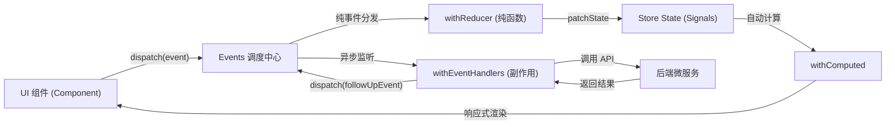

> 💡 **专栏导读**：本文收录于专栏 [《Spring Boot 4 & Angular 22 全栈微服务实战》](/columns/spring-boot-angular)。全专栏共 22 篇，深度覆盖 Java 26 微服务拆分、Spring Cloud 网关与安全鉴权、Angular 22 Signals 状态治理以及端到端容器化交付的全链路工程实践。

---

## 1. 架构总览：从组件本地状态到全局状态中枢

在上一章中，我们构建了书店系统的四大响应式表单，落地了强大的跨字段校验与模态弹窗交互。然而，前端系统的交互绝不仅限于表单本身——随着业务复杂度的上升，跨组件的**状态协同与生命周期管理**成为了系统的核心瓶颈：

- **跨视图状态共享**：用户是否已认证、当前登录用户的基本信息与 JWT 凭据，需要同时被登录页、注册页、全局顶部导航栏（Header）以及后续的路由守卫（Guards）即时消费；
- **异步操作的 UI 反馈**：网络请求触发时的全局/局部 Loading 遮罩、失败时的错误信息提示、成功后的自动页面导航，如果由各个组件自行维护，极易导致状态分裂与冗余样板代码；
- **状态流转的确定性与可观测性**：在复杂交互下，状态究竟在何时被谁修改？传统的基于“服务 + `BehaviorSubject`”的方案缺乏架构约束，极易引发竞态条件（Race Conditions）与不可预测的副作用。

过去，大型 Angular 项目通常采用传统的 NgRx Store（基于 Redux 模式），但它伴随着庞大的样板代码（Actions、Reducers、Effects、Selectors 分离定义），开发体验沉重。

随着 Angular 现代 Signals 响应式原语的成熟，NgRx 官方推出了轻量级、信号原生的 **NgRx SignalStore**。结合其全新的 **Events Plugin（`@ngrx/signals/events`）**，我们既保留了 Flux/Redux 单向数据流的可预测性与事件溯源能力，又彻底消除了样板代码。

本章我们将以**认证状态中心（AuthStore）**为主线，全面攻克现代 Angular 状态治理的核心技术。

---

## 2. 深入理解 Angular Signals 响应式基石

在掌握 SignalStore 之前，必须先扎实理解 Angular Signals 的三大核心要素：可写信号（`signal`）、计算信号（`computed`）以及副作用（`effect`）。

### 2.1 信号三原语：读、写与更新

Signal 是一个包装了值的响应式容器。与基于 RxJS 的 Observable 异步流不同，Signal 允许**同步读取**当前值，并在值发生变化时自动通知所有依赖它的消费者（包括模板和计算属性）：

```typescript
import { signal } from '@angular/core';

export class BookListDemo {
  // 1. 创建可写信号并赋予初始值
  bookCount = signal<number>(0);

  // 2. 同步读取：通过像函数一样调用获取当前值
  getCount(): number {
    return this.bookCount();
  }

  // 3. 基于当前值更新（Update）
  addBook() {
    this.bookCount.update(count => count + 1);
  }

  // 4. 直接覆盖设置（Set）
  resetCount() {
    this.bookCount.set(0);
  }
}
```

### 2.2 派生状态利器：计算信号（Computed Signals）

`computed()` 创建一个只读的派生信号。它具备**自动依赖追踪**与**惰性求值（Lazy Evaluation）**两大关键特性：只有在依赖项发生变化且被外部读取时才会重新计算，其余时刻直接复用缓存值：

```typescript
import { signal, computed } from '@angular/core';
import { Book } from '../../shared/models/book';

export class BookCatalog {
  books = signal<Book[]>([]);
  searchTerm = signal<string>('');

  // 自动收集 searchTerm() 与 books() 两个依赖
  filteredBooks = computed(() => {
    const term = this.searchTerm().toLowerCase();
    return this.books().filter(book =>
      book.title.toLowerCase().includes(term)
    );
  });

  // 支持计算属性链路式复合
  bookCount = computed(() => this.filteredBooks().length);
}
```

### 2.3 副作用边界与最佳实践（Effects）

`effect()` 用于在依赖的 Signal 发生变化时执行外部副作用（例如同步写入 `localStorage`、记录埋点日志）。

> ⚠️ **高危反模式警告**：
> 绝对不要在 `effect()` 内部直接触发异步 HTTP 请求！在 `effect` 中订阅请求会导致并发请求交错、乱序响应覆盖以及取消竞态问题。
> 涉及复杂网络请求与输入去重时，应使用 `@angular/core/rxjs-interop` 中的 `toObservable` 将 Signal 转换为 RxJS 数据流，利用流操作符精确控制：

```typescript
import { toObservable, takeUntilDestroyed } from '@angular/core/rxjs-interop';
import { debounceTime, distinctUntilChanged, filter, map, switchMap } from 'rxjs';

// 正确姿势：流式异步请求编排
toObservable(this.searchTerm)
  .pipe(
    map(term => term.trim()),
    filter(term => term.length > 2),
    debounceTime(300),
    distinctUntilChanged(),
    switchMap(term => this.bookService.search(term)),
    takeUntilDestroyed()
  )
  .subscribe(results => {
    console.log('Search results:', results);
  });
```

---

## 3. NgRx SignalStore 与 Events 架构模型

### 3.1 为什么选择 NgRx SignalStore？

| 特性维度 | 传统 NgRx Redux Store | 普通 Service + BehaviorSubject | NgRx SignalStore |
| :--- | :--- | :--- | :--- |
| **底层响应模型** | RxJS Observable 流 | RxJS Subject | **Angular Signals 原生** |
| **样板代码量** | 极大（Action / Reducer / Effect） | 较小但缺乏结构规范 | **极简（函数式可插拔组合）** |
| **心智负担** | 繁重（严格三层分工） | 随意（易写出杂乱代码） | **直观、灵活且边界清晰** |
| **细粒度更新** | 依赖 OnPush 与异步管道 | 需手动管理解绑 | **Signal 级别的零开销渲染** |

### 3.2 依赖引入

在前端工程中安装配套版本（与 Angular 22 保持一致）：

```bash
npm install @ngrx/signals@22
```

SignalStore 不需要全局根模块注册或复杂配置，每个 Store 本质上就是一个可随处注入的 Angular 服务。

### 3.3 经典 SignalStore 的局限与 Events Plugin 的引入

基础的 SignalStore 通过 `withState()` 定义状态，通过 `withMethods()` 提供直接调用 `patchState()` 修改状态的方法：

```typescript
// 基础 SignalStore 示例
export const SimpleBookStore = signalStore(
  { providedIn: 'root' },
  withState({ books: [], loading: false }),
  withMethods((store) => ({
    addBook(book: Book) {
      patchState(store, (state) => ({ books: [...state.books, book] }));
    }
  }))
);
```

**这种简单模式在大中型系统中存在硬伤**：
1. 业务意图（“发生了什么”）与状态变更细节（“如何修改状态”）混在一起；
2. 难以进行独立的纯函数单元测试；
3. 多个调用方散落调用不同方法，无法清晰还原系统的状态流转历史。

为了解决这一痛点，NgRx 引入了 **Events Plugin（`@ngrx/signals/events`）**，将事件驱动（Event-Driven）的 Flux 核心精髓与 SignalStore 深度结合：



- **Event（事件）**：通过 `eventGroup` 声明的纯数据载荷，代表“系统内已经发生的某一事实”（如 `signinSubmitted`、`signinSuccess`）；
- **Reducer（状态映射器）**：在 `withReducer` 中使用 `on(event, handler)`，作为**纯函数**根据当前状态与事件返回局部变更状态，绝不允许产生任何副作用；
- **Event Handler（副作用监听器）**：在 `withEventHandlers` 中捕获事件并触发异步服务调用，完成后发射后续结果事件；
- **Dispatch（事件派发）**：组件通过 `injectDispatch` 派发事件，彻底解耦 UI 与状态修改实现。

---

## 4. 动手实战：构建认证状态中心（AuthStore）

认证状态具备典型的状态特征：需要跨页面维护用户信息、持久化 JWT 凭据、处理全局登录中遮罩与错误响应。我们将按照工业级规范完整落地。

### 4.1 目录组织结构

在 `src/app/features/auth/` 下创建独立的 `store` 模块：

```text
src/app/features/auth/
├── components/
│   ├── signup-form/
│   └── signin-form/
├── pages/
│   ├── signup/
│   └── signin/
├── services/
│   └── auth.service.ts
└── store/
    ├── auth.events.ts    # 事件契约定义（Page Events / API Events）
    ├── auth.state.ts     # 状态接口与初始值
    └── auth.store.ts     # Store 核心实现（Reducers / Computed / Handlers）
```

### 4.2 扩展认证领域响应类型

在 `src/app/shared/models/auth.ts` 中补充后端微服务返回的 JWT 载荷契约：

```typescript
export interface AuthResponse {
  accessToken: string;
  refreshToken: string;
  tokenType: string;
  expiresIn: number;
  user: UserInfo;
}

export interface UserInfo {
  id: string;
  email: string;
  firstName: string;
  lastName: string;
  role: string;
}
```

> **架构注记**：
> 我们的 Spring Boot 后端虽然整合了 Keycloak，但在网关层使用自定义 REST 接口（`/users/signin`、`/users/signup` 等）对标准 OIDC 复杂流程进行了收敛。因此前端不需要集成笨重的 `angular-oauth2-oidc` 客户端库，而是直接通过标准轻量 HTTP 接口与拦截器治理 JWT，兼顾灵活性与透明度。

### 4.3 步骤一：声明事件契约（auth.events.ts）

在 `src/app/features/auth/store/auth.events.ts` 中，使用 `eventGroup` 区分事件来源：

```typescript
import { eventGroup, type } from '@ngrx/signals/events';
import { SigninRequest, SignupRequest, UserInfo } from '../../../shared/models/auth';

/**
 * 用户在页面 UI 交互中触发的事实事件
 */
export const authPageEvents = eventGroup({
  source: 'Auth Page',
  events: {
    signinSubmitted: type<SigninRequest>(),
    signupSubmitted: type<SignupRequest>(),
    logoutClicked: type<void>(),
  },
});

/**
 * 异步 API 请求完成后产生的响应事件
 */
export const authApiEvents = eventGroup({
  source: 'Auth API',
  events: {
    signinSuccess: type<{
      user: UserInfo;
      accessToken: string;
      refreshToken: string;
    }>(),
    signinFailure: type<{ error: string }>(),
    signupSuccess: type<void>(),
    signupFailure: type<{ error: string }>(),
  },
});
```

- **按来源隔离命名空间**：`Auth Page` 负责 UI 事件，`Auth API` 负责异步网络回执；
- **时态规范**：Page 事件统一采用过去时（如 `signinSubmitted`、`logoutClicked`），表明这是已经发生的用户操作；
- **类型安全载荷**：利用 `type<T>()` 绑定契约，无载荷事件声明为 `type<void>()`。

### 4.4 步骤二：定义状态树结构（auth.state.ts）

在 `src/app/features/auth/store/auth.state.ts` 中：

```typescript
import { UserInfo } from '../../../shared/models/auth';

export interface AuthState {
  // 核心用户数据与令牌
  user: UserInfo | null;
  accessToken: string | null;
  refreshToken: string | null;

  // UI 交互与异常状态
  loading: boolean;
  error: string | null;
}

export const initialAuthState: AuthState = {
  user: null,
  accessToken: null,
  refreshToken: null,
  loading: false,
  error: null,
};
```

### 4.5 步骤三：认证服务接口与模拟层

在接入后端真实网关前，我们在 `src/app/features/auth/services/auth.service.ts` 中建立与真实 HTTP 接口签名完全相同的模拟服务：

```typescript
import { Injectable } from '@angular/core';
import { Observable, delay, of, throwError } from 'rxjs';
import { SigninRequest, SignupRequest, UserInfo } from '../../../shared/models/auth';

@Injectable({ providedIn: 'root' })
export class AuthService {
  signin(credentials: SigninRequest): Observable<{
    user: UserInfo;
    accessToken: string;
    refreshToken: string;
  }> {
    // 模拟测试用户校验
    if (credentials.email === 'test@bookstore.com' && credentials.password === 'password123') {
      return of({
        user: {
          id: 'u-101',
          email: credentials.email,
          firstName: 'Alice',
          lastName: 'Johnson',
          role: 'ROLE_USER',
        },
        accessToken: 'mock-access-token',
        refreshToken: 'mock-refresh-token',
      }).pipe(delay(600)); // 模拟网络延迟
    }
    return throwError(() => new Error('Invalid credentials')).pipe(delay(600));
  }

  signup(data: SignupRequest): Observable<void> {
    return of(void 0).pipe(delay(600));
  }
}
```

### 4.6 步骤四：核心 Store 组装（auth.store.ts）

现在我们将 State、Reducers、Computed、EventHandlers 与 Methods 拼装为强类型的单例 Store。在 `src/app/features/auth/store/auth.store.ts` 中：

```typescript
import { inject } from '@angular/core';
import { Router } from '@angular/router';
import { computed } from '@angular/core';
import { takeUntilDestroyed } from '@angular/core/rxjs-interop';
import { catchError, exhaustMap, map, of } from 'rxjs';

import { signalStore, withState, withComputed, withMethods, patchState } from '@ngrx/signals';
import { Events, withEventHandlers, withReducer, on } from '@ngrx/signals/events';

import { initialAuthState } from './auth.state';
import { authPageEvents, authApiEvents } from './auth.events';
import { AuthService } from '../services/auth.service';

export const AuthStore = signalStore(
  { providedIn: 'root' },

  // 1. 注册初始状态
  withState(initialAuthState),

  // 2. 纯函数状态转移（Reducers）
  withReducer(
    // 登录提交：进入 loading 态，清空历史错误
    on(authPageEvents.signinSubmitted, () => ({
      loading: true,
      error: null,
    })),

    // 注册提交：进入 loading 态
    on(authPageEvents.signupSubmitted, () => ({
      loading: true,
      error: null,
    })),

    // 登录成功：保存凭据与用户，退出 loading
    on(authApiEvents.signinSuccess, (event) => ({
      user: event.payload.user,
      accessToken: event.payload.accessToken,
      refreshToken: event.payload.refreshToken,
      loading: false,
      error: null,
    })),

    // 登录失败：记录错误并退出 loading
    on(authApiEvents.signinFailure, (event) => ({
      loading: false,
      error: event.payload.error,
    })),

    // 注册成功：退出 loading
    on(authApiEvents.signupSuccess, () => ({
      loading: false,
      error: null,
    })),

    // 注册失败：记录错误并退出 loading
    on(authApiEvents.signupFailure, (event) => ({
      loading: false,
      error: event.payload.error,
    })),

    // 用户点击登出：全面重置状态回到初始值
    on(authPageEvents.logoutClicked, () => ({
      ...initialAuthState,
    }))
  ),

  // 3. 基于状态的派生计算信号（Computed）
  withComputed((store) => ({
    isAuthenticated: computed(() => store.accessToken() !== null),
    currentUser: computed(() => store.user()),
    userDisplayName: computed(() => {
      const user = store.user();
      return user ? `${user.firstName} ${user.lastName}` : '';
    }),
  })),

  // 4. 异步副作用编排（Event Handlers）
  withEventHandlers(
    (
      store,
      events = inject(Events),
      authService = inject(AuthService),
    ) => ({
      // 监听登录提交事件
      signin$: events.on(authPageEvents.signinSubmitted).pipe(
        // exhaustMap 自动忽略请求在途时的重复点击，防止二次连击
        exhaustMap((event) =>
          authService.signin(event.payload).pipe(
            map((response) => authApiEvents.signinSuccess(response)),
            catchError((error: { message: string }) =>
              of(authApiEvents.signinFailure({ error: error.message || 'Authentication failed' }))
            )
          )
        )
      ),

      // 监听注册提交事件
      signup$: events.on(authPageEvents.signupSubmitted).pipe(
        exhaustMap((event) =>
          authService.signup(event.payload).pipe(
            map(() => authApiEvents.signupSuccess()),
            catchError((error: { message: string }) =>
              of(authApiEvents.signupFailure({ error: error.message || 'Registration failed' }))
            )
          )
        )
      ),
    })
  ),

  // 5. 导航监听与业务方法
  withMethods((store, events = inject(Events), router = inject(Router)) => {
    // 监听登录成功：自动重定向至图书主页
    events
      .on(authApiEvents.signinSuccess)
      .pipe(takeUntilDestroyed())
      .subscribe(() => {
        router.navigate(['/books']);
      });

    // 监听注册成功：自动重定向至登录页
    events
      .on(authApiEvents.signupSuccess)
      .pipe(takeUntilDestroyed())
      .subscribe(() => {
        router.navigate(['/auth/signin']);
      });

    return {
      // 供页面在初始化时主动重置残留的错误状态
      clearError: () => patchState(store, { error: null }),
    };
  })
);
```

### 4.7 核心机制原理解析

1. **`on()` 自动合并状态**：每个 reducer 只需要返回发生改变的属性字典（Partial State），SignalStore 内部会自动合并，不需要像传统 Redux 那样反复手写 `{ ...state, ... }`；
2. **`exhaustMap` 防连击防抖**：当用户在网络较慢时疯狂点击登录按钮，`exhaustMap` 确保在第一次 API 响应返回前，所有后续派发的 `signinSubmitted` 均被静默丢弃，有效避免重复下发请求；
3. **路由副作用严格分离**：我们没有在 Reducer 或 EventHandler 内部执行 `router.navigate()`，而是将其放入 `withMethods` 的事件订阅管线中。这保证了 **Reducer 永远纯净，EventHandler 永远只负责生产后继 Event**；
4. **`takeUntilDestroyed` 资源释放**：即便是全局单例 Store，显式挂载生命周期清理管线也是保障代码在特性模块级别复用时不发生内存泄漏的优秀工程惯例。

---

## 5. 单元测试与事件流可观测性验证（Vitest）

得益于事件驱动架构的天然解耦，测试 `AuthStore` 变得非常清晰：**构造前置状态 $\rightarrow$ 派发目标事件 $\rightarrow$ 断言 Store 的 Signals 状态变化**。

在 `src/app/features/auth/store/auth.store.spec.ts` 中编写测试套件：

```typescript
import { TestBed } from '@angular/core/testing';
import { Router } from '@angular/router';
import { delay, of, throwError } from 'rxjs';
import { Dispatcher } from '@ngrx/signals/events';

import { AuthStore } from './auth.store';
import { authPageEvents, authApiEvents } from './auth.events';
import { AuthService } from '../services/auth.service';

describe('AuthStore', () => {
  let store: InstanceType<typeof AuthStore>;
  let dispatcher: Dispatcher;
  let authService: {
    signin: ReturnType<typeof vi.fn>;
    signup: ReturnType<typeof vi.fn>;
  };
  let router: { navigate: ReturnType<typeof vi.fn> };

  const mockUser = {
    id: 'u-101',
    email: 'test@bookstore.com',
    firstName: 'Alice',
    lastName: 'Johnson',
    role: 'ROLE_USER',
  };

  const mockAuthResponse = {
    user: mockUser,
    accessToken: 'mock-access-token',
    refreshToken: 'mock-refresh-token',
  };

  beforeEach(() => {
    authService = {
      signin: vi.fn(),
      signup: vi.fn(),
    };
    router = { navigate: vi.fn() };

    TestBed.configureTestingModule({
      providers: [
        AuthStore,
        Dispatcher,
        { provide: AuthService, useValue: authService },
        { provide: Router, useValue: router },
      ],
    });

    store = TestBed.inject(AuthStore);
    dispatcher = TestBed.inject(Dispatcher);
  });

  describe('初始状态', () => {
    it('应该具备正确的未登录初始状态', () => {
      expect(store.user()).toBeNull();
      expect(store.accessToken()).toBeNull();
      expect(store.isAuthenticated()).toBe(false);
      expect(store.loading()).toBe(false);
      expect(store.error()).toBeNull();
    });
  });

  describe('登录流（Signin Flow）', () => {
    it('派发 signinSubmitted 时应同步进入 loading 状态', () => {
      authService.signin.mockReturnValue(of(mockAuthResponse).pipe(delay(100)));

      dispatcher.dispatch(
        authPageEvents.signinSubmitted({
          email: 'test@bookstore.com',
          password: 'password123',
        })
      );

      expect(store.loading()).toBe(true);
      expect(store.error()).toBeNull();
    });

    it('派发 signinSuccess 应更新凭据与用户信息，并派生计算属性', () => {
      dispatcher.dispatch(authApiEvents.signinSuccess(mockAuthResponse));

      expect(store.user()).toEqual(mockUser);
      expect(store.accessToken()).toBe('mock-access-token');
      expect(store.refreshToken()).toBe('mock-refresh-token');
      expect(store.loading()).toBe(false);
      expect(store.isAuthenticated()).toBe(true);
      expect(store.userDisplayName()).toBe('Alice Johnson');
    });

    it('派发 signinFailure 应记录错误原因并退出 loading', () => {
      dispatcher.dispatch(
        authApiEvents.signinFailure({ error: 'Invalid credentials' })
      );

      expect(store.error()).toBe('Invalid credentials');
      expect(store.loading()).toBe(false);
      expect(store.isAuthenticated()).toBe(false);
    });

    it('异步完整流程：提交表单应触发服务调用与自动导航', async () => {
      authService.signin.mockReturnValue(of(mockAuthResponse));

      dispatcher.dispatch(
        authPageEvents.signinSubmitted({
          email: 'test@bookstore.com',
          password: 'password123',
        })
      );

      // 等待异步 EventHandler 与导航管道完成
      await new Promise((resolve) => setTimeout(resolve, 50));

      expect(authService.signin).toHaveBeenCalledWith({
        email: 'test@bookstore.com',
        password: 'password123',
      });
      expect(store.isAuthenticated()).toBe(true);
      expect(router.navigate).toHaveBeenCalledWith(['/books']);
    });
  });

  describe('登出流（Logout）', () => {
    it('派发 logoutClicked 应完全重置认证状态', () => {
      // 预置登录态
      dispatcher.dispatch(authApiEvents.signinSuccess(mockAuthResponse));
      expect(store.isAuthenticated()).toBe(true);

      // 执行登出
      dispatcher.dispatch(authPageEvents.logoutClicked());

      expect(store.user()).toBeNull();
      expect(store.accessToken()).toBeNull();
      expect(store.refreshToken()).toBeNull();
      expect(store.isAuthenticated()).toBe(false);
      expect(store.loading()).toBe(false);
      expect(store.error()).toBeNull();
    });
  });
});
```

---

## 6. UI 集成：驱动 Smart 页面与全局导航栏

有了完整的 `AuthStore`，UI 组件的职责变得极其轻量——它们只需要**读取 Store 中的 Signals**，并在交互发生时通过 **`injectDispatch` 发射 Event**。

### 6.1 改造登录页面（Signin Page）

更新 `src/app/features/auth/pages/signin/signin.ts`：

```typescript
import { Component, OnInit, inject } from '@angular/core';
import { RouterLink } from '@angular/router';
import { MatCardModule } from '@angular/material/card';
import { MatProgressSpinnerModule } from '@angular/material/progress-spinner';

import { injectDispatch } from '@ngrx/signals/events';
import { SigninForm } from '../../components/signin-form/signin-form';
import { SigninRequest } from '../../../../shared/models/auth';
import { AuthStore } from '../../store/auth.store';
import { authPageEvents } from '../../store/auth.events';

@Component({
  selector: 'app-signin',
  templateUrl: './signin.html',
  styleUrl: './signin.scss',
  imports: [
    SigninForm,
    RouterLink,
    MatCardModule,
    MatProgressSpinnerModule,
  ],
})
export class Signin implements OnInit {
  protected readonly store = inject(AuthStore);
  // 注入类型安全的事件派发器
  protected readonly dispatch = injectDispatch(authPageEvents);

  ngOnInit() {
    // 页面初次加载时清除历史遗留的错误
    this.store.clearError();
  }

  handleSigninComplete(credentials: SigninRequest) {
    // 组件不处理任何 HTTP、Token 或 Router，仅发射意图事件
    this.dispatch.signinSubmitted(credentials);
  }
}
```

配套的模板 `src/app/features/auth/pages/signin/signin.html`：

```html
<div class="page-container">
  <div class="page-header">
    <h1>Sign In</h1>
    <p>Access your Packt Bookstore account</p>
  </div>

  <!-- 响应式错误提示绑定 -->
  @if (store.error()) {
    <div class="error-message">{{ store.error() }}</div>
  }

  <!-- 呈现 Dumb 登录表单 -->
  <signin-form (signinComplete)="handleSigninComplete($event)" />

  <!-- 异步请求中的遮罩指示器 -->
  @if (store.loading()) {
    <mat-spinner diameter="32" class="loading-spinner" />
  }
</div>
```

### 6.2 改造注册页面（Signup Page）

在 `src/app/features/auth/pages/signup/signup.ts` 中遵循完全一致的模式：

```typescript
import { Component, OnInit, inject } from '@angular/core';
import { RouterLink } from '@angular/router';
import { MatCardModule } from '@angular/material/card';
import { MatProgressSpinnerModule } from '@angular/material/progress-spinner';

import { injectDispatch } from '@ngrx/signals/events';
import { SignupForm } from '../../components/signup-form/signup-form';
import { SignupRequest } from '../../../../shared/models/auth';
import { AuthStore } from '../../store/auth.store';
import { authPageEvents } from '../../store/auth.events';

@Component({
  selector: 'app-signup',
  templateUrl: './signup.html',
  styleUrl: './signup.scss',
  imports: [
    SignupForm,
    RouterLink,
    MatCardModule,
    MatProgressSpinnerModule,
  ],
})
export class Signup implements OnInit {
  protected readonly store = inject(AuthStore);
  protected readonly dispatch = injectDispatch(authPageEvents);

  ngOnInit() {
    this.store.clearError();
  }

  handleSignupComplete(data: SignupRequest) {
    this.dispatch.signupSubmitted(data);
  }
}
```

### 6.3 联动全局顶部导航栏（Header）

顶部导航栏位于所有页面的最顶层，通过注入 `AuthStore`，可以实现根据登录状态自动切换用户视图：

更新 `src/app/shared/layout/header/header.ts`：

```typescript
import { Component, inject } from '@angular/core';
import { RouterLink } from '@angular/router';
import { MatToolbarModule } from '@angular/material/toolbar';
import { MatButtonModule } from '@angular/material/button';
import { MatIconModule } from '@angular/material/icon';

import { injectDispatch } from '@ngrx/signals/events';
import { AuthStore } from '../../../features/auth/store/auth.store';
import { authPageEvents } from '../../../features/auth/store/auth.events';

@Component({
  selector: 'app-header',
  templateUrl: './header.html',
  styleUrl: './header.scss',
  imports: [
    RouterLink,
    MatToolbarModule,
    MatButtonModule,
    MatIconModule,
  ],
})
export class Header {
  protected readonly store = inject(AuthStore);
  protected readonly dispatch = injectDispatch(authPageEvents);

  onLogout() {
    this.dispatch.logoutClicked();
  }
}
```

更新模板 `src/app/shared/layout/header/header.html`：

```html
<header>
  <mat-toolbar color="primary">
    <button mat-icon-button class="menu-icon" aria-label="Menu">
      <mat-icon>menu</mat-icon>
    </button>
    <a routerLink="/books" class="brand-title">Packt Bookstore</a>
    <span class="spacer"></span>

    <!-- 响应式状态分支：已登录 vs 未登录 -->
    @if (store.isAuthenticated()) {
      <span class="user-greeting">Welcome, {{ store.userDisplayName() }}</span>
      <button mat-button (click)="onLogout()">
        <mat-icon>logout</mat-icon>
        Logout
      </button>
    } @else {
      <a mat-icon-button routerLink="/auth/signin" aria-label="Sign in">
        <mat-icon>account_circle</mat-icon>
      </a>
    }
  </mat-toolbar>
</header>
```

未登录状态下，导航栏右上角展示个人中心入口图标：


当用户在登录页面成功提交表单后：
1. `AuthStore` 接收到 API 成功的 Token 载荷；
2. 计算信号 `store.isAuthenticated()` 同步翻转为 `true`，`store.userDisplayName()` 立即派生出用户姓名；
3. **全局 Header 组件瞬间自动重新渲染**，呈现欢迎文案与登出按钮；
4. 路由管线无缝重定向回 `/books` 主列表——**整个流程无需组件间编写任何手动的消息通知或全局事件总线代码**。

---

## 7. 总结与下章演进

在本章中，我们完成了 Angular 前端架构中最核心的状态治理转型：

1. **掌握 Signals 响应式基石**：系统理解了 `signal`、`computed` 的缓存与惰性追踪原理，以及基于 `toObservable` 管理异步网络副作用的规范模式；
2. **落地 NgRx SignalStore + Events 架构**：告别传统 Redux 臃肿的文件结构，利用 `eventGroup` 声明意图、`withReducer` 保证状态纯净流转、`withEventHandlers` 安全接入异步接口；
3. **实现端到端响应式联动**：以 `AuthStore` 为枢纽，实现了表单提交、进度遮罩、全局导航栏登录态变更与自动路由跳转的完整闭环；
4. **高质量单测驱动**：借助 Vitest 与 `Dispatcher`，以极低的成本覆盖了复杂状态机与异步时钟的全部用例。

目前我们的 `AuthService` 仍在使用模拟数据。在下一章中，我们将**全面接通 Spring Boot 后端安全微服务**：实战开发 HTTP 拦截器自动注入 JWT Bearer Token、构建前端路由守卫（Route Guards）拦截未授权访问、处理短生命周期 Token 的无感刷新（Refresh Token）以及实现完整的个人中心页面！
