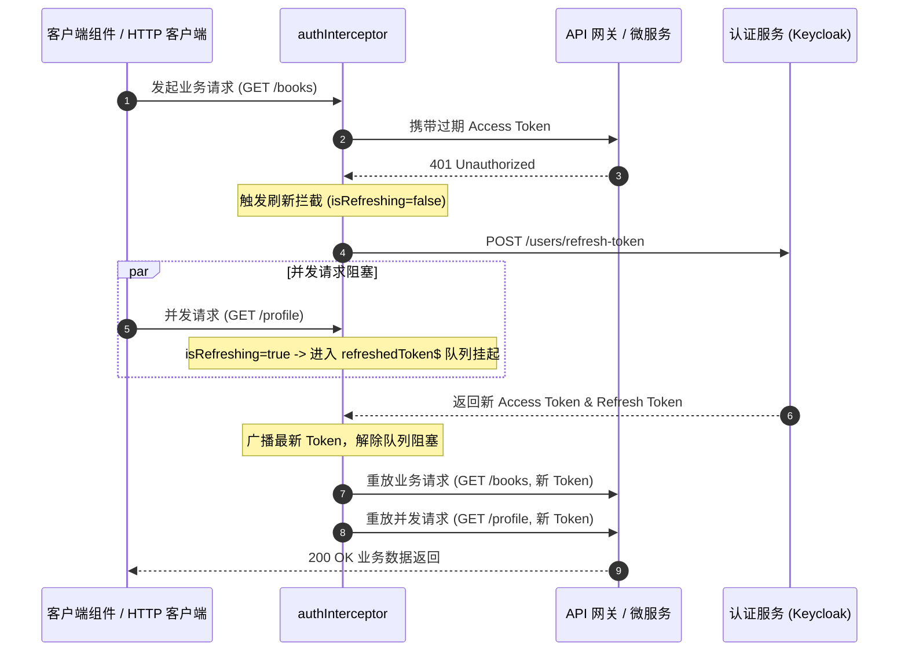

## 1. 客户端鉴权与状态架构决策矩阵

| 技术维度 | 选型方案 | 替代方案 | 决策依据 |
| :--- | :--- | :--- | :--- |
| **HTTP 驱动核心** | `provideHttpClient(withFetch())` | 传统 `XMLHttpRequest` | 原生 Fetch API 执行效率更高，天然适配流式传输与 Service Worker 环境。 |
| **持久化隔离** | 封装独立 `TokenService` | 各业务模块直接读写 `localStorage` | 集中治理存储键名，拦截 JSON 反序列化异常，并在单元测试中安全 Mock 浏览器 API。 |
| **并发刷新控制** | `BehaviorSubject` 广播队列 + `isRefreshing` 互斥标志 | 裸并发重试或单一 Promise | 避免多请求并发 401 导致重复向 Keycloak 发起 Refresh 进而触发多重会话作废机制。 |
| **会话状态自愈** | SignalStore `withHooks` (`onInit`) | 组件挂载阶段手动派发状态恢复 | 在依赖注入树初始化的第一生命周期完成持久化凭证载入，消除未登录闪烁。 |
| **路由守卫范式** | 函数式 `CanActivateFn` + `router.createUrlTree()` | 类装饰器守卫 + 命令式 `router.navigate()` | 无类样板代码，URL 树重定向在单一导航事务周期内解析，杜绝重绘竞态。 |

## 2. 生产级 HttpInterceptorFn：JWT 自动装配与并发无感刷新

```typescript
import { HttpInterceptorFn, HttpErrorResponse, HttpClient } from '@angular/common/http';
import { inject } from '@angular/core';
import { Dispatcher } from '@ngrx/signals/events';
import { BehaviorSubject, catchError, filter, switchMap, take, throwError } from 'rxjs';
import { environment } from '../../../environments/environment';
import { AuthResponse } from '../../shared/models/auth';
import { authApiEvents } from '../../features/auth/store/auth.events';
import { TokenService } from '../services/token.service';

let isRefreshing = false;
const refreshedToken$ = new BehaviorSubject<string | null>(null);

export const authInterceptor: HttpInterceptorFn = (req, next) => {
  const tokenService = inject(TokenService);
  const http = inject(HttpClient);
  const dispatcher = inject(Dispatcher);

  // 1. 白名单过滤：认证端点无需注入旧 Token
  const isAuthEndpoint =
    req.url.includes('/users/signin') ||
    req.url.includes('/users/signup') ||
    req.url.includes('/users/refresh-token');

  const skipRefreshOn401 = isAuthEndpoint || req.url.includes('/users/logout');

  // 2. 注入 Bearer Token
  let authReq = req;
  const token = tokenService.getAccessToken();
  if (token && !isAuthEndpoint) {
    authReq = req.clone({
      setHeaders: { Authorization: `Bearer ${token}` }
    });
  }

  return next(authReq).pipe(
    catchError((error: HttpErrorResponse) => {
      // 3. 拦截 401 状态码执行无感刷新
      if (error.status === 401 && !skipRefreshOn401) {
        const retryWith = (newToken: string) =>
          next(req.clone({ setHeaders: { Authorization: `Bearer ${newToken}` } }));

        // 并发互斥锁：已有刷新在途，将当前请求加入等待队列
        if (isRefreshing) {
          return refreshedToken$.pipe(
            filter((t): t is string => t !== null),
            take(1),
            switchMap(retryWith)
          );
        }

        const refreshToken = tokenService.getRefreshToken();
        if (!refreshToken) {
          dispatcher.dispatch(authApiEvents.tokenRefreshFailure({ error: 'No refresh token' }));
          return throwError(() => error);
        }

        isRefreshing = true;
        refreshedToken$.next(null);

        // 使用原始 HttpClient 发起刷新，规避重入死锁
        return http.post<AuthResponse>(`${environment.apiUrl}/user/api/users/refresh-token`, { refreshToken }).pipe(
          switchMap((res) => {
            isRefreshing = false;
            dispatcher.dispatch(authApiEvents.tokenRefreshSuccess({
              accessToken: res.accessToken,
              refreshToken: res.refreshToken
            }));
            refreshedToken$.next(res.accessToken);
            return retryWith(res.accessToken);
          }),
          catchError((refreshErr) => {
            isRefreshing = false;
            dispatcher.dispatch(authApiEvents.tokenRefreshFailure({ error: 'Session expired' }));
            return throwError(() => refreshErr);
          })
        );
      }
      return throwError(() => error);
    })
  );
};
```

## 3. NgRx SignalStore 认证状态闭环与会话自愈

```typescript
import { inject } from '@angular/core';
import { Router } from '@angular/router';
import { patchState, signalStore, withHooks, withMethods, withState } from '@ngrx/signals';
import { withReducer, on } from '@ngrx/signals/events';
import { takeUntilDestroyed } from '@angular/core/rxjs-interop';
import { Events } from '@ngrx/signals/events';
import { authApiEvents } from './auth.events';
import { TokenService } from '../../core/services/token.service';

export interface AuthState {
  user: UserInfo | null;
  accessToken: string | null;
  refreshToken: string | null;
  loading: boolean;
  error: string | null;
}

export const AuthStore = signalStore(
  { providedIn: 'root' },
  withState<AuthState>({ user: null, accessToken: null, refreshToken: null, loading: false, error: null }),
  withReducer(
    on(authApiEvents.tokenRefreshSuccess, (event) => ({
      accessToken: event.payload.accessToken,
      refreshToken: event.payload.refreshToken
    })),
    on(authApiEvents.tokenRefreshFailure, () => ({
      user: null, accessToken: null, refreshToken: null, loading: false, error: null
    }))
  ),
  withMethods((store, events = inject(Events), router = inject(Router), tokenService = inject(TokenService)) => {
    // 监听刷新成功：同步更新 localStorage
    events.on(authApiEvents.tokenRefreshSuccess).pipe(takeUntilDestroyed()).subscribe((e) => {
      tokenService.saveTokens(e.payload.accessToken, e.payload.refreshToken);
    });

    // 监听刷新失败：清除持久化数据并强制退回登录页
    events.on(authApiEvents.tokenRefreshFailure).pipe(takeUntilDestroyed()).subscribe(() => {
      tokenService.clearAll();
      router.navigate(['/auth/signin']);
    });

    return {
      isAuthenticated: () => Boolean(store.accessToken())
    };
  }),
  withHooks({
    // 页面刷新自愈钩子：恢复会话
    onInit(store) {
      const tokenService = inject(TokenService);
      const accessToken = tokenService.getAccessToken();
      const refreshToken = tokenService.getRefreshToken();
      const user = tokenService.getUser();
      if (accessToken && refreshToken && user) {
        patchState(store, { accessToken, refreshToken, user });
      }
    }
  })
);
```

## 4. 客户端鉴权与无感刷新时序拓扑



## 5. 前端鉴权避坑清单 (Do's & Don'ts)

| 错误实践 (Don't) | 正确实践 (Do) |
| :--- | :--- |
| 在拦截器内部注入封装了业务拦截链的 `AuthService` 发起刷新请求。 | 直接注入底层的原始 `HttpClient` 发起刷新端点调用，避免请求重入导致拦截器死锁。 |
| 每个并发的 401 错误均各自独立向后端发起 `/refresh-token`。 | 设立全局互斥锁与 `BehaviorSubject` 广播队列，确保单并发刷新，后续请求无感重试。 |
| 在路由守卫未通过时调用 `router.navigate(['/signin'])` 并返回 `false`。 | 返回 `router.createUrlTree(['/signin'])`，在同一路由调度事务中原子化完成重定向。 |
| 将敏感用户信息与 Token 明文分散存储且未作异常捕获。 | 通过集中式 `TokenService` 进行存取隔离，针对 `JSON.parse` 实施容错降级。 |
| 仅在前端清除 LocalStorage 即视同完成用户退出。 | 派发注销请求通知后端/Keycloak 销毁服务端 Session，并在失败时实施前端保底注销。 |

<!-- split -->
在上一章中，我们使用 NgRx Events Plugin 和 Mock 数据构建了一个完整的认证状态管理仓库（AuthStore）。我们按事件来源划分定义了各个事件，实现了用于状态迁移的 Reducer，编写了处理异步操作的事件处理器（Event Handlers），并将整套状态逻辑与登录（Sign-in）及注册（Sign-up）页面进行了联动。虽然当时的 Store 架构已经非常健壮，但其底层仍然依赖一个返回硬编码 Token 和模拟网络延迟的伪服务。

在本章中，我们将用针对 Spring Boot 后端的真实 HTTP 调用替换这一 Mock 层。我们将配置基于环境的 API 基础 URL，使用 Angular 的 `HttpClient` 重写 `AuthService`，添加一个为每个外部请求自动附加 JWT 令牌的 HTTP 拦截器，在访问令牌过期时透明地处理 Token 静默刷新，利用函数式路由守卫（Functional Route Guards）保护系统路由，并构建一个用于查看和编辑账户详情的用户个人资料页面。由于 `AuthStore` 的事件处理器通过我们在第 15 章建立的统一方法签名来调用服务，因此 Store 本身无需做任何破坏性变动。这就是“面向接口而非实现编程”带来的巨大回报。

本章我们将涵盖以下主题：

- 应用配置前提条件
- 使用 HttpClient 替换 Mock AuthService
- 添加 HTTP 拦截器
- 为 AuthStore 扩展新功能
- 添加注销与令牌刷新的事件处理器
- 持久化认证状态
- 使用认证守卫保护路由
- 构建用户个人资料页面
- 测试认证层

> **注意**
>
> 本书中的部分界面截图在排版中可能细节较小。我们保留这些截图是因为它们真实反映了运行界面，便于你在自己的屏幕上对照操作。你也可以在本书《前言》提供的随书资源包链接中查看并放大所有高清原图。

## 技术要求

本章的源码可在此处获取：

`https://github.com/PacktPublishing/Spring-Boot-and-Angular-2E_Frontend/tree/main/chapter-16/`

请确保后端的各个微服务已按照第 10 章的说明通过 Docker Compose 正常启动运行。前端将直接与运行在 `http://localhost:8080` 的 API 网关通信，网关会在后台透明地将请求路由到用户微服务（User Microservice）和库存微服务（Inventory Microservice）。

## 应用配置前提条件

为了与真实后端建立通信，我们首先需要完善 Angular 应用的基础设施配置。这包括使应用的渲染策略与基于浏览器的安全 API 保持兼容、定义区分环境的 API 端点地址，并在应用启动时注册必要的 Angular HTTP 提供者以处理网络流量。

### 切换至客户端渲染

在接入真实 HTTP 调用之前，我们需要处理一个渲染层面的约束。我们在第 11 章启用的 SSR（服务端渲染）配置会尝试在服务端预渲染各个路由页面，但我们的认证流程将依赖仅在浏览器环境中可用的 API（例如用于持久化 Token 的 `localStorage`）。服务端渲染在预渲染期间遇到这些原生浏览器 API 时会抛出运行时错误。为了避免该问题，我们暂时将所有路由切换为纯客户端渲染（CSR），更新 `src/app/app.routes.server.ts`：

```typescript
import { RenderMode, ServerRoute } from '@angular/ssr';

export const serverRoutes: ServerRoute[] = [
  {
    path: '**',
    renderMode: RenderMode.Client,
  },
];
```

这指示 Angular 在客户端渲染所有路由，完全跳过服务端的预渲染。这只是一个过渡方案；在第 18 章中，我们将重新深入探讨 SSR，并针对已认证路由和公开路由分别配置合理的按路由渲染策略。

### 配置 API 环境变量

此外，为了发起真实的 HTTP 调用，我们需要一种可配置 API 基础 URL 的途径。Angular 的环境配置文件允许我们定义在开发和生产构建之间动态切换的配置项。Angular CLI 会在构建时根据目标构建配置自动替换这些文件，因此无论当前处于何种环境，我们的应用代码始终只需从同一个路径导入常量。我们在 `src/environments/environment.ts` 创建开发环境配置文件：

```typescript
export const environment = {
  production: false,
  apiUrl: 'http://localhost:8080/packt',
};
```

接着在 `src/environments/environment.prod.ts` 创建生产环境配置文件：

```typescript
export const environment = {
  production: true,
  apiUrl: '/packt',
};
```

在开发模式下，我们直接指向运行在 `8080` 端口的 API 网关。在生产环境下，由于 Angular 应用会部署在同一个网关的反向代理之下，因此我们使用相对路径 `/packt`。这里的 `/packt` 前缀与网关的路由配置保持一致，所有 API 请求都会匹配网关的 `/packt/{service}/api/*` 路由规则。接下来，我们需要在 `angular.json` 中配置生产构建时的文件替换规则。

在生产构建的配置节（production build configuration）中添加：

```json
"fileReplacements": [
  {
    "replace": "src/environments/environment.ts",
    "with": "src/environments/environment.prod.ts"
  }
]
```

完成环境配置后，应用中的每个服务都可以导入 `apiUrl`，并将其作为拼接所有 HTTP 请求的前缀基准。

### 在应用提供者中引入 HttpClient

Angular 的 `HttpClient` 用于执行 HTTP 网络请求，需要显式注册其提供者。由于 Angular 采用基于独立组件（Standalone）的引导模式，我们在 `src/app/app.config.ts` 中使用 `provideHttpClient` 函数进行注册。我们还会传入 `withFetch()`，以使用浏览器原生的 Fetch API 代替传统的 `XMLHttpRequest`。对于 SSR 应用来说这是强烈推荐的做法，因为 Node.js 服务端环境中不存在 `XMLHttpRequest`（我们将在第 18 章针对 SSR 进行专门实战），如果遗漏 `withFetch()`，Angular 会在控制台打印警告。同时，我们还会传入 `withInterceptors()`，为本章后续要构建的认证拦截器做好准备：

```typescript
import { provideHttpClient, withFetch, withInterceptors }
  from '@angular/common/http';

export const appConfig: ApplicationConfig = {
  providers: [
    // .. 其他 providers
    provideRouter(routes),
    provideHttpClient(withFetch(), withInterceptors([])),
    // .. 其他 providers
  ],
};
```

这里的 `withFetch()` 调用将全局配置 `HttpClient` 采用 Fetch API。`withInterceptors([])` 接收一个函数式拦截器数组。目前我们先传入一个空数组，待拦截器编写完成后再将其加入。

现在客户端已具备处理外部请求的基础环境，接下来我们就可以把模拟逻辑替换为真实的后端通信了。

## 使用 HttpClient 替换 Mock AuthService

在第 15 章中，我们实现的 `AuthService` 包含若干 Mock 方法，使用 `delay()` 和硬编码响应来模拟 API 行为。当时定义的方法签名经过精心设计，与基于 HttpClient 的真实实现完全一致。现在我们在保持公共接口不变的前提下，将那些 Mock 实现替换为实际的 HTTP 调用。在动手修改服务本身之前，我们需要先搭建它所依赖的基础构件：

- 与后端真实响应相匹配的更新版接口；
- 用于将 Token 持久化至 `localStorage` 的 `TokenService`；
- 能够自动附加认证请求头的 HTTP 拦截器。

一旦这些模块就位，`AuthService` 的实现就会变得极为清晰简练；每个方法都是普通的 `HttpClient` 调用，无需手动管理请求头。这里选择 `localStorage` 而非 `sessionStorage` 是经过深思熟虑的决策。两者的 API 完全相同，但 `sessionStorage` 的作用域仅限于单个浏览器标签页，一旦该标签页关闭就会被清空，这意味着用户每次关闭窗口都会被注销。而 `localStorage` 会一直保留，直到被显式清除，因此再次访问应用的用户仍能保持登录会话，这正符合读者对同类应用的预期。两者的权衡在于安全性暴露面：两种本地存储机制都无法防御跨站脚本攻击（XSS），页面上运行的任何恶意脚本都能从中读取 Token。这是浏览器端存储本身的机制局限，而非选用哪种方案的决定性理由，也正因如此，我们在注销时必须主动清除 Token 和缓存的用户数据，而不能依赖浏览器代劳。此外，这在渲染时同样至关重要：由于这两个 API 仅在浏览器中存在，任何触及它们的代码路径在服务端渲染时都会崩溃。这也是我们在本章强制使用客户端渲染的缘由，我们将在第 18 章对其进行彻底规范的治理。

### 更新认证响应接口

在第 15 章中，我们定义的 `UserInfo` 仅包含 Store 和 UI 所需的字段：用于展示的姓名、用于标识的电子邮箱，以及用于后续授权校验的用户角色。由于 Mock 服务始终返回这些字段，当时并未定义其他属性。但在实现真实服务并调用后端 API 之前，我们需要做出两处有针对性的补充：首先，后端的 User 载荷中包含用户的 Keycloak ID，因此我们在 `UserInfo` 中增加 `keycloakId` 以匹配接口结构；其次，刷新令牌端点（Refresh Token Endpoint）返回新令牌但不包含用户对象，因此我们将 `AuthResponse` 中的 user 字段声明为可为空（nullable）。更新 `src/app/shared/models/auth.ts`：

```typescript
export interface AuthResponse {
  accessToken: string;
  refreshToken: string;
  tokenType: string;
  expiresIn: number;
  user: UserInfo | null;
}

export interface UserInfo {
  id: string;
  keycloakId: string;
  email: string;
  firstName: string;
  lastName: string;
  role: string;
}
```

接口与真实的后端响应结构对齐后，我们需要一种在页面刷新后仍能持久保存 Token 并供 HTTP 流水线随取随用的机制。`TokenService` 将承担这两项职责。

### 创建 Token 存储服务

如果没有持久化机制，用户每次刷新页面都会被迫登出。`TokenService` 封装了 `localStorage`，提供用于存取访问令牌（Access Token）、刷新令牌（Refresh Token）以及用户信息的强类型方法。我们优先创建它，因为接下来要编写的拦截器需要从中读取 Token 来添加认证请求头，而 `AuthStore` 也会使用它在登录时存储 Token 并在应用启动时恢复状态。我们在 `src/app/core/services/token.service.ts` 中创建该服务：

```typescript
import { Injectable } from '@angular/core';
import { UserInfo } from '../../shared/models/auth';

const ACCESS_TOKEN_KEY = 'bookstore_access_token';
const REFRESH_TOKEN_KEY = 'bookstore_refresh_token';
const USER_KEY = 'bookstore_user';

@Injectable({ providedIn: 'root' })
export class TokenService {
  saveTokens(accessToken: string, refreshToken: string): void {
    localStorage.setItem(ACCESS_TOKEN_KEY, accessToken);
    localStorage.setItem(REFRESH_TOKEN_KEY, refreshToken);
  }

  saveUser(user: UserInfo): void {
    localStorage.setItem(USER_KEY, JSON.stringify(user));
  }

  getAccessToken(): string | null {
    return localStorage.getItem(ACCESS_TOKEN_KEY);
  }

  getRefreshToken(): string | null {
    return localStorage.getItem(REFRESH_TOKEN_KEY);
  }

  getUser(): UserInfo | null {
    const raw = localStorage.getItem(USER_KEY);
    if (!raw) return null;
    try {
      return JSON.parse(raw) as UserInfo;
    } catch {
      return null;
    }
  }

  clearAll(): void {
    localStorage.removeItem(ACCESS_TOKEN_KEY);
    localStorage.removeItem(REFRESH_TOKEN_KEY);
    localStorage.removeItem(USER_KEY);
  }
}
```

采用专用服务而非在 Store 中直接访问 `localStorage` 有两个重要原因：第一，集中管理存储键名，避免魔术字符串分散在各个文件中；第二，使得所有调用方的测试变得非常容易，因为我们可以在单元测试中轻松 Mock `TokenService`，而无需与浏览器的真实 `localStorage` API 纠缠。

定义好存储策略后，接下来的任务是确保发往后端的每个请求都能稳定携带这些令牌。

## 添加 HTTP 拦截器

每个经过认证的 API 请求都需要携带一个凭证：放在 `Authorization` 请求头中的 JWT 访问令牌。用户的身份并非由浏览器单方面声明。API 网关负责校验该令牌，从 Claims 声明中解析出调用者身份，并由网关亲自将其传递给下游微服务。将信任边界收敛在单一位置，意味着一个请求所能代表的身份永远只能是它所呈现的令牌对应的用户，这使得拦截器的职责得以简化为两点：附加令牌，以及在后端拒绝令牌时做出响应。

> **注意**
>
> 下游微服务确实会从 `X-User-Id` 请求头中读取 Keycloak 用户 ID，但该请求头是由网关生成的。在路由请求之前，网关会剥离随请求到达的所有 `X-User-Id`、`X-User-Email` 和 `X-User-Name` 请求头，然后根据已通过校验的 JWT Claims 重新注入它们。客户端即使自行发送 `X-User-Id` 也不会产生任何效果，而不发送也不会丢失任何数据。如果允许从浏览器直接发送该头，就意味着信任客户端单方面声明身份，而这正是网关机制要坚决防止的。

与其在每个具体服务方法中手动设置请求头，不如将该逻辑集中在一个拦截器中，由它统一从 `TokenService` 读取令牌并应用到所有发出的请求上。在 Angular 中，拦截器采用函数式语法：一个接收请求和下一个处理器（next handler）并返回响应 Observable 的纯函数。我们在 `src/app/core/interceptors/auth.interceptor.ts` 创建拦截器：

```typescript
import {
  HttpClient,
  HttpErrorResponse,
  HttpInterceptorFn,
} from '@angular/common/http';
import { inject } from '@angular/core';
import { BehaviorSubject, catchError, filter, switchMap, take, throwError } from 'rxjs';
import { Dispatcher } from '@ngrx/signals/events';
import { TokenService } from '../services/token.service';
import { authApiEvents } from '../../features/auth/store/auth.events';
import { environment } from '../../../environments/environment';
import { AuthResponse } from '../../shared/models/auth';

let isRefreshing = false;
const refreshedToken$ = new BehaviorSubject<string | null>(null);

function buildAuthHeaders(
  tokenService: TokenService
): Record<string, string> {
  const headers: Record<string, string> = {};
  const token = tokenService.getAccessToken();
  if (token) {
    headers['Authorization'] = `Bearer ${token}`;
  }
  return headers;
}

export const authInterceptor: HttpInterceptorFn = (req, next) => {
  const tokenService = inject(TokenService);
  const http = inject(HttpClient);
  const dispatcher = inject(Dispatcher);

  const skipAuthHeaders = req.url.includes('/users/signin')
    || req.url.includes('/users/signup')
    || req.url.includes('/users/refresh-token');

  const skipRefreshOn401 = skipAuthHeaders
    || req.url.includes('/users/logout');

  if (skipAuthHeaders) {
    return next(req);
  }

  const headers = buildAuthHeaders(tokenService);
  const authReq = Object.keys(headers).length > 0
    ? req.clone({ setHeaders: headers })
    : req;

  return next(authReq).pipe(
    catchError((error: HttpErrorResponse) => {
      if (error.status === 401 && !skipRefreshOn401) {
        const retryWith = (token: string) =>
          next(req.clone({
            setHeaders: { Authorization: `Bearer ${token}` },
          }));

        if (isRefreshing) {
          return refreshedToken$.pipe(
            filter((token): token is string => token !== null),
            take(1),
            switchMap(retryWith)
          );
        }

        const refreshToken = tokenService.getRefreshToken();
        if (!refreshToken) {
          dispatcher.dispatch(
            authApiEvents.tokenRefreshFailure({
              error: 'No refresh token available',
            })
          );
          return throwError(() => error);
        }

        isRefreshing = true;
        refreshedToken$.next(null);
        return http.post<AuthResponse>(
          `${environment.apiUrl}/user/api/users/refresh-token`,
          { refreshToken }
        ).pipe(
          switchMap((response) => {
            isRefreshing = false;
            dispatcher.dispatch(
              authApiEvents.tokenRefreshSuccess({
                accessToken: response.accessToken,
                refreshToken: response.refreshToken,
              })
            );
            refreshedToken$.next(response.accessToken);
            return retryWith(response.accessToken);
          }),
          catchError((refreshError) => {
            isRefreshing = false;
            dispatcher.dispatch(
              authApiEvents.tokenRefreshFailure({
                error: 'Token refresh failed',
              })
            );
            return throwError(() => refreshError);
          })
        );
      }
      return throwError(() => error);
    })
  );
};
```

> **注意**
>
> 如果两个请求在同一时间触发 401 失败，简陋的拦截器会并发发起两次刷新请求。这是否会造成危害取决于认证中心（Identity Provider）的配置。如果 Keycloak 领域配置了“使用即作废”（Revoke refresh tokens on use），那么第二次刷新将被直接拒绝，导致用户在第一次刷新明明成功的情况下依然被登出。`isRefreshing` 标志位和 `BehaviorSubject` 彻底消除了对该服务端配置的依赖：仅有首个 401 会触发实际刷新请求，后续的所有并发 401 都会挂起并等待该刷新的最终结果。

我们逐步梳理拦截器的核心运行逻辑：

- **集中式请求头构建**：`buildAuthHeaders()` 函数从 `TokenService` 中读取访问令牌，并在存在令牌时构造 `Authorization` 请求头。各个业务服务方法不再需要关注鉴权请求头；它们发起普通的 HTTP 请求，其余一切由拦截器接管。
- **跳过认证端点**：登录（signin）、注册（signup）和刷新令牌（refresh-token）请求不需要（也不应该）附加认证头。登录请求本身就是用来获取令牌的途径，而在刷新请求上附加一个过期的访问令牌则会导致循环失败。
- **两份不同的跳过清单**：`skipAuthHeaders` 覆盖登录、注册与刷新令牌，这些请求绝不能携带令牌。`skipRefreshOn401` 在这三个端点的基础上还增加了注销（logout）。注销确实需要携带 `Authorization` 头，因此它不在第一份清单中；但注销遇到 401 时绝不能再尝试刷新令牌——因为令牌既然已被注销，重试只会导致级联错误。将这两处考量拆分为独立的清单，使得逻辑极其清晰明确。
- **无循环重入的刷新调用**：刷新调用直接注入了底层的 `HttpClient`，而不是调用 `AuthService`。`AuthService` 的方法同样会流经这个拦截器，如果通过它进行刷新就会重入当前拦截器链，并完全依赖 URL 过滤来防止无限递归。直接注入 `HttpClient` 彻底切断了循环依赖路径。
- **针对 401 的静默刷新**：当服务器返回 `401 Unauthorized` 时，拦截器在失败前先尝试刷新令牌。刷新成功后，它派发 `tokenRefreshSuccess` 事件以更新 Store，并使用新获取的令牌对原始请求进行重试。
- **级联失效处理**：如果刷新请求本身也失败了（说明 Refresh Token 也已过期或失效），我们派发 `tokenRefreshFailure` 事件。正如本章后文所配置的，该事件将通过 Store 中的 `refreshToken$` 处理器触发全自动注销。
- **非 401 错误直接透传**：任何非 401 的 HTTP 错误都会原样重新抛出，交由业务调用方正常处理。

注意，拦截器是从 `TokenService` 而非 `AuthStore` 读取令牌。这是经过深思熟虑的：拦截器运行在底层的 HTTP 管道中，直接从 `TokenService`（即 `localStorage`）读取能够确保始终拿到最新令牌，即便是在刷新操作刚写入 `localStorage` 但 Store 的 Reducer 尚未完成事件响应的微任务间隙亦是如此。

### 注册拦截器

现在我们需要更新 `src/app/app.config.ts` 以注册该拦截器：

```typescript
import { authInterceptor } from './core/interceptors/auth.interceptor';

export const appConfig: ApplicationConfig = {
  providers: [
    provideRouter(routes),
    provideHttpClient(withFetch(), withInterceptors([authInterceptor])),
    // .. 其他 providers
  ],
};
```

*拦截器的注册顺序至关重要*。如果我们后续添加了其他拦截器（例如日志拦截器），它们将严格按照数组中的声明顺序依次执行。认证拦截器应当置于首位，以便后续所有拦截器都能看到已经完成认证头注入的请求对象。

至此，接口已更新完毕，令牌已通过 `TokenService` 妥善持久化，请求头也由拦截器自动管理，数据契约全部就绪。`AuthStore` 已经在第 15 章通过事件载荷对接了 `UserInfo` 和 `AuthResponse`，因此这里更新接口后，Store 自动获得了新增的 `keycloakId` 属性，其 Reducer 和计算信号无需任何变动。真正需要改造的是服务层：我们必须将之前的 Mock `delay()` / `of()` 调用替换为真实的 `HttpClient` 网络请求。

### 实现真实的 AuthService

第 15 章中的 Mock `AuthService` 定义了 `signin()` 和 `signup()` 两个方法，其返回值类型均为符合 Store 事件处理器预期的 Observable。我们在最初设计时就特意保持了这一形态，因此替换过程非常平滑。现在我们为该服务扩展四个新方法：用于静默续期的 `refreshToken()`、用于终结会话的 `logout()`，以及用于后续个人资料页面的 `getProfile()` 与 `updateProfile()`。得益于拦截器对认证头的全自动管理，这里的每一个方法都只是非常精简的 `HttpClient` 调用。更新 `src/app/features/auth/services/auth.service.ts`：

```typescript
import { HttpClient } from '@angular/common/http';
import { inject, Injectable } from '@angular/core';
import { Observable } from 'rxjs';
import { map } from 'rxjs/operators';
import { environment } from '../../../../environments/environment';
import {
  AuthResponse,
  SigninRequest,
  SignupRequest,
  UserInfo,
  UserProfile,
} from '../../../shared/models/auth';

@Injectable({ providedIn: 'root' })
export class AuthService {
  private http = inject(HttpClient);
  private baseUrl = `${environment.apiUrl}/user/api/users`;

  signin(credentials: SigninRequest): Observable<{
    user: UserInfo;
    accessToken: string;
    refreshToken: string;
  }> {
    return this.http.post<AuthResponse>(
      `${this.baseUrl}/signin`, credentials).pipe(
      map((response) => ({
        user: response.user!,
        accessToken: response.accessToken,
        refreshToken: response.refreshToken,
      })),
    );
  }

  signup(data: SignupRequest): Observable<void> {
    return this.http
      .post<{ success: boolean; message: string }>(`${this.baseUrl}/signup`, data)
      .pipe(map(() => undefined));
  }

  refreshToken(refreshToken: string): Observable<{
    accessToken: string;
    refreshToken: string;
  }> {
    return this.http.post<AuthResponse>(`${this.baseUrl}/refresh-token`, {
      refreshToken }).pipe(
      map((response) => ({
        accessToken: response.accessToken,
        refreshToken: response.refreshToken,
      })),
    );
  }

  logout(): Observable<void> {
    return this.http
      .post<{ success: boolean; message: string }>(`${this.baseUrl}/logout`, {})
      .pipe(map(() => undefined));
  }

  getProfile(): Observable<UserProfile> {
    return this.http.get<UserProfile>(`${this.baseUrl}/profile`);
  }

  updateProfile(profile: UserProfile): Observable<UserProfile> {
    return this.http.put<UserProfile>(`${this.baseUrl}/profile`, profile);
  }
}
```

对比 Mock 实现，梳理以下几处关键改进：

- **无需手动组装请求头**：每个方法都是纯粹的 `HttpClient` 调用。拦截器会自动从 `TokenService` 读取 Access Token 并附加为 `Authorization` 请求头。
- **无参注销**：`logout()` 方法不需要接收任何入参。在第 15 章中，Store 的事件处理器必须先从状态中提取 Token 和用户再向下传递。现在拦截器在底层自动注入 Token，使得注销事件处理器的调用变得极其纯粹，无需前置条件检查。
- **登录和注册保持相同的公开契约**：`signin()` 与 `signup()` 的方法签名相较第 15 章完全未变。`AuthStore` 的事件处理器调用这两个真实方法的方式与此前调用 Mock 版本完全一致。
- **响应体精简映射**：后端的登录端点返回的 `AuthResponse` 包含 `tokenType` 和 `expiresIn` 等我们 Store 并不关心的字段。通过 `map()` 操作符提取出 Store 所需的精确属性，严格维护了第 15 章既定的接口契约。

这些细致的封装确保了服务层的高度纯粹与可预期性。

基础设施与网络通信搞定后，下一步就是扩展 Store 来编排这些新的后台异步流程。

## 为 AuthStore 扩展新功能

有了真实的 `AuthService`、拦截器和 `TokenService`，我们需要扩展 `AuthStore` 以处理用户注销和令牌刷新。Store 依然沿用第 15 章确立的核心设计模式：添加新事件、编写 Reducer，以及配置事件处理器。

### 添加新事件

更新 `src/app/features/auth/store/auth.events.ts`，为令牌刷新和注销流程增加新事件：

```typescript
import { eventGroup, type } from '@ngrx/signals/events';
import { SigninRequest, SignupRequest, UserInfo } from '../../../shared/models/auth';

export const authPageEvents = eventGroup({
  source: 'Auth Page',
  events: {
    signinSubmitted: type<SigninRequest>(),
    signupSubmitted: type<SignupRequest>(),
    logoutClicked: type<void>(),
  },
});

export const authApiEvents = eventGroup({
  source: 'Auth API',
  events: {
    signinSuccess: type<{
      user: UserInfo;
      accessToken: string;
      refreshToken: string;
    }>(),
    signinFailure: type<{ error: string }>(),
    signupSuccess: type<void>(),
    signupFailure: type<{ error: string }>(),
    logoutSuccess: type<void>(),
    logoutFailure: type<{ error: string }>(),
    tokenRefreshSuccess: type<{
      accessToken: string;
      refreshToken: string;
    }>(),
    tokenRefreshFailure: type<{ error: string }>(),
  },
});
```

新事件严格遵循我们在第 15 章建立的基于来源的分组规范。`logoutClicked` 来自用户界面（点击顶部导航栏中的注销按钮），而 `logoutSuccess`、`logoutFailure`、`tokenRefreshSuccess` 和 `tokenRefreshFailure` 归属于 API 事件，因为它们是异步 HTTP 调用的结果。请注意，`tokenRefreshSuccess` 和 `tokenRefreshFailure` 是由拦截器直接派发的，而非 Store 的事件处理器；因为拦截器是在 HTTP 流水线内部全透明完成令牌刷新的。

### 为新事件添加 Reducer

现在我们更新 `src/app/features/auth/store/auth.store.ts` 中的 `withReducer` 块，以响应这些新事件：

```typescript
// .. 保留第 15 章已有的其他 reducers

on(authApiEvents.logoutSuccess, () => ({
  ...initialAuthState,
})),

on(authApiEvents.logoutFailure, (event) => ({
  loading: false,
  error: event.payload.error,
})),

on(authApiEvents.tokenRefreshSuccess, (event) => ({
  accessToken: event.payload.accessToken,
  refreshToken: event.payload.refreshToken,
})),

on(authApiEvents.tokenRefreshFailure, () => ({
  ...initialAuthState,
})),
```

`logoutSuccess` Reducer 将整个状态完全重置为 `initialAuthState`，清空所有用户信息、令牌及错误提示。`tokenRefreshSuccess` Reducer 仅更新令牌本身，完好保留现有的用户数据和页面 UI 状态。如果遇到 `tokenRefreshFailure`，系统将执行注销逻辑并将状态重置为初始值，因为无法续期的令牌意味着当前会话已彻底失效。

## 添加注销与令牌刷新的事件处理器

在第 15 章中，`logoutClicked` Reducer 只是单纯重置内存状态并清空浏览器端的 Token。这对于 Mock 演示已经足够，但在真实后端环境中会留下安全漏洞：Keycloak 服务端上的 Refresh Token 仍然有效！任何获取到该 Refresh Token 的人（无论是通过共享设备、恶意浏览器插件还是被窃听的网络），都能在它自然过期前持续换取新的 Access Token。通过向后端的 `POST /users/logout` 发起请求，我们在 Keycloak 服务端将 Refresh Token 彻底撤销作废，确保无论副本泄露在何处都无法再被使用。至于 Access Token 本身生命周期极短（根据后端的 `expiresIn` 配置通常仅有 5 分钟），它很快就会自行失效。服务端主动撤销与客户端彻底清理的组合，构成了真正完整的注销闭环：服务端销毁会话、`localStorage` 清理令牌、Store 重置为初始状态，用户被重定向至登录页。我们在 `withEventHandlers` 中加入新的处理器：

```typescript
logout$: events.on(authPageEvents.logoutClicked).pipe(
  exhaustMap(() =>
    tokenService.getAccessToken()
      ? authService.logout().pipe(
          map(() => authApiEvents.logoutSuccess()),
          catchError((error: unknown) =>
            of(
              authApiEvents.logoutFailure({
                error: normalizeApiErrorMessage(
                  error, 'Unable to sign out right now.'),
              }),
            ),
          ),
        )
      : of(authApiEvents.logoutSuccess()),
  ),
),
refreshToken$: events
  .on(authApiEvents.tokenRefreshFailure)
  .pipe(map(() => authPageEvents.logoutClicked())),
```

`logout$` 事件处理器在调用后端接口前增加了一个审慎的防守检查：如果 `localStorage` 中根本不存在 Access Token，则完全跳过 API 请求，直接触发 `logoutSuccess`。这一点至关重要，因为我们在本章后文设置的持久化监听器中，是将前端清除 `localStorage` 和重置 Store 绑定在 `logoutSuccess` 事件上的。如果我们无条件调用 `authService.logout()`，在未认证或 Token 已失效的场景下接口将返回 401 或 403，派发 `logoutFailure` 而非 `logoutSuccess`，导致清理逻辑被直接跳过，失效的残留 Token 仍滞留在 `localStorage` 中。前置的 Token 检查确保了清理逻辑绝对会被触发：要么后端确认注销成功返回 `logoutSuccess`，要么本地本就无须注销直接派发 `logoutSuccess`。

这里的错误处理使用了 `normalizeApiErrorMessage()` 实用函数，而不是将其暴力类型断言为 `{ message: string }`。该工具函数能够安全稳健地从各种不同形态的错误对象中提炼出易读的错误消息，并在无法解析时回退到传入的默认提示。该工具的具体实现可参考 `src/app/shared/utils/error-message.ts`。

`refreshToken$` 处理器则是一道保底防线：如果拦截器重试刷新令牌失败并派发了 `tokenRefreshFailure`，该流会自动触发 `logoutClicked`。虽然此时由于 Token 失效，`getAccessToken()` 可能会再次尝试注销接口并可能以 `logoutFailure` 告终，但这是完全可以接受的，因为 `tokenRefreshFailure` Reducer 早已将内存状态重置为 `initialAuthState`。此时清理 `localStorage` 只是尽力而为的操作，而用户已经被导航订阅器引导向登录页面了。

事件处理器编写完毕后，我们还需要为这些新事件配置路由导航和 Token 持久化。来自第 15 章的登录和注册导航监听器已经存在于 `withMethods` 块中。我们在下一节中将注销后的导航与持久化逻辑合并实现，因为 `logoutSuccess` 的监听器必须在发起页面重定向之前彻底清空 `localStorage`；将这两项职责统一在单个订阅器中能够从根本上保证严格的先后执行顺序。

## 持久化认证状态

我们在本章前文构建的 `TokenService` 负责针对 `localStorage` 的底层读写操作。但它本身并不决定何时保存或清空数据；该职责属于 `AuthStore`。在本节中，我们将两者连接起来：Store 监听认证事件，据此通知 `TokenService` 保存或清除 Token，并在应用初次启动时负责恢复持久化的会话状态。这一状态恢复步骤至关重要；否则每次页面刷新都会导致内存状态被初始化为空，接下来要配置的路由守卫便会把所有用户无一例外地重定向到登录页面。

### 将持久化集成至 AuthStore

我们需要扩展 `AuthStore`，使其在登录成功时保存 Token，在注销时清空它们。更新 `src/app/features/auth/store/auth.store.ts` 中的 `withMethods` 块，注入 `TokenService`：

```typescript
withMethods(
  (store, events = inject(Events), router = inject(Router),
   tokenService = inject(TokenService)) => {
    events.on(authApiEvents.signinSuccess)
      .pipe(takeUntilDestroyed())
      .subscribe((event) => {
        tokenService.saveTokens(
          event.payload.accessToken, event.payload.refreshToken
        );
        if (event.payload.user) {
          tokenService.saveUser(event.payload.user);
        }
      });
    events.on(authApiEvents.tokenRefreshSuccess)
      .pipe(takeUntilDestroyed())
      .subscribe((event) => {
        tokenService.saveTokens(
          event.payload.accessToken, event.payload.refreshToken
        );
      });
    events.on(authApiEvents.signinSuccess)
      .pipe(takeUntilDestroyed())
      .subscribe(() => router.navigate(['/books']));
    events.on(authApiEvents.signupSuccess)
      .pipe(takeUntilDestroyed())
      .subscribe(() => router.navigate(['/auth/signin']));
    events.on(authApiEvents.logoutSuccess)
      .pipe(takeUntilDestroyed())
      .subscribe(() => {
        tokenService.clearAll();
        router.navigate(['/auth/signin']);
      });
    return {
      clearError: () => patchState(store, { error: null }),
    };
  }
),
```

持久化订阅器与 Reducer 监听完全相同的事件集合。当 `signinSuccess` 触发时，Reducer 将 Token 存入内存状态，与此同时订阅器将其同步保存到 `localStorage` 中。当 `tokenRefreshSuccess` 触发时，只更新 Token 本身，因为此时用户信息并没有改变。

注销清理逻辑直接内置在导航订阅器内，而不是拆分为独立的持久化订阅器，这从结构上确保了在路由导航启动之前，`localStorage` 中的 Token 必定已被全部清除；如果是两个平行的独立订阅器，登录页面上的路由守卫可能会在 Token 尚未完全移除之前就被触发求值，从而错误地把刚刚执行注销的用户再次重定向离开登录页。

`logoutSuccess` Reducer 负责内存状态重置（用户、令牌、加载状态与错误信息均回到初始状态），而订阅器负责产生外部副作用（清理本地存储并执行路由重定向）。这种职责切分非常干净利落：Reducer 负责状态迁移，Subscriber 负责副作用执行。在该代码块中，依然保留了第 15 章中供登录和注册页面在加载时调用的 `clearError()` 方法。

### 在应用启动时恢复状态

为了在应用重新加载时恢复已持久化的认证状态，我们需要在 Store 初始化时读取 `localStorage` 中的数据。我们可以借助 `withHooks` 来实现这一逻辑。`withHooks` 是 NgRx SignalStore 提供的生命周期钩子，允许在 Store 实例初始化（`onInit`）或销毁（`onDestroy`）时执行自定义逻辑。在 `AuthStore` 中增加 `withHooks` 块：

```typescript
withHooks({
  onInit(store) {
    const tokenService = inject(TokenService);
    const accessToken = tokenService.getAccessToken();
    const refreshToken = tokenService.getRefreshToken();
    const user = tokenService.getUser();
    if (accessToken && refreshToken && user) {
      patchState(store, { accessToken, refreshToken, user });
    }
  },
}),
```

`onInit` 钩子会在 Store 首次被依赖注入容器实例化时执行一次。它从 `localStorage` 中读取持久化的令牌和用户数据，并在三者同时存在时，通过 `patchState` 一次性同步写回 Store 状态。这样就实现了在无需用户重新登录的前提下无缝还原认证会话。由于 `isAuthenticated` 计算信号以 Access Token 是否非空作为判断基准，它会自动同步求值为 `true`，顶部导航栏也能立刻展示出用户名以及注销按钮。这一状态恢复步骤是后续路由守卫在页面刷新时能够正常运作的核心基石。若缺少该步骤，内存 Store 每次初始化都会处于空白状态，`isAuthenticated` 必然为 false，所有受保护路由都会直接把手持有效 Token 的合法用户强制重定向回登录页。

## 使用认证守卫保护路由

应用中的页面并非对所有人无差别开放。图书和作者管理页面应当要求登录，而登录和注册页面则只应当对未认证用户开放。Angular 的路由守卫（Route Guards）允许我们在路由配置中声明式地落实这些访问控制规则。在现代 Angular 中，守卫采用函数式声明：一个返回 `boolean`、`UrlTree` 或其 Observable 的简单函数。

我们在 `src/app/core/guards/auth.guard.ts` 中创建认证守卫：

```typescript
import { inject } from '@angular/core';
import { CanActivateFn, Router } from '@angular/router';
import { AuthStore } from '../../features/auth/store/auth.store';

export const authGuard: CanActivateFn = () => {
  const store = inject(AuthStore);
  const router = inject(Router);
  if (store.isAuthenticated()) {
    return true;
  }
  return router.createUrlTree(['/auth/signin']);
};

export const guestGuard: CanActivateFn = () => {
  const store = inject(AuthStore);
  const router = inject(Router);
  if (!store.isAuthenticated()) {
    return true;
  }
  return router.createUrlTree(['/books']);
};
```

这里定义了两个用途互补的守卫：

- `authGuard`：保护需要登录鉴权的路由。如果用户尚未登录，将其重定向至登录页。该守卫读取 `AuthStore` 的 `isAuthenticated` 计算信号，这与顶部导航组件用于切换“Sign In”与“Logout”按钮使用的是同一个信号。
- `guestGuard`：保护仅供访客访问的路由（登录与注册）。如果已登录用户在地址栏手动输入 `/auth/signin`，守卫会将其重定向到 `/books`。这有效避免了已认证用户看到登录表单的尴尬与困惑。

两个守卫均返回 `true`（允许导航）或 `UrlTree`（执行重定向）。返回 `UrlTree` 而非在守卫内部命令式调用 `router.navigate()` 是 Angular 官方强烈推荐的最佳实践，因为这能让 Angular 路由调度器在单次导航事务周期内直接处理重定向，彻底消除了命令式导航可能引发的竞态风险。由于我们在上一节配置的 `withHooks onInit` 钩子会在 Store 初始化时立刻从 `localStorage` 中恢复 Token，因此即便用户按 F5 刷新了页面，当路由器评估守卫时，`isAuthenticated` 信号也早已是正确无误的值。注意，守卫是从 `AuthStore` 而非 `TokenService` 读取状态。这种边界划分是刻意为之的：Store 的 `isAuthenticated` 计算信号是整个应用 UI 与路由决策的唯一事实来源（Single Source of Truth），而 `TokenService` 仅通过拦截器服务于底层的 HTTP 通信链路。

接下来更新 `src/app/app.routes.ts` 以应用守卫：

```typescript
import { Routes } from '@angular/router';
import { authGuard, guestGuard } from './core/guards/auth.guard';

export const routes: Routes = [
  { path: '', redirectTo: 'books', pathMatch: 'full' },
  {
    path: 'books',
    canActivate: [authGuard],
    loadChildren: () =>
      import('./features/books/books.routes').then(m => m.routes)
  },
  {
    path: 'auth',
    canActivate: [guestGuard],
    loadChildren: () =>
      import('./features/auth/auth.routes').then(m => m.routes)
  },
  {
    path: 'profile',
    canActivate: [authGuard],
    loadComponent: () =>
      import('./features/profile/pages/profile/profile').then(
        m => m.Profile
      )
  },
];
```

现在，`books` 和 `profile` 路由均已受到 `authGuard` 的严密保护，而 `auth` 路由则配置了 `guestGuard`。请注意新增的 profile 路由：我们将在下一节实现个人资料组件，如果此时出现 TypeScript 编译报错，暂时忽略它或先将该路由块注释，待组件构建完毕后即可恢复。这里使用 `loadComponent` 而非 `loadChildren`，因为该页面是一个独立的单页组件，不包含嵌套子路由。

## 构建用户个人资料页面

用户个人资料页面允许已登录用户查看并编辑其账户基本信息。该页面与后端的 `GET /users/profile` 和 `PUT /users/profile` 端点通信，并展示了如何将响应式表单与 `AuthStore` 深度整合以实现完整的数据流转。

### 创建 Profile 特性目录结构

首先搭建个人资料特性的骨架。由于个人资料与认证属于不同的关注领域，我们为其创建专门的独立特性目录：

```bash
ng generate component features/profile/pages/profile
ng generate component features/profile/components/profile-form
```

生成后的目录结构如下：

```
src/app/features/profile/
├── pages/
│   └── profile/
│       ├── profile.ts
│       ├── profile.html
│       └── profile.scss
└── components/
    └── profile-form/
        ├── profile-form.ts
        ├── profile-form.html
        └── profile-form.scss
```

### 构建个人资料表单组件

个人资料表单组件沿用第 14 章确立的设计模式：一个使用响应式表单、Angular Material 组件库并通过 Output 事件向外派发数据的展示型组件（Dumb Component）。更新 `src/app/features/profile/components/profile-form/profile-form.ts`：

```typescript
import { Component, effect, inject, input, output } from '@angular/core';
import { FormBuilder, ReactiveFormsModule, Validators } from '@angular/forms';
import { toSignal } from '@angular/core/rxjs-interop';
import { map } from 'rxjs/operators';
import { MatCardModule } from '@angular/material/card';
import { MatFormFieldModule } from '@angular/material/form-field';
import { MatInputModule } from '@angular/material/input';
import { MatButtonModule } from '@angular/material/button';
import { MatIconModule } from '@angular/material/icon';
import { MatProgressSpinnerModule } from '@angular/material/progress-spinner';
import { UserProfile } from '../../../../shared/models/auth';

@Component({
  selector: 'app-profile-form',
  imports: [
    ReactiveFormsModule, MatCardModule, MatFormFieldModule,
    MatInputModule, MatButtonModule, MatIconModule,
    MatProgressSpinnerModule,
  ],
  templateUrl: './profile-form.html',
  styleUrl: './profile-form.scss',
})
export class ProfileForm {
  private fb = inject(FormBuilder);
  profileData = input<UserProfile | null>(null);
  loading = input<boolean>(false);
  profileSubmit = output<UserProfile>();

  profileForm = this.fb.nonNullable.group({
    firstName: ['', [Validators.required]],
    lastName: ['', [Validators.required]],
    phone: [''], address: [''], city: [''],
    state: [''], zipCode: [''], country: [''],
  });

  readonly isFormValid = toSignal(
    this.profileForm.statusChanges.pipe(
      map(status => status === 'VALID')
    ),
    { initialValue: this.profileForm.valid }
  );

  constructor() {
    effect(() => {
      const data = this.profileData();
      if (data) {
        this.profileForm.patchValue({
          firstName: data.firstName,
          lastName: data.lastName,
          phone: data.phone ?? '',
          address: data.address ?? '',
          city: data.city ?? '',
          state: data.state ?? '',
          zipCode: data.zipCode ?? '',
          country: data.country ?? '',
        });
      }
    });
  }

  getErrorMessage(controlName: string): string {
    const control = this.profileForm.get(controlName);
    if (!control || !control.errors || !control.touched) return '';
    if (control.hasError('required'))
      return `${this.formatFieldName(controlName)} is required.`;
    return 'Invalid value.';
  }

  onSubmit() {
    if (this.profileForm.valid) {
      const form = this.profileForm.getRawValue();
      const profileData: UserProfile = {
        firstName: form.firstName,
        lastName: form.lastName,
        phone: form.phone || undefined,
        address: form.address || undefined,
        city: form.city || undefined,
        state: form.state || undefined,
        zipCode: form.zipCode || undefined,
        country: form.country || undefined,
      };
      this.profileSubmit.emit(profileData);
    }
  }

  private formatFieldName(name: string): string {
    return name.replace(/([A-Z])/g, ' $1')
      .replace(/^./, s => s.toUpperCase()).trim();
  }
}
```

个人资料表单与认证表单之间存在一个显著区别：它是通过基于信号的 `input()` 接收已有数据的，而不是通过弹窗的数据注入令牌（Dialog Injection）。这是因为个人资料表单是一个嵌入在独立页面中的组件，而非弹窗。构造函数中的 `effect()` 持续侦听 `profileData` 输入信号的变化，无论是初次从 API 加载数据还是用户提交更新成功后返回了新数据，它都会自动调用 `patchValue` 刷新表单内容。

### 构建个人资料表单模板

该模板遵循第 14 章的 Material Design 规范。完整的模板代码可以在 GitHub 仓库的 `chapter-16/src/app/features/profile/components/profile-form/profile-form.html` 中找到。

你可能会注意到的唯一明显差异是 `app-form-card` 样式的应用，这是我们从整个应用现有的各个表单中提炼出来的公用卡片样式类，并放到了全局 `styles.scss` 中。此外，还需要一些组件私有的微调样式，它们被定义在 `components/profile-form/profile-form.scss` 中。

### 构建个人资料页面

个人资料页面是一个智能容器组件（Smart Component），统一负责数据加载、错误捕获以及表单提交处理。编写 `src/app/features/profile/pages/profile/profile.ts`：

```typescript
import { Component, inject, OnInit, signal } from '@angular/core';
import { MatProgressSpinnerModule } from '@angular/material/progress-spinner';
import { MatSnackBar, MatSnackBarModule } from '@angular/material/snack-bar';
import { AuthService } from '../../../auth/services/auth.service';
import { AuthStore } from '../../../auth/store/auth.store';
import { UserProfile } from '../../../../shared/models/auth';
import { ProfileForm } from '../../components/profile-form/profile-form';
import { normalizeApiErrorMessage } from '../../../../shared/utils/error-message';

@Component({
  selector: 'app-profile',
  imports: [ProfileForm, MatProgressSpinnerModule, MatSnackBarModule],
  templateUrl: './profile.html',
  styleUrl: './profile.scss',
})
export class Profile implements OnInit {
  private authService = inject(AuthService);
  private snackBar = inject(MatSnackBar);
  protected readonly store = inject(AuthStore);

  profileData = signal<UserProfile | null>(null);
  loading = signal(false);
  pageLoading = signal(true);
  error = signal<string | null>(null);

  ngOnInit() {
    this.loadProfile();
  }

  private loadProfile() {
    this.pageLoading.set(true);
    this.authService.getProfile().subscribe({
      next: (profile: UserProfile) => {
        this.profileData.set(profile);
        this.pageLoading.set(false);
      },
      error: (err: unknown) => {
        const message = normalizeApiErrorMessage(
          err, 'Failed to load profile');
        this.error.set(message);
        this.pageLoading.set(false);
      },
    });
  }

  handleProfileSubmit(profile: UserProfile) {
    this.loading.set(true);
    this.authService.updateProfile(profile).subscribe({
      next: (updated: UserProfile) => {
        this.profileData.set(updated);
        this.loading.set(false);
        this.snackBar.open('Profile updated successfully', 'Close', {
          duration: 3000 });
      },
      error: (err: unknown) => {
        const message = normalizeApiErrorMessage(
          err, 'Failed to update profile');
        this.loading.set(false);
        this.snackBar.open(message, 'Close', { duration: 5000,
          panelClass: ['error-snackbar'] });
      },
    });
  }
}
```

个人资料页面将其自身的加载中和错误状态保存在本地信号中，而不是委派给全局 `AuthStore`。这是刻意的架构选择：个人资料数据仅在当前页面中使用，无需跨组件全局共享。`AuthStore` 负责管理全局的认证状态（身份、令牌、认证标识），而该页面则自主管理表单编辑工作流的局部瞬时状态。我们选用 `MatSnackBar`（消息轻量提示条）来呈现保存成功与失败的反馈，替代侵入式的内嵌提示，这种轻量交互模式非常适合展示表单提交的最终结果。

创建页面模板 `src/app/features/profile/pages/profile/profile.html`：

```html
<div class="page-container">
  <div class="page-header">
    <h1>My Profile</h1>
    <p>Manage your Packt Bookstore account</p>
  </div>
  @if (pageLoading()) {
    <mat-spinner diameter="48" />
  } @else if (error()) {
    <div class="error-message">{{ error() }}</div>
  } @else {
    <app-profile-form
      [profileData]="profileData()"
      [loading]="loading()"
      (profileSubmit)="handleProfileSubmit($event)" />
  }
</div>
```

模板展示了三种清晰的状态转换：加载态（初次获取数据时）、错误态（API 失败）以及表单就绪态。Angular 现代的 `@if` / `@else if` / `@else` 控制流让这几类状态之间的跳转一目了然。

### 更新顶部导航栏添加个人资料链接

有了个人资料页面后，我们在顶部导航栏中添加通往该页面的入口。更新 `src/app/shared/layout/header/header.html`，在用户处于登录状态时加入个人资料按钮，替代原有的静态问候语：

```html
<button mat-icon-button routerLink="/profile"
  aria-label="View your profile">
  <mat-icon>person</mat-icon>
</button>
```

个人资料图标按钮位于注销按钮的左侧，方便已认证用户快速访问其账户设置，如下图所示：


*Figure 16.1: The profile page with the updated header and snack bar in action*

随着用户资料与全套鉴权功能的成功落地，我们必须构建高覆盖率的单元测试以确保系统的长期稳定性。

## 测试认证层

完成整套认证流程的拼装后，我们需要针对真实的 `AuthService`、HTTP 拦截器、路由守卫以及 `TokenService` 编写单元测试。在第 15 章中，我们通过派发事件并断言状态迁移来测试 `AuthStore`；由于当时使用的是 Mock 服务，不涉及真正的网络请求，测试非常直接。现在服务改用了 `HttpClient`，我们需要一套不同的测试策略。Angular 提供了 `provideHttpClientTesting`，它用一个能够捕获发出的 HTTP 请求而不向网络发送的 Mock 替代了真实的 HTTP 后端。这使我们能够精确校验发往后端的 URL、请求方法和请求体，并通过 `req.flush()` 模拟后端返回，以检验服务的各种响应分支。在借助 AI 生成完整测试套件之前，我们先通过一个核心示例来掌握这一机制。

### 理解 HTTP 服务测试模式

核心测试模式分为三步：调用服务方法、断言捕获到的 HTTP 请求，以及模拟刷新响应。我们在 `src/app/features/auth/services/auth.service.spec.ts` 中创建测试文件：

```typescript
import { TestBed } from '@angular/core/testing';
import { provideHttpClient } from '@angular/common/http';
import { HttpTestingController, provideHttpClientTesting } from '@angular/common/http/testing';
import { AuthService } from './auth.service';

describe('AuthService', () => {
  let service: AuthService;
  let httpMock: HttpTestingController;

  beforeEach(() => {
    TestBed.configureTestingModule({
      providers: [provideHttpClient(), provideHttpClientTesting()],
    });
    service = TestBed.inject(AuthService);
    httpMock = TestBed.inject(HttpTestingController);
  });

  afterEach(() => {
    httpMock.verify();
  });

  it('should POST credentials and return mapped response', () => {
    const credentials = {
      email: 'test@bookstore.com',
      password: 'password123',
    };
    const mockResponse = {
      accessToken: 'mock-access-token',
      refreshToken: 'mock-refresh-token',
      tokenType: 'Bearer',
      expiresIn: 300,
      user: {
        id: '123',
        keycloakId: 'kc-123',
        email: 'test@bookstore.com',
        firstName: 'Test',
        lastName: 'User',
        role: 'user',
      },
    };

    // 步骤 1：调用服务方法
    service.signin(credentials).subscribe((result) => {
      expect(result.accessToken).toBe('mock-access-token');
      expect(result.user.email).toBe('test@bookstore.com');
      // tokenType 与 expiresIn 被 map() 剔除
      expect((result as any).tokenType).toBeUndefined();
    });

    // 步骤 2：断言捕获到的请求
    const req = httpMock.expectOne(
      r => r.url.includes('/users/signin')
    );
    expect(req.request.method).toBe('POST');
    expect(req.request.body).toEqual(credentials);

    // 步骤 3：模拟推送响应数据
    req.flush(mockResponse);
  });
});
```

这里展现了 Angular 标准的 HTTP 单元测试规范：

- `provideHttpClientTesting()` 将真实的网络后端替换为测试控制器，拦截所有外部请求，保证在测试期间绝不发出真正的网络调用。
- `httpMock.expectOne()` 断言恰好捕获到了一个匹配指定条件的请求。我们使用 URL 谓词函数（`r => r.url.includes('/users/signin')`）而不是全路径硬编码匹配，因为环境变量前缀的存在会让全路径匹配在不同配置下显得非常脆弱。
- `req.flush()` 模拟服务器的成功响应。`service.signin()` 返回的 Observable 将接收到该数据并执行完成（complete），从而触发 `subscribe()` 内部的断言逻辑。我们也可以通过向第二个参数传入 `{ status: 401, statusText: 'Unauthorized' }` 来模拟各种 HTTP 异常，进而测试错误处理分支。
- `afterEach` 中的 `httpMock.verify()` 用于确保测试结束时没有任何多余且未被处理的残留请求。如果服务发出了未被预料的 HTTP 调用，测试会立刻报错失败——这能极早发现漏掉的或意外触发的请求。
- 测试明确断言了结果对象上的 `tokenType` 为 `undefined`，验证了 `signin()` 中的 `map()` 操作符确实正确过滤掉了 Store 不需要的多余字段，有力捍卫了服务与 Store 之间的数据契约。

### 借助 AI 辅助生成其余测试

至此，我们已经亲手建立了完整的测试范式：第 14 章的响应式表单测试、第 15 章的事件驱动 Store 测试，以及上面的 HTTP 服务测试。其余的测试套件——包括覆盖完整的 `AuthService`、拦截器、路由守卫与 `TokenService`——均严格遵循相同的模式。这使它们成为利用生成式 AI 辅助编写的绝佳场景。我们在 VS Code 中打开 Copilot 的 Agent Mode（类似第 14 章的操作）。

将现有的 `auth.service.spec.ts` 作为上下文参考文件，以便 Copilot 理解我们的测试规范，然后输入以下 Prompt：

```yaml
Using the existing signin test in auth.service.spec.ts as a reference pattern, add
tests in the same file for the remaining AuthService methods:
- signup: POST to /users/signup
- refreshToken: POST to /users/refresh-token, verify both tokens returned
- logout: POST to /users/logout, verify no parameters needed
- getProfile: GET to /users/profile
- updateProfile: PUT to /users/profile with body, verify updated profile returned
Keep httpMock.verify() in afterEach. Use Vitest.
```

审查生成的测试用例：确保 `httpMock.expectOne()` 采用 URL 谓词断言（`r => r.url.includes(…)`）而不是完整字符串匹配。注销测试应当以无参方式调用 `service.logout()`；如果 Copilot 擅自添加了参数，请将其移除。`refreshToken` 的测试应确认只返回 `accessToken` 和 `refreshToken`，断言 `map()` 操作符剥离了 `AuthResponse` 的其他属性。

接下来为 `TokenService` 编写测试。开启一个新的 Agent 会话：

```
Using the auth.service.spec.ts as a reference for Vitest conventions, generate
tests for src/app/core/services/token.service.spec.ts:
- Mock localStorage with vi.spyOn on Storage.prototype
- Test saveTokens stores both keys
- Test saveUser stores serialized UserInfo
- Test getAccessToken, getRefreshToken, getUser retrieve correct values
- Test getUser returns null for invalid JSON
- Test clearAll removes all three keys
```

审查生成的代码，确认使用了 `vi.spyOn(Storage.prototype, 'setItem')` 等 Spy 机制，避免单元测试污染真实的浏览器本地存储。对于 `getUser()` 的异常分支，应存入类似 `'{invalid'` 的畸形 JSON 字符串，并断言其静默返回 `null` 而非抛出致命异常。在下图中，展示了这一阶段与 Copilot 协作生成的测试过程：


*Figure 16.2: The generated token service tests and the execution output*

紧接着，我们要为拦截器编写测试，以 `AuthService` 与 `TokenService` 的测试作为基准。开启一个新的 Agent 会话并关联之前的测试套件：

```yaml
Using the auth.service.spec.ts and token.service.spec.ts as reference patterns,
generate tests for src/app/core/interceptors/auth.interceptor.spec.ts:
- Use provideHttpClient(withInterceptors([authInterceptor])) with
  provideHttpClientTesting()
- Mock TokenService to control token and user presence
- Test: attaches the Authorization header when an access token exists
- Test: never sends X-User-Id, since the gateway derives identity from the JWT
- Test: skips headers for /users/signin, /users/signup, /users/refresh-token
  endpoints
- Test: sends no auth headers when TokenService returns null
- Test: 401 response triggers token refresh and retries the original request with
  new tokens. Use Vitest.
```

这是逻辑最复杂的测试套件，务必逐条仔细审查。确认 Mock 了 `TokenService` 而非调用原生 `localStorage`。由于拦截器是通过自身注入的 `HttpClient` 而非 `AuthService` 发起刷新的，因此刷新请求同样会被 `httpMock` 捕获。针对 401 重试的测试用例必须按顺序模拟三次响应：首先对原始请求模拟返回 401，然后模拟刷新令牌成功返回新 Token，最后捕获并验证携带新 Token 重新发起的重试请求。确认 `httpMock.expectOne('/api/books')` 在 401 模拟之后被第二次调用，以捕获重试请求。同时验证在 `TokenService` 存在 Token 时对无需鉴权的端点（signin, signup, refresh-token）发起请求，以证明拦截器确实是根据 URL 路径主动跳过添加请求头，而非仅仅因为 Token 为空。

最后，为路由守卫编写测试套件。在新的 Agent 会话中输入：

```
Using the existing test patterns in the project, generate tests for src/app/core/
guards/auth.guard.spec.ts:
- Test authGuard: returns true when authenticated, returns UrlTree to /auth/signin
  when not
- Test guestGuard: returns true when not authenticated, returns UrlTree to /books
  when authenticated
- Use TestBed.runInInjectionContext to execute functional guards
- Set up authenticated state by dispatching authApiEvents.signinSuccess through
  Dispatcher. Use Vitest.
```

检查 `TestBed.runInInjectionContext()` 是否正确包裹了守卫调用，因为函数式守卫内部依赖 `inject()`，缺少依赖注入上下文会直接崩溃。确认认证状态是通过 `Dispatcher` 派发事件建立的，而非直接手动修改 Store，以与应用的实际运行时保持一致。对于 `UrlTree` 的断言，应当与 `router.createUrlTree(['/auth/signin'])` 和 `router.createUrlTree(['/books'])` 进行实例比对，避免脆弱的纯字符串比对。

### 运行测试

审查并微调好这四个测试套件后，运行全量测试套件以验证各项功能的协同性：

```bash
npm run test:run
```

控制台输出应显示所有测试套件全部通过（包含来自第 15 章的 Store 测试，以及新加入的 Service、Interceptor、Guard 和 TokenService 测试）。这全面证实了真实的认证闭环已经端到端打通：从使用真实 HTTP 接口登录，到令牌在本地的安全持久化与拦截器自动注入，再到路由守卫的精准权限拦截以及用户个人资料的自由编辑。

## 本章小结

在本章中，我们用针对 Spring Boot 后端的真实 HTTP 调用彻底替换了第 15 章中的 Mock 认证层。我们配置了区分开发与生产环境的 API URL 基地址，使用 `HttpClient` 重写了 `AuthService` 并完好保留了原有的方法签名，使 `AuthStore` 免于破坏性变动。我们构建了一个强大的 HTTP 拦截器，自动为外部请求注入 JWT 访问令牌，并在遇到 401 错误时静默执行令牌刷新与请求重试。我们利用函数式路由守卫基于 `AuthStore` 的计算信号牢牢守护受限路由，通过 `localStorage` 实现了页面刷新后的会话无感恢复，并打造了一个功能完备的用户个人资料页面。最后，我们搭建了严密的测试防线：通过 `provideHttpClientTesting` 验证服务层交互，针对拦截器的令牌注入与重试逻辑进行了深度测试，并验证了路由守卫的分流决策。

在下一章中，我们将运用这套基于事件驱动的状态管理范式，全面开展图书与作者的 CRUD 数据操作：首先手动实现完整的作者 CRUD，随后借助 AI 辅助快速生成图书的 CRUD 交互与状态流转。
