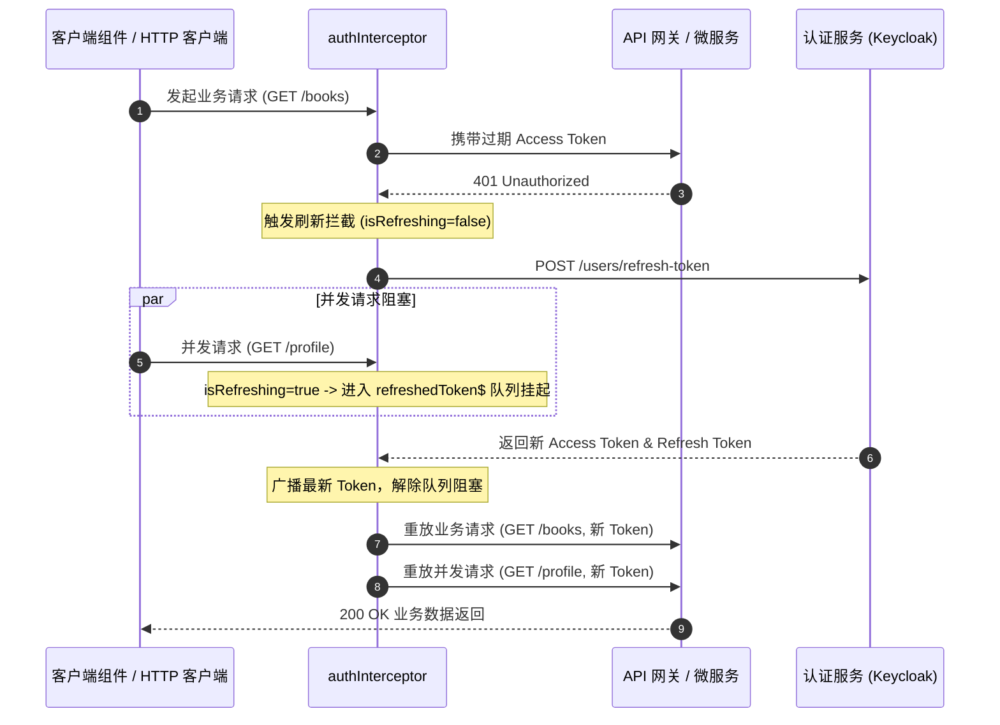

> 💡 **双栏独立滚动工作台导读**：本文采用双栏对照架构。**左栏**为核心技术决策矩阵、生产级代码范式与避坑清单；**右栏**为技术实现演化参考，并提供关键段落的英文原文展开与难词解析。左右两栏可独立滚动，并支持顶栏自定义宽度比例（7:3 / 5:5 / 3:7）与拖拽调节。

## 1. 客户端鉴权与状态架构决策矩阵

| 技术维度 | 选型方案 | 替代方案 | 决策依据 |
| :--- | :--- | :--- | :--- |
| **HTTP 驱动核心** | `provideHttpClient(withFetch())` | 传统 `XMLHttpRequest` | 原生 Fetch API 执行效率更高，天然适配流式传输与 Service Worker 环境。 |
| **持久化隔离** | 封装独立 `TokenService` | 各业务模块直接读写 `localStorage` | 集中治理存储键名，拦截 JSON 反序列化异常，并在单元测试中安全 Mock 浏览器 API。 |
| **并发刷新控制** | `BehaviorSubject` 广播队列 + `isRefreshing` 互斥标志 | 裸并发重试或单一 Promise | 避免多请求并发 401 导致重复向 Keycloak 发起 Refresh 进而触发多重会话作废机制。 |
| **会话状态自愈** | SignalStore `withHooks` (`onInit`) | 组件挂载阶段手动派发状态恢复 | 在依赖注入树初始化的第一生命周期完成持久化凭证载入，消除未登录闪烁。 |
| **路由守卫范式** | 函数式 `CanActivateFn` + `router.createUrlTree()` | 类装饰器守卫 + 命令式 `router.navigate()` | 无类样板代码，URL 树重定向在单一导航事务周期内解析，杜绝重绘竞态。 |

## 2. 生产级 HttpInterceptorFn：JWT 自动装配与并发无感刷新

```typescript
import { HttpInterceptorFn, HttpErrorResponse, HttpClient } from '@angular/common/http';
import { inject } from '@angular/core';
import { Dispatcher } from '@ngrx/signals/events';
import { BehaviorSubject, catchError, filter, switchMap, take, throwError } from 'rxjs';
import { environment } from '../../../environments/environment';
import { AuthResponse } from '../../shared/models/auth';
import { authApiEvents } from '../../features/auth/store/auth.events';
import { TokenService } from '../services/token.service';

let isRefreshing = false;
const refreshedToken$ = new BehaviorSubject<string | null>(null);

export const authInterceptor: HttpInterceptorFn = (req, next) => {
  const tokenService = inject(TokenService);
  const http = inject(HttpClient);
  const dispatcher = inject(Dispatcher);

  // 1. 白名单过滤：认证端点无需注入旧 Token
  const isAuthEndpoint =
    req.url.includes('/users/signin') ||
    req.url.includes('/users/signup') ||
    req.url.includes('/users/refresh-token');

  const skipRefreshOn401 = isAuthEndpoint || req.url.includes('/users/logout');

  // 2. 注入 Bearer Token
  let authReq = req;
  const token = tokenService.getAccessToken();
  if (token && !isAuthEndpoint) {
    authReq = req.clone({
      setHeaders: { Authorization: `Bearer ${token}` }
    });
  }

  return next(authReq).pipe(
    catchError((error: HttpErrorResponse) => {
      // 3. 拦截 401 状态码执行无感刷新
      if (error.status === 401 && !skipRefreshOn401) {
        const retryWith = (newToken: string) =>
          next(req.clone({ setHeaders: { Authorization: `Bearer ${newToken}` } }));

        // 并发互斥锁：已有刷新在途，将当前请求加入等待队列
        if (isRefreshing) {
          return refreshedToken$.pipe(
            filter((t): t is string => t !== null),
            take(1),
            switchMap(retryWith)
          );
        }

        const refreshToken = tokenService.getRefreshToken();
        if (!refreshToken) {
          dispatcher.dispatch(authApiEvents.tokenRefreshFailure({ error: 'No refresh token' }));
          return throwError(() => error);
        }

        isRefreshing = true;
        refreshedToken$.next(null);

        // 使用原始 HttpClient 发起刷新，规避重入死锁
        return http.post<AuthResponse>(`${environment.apiUrl}/user/api/users/refresh-token`, { refreshToken }).pipe(
          switchMap((res) => {
            isRefreshing = false;
            dispatcher.dispatch(authApiEvents.tokenRefreshSuccess({
              accessToken: res.accessToken,
              refreshToken: res.refreshToken
            }));
            refreshedToken$.next(res.accessToken);
            return retryWith(res.accessToken);
          }),
          catchError((refreshErr) => {
            isRefreshing = false;
            dispatcher.dispatch(authApiEvents.tokenRefreshFailure({ error: 'Session expired' }));
            return throwError(() => refreshErr);
          })
        );
      }
      return throwError(() => error);
    })
  );
};
```

## 3. NgRx SignalStore 认证状态闭环与会话自愈

```typescript
import { inject } from '@angular/core';
import { Router } from '@angular/router';
import { patchState, signalStore, withHooks, withMethods, withState } from '@ngrx/signals';
import { withReducer, on } from '@ngrx/signals/events';
import { takeUntilDestroyed } from '@angular/core/rxjs-interop';
import { Events } from '@ngrx/signals/events';
import { authApiEvents } from './auth.events';
import { TokenService } from '../../core/services/token.service';

export interface AuthState {
  user: UserInfo | null;
  accessToken: string | null;
  refreshToken: string | null;
  loading: boolean;
  error: string | null;
}

export const AuthStore = signalStore(
  { providedIn: 'root' },
  withState<AuthState>({ user: null, accessToken: null, refreshToken: null, loading: false, error: null }),
  withReducer(
    on(authApiEvents.tokenRefreshSuccess, (event) => ({
      accessToken: event.payload.accessToken,
      refreshToken: event.payload.refreshToken
    })),
    on(authApiEvents.tokenRefreshFailure, () => ({
      user: null, accessToken: null, refreshToken: null, loading: false, error: null
    }))
  ),
  withMethods((store, events = inject(Events), router = inject(Router), tokenService = inject(TokenService)) => {
    // 监听刷新成功：同步更新 localStorage
    events.on(authApiEvents.tokenRefreshSuccess).pipe(takeUntilDestroyed()).subscribe((e) => {
      tokenService.saveTokens(e.payload.accessToken, e.payload.refreshToken);
    });

    // 监听刷新失败：清除持久化数据并强制退回登录页
    events.on(authApiEvents.tokenRefreshFailure).pipe(takeUntilDestroyed()).subscribe(() => {
      tokenService.clearAll();
      router.navigate(['/auth/signin']);
    });

    return {
      isAuthenticated: () => Boolean(store.accessToken())
    };
  }),
  withHooks({
    // 页面刷新自愈钩子：恢复会话
    onInit(store) {
      const tokenService = inject(TokenService);
      const accessToken = tokenService.getAccessToken();
      const refreshToken = tokenService.getRefreshToken();
      const user = tokenService.getUser();
      if (accessToken && refreshToken && user) {
        patchState(store, { accessToken, refreshToken, user });
      }
    }
  })
);
```

## 4. 客户端鉴权与无感刷新时序拓扑



## 5. 前端鉴权避坑清单 (Do's & Don'ts)

| 错误实践 (Don't) | 正确实践 (Do) |
| :--- | :--- |
| 在拦截器内部注入封装了业务拦截链的 `AuthService` 发起刷新请求。 | 直接注入底层的原始 `HttpClient` 发起刷新端点调用，避免请求重入导致拦截器死锁。 |
| 每个并发的 401 错误均各自独立向后端发起 `/refresh-token`。 | 设立全局互斥锁与 `BehaviorSubject` 广播队列，确保单并发刷新，后续请求无感重试。 |
| 在路由守卫未通过时调用 `router.navigate(['/signin'])` 并返回 `false`。 | 返回 `router.createUrlTree(['/signin'])`，在同一路由调度事务中原子化完成重定向。 |
| 将敏感用户信息与 Token 明文分散存储且未作异常捕获。 | 通过集中式 `TokenService` 进行存取隔离，针对 `JSON.parse` 实施容错降级。 |
| 仅在前端清除 LocalStorage 即视同完成用户退出。 | 派发注销请求通知后端/Keycloak 销毁服务端 Session，并在失败时实施前端保底注销。 |

<!-- split -->

# 原著完整参考：Angular 客户端鉴权、拦截器与路由守卫

在现代微服务全栈架构中，客户端鉴权不仅要求保障通信链路的安全，更要在用户交互体验与令牌生命周期维护之间取得严格平衡。

本文将前端状态模型与微服务网关安全契约对齐，全面落实基于函数式 HTTP 拦截器的 JWT 注入、高并发透明 Token 刷新、会话持久化自愈以及基于 Signals 的函数式路由守卫。

:::en
> **Original**: Client-side authentication in modern Single Page Applications must transparently bridge stateless backend security protocols with stateful browser session management.

**📌 核心术语与语境解析**：
- **Silent Token Refresh** [ˈsaɪlənt ˈtoʊkən rɪˈfreʃ]：*无感/静默令牌刷新*。在 Access Token 过期时，由客户端在后台自动利用 Refresh Token 获取新凭证并重试原请求，用户界面不发生中断或重定向。
- **Stateless Authentication** [ˈsteɪtləs ɔːˌθentɪˈkeɪʃn]：*无状态认证*。服务端不保存会话状态，完全通过客户端持有的加密签名令牌（如 JWT）自包含验证身份。
:::

## 1. 应用级网络与渲染架构准备

在发起真实 HTTP 请求前，需要调整 Angular 应用的底层运行环境，理顺渲染模式、环境常量与网络客户端提供者。

### 1.1 服务端渲染策略调整（SSR 隔离）

服务端渲染在 Node.js 环境执行时不存在 `window`、`document` 与 `localStorage` 等全局对象。若应用在构建预渲染期直接执行依赖本地存储的代码，将触发运行时异常。在 `src/app/app.routes.server.ts` 中针对当前阶段配置按需隔离：

```typescript
import { RenderMode, ServerRoute } from '@angular/ssr';

export const serverRoutes: ServerRoute[] = [
  {
    path: '**',
    renderMode: RenderMode.Client,
  },
];
```

:::en
> **Original**: Server-Side Rendering environments lack browser-specific global objects; applications must guard or partition browser storage logic from server execution paths.

**📌 核心术语与语境解析**：
- **Execution Context** [ˌeksɪˈkjuːʃn ˈkɑːntekst]：*执行上下文*。代码当前运行的环境依赖栈，区分 Node.js 运行时与浏览器 DOM 宿主环境。
- **Prerendering Phase** [ˌpriːˈrendərɪŋ feɪz]：*预渲染阶段*。构建期离线执行组件渲染输出静态 HTML 的工程流程。
:::

### 1.2 多环境 API 端点配置与 Fetch 客户端注册

在开发与生产环境中，前端访问 API 网关的基准 URL 存在差异：本地开发直连 `http://localhost:8080`，生产环境通过同源反向代理使用 `/packt`。通过 `angular.json` 中的 `fileReplacements` 机制实现编译期动态解析。

在 `src/app/app.config.ts` 中通过 `provideHttpClient(withFetch())` 注册现代 HTTP 驱动，全面替代传统的 `XMLHttpRequest`：

```typescript
import { ApplicationConfig } from '@angular/core';
import { provideRouter } from '@angular/router';
import { provideHttpClient, withFetch, withInterceptors } from '@angular/common/http';
import { routes } from './app.routes';
import { authInterceptor } from './core/interceptors/auth.interceptor';

export const appConfig: ApplicationConfig = {
  providers: [
    provideRouter(routes),
    provideHttpClient(withFetch(), withInterceptors([authInterceptor])),
  ],
};
```

:::en
> **Original**: Modern Angular bootstrap recommends `withFetch()` to leverage the native Fetch API, providing better streaming performance and modern network primitives.

**📌 核心术语与语境解析**：
- **Fetch API** [fetʃ ˌeɪ piː ˈaɪ]：*现代浏览器原生网络接口*。相较于传统 XMLHttpRequest，具备 Promise 原生集成、流式响应处理与更优的内存开销。
- **File Replacements** [faɪl rɪˈpleɪsmənts]：*文件替换机制*。Angular CLI 在特定构建目标下将源代码文件重定向为目标环境文件的构建机制。
:::

## 2. 鉴权数据模型与持久化治理

### 2.1 契约模型与 TokenService 抽象

根据后端微服务的接口定义，用户登录成功后返回的载荷中包含 Keycloak 派发的唯一标识 `keycloakId`，而令牌刷新端点（`POST /users/refresh-token`）仅返回双 Token（Access & Refresh），不携带冗余的 User 详情。

为防止 `localStorage` 键名硬编码散落于业务逻辑中，封装集中式 `TokenService` 并对 JSON 反序列化提供异常捕获机制：

```typescript
import { Injectable } from '@angular/core';
import { UserInfo } from '../../shared/models/auth';

const ACCESS_TOKEN_KEY = 'bookstore_access_token';
const REFRESH_TOKEN_KEY = 'bookstore_refresh_token';
const USER_KEY = 'bookstore_user';

@Injectable({ providedIn: 'root' })
export class TokenService {
  saveTokens(accessToken: string, refreshToken: string): void {
    localStorage.setItem(ACCESS_TOKEN_KEY, accessToken);
    localStorage.setItem(REFRESH_TOKEN_KEY, refreshToken);
  }

  saveUser(user: UserInfo): void {
    localStorage.setItem(USER_KEY, JSON.stringify(user));
  }

  getAccessToken(): string | null {
    return localStorage.getItem(ACCESS_TOKEN_KEY);
  }

  getRefreshToken(): string | null {
    return localStorage.getItem(REFRESH_TOKEN_KEY);
  }

  getUser(): UserInfo | null {
    const raw = localStorage.getItem(USER_KEY);
    if (!raw) return null;
    try {
      return JSON.parse(raw) as UserInfo;
    } catch {
      return null;
    }
  }

  clearAll(): void {
    localStorage.removeItem(ACCESS_TOKEN_KEY);
    localStorage.removeItem(REFRESH_TOKEN_KEY);
    localStorage.removeItem(USER_KEY);
  }
}
```

:::en
> **Original**: Encapsulating browser storage within a dedicated service layer decouples components from Web Storage APIs and provides resilience against deserialization failures.

**📌 核心术语与语境解析**：
- **Web Storage API** [web ˈstɔːrɪdʒ ˌeɪ piː ˈaɪ]：*浏览器存储规范*。包含 `localStorage` 与 `sessionStorage` 的键值持久化标准。
- **Defensive Deserialization** [dɪˈfensɪv diːˌseriələˈzeɪʃn]：*防御性反序列化*。通过异常捕获保护不可靠外部输入或损坏存储数据时的程序容错设计。
:::

## 3. HTTP 拦截器与透明令牌刷新并发治理

在微服务架构中，**信任边界由 API 网关守卫**。客户端将 JWT Access Token 放入 `Authorization: Bearer <token>` 报头中。网关验证其签名真实性后，解析 Claims 并向下游微服务注入安全上下文请求头（如 `X-User-Id`）。

### 3.1 拦截器核心实现与并发锁保护

在单页面应用中，若 Access Token 过期，页面上同时触发的多个 HTTP 请求将在同一瞬间接收到 `401` 响应。如果每个 `401` 都独立触发刷新请求，将引发灾难性的并发刷新竞争（Race Condition）——某些严格的 OAuth2 / Keycloak 策略一旦检测到同一个 Refresh Token 被重复使用，会直接注销该会话。

通过引入 `isRefreshing` 互斥标志与 RxJS 的 `BehaviorSubject` 构成等待队列：
- 第一个捕获 401 的请求负责发起后端刷新；
- 后续并发的 401 挂起并等待 `refreshedToken$` 广播最新 Token，随后统一无感重试。

:::en
> **Original**: In concurrent environments, an expired token triggers multiple 401 responses simultaneously. A mutex lock with a broadcast stream queues subsequent requests until a new token is obtained.

**📌 核心术语与语境解析**：
- **Race Condition** [reɪs kənˈdɪʃn]：*竞态条件*。系统执行输出依赖于多线程或并发异步操作不可控交错时序的缺陷状态。
- **Mutex Lock** [ˈmjuːteks lɑːk]：*互斥锁*。同一时刻仅允许单一执行流进入临界区资源的同步原语。
:::

## 4. AuthService：微服务通信接入

在 HTTP 拦截器自动接管鉴权头注入后，`AuthService` 的逻辑完全解耦了请求头管理，专注于业务契约调用：

```typescript
@Injectable({ providedIn: 'root' })
export class AuthService {
  private http = inject(HttpClient);
  private baseUrl = `${environment.apiUrl}/user/api/users`;

  signin(credentials: SigninRequest): Observable<{ user: UserInfo; accessToken: string; refreshToken: string }> {
    return this.http.post<AuthResponse>(`${this.baseUrl}/signin`, credentials).pipe(
      map((response) => ({
        user: response.user!,
        accessToken: response.accessToken,
        refreshToken: response.refreshToken,
      }))
    );
  }

  signup(data: SignupRequest): Observable<void> {
    return this.http.post<{ success: boolean; message: string }>(`${this.baseUrl}/signup`, data).pipe(
      map(() => undefined)
    );
  }

  refreshToken(refreshToken: string): Observable<{ accessToken: string; refreshToken: string }> {
    return this.http.post<AuthResponse>(`${this.baseUrl}/refresh-token`, { refreshToken }).pipe(
      map((response) => ({
        accessToken: response.accessToken,
        refreshToken: response.refreshToken,
      }))
    );
  }

  logout(): Observable<void> {
    return this.http.post<{ success: boolean; message: string }>(`${this.baseUrl}/logout`, {}).pipe(
      map(() => undefined)
    );
  }
}
```

:::en
> **Original**: Abstracting HTTP operations into service classes decouples low-level network invocation details from higher-level component and state management layers.

**📌 核心术语与语境解析**：
- **Separation of Concerns** [ˌsepəˈreɪʃn əv kənˈsɜːrnz]：*关注点分离*。将系统拆分为各司其职的独立功能模块的软件工程准则。
- **Response Mapping** [rɪˈspɑːns ˈmæpɪŋ]：*响应数据规约与映射*。将传输层 DTO 裁剪变换为业务层所需精简模型的数据转换过程。
:::

## 5. NgRx SignalStore 状态流转与生命周期自愈

### 5.1 事件流与持久化副作用解耦

利用 NgRx Signals 的 `eventGroup` 声明动作事件，在 `withReducer` 中执行纯状态跃迁，在 `withMethods` 中消费事件执行外部副作用（如同步写入存储、路由跳转）。

### 5.2 页面刷新自愈：withHooks 机制

为防止用户在刷新页面时内存状态重置而丢失登录会话，利用 NgRx SignalStore 的 `withHooks` 钩子，在 Store 首次初始化的 `onInit` 生命周期中从 `TokenService` 自动恢复会话凭证。

:::en
> **Original**: SignalStore lifecycle hooks like `withHooks` allow state stores to initialize, hydrate, and synchronize with external storage without polluting UI components.

**📌 核心术语与语境解析**：
- **State Rehydration** [steɪt ˌriːhaɪˈdreɪʃn]：*状态复水/自愈*。将持久化介质中的静态数据重新灌注为运行时内存反应式状态的过程。
- **Lifecycle Hook** [ˈlaɪfsaɪkl hʊk]：*生命周期钩子*。框架在实体创建、变更或销毁等关键节点所调用的拦截机制。
:::

## 6. 函数式路由守卫（Functional Route Guards）

Angular 采用轻量且易于测试的函数式 `CanActivateFn`。配合 `router.createUrlTree()`，能够使重定向在同一导航事务周期内完成，杜绝传统 `router.navigate()` 导致的冗余重绘：

```typescript
import { inject } from '@angular/core';
import { CanActivateFn, Router } from '@angular/router';
import { AuthStore } from '../../features/auth/store/auth.store';

export const authGuard: CanActivateFn = () => {
  const store = inject(AuthStore);
  const router = inject(Router);
  return store.isAuthenticated() ? true : router.createUrlTree(['/auth/signin']);
};

export const guestGuard: CanActivateFn = () => {
  const store = inject(AuthStore);
  const router = inject(Router);
  return !store.isAuthenticated() ? true : router.createUrlTree(['/books']);
};
```

:::en
> **Original**: Functional route guards using `UrlTree` returns ensure atomic navigation transitions, eliminating intermediary route activations and state race conditions.

**📌 核心术语与语境解析**：
- **UrlTree** [ˌjuː ɑːr ˈel triː]：*URL 语法树*。Angular Router 内部对路由路径、矩阵参数与查询参数的结构化抽象表示。
- **Atomic Navigation** [əˈtɑːmɪk ˌnævɪˈɡeɪʃn]：*原子化导航*。导航状态转移在单一次事件轮询中不可分割地完成，避免闪烁或中间路由加载。
:::

## 7. 受保护的个人中心页面架构

采用「智能容器组件（Smart Component）+ 纯受控表单组件（Dumb Component）」的标准工程模式：
- **ProfileForm（Dumb 组件）**：通过 Signal-based `input()` 接收实体数据，使用 `output()` 抛出提交事件，内部通过 `effect()` 响应外界输入自适应更新表单状态；
- **Profile（Smart 组件）**：注入 `AuthService` 与全局 `AuthStore`，负责实际的网络调用、全局提示反馈与加载骨架屏管理。

:::en
> **Original**: The Smart/Dumb component pattern decouples presentation mechanics from side-effects and network orchestration, maximizing testability and component reusability.

**📌 核心术语与语境解析**：
- **Smart Component** [smɑːrt kəmˈpoʊnənt]：*智能/容器组件*。负责与服务层、状态管理通信，处理副作用并向子组件分发数据的上层组件。
- **Dumb Component** [dʌm kəmˈpoʊnənt]：*哑/展示组件*。仅依赖输入（Input）与输出（Output），专注于纯粹视图渲染与用户事件捕获的受控组件。
:::

## 8. 自动化测试矩阵

网络基础设施与安全逻辑是系统生命线，基于 `provideHttpClientTesting()` 构建零网络副作用的测试沙箱：
- 针对 `AuthService`：测试 HTTP 方法、请求载荷与契约映射正确性，校验 `httpMock.verify()` 无遗留悬挂请求；
- 针对 `TokenService`：劫持 `localStorage` 原型方法，防止测试污染；
- 针对函数式守卫：依托 `TestBed.runInInjectionContext` 提供依赖注入运行宿主环境。

:::en
> **Original**: Testing functional guards requires `TestBed.runInInjectionContext` to provide the requisite dependency injection environment without instantiating dummy components.

**📌 核心术语与语境解析**：
- **Injection Context** [ɪnˈdʒekʃn ˈkɑːntekst]：*依赖注入上下文*。Angular 中允许调用 `inject()` 动态解析服务的作用域生命周期环境。
- **Mock Controller** [mɑːk kənˈtroʊlər]：*模拟控制器*。在单元测试中拦截、校验并手动刷新 HTTP 请求的测试驱动工具。
:::
