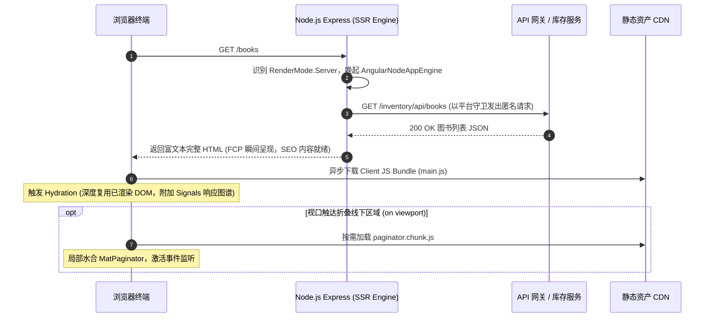

## 1. 前端渲染策略与平台适配决策矩阵

| 技术维度 | 选型方案 | 替代方案 | 决策依据 |
| :--- | :--- | :--- | :--- |
| **路由渲染分层** | 细粒度按需指派（SSR / SSG / CSR 混合） | 全站单一 CSR 或全站纯 SSR | 兼顾公开页面 SEO 与极速首屏，同时隔离私密表单免受 Node 环境缺失浏览器 API 困扰。 |
| **静态协议页面** | `RenderMode.Prerender` 构建期离线生成 | 请求期服务端动态计算渲染 | 隐私条款等极少变更的内容直接生成静态 HTML，线上分发零 CPU 算力消耗。 |
| **动态列表目录** | `RenderMode.Server` 服务端实时渲染 | 客户端异步拉取渲染（CSR） | 确保动态图书目录即时反映数据库变更，并在网络请求完成前交付富语义 HTML 结构。 |
| **跨端存储防护** | `isPlatformBrowser(inject(PLATFORM_ID))` | 裸访问 `localStorage` 或 `typeof window` | 在服务注入时完成平台环境判定并缓存，在 Node 进程中静默降级返回 `null`，消除运行时崩溃。 |
| **首屏按需水合** | `@defer (on viewport)` 延迟加载次要交互组件 | 初始 Bundle 一次性同步全量水合 | 降低首屏主线程 JavaScript 载入与解析开销，优化 INP，配合占位骨架消除布局偏移（CLS）。 |

## 2. 生产级跨平台 TokenService 封装范式

```typescript
import { Injectable, PLATFORM_ID, inject } from '@angular/core';
import { isPlatformBrowser } from '@angular/common';
import { UserInfo } from '../../shared/models/auth';

const ACCESS_TOKEN_KEY = 'bookstore_access_token';
const REFRESH_TOKEN_KEY = 'bookstore_refresh_token';
const USER_KEY = 'bookstore_user';

@Injectable({ providedIn: 'root' })
export class TokenService {
  // 注入 PLATFORM_ID 缓存运行态：Node.js 侧为 false，浏览器侧为 true
  private readonly isBrowser = isPlatformBrowser(inject(PLATFORM_ID));

  saveTokens(accessToken: string, refreshToken: string): void {
    if (!this.isBrowser) return;
    localStorage.setItem(ACCESS_TOKEN_KEY, accessToken);
    localStorage.setItem(REFRESH_TOKEN_KEY, refreshToken);
  }

  saveUser(user: UserInfo): void {
    if (!this.isBrowser) return;
    localStorage.setItem(USER_KEY, JSON.stringify(user));
  }

  getAccessToken(): string | null {
    if (!this.isBrowser) return null; // 服务端静默返回 null，拦截器据此跳过注入
    return localStorage.getItem(ACCESS_TOKEN_KEY);
  }

  getRefreshToken(): string | null {
    if (!this.isBrowser) return null;
    return localStorage.getItem(REFRESH_TOKEN_KEY);
  }

  getUser(): UserInfo | null {
    if (!this.isBrowser) return null;
    const raw = localStorage.getItem(USER_KEY);
    if (!raw) return null;
    try {
      return JSON.parse(raw) as UserInfo;
    } catch {
      return null;
    }
  }

  clearAll(): void {
    if (!this.isBrowser) return;
    localStorage.removeItem(ACCESS_TOKEN_KEY);
    localStorage.removeItem(REFRESH_TOKEN_KEY);
    localStorage.removeItem(USER_KEY);
  }
}
```

## 3. 生产级细粒度服务端路由与 `@defer` 增量水合

### 服务端路由策略定义 (`src/app/app.routes.server.ts`)

```typescript
import { RenderMode, ServerRoute } from '@angular/ssr';

export const serverRoutes: ServerRoute[] = [
  // 1. 公开动态图书目录：服务端实时渲染，确保搜索引擎可见与秒开
  {
    path: 'books',
    renderMode: RenderMode.Server,
  },
  // 2. 静态法律页面：构建期直接输出 HTML 文件，零动态计算
  {
    path: 'privacy',
    renderMode: RenderMode.Prerender,
  },
  {
    path: 'terms',
    renderMode: RenderMode.Prerender,
  },
  // 3. 私密鉴权中心与登录注册：客户端渲染，隔离 Node.js 运行时
  {
    path: 'auth/**',
    renderMode: RenderMode.Client,
  },
  {
    path: 'profile',
    renderMode: RenderMode.Client,
  },
  // 4. 全局兜底策略
  {
    path: '**',
    renderMode: RenderMode.Client,
  },
];
```

### 增量水合与骨架占位模板 (`book-list.html`)

```html
<div class="table-wrapper">
  <!-- 服务端直出的主体表格内容 -->
  <table mat-table [dataSource]="books()" class="app-table">
    <!-- 数据列定义 -->
  </table>
</div>

<div class="paginator-shell">
  <!-- 滚动触达视口时再激活并下载分页器分块 -->
  @defer (on viewport) {
    <mat-paginator
      [length]="store.totalElements()"
      [pageSize]="store.pageSize()"
      [pageIndex]="store.currentPage()"
      [pageSizeOptions]="[5, 10, 25]"
      (page)="onPageChange($event)" />
  } @placeholder {
    <!-- 固定高度占位符，严防内容突然弹入引起 CLS 抖动 -->
    <div class="paginator-placeholder"></div>
  } @loading (minimum 300ms) {
    <!-- 防闪烁微调等待指示器 -->
    <mat-spinner diameter="24" />
  } @error {
    <div class="paginator-error">Unable to load paginator</div>
  }
</div>
```

## 4. 现代 SSR 水合与事件接管时序拓扑



## 5. SSR 与水合避坑清单 (Do's & Don'ts)

| 错误实践 (Don't) | 正确实践 (Do) |
| :--- | :--- |
| 在全局服务中直接调用 `localStorage` 或 `window` 对象。 | 借助 `isPlatformBrowser(inject(PLATFORM_ID))` 评估宿主平台，在服务端实施安全降级。 |
| 在公开图书目录顶层路由挂载全局 `authGuard` 守卫。 | 开放公开浏览路由以赋能 SSR 与搜索引擎抓取，敏感写操作在视图层通过计算信号（`computed`）动态鉴权。 |
| 允许 Node SSR 接受任意 Host Header 发起的内部渲染请求。 | 在 `AngularNodeAppEngine` 构造器中严格锁定 `allowedHosts` 白名单，防范 SSRF 漏洞。 |
| 采用 `@defer` 懒加载组件时省略 `@placeholder` 占位块。 | 提供与目标组件等高的占位容器，消除异步分块加载完成后触发的累积布局偏移（CLS）。 |
| 在 SSR 运行环境下遗漏 `withFetch()` 配置。 | 显式注册 `provideHttpClient(withFetch())`，使服务端底层调用 Node 原生 fetch 发起请求。 |

<!-- split -->

# 原著完整参考：Angular 现代服务端渲染（SSR）与水合优化

在现代前端全栈工程演进中，单页应用（SPA）长久以来受制于首屏空白时间长（FCP 迟缓）与搜索引擎索引困难两大顽疾。

本文通过 Angular 现代渲染引擎 `AngularNodeAppEngine`，构建 Server、Prerender 与 Client 细粒度混合渲染体系，彻底消除浏览器专有 API 在 Node.js 宿主中的执行隐患，并借助 `@defer` 增量水合大幅优化核心 Web 体验指标。

:::en
> **Original**: Modern Angular server-side rendering integrates declarative route-level render modes with non-destructive hydration, bridging SEO visibility and instant interactivity.

**📌 核心术语与语境解析**：
- **Non-destructive Hydration** [nɑːn dɪˈstrʌktɪv haɪˈdreɪʃn]：*非破坏性水合*。客户端直接复用服务端已渲染生成的真实 DOM 结构，仅绑定事件侦听与反应式上下文，彻底避免销毁重构带来的页面白屏与布局重排。
- **First Contentful Paint (FCP)** [fɜːrst kənˈtentfl peɪnt]：*首次内容绘制*。浏览器从发起导航到屏幕上渲染出第一段文本或第一张图像所消耗的时间，衡量首屏感知速度的核心指标。
:::

## 1. Angular 现代渲染策略选型与矩阵划分

页面的 HTML 在何处、以何种时机生成与交付，决定了系统的性能与架构边界：

### 1.1 核心渲染模式界定
1. **客户端渲染（RenderMode.Client, CSR）**：
   服务端仅下发极简宿主外壳（如 `<app-root>`），浏览器下载执行全部 JavaScript 包后生成完整 DOM。适用于登录、注册、个人中心等强鉴权、高交互且免于搜索引擎检索的私密路由。
2. **服务端渲染（RenderMode.Server, SSR）**：
   Node.js 运行时动态拦截 HTTP 请求，拉起渲染引擎执行组件取数与渲染，即时下发包含完整语义与数据的真实 HTML。适用于图书目录等高动态、高时效性的公开页面。
3. **静态预渲染（RenderMode.Prerender, SSG）**：
   在 `ng build` 编译期离线渲染，将路由直接编译固化为静态 `.html` 磁盘文件。线上访问时由 Web 服务器以静态资源零算力下发。适用于隐私协议、用户条款等非高频变动的纯展示内容。

:::en
> **Original**: Granular rendering strategies assign Client, Server, or Prerender modes across routes, aligning computation costs with SEO requirements and data volatility.

**📌 核心术语与语境解析**：
- **Data Volatility** [ˈdeɪtə ˌvɑːləˈtɪləti]：*数据易变性/时效性*。业务数据在存储介质中更新的频繁程度，高频更新宜用 SSR，低频或静态宜用 SSG。
- **Static Site Generation (SSG)** [ˈstætɪk saɪt ˌdʒenəˈreɪʃn]：*静态站点生成*。在构建阶段预先计算并输出静态网页的交付范式。
:::

## 2. AngularNodeAppEngine 服务端架构与现代水合生命周期

`src/server.ts` 基于 Express 搭配 `@angular/ssr/node` 提供的引擎驱动：

```typescript
import { AngularNodeAppEngine, createNodeRequestHandler, isMainModule, writeResponseToNodeResponse } from '@angular/ssr/node';
import express from 'express';
import { join } from 'node:path';

const browserDistFolder = join(import.meta.dirname, '../browser');
const app = express();

const angularApp = new AngularNodeAppEngine({
  allowedHosts: ['localhost', '127.0.0.1'],
});

app.use(express.static(browserDistFolder, { maxAge: '1y', index: false, redirect: false }));

app.use((req, res, next) => {
  angularApp.handle(req)
    .then((response) => (response ? writeResponseToNodeResponse(response, res) : next()))
    .catch(next);
});
```

关键架构约束：
- **`allowedHosts` 防御**：严格限制允许的主机标头，阻断恶意请求头注入与 SSRF 攻击；
- **现代水合流转**：HTML 即刻呈现给用户，后台下载 Bundle 完成后，系统比对复用已有 DOM，无损激活 Signals 依赖树。

:::en
> **Original**: The `AngularNodeAppEngine` acts as an HTTP orchestrator within Node.js, compiling component views into streaming markup while guarding against Server-Side Request Forgery.

**📌 核心术语与语境解析**：
- **Server-Side Request Forgery (SSRF)** [ˈsɜːrvər saɪd rɪˈkwest ˈfɔːrdʒəri]：*服务端请求伪造*。攻击者诱使服务端向未授权的内部网路发起恶意请求的安全漏洞。
- **Markup Streaming** [ˈmɑːrkʌp ˈstriːmɪŋ]：*标记语言流式分发*。服务端以 chunk 分块流形式边生成边传输 HTML 内容的优化机制。
:::

## 3. 路由鉴权解耦与响应式操作列计算

为使书籍目录享有 SSR 带来的 SEO 收益，必须打破将全站父路由置于 `authGuard` 之下的粗暴设计。公开浏览应当完全对外敞开，敏感的写操作（新增、编辑、删除）收敛在组件内部按需授权。

在 `features/books/components/book-list/book-list.ts` 中，借助 Angular 计算信号依据登录态动态伸缩表格列定义：

```typescript
export class BookList {
  protected readonly authStore = inject(AuthStore);
  private readonly baseColumns = ['title', 'author', 'genre', 'price', 'published'];

  // 计算信号：依据当前登录态决定是否渲染操作列
  protected readonly columns = computed(() =>
    this.authStore.isAuthenticated() ? [...this.baseColumns, 'actions'] : this.baseColumns
  );
}
```

:::en
> **Original**: Decoupling route-level access controls from public catalog views allows unauthenticated crawling while dynamically toggling mutation controls using computed signals.

**📌 核心术语与语境解析**：
- **Access Decoupling** [ˈækses diːˈkʌplɪŋ]：*权限控制解耦*。将页面浏览权限与页面内部细粒度写操作权限进行分层分离的设计实践。
- **Unauthenticated Crawling** [ˌʌnɔːˈθentɪkeɪtɪd ˈkrɔːlɪŋ]：*免认证爬行抓取*。允许搜索引擎爬虫在无登录凭据状态下畅通抓取公共索引内容。
:::

## 4. 细粒度服务端路由配置与参数工厂扩展

在 `src/app/app.routes.server.ts` 中，遵循自顶向下的严格顺序，针对高频动态路由配置 `RenderMode.Server`，针对纯静态协议配置 `RenderMode.Prerender`，将鉴权中心设为 `RenderMode.Client`。

对于携带动态路由参数的场景（如 `/articles/:slug`），Angular 原生支持 `getPrerenderParams` 异步参数收集器，在构建期拉取数据库或 CMS 内容清单，批量预渲染对应的静态 HTML。

:::en
> **Original**: The `getPrerenderParams` resolver enables static pre-rendering for parameterized dynamic routes by querying content identifiers during the compilation pipeline.

**📌 核心术语与语境解析**：
- **Parameterized Route** [pəˈræmətəraɪzd ruːt]：*参数化路由*。包含动态路径变量（如 `:slug` 或 `:id`）的路由模式。
- **Prerender Parameter Resolver** [ˌpriːˈrendər pəˈræmɪtər rɪˈzɑːlvər]：*预渲染参数解析器*。构建期执行的异步函数，用于解析并返回需要离线生成的全量参数元组。
:::

## 5. 跨平台环境守卫与 TokenService 平台无关性重构

Node.js 执行环境中原生不存在 `localStorage`。若在服务端执行代码中直接触碰本地存储，会直接抛出致命的 `ReferenceError`。

通过依赖注入内置的 `PLATFORM_ID` 令牌配合 `isPlatformBrowser` 守卫函数，在服务构造阶段完成环境评估：
- 处于服务端时，`getAccessToken()` 静默返回 `null`，使得全局拦截器跳过请求头注入，以公开匿名方式发起微服务抓取；
- 处于浏览器时，恢复正常的持久化存取。

:::en
> **Original**: Environment guards inspecting the `PLATFORM_ID` token allow multi-platform services to degrade gracefully in Node.js runtime environments without runtime exceptions.

**📌 核心术语与语境解析**：
- **Platform Guard** [ˈplætfɔːrm ɡɑːrd]：*平台守卫*。依据宿主环境特征（Node.js 或 Browser DOM）动态隔离或降级特定平台专属逻辑的防御模式。
- **Graceful Degradation** [ˈɡreɪsfl ˌdeɡrəˈdeɪʃn]：*优雅降级*。在运行时环境能力缺失或异常时，系统不崩溃瘫痪而是平稳退化为安全默认行为的能力。
:::

## 6. 利用 `@defer` 语法块实现增量水合

首屏快速呈现后，为了降低初始客户端 JavaScript 包体体积并优化 INP 指标，引入 Angular 现代声明式块 `@defer`：
- **`@defer (on viewport)`**：仅当折叠线下的重型分页器滚动进入可视区域时，才触发异步分块下载与激活水合；
- **`@placeholder`**：预留等高布局容器，消除因元素突然插入引发的累积布局偏移（CLS）；
- **`@loading (minimum 300ms)`**：设定最小加载显示时长，消除弱网或极快网络下的视觉微闪烁；
- **`@error`**：提供局部分块网络异常时的容灾降级界面。

:::en
> **Original**: Angular's `@defer` blocks partition non-critical template segments into asynchronous chunks that hydrate progressively based on viewport visibility or user interaction.

**📌 核心术语与语境解析**：
- **Progressive Hydration** [prəˈɡresɪv haɪˈdreɪʃn]：*渐进式水合*。将大型单页应用按视图优先级拆分，按需、分阶段激活交互状态的精细化渲染策略。
- **Cumulative Layout Shift (CLS)** [ˈkjuːmjəleɪtɪv ˈleɪaʊt ʃɪft]：*累积布局偏移*。衡量页面可视元素在生命周期中不可预期突变移动程度的核心 Web 体验指标。
:::

## 7. 终端验证与平台隔离测试实践

在交付阶段，通过命令行 `curl` 抓取验证裸 HTML 结构中已内嵌服务端渲染出的图书列表；在浏览器中禁用 JavaScript 验证离线首屏呈现可用性。

在测试工程中，通过 Vitest 显式提供 `{ provide: PLATFORM_ID, useValue: 'server' }`，针对平台守卫在无浏览器环境下的纯粹性、以及组件在 SSR 状态下的无错渲染实施严格的自动化断言验证。

:::en
> **Original**: Automated SSR testing validates that platform tokens can be decoupled within headless test harnesses to verify both server degradation and template integrity.

**📌 核心术语与语境解析**：
- **Headless Test Harness** [ˈhedləs test ˈhɑːrnɪs]：*无头测试框架/驱动套件*。不依赖图形用户界面或实体浏览器窗口即可运行单元测试并校验执行行为的测试沙箱。
- **Template Integrity** [ˈtempleɪt ɪnˈteɡrəti]：*模板完整性*。组件视图结构在不同编译目标与运行环境下载荷无缺损、语义合规的稳定性保证。
:::
