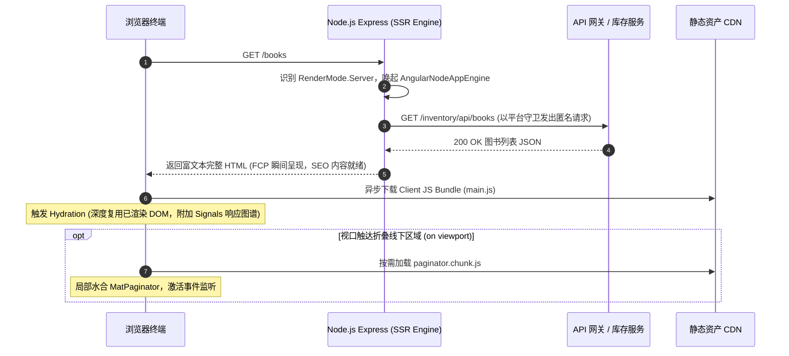

## 1. 前端渲染策略与平台适配决策矩阵

| 技术维度 | 选型方案 | 替代方案 | 决策依据 |
| :--- | :--- | :--- | :--- |
| **路由渲染分层** | 细粒度按需指派（SSR / SSG / CSR 混合） | 全站单一 CSR 或全站纯 SSR | 兼顾公开页面 SEO 与极速首屏，同时隔离私密表单免受 Node 环境缺失浏览器 API 困扰。 |
| **静态协议页面** | `RenderMode.Prerender` 构建期离线生成 | 请求期服务端动态计算渲染 | 隐私条款等极少变更的内容直接生成静态 HTML，线上分发零 CPU 算力消耗。 |
| **动态列表目录** | `RenderMode.Server` 服务端实时渲染 | 客户端异步拉取渲染（CSR） | 确保动态图书目录即时反映数据库变更，并在网络请求完成前交付富语义 HTML 结构。 |
| **跨端存储防护** | `isPlatformBrowser(inject(PLATFORM_ID))` | 裸访问 `localStorage` 或 `typeof window` | 在服务注入时完成平台环境判定并缓存，在 Node 进程中静默降级返回 `null`，消除运行时崩溃。 |
| **首屏按需水合** | `@defer (on viewport)` 延迟加载次要交互组件 | 初始 Bundle 一次性同步全量水合 | 降低首屏主线程 JavaScript 载入与解析开销，优化 INP，配合占位骨架消除布局偏移（CLS）。 |

## 2. 生产级跨平台 TokenService 封装范式

```typescript
import { Injectable, PLATFORM_ID, inject } from '@angular/core';
import { isPlatformBrowser } from '@angular/common';
import { UserInfo } from '../../shared/models/auth';

const ACCESS_TOKEN_KEY = 'bookstore_access_token';
const REFRESH_TOKEN_KEY = 'bookstore_refresh_token';
const USER_KEY = 'bookstore_user';

@Injectable({ providedIn: 'root' })
export class TokenService {
  // 注入 PLATFORM_ID 缓存运行态：Node.js 侧为 false，浏览器侧为 true
  private readonly isBrowser = isPlatformBrowser(inject(PLATFORM_ID));

  saveTokens(accessToken: string, refreshToken: string): void {
    if (!this.isBrowser) return;
    localStorage.setItem(ACCESS_TOKEN_KEY, accessToken);
    localStorage.setItem(REFRESH_TOKEN_KEY, refreshToken);
  }

  saveUser(user: UserInfo): void {
    if (!this.isBrowser) return;
    localStorage.setItem(USER_KEY, JSON.stringify(user));
  }

  getAccessToken(): string | null {
    if (!this.isBrowser) return null; // 服务端静默返回 null，拦截器据此跳过注入
    return localStorage.getItem(ACCESS_TOKEN_KEY);
  }

  getRefreshToken(): string | null {
    if (!this.isBrowser) return null;
    return localStorage.getItem(REFRESH_TOKEN_KEY);
  }

  getUser(): UserInfo | null {
    if (!this.isBrowser) return null;
    const raw = localStorage.getItem(USER_KEY);
    if (!raw) return null;
    try {
      return JSON.parse(raw) as UserInfo;
    } catch {
      return null;
    }
  }

  clearAll(): void {
    if (!this.isBrowser) return;
    localStorage.removeItem(ACCESS_TOKEN_KEY);
    localStorage.removeItem(REFRESH_TOKEN_KEY);
    localStorage.removeItem(USER_KEY);
  }
}
```

## 3. 生产级细粒度服务端路由与 `@defer` 增量水合

### 服务端路由策略定义 (`src/app/app.routes.server.ts`)

```typescript
import { RenderMode, ServerRoute } from '@angular/ssr';

export const serverRoutes: ServerRoute[] = [
  // 1. 公开动态图书目录：服务端实时渲染，确保搜索引擎可见与秒开
  {
    path: 'books',
    renderMode: RenderMode.Server,
  },
  // 2. 静态法律页面：构建期直接输出 HTML 文件，零动态计算
  {
    path: 'privacy',
    renderMode: RenderMode.Prerender,
  },
  {
    path: 'terms',
    renderMode: RenderMode.Prerender,
  },
  // 3. 私密鉴权中心与登录注册：客户端渲染，隔离 Node.js 运行时
  {
    path: 'auth/**',
    renderMode: RenderMode.Client,
  },
  {
    path: 'profile',
    renderMode: RenderMode.Client,
  },
  // 4. 全局兜底策略
  {
    path: '**',
    renderMode: RenderMode.Client,
  },
];
```

### 增量水合与骨架占位模板 (`book-list.html`)

```html
<div class="table-wrapper">
  <!-- 服务端直出的主体表格内容 -->
  <table mat-table [dataSource]="books()" class="app-table">
    <!-- 数据列定义 -->
  </table>
</div>

<div class="paginator-shell">
  <!-- 滚动触达视口时再激活并下载分页器分块 -->
  @defer (on viewport) {
    <mat-paginator
      [length]="store.totalElements()"
      [pageSize]="store.pageSize()"
      [pageIndex]="store.currentPage()"
      [pageSizeOptions]="[5, 10, 25]"
      (page)="onPageChange($event)" />
  } @placeholder {
    <!-- 固定高度占位符，严防内容突然弹入引起 CLS 抖动 -->
    <div class="paginator-placeholder"></div>
  } @loading (minimum 300ms) {
    <!-- 防闪烁微调等待指示器 -->
    <mat-spinner diameter="24" />
  } @error {
    <div class="paginator-error">Unable to load paginator</div>
  }
</div>
```

## 4. 现代 SSR 水合与事件接管时序拓扑



## 5. SSR 与水合避坑清单 (Do's & Don'ts)

| 错误实践 (Don't) | 正确实践 (Do) |
| :--- | :--- |
| 在全局服务中直接调用 `localStorage` 或 `window` 对象。 | 借助 `isPlatformBrowser(inject(PLATFORM_ID))` 评估宿主平台，在服务端实施安全降级。 |
| 在公开图书目录顶层路由挂载全局 `authGuard` 守卫。 | 开放公开浏览路由以赋能 SSR 与搜索引擎抓取，敏感写操作在视图层通过计算信号（`computed`）动态鉴权。 |
| 允许 Node SSR 接受任意 Host Header 发起的内部渲染请求。 | 在 `AngularNodeAppEngine` 构造器中严格锁定 `allowedHosts` 白名单，防范 SSRF 漏洞。 |
| 采用 `@defer` 懒加载组件时省略 `@placeholder` 占位块。 | 提供与目标组件等高的占位容器，消除异步分块加载完成后触发的累积布局偏移（CLS）。 |
| 在 SSR 运行环境下遗漏 `withFetch()` 配置。 | 显式注册 `provideHttpClient(withFetch())`，使服务端底层调用 Node 原生 fetch 发起请求。 |

<!-- split -->
在上一章中，我们完成了作者和图书的完整 CRUD 交互层，通过事件驱动的状态仓库将第 14 章构建的表单全面对接至真实的后端 API。作者管理特性完全由手工打造，而图书管理则通过 AI 辅助复现了这一成熟范式。我们没有为作者建立独立的路由页面，而是把作者列表安放在一个从图书页弹出的对话框中，通过优雅的弹窗堆叠在单个路由内实现了全功能的 CRUD 交互体验。

然而，我们从第 16 章起就背负着一笔架构妥协的技术债务：应用中的所有路由都被强制在客户端（Client）单侧渲染。我们当时做出这一权衡，是因为认证流程高度依赖于仅在浏览器中存在的 API（如 `localStorage`），如果在服务端预渲染阶段遇到这些原生 API，渲染流程会直接崩溃报错。

在本章中，我们将彻底偿还这笔技术债。我们将配置细粒度的按路由渲染策略（Per-route Rendering Strategies），让图书目录充分享受服务端渲染（SSR）带来的 SEO 索引优化、首屏内容渲染（First Contentful Paint, FCP）加速以及用户感官性能提升；与此同时，要求登录的鉴权页面则继续停留在它们应属的客户端渲染模式。在此过程中，我们将深入剖析 Angular 现代水合模型（Hydration Model），学习如何严密防范特定于浏览器的代码执行，并借助 `@defer` 延迟加载块实现渐进式增量水合。

本章我们将涵盖以下主题：

- 理解 Angular 中的渲染策略
- 深入探索 Angular 的 SSR 架构
- 为 SSR 改造准备应用路由
- 配置路由级渲染模式
- 实现水合机制与治理浏览器专有代码
- 利用延迟加载实现渐进式水合
- 测试与验证 SSR 渲染输出

> **注意**
>
> 本书中的部分界面截图在排版中可能细节较小。我们保留这些截图是因为它们真实反映了运行界面，便于你在自己的屏幕上对照操作。你也可以在本书《前言》提供的随书资源包链接中查看并放大所有高清原图。

## 技术要求

本章的完整源码可在此处获取：

`https://github.com/PacktPublishing/Spring-Boot-and-Angular-2E_Frontend/tree/main/chapter-18/`

请确保你在第 10 章配置的 Docker Compose 环境已正常运行，因为本章中我们将持续对库存微服务（Inventory Microservice）发起真实的 API 请求。前端应用将直接与运行在 `http://localhost:8080` 的 API 网关通信，网关在后台负责将请求反向代理至用户微服务与库存微服务。

## 理解 Angular 中的渲染策略

在动手编写代码之前，先建立对 Angular 所支持的三大渲染策略的清晰心智模型。每种策略决定了一个路由的 HTML 是在何时、何地生成的，而最佳的选择取决于所呈现内容的固有属性。

### 客户端渲染（Client-Side Rendering, CSR）

在**客户端渲染**模式下，服务器向浏览器发送一个极其简化的 HTML 外壳——本质上是一个空白的 `<app-root>` 标签。浏览器随后下载 JavaScript 代码包，启动 Angular 运行时，并在浏览器内存中从头构建并渲染完整的页面 DOM。这正是我们在第 16 章设置 `RenderMode.Client` 兜底规则后整个应用一直在运行的方式。

CSR 非常适用于高度动态交互、针对特定用户的个性化页面，这类页面的内容无法在构建期甚至无法在无状态服务器上预先得知。我们的登录、注册、个人资料以及各种 CRUD 表单弹窗都属于这一类别：它们依赖保存在 `localStorage` 中的认证凭证，且对登录表单进行预渲染并没有任何 SEO 收益。其代价在于性能：在 JavaScript 代码包完成下载、解析和执行之前，用户看到的只能是白屏或加载旋转指示器。在弱网环境或低算力移动设备上，这种等待延迟会尤为明显。

### 服务端渲染（Server-Side Rendering, SSR）

在**服务端渲染**模式下，服务器在收到每个 HTTP 请求时实时执行 Angular 运行时，生成该路由对应的完整静态 HTML，并立即返回给浏览器。用户无需等待任何 JavaScript 加载，就能瞬间在屏幕上看到结构与内容完备的有意义页面。当 JavaScript 脚本包随后在后台下载就绪后，Angular 会对服务端渲染出来的 HTML 进行**水合（Hydrate）**：为现有的 DOM 节点挂载事件监听器并激活响应式状态，将静态页面无缝升级为具备完整交互能力的活单页应用。

SSR 是动态公共页面的理想之选，它能兼顾极速的首屏内容呈现与搜索引擎爬虫索引。以书店的图书目录为例，图书的标题、作者、封面与介绍信息应当能够完整暴露给搜索引擎爬虫和社交媒体的链接抓取器。

### 静态预渲染（Static Site Generation, SSG）

静态预渲染是在项目构建期（Build Time）而非请求到达时生成 HTML。在执行 `ng build` 期间，Angular 会在本地离线运行每一个配置好的路由，输出对应的静态 HTML 文件，并在部署后由 Web 服务器直接托管分发。每个请求到达时不需要服务端进行任何计算开销，HTML 现成可用。

对于部署后内容不再变动的页面，这是性能最高的极致之选：例如产品落地页、用户协议、隐私政策或者内容固定的营销站点。

### 为每个路由量身定制最佳策略

核心认知在于：你绝不需要在整个应用层面上对单一策略做“非此即彼”的全局抉择。Angular 现代的 `RenderMode` 枚举允许你为每个路由分别指定最适合的策略。我们的书店系统拥有非常天然的业务划分：

- 公共且内容密集的展示路由（图书目录 `book catalog`）应当采用 SSR，以实现优质的 SEO 和快速的首屏渲染（即浏览器在屏幕上画出第一笔有效内容的瞬间）；
- 涉及具体用户身份的高交互路由（登录、注册、个人中心）更适合 CSR，因为它们深度依赖浏览器存储且没有任何 SEO 诉求；
- 纯静态说明路由（落地页或隐私政策/条款页面）应当采用 Prerender 预渲染，以获得极致的响应速度。

这种“按路由量身定制”的策略，正是我们接下来要落地实现的核心方案。

## 深入探索 Angular 的 SSR 架构

当我们在第 11 章使用 Angular CLI 初始化项目时，针对 SSR 提示选择了“Yes”，CLI 便自动生成了若干文件，它们一直静默存放在工程中。在对其进行配置之前，先理清每个文件的角色职责。

### 服务端启动入口

`src/server.ts` 是 SSR 服务的 Node.js 入口文件。它利用来自 `@angular/ssr/node` 的 `AngularNodeAppEngine` 引擎来监听并处理入站 HTTP 请求，在 Node.js 服务端实时渲染 Angular 路由。以下是 CLI 生成并经过我们微调补充的基础结构：

```typescript
import {
  AngularNodeAppEngine,
  createNodeRequestHandler,
  isMainModule,
  writeResponseToNodeResponse,
} from '@angular/ssr/node';
import express from 'express';
import { join } from 'node:path';

const browserDistFolder = join(import.meta.dirname, '../browser');
const app = express();

const angularApp = new AngularNodeAppEngine({
  allowedHosts: ['localhost', '127.0.0.1'],
});

app.use(express.static(browserDistFolder, {
  maxAge: '1y', index: false,
  redirect: false,
}));
app.use((req, res, next) => {
  angularApp.handle(req)
    .then((response) =>
      response ? writeResponseToNodeResponse(response, res) : next()
    )
    .catch(next);
});
if (isMainModule(import.meta.url) || process.env['pm_id']) {
  const port = process.env['PORT'] || 4000;
  app.listen(port, (error) => {
    if (error) {
      throw error;
    }
    console.log(`Node Express server listening on
      http://localhost:${port}`);
  });
}
export const reqHandler = createNodeRequestHandler(app);
```

> **注意**
>
> 这里的 `allowedHosts` 选项并不是 CLI 默认脚手架的一部分。Angular 的 SSR 服务端为了防止服务端请求伪造（SSRF）攻击，默认会严厉拒绝来自未识别 Host 头的请求；如果不显式加上这一行，生产服务甚至会直接拦截普通的 localhost 请求。我们在此处将其明确配置，以保证本章中的所有演示用例能够端到端顺畅运行；第 20 章将详细讨论该防护机制背后的安全考量以及面向真实生产部署时的规范配置。

该文件的核心要点如下：

- `AngularNodeAppEngine` 是 SSR 的核心渲染引擎。它接收底层的 HTTP 请求，匹配目标渲染路由，驱动 Angular 渲染流水线，并返回拼接好的 HTML 响应。
- `express.static` 中间件用于分发预构建的前端静态资源（JavaScript chunks、CSS、图片），并配置了长效缓存请求头。`index: false` 选项能够防止 Express 直接越俎代庖发送静态的 `index.html`，把页面的生成权交由 Angular 引擎调度。
- 最后的 `app.use()` 处理器将所有未命中静态文件的请求委派给 `angularApp.handle()`，由其在服务端动态渲染对应的 Angular 路由。

对于我们的业务开发，通常不需要改动这个文件。渲染行为完全由接下来要配置的路由级规则统一控制。

### 服务端路由配置文件

`src/app/app.routes.server.ts` 是我们声明每个路由具体采用何种渲染策略的核心阵地。我们在第 16 章中曾修改过该文件，强制所有路由回退至 CSR：

```typescript
import { RenderMode, ServerRoute } from '@angular/ssr';

export const serverRoutes: ServerRoute[] = [
  {
    path: '**',
    renderMode: RenderMode.Client,
  },
];
```

`ServerRoute` 接口接收一个 `path`（与 `app.routes.ts` 中的前端客户端路由相对应）以及一个取自 `RenderMode` 枚举的 `renderMode`。通配符 `**` 充当保底回退规则；任何未在上方显式声明的路由都会继承该渲染模式。

接下来我们将用精细化的按路由配置替换这一粗暴的一刀切设置。不过在此之前，先系统梳理一次 SSR 路由请求发生时的底层完整时序。

### SSR、水合与客户端的协同流程

当用户访问一个启用了 SSR 的路由时，系统会经历如下步骤：

1. 浏览器向 Node.js Express 服务器发起 HTTP 请求。
2. `AngularNodeAppEngine` 捕获该请求，在 Node.js 环境下启动轻量 Angular 实例，执行组件初始化逻辑，并在服务端异步解析获取数据。
3. 服务器将生成完毕的完整 HTML 文本直接推流回传给浏览器。用户屏幕瞬间呈现出完整内容。
4. 浏览器在后台并行下载 Angular 的 JavaScript 运行时包。
5. Angular 启动**水合（Hydration）**流程：遍历服务端渲染生成的现有 DOM 树，将每个 DOM 节点精确匹配到组件树中的对应组件，挂载事件监听器，激活动态数据绑定。

> **注意**
>
> 水合是现代 SSR 彻底区别于传统“服务端生成一次，客户端完全推翻重画”笨拙模式的核心分水岭。Angular 不再销毁并重新创建 DOM，而是直接复用服务端已经渲染出的现有节点，这从根本上杜绝了页面白屏闪烁（Layout Flicker），并完好保留了用户的滚动位置和焦点状态。

6. 从此时起，应用无缝过渡为标准的单页应用（SPA），后续的所有页面跳转和路由切换均完全由客户端路由拦截处理，不再向 Node 服务端重新请求整页 HTML。

### withFetch() 的关键角色

我们此前编写的 HTTP 配置中，有一行代码在还没运行 SSR 之前就已经在默默地为服务端运行做准备了。在上面的步骤 2 中，Node 端的 Angular 实例需要执行组件逻辑并拉取数据，而此时 `withFetch()` 的作用至关重要。早在第 16 章，我们在 `app.config.ts` 中配置了 `provideHttpClient(withFetch(), withInterceptors([…]))`。这里的 `withFetch()` 指示 `HttpClient` 全局改用现代浏览器和 Node.js 原生支持的 Fetch API，而非古老的 `XMLHttpRequest`。这是 SSR 能够成功运行的生命线，因为 Node.js 服务端根本不存在 `XMLHttpRequest` 对象。若缺少 `withFetch()`，服务端渲染期间发起的任何 `HttpClient` 调用都会直接发生未捕获异常，Angular 在检测到 SSR 环境缺少该配置时也会在终端抛出明确警告。

理解了完整的生命周期并确保了 `withFetch()` 就绪后，SSR 基础设施已万事俱备。接下来我们对现有的路由体系进行改造适配。

## 为 SSR 改造准备应用路由

在正式配置渲染模式之前，我们的路由结构需要做出两处针对性的改造。

首先，在第 16 章中我们将 `authGuard` 挂载在 `/books` 父路由上，这意味着任何对 `/books` 的请求都会把未登录的访客强制重定向至登录页。这对 SSR 而言是致命的：当搜索引擎爬虫或首次访问的匿名读者请求 `/books` 时，服务端执行该守卫发现没有 JWT 令牌，就会立刻重定向到 `/auth/signin`，导致图书目录完全无法被预渲染或被搜索引擎收录。为了让 SSR 释放其业务价值，图书目录必须对公众完全开放浏览。这也是现实工业级应用的通用惯例：任何人都可以自由浏览商品目录，但只有登录用户才能执行新增、编辑或删除等管理写操作。因为我们所有的 CRUD 操作都是基于弹窗（Dialog）实现的，因此我们可以把权限校验从“路由级”下沉到“组件展示级”。

其次，我们在第 11 章添加到页面底部的 `/privacy`（隐私政策）和 `/terms`（服务条款）链接目前依然指向 404 虚无页面。我们顺手将其构建为精简的静态组件，作为 SSG 静态预渲染的最佳实战载体。

### 新增用于预渲染的静态页面

使用 CLI 快速生成两个轻量组件，采用内联模板与内联样式即可：

```bash
ng generate component pages/privacy --inline-template --inline-style
ng generate component pages/terms --inline-template --inline-style
```

这两个组件包含简单的说明段落，完整示例代码可在随书仓库的 `chapter-18/src/app/pages` 中找到。你会发现它们复用了全局样式中的 `.page-container` 与 `.page-header` 类，保持了与第 16 章个人中心页面一致的视觉质感。具体的文本内容包裹在 `styles.scss` 定义的 `.legal-content` 通用样式类中。

同时，更新 `src/app/shared/layout/footer/footer.html` 中的底部链接，改用 Angular 原生的 `routerLink` 指令代替原生的 `href` 属性，使其参与客户端路由调度，避免触发整页硬刷新：

```html
<footer>
  <mat-toolbar color="primary" class="footer">
    <span class="footer-text">© 2026 Packt Publishing</span>
    <span class="spacer"></span>
    <a mat-button routerLink="/privacy"
       aria-label="View privacy policy">Privacy</a>
    <a mat-button routerLink="/terms"
       aria-label="View terms of service">Terms</a>
  </mat-toolbar>
</footer>
```

请在 Footer 组件的 `imports` 数组中引入 `RouterLink`，同时在组件单测中通过 `provideRouter([])` 补充路由测试环境。

### 更新路由配置表

现在我们在 `src/app/app.routes.ts` 中落实这两处改动——移除 `/books` 上的 `authGuard` 并注册新的静态页面：

```typescript
import { Routes } from '@angular/router';
import { authGuard, guestGuard } from './core/guards/auth.guard';

export const routes: Routes = [
  { path: '', redirectTo: 'books', pathMatch: 'full' },
  {
    path: 'books',
    // 移除 authGuard —— 目录面向公众开放自由浏览
    loadChildren: () =>
      import('./features/books/books.routes').then(m => m.routes)
  },
  {
    path: 'auth',
    canActivate: [guestGuard],
    loadChildren: () =>
      import('./features/auth/auth.routes').then(m => m.routes)
  },
  {
    path: 'profile',
    canActivate: [authGuard],
    loadComponent: () =>
      import('./features/profile/pages/profile/profile').then(
        m => m.Profile
      )
  },
  {
    path: 'privacy',
    loadComponent: () =>
      import('./pages/privacy/privacy').then(
        m => m.Privacy
      )
  },
  {
    path: 'terms',
    loadComponent: () =>
      import('./pages/terms/terms').then(
        m => m.Terms
      )
  },
];
```

这里移除了 `/books` 路由上的 `canActivate: [authGuard]`，并为 privacy 和 terms 注册了基于独立组件的懒加载路由。`/auth` 保持 `guestGuard`（防止已登录用户重复访问登录页），`/profile` 保持 `authGuard`（必须登录）。

> **注意**
>
> 从 `/books` 根路由移除 `authGuard` 意味着其下的整个路由子树默认都成为公开页面。如果未来在 `/books` 路径下增加子路由（如图书详情、批量导入或后台管理面板），它们若不加防范也会被匿名访问。从现在开始，守卫决策下沉至子路由层面：对于 `/books` 之下不希望公开的特定子路由，必须显式附加 `canActivate: [authGuard]`。

### 在图书列表模板中保护 CRUD 操作按钮

公开图书路由后，我们必须确保只有已登录的认证用户才能看到 **Add New Book** 和 **Authors** 管理按钮。更新 `features/books/pages/list/list.html` 中的头部操作区，对按钮进行条件渲染：

```html
<div class="page-header-full">
  <h1>Book Catalog</h1>
  @if (authStore.isAuthenticated()) {
    <div class="header-actions">
      <button mat-stroked-button
              (click)="openAuthorManagement()">
        <mat-icon>people</mat-icon>
        Authors
      </button>
      <button mat-raised-button color="primary"
              (click)="openCreateDialog()">
        <mat-icon>add</mat-icon>
        Add New Book
      </button>
    </div>
  }
</div>
```

对于匿名访客，`authStore.isAuthenticated()` 计算信号返回 `false`，管理按钮完全不渲染。而图书表格本身对所有人完整可见。

在 `features/books/pages/list/list.ts` 中注入 `AuthStore`：

```typescript
protected readonly authStore = inject(AuthStore);
```

紧接着，将该模式应用到 `book-list` 组件的 `mat-table` 操作列上，因为该列包含编辑与删除按钮。我们将单元格内容包裹在 `@if (authStore.isAuthenticated())` 中，使匿名用户只能看数据而无操作按钮。同时将表格的 `columns` 定义改造为计算信号（computed signal），使表头与行数据能够动态响应身份状态。在 `features/books/components/book-list/book-list.ts` 中：

```typescript
protected readonly authStore = inject(AuthStore);
private readonly baseColumns = ['title', 'author', 'genre',
  'price', 'published'];
protected readonly columns = computed(() =>
  this.authStore.isAuthenticated() ? [...this.baseColumns,
    'actions'] : this.baseColumns
);
```

在模板 `book-list.html` 中绑定该 `columns()` 信号。由于后端的 `GET /inventory/api/books` 端点本身就是公开接口，无需携带令牌，因此即便是匿名请求，`BookStore` 的加载处理器也能顺利取回图书目录。我们在第 16 章构建的拦截器在发现本地无 Token 时会自动发起不带 `Authorization` 头的干净请求。

下图展示了图书列表页面在已登录用户（左侧）与未登录匿名访客（右侧）视角下的差异：


*Figure 18.1: The books page as it looks for logged-in and anonymous users*

注意，`columns` 信号被声明为 `protected`，因为它只被该组件自身的模板所消费。如果此时运行组件单测，直接读取 `columns` 属性的断言会报访问控制错误。切忌为了迎合单测而破坏封装性去放大可见性；应当更新测试用例，改为断言用户在界面上实际可见的元素——表头单元格：

```typescript
const headerCells = fixture.debugElement.queryAll(
  By.css('th[mat-header-cell]')
);
expect(
  headerCells.map((cell) => cell.nativeElement.textContent.trim())
).toEqual(['Title', 'Author', 'Genre', 'Price', 'Published']);
```

这一断言不受组件内部重构的影响，且精确检验了我们真正关心的业务表现：匿名访问者只能看到 5 列数据，且绝无操作列。访问修饰符应当由真正的调用者边界决定，而不是迁就测试代码的便利。

路由改造完毕且组件能自适应兼顾两类用户后，我们可以正式配置渲染模式了。

## 配置路由级渲染模式

现在我们打开 `src/app/app.routes.server.ts`，用严谨的路由渲染映射表替换原有的通配符 CSR。我们盘点应用的整体路由拓扑并为其匹配对应策略：

| 路由路径 | 呈现内容 | 渲染模式（Render Mode） | 选型依据 |
| --- | --- | --- | --- |
| /books | 图书目录（mat-table） | Server (SSR) | SEO 索引收录、首屏极速呈现、公开内容 |
| /privacy | 隐私政策（静态内容） | Prerender (SSG) | 纯静态文本、无需动态拉取数据 |
| /terms | 服务条款（静态内容） | Prerender (SSG) | 纯静态文本、无需动态拉取数据 |
| /auth/signin | 登录表单 | Client (CSR) | 依赖本地 localStorage 状态、无 SEO 价值 |
| /auth/signup | 注册表单 | Client (CSR) | 依赖本地 localStorage 状态、无 SEO 价值 |
| /profile | 用户个人资料页 | Client (CSR) | 仅对认证用户开放、高度个性化数据 |

*表 18.1：根据内容类型划分的路由渲染策略*

三种渲染模式各展所长：

- 图书目录采用 SSR，因为随着图书的增删改，其数据具有高度动态性；
- 隐私与条款页面采用 Prerender，因为其内容在构建期就已完全固化：Angular 在 `ng build` 期间为它们一次性生成纯静态 HTML，服务器直接无损极速分发，零计算开销；
- 认证与个人中心路由保持 CSR。

请注意，正如我们在第 17 章所实现的，所有针对图书和作者的增删改查操作均通过图书列表页唤起的 `MatDialog` 完成。系统中并不存在 `/books/new`、`/books/:id/edit` 或 `/authors/*` 这样的独立路由。这些对话框会自然继承打开它们的宿主页面（图书列表）的渲染环境，且由于弹窗属于客户端动态挂载的悬浮层，无论宿主页面是由服务端渲染生成还是在客户端生成的，弹窗的展现与交互机制完全一致。

如果未来后端能够提供一个无需鉴权的单本图书查询接口，那么图书详情页将是应用 `RenderMode.Server` 的绝佳候选：包含书名、简介与作者详情的单本图书页是搜索引擎极度渴望抓取的高价值载体。目前库存 API 中仅有图书列表和标题搜索端点面向公众开放，因此目录页是当前唯一的 SSR 路由。

### 更新服务端路由配置代码

将*表 18.1*的设计契约落地到代码中。更新 `src/app/app.routes.server.ts`：

```typescript
import { RenderMode, ServerRoute } from '@angular/ssr';

export const serverRoutes: ServerRoute[] = [
  // 公共内容路由 —— 服务端实时渲染，兼顾 SEO 与首屏性能
  {
    path: 'books',
    renderMode: RenderMode.Server,
  },
  // 静态页面 —— 构建时预渲染为静态 HTML
  {
    path: 'privacy',
    renderMode: RenderMode.Prerender,
  },
  {
    path: 'terms',
    renderMode: RenderMode.Prerender,
  },
  // 认证与高度交互路由 —— 纯客户端渲染
  {
    path: 'auth/**',
    renderMode: RenderMode.Client,
  },
  {
    path: 'profile',
    renderMode: RenderMode.Client,
  },
  // 兜底回退规则
  {
    path: '**',
    renderMode: RenderMode.Client,
  },
];
```

声明的先后顺序至关重要：Angular 会**从上至下（Top-down）**对服务器路由进行模式匹配，并采用首个命中的规则。`books` 路由最先匹配并在每次收到请求时在服务端动态渲染；`privacy` 与 `terms` 在构建期由 Angular 生成一次静态 HTML，生产服务器直接返回现成文件；`auth/**` 通配符同时拦截 `/auth/signin` 与 `/auth/signup`；剩余的任何未知路径一律落入底部的 CSR 兜底规则中。

根路径 `/` 在前端路由中直接重定向到 `/books`，因此由 books 服务端路由统一承接主页落地体验。

`RenderMode.Server` 与 `RenderMode.Prerender` 之间的差异必须牢记：图书目录使用 `Server` 是因为数据时效性强，每次请求都要根据数据库现状组装最新 HTML；静态条款页使用 `Prerender` 是因为文本硬编码在模板中，只有重新打包部署时才会变动。

> **注意**
>
> 如果你在此刻直接启动 SSR 服务，应用会立刻崩溃并抛出 `localStorage is not defined` 异常。这完全在预料之中：因为在服务端渲染期间，拦截器发起的请求同样会触发 `TokenService.getAccessToken()`，而 Node.js 环境下根本没有 `localStorage`。我们将在下一节中使用 `isPlatformBrowser` 对 `TokenService` 进行环境隔离来彻底修复它。

### 参数化动态路由的预渲染

我们的隐私与条款页面的路径是完全固定的。但如果是需要静态预渲染带有动态参数的路由（例如 `/articles/:slug`），Angular 提供了 `getPrerenderParams` 函数支持：

```typescript
{
  path: 'articles/:slug',
  renderMode: RenderMode.Prerender,
  async getPrerenderParams() {
    try {
      const articles = await fetchPublishedArticles();
      return articles.map((article) => ({ slug: article.slug }));
    } catch {
      return [];
    }
  },
}
```

Angular 会在 `ng build` 期间执行该函数，并为返回的每一个参数组合生成对应的静态 HTML。这对于博客系统、文档库或固定上架的商品目录非常有用。在真实生产中，这个函数会调用 CMS 或数据库拉取全量 Slug 清单。请注意，这意味着在执行 `ng build` 时存在外部网络调用，若外部服务宕机，构建流水线就会报错中断。上面的示例中通过 try/catch 降级为空数组，避免中断构建。具体是“允许构建跳过并交付缺损页面”还是“直接让构建报错阻断”，取决于具体业务的容灾决策。

路由规则已全部确立，接下来我们必须确保在服务端执行的代码能够安全脱离浏览器环境独立运行。

## 实现水合机制与治理浏览器专有代码

既然图书目录被配置为在服务端动态执行，我们就必须直面最棘手的跨端运行问题：应用中包含依赖浏览器专有特性的代码，尤其是读写 `localStorage` 的 `TokenService`，如果直接暴露在 Node.js 中会引发严重异常。我们必须制定稳健的环境隔离方案。

### Angular 的水合机制

在配置了 SSR 的项目中，Angular 默认开启无损水合（Hydration）。在水合阶段，Angular 不会把页面推倒重画，而是自顶向下遍历服务端早已就位的真实 DOM 树，将每个 DOM 节点与组件树的对应节点精确绑定，并激活事件监听。这一过程完全自动化，无需手动干预。这使得用户可以毫秒级看到服务端输出的页面骨架与文字，而随着 JS 包的到位，页面在毫无闪烁和抖动的情况下平滑变活。

### 防护浏览器专有 API

最常见的 SSR 踩坑点就是直接在服务端执行代码中调用 `localStorage`、`sessionStorage`、`window` 或 `document`。Angular 提供了两把利剑来阻断这种风险：用于生命周期初始化的 `afterNextRender`，以及用于逻辑分支判断的 `isPlatformBrowser`。

`afterNextRender` 回调只会在浏览器端、且在 Angular 首次完成该组件的完整渲染后才会执行。它是存放一切依赖浏览器原生 DOM API 初始化代码的绝佳归宿：

```typescript
import { Component, afterNextRender } from '@angular/core';

@Component({ ... })
export class SomeComponent {
  constructor() {
    afterNextRender(() => {
      // 在此处安全调用 localStorage、window 或 document
      const theme = localStorage.getItem('theme');
      document.body.classList.add(theme ?? 'light');
    });
  }
}
```

而在服务（Service）或常规方法内部，我们需要根据当前的宿主运行环境进行动态逻辑分支，这时 Angular 的 `isPlatformBrowser` 实用工具就能提供毫秒级运行时判定：

```typescript
import { Injectable, PLATFORM_ID, inject } from '@angular/core';
import { isPlatformBrowser } from '@angular/common';

@Injectable({ providedIn: 'root' })
export class StorageService {
  private platformId = inject(PLATFORM_ID);

  getValue(key: string): string | null {
    if (!isPlatformBrowser(this.platformId)) {
      return null;
    }
    return localStorage.getItem(key);
  }
}
```

### 为 TokenService 注入 isPlatformBrowser 防护

既然图书目录要在服务端执行渲染，那么由服务端发起的 `BookService.getPaged()` 同样会流经 HTTP 拦截器，进而触发 `TokenService` 的调用。在 Node.js 中不存在 `localStorage`，我们必须对所有操作进行守卫。更新 `src/app/core/services/token.service.ts`：

```typescript
import { Injectable, PLATFORM_ID, inject } from '@angular/core';
import { isPlatformBrowser } from '@angular/common';
import { UserInfo } from '../../shared/models/auth';

const ACCESS_TOKEN_KEY = 'bookstore_access_token';
const REFRESH_TOKEN_KEY = 'bookstore_refresh_token';
const USER_KEY = 'bookstore_user';

@Injectable({ providedIn: 'root' })
export class TokenService {
  private isBrowser = isPlatformBrowser(inject(PLATFORM_ID));

  saveTokens(accessToken: string, refreshToken: string): void {
    if (!this.isBrowser) return;
    localStorage.setItem(ACCESS_TOKEN_KEY, accessToken);
    localStorage.setItem(REFRESH_TOKEN_KEY, refreshToken);
  }

  saveUser(user: UserInfo): void {
    if (!this.isBrowser) return;
    localStorage.setItem(USER_KEY, JSON.stringify(user));
  }

  getAccessToken(): string | null {
    if (!this.isBrowser) return null;
    return localStorage.getItem(ACCESS_TOKEN_KEY);
  }

  getRefreshToken(): string | null {
    if (!this.isBrowser) return null;
    return localStorage.getItem(REFRESH_TOKEN_KEY);
  }

  getUser(): UserInfo | null {
    if (!this.isBrowser) return null;
    const raw = localStorage.getItem(USER_KEY);
    if (!raw) return null;
    try {
      return JSON.parse(raw) as UserInfo;
    } catch {
      return null;
    }
  }

  clearAll(): void {
    if (!this.isBrowser) return;
    localStorage.removeItem(ACCESS_TOKEN_KEY);
    localStorage.removeItem(REFRESH_TOKEN_KEY);
    localStorage.removeItem(USER_KEY);
  }
}
```

相较于第 16 章，唯一的改动是引入了 `isPlatformBrowser` 以及缓存布尔标记 `this.isBrowser`。该变量在依赖注入初始化时仅评估一次并被后续所有方法复用。在服务端执行时，`getAccessToken()` 恒定返回 `null`，因此拦截器发往 `/books` 的请求不会携带任何认证头，这与该端点作为公共接口的定位高度吻合。而在浏览器端，一切原样运行。

读者可能会顾虑：将 `this.isBrowser` 缓存在实例属性中是否安全？服务端的 `false` 是否会在水合后污染客户端？答案是绝无可能。服务端与浏览器分别运行在两个物理隔离的独立 Angular 应用实例与 DI 容器中。服务端创建的 `TokenService`（`isBrowser` 为 `false`）在 HTML 渲染完成后就随着进程垃圾回收而被销毁；当浏览器在前端引导启动时，它会重新创建一个全新的、全新的 `TokenService` 实例（此时 `isBrowser` 为 `true`）。水合过程复用的是 DOM 元素树，绝不会跨进程复用服务端内存里的服务实例。因此将其缓存不仅绝对安全，而且比在每次方法调用时重复解析平台 ID 具有更高的性能。

消除了运行时崩溃隐患后，我们就可以把精力从“保证可用”升级为“性能调优”了。`@defer` 延迟加载块能让我们精细调控页面各区域的水合时机。

## 利用延迟加载实现渐进式水合

Angular 的 `@defer` 控制块允许我们将模板中次要区域的加载和水合推迟到真正需要时再进行。这在 SSR 页面中尤为强大：它使首屏下发的静态 HTML 极度精简，将庞大复杂的交互模块留待后续按需渐进式加载。

### @defer 的工作原理

`@defer` 会包裹模板的特定代码块。Angular 编译器在打包时会自动把被包裹的组件及其依赖拆分为一个完全独立的**异步 JavaScript Chunk**，只有在设定的触发条件（Trigger）被满足时才会发起网络请求下载该代码包。在此之前，页面展示由占位块提供。支持的核心触发器包括：

- `on viewport`：当元素进入视口可视范围时触发（极适合“首屏折叠线以下”的内容）；
- `on interaction`：当用户与占位元素发生交互（如点击、聚焦）时触发；
- `on hover`：当鼠标悬停在占位区域上方时触发；
- `on timer(duration)`：经过指定的时间延迟后触发；
- `on idle`：当浏览器处于空闲帧时静默触发。

关于 `on viewport` 需要了解一个细节：该触发器在元素进入可视区的一瞬间就会触发，这也包含初次渲染时。如果一个页面非常短（例如测试数据库里只有三两本书），整个分页器直接露在首屏视口之内，那么它的代码包会在页面一打开时立即加载，起不到延迟效果。这一行为完全正确，纯粹是因为内容太少未形成折叠区；一旦表格上方的内容足够长、将分页器挤出第一屏视口，延迟加载的威力就会立即显现。

### 延迟加载图书分页器

随着书库藏书的增长，在单个页面上平铺所有图书是不现实的。`BookStore` 已经在第 17 章中实现了完整的 `currentPage`、`pageSize`、`totalElements` 和 `totalPages` 状态跟踪，但我们此前并未在图书列表模板中摆放分页器控件。这是一个绝佳的优化切入点：分页器位于表格最底部，是纯粹的强交互组件，首屏预渲染根本不需要它。搜索引擎关心的只是表格里的图书名录与作者，而不是底下那排翻页按钮。

首先在 `book-list.ts` 的 `imports` 中加入 `MatPaginator` 和 `MatProgressSpinnerModule`，从 `@angular/material/paginator` 导入 `PageEvent`，注入 `BookStore` 和事件派发器，并编写翻页回调：

```typescript
protected readonly store = inject(BookStore);
protected readonly dispatch = injectDispatch(bookPageEvents);

onPageChange(event: PageEvent) {
  this.dispatch.loadBooks({
    page: event.pageIndex,
    size: event.pageSize,
  });
}
```

随后在 `features/books/components/book-list/book-list.html` 中，紧跟在表格外层容器 `</div>` 后面加入分页器，并将其包裹在基于视口触发的 `@defer` 块中：

```html
<div class="table-wrapper">
  <table mat-table [dataSource]="books()"
         class="mat-elevation-z8 app-table">
    <!-- ... 列定义 ... -->
  </table>
</div>
<div class="paginator-shell">
  @defer (on viewport) {
    <mat-paginator
      [length]="store.totalElements()"
      [pageSize]="store.pageSize()"
      [pageIndex]="store.currentPage()"
      [pageSizeOptions]="[5, 10, 25]"
      (page)="onPageChange($event)" />
  } @placeholder {
    <div class="paginator-placeholder"></div>
  } @loading (minimum 300ms) {
    <mat-spinner diameter="24" />
  } @error {
    <div class="paginator-placeholder paginator-error">
      Unable to load paginator
    </div>
  }
</div>
```

`paginator-shell` 容器为延迟块提供了稳定的外边距约束。其中的 `@placeholder`（占位块）预先撑开物理高度，防止分页器插入时页面发生剧烈的布局跳动（CLS 恶化）。占位块是放置骨架屏（Skeleton Screen）的绝佳位置。`@loading (minimum 300ms)` 的设计非常巧妙：它能防止在网速极快时加载指示器闪烁一瞬造成刺眼感，只在代码块加载耗时真正超过 300ms 时才展示旋转进度条。

> **注意**
>
> `@error` 块负责在网络抖动、CDN 故障或代码包下载失败时提供兜底呈现。对于分页器而言，由于首屏的图书数据早已由服务端渲染完毕，即使分页组件偶发加载失败也不会让整页瘫痪，因此兜底块展示一行精简的错误提示。对于核心区域的内容，`@error` 是保障应用不出现空白黑洞的关键护栏。

至此，SSR 图书页的性能架构非常干净：服务端输出第一页完整的 `<table>` HTML 标签供爬虫抓取并瞬间呈现给读者；分页器的独立 JavaScript 代码包仅在用户向下滚动到表格底部时才会被激活下载。在高速网络下它几乎瞬间显现；在慢速网络下，占位块稳定支撑布局，加载动画平滑指引用户。

### 性能收益与 Core Web Vitals

延迟加载通过代码切片直接压缩了首屏初始 JavaScript 的体积。与 SSR 强强联合后，用户能在瞬息之间看到由服务端直出的完整图书内容；客户端首屏仅需下载用于路由调度和基础水合的核心逻辑，诸如分页器等重型交互组件则完全按需延后加载。这种架构模式能对 Google 核心 Web 指标（Core Web Vitals）带来质的提升：**最大内容绘制**（LCP）直接受益于服务端直出的 HTML，而**下次绘制交互**（INP）则因初始主线程执行压力的骤减而大幅改善。

完成所有配置后，我们对其进行系统性的验证与测试。

## 测试与验证 SSR 渲染输出

配置完毕后，我们需要全面检验 SSR 是否按预期生效。

### 启动 SSR 本地开发服务器

在开发模式下，Angular 的 `ng serve` 命令（通过 `npm run start` 唤起）会以 SSR 模式启动开发服务器，并使用包含绝对网关地址（`http://localhost:8080/packt`）的 `environment.ts` 配置。这使得 `BookStore` 在服务端执行渲染时能够无障碍地访问到微服务网关：

```bash
npm run start
```

本地服务默认运行在 `http://localhost:4200`，SSR 处于活跃状态。我们建议在开发调试阶段始终使用 `ng serve`，而不是直接执行生产打包 `ng build` + `node`。因为生产环境配置使用的是相对路径（`/packt`），在没有反向代理介入的情况下，SSR Node 进程会将其解析到自身端口而非 8080 端口，从而导致接口请求失败并返回一张空表。

相对路径是面向生产设计的：在生产部署时，前端与 API 会共同置于 Nginx 反向代理之后，相对路径即可完美协同解析。我们将在第 21 章中对这一生产拓扑进行完整编排。

### 使用 curl 审视服务端生成的原生 HTML

检验 SSR 是否真正生效最简便直接的办法，是在尚未执行任何前端 JavaScript 之前用命令行工具拉取并检查原始 HTML。保持开发服务运行，开启新终端输入：

```bash
curl http://localhost:4200/books
```

如果 SSR 运转正常，你在终端看到的将是一份内容饱满的 HTML 代码——包含真正的 `<table>` 结构以及书名、作者与价格数据，而绝非仅仅一个孤零零的空白 `<app-root></app-root>`。

另一种直观验证方式是在浏览器中打开开发者工具，在设置中彻底勾选“Disable JavaScript”（禁用 JavaScript），然后强制刷新页面。你会惊喜地发现：即便浏览器完全剥离了运行 JS 的能力，页面依然图文并茂、结构整齐，这坚实地证明了所有的 HTML 都是在 Node.js 服务端实时渲染生成的。

肉眼观察对于排查很直观，但在持续集成中我们需要程序化校验。如果数据请求报错，服务端依然会返回带有外壳的 200 OK 空表格。我们可以通过在输出流中 grep 某本已知图书的标题来进行严谨断言：

```bash
curl -s http://localhost:4200/books | grep -c "Clean Code"
```

如果统计计数为 0，说明页面虽然输出了外壳，但数据未能成功渲染。本书仓库中提供了 `scripts/verify-ssr.sh` 脚本，它正是封装了这一校验逻辑，在发现缺少预期书籍时直接退出并报错。


*Figure 18.2: The books page as it looks when JavaScript is disabled*

你会注意到分页器并没有出现，这完全符合设计，因为它是被 `@defer` 保护并留待客户端动态拉取的。同时观察搜索框：搜索框的输入框 HTML 节点完整呈现，因为它是服务端模板的一部分，但在 JavaScript 脚本包完全水合就绪之前，输入文字不会触发搜索过滤逻辑。水合机制的使命正是抹平这一“静态展示”到“动态可操作”的过渡期。尝试用 curl 分别请求预渲染的 `/privacy` 页面和纯客户端渲染的 `/auth/signin` 页面：你会发现 privacy 响应包含完整的法律声明正文，而 signin 路由返回的则是一个包含空白 `<app-root>` 的极小外壳。

### 借助 AI 辅助编写 SSR 单元测试

借鉴第 16 章的经验，我们可以提示 Copilot 生成针对服务端环境隔离的测试用例。首先对更新后的 `TokenService` 建立测试屏障：

```
Write a Vitest test for TokenService that verifies all methods return null or do
nothing when isPlatformBrowser returns false. Use TestBed with PLATFORM_ID
overridden to a server platform.
```

审查生成的 `token.service.spec.ts` 时，重点确认：

- 在 TestBed 的 providers 中使用 `{ provide: PLATFORM_ID, useValue: 'server' }` 准确覆盖了平台类型；
- 全面覆盖了各方法的断言：`getAccessToken()`、`getRefreshToken()` 和 `getUser()` 必须返回 `null`，而 `saveTokens()`、`saveUser()` 和 `clearAll()` 必须安全执行且不抛异常；
- 确认没有真正去调用浏览器的 `localStorage`。

随后，针对图书列表在服务端环境下的渲染建立测试：

```
Write a Vitest test that verifies the book list component renders without errors
when PLATFORM_ID is set to server. Mock the BookStore to return sample data and
the AuthStore to return isAuthenticated as false
```

该测试逻辑较为微妙，重点核对：

- 将 `BookStore` 和 `AuthStore` 作为 Mock 提供者注入，并提供基于信号的返回值（例如为图书列表提供 `signal([…])`，为 `isAuthenticated` 提供 `signal(false)`）；
- 确认测试使用的是 `await fixture.whenStable()`，以契合我们在第 11 章确立的无 Zone（Zoneless）架构，而非传统的 `fixture.detectChanges()`；
- 断言组件在渲染表格时排除了所有管理按钮（因为此时处于匿名未认证态），并且绝无任何 `localStorage` 未定义的报错。

运行测试套件进行终验：

```bash
npm run test:run
```

所有测试无暇通过。

## 本章小结

在本章中，我们通过细致配置按路由渲染策略，彻底解决了第 16 章遗留下来的客户端全量渲染技术债。我们首先将权限控制从路由级下沉到组件级，使图书目录能够面向公众自由浏览；这是工业级系统兼顾内容展示与写权限隔离的标准实践。随后我们打造了隐私与条款页面，并在同一个项目中完整实践了三大渲染模式：图书目录依托服务端渲染（SSR）获得 SEO 与极速首屏优势；法律条款页依托静态预渲染（SSG）实现零开销极速分发；核心认证路由继续采用客户端渲染（CSR）。我们深入探讨了 Angular 的无损水合模型，并借助 `isPlatformBrowser` 守卫彻底消除了 `TokenService` 在 Node 环境下触碰 `localStorage` 的崩溃隐患。最后，我们利用 `@defer` 控制块将分页器剥离为按需加载的异步代码块，优化了首屏体积与核心 Web 性能指标。

我们的应用现在拥有了极具韧性与生产水准的渲染架构。在接下来的第 19 章中，我们将引入 Server-Sent Events（SSE）技术，为图书目录赋予全自动感知的实时数据更新能力。
