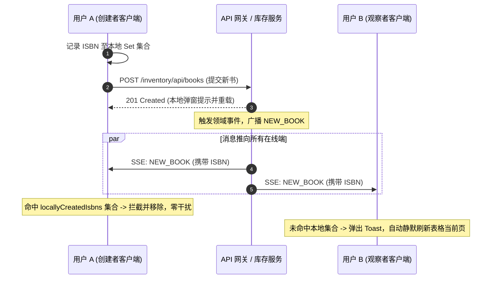

## 1. 实时通信架构决策矩阵

| 技术维度 | 选型方案 | 替代方案 | 决策依据 |
| :--- | :--- | :--- | :--- |
| **实时通信协议** | Server-Sent Events (SSE) | WebSocket / 短轮询 (Polling) | 业务为服务端向客户端单向广播；复用标准 HTTP 基础设施与网关，原生支持断线自愈重连。 |
| **SSR 宿主守卫** | `isPlatformBrowser` 判定为 false 时直接 `complete()` | 服务端尝试建立连接或抛异常 | Node.js 运行时缺少原生 `EventSource`，服务端阶段立即完成流，杜绝渲染挂起与致命报错。 |
| **事件路由分发** | `addEventListener('NEW_BOOK', ...)` | 原生 `eventSource.onmessage` | 后端采用具名事件推送；利用浏览器底层事件总线直接过滤，避免应用层进行无意义的类型判断。 |
| **连接断线重试** | `onerror` 仅记录日志，严禁调用 `subscriber.error()` | 遇到网络中断直接触发 error 终结流 | 触发 `subscriber.error` 将导致 RxJS 流彻底报废，保留由浏览器内核执行自动指数退避重连。 |
| **自反事件去重** | 客户端 Set 记录规范化 ISBN 进行自创建抑制 | 仅依赖服务端过滤或忽略重复 | 消除本端提交成功后的重复弹窗与二次重载，消除网络延迟带来的视图抖动。 |

## 2. 生产级 NotificationService：RxJS EventSource 封装范式

```typescript
import { Injectable, PLATFORM_ID, inject } from '@angular/core';
import { isPlatformBrowser } from '@angular/common';
import { Observable } from 'rxjs';
import { environment } from '../../../../environments/environment';
import { BookNotification } from '../../../shared/models/notification';

@Injectable({ providedIn: 'root' })
export class NotificationService {
  private readonly platformId = inject(PLATFORM_ID);
  private readonly streamUrl = `${environment.apiUrl}/inventory/api/notifications/stream`;

  /**
   * 建立 SSE 响应式数据流连接
   */
  connect(): Observable<BookNotification> {
    return new Observable<BookNotification>((subscriber) => {
      // 1. SSR 平台环境防护：Node.js 环境直接完成，防止找不到 EventSource
      if (!isPlatformBrowser(this.platformId)) {
        subscriber.complete();
        return;
      }

      // 2. 初始化浏览器原生 EventSource
      const eventSource = new EventSource(this.streamUrl);

      // 3. 定向监听后端广播的 NEW_BOOK 具名事件
      eventSource.addEventListener('NEW_BOOK', (event: Event) => {
        try {
          const messageEvent = event as MessageEvent;
          const parsed = JSON.parse(messageEvent.data) as BookNotification;
          subscriber.next(parsed);
        } catch (error) {
          console.error('[NotificationService] SSE JSON parse error:', error);
        }
      });

      // 4. 容错处理：切勿调用 subscriber.error()，以便保留浏览器原生重连机制
      eventSource.onerror = () => {
        console.warn('[NotificationService] SSE connection interrupted. Browser will reconnect...');
      };

      // 5. 资源清理回收：当外部 Observable 发生取消订阅时关闭 TCP 长连接
      return () => {
        eventSource.close();
      };
    });
  }
}
```

## 3. 消费端闭环：生命周期绑定、自创建去重与搜索防冲刷

```typescript
import { Component, DestroyRef, OnInit, inject } from '@angular/core';
import { takeUntilDestroyed } from '@angular/core/rxjs-interop';
import { MatDialog } from '@angular/material/dialog';
import { MatSnackBar } from '@angular/material/snack-bar';
import { injectDispatch } from '@ngrx/signals/events';
import { BookStore } from '../../store/book-store/book.store';
import { bookPageEvents } from '../../store/book-store/book.events';
import { NotificationService } from '../../services/notification.service';
import { BookForm } from '../../components/book-form/book-form';

export class List implements OnInit {
  protected readonly store = inject(BookStore);
  protected readonly dispatch = injectDispatch(bookPageEvents);
  private readonly dialog = inject(MatDialog);
  private readonly snackBar = inject(MatSnackBar);
  private readonly notificationService = inject(NotificationService);
  private readonly destroyRef = inject(DestroyRef);

  // 本地已提交待确认的 ISBN 白名单（用于自发推送拦截）
  private readonly locallyCreatedIsbns = new Set<string>();

  ngOnInit(): void {
    this.dispatch.loadBooks({ page: 0, size: 10 });

    // 订阅实时事件流，绑定组件生命周期
    this.notificationService
      .connect()
      .pipe(takeUntilDestroyed(this.destroyRef))
      .subscribe((notification) => {
        const normalizedIsbn = notification.isbn ? this.normalizeIsbn(notification.isbn) : null;

        // 核心自反去重：若通知源于本地刚刚提交的创建操作，静默消费并退出
        if (normalizedIsbn && this.locallyCreatedIsbns.has(normalizedIsbn)) {
          this.locallyCreatedIsbns.delete(normalizedIsbn);
          return;
        }

        // 外部新书推送提示
        this.snackBar.open(`📚 New book added: ${notification.bookTitle}`, 'Dismiss', { duration: 5000 });

        // 搜索态保护：非搜索模式下方自动重载列表，避免冲刷用户当前查询结果
        if (!this.store.isSearching()) {
          this.dispatch.loadBooks({
            page: this.store.currentPage(),
            size: this.store.pageSize(),
          });
        }
      });
  }

  openCreateDialog(): void {
    const dialogRef = this.dialog.open(BookForm, { width: '560px' });
    dialogRef.afterClosed().subscribe((result) => {
      if (result) {
        this.locallyCreatedIsbns.add(this.normalizeIsbn(result.isbn));
        this.dispatch.createSubmitted(result);
        this.snackBar.open('Book created successfully', 'Close', { duration: 3000 });
      }
    });
  }

  private normalizeIsbn(isbn: string): string {
    return isbn.replace(/[-\s]/g, '');
  }
}
```

## 4. SSE 广播与自发事件拦截时序拓扑



## 5. SSE 实时通信避坑清单 (Do's & Don'ts)

| 错误实践 (Don't) | 正确实践 (Do) |
| :--- | :--- |
| 在 `eventSource.onerror` 回调中调用 `subscriber.error(err)`。 | 仅输出警告日志，保留浏览器原生指数退避自动重连能力，避免流永久冻结。 |
| 未针对 SSR 平台进行隔离，导致在 Node.js 中执行 `new EventSource()`。 | 注入 `PLATFORM_ID` 校验，在非浏览器宿主中直接调用 `subscriber.complete()` 正常终结。 |
| 忽略组件销毁生命周期，未进行长连接注销清理。 | 在 Observable Teardown 中执行 `eventSource.close()`，并搭配 `takeUntilDestroyed` 自动取消订阅。 |
| 客户端收到新书推送时不假思索强行重置刷新分页列表。 | 判断 `isSearching()` 状态，若用户正处于搜索筛选状态，则保留当前视图仅作通知提示。 |
| 缺乏客户端去重机制，用户自身创建数据后被自己的 SSE 消息二次弹窗干扰。 | 引入 Correlation Key（如标准化 ISBN）集合，对本地触发的异步回环事件实施静默拦截。 |

<!-- split -->
在上一章中，我们为应用配置了服务端渲染（SSR）策略，使图书目录面向搜索引擎公开以优化 SEO，并利用 `@defer` 控制块实现了分页器的延迟加载。我们的应用现在已经能够在服务端动态渲染、构建期静态预渲染以及客户端按需渲染之间高效协同。然而，所有的页面交互依然严格遵循传统的“请求-响应”单向循环：用户创建了一本书，列表从服务端拉取刷新；但如果有另一位用户也创建了一本书，第一位用户在主动手动刷新页面之前是完全无法感知的。

在本章中，我们将引入**服务端发送事件**（**Server-Sent Events, SSE**）为系统赋予实时推送能力，使图书目录在有新书添加时，能够自动为所有在线连接的客户端弹出通知并近实时刷新图书列表。

本章我们将涵盖以下主题：

- 理解服务端发送事件（SSE）
- 构建 NotificationService
- 将实时更新集成至图书列表
- 抑制针对自身的冗余通知
- 测试实时通知业务流

## 技术要求

本章的完整源码可在此处获取：

`https://github.com/PacktPublishing/Spring-Boot-and-Angular-2E_Frontend/tree/main/chapter-19/`

请确保你在第 10 章配置的 Docker Compose 微服务环境处于正常运行状态。库存微服务对外暴露了一个位于 `/inventory/api/notifications/stream` 的 SSE 流端点，每当有新书入库或价格变动时就会向该通道广播事件。你可以在终端中执行以下命令来预先验证该端点的连通性：

```bash
curl -N -H "Accept: text/event-stream" http://localhost:8081/inventory/api/notifications/stream
```

保持该终端窗口常驻运行。

随后，打开另一个终端窗口或通过 Postman，向 `/inventory/api/books` 发送 POST 请求创建一本新书；你会立即在运行 `curl` 的终端中看到一条事件推送输出。这在我们将前端 Angular 代码接入之前，充分验证了后端 SSE 事件推送通道的可用性。

需要说明的是，后端微服务会发布两类事件：在创建新书时发布 `NEW_BOOK`，以及通过 PATCH 修改价格时发布 `PRICE_CHANGE`。在本章中，我们聚焦于 `NEW_BOOK` 事件，因为新增图书正是我们前端已经实现的完整 CRUD 操作之一。`PRICE_CHANGE` 遵循完全相同的数据拓扑，如果你后续计划扩展价格更新功能，完全可以套用相同的模式进行处理。

## 理解服务端发送事件

在着手编写代码之前，先弄清 SSE 的工作机制，以及为什么相较于 WebSockets 或短轮询（Polling），它更适合当前的业务场景。服务端发送事件（SSE）是标准的 W3C 浏览器规范，允许服务器通过单条长连接 HTTP 通道向客户端单向推送事件流。与提供全双工通信（客户端与服务端可双向自由收发数据）的 WebSockets 不同，SSE 是严格单向的：服务器负责推送，客户端只管监听。这种高度克制的单向性恰恰是其最大的架构优势。

我们的通知业务场景本质上是纯单向的：服务器在有新书加入时广播通知所有读者，而客户端绝不需要通过这个同一条通道向服务端回传任何数据。这使得 SSE 成为天造地设的选择。现代浏览器原生的 `EventSource` API 对 SSE 提供了开箱即用的支持，甚至包含底层自动重连机制：若网络偶然断开，浏览器会在后台全自动尝试重连，无需编写一行额外的业务兜底代码。SSE 的传输协议极其精简，采用 `text/event-stream` 内容类型，每条事件由若干以冒号分隔的键值对行组成，事件之间以空行分隔。以下是一条原始的 SSE 事件在网络链路中的真实形态：

```
id:a8780704-9799-46b4-84dc-9431d7db5f19
event: NEW_BOOK
data: {"eventType":"NEW_BOOK","bookId":42,"bookTitle":"Clean Code","isbn":"9780132350884", …other fields}
```

当库存微服务收到新建图书的 POST 请求后，便会向流中广播此事件。我们在 Angular 侧将对其进行强类型建模，并在收到事件时弹出轻量级消息提示（Toast/SnackBar）以及全自动刷新本地图书列表。

SSE 连接与其他 API 请求一样流经 API 网关。网关的路由规则（`/packt/inventory/api/**`）能够透明地将 SSE 长连接反向代理给库存服务。不过需要注意，浏览器原生的 `EventSource` 不支持自定义 HTTP 请求头，这意味着无法在建立 SSE 握手时附加 JWT 鉴权头。但这对我们来说完全不是问题：通知流端点被设计为公开免认证通道，它广播的书目更新本就是公开信息，这与我们在第 18 章确立的“图书目录面向全网公开浏览”的决策完全契合。理清了 SSE 的底层原理后，我们开始在 Angular 侧实现具体的客户端接入。

## 定义通知模型

在构建服务或编写任何 UI 代码之前，我们需要定义一个表示后端推送载荷的 TypeScript 接口。这为后续所有模块提供了强类型的契约保障。创建 `src/app/shared/models/notification.ts`：

```typescript
export interface BookNotification {
  eventType: 'NEW_BOOK';
  bookId: number;
  bookTitle: string;
  isbn?: string;
}
```

`BookNotification` 接口精准提炼了前端真正消费的字段：用于事件类型匹配的 `eventType`、用于标识书籍的 `bookId`、用于轻量提示文案的 `bookTitle`，以及用于抑制自发自收通知（本章后文实现）的 `isbn`。

后端推过来的 JSON 载荷中其实还包含了 `eventData` 等携带作者和售价明细的属性，但由于我们在收到通知后会直接向后端重新拉取完整的分页列表，因此在通知载荷中无需解析这些冗余信息。模型定义完毕后，我们着手编写生产该模型的服务层。

## 构建 NotificationService

`NotificationService` 将把浏览器原生的 `EventSource` API 封装为一个 RxJS Observable，使其能够与我们现有的事件驱动状态架构无缝组合。由于我们在第 18 章启用了 SSR，我们必须防范在 Node.js 服务端渲染期间误调用 `EventSource`，依然采用针对 `TokenService` 使用过的 `isPlatformBrowser` 守卫模式。

使用 CLI 生成该服务：

```bash
ng generate service features/books/services/notification.service
```

更新 `src/app/features/books/services/notification.service.ts`。该服务对外暴露唯一的 `connect()` 方法，返回 `Observable<BookNotification>`。在其内部，它会向后端的 SSE 端点建立 `EventSource` 连接，监听名为 `NEW_BOOK` 的特定事件，解析消息体并推送给流的订阅者。当外部取消订阅时，清理回调（Teardown function）会优雅关闭底层连接。在服务端宿主环境中，该 Observable 会直接触发完成（complete），避免触碰不存在的原生 API：

```typescript
import { Injectable, PLATFORM_ID, inject } from '@angular/core';
import { isPlatformBrowser } from '@angular/common';
import { Observable } from 'rxjs';
import { environment } from '../../../../environments/environment';
import { BookNotification } from '../../../shared/models/notification';

@Injectable({ providedIn: 'root' })
export class NotificationService {
  private platformId = inject(PLATFORM_ID);
  private streamUrl = `${environment.apiUrl}/inventory/api/notifications/stream`;

  connect(): Observable<BookNotification> {
    return new Observable<BookNotification>((subscriber) => {
      if (!isPlatformBrowser(this.platformId)) {
        subscriber.complete();
        return;
      }
      const eventSource = new EventSource(this.streamUrl);
      eventSource.addEventListener('NEW_BOOK', (event: Event) => {
        try {
          const parsed = JSON.parse((event as MessageEvent).data);
          subscriber.next(parsed as BookNotification);
        } catch (error) {
          console.error('Failed to parse notification:', error);
        }
      });
      eventSource.onerror = () => {
        console.warn('SSE connection error. Reconnecting...');
      };
      return () => {
        eventSource.close();
      };
    });
  }
}
```

关于该服务，有几个关键设计要点值得深入探讨：

- 后端将每条通知作为具名事件（Named SSE Event）推送，因此服务通过 `addEventListener('NEW_BOOK', ...)` 监听特定事件，而非绑定通用的 `onmessage`。根据 SSE 标准规范，带有 `event: ...` 字段的消息只会被分发给监听该特定名称的回调，而 `onmessage` 仅用于接收未命名的普通事件。按名监听使得服务天然过滤掉不关心的杂音事件（例如 `PRICE_CHANGE`），无需在回调内部手动 `if` 筛选。
- `isPlatformBrowser` 守卫确保了在 SSR 期间返回一个立即完成（complete）的 Observable，彻底杜绝了 `EventSource is not defined` 异常的发生。
- 我们刻意没有在 `onerror` 处理器中调用 `subscriber.error()`。SSE 在遭遇网络抖动或服务端微服务重启时发生断连是完全正常的网络现象，`EventSource` 底层会自动执行静默重连。如果在此处向 Observable 发出 `error()`，会导致整个 RxJS 流直接宣告终结并彻底停止后续的通知接收。
- 清理回调 `return () => eventSource.close()` 保证了当所有订阅者退订时，底层的长连接能够被及时关闭，防止客户端与服务端产生内存泄漏与死连接堆积。

> **注意**
>
> 我们的应用从第 11 章起就采用全新的无 Zone（Zoneless）变更检测架构。在传统的 Zone.js 应用中，`EventSource` 的异步回调往往需要手动包裹在 `NgZone.run()` 中才能通知 Angular 刷新视图。而在我们的 Zoneless 架构下，所有的视图更新完全由 Signals 细粒度驱动。当 Store 响应通知事件并调用 `patchState()` 修改状态时，关联的 Signals 会全自动唤醒对应的 UI 消费者，完全不需要任何 `NgZone` 的 Hack 逻辑。

## 将实时更新集成至图书列表

服务准备就绪后，我们可以在图书列表组件中直接订阅这一 SSE 事件流。当收到 `NEW_BOOK` 通知时，我们使用 `MatSnackBar` 弹出 Toast 提示条，并复用现有的 `BookStore` 事件流水线重新加载当前页面的图书数据。

这种接入方式非常轻盈：`NotificationService` 是一个高度可复用的薄层，负责封装 `EventSource`，而具体收到通知后做何反应则完全由组件自主裁量。我们不需要为此专门引入一个全新的通知 Store，因为我们并不需要在内存中持久累积通知历史；每一条通知都是阅后即焚、即刻响应。

更新 `src/app/features/books/pages/list/list.ts`，加入 SSE 订阅逻辑：

```typescript
import { Component, DestroyRef, inject, OnInit } from '@angular/core';
import { takeUntilDestroyed } from '@angular/core/rxjs-interop';
import { MatDialog } from '@angular/material/dialog';
import { MatSnackBar } from '@angular/material/snack-bar';
import { injectDispatch } from '@ngrx/signals/events';
import { BookStore } from '../../store/book-store/book.store';
import { bookPageEvents } from '../../store/book-store/book.events';
import { NotificationService } from '../../services/notification.service';
import { BookForm } from '../../components/book-form/book-form';
import { AuthorListDialog } from '../../components/author-list-dialog/author-list-dialog';

@Component({
  selector: 'book-list-page',
  templateUrl: './list.html',
  styleUrl: './list.scss',
})
export class List implements OnInit {
  protected readonly store = inject(BookStore);
  protected readonly dispatch = injectDispatch(bookPageEvents);
  private dialog = inject(MatDialog);
  private snackBar = inject(MatSnackBar);

  // 引入 SSE 相关的依赖注入
  private notificationService = inject(NotificationService);
  private destroyRef = inject(DestroyRef);

  ngOnInit() {
    this.dispatch.loadBooks({
      page: 0,
      size: 10,
    });
    this.notificationService
      .connect()
      .pipe(takeUntilDestroyed(this.destroyRef))
      .subscribe((notification) => {
        this.snackBar.open(`📚 New book added: ${notification.bookTitle}`, 'Dismiss', {
          duration: 5000,
        });
        this.dispatch.loadBooks({
          page: this.store.currentPage(),
          size: this.store.pageSize(),
        });
      });
  }

  // ... 其余已有逻辑保持不变
}
```

我们来细致剖析列表组件中的这几处关键新增点：

- `NotificationService` 与现有的 `BookStore`、`MatDialog` 及 `MatSnackBar` 一并注入。该服务由 `providedIn: 'root'` 管理，无需在模块中额外声明 provider。
- `DestroyRef` 与 `takeUntilDestroyed` 组合实现了生命周期自愈。当用户离开图书列表页面跳转至其他路由时，Angular 销毁该组件，`DestroyRef` 触发，`takeUntilDestroyed` 自动取消对 Observable 的订阅，进而触发 `NotificationService` 内部的清理回调关闭 `EventSource` 长连接。无需在 `ngOnDestroy` 中编写任何手动反注册代码。
- 订阅回调在收到通知后执行两项操作：通过 `MatSnackBar` 弹出带有书名的提示条（5 秒后自动消失），并借助已有的 `BookStore` 流水线派发 `loadBooks` 事件。通过读取 `store.currentPage()` 与 `store.pageSize()`，列表刷新后依然稳定停留在用户当前浏览的页码上，这复用了我们在第 17 章确立的突变重载模式。
- SSE 连接**仅在图书列表组件处于活跃状态时建立**。如果读者导航到了个人中心或登录页，长连接会自动断开，切回图书列表时再重新建立。对于我们的书店系统，这是非常符合实际的架构权衡：用户只有在亲眼注视着书架时，书籍的新增推送才具有最大的业务价值。

> **注意**
>
> 如果系统未来需要全局应用级通知（例如无论用户停留在哪个路由，都在页面顶栏右上角展示未读小红点角标），我们可以将该订阅上移至根组件 `AppComponent` 中，并借助共享 Store 进行状态广播。`NotificationService` 的设计原生支持这种演进，其 `connect()` 方法是完全无状态的，支持在任何组件中按需调用。

## 抑制针对自身的冗余通知

如果你现在在浏览器中测试这一套实时流程，会发现一个别扭的交互瑕疵：当我们在当前页面的弹窗中亲手创建了一本新书后，界面上不仅会触发 `BookStore` 自带的列表刷新（来自第 17 章的 `reloadAfterCreate` 处理器），紧接着还会弹出一个由 SSE 推过来的自己刚创建该书的 Toast 提示。用户刚刚亲手填写并提交了表单，完全不需要系统再多此一举地向自己广播“有人添加了这本书”。

解决之道在于：在前端本地记录当前客户端主动发起创建的图书凭据，并在 SSE 流中智能识别并跳过针对自身的通知。由于用户在提交表单时必须输入 `isbn`，而后端的 SSE 推送中恰好也附带了 `isbn` 字段，我们完全可以使用 ISBN 作为全链路关联标识（Correlation Key）。

我们在 `src/app/features/books/pages/list/list.ts` 中加入这套本地抑制逻辑：

```typescript
export class List implements OnInit {
  // ... 已有的依赖注入
  private locallyCreatedIsbns = new Set<string>();

  ngOnInit() {
    this.dispatch.loadBooks({
      page: 0,
      size: 10,
    });
    this.notificationService
      .connect()
      .pipe(takeUntilDestroyed(this.destroyRef))
      .subscribe((notification) => {
        const normalizedIsbn = notification.isbn ?
          this.normalizeIsbn(notification.isbn) : null;
        if (normalizedIsbn && this.locallyCreatedIsbns.has(normalizedIsbn)) {
          this.locallyCreatedIsbns.delete(normalizedIsbn);
          return;
        }

        this.snackBar.open(`📚 New book added: ${notification.bookTitle}`, 'Dismiss', {
          duration: 5000,
        });

        // 仅在非搜索模式下才自动刷新列表
        if (!this.store.isSearching()) {
          this.dispatch.loadBooks({
            page: this.store.currentPage(),
            size: this.store.pageSize(),
          });
        }
      });
  }

  private normalizeIsbn(isbn: string): string {
    return isbn.replace(/[-\s]/g, '');
  }

  openCreateDialog() {
    const dialogRef = this.dialog.open(BookForm, {
      width: '560px',
    });
    dialogRef.afterClosed().subscribe((result) => {
      if (result) {
        this.locallyCreatedIsbns.add(this.normalizeIsbn(result.isbn));
        this.dispatch.createSubmitted(result);
        this.snackBar.open('Book created successfully', 'Close', { duration: 3000 });
      }
    });
  }

  // ... 组件其余逻辑保持不变
}
```

梳理这套抑制机制的完整运行流程：

1. 当用户在弹窗中点击提交时，客户端首先将 ISBN 格式化归一化，并加入本地的 `locallyCreatedIsbns` 集合中，然后再派发创建事件。
2. `BookStore` 的 `reloadAfterCreate` 处理器正常刷新列表。
3. 几百毫秒后，由后端微服务通过 SSE 广播回来的通知到达当前页面。订阅回调解析出通知中的 ISBN，进行同样的归一化后比对集合，发现命中自己刚刚录入的书籍，立即将其从集合中移除并直接 `return` 退出；不弹出重复 Toast，也不触发多余的重复刷新。
4. 而来自其他用户在其他终端创建的书籍（其 ISBN 绝不可能存在于当前浏览器的本地集合中），则会畅通无阻地触发弹窗提示和列表重载。
5. 如果当前用户正在搜索框中按关键字过滤图书（`this.store.isSearching()` 为真），即便收到了他人的新书通知，系统虽然会展示 Toast 告知有新书上线，但会理智地跳过列表自动重载。

如果不加这道保护，实时的全量重载会直接冲垮用户辛苦输入的搜索过滤结果，导致输入框里明明写着搜索关键字、而下方的表格却显示着全量图书的不一致窘境。

之所以选用 ISBN 作为关联键，是因为它在客户端提交表单的瞬间就已确定，而不像数据库主键 ID 那样必须等到服务端持久化完成后才能得知。考虑到实际场景中用户输入的 ISBN 可能带有短横线或空格，我们在比对前通过 `normalizeIsbn()` 进行了统一步伐。集合在命中后会立即自我清理，即便偶发网络异常导致某个通知未能送达，最多也仅会在未来极个别情况下静默一次完全相同的 ISBN，无伤大雅。接下来我们通过单元测试把这套实时流程固化下来。

## 测试实时通知业务流

贯穿全书，我们始终践行“手工构建立标杆、AI 扩展提效能”的方法论。截至目前，我们已经在多个章节中亲手编写了服务测试（第 16、17 章）、状态仓库测试（第 15、17 章）以及组件渲染测试（第 11、18 章）。诸如 `vi.fn` Mock、`TestBed` 配置、`await fixture.whenStable()`、事件派发与状态断言等测试套件设计模式，我们已经掌握得炉火纯青。

针对通知特性的测试，其底层骨架完全遵循相同的模式，唯一的全新挑战在于：我们需要 Mock 浏览器原生的全局 `EventSource`，而非普通的 Angular DI 服务。既然核心套件范式读者已经谙熟于心，我们本次直接借助 GitHub Copilot 协助生成服务与组件的测试，并将审查精力聚焦在针对 `EventSource` 的特殊测试技巧上。

### 借助 GitHub Copilot 生成服务测试

打开 `src/app/features/books/services/notification.service.spec.ts`。在 Vitest 的 Node 环境中并不存在原生的 `EventSource`，我们需要构造一个能够模拟其行为的 Stub 桩对象。

打开 VS Code 命令面板，激活 Copilot Agent Mode，并引用现有文件作为参考上下文：

```
Using the NotificationService and the AuthorService tests in src/app/features/
books/services/author.service.spec.ts as reference, generate a test suite for
NotificationService that:
1. Stubs the global EventSource constructor with a mock that captures
   onmessage, onerror, close, and addEventListener
2. Emits a NEW_BOOK notification via the default onmessage handler and
   asserts the subscriber receives it
3. Emits a NEW_BOOK notification via the named
   addEventListener('NEW_BOOK', ...) handler and asserts the subscriber
   receives it
4. Emits a PRICE_CHANGE event via onmessage and asserts the subscriber ignores it
5. Verifies that unsubscribing calls eventSource.close()
6. Provides PLATFORM_ID as 'server' and asserts the Observable completes
   immediately without opening a connection
Use Vitest tooling (vi.fn, vi.stubGlobal, vi.restoreAllMocks,
vi.unstubAllGlobals).
```

仔细审查生成的测试代码，重点关注以下关键环节：

- `EventSource` 必须通过 `vi.stubGlobal('EventSource', vi.fn(…))` 挂载为全局对象，而不能作为 Angular DI Provider；因为 `EventSource` 是宿主全局构造函数，而非 Angular 容器管辖的服务。
- `addEventListener` 的 Mock 应当根据事件名（例如通过 `Record<string, Function>`）捕获回调函数，以便测试用例能够精准触发具名事件。构造函数 Mock 必须是标准的普通函数而非箭头函数，因为业务代码会使用 `new EventSource()` 实例化它。
- 在测试 SSR 服务端分支时，必须在重新配置 `{ provide: PLATFORM_ID, useValue: 'server' }` 之前调用 `TestBed.resetTestingModule()`；否则上一个浏览器测试中的 Provider 会残留污染服务端单测。
- 在 `afterEach` 的清理钩子中必须成对执行两个调用：`vi.restoreAllMocks()` 用于清理通过 `vi.spyOn` 建立的 Spy，而 `vi.unstubAllGlobals()` 用于彻底还原通过 `vi.stubGlobal` 劫持的全局变量。漏掉后者会导致全局 Mock 残留，破坏后续所有测试套件的纯净度。

### 借助 GitHub Copilot 扩展组件测试

图书列表组件在第 16 章中已经具备了基础单测。现在我们需要为其补充对 SSE 接入与自身通知抑制的测试用例。

在 Copilot 会话中输入以下指令：

```typescript
Using the book list component in src/app/features/books/pages/list/list.ts
and the existing book list tests as reference, add test cases for the SSE
notification integration:
1. Mock NotificationService.connect() to return a Subject so tests can
   push notifications on demand
2. Verify that MatSnackBar.open() is called with the book's title for
   external notifications
3. Verify that loadBooks is dispatched after a notification arrives
4. Verify that a notification with an ISBN matching locallyCreatedIsbns
   is suppressed (no snackbar, no reload)
5. Verify the subscription is cleaned up when the component is destroyed
Use Vitest tooling and await fixture.whenStable().
```

仔细审查生成的用例，重点核对：

- `NotificationService` 应当在 Provider 层级进行 Mock，其 `connect()` 方法应当返回一个可在测试代码中手动推进事件的 `Subject<BookNotification>`。如果返回的是类似 `of(…)` 的冷流，通知会在组件初始化阶段立刻发射，无法让测试代码精确控制推进时机；而 `Subject` 能让我们在断言准备就绪后再手动触发 `next()`。
- 自我抑制测试应当先模拟录入一条 ISBN 到 `locallyCreatedIsbns`（或调用 `openCreateDialog()`），随后向 Subject 推送相同 ISBN 的通知，并严格断言 `MatSnackBar.open` 未曾被调用。
- 组件销毁测试应在销毁组件实例后，断言向 Subject 推送的新事件不再引发任何界面副作用，以此验证 `takeUntilDestroyed` 的退订有效性。
- 所有视图刷新断言均应使用 `await fixture.whenStable()`，以贴合我们的 Zoneless 架构。

运行自动化测试进行确认：

```bash
npm run test:run
```

所有测试完美通过。

### 手动端到端全链路验证

在单元测试全部亮绿之后，我们在真实浏览器中亲身体验这一套高可靠的实时更新闭环：

1. 确保 Docker Compose 后端环境与 Angular 本地开发服务器（`npm run start`）均已启动。
2. 在浏览器中打开第一个标签页，访问图书列表页 `/books`。
3. 打开第二个浏览器标签页，登录系统，点击 **Add New Book** 添加一本新书。在第二个标签页中，你会看到列表根据 Store 自动重载并弹出“Book created successfully”提示，但**绝不会**收到 SSE 的重复 Toast，这证明了自身的通知抑制机制发挥了作用。
4. 切换回第一个标签页：屏幕下方会立刻弹出一个清晰的消息条，提示 **New book added: [新书书名]**，并且图书列表无需手动点击任何刷新按钮就已经自动拉取并呈现了最新入库的书籍！
5. 在第二个标签页中再创建一本书，第一个标签页再次平滑弹出提示并自动更新，且页码依然停留在当前正在浏览的页面上。
6. 在第一个标签页的搜索框中输入某个关键字进行过滤搜索，此时在第二个标签页中再次创建图书：第一个标签页会弹出到账 Toast 提示，但下方的过滤搜索结果岿然不动，证明搜索态保护机制生效。


*Figure 19.1: The first tab receives a real-time toast notification for a book created in the second tab*

你也可以在操作界面的同时，在独立的终端里保持前述的 `curl` 命令常驻运行，实时观测底层推送的原始 SSE 报文。

## 本章小结

在本章中，我们利用现代 Server-Sent Events（SSE）技术为书店系统注入了全自动感知的实时推送能力。我们构建了一个严谨的 `NotificationService`，将浏览器底层的 `EventSource` API 深度包装为强类型的 RxJS Observable，精准捕获后端推送的 `NEW_BOOK` 具名事件。我们利用 `takeUntilDestroyed` 将该流直接绑定到图书列表组件中实现生命周期自愈：当新书事件到达时，通过 `MatSnackBar` 弹出通知，并复用第 17 章确立的 `BookStore` 事件流水线实现当前页的平滑无感重载，无需额外引入笨重的状态仓库。此外，我们利用归一化 ISBN 巧妙实现了本地创建操作的自收抑制，杜绝了自发自收的冗余提示，并在搜索态下对视图实施了严密防卫。

SSE 的实战向我们展示了一种在工业级生产中极具价值的轻量级实时架构范式：在单向推送已经能够完全满足业务诉求的前提下，它比 WebSockets 更加轻便、具备天然的底层自动重连能力，且与标准 HTTP 反向代理完全兼容。至此，我们的应用已经完整兼备了全套典型的数据交互范式：满足常规 CRUD 的请求-响应模型、满足 SEO 与首屏极速加载的服务端渲染模型，以及满足近实时动态感知的服务端流式推送模型。

在接下来的第 20 章中，我们将聚焦于 Angular 前端的生产级打包构建与 Docker 容器化编排，为应用部署上线迈出坚实的一步。
