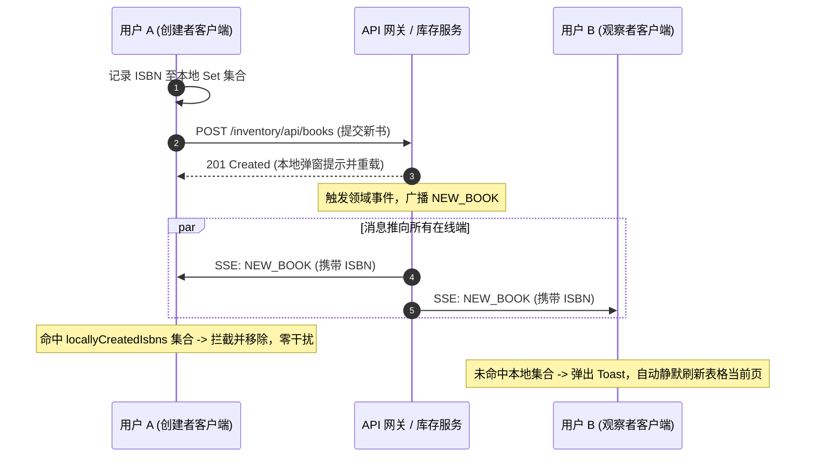

## 1. 实时通信架构决策矩阵

| 技术维度 | 选型方案 | 替代方案 | 决策依据 |
| :--- | :--- | :--- | :--- |
| **实时通信协议** | Server-Sent Events (SSE) | WebSocket / 短轮询 (Polling) | 业务为服务端向客户端单向广播；复用标准 HTTP 基础设施与网关，原生支持断线自愈重连。 |
| **SSR 宿主守卫** | `isPlatformBrowser` 判定为 false 时直接 `complete()` | 服务端尝试建立连接或抛异常 | Node.js 运行时缺少原生 `EventSource`，服务端阶段立即完成流，杜绝渲染挂起与致命报错。 |
| **事件路由分发** | `addEventListener('NEW_BOOK', ...)` | 原生 `eventSource.onmessage` | 后端采用具名事件推送；利用浏览器底层事件总线直接过滤，避免应用层进行无意义的类型判断。 |
| **连接断线重试** | `onerror` 仅记录日志，严禁调用 `subscriber.error()` | 遇到网络中断直接触发 error 终结流 | 触发 `subscriber.error` 将导致 RxJS 流彻底报废，保留由浏览器内核执行自动指数退避重连。 |
| **自反事件去重** | 客户端 Set 记录规范化 ISBN 进行自创建抑制 | 仅依赖服务端过滤或忽略重复 | 消除本端提交成功后的重复弹窗与二次重载，消除网络延迟带来的视图抖动。 |

## 2. 生产级 NotificationService：RxJS EventSource 封装范式

```typescript
import { Injectable, PLATFORM_ID, inject } from '@angular/core';
import { isPlatformBrowser } from '@angular/common';
import { Observable } from 'rxjs';
import { environment } from '../../../../environments/environment';
import { BookNotification } from '../../../shared/models/notification';

@Injectable({ providedIn: 'root' })
export class NotificationService {
  private readonly platformId = inject(PLATFORM_ID);
  private readonly streamUrl = `${environment.apiUrl}/inventory/api/notifications/stream`;

  /**
   * 建立 SSE 响应式数据流连接
   */
  connect(): Observable<BookNotification> {
    return new Observable<BookNotification>((subscriber) => {
      // 1. SSR 平台环境防护：Node.js 环境直接完成，防止找不到 EventSource
      if (!isPlatformBrowser(this.platformId)) {
        subscriber.complete();
        return;
      }

      // 2. 初始化浏览器原生 EventSource
      const eventSource = new EventSource(this.streamUrl);

      // 3. 定向监听后端广播的 NEW_BOOK 具名事件
      eventSource.addEventListener('NEW_BOOK', (event: Event) => {
        try {
          const messageEvent = event as MessageEvent;
          const parsed = JSON.parse(messageEvent.data) as BookNotification;
          subscriber.next(parsed);
        } catch (error) {
          console.error('[NotificationService] SSE JSON parse error:', error);
        }
      });

      // 4. 容错处理：切勿调用 subscriber.error()，以便保留浏览器原生重连机制
      eventSource.onerror = () => {
        console.warn('[NotificationService] SSE connection interrupted. Browser will reconnect...');
      };

      // 5. 资源清理回收：当外部 Observable 发生取消订阅时关闭 TCP 长连接
      return () => {
        eventSource.close();
      };
    });
  }
}
```

## 3. 消费端闭环：生命周期绑定、自创建去重与搜索防冲刷

```typescript
import { Component, DestroyRef, OnInit, inject } from '@angular/core';
import { takeUntilDestroyed } from '@angular/core/rxjs-interop';
import { MatDialog } from '@angular/material/dialog';
import { MatSnackBar } from '@angular/material/snack-bar';
import { injectDispatch } from '@ngrx/signals/events';
import { BookStore } from '../../store/book-store/book.store';
import { bookPageEvents } from '../../store/book-store/book.events';
import { NotificationService } from '../../services/notification.service';
import { BookForm } from '../../components/book-form/book-form';

export class List implements OnInit {
  protected readonly store = inject(BookStore);
  protected readonly dispatch = injectDispatch(bookPageEvents);
  private readonly dialog = inject(MatDialog);
  private readonly snackBar = inject(MatSnackBar);
  private readonly notificationService = inject(NotificationService);
  private readonly destroyRef = inject(DestroyRef);

  // 本地已提交待确认的 ISBN 白名单（用于自发推送拦截）
  private readonly locallyCreatedIsbns = new Set<string>();

  ngOnInit(): void {
    this.dispatch.loadBooks({ page: 0, size: 10 });

    // 订阅实时事件流，绑定组件生命周期
    this.notificationService
      .connect()
      .pipe(takeUntilDestroyed(this.destroyRef))
      .subscribe((notification) => {
        const normalizedIsbn = notification.isbn ? this.normalizeIsbn(notification.isbn) : null;

        // 核心自反去重：若通知源于本地刚刚提交的创建操作，静默消费并退出
        if (normalizedIsbn && this.locallyCreatedIsbns.has(normalizedIsbn)) {
          this.locallyCreatedIsbns.delete(normalizedIsbn);
          return;
        }

        // 外部新书推送提示
        this.snackBar.open(`📚 New book added: ${notification.bookTitle}`, 'Dismiss', { duration: 5000 });

        // 搜索态保护：非搜索模式下方自动重载列表，避免冲刷用户当前查询结果
        if (!this.store.isSearching()) {
          this.dispatch.loadBooks({
            page: this.store.currentPage(),
            size: this.store.pageSize(),
          });
        }
      });
  }

  openCreateDialog(): void {
    const dialogRef = this.dialog.open(BookForm, { width: '560px' });
    dialogRef.afterClosed().subscribe((result) => {
      if (result) {
        this.locallyCreatedIsbns.add(this.normalizeIsbn(result.isbn));
        this.dispatch.createSubmitted(result);
        this.snackBar.open('Book created successfully', 'Close', { duration: 3000 });
      }
    });
  }

  private normalizeIsbn(isbn: string): string {
    return isbn.replace(/[-\s]/g, '');
  }
}
```

## 4. SSE 广播与自发事件拦截时序拓扑



## 5. SSE 实时通信避坑清单 (Do's & Don'ts)

| 错误实践 (Don't) | 正确实践 (Do) |
| :--- | :--- |
| 在 `eventSource.onerror` 回调中调用 `subscriber.error(err)`。 | 仅输出警告日志，保留浏览器原生指数退避自动重连能力，避免流永久冻结。 |
| 未针对 SSR 平台进行隔离，导致在 Node.js 中执行 `new EventSource()`。 | 注入 `PLATFORM_ID` 校验，在非浏览器宿主中直接调用 `subscriber.complete()` 正常终结。 |
| 忽略组件销毁生命周期，未进行长连接注销清理。 | 在 Observable Teardown 中执行 `eventSource.close()`，并搭配 `takeUntilDestroyed` 自动取消订阅。 |
| 客户端收到新书推送时不假思索强行重置刷新分页列表。 | 判断 `isSearching()` 状态，若用户正处于搜索筛选状态，则保留当前视图仅作通知提示。 |
| 缺乏客户端去重机制，用户自身创建数据后被自己的 SSE 消息二次弹窗干扰。 | 引入 Correlation Key（如标准化 ISBN）集合，对本地触发的异步回环事件实施静默拦截。 |

<!-- split -->

# 原著完整参考：SSE 实时数据流与 RxJS 响应式集成

在现代高协同业务体系中，传统 Web 应用的“请求-响应”单向拉取模型已无法满足即时感知的诉求。当多个客户端或后台任务协同操作同一业务实体时，单方变更应当近实时广播给所有在线终端。

本文深入剖析基于 HTTP 标准的 Server-Sent Events（SSE）单向长连接架构，通过 RxJS 深度封装 `EventSource` 成为具备平台防护与资源自愈能力的响应式流，并攻克自创建通知拦截与搜索视图保护等生产级交互难题。

:::en
> **Original**: Server-Sent Events provide a lightweight, HTTP-compliant channel for push notifications, avoiding the protocol overhead and complex heartbeat management of WebSockets.

**📌 核心术语与语境解析**：
- **Server-Sent Events (SSE)** [ˈsɜːrvər sent ɪˈvents]：*服务端推送事件*。HTML5 规范中基于标准 HTTP 流式连接（`text/event-stream`）实现的服务端向浏览器单向文本事件推送协议。
- **Unidirectional Push** [ˌjuːnɪdəˈrekʃənl pʊʃ]：*单向推送*。通信流仅单向由服务端源向客户端终端流动的数据下发模式。
:::

## 1. 实时通信选型：Server-Sent Events 与全双工方案对比

在企业全栈架构中，实时通信的核心选型通常在 WebSocket 与 Server-Sent Events 之间展开：

| 评估维度 | WebSocket | Server-Sent Events (SSE) |
| :--- | :--- | :--- |
| **连接方向** | 全双工（双向读写） | 单向（服务端主动推送） |
| **协议层级** | 独立 `ws://` 协议（需握手升级） | 标准 HTTP 协议（`text/event-stream`） |
| **重连机制** | 需要应用层自行编写心跳与重连算法 | 原生 `EventSource` 内置退避自愈重连 |
| **网关适配** | 易被企业代理、网关或防火墙阻断 | 天然穿透反向代理、CDN 与 Spring Cloud Gateway |
| **传输开销** | 帧头部解析与连接维护开销较高 | 极简纯文本行，资源消耗极低 |

在图书目录通知场景中，业务具备纯粹的单向通知属性：后台库存微服务向前端广播图书动态，客户端的写操作走成熟的 RESTful API。因此选用轻量级的 SSE 能以最小开销达成业务目标。

:::en
> **Original**: For scenarios limited to downlink broadcasts, SSE preserves architectural simplicity by reusing existing HTTP gateway routes and leveraging browser-native reconnection mechanisms.

**📌 核心术语与语境解析**：
- **Downlink Broadcast** [ˈdaʊnlɪŋk ˈbrɔːdkæst]：*下行链路广播*。从集中式服务集群向下级分布式客户端分发数据的网络传输通路。
- **Exponential Backoff** [ˌekspəˈnenʃl ˈbækɔːf]：*指数退避*。在连接失败后逐步按几何级数延长下一次重试等待时长的自适应网络容错算法。
:::

## 2. SSE 传输报文剖析与网关代理边界

后端微服务推送的事件遵循 W3C 规范，内容类型为 `text/event-stream`：

```text
id: a8780704-9799-46b4-84dc-9431d7db5f19
event: NEW_BOOK
data: {"eventType":"NEW_BOOK","bookId":42,"bookTitle":"Clean Code","isbn":"9780132350884"}
```

- `id`：事件唯一标识符，浏览器断线重试时会在报头中携带 `Last-Event-ID` 以便服务端补发；
- `event`：**具名事件名称**。客户端可通过 `addEventListener` 精准监听；
- `data`：传输的 JSON 业务载荷。

需要注意的是，浏览器原生 `EventSource` API 不支持自定义 HTTP 请求头（无法直接设置 `Authorization` 头）。由于图书公开目录与通知流属于免密公开范围，端点直接设计为匿名放行，与安全边界完全自洽。

:::en
> **Original**: Named event streams allow client listeners to bind exclusively to relevant domain topics, discarding extraneous traffic without deserialization penalties.

**📌 核心术语与语境解析**：
- **Named Event** [neɪmd ɪˈvent]：*具名事件*。通过 `event: <name>` 指令显式标记类型的自定义事件流。
- **Payload Deserialization** [ˈpeɪloʊd diːˌseriələˈzeɪʃn]：*载荷反序列化*。将流中的文本或二进制流解析恢复为内存结构化对象的过程。
:::

## 3. 构建基于 RxJS 的响应式 NotificationService

将底层 `EventSource` 包装为标准的 `Observable<BookNotification>`：
1. **SSR 平台防护**：通过 `isPlatformBrowser(this.platformId)` 评估环境，Node 端直接 `subscriber.complete()`；
2. **具名事件定向监听**：使用 `addEventListener('NEW_BOOK', ...)` 替代全局 `onmessage`；
3. **自愈容错守卫**：`onerror` 回调仅记录警示日志，绝不调用 `subscriber.error()`，保留内核重连机制；
4. **资源注销清理**：在 Observable Teardown 闭包中调用 `eventSource.close()`。

:::en
> **Original**: Wrapping `EventSource` in an RxJS Observable encapsulates connection lifecycle management and teardown semantics inside a standard reactive interface.

**📌 核心术语与语境解析**：
- **Observable Teardown** [əbˈzɜːrvəbl ˈteərdaʊn]：*可观察对象资源回收清理逻辑*。当订阅者调用 `unsubscribe` 或流终止时执行的资源终结与释放机制。
- **Reactive Interface** [riˈæktɪv ˈɪntərfeɪs]：*反应式接口*。基于流、事件与数据变更响应构建的统一编程契约。
:::

## 4. 书籍列表编排与 takeUntilDestroyed 资源回收

在 `features/books/pages/list/list.ts` 中消费事件流。长连接如果在视图离开后继续后台运行，将导致内存泄露与带宽损耗。

利用 Angular 现代操作符 `takeUntilDestroyed(this.destroyRef)`，无需显式编写 `ngOnDestroy` 即可让订阅生命周期与当前组件宿主生死绑定。

:::en
> **Original**: The `takeUntilDestroyed` operator automatically unsubscribes from event streams when the host component's `DestroyRef` is triggered, eliminating manual cleanup boilerplate.

**📌 核心术语与语境解析**：
- **DestroyRef** [dɪˈstrɔɪ ref]：*销毁引用令牌*。Angular 提供的代表当前依赖注入上下文销毁事件的生命周期原语。
- **Connection Leak** [kəˈnekʃn liːk]：*连接泄漏*。由于组件未注销订阅导致底层 TCP 长连接长期挂起、浪费服务器文件描述符的缺陷状态。
:::

## 5. 自创建事件去重 (Self-Notification Suppression) 与搜索态保护

当用户在当前页面创建新书后，若直接接收后端的全站广播，会导致自身收到重复的 Toast 提醒以及二次多余的表格重载。

### 5.1 基于 ISBN 的客户端抑制机制
图书在提交时即具备确定性的 `isbn`，且 SSE 载荷同样携带该字段。通过客户端本地维护 `locallyCreatedIsbns = new Set<string>()`，提交时加入经格式清洗的 ISBN，接收推送时若匹配则静默剔除并跳过刷新。

### 5.2 搜索态保护机制
当用户当前正在搜索框按关键字筛选内容时，新书推送不可强行调用 `dispatch.loadBooks()` 覆盖当前视图。通过校验 `!store.isSearching()`，仅在常规分页浏览时静默重载，保护用户当前的查询上下文。

:::en
> **Original**: Self-notification suppression filters local mutations using correlation keys, while search-state guards prevent background refreshes from disrupting ongoing queries.

**📌 核心术语与语境解析**：
- **Self-Notification Suppression** [self ˌnoʊtɪfɪˈkeɪʃn səˈpreʃn]：*自身通知抑制*。在分布式广播系统中识别并忽略由本客户端自身操作产生的回环通知。
- **Correlation Key** [ˌkɔːrəˈleɪʃn kiː]：*关联标识键*。在异步流转或分布式系统中用于串联请求、事件与响应的唯一业务标识。
:::

## 6. 严谨的单测隔离：全局 EventSource 插桩与模拟测试

在基于 Node.js 的 Vitest 运行态中，通过 `vi.stubGlobal('EventSource', mockEventSource)` 对全局构造函数进行插桩模拟，测试具名事件监听分发、取消订阅时 `close()` 调用以及服务端平台直接 `complete` 的确定性表现。测试完毕后通过 `vi.unstubAllGlobals()` 恢复环境洁净。

:::en
> **Original**: Stubbing global APIs with Vitest's `vi.stubGlobal` isolates test harnesses from browser-specific globals while asserting lifecycle teardown invocations accurately.

**📌 核心术语与语境解析**：
- **Global Stubbing** [ˈɡloʊbl ˈstʌbɪŋ]：*全局环境插桩/打桩*。在运行时动态替换宿主全局命名空间变量以辅助测试的控制技术。
- **Harness Isolation** [ˈhɑːrnɪs ˌaɪsəˈleɪʃn]：*测试套件环境隔离*。确保单一测试用例对全局环境的修改不会外溢污染其他套件的工程准则。
:::

## 7. 多终端交互联调与实时流验收

在真实交付验收中：
- 窗口 A 未登录打开图书目录；
- 窗口 B 登录后录入新书；
- 窗口 A 毫秒级弹出新书 Toast 并静默刷新，新书排列至第一行；
- 窗口 B 仅展示常规创建成功提示，无多余通知弹窗；
- 窗口 A 在搜索模式下接收新书时，表格数据保持当前过滤视图不被冲刷。

:::en
> **Original**: Multi-terminal verification demonstrates real-time synchronization under dual client perspectives, validating debounce integrity and broadcast routing end-to-end.

**📌 核心术语与语境解析**：
- **Multi-terminal Synchronization** [ˈmʌlti ˈtɜːrmɪnl ˌsɪŋkrənəˈzeɪʃn]：*多终端状态同步*。多个物理设备或浏览器会话之间近乎实时达成数据状态一致性的流转体系。
- **End-to-End Verification** [end tu end ˌverɪfɪˈkeɪʃn]：*端到端链路验证*。贯穿前端输入、网络传输、服务端持久化与跨客户端广播全流程的集成测试。
:::
