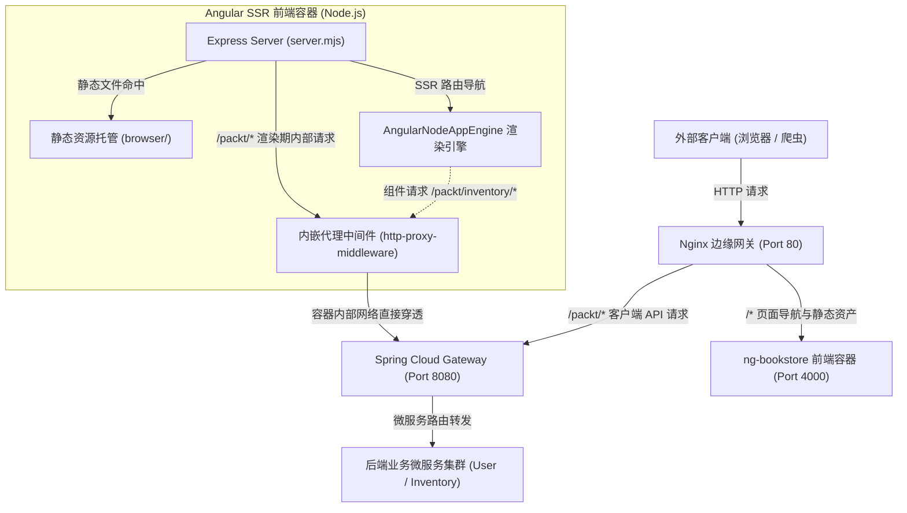

## 1. 前端构建与容器化打包决策矩阵

| 技术维度 | 选型方案 | 替代方案 | 决策依据 |
| :--- | :--- | :--- | :--- |
| **产物交付形态** | 混合双层输出（`browser/` 静态资源 + `server/` Node 入口） | 纯前端静态 HTML/JS 包 | SSR 渲染需要 Node 运行时常驻执行动态计算，无法仅靠静态 Nginx 托管。 |
| **容器分层构建** | 多阶段构建（`node:24-alpine` Builder + Runtime） | 单一阶段直接保留全量开发工具 | 剥离 TypeScript 编译器与构建缓存，减小最终镜像攻击面与分发体积。 |
| **SSR 内部代理** | Express 集成 `http-proxy-middleware` 拦截 `/packt` | SSR 期间硬编码绝对路径或直连微服务 | 统一前后端相对路径 `/packt` 契约，使容器无论在边缘代理下还是独立排查均具备自愈能力。 |
| **路径剥离修复** | 显式配置 `pathRewrite: (path) => '/packt' + path` | 依赖默认前缀截断 | Express 挂载中间件默认会裁减匹配前缀，必须补齐前缀以命中 Spring Cloud Gateway 断言。 |
| **主机标头加固** | `AngularNodeAppEngine({ allowedHosts: ['localhost', '127.0.0.1'] })` | 允许任意 Host Header 通过 | 严格限制请求 Host 头，阻断恶意伪造导致服务端请求伪造（SSRF）与缓存投毒。 |

## 2. 生产级 SSR 服务内嵌反向代理与安全加固范式

```typescript
import {
  AngularNodeAppEngine,
  createNodeRequestHandler,
  isMainModule,
  writeResponseToNodeResponse,
} from '@angular/ssr/node';
import express from 'express';
import { join } from 'node:path';
import { createProxyMiddleware } from 'http-proxy-middleware';

const browserDistFolder = join(import.meta.dirname, '../browser');
const app = express();

// 1. SSR 引擎安全加固：严格白名单校验 Host 标头，防御 SSRF
const angularApp = new AngularNodeAppEngine({
  allowedHosts: ['localhost', '127.0.0.1'],
});

// 2. 内嵌 API 反向代理：解决 SSR 在 Node 进程内部发起的相对路径请求回环问题
app.use(
  '/packt',
  createProxyMiddleware({
    target: process.env['API_URL'] || 'http://localhost:8080',
    changeOrigin: true,
    // 关键修正：防止 Express 默认剥离挂载前缀导致网关 404
    pathRewrite: (path) => `/packt${path}`,
  }),
);

// 3. 静态资产托管：长效缓存 JS/CSS/图片，关闭默认 index.html 由 SSR 动态接管
app.use(
  express.static(browserDistFolder, {
    maxAge: '1y',
    index: false,
    redirect: false,
  }),
);

// 4. 路由分发管道：交由 Angular 引擎处理动态组件渲染
app.use((req, res, next) => {
  angularApp
    .handle(req)
    .then((response) => (response ? writeResponseToNodeResponse(response, res) : next()))
    .catch(next);
});

if (isMainModule(import.meta.url) || process.env['pm_id']) {
  const port = process.env['PORT'] || 4000;
  app.listen(port, (error) => {
    if (error) throw error;
    console.log(`[SSR] Angular Node Express listening on port ${port}`);
  });
}

export const reqHandler = createNodeRequestHandler(app);
```

## 3. 生产级多阶段 Node.js Dockerfile 范式

```dockerfile
# ==========================================
# 阶段 1：编译构建环境 (Builder)
# ==========================================
FROM node:24-alpine AS builder

WORKDIR /app

# 利用 Docker 层缓存：依赖文件未变动时跳过重新下载
COPY package.json package-lock.json ./
RUN npm ci

# 复制工程源码并执行 AOT 生产构建
COPY . .
RUN npm run build

# ==========================================
# 阶段 2：生产运行环境 (Runtime)
# ==========================================
FROM node:24-alpine

WORKDIR /app

# 仅从 Builder 提取运行时所必需的双层产物与生产依赖
COPY --from=builder /app/dist/chapter-20 ./dist/chapter-20
COPY --from=builder /app/node_modules ./node_modules
COPY --from=builder /app/package.json ./

# 暴露端口与默认环境变量
EXPOSE 4000
ENV PORT=4000

# 启动 Node.js 原生 SSR 生产服务器
ENTRYPOINT ["node", "dist/chapter-20/server/server.mjs"]
```

## 4. 容器内 SSR 渲染与边缘代理流量流向拓扑



## 5. 前端构建与容器化避坑清单 (Do's & Don'ts)

| 错误实践 (Don't) | 正确实践 (Do) |
| :--- | :--- |
| 将开发环境的 `node_modules` 与本地 `dist` 直接打包进 Docker 镜像。 | 配置 `.dockerignore` 排除无关文件，在容器构建阶段执行纯净 `npm ci`。 |
| 在 Express 挂载代理中间件时省略 `pathRewrite` 导致路由前缀被自动截断。 | 显式声明 `pathRewrite: (path) => '/packt' + path`，确保网关断言路径完整。 |
| 单阶段镜像打包，将源码、测试文件与开发依赖全部保留在最终镜像中。 | 采用 Docker 多阶段构建（Multi-stage Build），仅将构建产物与运行时依赖拷贝至生产镜像。 |
| 在生产部署中依赖动态变动的 `:latest` 镜像标签。 | 遵循语义化版本规范（Semantic Versioning），为镜像显式标注具体发布版本号（如 `v0.0.1`）。 |
| 在 SSR 渲染引擎中完全不校验 `allowedHosts` 允许任意主机头。 | 严格显式配置 `['localhost', '127.0.0.1']` 白名单，从根源规避 Host 头投毒与 SSRF 风险。 |

<!-- split -->
# 原著完整参考：第 20 章 构建与部署 Angular 前端（Building and Deploying the Angular Frontend）

在上一章中，我们使用服务端发送事件（Server-Sent Events, SSE）为书店系统注入了实时推送能力，至此完整覆盖了现代全栈系统的数据交互形态：用于增删改查的请求-响应模式、用于提升 SEO 和首屏性能的服务端渲染（SSR）模式，以及用于感知近实时变动的服务端推送模式。我们的应用在功能层面上已彻底完备。

在本章中，我们将把重心从“业务特性开发”转移到“面向生产环境的工程交付”上，利用在第 10 章容器化 Spring Boot 后端时采用的标准化容器工作流，将 Angular 前端应用打包为一个工业级的 Docker 镜像。

本章我们将涵盖以下主题：

- 深入剖析 Angular 生产级构建产物
- 改造 SSR 服务端以适配生产环境的 API 路由代理
- 为 Angular 应用编写多阶段构建 Dockerfile
- 本地构建与运行前端容器
- 将前端镜像发布至 Docker Hub

## 技术要求

本章的完整源码可在此处获取：

`https://github.com/PacktPublishing/Spring-Boot-and-Angular-2E_Frontend/tree/main/chapter-20/`

你需要确保本地机器已安装并启动 Docker 守护进程（正如第 10 章所要求的那样）。你还需要使用在第 10 章注册的 Docker Hub 账号来发布前端容器镜像。在学习本章内容时，后端的 Docker Compose 环境无需保持运行，因为我们首先在完全隔离的沙箱中对前端进行独立容器化打包与验证。在接下来的第 21 章中，我们将把它与后端微服务集群进行全栈编排。在此有一个前置细节值得提前知晓：由于此时后端尚未接入，在独立运行的前端容器中打开图书目录时会渲染出一张空表格，而不会报错弹窗。这完全符合预期，我们在后文会详细分析其背后的运行机制。

## 深入剖析 Angular 生产级构建产物

在对 Angular 应用进行容器化之前，我们需要彻底搞清楚生产环境构建究竟输出了什么，以及它与我们在第 10 章打包的 Spring Boot Fat JAR 之间有何异同。

在项目根目录下执行以下构建命令：

```bash
npm run build
```

该命令底层调用的是 `ng build`，默认使用生产配置（Production Configuration）。这会触发**预先编译**（**Ahead-of-Time, AOT**），在构建期而非浏览器端将 Angular 的 HTML 模板编译为经过高度优化的高效 JavaScript 代码。构建引擎还会执行摇树优化（Tree-shaking）剔除死代码、进行代码压缩混淆（Minification，缩短变量名并消除冗余空白），并自动激活我们在第 16 章配置的 `fileReplacements` 规则，将开发期的 `environment.ts` 无缝替换为 `environment.prod.ts`，从而把生产环境的 API 相对路径静态固化到输出包中。构建完成后，将在项目根目录下生成如下输出拓扑：

```
dist/chapter-20/
├── browser/              # 纯静态前端资产：JS、CSS、预渲染 HTML
│   ├── index.html        # CSR 客户端渲染路由的兜底 HTML 外壳
│   ├── privacy/
│   │   └── index.html    # 静态预渲染页面（来自第 18 章）
│   ├── terms/
│   │   └── index.html    # 静态预渲染页面（来自第 18 章）
│   └── *.js, *.css       # 带有内容哈希指纹的代码包
└── server/
    └── server.mjs        # Node.js SSR 服务的执行入口
```

- `browser/` 目录包含了浏览器端运行所需的一切静态资产：JavaScript 代码包、CSS 样式表与预生成的 HTML 页面。文件名中的内容哈希后缀（如 `main-abc123.js`）能够完美支持浏览器和 CDN 开启强力长效缓存：一旦源码发生微小变更，哈希指纹随之改变，浏览器就会自动拉取新版。
- `privacy/` 和 `terms/` 子目录存放了我们在第 18 章配置的静态预渲染 HTML 页面，它们作为静态文件由 Web 服务器直接零计算极速分发。
- `server/` 目录包含 `server.mjs`，它是我们在第 18 章深入解析的 `src/server.ts` 经过 TypeScript 编译后的 Node.js 运行入口。这个文件驱动了内置 Express 服务器与 Angular SSR 核心渲染引擎。

`browser/` 与 `server/` 共同构成了完整的生产交付产物，但它们分别被两个物理隔离的运行时消费：`browser/` 下的内容由最终读者的浏览器下载并在客户端本地执行，纯静态且无需 Node 进程介入；而 `server/server.mjs` 仅在 Node.js 服务端由后台守护进程执行，绝不向浏览器暴露。在阅读后续内容时务必牢记这一二分法：我们的 Docker 镜像必须同时打包这两者，但容器内部真正在运行的只有 Node 进程。

我们不妨与第 10 章做个深度类比：在后端，执行 `mvn clean package` 会生成一个内置嵌入式 Tomcat 容器的自包含 Fat JAR 文件，一条 `java -jar` 命令即可在任何 JRE 环境下拉起运行；在前端，执行 `ng build` 输出的是一个必须依赖 Node.js 运行时支撑的 `dist/` 目录。后端 JAR 内置了 Web 容器，而我们的 Angular SSR 产物内置了 Express 服务器。两者都是生产就绪的高可用产物，只是宿主运行时的技术契约不同。

关于生产环境配置，还有一个至关重要的细节必须阐明。在第 16 章中，我们在 `environment.prod.ts` 中将接口基地址定义为相对路径 `apiUrl: '/packt'`。在浏览器中，该相对路径会自然基于当前页面的 Origin 进行解析（例如 `http://localhost/packt/...`）；但在 Node.js 服务端执行 SSR 渲染期间，由于处于 Node 进程内部上下文，它会被相对解析为 Node 服务自身的地址（例如 `http://localhost:4000/packt/...`）。在本地开发时之所以能正常工作，是因为 `ng serve` 直接使用了 `environment.ts` 中的绝对地址（`http://localhost:8080/packt`）去直连微服务网关。但在生产环境下，我们必须确保 Node 进程内部发出的 `/packt/*` 请求能够精准穿透并路由到真实的后端微服务网关上。我们将在下一节彻底解决这一路由穿透问题。

## 改造 SSR 服务端以适配生产环境的 API 路由代理

当 Angular SSR 引擎在 Node 服务端尝试渲染 `/books` 页面时，`BookService` 会发起针对 `/packt/inventory/api/books` 的 HTTP GET 请求。由于这是一个相对路径，在容器内部它会被解析为 `http://localhost:4000/packt/...`，这指向的其实是 Angular 服务本身，而非后端的 API 网关。由于 Angular Express 服务自身并没有挂载任何 `/packt` 的业务控制器，该请求必然报错失败。

工业级的标准解决方案是：在 `src/server.ts` 中引入 Express 代理中间件，专门拦截所有以 `/packt` 开头的内部请求，并将其全透明反向代理至真实的后端网关。这是现代 Node.js SSR 应用的行业标准设计范式——让 SSR 宿主在渲染期间兼任自身的边缘代理转发器。

> **注意**
>
> 这一路由穿透问题可以在两个层面上解决，弄清为什么在此处解决非常必要。这里的 Express 中间件内置在前端容器内部，这意味着无论前端容器被部署在何种拓扑中（甚至前面没有任何额外反向代理单兵作战），SSR 都能始终自愈工作。另一种方案是依赖边缘反向代理统一分发，这正是我们在第 21 章利用 Nginx 针对浏览器流量所做的事情。然而 Nginx 无法帮助容器内部的 SSR 服务：Node 进程在渲染期间发出的内部网络调用根本不会流经外部的 Nginx 边缘网关。因此，这个 Express 代理中间件是刚需，第 21 章的 Nginx 层是与之相辅相成，而非取而代之。

首先安装 `http-proxy-middleware` 依赖包：

```bash
npm install http-proxy-middleware
```

接下来更新 `src/server.ts`，增加用于将 `/packt` 请求转发至网关的代理中间件。它必须放置在静态文件分发中间件和 Angular 兜底路由处理器之前。代码清单中出现的 `allowedHosts` 配置已经在第 18 章中加入，此处呈现仅供参考上下文：

```typescript
// ... 现有的其他 import 语句
import { createProxyMiddleware } from 'http-proxy-middleware';

const app = express();
const angularApp = new AngularNodeAppEngine({
  allowedHosts: ['localhost', '127.0.0.1'],
});

// API 代理 —— 在 SSR 渲染期间将 /packt/* 透明转发至后端微服务网关
app.use(
  '/packt',
  createProxyMiddleware({
    target: process.env['API_URL'] || 'http://localhost:8080',
    changeOrigin: true,
    pathRewrite: (path) => `/packt${path}`,
  }),
);

// ... 保留现有的 express.static 与 /** 处理器不变
```

这个代理中间件会把所有以 `/packt` 为前缀的请求精准转发给后端网关。这里有一个微妙但极具杀伤力的底层细节：当 Express 将请求匹配到挂载路径（Mounted Path）如 `/packt` 时，它在把请求移交给下游中间件之前，会默认**剥离（Strip）**该前缀！也就是说，对 `/packt/inventory/api/books/paged` 的请求，在进入代理中间件时变成了 `/inventory/api/books/paged`。

如果不做纠正，微服务网关收到的请求将缺失 `/packt` 前缀并直接返回 404，因为网关路由全部严格配置在 `/packt/inventory/**` 之下。`pathRewrite` 选项正是为了挽救这一问题：它在向外部发出代理请求之前，把 `/packt` 重新补回路径最前端。需要强调的是，这仅仅是 SSR 内部的特殊诉求；未来浏览器发出的普通 API 请求会直接流经生产 Nginx，Nginx 会完整无损地透传全路径。

用一个具体的请求追踪一下整个重写过程：当 SSR 请求 `/packt/inventory/api/books/paged?page=0&size=10` 时，命中 `/packt` 挂载点，Express 剥离前缀，中间件收到 `/inventory/api/books/paged?page=0&size=10`。`pathRewrite` 函数将其重新前缀化为 `/packt/inventory/api/books/paged?page=0&size=10` 并发往网关，网关顺利匹配路由。把前缀直接写死在 `target` URL 里也可以达到类似目的，但我们采用 `pathRewrite` 能让 `target` 保持纯粹的“协议+域名/主机名”，使得我们可以直接通过 `API_URL` 环境变量灵活注入。

在第 18 章中，我们曾为 `AngularNodeAppEngine` 配置了 `allowedHosts`，当时将原理解析推迟到了本章。它的安全防护使命在于：Angular SSR 服务会校验每个入站请求的 `Host` 请求头，在请求触及路由渲染前严厉拒绝一切未识别的域名。如果没有这一层防线，攻击者伪造恶意的 Host 请求头，就可能诱骗服务端在预渲染时生成指向攻击者受控服务器的绝对 URL，造成**服务端请求伪造（SSRF）**高危漏洞。

这里配置的值取决于外部流量到达该容器时的真实 Host 头。在第 21 章中，前端容器将运行在 Nginx 之后，Nginx 虽然通过 Docker 服务名连接该容器，但其配置的 `proxy_set_header Host $host` 指令会把浏览器发来的原始 Host 完整透传过来。因此 SSR 服务看到的依然是 `localhost` 而非内部容器名；Docker 健康检查同样是以 `localhost` 访问容器。将 `allowedHosts` 设置为 `localhost` 和 `127.0.0.1` 能够同时覆盖这两条通信路径，使得我们构建出来的镜像开箱即用，无需在第 21 章重新打包。

中间件的注册顺序同样至关重要。Express 会严格按照声明顺序执行 `app.use()`。把 `/packt` 代理放在最前面，能够确保所有 API 调用在触及静态资源服务和 Angular 页面渲染器之前被迅速截获并转发。而普通的页面路由跳转与静态图片请求则会自然穿透，交由后续的处理器处理。

`target` 选项指定了目标代理地址。我们通过 `process.env['API_URL']` 动态读取它，赋予了容器极大的环境适应能力：在无需重新构建镜像的前提下，自由切换后端目标。在第 21 章将该容器放入 Docker Compose 编排时，我们只需将 `API_URL` 设置为 `http://gateway-server:8080`，即可利用 Docker 内部的 DNS 网络直连 Spring Cloud Gateway。而在本地非容器环境调试时，默认回退的 `http://localhost:8080` 也能无缝匹配第 10 章的本地网关端口。`changeOrigin: true` 会把发往网关的 Host 请求头自动重写为目标主机的域名，避免在网关侧因 Host 不匹配而触发虚拟主机路由异常。

另外值得一提的是，`http-proxy-middleware` 默认采用流式传输（Streaming），这意味着如果未来服务端渲染过程中也需要代理 SSE 长连接流，它也能原生支持。尽管在我们的设计中，`NotificationService` 早已通过 `isPlatformBrowser` 将 SSE 限制在浏览器端运行，SSR 根本不会发起长连接，但代理层本身在能力上是毫无阻碍的。

## 为 Angular 应用编写多阶段构建 Dockerfile

理清了生产构建与服务端代理机制后，我们可以运用在第 10 章学到的多阶段构建（Multi-stage Build）模式，为前端应用编写高内聚的 Docker 镜像。

首先在项目根目录下创建 `.dockerignore` 文件，排除无需复制到构建上下文中的文件：

```
node_modules
.angular
dist
.git
*.md
```

这能显著缩减构建上下文的大小，避免本地环境残留的 `node_modules` 或旧的构建产物干扰容器内部干净的构建流程。`.angular` 目录包含本地构建缓存，同样无需打包进容器。

接下来在项目根目录（`chapter-20`）下创建 `Dockerfile`：

```dockerfile
# 阶段 1：编译构建（Build Stage）
FROM node:24-alpine AS builder
WORKDIR /app
COPY package.json package-lock.json ./
RUN npm ci
COPY . .
RUN npm run build

# 阶段 2：生产运行（Runtime Stage）
FROM node:24-alpine
WORKDIR /app
COPY --from=builder /app/dist/chapter-20 ./dist/chapter-20
COPY --from=builder /app/node_modules ./node_modules
COPY --from=builder /app/package.json ./
EXPOSE 4000
ENV PORT=4000
ENTRYPOINT ["node", "dist/chapter-20/server/server.mjs"]
```

这里的语法和多阶段思想与第 10 章一脉相承，重点关注 Angular 与 Spring Boot 之间的关键差异：

- **阶段一（builder）**：使用 `npm ci` 安装确定性的生产依赖版本（相当于 Maven 的依赖解析）。随后执行 `npm run build` 生成前文详述的 `dist/` 产物。先复制 `package.json` 和 `package-lock.json` 执行 `npm ci`、再复制其余源码，充分利用了 Docker 的镜像层缓存（Layer Caching）：只要依赖项没有变动，哪怕源码频繁修改，Docker 也会直接复用已缓存的 `node_modules` 层，彻底跳过漫长的依赖下载过程。
- **阶段二（runtime）**：这是与 Spring Boot 最大的分水岭所在。在第 10 章中，我们只需要将构建好的单个 JAR 复制到最终运行时镜像中，因为 Java 已经把所有第三方类库全部平铺打包进了该 JAR 内部。但 Node.js 并非这种机制：SSR 服务在运行期间依然需要加载 `express`、`http-proxy-middleware` 和 `@angular/ssr` 等动态依赖，这些依赖实体存放在 `node_modules` 中。因此，我们必须将 `dist/` 编译产物与 `node_modules` 同时复制到运行时阶段。
- `EXPOSE 4000` 声明了 SSR 服务监听的内部端口，与 `src/server.ts` 中的默认值保持一致。`ENTRYPOINT` 直接通过 Node 启动编译后的 `server.mjs`；这相当于第 10 章中的 `java -jar app.jar`。我们在生产环境中运行的是高度编译优化的终态产物，绝不是用来开发调试的 `ng serve`。

> **注意**
>
> 直接将全量 `node_modules` 复制到运行时阶段，虽然保持了 Dockerfile 的直观易懂，但并非极致的生产体积优化方案：这会导致最终镜像达到约 600 MB，其中大部分包含了仅在构建期使用的 CLI 工具链。在极端严苛的生产环境中，可以增加第三个阶段执行 `npm ci --omit=dev`，生成一个仅包含生产纯运行依赖的超精简 `node_modules` 目录。我们在此保持双阶段结构，是为了突出与第 10 章 JAR 打包的核心异同，优先保障架构认知的清晰透彻。

## 本地构建与运行前端容器

有了 Dockerfile，我们就可以将 Angular 前端打包为独立的容器镜像。构建过程会严格执行我们声明的两个阶段：builder 阶段拉取依赖并编译代码，runtime 阶段组装极简的执行镜像。

执行镜像构建命令：

```bash
docker build -t bookstore/ng-bookstore:v0.0.1 .
```

这里沿用了第 10 章的命名规范：镜像标签 `bookstore/ng-bookstore:v0.0.1` 与后端的 `bookstore/inventory-service:v0.0.1` 保持统一的命名空间。

构建完成后，启动容器：

```bash
docker run -d -p 4000:4000 --name ng-bookstore bookstore/ng-bookstore:v0.0.1
```

`-d` 参数使容器在后台以守护进程模式运行，`-p 4000:4000` 将容器内部的 4000 端口映射到宿主机端口。

验证容器是否健康存活以及 SSR 服务是否正确响应：

```bash
curl http://localhost:4000
```

根路径在前端路由中重定向至 `/books`，因此该命令会返回带有 `location` 头的 302 响应。你可以附加 `-L` 参数跟踪重定向，或者直接请求特定路由查看服务端渲染的 HTML。

检查静态预渲染的隐私政策页面：

```bash
curl http://localhost:4000/privacy
```

这会立即返回构建期预生成的静态 HTML，证明了构建输出与 SSR 静态托管在容器内部运转完全正常。该页面无需发起任何后端 API 请求。

此时，如果你在宿主机浏览器中访问 `http://localhost:4000/books`，页面会呈现一个空表格：能够看到表头列名，但没有数据行，也没有错误弹窗。这完全在预料之中，其根本原因在于：在容器内部，SSR 代理中间件的默认目标是 `http://localhost:8080`，而在容器隔离的网络命名空间里，`localhost` 指向的是容器自身，其内部根本没有运行任何 8080 服务。因此，SSR 引擎向网关发起的请求超时失败，降级渲染出了一张没有图书数据的空表格。

这种失败是隐匿的：页面展示正常结构的外壳，`docker logs` 中也只有常规的启动日志。唯一能抓取到异常的地方是直接请求被代理的接口路径：

```bash
curl -i "http://localhost:4000/packt/inventory/api/books/paged?page=0&size=10"
```

该命令会返回代理层默认错误处理器抛出的 `504 Gateway Timeout`。因此，如果当前你在容器中看到空列表，说明前端容器本身的运行完全健康，只是单纯缺乏可连通的后端服务。在第 21 章中，我们将通过 Docker Compose 将该容器接入微服务专用网络，届时 `API_URL` 环境变量将指向真实的微服务网关，图书数据便会立刻喷薄而出。

在进入下一节之前，停止并删除该测试容器：

```bash
docker stop ng-bookstore && docker rm ng-bookstore
```

## 将前端镜像发布至 Docker Hub

最后一步是使用第 10 章的标准工作流，将构建好的镜像推送到 Docker Hub。请将 `<dockerhub-username>` 替换为你真实的 Docker Hub 用户名：

```bash
docker tag bookstore/ng-bookstore:v0.0.1 <dockerhub-username>/ng-bookstore:v0.0.1
docker tag bookstore/ng-bookstore:v0.0.1 <dockerhub-username>/ng-bookstore:latest
docker push <dockerhub-username>/ng-bookstore:v0.0.1
docker push <dockerhub-username>/ng-bookstore:latest
```

`docker tag` 命令为本地镜像打上包含远程仓库命名空间的别名，`docker push` 则把镜像层上传到 Docker Hub。我们同时推送了具体的版本标签（`v0.0.1`，用于精准复原与追溯）以及通用的 `latest` 标签（用于本地开发集成便利）。

在第 21 章中，我们编写的 Docker Compose 文件将通过 `${IMAGE_TAG:-latest}` 动态解析镜像标签，在未显式指定环境变量时默认拉取 `latest`。

必须清醒认识到：`latest` 标签虽然在本地开发时极具便利性，但在生产环境中是严禁使用的危险反模式。因为 `latest` 是一个随时变动的游标指针，一次未经版本锁定的重复部署很可能会意外拉取到一个未经验证的全新构建包，出现故障时既无法查清变更记录也无法快速回滚。在任何对稳定性有要求的严肃环境中，必须严格使用显式的确定版本号。至此，前端镜像已成功托管至远程 Registry，可以在任何具备 Docker 环境的宿主机上自由拉取。

## 本章小结

在本章中，我们完成了 Angular 前端的生产级构建与全套容器化封装。我们深入剖析了生产构建命令背后的 AOT 编译、摇树优化、代码压缩以及针对生产环境配置文件的自动替换机制，并对比了它与 Spring Boot Fat JAR 之间的异同。针对 SSR 渲染引擎在容器内请求相对路径引发的闭环解析难题，我们在 `server.ts` 中引入了基于 `http-proxy-middleware` 的生产级代理中间件，并通过 `API_URL` 环境变量实现了后端的动态可配置。我们编写了高效的多阶段 Dockerfile，并辨析了 Node.js 镜像因必须打包 `node_modules` 而与 Java 容器产生的关键区别。最后，我们在本地对镜像进行了全套功能检验，并将其成功推送至 Docker Hub。

前端应用现在已经成为一个自包含、高便携的标准容器单元，但在当前它仍然处于孤立运行状态。在全书的终章——第 21 章中，我们将把前端容器与后端庞大的微服务集群结合在一起，引入 Nginx 作为统一的边缘反向代理，打造出企业级全栈在线书店系统的完整生产编排交付物。
