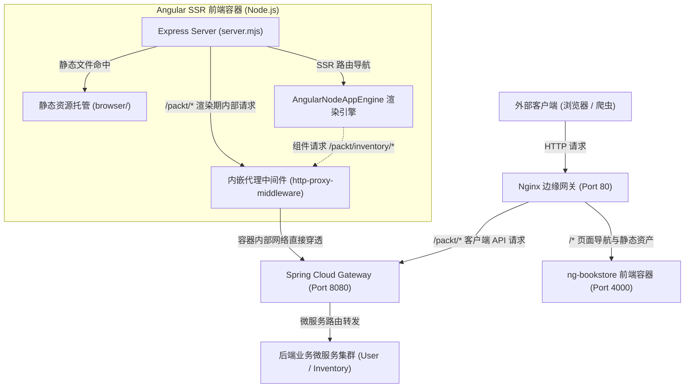

## 1. 前端构建与容器化打包决策矩阵

| 技术维度 | 选型方案 | 替代方案 | 决策依据 |
| :--- | :--- | :--- | :--- |
| **产物交付形态** | 混合双层输出（`browser/` 静态资源 + `server/` Node 入口） | 纯前端静态 HTML/JS 包 | SSR 渲染需要 Node 运行时常驻执行动态计算，无法仅靠静态 Nginx 托管。 |
| **容器分层构建** | 多阶段构建（`node:24-alpine` Builder + Runtime） | 单一阶段直接保留全量开发工具 | 剥离 TypeScript 编译器与构建缓存，减小最终镜像攻击面与分发体积。 |
| **SSR 内部代理** | Express 集成 `http-proxy-middleware` 拦截 `/packt` | SSR 期间硬编码绝对路径或直连微服务 | 统一前后端相对路径 `/packt` 契约，使容器无论在边缘代理下还是独立排查均具备自愈能力。 |
| **路径剥离修复** | 显式配置 `pathRewrite: (path) => '/packt' + path` | 依赖默认前缀截断 | Express 挂载中间件默认会裁减匹配前缀，必须补齐前缀以命中 Spring Cloud Gateway 断言。 |
| **主机标头加固** | `AngularNodeAppEngine({ allowedHosts: ['localhost', '127.0.0.1'] })` | 允许任意 Host Header 通过 | 严格限制请求 Host 头，阻断恶意伪造导致服务端请求伪造（SSRF）与缓存投毒。 |

## 2. 生产级 SSR 服务内嵌反向代理与安全加固范式

```typescript
import {
  AngularNodeAppEngine,
  createNodeRequestHandler,
  isMainModule,
  writeResponseToNodeResponse,
} from '@angular/ssr/node';
import express from 'express';
import { join } from 'node:path';
import { createProxyMiddleware } from 'http-proxy-middleware';

const browserDistFolder = join(import.meta.dirname, '../browser');
const app = express();

// 1. SSR 引擎安全加固：严格白名单校验 Host 标头，防御 SSRF
const angularApp = new AngularNodeAppEngine({
  allowedHosts: ['localhost', '127.0.0.1'],
});

// 2. 内嵌 API 反向代理：解决 SSR 在 Node 进程内部发起的相对路径请求回环问题
app.use(
  '/packt',
  createProxyMiddleware({
    target: process.env['API_URL'] || 'http://localhost:8080',
    changeOrigin: true,
    // 关键修正：防止 Express 默认剥离挂载前缀导致网关 404
    pathRewrite: (path) => `/packt${path}`,
  }),
);

// 3. 静态资产托管：长效缓存 JS/CSS/图片，关闭默认 index.html 由 SSR 动态接管
app.use(
  express.static(browserDistFolder, {
    maxAge: '1y',
    index: false,
    redirect: false,
  }),
);

// 4. 路由分发管道：交由 Angular 引擎处理动态组件渲染
app.use((req, res, next) => {
  angularApp
    .handle(req)
    .then((response) => (response ? writeResponseToNodeResponse(response, res) : next()))
    .catch(next);
});

if (isMainModule(import.meta.url) || process.env['pm_id']) {
  const port = process.env['PORT'] || 4000;
  app.listen(port, (error) => {
    if (error) throw error;
    console.log(`[SSR] Angular Node Express listening on port ${port}`);
  });
}

export const reqHandler = createNodeRequestHandler(app);
```

## 3. 生产级多阶段 Node.js Dockerfile 范式

```dockerfile
# ==========================================
# 阶段 1：编译构建环境 (Builder)
# ==========================================
FROM node:24-alpine AS builder

WORKDIR /app

# 利用 Docker 层缓存：依赖文件未变动时跳过重新下载
COPY package.json package-lock.json ./
RUN npm ci

# 复制工程源码并执行 AOT 生产构建
COPY . .
RUN npm run build

# ==========================================
# 阶段 2：生产运行环境 (Runtime)
# ==========================================
FROM node:24-alpine

WORKDIR /app

# 仅从 Builder 提取运行时所必需的双层产物与生产依赖
COPY --from=builder /app/dist/chapter-20 ./dist/chapter-20
COPY --from=builder /app/node_modules ./node_modules
COPY --from=builder /app/package.json ./

# 暴露端口与默认环境变量
EXPOSE 4000
ENV PORT=4000

# 启动 Node.js 原生 SSR 生产服务器
ENTRYPOINT ["node", "dist/chapter-20/server/server.mjs"]
```

## 4. 容器内 SSR 渲染与边缘代理流量流向拓扑



## 5. 前端构建与容器化避坑清单 (Do's & Don'ts)

| 错误实践 (Don't) | 正确实践 (Do) |
| :--- | :--- |
| 将开发环境的 `node_modules` 与本地 `dist` 直接打包进 Docker 镜像。 | 配置 `.dockerignore` 排除无关文件，在容器构建阶段执行纯净 `npm ci`。 |
| 在 Express 挂载代理中间件时省略 `pathRewrite` 导致路由前缀被自动截断。 | 显式声明 `pathRewrite: (path) => '/packt' + path`，确保网关断言路径完整。 |
| 单阶段镜像打包，将源码、测试文件与开发依赖全部保留在最终镜像中。 | 采用 Docker 多阶段构建（Multi-stage Build），仅将构建产物与运行时依赖拷贝至生产镜像。 |
| 在生产部署中依赖动态变动的 `:latest` 镜像标签。 | 遵循语义化版本规范（Semantic Versioning），为镜像显式标注具体发布版本号（如 `v0.0.1`）。 |
| 在 SSR 渲染引擎中完全不校验 `allowedHosts` 允许任意主机头。 | 严格显式配置 `['localhost', '127.0.0.1']` 白名单，从根源规避 Host 头投毒与 SSRF 风险。 |

<!-- split -->

# 原著完整参考：前端生产级构建与 Node SSR 容器化打包

现代前端全栈工程的终局是交付高度可靠、自包含且具备弹性伸缩能力的容器化单元。当前端应用融合了服务端渲染（SSR）与静态预渲染（SSG）后，其交付形态已由传统的纯静态资源转变为动态 Node.js Web 服务的复合体。

本文深入剖析 Angular 生产级构建产物的底层拓扑，解决服务端渲染期间 Node 进程内部回环网络路由穿透难题，并通过多阶段构建打造工业级前端 Docker 镜像。

:::en
> **Original**: Containerizing modern SSR applications requires dual topology management: serving static browser bundles efficiently while hosting a dynamic Node.js rendering process.

**📌 核心术语与语境解析**：
- **Dual Topology** [ˈduːəl təˈpɑːlədʒi]：*双重拓扑架构*。指同一应用交付物由纯静态客户端资源（CSS/JS/图片）与常驻动态服务端运行时（Node.js/Express）构成的复合体系。
- **Self-contained Container** [self kənˈteɪnd kənˈteɪnər]：*自包含容器*。内置了运行所需完整代码、依赖库与轻量运行环境，脱离宿主机环境后仍能独立稳定启动的容器单元。
:::

## 1. 深度剖析 Angular 生产级构建产物与 AOT 优化

在前端根目录执行生产构建：

```bash
npm run build
```

该命令底层调用 `ng build --configuration production`，触发核心工程优化：
1. **Ahead-of-Time (AOT) 编译**：在构建期将 Angular HTML 模板与组件声明编译为高效的高性能 JavaScript 代码，消除浏览器运行时的模板解析开销；
2. **Tree-Shaking（摇树优化）**：基于 ES 模块静态依赖分析，移除未引用的冗余代码分块；
3. **Minification 与混淆**：去除注释与空白字符，缩短标识符，极大压缩静态资产体积；
4. **环境文件替换（fileReplacements）**：将 `environment.ts` 无缝替换为 `environment.prod.ts`，固化生产 API 前缀 `/packt`。

编译完成后在 `dist/chapter-20/` 输出双层拓扑结构：
- **`browser/` 目录**：包含供浏览器加载的静态 JS Bundle、CSS 与预渲染静态 HTML 文件；
- **`server/` 目录**：核心为 `server.mjs`，由 `src/server.ts` 编译生成的原生 Node.js 服务端入口。

:::en
> **Original**: Production compilation executes Ahead-of-Time template generation and dead-code elimination, outputting segregated browser static assets and server execution bundles.

**📌 核心术语与语境解析**：
- **Ahead-of-Time (AOT)** [əˈhed əv taɪm]：*预先编译*。在代码构建打包阶段直接将模板编译为原生执行代码的编译技术。
- **Dead-code Elimination** [ded koʊd ɪˌlɪmɪˈneɪʃn]：*死代码消除/摇树优化*。编译器通过静态依赖图分析剔除永远不可能被执行到的多余逻辑的优化手法。
:::

## 2. 改造 SSR 引擎：内嵌 API 代理与防护策略

在生产环境配置中，API 基准地址采用同源相对路径 `apiUrl: '/packt'`：
- 在浏览器客户端中，相对路径自动以当前页面域名解析，由最外层 Nginx 统一转发；
- 在服务端渲染（SSR）期间，Node.js 运行在独立进程中，发起网络调用时默认以自身回环地址解析（如 `http://localhost:4000/packt/...`）。

由于 Angular Express 服务器自身未定义业务接口，内部请求将直接触发 404 或连接拒绝。

在 Node.js SSR 服务器内部集成 API 代理中间件 `http-proxy-middleware`，能够将服务端抓取请求直接代理转发至后端网关，使前端容器无论是在边缘代理后方还是单机隔离调试，都具备完整自愈的渲染能力。

:::en
> **Original**: Embedding an API proxy within the Express SSR server guarantees loopback request resolution, ensuring server-side data fetching functions independently of edge proxies.

**📌 核心术语与语境解析**：
- **Loopback Request** [ˈluːpbæk rɪˈkwest]：*回环请求*。服务在本地进程或容器内部直接向自身绑定的地址或网络栈发起的内部网络调用。
- **Edge Proxy** [edʒ ˈprɑːksi]：*边缘代理*。部署在系统最外层、负责接收公网流量并执行 TLS 终结与路由分发的反向代理（如 Nginx）。
:::

## 3. Express 路径剥离陷阱与 pathRewrite 补全机制

当 Express 匹配到挂载在 `/packt` 路径上的中间件时，其默认行为会在将请求转交给子中间件前**剥离掉匹配路径前缀**。

例如原本请求 `/packt/inventory/api/books`，传递给代理中间件时路径已被截断为 `/inventory/api/books`。如果直接透传给网关，Spring Cloud Gateway 将因断言谓词匹配失败而返回 404。

必须显式声明路径重写规则：

```typescript
pathRewrite: (path) => `/packt${path}`,
```

将前缀重新补齐，同时配合 `changeOrigin: true` 改写 Host 标头，保证后端网关准确识别路由。

:::en
> **Original**: Express middleware strips mount path prefixes by default; the proxy configuration must explicitly prepend the required route prefix using `pathRewrite`.

**📌 核心术语与语境解析**：
- **Mount Path Stripping** [maʊnt pæθ ˈstrɪpɪŋ]：*挂载路径剥离*。Web 中间件框架在将请求转交至命名挂载路由处理程序时默认裁减前缀的处理特性。
- **Path Rewrite** [pæθ ˈriːraɪt]：*路径重写*。反向代理在将请求转发至上游服务之前，依据规则动态修改请求 URI 路径的机制。
:::

## 4. 编写多阶段构建 Dockerfile 与缓存优化

多阶段构建（Multi-stage Build）是工业级容器交付的标准模式：
1. **阶段 1（Builder）**：基于 `node:24-alpine`，先拷贝 `package.json` 与锁文件执行 `npm ci`，充分利用 Docker 层缓存（Layer Cache）；随后拷贝源码执行编译；
2. **阶段 2（Runtime）**：拉起纯净的 `node:24-alpine` 运行时镜像，仅拷贝编译产物 `dist/` 与运行必需的 `node_modules`。

由于 Node.js 并非像 Java 那样将依赖打入单个自包含 Fat JAR 中，`server.mjs` 启动依赖 Express 与渲染库，因此运行时镜像必须同步提取 `node_modules`。

:::en
> **Original**: Multi-stage Docker builds isolate compilation tooling from minimal runtime environments, leveraging layer caching to accelerate continuous deployment pipelines.

**📌 核心术语与语境解析**：
- **Multi-stage Build** [ˈmʌlti steɪdʒ bɪld]：*多阶段构建*。在单一 Dockerfile 中使用多个 `FROM` 指令分别完成构建与运行镜像剥离的容器打包技术。
- **Layer Cache** [ˈleɪər kæʃ]：*镜像层缓存*。容器引擎依据前后指令与文件哈希值复用未变动镜像层以缩短构建时长的机制。
:::

## 5. 容器构建、独立运行与无后端行为验证

在本地对镜像进行独立验证：

```bash
docker build -t bookstore/ng-bookstore:v0.0.1 .
docker run -d -p 4000:4000 --name ng-bookstore bookstore/ng-bookstore:v0.0.1
```

- 探测根路径 `curl -i http://localhost:4000` 验证 HTTP 302 重定向；
- 探测预渲染路径 `curl http://localhost:4000/privacy` 验证无动态计算的静态 HTML 秒下发；
- 在无后端挂载时访问 `/books`，页面呈现完整表格骨架且不崩溃，控制台返回代理超时的 `504 Gateway Timeout`，证明前端容器各层生命周期运转正常。

:::en
> **Original**: Independent container verification tests edge-case behaviors such as graceful degradation and gateway timeouts in the absence of upstream backend services.

**📌 核心术语与语境解析**：
- **Upstream Service** [ˈʌpstriːm ˈsɜːrvɪs]：*上游服务*。位于反向代理后方实际承担业务计算与数据持久化的后端服务节点。
- **Gateway Timeout (504)** [ˈɡeɪtweɪ ˈtaɪmaʊt]：*网关超时*。代理服务器在规定时间内未能从上游目标服务器获得响应时返回的 HTTP 标准状态码。
:::

## 6. 镜像发布与语义化版本标签规范

在生产交付管线中，严禁在自动化编排与生产配置中直接依赖可变的 `:latest` 标签。动态标签容易引发镜像漂移与不可重现的发布事故。

为镜像同时打上具体版本标签与 `latest` 标签：
- `latest` 仅用于开发期便捷拉取；
- 生产环境强制声明固定语义化版本（如 `v0.0.1`），确保部署具有绝对确定性。

:::en
> **Original**: Production orchestration requires explicit semantic version tagging, strictly discouraging mutable `latest` tags to ensure deterministic and reproducible deployments.

**📌 核心术语与语境解析**：
- **Semantic Versioning (SemVer)** [sɪˈmæntɪk ˈvɜːrʒənɪŋ]：*语义化版本控制*。遵循 `主版本号.次版本号.修订号` 结构严格表达兼容性与功能变更的版本管理准则。
- **Deterministic Deployment** [dɪˌtɜːrmɪˈnɪstɪk dɪˈplɔɪmənt]：*确定性部署*。在任何时间、任何集群节点上执行部署指令均能生成完全一致运行态的可靠发布范式。
:::
